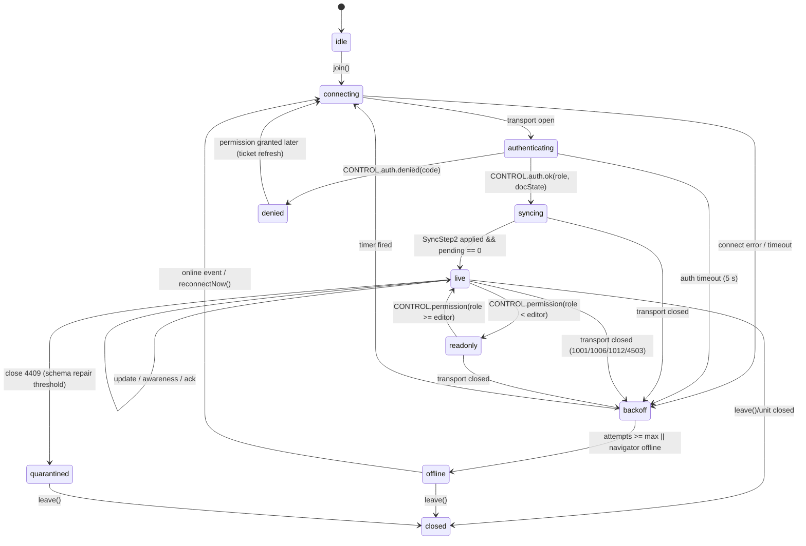
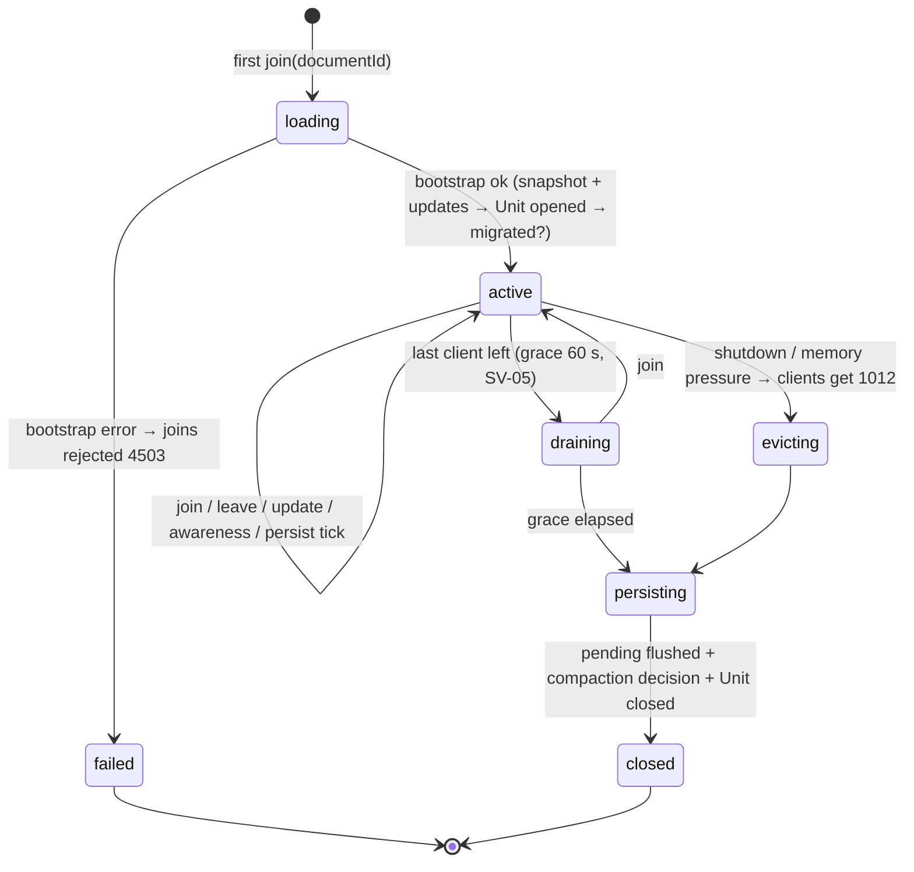

> 状态：草稿 | 负责：架构-运行时 | 更新：2026-09-14 | 依赖：charter v0.1

# 06 协同（Collaboration）：CRDT 映射、同步协议、房间与会话、presence、离线、权限即时性、冲突语义

> 读者：实现 `@oce/store-yjs`、`@oce/collab-core`、`@oce/collab-yjs`、`@oce/collab-transport-ws`、`@oce/server-collab` 的工程师；评审协同语义的产品/设计。
> 章程锚点：D4（Mutation 唯一改 Store）、D5（CRDT 单一事实源）、D6（Snapshot 编解码边界）、D12（fail-closed）、§5.2 包边界、§5.3 规则 4（`yjs`/`y-protocols` 单点引入）、§10 Q3/Q5。
> 相关 ADR：0020（CRDT 选型）、0023（传输与协议）、0024（presence）、0025（update 持久化与压缩）、0032（有序集合的 fractional index）、0033（离线持久化）、0034（服务端校验与修复）、0035（网关横向扩展）。
> 术语：本文只用章程 §4 词表；新增术语见文末「术语补充」。内核/UnitScope 见架构 03；模型与 OOXML 映射见架构 04；命令管线见架构 05——本文不重新定义它们。

---

## 0. 一页总览

```
 浏览器（每个 Unit 一个 UnitScope）                                  服务端（apps/server + server-collab）
 ┌────────────────────────────────────────────────┐                ┌──────────────────────────────────────────┐
 │ commands ──Mutation──► store (store-yjs)        │                │ CollabGateway(Nest, 薄) ─► RoomManager    │
 │                 │ Y.Doc = 唯一事实源             │   WS 帧        │        │ 每个 Room = 服务端 Unit（同一份    │
 │                 │ transact(origin=local)         │◄─────────────►│        │ store-yjs + model-slide 代码）     │
 │  observe ◄──────┤ UndoManager(trackedOrigins)    │  SYNC/AWARE/  │        ├─ 硬门禁：鉴权/权限/大小/速率        │
 │     │           │                                │  CONTROL      │        ├─ 软门禁：schema 校验 → 修复事务      │
 │  render/UI      ▼                                │                │        ├─ 持久化：updates 追加 + 快照压缩    │
 │           yjsBackend ──► collab-yjs(SyncEngine) │                │        └─ 扇出：Redis pub/sub 跨实例        │
 │                              │  awareness       │                │                                          │
 │                   collab-transport-ws(重连/握手) │                │ Postgres: document_updates / snapshots    │
 │                   offline: y-indexeddb(可选)     │                │ Redis: 扇出 / presence / 锁              │
 └────────────────────────────────────────────────┘                └──────────────────────────────────────────┘
```

十条不变量（后文逐条给出机械验证）：

| # | 不变量 | 验证入口 |
|---|---|---|
| I1 | 协同模式下 Y.Doc 是唯一模型；不存在第二份可写模型（A31） | store-yjs 无独立缓存字段；`observe` 只由 Y 事件驱动（单测 + 代码扫描：store-yjs 内禁止 `Map<…, Model>` 类缓存） |
| I2 | 所有修改经 Mutation → `store.transact`；Y 类型对象**不外泄**到 store-yjs 之外（除 `yjsBackend` 给 collab-yjs） | api-extractor 基线：store-yjs 公共 API 不含 `Y.*` 类型（由 09-04 承接） |
| I3 | 撤销只回滚**本地 origin** 的事务 | 单测：远端 update 不进入撤销栈 |
| I4 | 实体以 id 定位，顺序以 fractional key 表达，**禁止数组下标** | Mutation schema 无 `index` 字段（类型测试）；fuzz 收敛 |
| I5 | 服务端与客户端运行同一份 store-yjs/model-slide 代码 | iso 冒烟 + server-headless 加载清单 |
| I6 | 权限 fail-closed 且双点：客户端命令管线 + 服务端网关 | conformance：viewer 发送 update 被拒且连接保活 |
| I7 | 任意 update 顺序、重复、乱序都收敛到同一状态 | collab-sim fuzz |
| I8 | 服务端从不把未校验通过的帧扇出 | 单测：坏帧 → 关闭码 4400，无广播 |
| I9 | 离线期间的修改在恢复后**要么被合并要么被明确告知拒绝**，不静默丢失 | e2e：离线编辑 → 降权 → 重连 → 提示导出 |
| I10 | 房间关闭前所有已确认 update 已落库（at-least-once 持久化） | 单测：kill 进程前的 `ack` 语义；集成：重启后状态相同 |

---

## 1. model-slide 在 Y.Doc 中的结构

### 1.1 设计原则

1. **Store 对文档类型盲**：store-yjs 不认识「幻灯片」，只认识 6 种**值形状**（§1.2；作用于其上的操作是 04 §2.3 的 5 种 `StoreOp`）。model-slide 用这 6 种值形状声明自己的树形 schema（在架构 04 的 `DocumentType` 声明中），store-yjs 与 store-memory 都实现同一原语集，从而满足 M3 验收「store-yjs 替换 store-memory 仅改 preset 配置」。
2. **实体表 + 引用**，不用嵌套数组：所有有身份的东西（slide/layout/master/theme/shape/media）都是 `EntityTable` 中以 id 为键的 `Record`；顺序用 `order` 类型的 fractional key 属性表达（ADR-0032）。
3. **属性粒度 = 用户可独立编辑的最小单位**：任何能被两个用户同时独立修改的属性必须是独立的 Y.Map 键（例如 `xfrm.off.x` 与 `xfrm.ext.cx` 分开），使并发的「移动」与「缩放」都能存活。
4. **富文本用 `Y.XmlFragment`**，段落是元素、文本是带属性的 `Y.XmlText`（§1.4）。
5. **媒体不进 CRDT**：Y.Doc 只存 `BlobRef`（内容哈希 + mime + 尺寸），字节走对象存储（08）。
6. **不透明保留**照常成立：未建模的 XML 子树以字符串放在 `extensions`（`Opaque` 原语）里，随实体一起同步、导出时原样写回（D7）。

### 1.2 存储原语（Store primitives，提请 A 线纳入 04/05 的 `DocumentStore` Definition，草案）

| 原语 | 语义 | store-yjs 映射 | store-memory 映射 | 并发语义 |
|---|---|---|---|---|
| `Record` | 键固定或半固定的对象 | `Y.Map`；嵌套 Record 为嵌套 `Y.Map`；叶子为 JSON 标量 | 不可变对象 | 键级 LWW（Yjs 时钟 + clientID 决定） |
| `EntityTable<Id, Record>` | 以 id 为键的实体集合 | `Y.Map<Id, Y.Map>` | `Map<Id, Record>` | 增删 = 键级；删除胜过并发编辑（delete-wins） |
| `Ordered` | 实体的相对顺序 | 实体 Record 上的 `order: FracKey`（字符串） | 同 | 移动 = 单键 LWW；排序键 `(order, id)` 全序 |
| `RichText` | 段落序列 + 带属性文本 + 内嵌对象 | `Y.XmlFragment` | 段落/run 不可变数组 + 稳定位置表 | 字符级合并（YATA） |
| `BlobRef` | 媒体引用 | JSON `{ sha256, mime, bytes, w?, h? }` 叶子 | 同 | LWW |
| `Opaque` | 不透明保留的 XML/字节 | `string`（XML）或 base64 叶子 | 同 | LWW |

> 由此，`Mutation` 经 `lower()` 只能降为 04 §2.3 的 **5 种 `StoreOp`**（总编排定稿）：`set(path, value)` / `delete(path)` / `insert(path, index, items)` / `remove(path, index, count)` / `text(path, delta)`。有身份实体的移动 = `set(entities/<id>/order, key)`（键由命令层经 `@oce/shared/order` 算出，ADR-0032），因此**没有 `move` 原语**；原子数组极少移动，用 `remove` + `insert`。逆操作由 Store 从原语推导（D4），store-yjs 由 `Y.UndoManager` 实现，store-memory 由不可变快照 diff 实现。

### 1.3 Y.Doc 顶层布局（草案）

```
Y.Doc (guid = unitId)                                 说明
├── meta: Y.Map                                       { schemaVersion: number, docType: 'slide', epoch: 0, createdAt }
│                                                     schemaVersion 与 A 线 D6 的迁移注册表对应；epoch 见 §9.4
├── presentation: Y.Map                               根 Record
│   ├── slideSize: Y.Map { cx: Emu, cy: Emu, type? }
│   ├── notesSize: Y.Map
│   ├── defaultTextStyle: string(Opaque)              a:defaultTextStyle 原样保留（M1–M3 不编辑）
│   ├── sectionList?: Y.Map<SectionId, Y.Map>         节（order + name + slideIds 由 slide.sectionId 反推）
│   └── extensions: Y.Map<string, string>             p:presentation 下未建模子树（Opaque）
├── themes:   Y.Map<ThemeId,  Y.Map>                  a:theme（clrScheme/fontScheme/fmtScheme 建模为 Record；其余 Opaque）
├── masters:  Y.Map<MasterId, Y.Map>                  { themeId, clrMap, txStyles(Opaque), shapes: EntityTable, background, extensions }
├── layouts:  Y.Map<LayoutId, Y.Map>                  { masterId, type, name, shapes: EntityTable, showMasterSp, extensions }
├── slides:   Y.Map<SlideId,  Y.Map>                  见 1.3.1
├── notes?:   Y.Map<NotesId,  Y.Map>                  备注页（M1 保留，M3 可编辑文本）
├── media:    Y.Map<MediaId,  Y.Map>                  { ref: BlobRef, originalPartName }；MediaId = sha256 前 16 hex
└── resources: Y.Map<string, Y.Map>                   ResourceHook 数据；键为 `${pluginId}.${string}`（见架构 04）
```

#### 1.3.1 slide 实体（草案）

```
slides/<SlideId>: Y.Map
├── id: SlideId                        与键相同，便于 observe 时定位
├── order: FracKey                     幻灯片顺序（ADR-0032）
├── layoutId: LayoutId
├── sectionId?: SectionId
├── show: boolean                      p:sld/@show（隐藏页）
├── background?: Y.Map                 { fill: Y.Map(Record), extensions }
├── clrMapOvr?: Y.Map
├── timing?: string(Opaque)            动画/切换：M1–M3 只保留（章程 Q7）
├── transition?: string(Opaque)
├── shapes: Y.Map<ShapeId, Y.Map>      **扁平**实体表：组合的子形状也在此表中，用 parentId 表达层级
└── extensions: Y.Map<string, string>
```

#### 1.3.2 shape 实体（草案，kind 为开放字符串，见 `slide.shapeKind` 贡献点/架构 04）

```
slides/<SlideId>/shapes/<ShapeId>: Y.Map
├── id: ShapeId
├── kind: 'sp' | 'pic' | 'grpSp' | 'cxnSp' | 'graphicFrame' | <第三方 kind>
├── parentId: ShapeId | null           null = 直接位于 spTree 下；否则为 grpSp 的 id
├── z: FracKey                         同一 parent 内的绘制顺序（z-order）
├── nv: Y.Map                          { name, descr, hidden, placeholder?: { type, idx, orient, sz }, hlinkClick(Opaque) }
├── xfrm: Y.Map                        { off: Y.Map{x,y}, ext: Y.Map{cx,cy}, rot, flipH, flipV, chOff?, chExt? }   叶子独立键
├── geom: Y.Map                        { preset?: string, adj: Y.Map<string, number>, custom?: string(Opaque) }
├── fill: Y.Map                        Record（solid/gradient/pattern/blip/none；blip 引用 MediaId）
├── ln: Y.Map                          线型 Record
├── effects?: string(Opaque)           a:effectLst / a:scene3d：M1–M3 保留
├── style?: Y.Map                      a:style 引用（lnRef/fillRef/effectRef/fontRef）
├── txBody?: Y.Map                     { bodyPr: Y.Map, lstStyle: string(Opaque), text: Y.XmlFragment }   见 1.4
├── pic?: Y.Map                        { mediaId, srcRect, extensions }
├── graphic?: Y.Map                    graphicFrame 内容：{ uri, table?: Y.Map(建模), chart?: string(Opaque, M3 起建模数据), ole?: Opaque }
├── cxn?: Y.Map                        { stCxn: {id, idx}, endCxn }
└── extensions: Y.Map<string, string>
```

> 备注：把组合的子形状**扁平化**到同一 `shapes` 表（而非嵌套在 grpSp 内）的原因：(1) 进/出组只是改 `parentId` 一个键，天然支持并发；(2) observe 事件路径深度固定，dirty 追踪简单；(3) 避免 Yjs 深嵌套类型在整组删除时的事件爆炸。代价是需要一个「父子环检测与修复」（§8 冲突 #5）。

### 1.4 富文本：Run/Paragraph → `Y.XmlFragment`

```
txBody.text: Y.XmlFragment
└── <p> : Y.XmlElement('p')                 每个 a:p 一个元素；属性 = pPr 的标量（algn、lvl、indent、marL、bullet(JSON 字串)、
    │                                        spcBef/spcAft/lnSpc、endParaRPr(JSON 字串)、x(Opaque 字串：未建模 pPr 子树)）
    └── Y.XmlText                            段落正文；a:r 折叠为**带属性的文本区间**（属性 = rPr：b/i/u/strike/sz/baseline/spc/kern/lang、
                                             latin/ea/cs/sym 字体、fill(JSON 字串)、hlink(JSON 字串)、x(Opaque)）
                                             a:br → insertEmbed({ br: 1 })；a:fld → insertEmbed({ fld: { type, id, text } })
                                             a14:m / mc:AlternateContent 等 → insertEmbed({ opaque: '<xml…>' })
```

选择 `Y.XmlFragment` 而非「`Y.Text` + `\n` 携带段落属性」（Quill 惯例）的理由：段落拥有元素身份，段落属性不寄生在换行字符上（分段/合段时属性不漂移）；与 OOXML `a:p/a:r` 一一对应，编解码无歧义；`Y.RelativePosition` 可同时定位段落元素与字符偏移（用于光标与评论锚点）；若未来接入 ProseMirror，`y-prosemirror` 直接可用。代价：每段约多 ~40 B 的结构开销（200 页 × 30 段 = 6000 段 ≈ 240 KB，可接受）。详见 ADR-0020 §富文本。

**编辑操作 → Y 操作**（store-yjs `mapping/rich-text.ts` 实现）：`text.insert(path, pos, str, attrs)` → `XmlText.insert`；`text.format(path, range, attrs)` → `XmlText.format`；`splitParagraph(path, pos)` → 新建 `<p>` 元素 + 移动尾部文本（删除 + 插入，携带属性）；`mergeParagraph` 对称。**已知限制**：分段时被移动的尾部文本若被他人并发格式化，格式化落在已删除文本上而丢失（与 y-prosemirror 相同的取舍，见 §8 冲突 #8）。

### 1.5 属性值的编码规则

| 值类型 | 编码 | 理由 |
|---|---|---|
| 标量（数、布尔、枚举字串、品牌单位 `Emu`/`Pt`） | 直接 JSON 叶子 | LWW 粒度最细 |
| 小型复合值且总是整体替换（颜色、字体引用、超链接） | JSON **字符串**（稳定序列化：键排序） | 避免为每个颜色建 Y.Map 的开销；并发时整体 LWW 符合用户预期 |
| 用户可分别编辑的复合值（xfrm、fill、ln、bodyPr） | 嵌套 `Y.Map` | 并发独立编辑存活 |
| 未建模 XML | 字符串（原始 XML，命名空间归一化后） | D7 |
| 二进制 | 不进 Y.Doc；`BlobRef` | 体积 |

**机械验证**：`@oce/model-slide/testing` 导出 schema → 类型测试断言 `EntityTable` 值中不出现 `Array<Entity>`；扫描器（09-06）检查 Mutation schema 无 `index` 字段。

---

## 2. `@oce/store-yjs`：DocumentStore Provider

### 2.1 职责与边界

- **唯一** import `yjs` 的模型侧包；对外 API 不暴露 `Y.*` 类型（api-extractor 基线守护）。
- 为每个 Unit 提供 `store`（UnitScope 内），并额外提供 `yjsBackend` 服务（同 UnitScope）给 `collab-yjs` 使用——这是 Provider 间**受控的**类型依赖（章程 §5.2 已允许 collab-yjs 依赖 store-yjs）。
- 一个 Unit 一个 Fiber（插件由 preset 在 UnitScope 内加载），Y.Doc 归该 Fiber 的 effect 所有：Unit 关闭 → `doc.destroy()`。

### 2.2 `DocumentStore` 契约在 store-yjs 中的实现要点（签名级草案；契约本身由 A 线在 04/05 定义）

```ts
// 草案：store-yjs 期望的 DocumentStore 表面（提请 A 线在 model-core 中定型）
interface DocumentStore {
  readonly kind: string                                    // 'yjs' | 'memory'
  transact<T>(fn: (tx: StoreTx) => T, meta: TransactionMeta): T
  observe(listener: (change: ChangeSet) => void): Disposable  // 由 ctx.effect 拥有
  get<T>(path: StorePath): T | undefined
  undo(scope?: UndoScope): boolean;  redo(scope?: UndoScope): boolean
  canUndo(): boolean;  canRedo(): boolean
  createStablePosition(path: StorePath, offset: number): StablePosition   // Yjs: RelativePosition
  resolveStablePosition(pos: StablePosition): { path: StorePath; offset: number } | null
  exportSnapshot(): Snapshot;  importSnapshot(s: Snapshot): void        // D6 边界
}
interface TransactionMeta {
  origin: TransactionOrigin        // { kind: 'local', txnId, commandId, actor } | { kind: 'remote' } | { kind: 'undo' | 'redo' } | { kind: 'repair', by: 'server' } | { kind: 'import' | 'migration' }
  undoable: boolean
}
interface ChangeSet {
  origin: TransactionOrigin; local: boolean
  paths: readonly StorePath[]          // 变更的最小路径集合（去重、父路径合并），供 07 的脏区追踪消费
  entities: { added: EntityRef[]; removed: EntityRef[]; reordered: EntityRef[] }
}
```

- `transact`：包装 `doc.transact(fn, origin)`。`origin` 对象即 Yjs 事务的 origin，`UndoManager.trackedOrigins` 只包含本 Unit 的 `local` origin **类**（用 class 标识，而非对象实例，避免每个事务一个 origin 实例无法被 Set 命中的经典错误）。
- `observe`：`doc.on('afterTransaction')` → 把 `transaction.changed`/`changedParentTypes` 转为 `ChangeSet.paths`（`mapping/change-set.ts`）。**不**为每个 Y 类型单独 `observeDeep`（避免 O(类型数) 的监听器）。
- `undo/redo`：`Y.UndoManager({ trackedOrigins, captureTimeout: 500 })`，作用域为整份 Y.Doc（除 `resources.<presence-like>` 这类不该撤销的命名空间，通过 `UndoManager` 的 `scope` 参数排除）。`history` 服务（A 线，UnitScope）只是它的薄门面；`store.undo()` 返回是否发生了变化。
- 撤销粒度对齐事务：命令管线一个 Command = 一个 `transact`；连续键入由 `captureTimeout` 合并；拖拽由命令层显式用同一 `txnGroup`（A 线契约：`TransactionMeta.group?: string`，store-yjs 用 `UndoManager.stopCapturing()` 边界实现）。
- `createStablePosition`：`Y.createRelativePositionFromTypeIndex(xmlText, offset)` → base64；用于本地光标、远端光标（awareness）与评论锚点（08）。
- `importSnapshot`：只允许在**空** Y.Doc 上调用（导入/服务端 bootstrap），否则抛 `store.snapshot_import_on_nonempty`；Snapshot 保留 `order: FracKey` 键（ADR-0013 第 7 条），原样写入，不做数组转换。

### 2.3 `yjsBackend` 服务（供 collab-yjs，草案）

```ts
interface YjsBackend {
  encodeStateVector(): Uint8Array
  encodeStateAsUpdate(targetVector?: Uint8Array): Uint8Array   // V2 编码
  applyUpdate(update: Uint8Array, origin: TransactionOrigin): void
  onUpdate(listener: (update: Uint8Array, origin: TransactionOrigin) => void): Disposable  // 只回调非 remote 的 update
  awareness(): AwarenessHandle       // 由 collab-yjs 创建后挂回（y-protocols/awareness 需要 doc）
  stats(): { structs: number; deletedStructs: number; bytes: number }   // 供 telemetry
}
```

### 2.4 目录结构（`packages/store-yjs/`）

```
packages/store-yjs/
├── package.json                      exports: "." 与 "./testing"；dependencies: yjs（唯一）、@oce/model-core、@oce/shared
├── src/
│   ├── index.ts                      re-export 插件、Config、YjsBackend 类型、encode/decode 工具（不含 Y.* 类型）
│   ├── plugin.ts                     函数插件 name='store-yjs'；inject=['units']（读取当前 Unit 元数据）；provide=['store','yjsBackend']；
│   │                                 apply：ctx.effect 创建 Y.Doc({guid: unitId, gc: config.gc}) → 注册两个 Service → 返回 doc.destroy
│   ├── manifest.ts                   Manifest：provides ['store','yjsBackend']、injects、iso class 'iso'
│   ├── config.ts                     zod Config：{ gc: true, undo: { captureTimeout: 500, excludedNamespaces: [] }, maxDocBytes: 64 MiB }
│   ├── store.contribution.ts         declare module '@oce/kernel' { interface Context { yjsBackend: YjsBackend } }（store 由 model-core 声明）
│   ├── services/
│   │   ├── yjs-document-store.service.ts   DocumentStore Provider（extends Service，name 'store'）：transact/observe/get/undo/redo/stablePosition/snapshot
│   │   └── yjs-backend.service.ts          YjsBackend Provider（name 'yjsBackend'）
│   ├── mapping/
│   │   ├── primitives.ts             6 种值形状 ↔ Y 类型的构造与读取；FracKey 比较器（键的生成在命令层，来自 @oce/shared/order）
│   │   ├── paths.ts                  StorePath（['slides', id, 'shapes', sid, 'xfrm', 'off', 'x']）↔ Y.AbstractType 定位；路径规范化与父路径折叠
│   │   ├── mutations.ts              原语操作 → 事务内的 Y 操作；批量应用；对不存在目标的操作返回 Result.err('store.target_missing')
│   │   ├── rich-text.ts              RichText 操作 → Y.XmlFragment/Y.XmlText；embed 编解码；分段/合段；RelativePosition 编解码
│   │   ├── change-set.ts             Y.Transaction → ChangeSet（paths、entities）；合并父路径；标注 local/origin
│   │   └── snapshot.ts               Snapshot(JSON, schemaVersion) ↔ Y.Doc；数组 → FracKey；导出时按 (order, id) 排序
│   ├── undo/
│   │   └── undo-manager.ts           Y.UndoManager 封装：origin 类判定、captureTimeout、txnGroup 边界、栈变化事件 → 'store/history-changed'
│   ├── origin.ts                     TransactionOrigin 类（LocalOrigin/RemoteOrigin/UndoOrigin/RepairOrigin/ImportOrigin）与 isLocal()
│   ├── encoding.ts                   V2 update/state vector 薄封装；mergeUpdates；diffUpdate；不导出 Y 类型
│   ├── limits.ts                     文档体积/结构数守卫：超过 maxDocBytes 触发 'store/limit-exceeded' 与 errors 上报（不阻断）
│   ├── errors.ts                     错误码：store.target_missing / store.snapshot_import_on_nonempty / store.limit_exceeded / store.invalid_path
│   └── __tests__/
│       ├── conformance.test.ts       运行 @oce/model-core/testing 的 DocumentStore conformance kit（所有 Provider 必过，见 11）
│       ├── mapping.paths.test.ts     路径定位/规范化
│       ├── rich-text.test.ts         run 折叠、embed、分段/合段、RelativePosition 稳定性（并发插入后仍指向同一字符）
│       ├── undo-origin.test.ts       远端 update 不入栈；captureTimeout 合并；txnGroup
│       ├── convergence.test.ts       两 Doc 随机原语操作、乱序交换 update 后状态相等
│       ├── snapshot-roundtrip.test.ts Snapshot → Doc → Snapshot 幂等（顺序保持）
│       └── lifecycle.test.ts         Fiber 卸载后 getEffects() 为空；两个 Unit 的 store 互不可见（isolate）
└── testing/
    ├── index.ts                      `@oce/store-yjs/testing`：createLinkedStores(n)（进程内 n 个 store 通过内存管道交换 update）、
    │                                 applyUpdatesShuffled、YjsStoreHarness（可注入时钟/clientID 便于确定性测试）
    └── fixtures/                     小型 Snapshot 样本（空演示、3 页、含组合/表格/富文本）
```

---

## 3. `@oce/collab-core`：Definition

### 3.1 服务与契约（签名级草案）

```ts
// ctx.collab（根作用域服务，管理各 Unit 的 Session）
interface CollabService {
  join(unitId: UnitId, opts: JoinOptions): Session          // 幂等：同 Unit 重复 join 返回同一 Session
  leave(unitId: UnitId): Promise<void>
  session(unitId: UnitId): Session | undefined
}
interface Session {
  readonly state: SessionState                              // 见 §5 状态机；变化触发 'collab/session-state'
  readonly role: Role                                       // 来自服务端 auth.ok / permission 帧（@oce/protocol Role）
  readonly stats: SessionStats                              // pendingLocalUpdates、lastSyncedAt、bytesIn/Out、rtt
  flush(): Promise<void>                                    // 等待本地 pending 全部被服务端 ack（用于「关闭前保存」）
  reconnectNow(): void
  close(): Promise<void>
}
// ctx.presence（UnitScope 服务）
interface PresenceService {
  setLocal(patch: Partial<PresenceState>): void             // 节流由 Provider 做
  readonly local: PresenceState
  readonly remotes: ReadonlyMap<ClientId, PresenceState>    // 反应式；变化触发 'presence/changed'
}
// ctx.collabTransport（根作用域，可替换：ws / webrtc / memory）
interface CollabTransport {
  connect(target: TransportTarget, ticket: string, signal: AbortSignal): Promise<Connection>
}
interface Connection {
  send(frame: Uint8Array): void                             // 背压：返回前不阻塞；超过 outboundHighWater 触发 'collab/backpressure'
  onFrame(listener: (frame: Uint8Array) => void): Disposable
  onClose(listener: (code: number, reason: string) => void): Disposable
  close(code?: number, reason?: string): void
}
// SyncEngine（CRDT 相关的同步逻辑，collab-yjs 实现；transport/gateway 对其不可知）
interface SyncEngine {
  initialFrames(): Uint8Array[]                              // Yjs: SyncStep1 + 本地 awareness
  handleInbound(payload: Uint8Array): SyncOutcome           // 返回需回发的帧与「是否已同步」
  onLocalUpdate(listener: (payload: Uint8Array) => void): Disposable
}
// OfflineStore（可选 Provider；缺失时降级为「仅内存」）
interface OfflineStore { load(unitId): Promise<Uint8Array | null>; append(unitId, update): Promise<void>; compact(unitId, state): Promise<void>; clear(unitId): Promise<void> }
```

事件（在 `collab.contribution.ts` 中 `declare module '@oce/kernel'`）：`collab/session-state(unitId, prev, next)`（定稿名 `collab/state-changed`，10 §11）、`collab/synced(unitId)`、`collab/rejected(unitId, code, count)`（定稿名 `collab/update-rejected`）、`collab/backpressure(unitId, queued)`、`presence/changed(unitId, clientId | null)`。权限变更事件 `permission/changed` **不由 collab 发出**：由 `permissions` 服务在 `applyRemoteDecisions` 之后唯一发出（§18.3；原草稿 `collab/permission-changed` 弃用）。

### 3.2 目录结构（`packages/collab-core/`）

```
packages/collab-core/
├── package.json                      exports "." "./testing"；deps: @oce/model-core @oce/protocol @oce/kernel @oce/shared（无 yjs）
├── src/
│   ├── index.ts
│   ├── collab.contribution.ts        Context 增强（collab/presence/collabTransport/offlineStore）+ Events 增强
│   ├── contracts/
│   │   ├── collab.service.ts         CollabService/Session/JoinOptions/SessionStats
│   │   ├── session-state.ts          SessionState 联合类型 + 事件类型 + 允许的转换表（纯数据）
│   │   ├── transport.ts              CollabTransport/Connection/TransportTarget；背压水位常量
│   │   ├── sync-engine.ts            SyncEngine/SyncOutcome
│   │   ├── presence.ts               PresenceState schema（zod，来自 @oce/protocol 的 AwarenessState）与 PresenceService
│   │   ├── offline.ts                OfflineStore
│   │   └── permission-gate.ts        PermissionGate：把网关 Role/能力位映射为 `permissions.applyRemoteDecisions(decisions)` 的入参（权限进入客户端的唯一入口）；事件 `permission/changed` 由 permissions 发出
│   ├── fsm/
│   │   └── session-fsm.ts            reduce(state, event) → { next, effects[] }（无 IO，effects 为描述对象，由 Provider 执行）
│   ├── backoff.ts                    指数退避 + 抖动 的纯函数（transport 与 room 复用）
│   ├── errors.ts                     collab.* 错误码声明（见 10）
│   └── __tests__/session-fsm.test.ts / backoff.test.ts
└── testing/
    ├── index.ts                      `@oce/collab-core/testing`：runCollabConformance(factory)（对任一 CollabService Provider 的一致性套件）、
    │                                 MemoryTransport（进程内、可注入延迟/乱序/丢包/断线）、FakeTicketIssuer
    └── scenarios/                    conformance 用例脚本：join→synced、断线重连、离线队列、降权拒写、房间满、schema 过新
```

---

## 4. `@oce/collab-yjs` 与 `@oce/collab-transport-ws`：Provider

### 4.1 collab-yjs 的运行时装配（每个 Unit）

```
UnitScope(unit U)
 ├── store-yjs          provide store, yjsBackend
 ├── collab-yjs         inject ['store','yjsBackend','collabTransport','permissions','telemetry']（可选 ctx.get('offlineStore')）
 │    ├── YjsSyncEngine     y-protocols/sync：readSyncMessage / writeSyncStep1 / writeUpdate；applyUpdate(origin=RemoteOrigin)
 │    ├── AwarenessAdapter  y-protocols/awareness：Awareness(doc)；本地状态节流；远端状态 zod 清洗后进 presence
 │    ├── LocalBatcher      yjsBackend.onUpdate → 50 ms 内 Y.mergeUpdates → 一帧发送；离线时写 OfflineStore
 │    ├── PermissionGate    role < editor 时**本地拦截** outbound update（并触发 'collab/rejected'）；接收 CONTROL.permission 帧更新 permissions
 │    └── SessionDriver     执行 session-fsm 的 effects：connect/send/schedule/backoff/notify
 └── collab-transport-ws   provide collabTransport（根作用域也可）
```

### 4.2 目录结构（`packages/collab-yjs/`）

```
packages/collab-yjs/
├── package.json                      deps: yjs, y-protocols, @oce/collab-core, @oce/store-yjs, @oce/protocol
├── src/
│   ├── index.ts
│   ├── plugin.ts                     name='collab-yjs'；inject 如上；provide=['collab'（根）,'presence'（Unit）]；apply 里全部资源走 ctx.effect
│   ├── manifest.ts
│   ├── config.ts                     zod：{ flushMs: 50, awareness: { cursorHz: 20, stateHz: 2, timeoutMs: 30000 }, maxUpdateBytes: 1 MiB,
│   │                                       outboundHighWater: 200, offline: { enabled: true, maxBytes: 50 MiB } }
│   ├── services/
│   │   ├── yjs-collab.service.ts     CollabService Provider：Session 创建、SessionDriver、与 transport/offline 协调、stats
│   │   └── yjs-presence.service.ts   PresenceService Provider：基于 AwarenessAdapter；RelativePosition 光标编码；节流
│   ├── sync/
│   │   ├── yjs-sync-engine.ts        SyncEngine 实现（step1/step2/update）；「已同步」判定 = 收到 step2 且本地 pending 为空
│   │   ├── frame-codec.ts            @oce/protocol 信封（type 字节 + payload）↔ y-protocols 负载（lib0 encoding）；CONTROL JSON zod 解析
│   │   └── local-batcher.ts          合并/节流/背压；ack 追踪（服务端 CONTROL.ack{seq}，见 §6.4）
│   ├── awareness/
│   │   ├── awareness-adapter.ts      Awareness 生命周期（随 Fiber）；远端状态 schema 校验，非法状态丢弃并计数
│   │   └── cursor-codec.ts           选区/光标 ↔ RelativePosition base64
│   ├── offline/
│   │   └── offline-queue.ts          OfflineStore 之上的队列：启动时 load → applyUpdate(origin=LocalOrigin 重放，不入撤销栈)；synced 后 compact
│   ├── permission/
│   │   └── permission-gate.ts        CONTROL.permission → `permissions.applyRemoteDecisions(decisions)`（唯一入口）；outbound 拦截；不自发权限事件
│   ├── errors.ts
│   └── __tests__/
│       ├── conformance.test.ts       runCollabConformance(用 MemoryTransport + 内存 server 模拟)
│       ├── sync-engine.test.ts       step1/step2/update 与 y-websocket 参考实现帧互操作
│       ├── batcher.test.ts           50 ms 合并、背压事件、ack 回收
│       ├── awareness.test.ts         节流、超时清理、非法状态清洗
│       ├── permission-gate.test.ts   降权后本地拦截、升权恢复、事件顺序
│       ├── offline-queue.test.ts     离线积累 → 重连合并；拒绝路径保留可导出
│       └── lifecycle.test.ts         多 Unit 并存；卸载无 effect；Provider 替换（memory transport ↔ ws）
└── testing/
    └── index.ts                      `@oce/collab-yjs/testing`：createCollabCluster(n, networkModel)（n 个客户端 + 内存服务端）、NetworkModel
```

### 4.3 目录结构（`packages/collab-transport-ws/`）

```
packages/collab-transport-ws/
├── package.json                      deps: @oce/collab-core @oce/protocol；iso：使用全局 WebSocket（Node ≥ 22 内建），不依赖 ws 包
├── src/
│   ├── index.ts
│   ├── plugin.ts                     provide=['collabTransport']；Config 校验（url 模板、超时、退避）
│   ├── manifest.ts
│   ├── config.ts                     zod：{ urlTemplate: 'wss://{host}/collab/v1/rooms/{documentId}', connectTimeoutMs: 5000,
│   │                                       backoff: { baseMs: 1000, maxMs: 30000, jitter: 0.2, maxAttemptsBeforeOffline: 6 }, heartbeatMs: 15000 }
│   ├── ws-transport.service.ts       CollabTransport Provider：connect → 握手（handshake.ts）→ Connection；binaryType='arraybuffer'
│   ├── handshake.ts                  发送 CONTROL.auth{ticket, protocolVersion, clientId, capabilities} → 等待 auth.ok / auth.denied（5 s 超时）
│   ├── heartbeat.ts                  应用层 ping/pong（CONTROL.ping）用于浏览器不可见的 WS ping；2 次未响应即判死
│   ├── reconnect.ts                  使用 collab-core/backoff；online/offline 事件钩子（可注入，iso 安全）
│   ├── errors.ts                     transport.*（connect_timeout、auth_timeout、closed_by_server{code}）
│   └── __tests__/                    用 devDependency `ws` 起本地服务端；断线/超时/退避/握手拒绝
```

---

## 5. 房间（Room）与会话（Session）生命周期

### 5.1 客户端 Session 状态机（collab-core `session-fsm.ts`，Provider 执行 effects）



- **本地编辑在任何非 `closed` 状态下都允许**（含 `offline`/`backoff`），前提是 `role ≥ editor`；`readonly`/`denied` 下 `permissions` 快照使 commands 管线拒绝 Mutation（D12 客户端检查点）。
- `syncing` 期间用户已可编辑（先应用 HTTP bootstrap 快照，见 §9.1），本地 update 进入 pending 队列，`live` 后冲刷。
- 每次状态变化：`ctx.emit('collab/session-state', …)` + telemetry 计数 `oce_collab_session_transitions_total{from,to}`。

### 5.2 服务端 Room 状态机（server-collab `RoomManager`）



- 一个 Room = 服务端 cordis 宿主里的一个 **Unit**（同一份 store-yjs + model-slide 代码；D5/D8），因此 schema 校验、修复、迁移与客户端行为一致。
- `loading` 的 bootstrap：读最新快照（`document_snapshots`）+ 其后 `document_updates` → `applyUpdate` 逐条 → 若 `meta.schemaVersion < 当前` 则在 Redis 锁 `collab:migrate:{doc}` 下运行迁移事务（origin=`migration`）并立即落一个 `kind:'migration'` 快照。
- 预算：8 MB 状态的 bootstrap ≤ 500 ms（p95）；测量：span `server.room.load`。

### 5.3 时序：加入 → 同步 → 编辑 → 离开（正常路径）

```
Client                              Gateway/Room                              Postgres/Redis
  │ GET /documents/:id/snapshots/latest (HTTP, ETag)                              │
  │◄────────── 200 state(V2, zstd) ────────────────────────────────────────────────│
  │ importState(local)                                                            │
  │ POST /documents/:id/collab-ticket ──► ticket(60 s)                            │
  │ WS connect /collab/v1/rooms/:id                                               │
  │ ── CONTROL.auth{ticket} ─────────►│ verify(JWT) → role → room.join            │
  │◄── CONTROL.auth.ok{sessionId, role, serverSeq} ──│                            │
  │ ── SYNC step1(sv) ───────────────►│                                           │
  │◄── SYNC step2(diff) ──────────────│                                           │
  │ ── SYNC step1 (server asks) ◄─────│                                           │
  │ ── SYNC step2(diff of local pending) ──►│ apply → validate → persist ─────────►│ INSERT document_updates
  │◄── CONTROL.ack{seq} ──────────────│ publish collab:doc:{id} ─────────────────►│ Redis
  │ ── AWARENESS(local) ─────────────►│ fan-out                                   │
  │◄── SYNC update / AWARENESS (others)│                                          │
  │ … edit: SYNC update ────────────► │ … 同上                                    │
  │ close(1000)                       │ leave → draining(60 s) → persisting        │
```

---

## 6. 同步协议帧（复用 y-protocols；信封定义在 `@oce/protocol`）

### 6.1 决策

- **复用 y-protocols** 的 sync（`messageYjsSyncStep1/2`、`messageYjsUpdate`）与 awareness 编码，不自造 CRDT 同步；理由：与 y-websocket/Hocuspocus 生态互操作、经过生产验证、编码紧凑（lib0）。
- **自定义信封与控制面**：y-protocols 不覆盖鉴权、权限、ack、错误、房间控制。信封与 CONTROL 消息在 `@oce/protocol` 定义（protocol 是 L0、不 import y-protocols：sync/awareness 的 payload 对 protocol 是 `Uint8Array` 不透明体，由 collab-yjs/server-collab 解码）。详见 ADR-0023。

### 6.2 二进制信封（`@oce/protocol/src/collab/frame.ts`，草案）

```
byte 0        : FrameType   0x00 SYNC | 0x01 AWARENESS | 0x02 CONTROL | 0x03 QUERY_AWARENESS
byte 1..      : payload
  SYNC        : y-protocols sync 编码（varUint msgType: 0 step1 | 1 step2 | 2 update）
  AWARENESS   : y-protocols awareness 编码
  CONTROL     : UTF-8 JSON，schema = ControlMessage（zod 判别联合，见 6.3）
```

与 y-websocket 的 `messageSync=0 / messageAwareness=1 / messageAuth=2 / messageQueryAwareness=3` 保持编号一致（我们把 2 泛化为 CONTROL），便于用现成客户端做互操作测试。

### 6.3 CONTROL 消息（zod 判别联合 `type`，草案）

| 方向 | type | 字段 | 说明 |
|---|---|---|---|
| C→S | `auth` | `ticket, protocolVersion: 1, clientId: number(Yjs clientID), capabilities: string[], appVersion` | 连接后首帧；5 s 内未到 → 关闭 4408 |
| S→C | `auth.ok` | `sessionId, role, serverSeq, schemaVersion, limits{maxUpdateBytes, updateRateHz}, serverTime` | 成功后客户端才发 SYNC |
| S→C | `auth.denied` | `code: 'collab.unauthenticated' \| 'collab.forbidden' \| 'collab.doc_not_found' \| 'collab.schema_too_new' \| 'collab.room_full'` | 之后关闭 4401/4403/4404/4426/4503 |
| S→C | `permission` | `role, reason: 'granted' \| 'revoked' \| 'changed', permVersion` | 权限即时生效（§10） |
| S→C | `ack` | `seq: number, count: number` | 服务端**已持久化**的最大 seq（at-least-once 保证的可观察点） |
| S→C | `error` | `code, retryable, details?` | 非致命错误（例如单个 update 被拒） |
| S→C | `repair` | `reason, paths[]` | 服务端发出修复事务时通知（§11） |
| C↔S | `ping` / `pong` | `t` | 应用层心跳 |
| S→C | `room` | `clients: number, draining?: boolean` | 房间元信息（用于 UI「N 人在线」的权威值） |

所有 CONTROL 消息经 zod `parse`（D2）；解析失败 → 4400 并记录 `collab.bad_frame`。

### 6.4 ack 与 at-least-once 持久化

- 客户端为每个发出的 update 帧分配本地 `localSeq`；服务端在持久化（INSERT 提交）后回 `ack{seq}`；客户端据此清理 OfflineStore 中的已确认段并统计 `pendingLocalUpdates`。
- `Session.flush()` = 等待 `pending == 0`；关闭页面前由 UI 调用（`beforeunload` 提示）。
- 服务端崩溃于「已广播未落库」窗口：其他客户端已应用该 update 但库中缺失 → 它们下次同步时 step1/step2 会把该内容回填给服务端（CRDT 幂等），因此**最终不丢**；只有当所有持有该 update 的客户端都消失时才丢，故要求：广播前先落库（默认），或在配置 `persistBeforeBroadcast=false`（低延迟模式）时接受这一窄窗口。默认 `true`。

### 6.5 关闭码约定（`@oce/protocol/src/collab/close-codes.ts`）

| 码 | 含义 | 客户端行为 |
|---|---|---|
| 1000 | 正常 | closed |
| 1001/1006 | 网络/对端离开 | backoff 重连 |
| 1012 | 服务重启/驻留实例驱逐 | 立即重连（不退避首轮） |
| 4400 | 坏帧 | 上报 bug，重连（计数超 3 次进入 quarantined） |
| 4401 | 未认证/票据过期 | 换票据重连 |
| 4403 | 无权限 | denied（监听权限变化） |
| 4404 | 文档不存在/已删除 | closed + 提示 |
| 4408 | 认证超时 | 重连 |
| 4409 | 被隔离（重复触发修复） | quarantined，提示刷新 |
| 4413 | 帧过大 | 丢弃该 update 到「未同步更改」并提示 |
| 4426 | schema 过新（客户端需升级） | 提示刷新 |
| 4429 | 速率限制 | 退避后重连 |
| 4503 | 房间不可用/满/draining | 退避重连 |

---

## 7. Awareness / Presence 模型（详见 ADR-0024）

### 7.1 状态 schema（`@oce/protocol/src/collab/awareness.ts`，zod，草案）

```ts
interface AwarenessState {
  v: 1
  user: { id: UserId; name: string; color: string; avatar?: string }
  client: { id: number; device: 'desktop' | 'tablet' | 'phone'; appVersion: string }
  view?: { slideId: SlideId; zoom?: number }                        // Operation（视图状态）的广播形态
  selection?: { slideId: SlideId; shapeIds: ShapeId[] }
  caret?: { shapeId: ShapeId; anchor: string; head: string }        // RelativePosition(base64)
  editing?: ShapeId                                                 // 正在文本编辑的形状（用于「锁定提示」而非锁）
  idle?: boolean
  ts: number                                                        // 客户端时间，仅用于排序显示
}
```

- 大小上限 2 KiB/状态；服务端对超限或 schema 非法的 awareness 帧**丢弃**并计数（不关闭连接）。
- 频率：`caret`/`selection` 变化最多 20 Hz；`view` 等 2 Hz；`idle` 在 60 s 无输入后置位。awareness 超时 30 s（y-protocols 默认）→ 服务端也在会话断开时主动广播「移除」。
- Presence 服务是 UnitScope 服务，UI 覆盖层（07 §7）与设计 20-design/05 消费 `presence.remotes`。
- 不持久化、不审计内容（只审计 join/leave）。

### 7.2 「软锁」语义

文本编辑不加锁（Yjs 字符级合并），但 UI 显示「X 正在编辑」（来自 `editing`）；形状拖拽亦不加锁，靠 LWW 收敛。产品若要求「排他编辑」，可作为可选插件基于 awareness + 服务端仲裁实现，不在 M3 范围（待决事项 P1）。

---

## 8. 软冲突语义（并发但无「冲突错误」；全部自动收敛）

| # | 场景 | 原语层结果 | 用户可见结果与缓解 |
|---|---|---|---|
| 1 | A、B 同时把形状 S 移到不同位置（`xfrm.off`） | 两键 LWW，B（更晚时钟/更大 clientID）胜 | A 看到 S 「跳」到 B 的位置；无提示（与主流编辑器一致） |
| 2 | A 删除形状 S，B 同时编辑 S 文本 | `delete`（实体）胜；B 的 `XmlText` 插入落在已删类型上被丢弃 | B 端：在 observe 到 `removed` 且本地 60 s 内有对 S 的本地事务 → UI 提示「元素已被 A 删除」+「恢复为新元素」（用 B 端保留的 S 的最后快照，以新 id 重新插入；这是新 Mutation 而非撤销） |
| 3 | A 删除幻灯片 P，B 在 P 中新增形状 | P 被删；B 的形状随之消失 | 同 #2 的提示，粒度为页；「恢复此页」把 P 的最后快照以新 id 重新插入到相邻位置 |
| 4 | A、B 都在第 3 页之后插入新页 | 两页都存在；`order` 键都在 (k3, k4) 之间，比较 `(order, id)` 得到确定顺序 | 两页相邻出现，顺序在所有端一致；无提示 |
| 5 | A 把 X 放入组 G，B 同时把 G 放入 X（父子环） | 两个 `parentId` 各自 LWW 成功 → 形成环 | **修复规则**（客户端 observe 后与服务端软门禁都执行，结果确定）：沿环取 id 字典序最大的节点，把它 `parentId` 置为 null（回到页根）；记录 `collab/repair`。fuzz 断言：修复后无环且所有端一致 |
| 6 | A 改 S 填充色，B 改 S 位置 | 不同键，都存活 | 期望行为 |
| 7 | A、B 同时编辑同一段落不同位置 | Yjs 字符级合并 | 期望行为；光标经 RelativePosition 保持相对位置 |
| 8 | A 在段落中回车分段，B 同时给被移动的尾部文本加粗 | 尾部文本被 A 删除+重插，B 的 format 落空 | 尾部失去加粗；已知限制（y-prosemirror 同）；缓解：分段实现优先「保留头部、移动较短的一侧」以减小受影响范围（**这不改变正确性，只降低概率**） |
| 9 | A 更换幻灯片版式，B 编辑占位符文本 | `layoutId` 与 `txBody` 不同键，都存活 | 渲染按新版式解析继承（架构 04），文本保留 |
| 10 | A 撤销自己的移动，但其间 B 也移动了同一形状 | UndoManager 只回滚 A 的 origin：把 `xfrm.off` 写回 A 的旧值，覆盖 B 的值 | A 的撤销「覆盖」B 的移动；这是 Yjs UndoManager 的既定语义，与 Google Slides 一致；文档化于设计 05 |
| 11 | 离线的 A 修改了 S，在线的 B 早已删除 S | 重连后 A 的修改被丢弃（delete-wins） | A 收到 #2 的提示；A 的离线更改可从「未同步更改」导出为 JSON |
| 12 | A 被降权为 viewer 时仍有 pending update | 服务端拒绝（`error{collab.forbidden}`），不落库不广播 | A 端把被拒的本地事务放入「未同步更改」（本地 OfflineStore 的 `rejected` 区），横幅提示可导出/复制；本地视图保留还是回滚？→ **回滚**到服务端状态（fail-closed 一致性优先），提供导出（待产品确认 P3） |

**机械验证**：每一行对应 `test/collab-sim/scenarios/<n>.test.ts` 的确定性脚本（固定 clientID 与时钟），加 fuzz 的随机覆盖。

---

## 9. 大文档加载与体积治理（章程 Q5：≤ 200 页、≤ 20 编辑者、≤ 200 MB 含媒体）

### 9.1 加载策略：HTTP 快照 bootstrap + WS 增量

1. `GET /api/v1/documents/:id/snapshots/latest`（ETag = snapshot id；zstd 压缩的 V2 update；可被 CDN/浏览器缓存）→ 客户端在空 Y.Doc 上 `applyUpdate`（origin=`import`，不入撤销栈）。
2. 并行建立 WS；`auth.ok` 后 `SyncStep1` 只交换**差量**（通常几十 KB）。
3. 首屏渲染不等待 `live`：`syncing` 状态即可渲染与编辑（本地 pending 排队）。
4. 媒体字节按需拉取（`BlobRef.sha256` → `GET /api/v1/media/:sha256`，强缓存），并受渲染层 LRU（07）约束。

体积估算与预算（供设计容量）：200 页 × 30 形状 × ~25 键 × ~40 B ≈ 6 MB（未压缩 V2 update），富文本 200 页 × 600 字 ≈ 1 MB；**预算：单文档 Y 状态 ≤ 16 MB（未压缩）/ ≤ 4 MB（zstd）**；`store.limits` 在 64 MiB 触发告警（不阻断）。**时间预算：** 200 页文档在 10 Mbps 下 time-to-synced ≤ 3 s（p75），首页可见 ≤ 1.5 s（见 07）。测量：span `collab.bootstrap`（含 HTTP 与 step2）。

### 9.2 为什么 M3 不用 Yjs subdocs（按页懒加载）

- 200 页的 CRDT 状态在预算之内；subdocs 的 provider 支持不成熟（y-websocket 部分支持，Hocuspocus 不支持），跨 subdoc 的 UndoManager/RelativePosition/事务原子性（跨页移动形状）都要自造。
- **触发重评估的条件**（写入 ADR-0020 后果）：实测 p95 bootstrap 超预算 2 倍、或产品把规模上限提升到 ≥ 1000 页。届时方案：`slides/<id>` 值改为 `Y.Doc`（subdoc），页顺序仍在父文档。

### 9.3 更新流量治理

- 本地 50 ms 合并（键入 1 字 ≈ 30–60 B；合并后每帧 ≤ 数百 B）。
- 单 update 帧上限 1 MiB（超过多为粘贴大表格/导入）；超限 → 客户端**拆分事务**（命令层按形状分批，A 线契约：`commands` 支持 `chunked` 选项）或走 HTTP 导入路径。
- 速率上限：每连接 200 帧/s（突发 500，令牌桶；PRD CO-12）、10 MiB/min；awareness 节流 ≥ 50 ms（≤ 20 帧/s）；超限关闭 4429。

### 9.4 长期增长：结构数与 epoch（已知限制）

Yjs 删除留下结构元数据（内容 GC 后仍占若干字节/结构）。监控 `oce_ydoc_structs`（来自 `yjsBackend.stats()`），阈值 5M。超阈值的治理路径「**换纪元（epoch）**」：服务端在无在线编辑者的维护窗口把当前模型 `exportSnapshot()` 后导入全新 Y.Doc（`meta.epoch + 1`），旧纪元客户端连入时收到 `auth.denied{collab.epoch_changed}` 需刷新；其离线更改通过模型级 diff 转成新纪元的 Mutation（M5+ 才实现；M3 只做监控与手动触发）。列入待决事项 P5。

---

## 10. 权限变更即时生效（D12 双点 fail-closed）

```
权限变更（REST PATCH /documents/:id/permissions） 
  → PermissionsService 写库 + permVersion++ 
  → Redis PUBLISH perm:doc:{id} {permVersion}
  → 各实例 RoomManager 收到 → 对该 room 的每个 Session 重新计算 role（查库或缓存）
      ├─ 升权：CONTROL.permission{role, 'granted'}      客户端：permissions 快照更新 → 命令管线放开；readonly → live
      ├─ 降权：CONTROL.permission{role, 'changed'}      客户端：pending 里 role 不足的 update 本地丢弃到 rejected；live → readonly
      └─ 撤销：CONTROL.permission{role:'none','revoked'} + 关闭 4403；awareness 移除广播
  服务端每个入站 SYNC update 帧都检查 session.role ≥ editor（fail-closed），不依赖客户端自律
```

- 票据（ticket）里携带 `permVersion`；连接时若与 Redis 中的最新值不同则以库为准（防止用旧票据绕过）。
- 传播预算：变更到所有在线会话生效 ≤ 1 s（p95；PRD 门禁 ≤ 2 s）；测量：审计事件时间戳与 `permission/changed` 的 telemetry 事件差。
- 客户端检查点（命令管线的 `permissions` waterfall，架构 05）是**UX 守卫**；服务端网关是**安全边界**。两者都缺省拒绝。

---

## 11. 服务端对 update 的校验策略（详见 ADR-0034）

| 层 | 检查 | 失败处理 | 成本 |
|---|---|---|---|
| 硬门禁 L1（帧） | 信封类型合法、CONTROL zod 通过、payload ≤ 1 MiB、速率 | 4400/4413/4429；不广播不落库 | O(1) |
| 硬门禁 L2（权限） | `session.role ≥ editor`；文档非 `locked` | `error{collab.forbidden}`；计数；3 次 → 4403 | O(1) |
| 硬门禁 L3（结构） | `Y.decodeUpdateV2` 可解析；结构数 ≤ 50k/帧 | 4400 | O(帧大小) |
| 软门禁 L4（语义） | 在服务端 Unit 上 `applyUpdate` 后，对 `ChangeSet.paths` 做 zod 校验（model-slide 的 schema，架构 04）与不变量检查（无父子环、`parentId` 存在、`layoutId` 存在、`order` 为合法 FracKey、`schemaVersion` 未被改） | **修复事务**：服务端以 origin=`repair` 写补偿 Mutation（如置 `parentId=null`、恢复 `schemaVersion`、为非法 `order` 生成新键），广播 `CONTROL.repair`；同一 session 10 分钟内触发 ≥ 5 次 → 4409 quarantined | O(变更路径) |

- 为什么不「拒绝并回滚」：CRDT 已把 update 交给了其他客户端（或即将），单点拒绝会导致分叉；补偿事务保持全网收敛（I7）。
- 为什么仍要做：schema 与不变量是渲染/导出代码的前提（fail-closed 的另一面——数据层不能信任任意客户端）。
- 校验只在服务端做完整版；客户端 observe 时做**轻量**环/孤儿修复以保证本地渲染稳定（结果与服务端确定性一致，因为规则相同、输入相同）。

---

## 12. 离线队列与重连（详见 ADR-0033）

- Provider：`OfflineStore` 由 `y-indexeddb`-风格的 IndexedDB 实现；**collab-yjs 本身保持 iso**，IndexedDB 实现放在 dom 包 `@oce/collab-offline-idb`（L4，总编排已批准 S1，进入章程 v0.2 包清单；未加载该 Provider 时 collab-yjs 降级为内存队列，刷新即丢）。
- 存储布局：`oce-collab/<tenant>/<documentId>`：`updates`（追加的本地 update，附 `localSeq`）、`state`（compact 后的完整状态）、`rejected`（被服务端拒绝的事务快照，供导出）、`meta{epoch, schemaVersion, lastAckSeq}`。上限 50 MiB/文档；超限停止写入并提示。
- 安全：登出时清空该用户全部本地库；内容属于文档，**不**做客户端加密（与产品确认 P4）。
- 重连：退避 1 s→2 s→…→30 s（±20% 抖动）；6 次失败或 `navigator.onLine=false` 进入 `offline`（继续本地编辑）；恢复后 `connecting`。step1/step2 天然合并离线更改；随后 `ack` 清理本地 `updates`。

---

## 13. 与 Univer 的对照

| Univer 条目 | Univer 做法 | 本项目 |
|---|---|---|
| 决策 #1（K1）：Mutation 是协同最小单元 | Mutation 作为 OT 变换单元，服务端 transform（闭源协同） | **继承语义、改变机制**：Mutation 仍是权限/审计/撤销的单元（05），但冲突解决下沉到 CRDT 原语（键级 LWW、字符级 YATA、实体 delete-wins），无需服务端 transform，也无闭源接缝（A13） |
| 缺陷 #3：手写逆操作 | 每个 Mutation 手写 undo mutation | `Y.UndoManager` 按 origin 推导；store-memory 用不可变 diff 推导；**代码库禁止手写逆操作**（lint：Mutation 定义中不允许 `inverse`/`undoMutation` 字段，由 09-02 承接） |
| A31：Worker 第二份模型靠 27 条白名单收敛 | Worker 内维护模型副本 | 单一事实源 Y.Doc；若未来需要 Worker 做纯计算（布局/缩略图），Worker 只接收 update 流并持有**只读**副本（同一份 store-yjs 代码），不接受写入 |
| A32：编辑态跨三个模型两个异步边界 | 编辑缓冲 → 文档模型 → 渲染模型 | 文本编辑直接写 `Y.XmlText`（07 §6：隐藏输入框仅转发按键/IME 事件，组合中文本为**瞬态覆盖层**而非缓冲模型） |
| A10：全局可变注册表污染多实例 | 全局 Registry | 每 Unit 一个 Fiber/Y.Doc；`isolate` 保证同页多文档互不可见（lifecycle 测试） |

---

## 14. 性能与可靠性预算汇总（测量方式见 10/11）

| 指标 | 预算 | 测量 |
|---|---|---|
| 本地回显 | 同步（observe 在 transact 返回前触发） | 单测 |
| 服务端单 update 处理（校验+落库+扇出） | ≤ 20 ms p95 | span `server.collab.update` |
| 端到端传播（客户端→服务端→其他客户端） | ≤ RTT + 100 ms p95 | e2e 双浏览器时间戳差 |
| time-to-synced（200 页，10 Mbps） | ≤ 3 s p75 | span `collab.bootstrap` |
| 键入 update 大小（合并后） | ≤ 200 B p50 | 单测统计 |
| 房间容量 | 20 编辑者 + 50 查看者（Q5/SV-05）；超限只读加入，再超拒绝 | conformance「房间满」 |
| 权限变更传播 | ≤ 1 s p95 | 审计时间戳 vs 客户端事件 |
| 重连恢复（网络抖动 1 次） | ≤ 3 s 至 live | e2e 断网模拟 |
| Room bootstrap | ≤ 500 ms p95 @ 8 MB | span `server.room.load` |
| 每实例活跃房间 | 200（配置），内存 ≤ 40 MB/房间（200 页） | 指标 `oce_collab_rooms_active`、进程 RSS |

---

## 15. 待决事项（需要谁决策）

| # | 事项 | 默认 | 决策人 |
|---|---|---|---|
| P1 | 是否需要「排他编辑锁」（形状级/页级） | 不做，只有 awareness 软提示 | 产品 |
| P2 | 版本历史保留策略（自动快照频率与保留期） | 自动：每 10 min 或 500 updates；保留 30 天；命名快照永久 | 产品/运维 |
| P3 | 降权后本地未同步更改：回滚还是保留只读视图 | 回滚 + 可导出 | 产品/设计 |
| P4 | 离线本地库是否加密 | 不加密；登出清空 | 安全/产品 |
| P5 | epoch 换纪元的触发与 UX | M3 仅监控；手动维护 | 架构 A + 产品 |
| P6 | 评论锚点在目标删除后的展示 | 转为「已分离」列表（08 §6） | 设计 |
| P7 | `persistBeforeBroadcast` 默认值 | `true`（一致性优先） | 架构 B（本文默认） |
| P8 | 服务端是否执行语义软门禁（PRD CO-12 说「不做」，ADR-0034 主张「不变量修复」） | `softGate: repair`（不变量）+ `report-only`（schema 类型） | 总编排 + 产品 |

## 16. 对章程的异议/建议

- **S1（已批准，进入章程 v0.2）**：新增 dom 包 `@oce/collab-offline-idb`（L4，`OfflineStore` Provider，唯一 import `y-indexeddb` 或自写 IDB 适配）；否则 collab-yjs 无法保持 iso 又提供离线持久化。
- **S2**：§5.3 规则 4 的允许列表补充：`y-indexeddb` 仅 `collab-offline-idb`；`lib0` 仅 `collab-yjs`/`server-collab`（y-protocols 的编码依赖）。
- **S3**：术语表建议新增：Room、Session、Ticket、Update、StateVector、Compaction、Repair（见下）。
- **S4**：D12 建议补一句：「服务端软门禁（schema/不变量修复）是数据完整性边界，与权限边界并列」。

## 17. 跨条线要求（摘要，详见最终汇报）

- 对 A 线（03/04/05）：`DocumentStore` Definition 采用 §1.2 的 6 原语与 §2.2 的 `TransactionMeta.origin`/`ChangeSet.paths`；Mutation 载荷禁止数组下标；`history` 只做 Store 门面；`permissions` 支持外部更新快照；`units.open` 支持「先开空 Unit 后同步」；model-slide 提供 `validateChangeSet(paths)` 与不变量修复规则的纯函数（服务端与客户端共用）。
- 对类型治理线：store-yjs 公共 API 禁止出现 `Y.*` 类型（api-extractor）；Mutation schema 禁止 `index` 字段（扫描器）；Mutation 定义禁止 `inverse` 字段（lint）。

## 术语补充

| 术语 | 定义 |
|---|---|
| Room | 服务端为一份文档维护的协同会话集合与其 Y.Doc 副本（= 服务端 Unit） |
| Session | 一个客户端与一个 Room 的连接生命周期（状态机见 §5.1） |
| Ticket | 短时（60 s）签名凭据，用于 WS 握手，携带 role 与 permVersion |
| Update | Yjs 的二进制增量（V2 编码） |
| StateVector | Yjs 各 client 已知时钟的向量，用于差量同步 |
| Compaction | 用一个快照替换其前的 update 序列（ADR-0025） |
| Repair | 服务端软门禁发出的补偿事务（origin=`repair`） |
| FracKey | fractional index 字符串（ADR-0032） |

---

## 18. v0.2 补充：与架构 04/05 契约的对齐、PRD（CO/SV/EM）条目的承接

> 追加于 A 线 02/03/04/05 与产品线 10-prd 落盘之后。凡与前文冲突处以本节为准（前文保留以显示演进）。总编排已批准：S1（`@oce/collab-offline-idb`）、服务名 `ctx.collabTransport`、UnitScope 服务 `ctx.selection`。

### 18.1 `StoreOp`（04 §2.3）→ Y 操作（store-yjs `mapping/apply-op.ts`）

04 定义的 **5 种** `StoreOp`（`set/delete/insert/remove/text`；总编排最终裁决去掉 `move`）是**本地**原语（不上网络）；本文 §1.2 的 6 种「值形状」是它们作用的对象。映射：

| StoreOp | 目标值形状 | Y 操作 | 并发语义 |
|---|---|---|---|
| `set(path, value)` | Record 键 / 叶子 | `Y.Map.set`（嵌套 Record 递归建 Y.Map；标量与 JSON 字串直接写） | 键级 LWW |
| `delete(path)` | Record 键 / 实体 | `Y.Map.delete` | delete-wins |
| `insert(path, index, items)` | **有序实体列表**（`slides`、`shapes`（`parentId` + `z`）、`tbl.rows`/`row.cells`、`txBody.paragraphs`） | **不用于实体列表**：命令层经 `@oce/shared/order` 计算键，`lower()` 产出 `set(entities/<id>, record{ order })`（Snapshot 与 Y.Doc 都保留 `order` 键，ADR-0013 第 7 条） | 并发同位插入 → 都存在，按 `(order, id)` 全序 |
| `remove(path, index, count)` | 同上 | **不用于实体列表**：`lower()` 产出 `delete(entities/<id>)` | delete-wins |
| （无 `move` 原语） | 有身份实体 | **弃用 `move` 的原因**（总编排裁决）：顺序已由 `order: FracKey` 承载，移动只是 `set(entities/<id>/order, key)`（**单键写**，ADR-0032）；跨父移动 = `set(parentId)` + `set(order)`；原子数组极少移动且 `Y.Array` 无原生 move，`remove` + `insert` 即可 | 实体移动：LWW，无重复无丢失 |
| `insert/remove` | **非身份数组**（schema 声明为 `list` 的渐变色标、几何路径命令、`gridCol` 宽度等） | 直接落为 `Y.Array` 的 `insert/delete`；「移动」= `remove` + `insert`，并发时可能重复或丢失——**已知风险**，由幂等规则（同位同值去重）与 rekey/修复规则兜底；需要整体一致的小数组按 §1.5 用 JSON 叶子 `set` 整体 LWW | 元素级；移动无原生保证 |
| `text(path, delta)` | 段落的 `Y.XmlText` | `applyDelta`（与 Y.Text delta 同形；04 要求与 store-memory 语义一致） | 字符级 YATA |

- 列表形状由 `DocumentType.bodySchema` 注解决定（例：`z.array(idSchema).describe('ordered-entities')`；未注解数组一律按原子数组处理）——**对 A 线的要求**。
- 下标不进入 Store（总编排裁决，ADR-0032 第 7 条）：键由命令层计算，Mutation 携带最终键，`lower()` 纯函数；`TransactionRecord.ops` 因 `set` 自带键而天然可回放，无需锚点字段。索引式 `StoreOp.insert/remove` 只保留给非身份数组（`Y.Array`）；`StoreOp` 无 `move`。
- Snapshot ↔ Y.Doc：Snapshot 的归一化实体表（A-9）**保留 `order: FracKey` 键**（ADR-0013 第 7 条），`load`/`toSnapshotBody` 原样搬运，无数组转换；导出到 OOXML 时由编解码器按 `(order, id)` 排序。
- 富文本：`TextBody.paragraphs` = `Y.XmlFragment` 的子元素序列；`paragraphs[i]` 内文本 = 该 `<p>` 的 `Y.XmlText`。因此 `text` op 的 `path` 必须定位到**段落**（`…/txBody/paragraphs/{paragraphId}`）；段落级 `insert/remove` = XmlFragment 子元素插入/删除；段落移动 = `remove` + `insert`（XmlFragment 无键序，且 `StoreOp` 无 `move`），是本文唯一的删除+插入式移动；并发移动同一段落可能出现两份同 `id` 段落 → 修复规则保留位置靠前者（确定性），fuzz 覆盖。

### 18.2 `Origin` / `TransactOptions` / `ChangeSet` 的对齐

| 本文 v0.1 | 04/05 契约（以之为准） | 备注 |
|---|---|---|
| `TransactionMeta{origin, undoable}` | `TransactOptions{origin, label, meta?, undoable?}` | `label` 参与撤销合并（05 §6，`coalesceMs` 500） |
| `ChangeSet.paths` | `ChangeSet.touched`（前缀去重） | 语义相同 |
| `ChangeSet.ops` | 本地事务 = 已应用 StoreOp；**远端/修复事务**：由 Y 事件推导（`set/delete/text`，尽力而为），`touched` 为权威 | **对 A 线**：远端 `ops` 标注 `derived: true` 或允许为空 |
| `LocalOrigin/RemoteOrigin/ImportOrigin/RepairOrigin…` | `Origin = local(clientId) \| remote \| system(load\|import\|migration) \| replay` | **对 A 线的增补请求**：`system.reason` 增加 `'repair' \| 'restore' \| 'maintenance'`；`local` 增加可选 `via: 'undo' \| 'redo'`（EM-05 要求 `store/transaction` 区分撤销来源） |
| `runDocumentStoreConformance` | 同名（总编排裁决：契约套件统一命名 `run<Definition>Conformance`，位于 `model-core/testing`） | **store-yjs 的验收 = 通过该套件**；本文 §8 冲突表进入其「协同分节」，并新增两条用例：「并发同位插入按 `(order, id)` 全序一致」「rekey 后顺序不变」 |
| `yjsBackend` 服务 | 02 §4.7 `doc-access.ts`（unique symbol，`@internal`） | 二选一；本文建议 `yjsBackend`（可被测试替身替换、不外泄 Y 类型），由 A 线定稿 |
| `undo.captureTimeout: 500` | 02 写 300，05 写 `coalesceMs` 500 | 以 05 的 500 为准，请 A 线修正 02 |

### 18.3 权限、Selection、会话状态与 PRD 名称的对齐

- 网关下发的权限帧 → `permissions.applyRemoteDecisions(decisions)`（collab-core `permission-checkpoint.ts`，02 §4.11）→ 命令管线 `waterfall` 检查点即时生效并 emit `permission/changed`（PRD EM-05 名称）。**`applyRemoteDecisions` 是权限变更进入客户端的唯一入口**：collab-yjs 不维护自己的权限快照、不发权限事件；`permission/changed` 由 `permissions` 服务唯一发出，命令管线与 UI 都只订阅它（`collab/permission-changed` 弃用）。传播预算：**PRD/SV-05 门禁 ≤ 2 s**；内部目标 ≤ 1 s p95。
- `AwarenessState.selection: SerializedSelection` = `Selection<A>.serialize()`（05：`broadcast: true` 的 Operation 经 `presence` 序列化广播）；collab-core 对其内容不透明，由 `DocumentType.selectionKinds` 的 schema 校验。本文 §7.1 的 `selection`/`caret` 字段合并为该结构（幻灯片：`{ kind: 'slides'|'shapes'|'text'|'tableCells', slideId, ids[], range?: { anchor, head } }`，`range` 为 RelativePosition base64）。
- 会话状态：公开 `Session.state: SyncState`（02 §4.11：`disconnected|connecting|syncing|synced|offline|error`）是本文 §5.1 内部 FSM 的投影；PRD 名称对照：`readonly-degraded` = 本文 `readonly`（投影为 `synced` + `role` 降级标志）；`reconnecting` = `backoff`；`quarantined`/`denied` 投影为 `error`（附 code）。事件定稿 `collab/state-changed`（10 §11）。
- 令牌（CO-05/EM-03）：集成方 `getToken()` 回调在到期前 60 s 刷新，以新增 CONTROL 消息 `auth.refresh{token}` 续期（不断连）；刷新失败 → `reconnecting`，30 s 后 → `offline`。凭据两种形态见 ADR-0029 补充。

### 18.4 被拒 update 的本地回滚（05 §11 交由 06 决定）

被拒只发生在降权或锁定窗口：服务端未应用、他人未见，但本地 Y.Doc 已含这些事务。策略 = **导出后重载**：
1. `rejectedDiff = encodeStateAsUpdate(localDoc, serverStateVector)`（恰为未被 ack 的本地更改）连同对应 `TransactionRecord` 摘要写入 OfflineStore `rejected` 区（可导出为 JSON / 本地 pptx 副本）；
2. 丢弃本地 Y.Doc → HTTP 快照 + step1/2 重新 bootstrap（origin `system('load')`），撤销栈清空；
3. UI 横幅「你的 N 项更改未被保存（权限已变更）」+ 导出按钮（CO-05 措辞）。
`history` 不参与回退（`collab/update-rejected` 事件仅供 UI/遥测），不用撤销栈做一致性修复。

### 18.5 与 PRD CO/SV/EM 的逐条承接

| PRD | 承接 |
|---|---|
| CO-12 / EM-04 资源上传通道 | 图片/媒体经集成方 `uploadAsset(file) → { assetId }`（协同模式必需）或 `apps/server` 预签名 PUT（≥ 10 MB 分片，不经 Nest 内存）；CRDT 只存 `BlobRef`；上传中/失败元素显示占位并可重试（`pic.mediaId` 先指向本地临时 id，成功后一次 `set` 替换） |
| CO-12 消息限制 | 单帧 ≤ 1 MiB；**每连接 ≤ 200 帧/s（突发 500）**（取代本文 §9.3 的 100/s）；awareness 节流 ≥ 50 ms；未知 CONTROL 类型丢弃并计数 |
| CO-12「服务端不做内容语义校验」 | 与 ADR-0034 软门禁不一致。本文坚持服务端**至少**执行不变量修复：非法结构一旦进入 CRDT 就会永久留在文档中，客户端「解码失败即忽略」无法把它从其他端移除，且服务端导出/缩略图作业自身会消费该模型。折中：配置 `softGate: 'repair' \| 'report-only' \| 'off'`，M3 默认不变量 `repair`、schema 类型 `report-only`。**待总编排裁决（P8）** |
| SV-05 容量 | `maxEditors: 20`、`maxViewers: 50`，超限只读加入（`auth.ok{ role:'viewer', reason:'capacity' }`），再超 → `auth.denied{ collab.room_full }`；房间空置销毁延迟 **60 s**（取代 30 s）；协议版本协商失败 → `collab.protocol_mismatch`（关闭码 4427，与 schema 版本的 4426 区分） |
| SV-05 多实例与停机 | 跨实例 ≤ 50 ms、房间内广播 p95 ≤ 100 ms、持久化滞后 p99 ≤ 1 s、优雅停机 ≤ 30 s、客户端 ≤ 5 s 重连到其它实例（1012 首轮不退避）；单实例（RM-S 2 vCPU/4 GB）≥ 2,000 WS、≥ 200 活跃房间、CPU < 70%，房间准入按内存预算（08 §16.5） |
| CO-05 | 见 18.3/18.4；`permission/denied` 由命令管线发出 |
| CO-08 | 每行收敛结果见 ADR-0020 补充表 D；「X 也在编辑此文本框」的预防性提示来自 presence `caret`/`editing` |
| CO-04 / PD-04 评论 | ADR-0031 v0.2：评论为 Snapshot 内 `ResourceHook`（命名空间 `comments.*`）为事实源；服务端软门禁执行作者规则；PG 为镜像读模型 |
| NF-01 1.6 协同预算 | A→B 可见 p50 ≤ 150 / p95 ≤ 400 ms（门禁；本文 `RTT + 100 ms` 为内部目标）；初始同步 D50 ≤ 2 s / D200 ≤ 5 s（p75）；重连重同步（≤ 5,000 update）≤ 3 s；presence 传播 p95 ≤ 200 ms；权限 ≤ 2 s —— 一并进入 `test/perf/budgets.json` 的 `gate` 字段 |

### 18.6 `OfflineStore` Definition（签名级草案；collab-core `contracts/offline.ts`；Provider：`@oce/collab-offline-idb`，缺失时 collab-yjs 用同接口的内存实现）

```ts
// 草案
interface OfflineStore {
  open(scope: { tenantId: TenantId; documentId: DocumentId }): Promise<OfflineDocStore>
  clearAll(scope: { tenantId: TenantId; userId: UserId }): Promise<void>            // 登出 / 切换账号
  estimate(): Promise<{ usedBytes: number; quotaBytes: number }>                     // navigator.storage.estimate 的封装
}
interface OfflineDocStore {
  readonly meta: OfflineMeta | null                                                   // { epoch, schemaVersion, lastAckSeq, savedAt }
  loadState(): Promise<Uint8Array | null>                                             // compact 后的完整状态（V2 update）
  loadPending(): Promise<readonly PendingUpdate[]>                                    // 未 ack 的本地 update，按 localSeq 升序：{ localSeq, update }
  appendPending(update: Uint8Array, localSeq: number): Promise<Result<void, OceError<'collab.offline_quota_exceeded'>>>
  ackUpTo(localSeq: number): Promise<void>                                            // 删除 ≤ localSeq 的 pending
  compact(state: Uint8Array, meta: OfflineMeta): Promise<void>                        // 原子替换 state 并清空已 ack 的 pending
  moveToRejected(entries: readonly RejectedEntry[]): Promise<void>                    // { update, records: TransactionRecordSummary[], reason, at }（§18.4）
  listRejected(): Promise<readonly RejectedEntry[]>
  clearRejected(): Promise<void>
  close(): Promise<void>
}
```

- 约束：单文档上限 50 MiB（超限时 `appendPending` 返回 `err`，会话继续编辑但停止持久化并提示）；所有方法幂等；`compact` 与并发的 `appendPending` 在同一存储事务域内保证不丢追加；`epoch`/`schemaVersion` 与服务端不一致的本地数据由 collab-yjs 移入 `rejected`（ADR-0033）。
- 生命周期：`open()` 返回的句柄由 Unit 的 collab Fiber 以 `ctx.effect` 拥有，Unit 关闭时 `close()`。
