> 状态：草稿 | 负责：架构-运行时 | 更新：2026-09-14；2026-09-24（rulings §4.15：Q3 Yjs 13.6.x 精确锁版本、撤销语义统一（§2.2、§8 #2/#3/#10/#11）、软删除墓碑 + TTL；S-3a 两级 ack（§6.3/§6.4）；Q5 房间按文档实测权重准入、内存按实测（§9.1、§14）；T-0 去租户（§12、§18.6）；Q10 Valkey；Q9 Node 26）；2026-09-24（复核修正，rulings §4.17：D4 撤销永不复活他人删除的元素（§2.2、§8 #10）；D5/M2 `store/undo-skipped` 载荷 `{skipped, wholeStep}`、单独统计；M1 ack 帧形状以 M-02 为准；M3 撤销契约用例名照抄 M-02 §2.5；M20 P1/P2 标注 Q16/Q17 已裁决、local-batcher 注释补 tier；M21 删「≥ 200 活跃房间」）；2026-09-25（补图）；2026-09-25（矛盾收口，rulings §4.18：UX-03 离线判据改按时间 30 s（`offlineAfterMs`）、CO-03 offline 后 30 s 周期重连（§4.3、§5.1、§12）；UX-02 令牌刷新按原因分流、401 直接进「登录已过期」（§18.3）；CO-08 PG 故障降级期照常广播（§6.4）；CO-09 ack 在途 FIFO 对应、CO-10 step2 视同一帧与超限拆块（§6.3、§6.4、§9.3、§12）；CO-14 空闲房间 LRU 提前回收、CO-16 PG 不可达收尾与遗留溢写回放（§5.2、§6.4、§14）；BE-29 实例内存预算定义（§14）；BE-02 票据 `lnk` 与链接角色重算、BE-23 权限 REST 动词、BE-11 `/api/v1` 前缀（§5.3、§10）；CO-07 术语「彻底删除元素 / 永久删除文档」（§8、§18.1）；CO-20 P8 已裁决（§11、§15、§18.5）；GV-20 契约套件名（§3.2、§4.2）；CO-15 回放期 Room 保持 active、BE-15 purging 拒绝加入（§5.2）；CO-12 协同模式不走 Worker 分批打开（§9.1）；GV-15 `index` 字段检查改指 lint `cordex/no-index-in-mutation`（§1、§17））；2026-09-25（§4.19：D-M2-CONTENT 网关 / Room / 持久化 / 快照随协同后端提前到 M2、M3 保留多人体验层（§0.1）；INC-02~07 CONTROL 成员与判别键 `type`、`auth.epoch` / `maxSchemaVersion`、`auth.ok.reason` 拆 `capacity` / `over_ceiling`、`room.locked`、`event version.restored`、关闭码 1011 / 4427 / 4428（§6.3、§6.5）；INC-09 `room.persist` 与「未保存到服务器」判据（§6.4）；INC-27 `auth.refresh{ticket}` 只重新绑定（§18.3）；SYNC 写入门槛 ≥ commenter + L4 路径限制（§10、§11，D-COMMENTS-PKG）；§8 #1 prop-lww 提示；INC-21 媒体端点（§9.1）；C-06 快照保留（§15 P2）；§5.1 状态机迁 50/07；§4.2 删 `createCollabCluster` / `NetworkModel`（T-NAMING）；各节加 50 / 60 线落点链接）；2026-09-25（§4.19）；2026-09-25（§4.19 N1：锁定窗口收窄为覆盖导入与迁移、覆盖导入换纪元、版本恢复不锁（§6.3、§6.5、§9.4、§15 P5、§18.4））；2026-09-26（§4.20）（BE-01+TX-03：§6.3 `auth.denied` 增 `collab.rate_limited`（→ 4429）、握手图与判定顺序补「先扣后退」IP 限流与每用户单实例连接上限，§6.5 4429 行同步；FE-04：§8 #3 注明「引用者视为已删除」限于包含关系）；2026-09-26（§4.21：协同服务端改用 Hocuspocus 4（ADR-0039）——§0 总览与包依赖图加 `@hocuspocus/*`、§2.4 改为版本锁定表、§2.3 `yjsBackend` 开放受控 doc 句柄、§5.2 七态映射、§5.3 加入时序、§6.1–§6.5 帧改 Hocuspocus 与 Stateless、关闭码加 4205、§6.4 ack 挂点与 step2 16 MiB、§7 中继、§9.3 流量、§10 PermissionSync、§11 门禁挂点、§14 预算拆到 50/13 与 60/01 并加注脚、§18.3 / §18.5 承接；R 组：删 §2.4、§3.2、§4.2、§4.3 目录树改链 40-modules，§4.1 迁 50/07 §1，§0.1 里程碑表改引 30/01，§1.3.2 shapes 改为顶层表 + `containerId`（对齐 04 §3.1），补表格归一化与图表的 Yjs 映射（§1.3.3））；2026-09-26（§4.21 整合：§0 两图的离线件改为 idb 自写适配；§1.3.2 pic 改为 blip、srcRect 整值 LWW 加 alpha、effects；§1.3.3 表格键名对齐 04 §3.8（properties、hMerge/vMerge、_deleted），修复只在服务端软门禁、墓碑清扫覆盖 graphic 下的墓碑，图表 variant 与类别系列补墓碑；§2.3 registerRemoteOrigin 与 adopt 对齐 40/02 §5.7；§4.3 登记 collab-transport-ws 与 collab-yjs 的文件增删；§6.5 测试改名 close-policy.test；§8 补三行软冲突；§6.3 登记可选 rtt.ping / rtt.pong（RTT 探测，不参与判死））；2026-09-26（§4.21 Remap：原 30/08 与 30/07 迁出节的引用改指新位置，30/08 已删除）；2026-09-26（§4.21 复核：4205 主触发改为适配层认证前帧计数；非身份数组例子删 `gridCol`；§5.2 标题去掉 RoomManager）；2026-10-01（§4.23 插件管理：§6.3 Auth token 增 `pluginSet` 插件集指纹、登记 Stateless `plugins`、`auth.denied` code 增 `collab.plugins_outdated`；§6.5 4426 增该 reason） | 依赖：charter v0.1；ADR-0039；rulings §4.21

# 06 协同（Collaboration）：CRDT 映射、同步协议、房间与会话、presence、离线、权限即时性、冲突语义

> 读者：实现 `@cordexjs/store-yjs`、`@cordexjs/collab-core`、`@cordexjs/collab-yjs`、`@cordexjs/collab-transport-ws`、`@cordexjs/server-collab` 的工程师；评审协同语义的产品/设计。
> 章程锚点：D4（Mutation 唯一改 Store）、D5（CRDT 单一事实源）、D6（Snapshot 编解码边界）、D12（fail-closed）、§5.2 包边界、§5.3 规则 4（`yjs`/`y-protocols` 单点引入）、§10 Q3/Q5。
> 相关 ADR：0020（CRDT 选型）、0023（传输与协议，部分被 0039 取代）、0024（presence）、0025（update 持久化与压缩）、0032（有序集合的 fractional index）、0033（离线持久化）、0034（服务端校验与修复）、0035（网关横向扩展）、[0039](adr/0039-collab-server-hocuspocus.md)（协同服务端采用 Hocuspocus 4，2026-09-26）；表格与图表的模型见 ADR-0018、ADR-0036。
> 术语：本文只用章程 §4 词表；新增术语见文末「术语补充」。内核/UnitScope 见架构 03；模型与 OOXML 映射见架构 04；命令管线见架构 05——本文不重新定义它们。

---

## 0. 一页总览

**协同一页总览：浏览器 Unit 与服务端 Room**

```mermaid
flowchart LR
  subgraph browser["浏览器：每个 Unit 一个 UnitScope"]
    commands["commands"]
    store["store：store-yjs，Y.Doc = 唯一事实源，transact origin=local，UndoManager trackedOrigins"]
    observe["observe"]
    renderUi["render / UI"]
    yjsBackend["yjsBackend：受控 doc 句柄"]
    collabYjs["collab-yjs：HocuspocusProvider、在途 FIFO、PermissionGate"]
    transportWs["collab-transport-ws：HocuspocusProviderWebsocket、重连调度"]
    offline["offline：idb 自写适配，可选，M4 P2"]
  end
  subgraph server["服务端：apps/server + server-collab"]
    gateway["upgrade 处理与帧预过滤：L1，薄"]
    roomManager["Hocuspocus 实例：每个 Document = 服务端 Unit，同一份 store-yjs + model-slide 代码"]
    hardGate["硬门禁 L2、L3：beforeSync"]
    softGate["软门禁 L4：afterHandleMessage 修复事务"]
    persist["持久化：beforeSync 先落库，updates 追加 + 快照压缩"]
    fanout["扇出：M3 extension-redis，文档哈希"]
  end
  pg[("Postgres：document_updates / snapshots")]
  valkey[("Valkey：扇出 / 名额 / 锁 / 溢写 / 控制频道")]
  commands -- "Mutation" --> store
  store --> observe --> renderUi
  store --> yjsBackend --> collabYjs --> transportWs
  collabYjs -. "可选" .-> offline
  transportWs <-->|"WS：Hocuspocus 帧，Sync / Awareness / Auth / Stateless"| gateway
  gateway --> roomManager --> hardGate --> persist --> softGate --> fanout
  persist --> pg
  fanout --> valkey
  roomManager -. "presence / 锁 / 溢写" .-> valkey
```

怎么读：左框是浏览器里一个 Unit 的协同链路，右框是服务端一个 Room 的处理链路，两者只经 WS 帧往来；右框从 Hocuspocus 实例起的链条是一个入站 update 依次经过的环节：`beforeSync` 里先过 L2/L3 并落库，之后 Hocuspocus 才应用与广播，`afterHandleMessage` 做 L4 修复并回 ack（默认 `persistBeforeBroadcast=true`；PG 故障降级期进入降级档即广播、不等持久化，§6.4）。圆柱是存储。2026-09-26 起服务端与客户端的传输层都换成 Hocuspocus（ADR-0039；原图的「CollabGateway：Nest」「RoomManager」「SYNC / AWARE / CONTROL」作废）。
依据：本文 §2–§6、§11、§12；ADR-0039。

**协同相关包依赖**

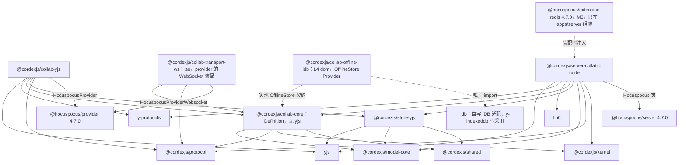

怎么读：实线是各包 `package.json` 声明的依赖，虚线是 Provider 对 Definition 的实现关系、S1/S2 的单点引入约定与装配注入。`yjs` 只被 store-yjs、collab-yjs、server-collab 三处直接引入（`@hocuspocus/*` 以 peer 方式共用同一份 yjs）；collab-core 不碰 yjs，可被其他 CRDT Provider 复用。`@hocuspocus/provider` 只出现在 collab-yjs 与 collab-transport-ws，`@hocuspocus/server` 只出现在 server-collab，extension-redis 与 ioredis 只在 apps/server 组装后注入（ADR-0039 d-25；章程 §5.3 规则 4 的放行范围随之扩充）。2026-09-26 起 collab-transport-ws 通过 provider 间接依赖 yjs 与 y-protocols（provider 的 peer），不再是「完全不碰 yjs」。
依据：本文 §2.4、§16 S1/S2、§18.6；ADR-0039 版本与依赖边界；[40-modules/02](../40-modules/02-kernel-protocol-and-document-core.md) §4.7、[40-modules/05](../40-modules/05-collaboration-client.md) §4.1–§4.3（目录树）；60-backend/05 §2。

十条不变量（后文逐条给出机械验证）：

| # | 不变量 | 验证入口 |
|---|---|---|
| I1 | 协同模式下 Y.Doc 是唯一模型；不存在第二份可写模型（A31） | store-yjs 无独立缓存字段；`observe` 只由 Y 事件驱动（单测 + 代码扫描：store-yjs 内禁止 `Map<…, Model>` 类缓存） |
| I2 | 所有修改经 Mutation → `store.transact`；Y 类型对象**不外泄**到 store-yjs 之外（除 `yjsBackend` 给 collab-yjs） | api-extractor 基线：store-yjs 公共 API 不含 `Y.*` 类型（由 09-04 承接） |
| I3 | 撤销只回滚**本地 origin** 的事务，且不覆盖他人后写的键、整步被跳过即停（rulings §4.15 Q3） | 单测：远端 update 不进入撤销栈；契约用例 `remote-conflict-skip`、`undo-skip-no-cascade` |
| I4 | 实体以 id 定位，顺序以 fractional key 表达，**禁止数组下标** | Mutation schema 无 `index` 字段（类型测试）；fuzz 收敛 |
| I5 | 服务端与客户端运行同一份 store-yjs/model-slide 代码 | iso 冒烟 + server-headless 加载清单 |
| I6 | 权限 fail-closed 且双点：客户端命令管线 + 服务端网关 | conformance：viewer 发送 update 被拒且连接保活 |
| I7 | 任意 update 顺序、重复、乱序都收敛到同一状态 | collab-sim fuzz |
| I8 | 服务端从不把未校验通过的帧扇出 | 单测：坏帧 → 关闭码 4400，无广播 |
| I9 | 离线期间的修改在恢复后**要么被合并要么被明确告知拒绝**，不静默丢失 | e2e：离线编辑 → 降权 → 重连 → 提示导出 |
| I10 | 房间关闭前所有 `ack{tier:'db'}` 确认的 update 已落库（at-least-once 持久化；`tier:'spill'` 不算落库，客户端保留 pending，S-3a） | 单测：kill 进程前的 `ack` 语义；集成：重启后状态相同；spill-and-replay 测试断言回放后无 `pendingStructs` |

### 0.1 里程碑边界（rulings §4.19 D-M2-CONTENT）

M1–M4 里程碑边界表全仓只在 [30/01](01-overview.md) 保留一份（rulings §4.21 架构三件套 R-d-07），逐项权威是 [PRD 05 §0.3](../10-prd/05-milestones-and-scope.md)（冲突时以它为准）；本文不再重复列表，各节在行内标注里程碑。与协同直接相关的口径只有三条：

- **M1** 无协同链路，查看器打开本地字节。
- **M2** 协同后端随 M2 交付（单实例 `all`）：M2 起参考应用新建、导入、打开的文档内容只以协同快照为事实源，单人编辑也经网关持久化，不设过渡的 pptx 内容版本端点；传输层即 Hocuspocus 嵌入与客户端官方 provider（ADR-0039 里程碑），门禁 L1–L4、先落库后广播与两级 ack、PG 故障溢写与 `room.persist`、awareness 中继、墓碑清扫、换纪元、压缩与快照 bootstrap 都在 M2。
- **M3** 只保留多人协同体验层与规模化：extension-redis 多实例与文档哈希分流、名额与满员只读、跨实例溢写认领、在场呈现、评论、按人分享与降权回滚、离线体验、软冲突提示、彻底删除元素、版本历史、服务端缩略图与导出；跨刷新离线持久化 `collab-offline-idb` 为 M4 P2（PD-05）。

依据：rulings §4.19 D-M2-CONTENT（覆盖决策 INC-37 中「WS 网关、快照 REST、服务端导入归 M3」一句；40-modules/09 所称「M2 切片」即 M2 交付）、INC-09、C-06、D-TEST-INFRA、§4.21；PRD 05 §0.3。（2026-09-26：原「里程碑 × 本文范围」表迁出，由 30/01 的唯一边界表承接。）

---

## 1. model-slide 在 Y.Doc 中的结构

### 1.1 设计原则

1. **Store 对文档类型盲**：store-yjs 不认识「幻灯片」，只认识 6 种**值形状**（§1.2；作用于其上的操作是 04 §2.3 的 5 种 `StoreOp`）。model-slide 用这 6 种值形状声明自己的树形 schema（在架构 04 的 `DocumentType` 声明中），store-yjs 与 store-memory 都实现同一原语集，从而满足章程 §7 的可插拔证据「store-yjs 替换 store-memory 仅改 preset 配置」（CI 检查 `pluggable:m3`，M3 出口判定，PRD 05 图 0-3；M2 起参考应用已用 `preset-slide-collab`，Manifest 比对随之提前运行，见 70-testing/02）。
2. **实体表 + 引用**，不用嵌套数组：所有有身份的东西（slide/layout/master/theme/shape/media）都是 `EntityTable` 中以 id 为键的 `Record`；顺序用 `order` 类型的 fractional key 属性表达（ADR-0032）。
3. **属性粒度 = 用户可独立编辑的最小单位**：任何能被两个用户同时独立修改的属性必须是独立的 Y.Map 键（例如 `xfrm.off.x` 与 `xfrm.ext.cx` 分开），使并发的「移动」与「缩放」都能存活。
4. **富文本用 `Y.XmlFragment`**，段落是元素、文本是带属性的 `Y.XmlText`（§1.4）。
5. **媒体不进 CRDT**：Y.Doc 只存 `BlobRef`（内容哈希 + mime + 尺寸），字节走对象存储（60-backend/14 §5–§6）。
6. **不透明保留**照常成立：未建模的 XML 子树以字符串放在 `extensions`（`Opaque` 原语）里，随实体一起同步、导出时原样写回（D7）。

### 1.2 存储原语（Store primitives，提请 A 线纳入 04/05 的 `DocumentStore` Definition，草案）

| 原语 | 语义 | store-yjs 映射 | store-memory 映射 | 并发语义 |
|---|---|---|---|---|
| `Record` | 键固定或半固定的对象 | `Y.Map`；嵌套 Record 为嵌套 `Y.Map`；叶子为 JSON 标量 | 不可变对象 | 键级 LWW（Yjs 时钟 + clientID 决定） |
| `EntityTable<Id, Record>` | 以 id 为键的实体集合 | `Y.Map<Id, Y.Map>` | `Map<Id, Record>` | 增删 = 键级；删除胜过并发编辑（delete-wins） |
| `Ordered` | 实体的相对顺序 | 实体 Record 上的 `order: FracKey`（字符串） | 同 | 移动 = 单键 LWW；排序键 `(order, id)` 全序 |
| `RichText` | 段落序列 + 带属性文本 + 内嵌对象 | `Y.XmlFragment` | 段落/run 不可变数组 + 稳定位置表 | 字符级合并（YATA） |
| `BlobRef` | 媒体引用 | JSON `{ sha256, mime, bytes, w?, h? }` 叶子 | 同 | LWW |
| `Opaque` | 不透明保留的 XML/字节 | `string`（XML）或 base64 叶子 | 同 | LWW |

> 由此，`Mutation` 经 `lower()` 只能降为 04 §2.3 的 **5 种 `StoreOp`**（总编排定稿）：`set(path, value)` / `delete(path)` / `insert(path, index, items)` / `remove(path, index, count)` / `text(path, delta)`。有身份实体的移动 = `set(entities/<id>/order, key)`（键由命令层经 `@cordexjs/shared/order` 算出，ADR-0032），因此**没有 `move` 原语**；原子数组极少移动，用 `remove` + `insert`。逆操作由 Store 从原语推导（D4），store-yjs 由 `Y.UndoManager` 实现，store-memory 由不可变快照 diff 实现。

### 1.3 Y.Doc 顶层布局（草案）

```
Y.Doc (guid = unitId)                                 说明
├── meta: Y.Map                                       { schemaVersion: number, docType: 'slide', epoch: 0, createdAt }
│                                                     schemaVersion 与 A 线 D6 的迁移注册表对应；epoch 见 §9.4
├── presentation: Y.Map                               根 Record
│   ├── slideSize: Y.Map { cx: Emu, cy: Emu, type? }
│   ├── notesSize: Y.Map
│   ├── defaultTextStyle: string(Opaque)              a:defaultTextStyle 原样保留（M1–M3 不编辑）
│   ├── sectionList?: Y.Map<SectionId, Y.Map>         节（order + name + slideIds 由 slide.sectionId 反推）
│   └── extensions: Y.Map<string, string>             p:presentation 下未建模子树（Opaque）
├── themes:   Y.Map<ThemeId,  Y.Map>                  a:theme（clrScheme/fontScheme/fmtScheme 建模为 Record；其余 Opaque）
├── masters:  Y.Map<MasterId, Y.Map>                  { order, themeId, clrMap, txStyles(Opaque), background, extensions }
├── layouts:  Y.Map<LayoutId, Y.Map>                  { order, masterId, type, name, showMasterSp, extensions }
├── slides:   Y.Map<SlideId,  Y.Map>                  见 1.3.1
├── shapes:   Y.Map<ShapeId,  Y.Map>                  **全部形状的顶层扁平实体表**（页、版式、母版上的都在这里），见 1.3.2；
│                                                     containerId 指向所在页 / 版式 / 母版，parentId 指向父组，order 决定同级 z 序
├── notes?:   Y.Map<NotesId,  Y.Map>                  备注页（M1 保留，M3 可编辑文本）
├── media:    Y.Map<MediaId,  Y.Map>                  { ref: BlobRef, originalPartName }；MediaId = sha256 前 16 hex
├── opaqueParts: Y.Map<PartName, string>              未建模的整部件引用（OpaquePartRef 的 JSON 串，整值 LWW；04 §3.1）
└── resources: Y.Map<string, Y.Map>                   ResourceHook 数据；键为 `${pluginId}.${string}`（见架构 04 §2.7），如评论 `comments.threads`（内含 threads / replies 两张实体表）
```

**Y.Doc 实体引用关系**

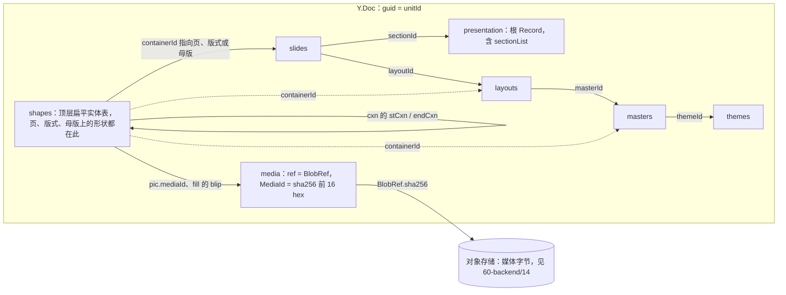

怎么读：箭头是「以 id 引用」，不是嵌套——所有实体都在各自顶层 `Y.Map` 中以 id 为键（§1.1 原则 2）；形状不挂在页、版式、母版下面，而是全部在顶层 `shapes` 表里、以 `containerId` 反指所在容器（实线画页，虚线画版式与母版），组合层级靠 `parentId` 在同一张表内自引用（§1.3.2 备注）；媒体字节不进 Y.Doc，只经 BlobRef 指向对象存储（§1.1 原则 5）。2026-09-26 按 04 §3.1 改为顶层 shapes 表（rulings §4.21 R-d-05；原图「slides/SlideId/shapes」「masters、layouts 含 shapes 实体表」作废）。

#### 1.3.1 slide 实体（草案）

```
slides/<SlideId>: Y.Map
├── id: SlideId                        与键相同，便于 observe 时定位
├── order: FracKey                     幻灯片顺序（ADR-0032）
├── layoutId: LayoutId
├── sectionId?: SectionId
├── show: boolean                      p:sld/@show（隐藏页）
├── background?: Y.Map                 { fill: Y.Map(Record), extensions }
├── clrMapOvr?: Y.Map
├── timing?: string(Opaque)            动画/切换：M1–M3 只保留（章程 Q7）
├── transition?: string(Opaque)
└── extensions: Y.Map<string, string>
```

页上的形状不在页实体里，而在顶层 `shapes` 表中以 `containerId = SlideId` 反查（§1.3.2；2026-09-26 删原 `shapes: Y.Map<ShapeId, Y.Map>` 子表，rulings §4.21 R-d-05）。

#### 1.3.2 shape 实体（草案，kind 为开放字符串，见 `slide.shapeKind` 贡献点/架构 04）

形状表是 Y.Doc 顶层的 `shapes`，与 04 §3.1 的归一化实体表同构（`Shape.containerId` / `parentId` / `order`，04 §3.2 决策表）；下列 Y 结构名是字段在 Y.Doc 中的编码，字段的模型名以 04 §3.2 为准（`nv` = `nonVisual`，`xfrm` / `geom` / `fill` / `ln` 为 `properties` 下的分项）。

```
shapes/<ShapeId>: Y.Map
├── id: ShapeId
├── kind: 'sp' | 'pic' | 'grpSp' | 'cxnSp' | 'graphicFrame' | <第三方 kind>
├── containerId: SlideId | LayoutId | MasterId   所在页 / 版式 / 母版（单键 LWW；换页 = 改这一个键）
├── parentId: ShapeId | null           null = 直接位于该容器的 spTree 下；否则为同表中 grpSp 的 id
├── order: FracKey                     同一 (containerId, parentId) 内的绘制顺序，按 (order, id) 排序（原名 z，2026-09-26 对齐 04 §3.1）
├── nv: Y.Map                          { name, descr, hidden, placeholder?: { type, idx, orient, sz }, hlinkClick(Opaque) }
├── xfrm: Y.Map                        { off: Y.Map{x,y}, ext: Y.Map{cx,cy}, rot, flipH, flipV, chOff?, chExt? }   叶子独立键
├── geom: Y.Map                        { preset?: string, adj: Y.Map<string, number>, custom?: string(Opaque) }
├── fill: Y.Map                        Record（solid/gradient/pattern/blip/none；blip 引用 MediaId）
├── ln: Y.Map                          线型 Record
├── effects?: string(Opaque)           a:effectLst / a:scene3d：M1–M3 保留
├── style?: Y.Map                      a:style 引用（lnRef/fillRef/effectRef/fontRef）
├── txBody?: Y.Map                     { bodyPr: Y.Map, lstStyle: string(Opaque), text: Y.XmlFragment }   见 1.4
├── pic?: Y.Map                        { blip: string, srcRect: string, alpha?: number, effects?: string, extensions }
│                                        blip = JSON 串 {mediaId?, svgMediaId?, external?}，整值 LWW：并发替换不会拼出甲的位图 + 乙的 SVG；
│                                        srcRect = JSON 串整值 LWW（裁剪是一次整体操作，逐边 LWW 会拼出两人都没选的矩形）；
│                                        alpha = 标量叶子；effects = JSON 串（只读建模，编辑 P2）（2026-09-26，50-frontend/23 §13 Q-2、04 §3.7）
├── graphic?: Y.Map                    graphicFrame 内容：{ uri, table?: Y.Map（归一化，见 1.3.3）, chart?: Y.Map（见 1.3.3）, ole?: Opaque }
├── cxn?: Y.Map                        { stCxn: {id, idx}, endCxn }
└── extensions: Y.Map<string, string>
```

> 备注：把所有形状放进顶层 `shapes` 表、组合的子形状也**扁平化**在其中（而非嵌套在页或 grpSp 内）的原因：(1) 进/出组只是改 `parentId` 一个键，天然支持并发；(2) observe 事件路径深度固定，dirty 追踪简单；(3) 避免 Yjs 深嵌套类型在整组删除时的事件爆炸。代价是需要一个「父子环检测与修复」（§8 冲突 #5）。放在顶层而非各页之下还有一条：把形状移到另一页或母版只改 `containerId` 一个键，不搬子树（04 §3.1）。

#### 1.3.3 表格与图表（`graphic.table` / `graphic.chart`）

**表格**按归一化模型映射（rulings §4.21 q-table-depth；模型与不变量的唯一源是 04 §3.8（图表数据为 04 §3.9），决策在 ADR-0018，本节只定 Y 编码，键名与 04 §3.8 一致）。数组形态 `{columnWidths, rows}` 在并发插行插列时会产生缺格，**M3 表格结构编辑开工前**改为下面的形态，里程碑为：M2 可插入表格并编辑单元格文字，行列插删、合并拆分与样式在 M3。

```
graphic.table: Y.Map
├── properties: Y.Map                   tblPr：styleId、firstRow、firstCol、lastRow、lastCol、bandRow、bandCol、fill（标量叶子，逐键 LWW）
├── columns: Y.Map<ColId, Y.Map>        { order: FracKey, width: Emu, _deleted?: Tombstone }   列序 = 按 (order, id) 排序
├── rows:    Y.Map<RowId, Y.Map>        { order: FracKey, height: Emu, _deleted?: Tombstone }  行序同理
├── cells:   Y.Map<'RowId:ColId', Y.Map>
│   └── <RowId:ColId>: Y.Map            { txBody: Y.Map（同 1.4 的 bodyPr / lstStyle / text: Y.XmlFragment）,
│                                         properties: Y.Map（tcPr：填充、边框、边距、锚点）,
│                                         gridSpan?: number, rowSpan?: number,   只记在合并区域的锚格上
│                                         hMerge?: boolean, vMerge?: boolean }   被合并格的标记（与 04 §3.8 同名）
└── extensions: Y.Map<string, string>
```

- **并发语义**：插行 / 插列 = 新增一个 `rows` / `columns` 键（`order` 由命令层经 `@cordexjs/shared/order` 生成），两人同时插入两行都存在、按 `(order, id)` 得到一致顺序，不会产生缺格；删行 / 删列写墓碑（04 §3.1a），其单元格随之不可见；同一单元格的文字按字符合并（YATA），不同单元格互不影响；列宽、行高、格 `properties` 各键 LWW。
- **不变量兜底**：I-TBL1（每一行的有效格覆盖全部列）与 I-TBL2（`gridSpan` / `rowSpan` 跨度合法、不越界、不重叠）由 model-slide `invariants/` 提供；**只由服务端软门禁 L4 以 `system('repair')` 执行修复**（§11，ADR-0034 的 slide 实例，与 I-GRP1 同批），客户端读时容错（缺格画空格、非法跨度按收缩后画），不写修复——与 04 §3.8 同一口径（原「服务端软门禁 L4 与客户端 observe 执行同一修复」作废）。
- **墓碑与清扫**：删行、删列与图表的删类别、删系列都写 `_deleted` 墓碑；服务端墓碑清扫（60-backend/05 §8、40-modules/09 `tombstone-sweeper`）的扫描范围覆盖 `shapes.*.graphic.table.{columns,rows}` 与 `shapes.*.graphic.chart.data.{categories,series}` 下的墓碑记录，硬删行列时连带删除其所在的格（40-modules/03 §13 Q8）。
- **导出**：按 `order` 排序重建 `a:tbl`（`a:tblGrid/a:gridCol`、`a:tr/a:tc`，合并格写 `gridSpan` / `rowSpan` / `hMerge` / `vMerge`）；未建模子元素经 `extensions` 原样写回。

**表格归一化的 Y 结构**

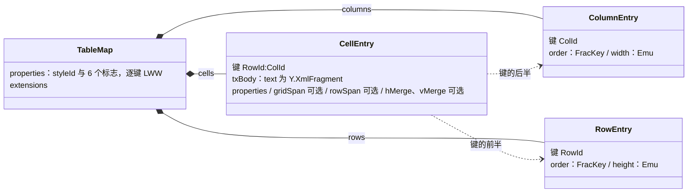

怎么读：实心菱形是 `graphic.table` 这个 Y.Map 下的三张以 id 为键的表，虚线表示单元格的键由行 id 与列 id 拼成。行列顺序只由各自的 `order` 决定，插一行或一列只新增一个键，不移动任何已有单元格，因此两人同时插行插列不会产生缺格（数组模型的问题）；合并信息只记在锚格上，由不变量 I-TBL1 / I-TBL2 兜底。

依据：rulings §4.21 q-table-depth；ADR-0018；04 §3.8。

**图表**（rulings §4.21 q-chart-route；渲染与编辑路线的唯一源是 ADR-0036）：M1–M2 只读，`graphic.chart` 只存部件引用、不建模数据；M3 起五类（柱形 / 条形、折线、饼、面积、散点）可编辑，数据同样按 Record + FracKey 归一化，使不同单元格的并发修改都能合并。

```
graphic.chart: Y.Map
├── partRef: string                     OpaquePartRef 的 JSON 串（M1 起；未建模子树与内嵌工作簿随它写回）
└── data?: Y.Map                        M3 起，仅五类可编辑图表
    ├── type: string                    'bar' | 'line' | 'pie' | 'area' | 'scatter'（切换类型 = 单键 LWW）
    ├── variant: string                 JSON 串 {barDir, grouping, overlap, gapWidth, marker, smooth, scatterStyle}（04 §3.9），整值 LWW
    ├── categories: Y.Map<CatId, Y.Map> { order: FracKey, label: string, _deleted?: Tombstone }
    ├── series: Y.Map<SerId, Y.Map>     { order: FracKey, name, fill?(JSON 串), _deleted?: Tombstone,
    │                                     values: Y.Map<CatId, number | null>, xValues?: Y.Map<CatId, number | null> }
    └── title? / legend? / dataLabels? / numFmt?   标量或 JSON 串叶子
```

- 数据未变时 `partRef` 所指部件按原字节写回；数据变了才由编码器重生成缓存与最小内嵌工作簿（04 §10「图表内嵌工作簿」行）。`Chart.data` 与 `partRef` 并存期间的一致性规则见 ADR-0008 与 ADR-0036。

### 1.4 富文本：Run/Paragraph → `Y.XmlFragment`

```
txBody.text: Y.XmlFragment
└── <p> : Y.XmlElement('p')                 每个 a:p 一个元素；属性 = pPr 的标量（algn、lvl、indent、marL、bullet(JSON 字串)、
    │                                        spcBef/spcAft/lnSpc、endParaRPr(JSON 字串)、x(Opaque 字串：未建模 pPr 子树)）
    └── Y.XmlText                            段落正文；a:r 折叠为**带属性的文本区间**（属性 = rPr：b/i/u/strike/sz/baseline/spc/kern/lang、
                                             latin/ea/cs/sym 字体、fill(JSON 字串)、hlink(JSON 字串)、x(Opaque)）
                                             a:br → insertEmbed({ br: 1 })；a:fld → insertEmbed({ fld: { type, id, text } })
                                             a14:m / mc:AlternateContent 等 → insertEmbed({ opaque: '<xml…>' })
```

选择 `Y.XmlFragment` 而非「`Y.Text` + `\n` 携带段落属性」（Quill 惯例）的理由：段落拥有元素身份，段落属性不寄生在换行字符上（分段/合段时属性不漂移）；与 OOXML `a:p/a:r` 一一对应，编解码无歧义；`Y.RelativePosition` 可同时定位段落元素与字符偏移（用于光标与评论锚点）；若未来接入 ProseMirror，`y-prosemirror` 直接可用。代价：每段约多 ~40 B 的结构开销（200 页 × 30 段 = 6000 段 ≈ 240 KB，可接受）。详见 ADR-0020 §富文本。

**编辑操作 → Y 操作**（store-yjs `mapping/rich-text.ts` 实现）：`text.insert(path, pos, str, attrs)` → `XmlText.insert`；`text.format(path, range, attrs)` → `XmlText.format`；`splitParagraph(path, pos)` → 新建 `<p>` 元素 + 移动尾部文本（删除 + 插入，携带属性）；`mergeParagraph` 对称。**已知限制**：分段时被移动的尾部文本若被他人并发格式化，格式化落在已删除文本上而丢失（与 y-prosemirror 相同的取舍，见 §8 冲突 #8）。

### 1.5 属性值的编码规则

| 值类型 | 编码 | 理由 |
|---|---|---|
| 标量（数、布尔、枚举字串、品牌单位 `Emu`/`Pt`） | 直接 JSON 叶子 | LWW 粒度最细 |
| 小型复合值且总是整体替换（颜色、字体引用、超链接） | JSON **字符串**（稳定序列化：键排序） | 避免为每个颜色建 Y.Map 的开销；并发时整体 LWW 符合用户预期 |
| 用户可分别编辑的复合值（xfrm、fill、ln、bodyPr） | 嵌套 `Y.Map` | 并发独立编辑存活 |
| 未建模 XML | 字符串（原始 XML，命名空间归一化后） | D7 |
| 二进制 | 不进 Y.Doc；`BlobRef` | 体积 |

**机械验证**：`@cordexjs/model-slide/testing` 导出 schema → 类型测试断言 `EntityTable` 值中不出现 `Array<Entity>`；lint 规则 `cordex/no-index-in-mutation`（09-02 §4.17，TD-065）检查 Mutation schema 无 `index` 字段。

---

## 2. `@cordexjs/store-yjs`：DocumentStore Provider

### 2.1 职责与边界

- **唯一** import `yjs` 的模型侧包；对外 API 不暴露 `Y.*` 类型（api-extractor 基线守护）。
- 为每个 Unit 提供 `store`（UnitScope 内），并额外提供 `yjsBackend` 服务（同 UnitScope）给 `collab-yjs` 使用——这是 Provider 间**受控的**类型依赖（章程 §5.2 已允许 collab-yjs 依赖 store-yjs）。
- 一个 Unit 一个 Fiber（插件由 preset 在 UnitScope 内加载），Y.Doc 归该 Fiber 的 effect 所有：Unit 关闭 → `doc.destroy()`。

### 2.2 `DocumentStore` 契约在 store-yjs 中的实现要点（签名级草案；契约本身由 A 线在 04/05 定义）

```ts
// 草案：store-yjs 期望的 DocumentStore 表面（提请 A 线在 model-core 中定型）
interface DocumentStore {
  readonly kind: string                                    // 'yjs' | 'memory'
  transact<T>(fn: (tx: StoreTx) => T, meta: TransactionMeta): T
  observe(listener: (change: ChangeSet) => void): Disposable  // 由 ctx.effect 拥有
  get<T>(path: StorePath): T | undefined
  undo(scope?: UndoScope): boolean;  redo(scope?: UndoScope): boolean
  canUndo(): boolean;  canRedo(): boolean
  createStablePosition(path: StorePath, offset: number): StablePosition   // Yjs: RelativePosition
  resolveStablePosition(pos: StablePosition): { path: StorePath; offset: number } | null
  exportSnapshot(): Snapshot;  importSnapshot(s: Snapshot): void        // D6 边界
}
interface TransactionMeta {
  origin: TransactionOrigin        // { kind: 'local', txnId, commandId, actor } | { kind: 'remote' } | { kind: 'undo' | 'redo' } | { kind: 'repair', by: 'server' } | { kind: 'import' | 'migration' }
  undoable: boolean
}
interface ChangeSet {
  origin: TransactionOrigin; local: boolean
  paths: readonly StorePath[]          // 变更的最小路径集合（去重、父路径合并），供 07 的脏区追踪消费
  entities: { added: EntityRef[]; removed: EntityRef[]; reordered: EntityRef[] }
}
```

- `transact`：包装 `doc.transact(fn, origin)`。`origin` 对象即 Yjs 事务的 origin，`UndoManager.trackedOrigins` 只包含本 Unit 的 `local` origin **类**（用 class 标识，而非对象实例，避免每个事务一个 origin 实例无法被 Set 命中的经典错误）。
- `observe`：`doc.on('afterTransaction')` → 把 `transaction.changed`/`changedParentTypes` 转为 `ChangeSet.paths`（`mapping/change-set.ts`）。**不**为每个 Y 类型单独 `observeDeep`（避免 O(类型数) 的监听器）。
- `undo/redo`：`Y.UndoManager({ trackedOrigins, captureTimeout: 500 })`，作用域为整份 Y.Doc（除 `resources.<presence-like>` 这类不该撤销的命名空间，通过 `UndoManager` 的 `scope` 参数排除）。`history` 服务（A 线，UnitScope）只是它的薄门面；`store.undo()` 返回是否发生了变化。
- **撤销语义不跟随 Yjs 默认**（rulings §4.15 Q3，契约字段 `undo.remoteConflict: 'skip'`，05 §6）：undo 包装层（`undo/undo-manager.ts`）在弹出栈项前比对该项涉及的 Y.Map 键的当前写入者（`item.id.client` 与本地 clientID）；已被远端后写的键**不回退**并收集到 `store/undo-skipped{ skipped: UndoSkip[], wholeStep }`（载荷以 40-modules/02 §2.4 为准）；若整项的键都被跳过 → 本次撤销不生效、**停止**（Yjs 默认会继续弹出下一项，即「连撤两步」，包装层阻断）。有身份实体删除以 `_deleted` 墓碑表示（04 §3.1a），撤销**自己的**删除 = 清除墓碑、原 id 复活；撤销目标已被**他人**删除（墓碑 TTL 内亦然）→ 该键跳过并提示，**撤销永不复活他人删除的元素**（rulings §4.17 D4）。Yjs 版本锁 13.6.x 精确版本（不跟 dist-tag，`@y/y` 的 latest 指向旧 rc）；Yjs 14 GA 后于 M3 前做升级 spike。
- 撤销粒度对齐事务：命令管线一个 Command = 一个 `transact`；连续键入由 `captureTimeout` 合并；拖拽由命令层显式用同一 `txnGroup`（A 线契约：`TransactionMeta.group?: string`，store-yjs 用 `UndoManager.stopCapturing()` 边界实现）。
- `createStablePosition`：`Y.createRelativePositionFromTypeIndex(xmlText, offset)` → base64；用于本地光标、远端光标（awareness）与评论锚点（ADR-0031；50-frontend/08 §6）。
- `importSnapshot`：只允许在**空** Y.Doc 上调用（导入/服务端 bootstrap），否则抛 `store.snapshot_import_on_nonempty`；Snapshot 保留 `order: FracKey` 键（ADR-0013 第 7 条），原样写入，不做数组转换。

### 2.3 `yjsBackend` 服务（供 collab-yjs，草案）

```ts
interface YjsBackend {
  encodeStateVector(): Uint8Array
  encodeStateAsUpdate(targetVector?: Uint8Array): Uint8Array   // V2 编码，只用于快照与本地持久化；线上同步由 provider / Hocuspocus 按 V1 自行编码
  applyUpdate(update: Uint8Array, origin: TransactionOrigin): void
  onUpdate(listener: (update: Uint8Array, origin: TransactionOrigin) => void): Disposable  // 只回调非 remote 的 update
  awareness(): AwarenessHandle       // 由 collab-yjs 创建后挂回（y-protocols/awareness 需要 doc）
  stats(): { structs: number; deletedStructs: number; bytes: number }   // 供 telemetry
  docHandle(): YDocHandle            // 2026-09-26 新增：受控 doc 句柄，只能由 collab-yjs / server-collab 解包为原始 Y.Doc 交给 provider 或 Hocuspocus
  registerRemoteOrigin(origin: unknown): Disposer   // 2026-09-26 新增：把 provider 实例（客户端）或 Hocuspocus 的连接来源（服务端）登记为 remote（命名与签名以 40-modules/02 §5.7 为准）
}
```

- **受控 doc 句柄**（2026-09-26，rulings §4.21，ADR-0039 决策 8；证据 CL-01）：官方 provider 需要原始 `Y.Doc`（`document` 参数），突破了「Y 类型不外泄」的原边界。`docHandle()` 返回带品牌的不透明句柄，解包只在 collab-yjs 与 server-collab 内进行（沿用 §18.2 所说 02 §4.7 `doc-access.ts` 的 unique symbol / `@internal` 做法，具体形状由 40-modules/02 定稿），store-yjs 的公共 API 仍不含 `Y.*` 类型（I2 的 api-extractor 基线不变）。
- **remote origin 登记**：provider 以自身实例为 origin 应用远端更新、且不回发 `origin === provider` 的更新；store-yjs 必须把它识别为 remote，否则他人修改会被卷进本地撤销栈（证据 CL-02）。服务端 Hocuspocus 应用连接帧时的 origin 同样登记为 remote（ADR-0034 L4 依赖这一点）。
- **接管外部 Y.Doc**（服务端）：Hocuspocus 自己 `new Document`（继承 `Y.Doc`），`yjs-store` 的打开参数增 `adopt?: YDocHandle`（40-modules/02 §5.7），服务端 Unit 在 `afterLoadDocument` 接管 Hocuspocus Document，不另建 Y.Doc；`gc` 须与 store-yjs 一致（两端都是 `gc:true`，ADR-0025 决策 7）。

### 2.4 目录结构与依赖版本锁定

包的目录树以 [40-modules/02](../40-modules/02-kernel-protocol-and-document-core.md) §4.7（`store-yjs`）为唯一源，本节不再重复（2026-09-26 删，rulings §4.21 R-d-05；原目录树作废）。

协同链路的第三方依赖一律**精确锁版本**（不跟 dist-tag），升级须过协同契约套件；版本于 2026-09-26 以 `npm view` 核实，许可按 ADR-0049 分级：

| 包 | 版本 | 许可 | 允许出现的位置 | 依据 |
|---|---|---|---|---|
| `yjs` | 13.6.33 | MIT | store-yjs、collab-yjs、server-collab；根 `overrides` 锁定，CI 检查依赖树只有一份 | rulings §4.15 Q3、§4.21 R-d-37 |
| `y-protocols` | 1.0.7 | MIT | collab-yjs、server-collab | 同上 |
| `lib0` | 0.2.118 | MIT | collab-yjs、server-collab（y-protocols 与 Hocuspocus 的编码依赖） | 同上 |
| `@hocuspocus/server` | 4.7.0 | MIT | 只在 server-collab | ADR-0039 |
| `@hocuspocus/provider`（含 `@hocuspocus/common`） | 4.7.0 | MIT | 只在 collab-yjs（`HocuspocusProvider`）与 collab-transport-ws（`HocuspocusProviderWebsocket`） | ADR-0039 |
| `@hocuspocus/extension-redis` | 4.7.0（M3） | MIT；传递依赖 `@sesamecare-oss/redlock` 1.4.0 的 package.json 标 UNLICENSED、LICENSE.md 为 MIT，登记例外 | 只在 apps/server 组装 | ADR-0039、ADR-0049 |
| `ioredis` | apps/server 显式声明 6.0.x；extension-redis 传递带入 ~5.6.1 | MIT | 只在 apps/server（extension-redis 以 `createClient` 注入 6.0.x 客户端，5.6.x 只被加载、不建连接，单版本规则登记例外） | rulings §4.21 R-d-40；ADR-0039 |
| `y-indexeddb`（可选） | 以 collab-offline-idb 立项时为准 | MIT | 只在 collab-offline-idb（或自写 IDB 适配） | §16 S2 |

Yjs 14 GA 后于 M3 前做升级 spike（`@y/y` 的 latest 仍指向旧 rc）；`@hocuspocus/*` 四个包同版本一起升。

---

## 3. `@cordexjs/collab-core`：Definition

### 3.1 服务与契约（签名级草案）

```ts
// ctx.collab（根作用域服务，管理各 Unit 的 Session）
interface CollabService {
  join(unitId: UnitId, opts: JoinOptions): Session          // 幂等：同 Unit 重复 join 返回同一 Session
  leave(unitId: UnitId): Promise<void>
  session(unitId: UnitId): Session | undefined
}
interface Session {
  readonly state: SessionState                              // 见 §5 状态机；变化触发 'collab/session-state'
  readonly role: Role                                       // 来自服务端 auth.ok / permission 帧（@cordexjs/protocol Role）
  readonly stats: SessionStats                              // pendingLocalUpdates、lastSyncedAt、bytesIn/Out、rtt
  flush(): Promise<void>                                    // 等待本地 pending 全部被服务端 ack（用于「关闭前保存」）
  reconnectNow(): void
  close(): Promise<void>
}
// ctx.presence（UnitScope 服务）
interface PresenceService {
  setLocal(patch: Partial<PresenceState>): void             // 节流由 Provider 做
  readonly local: PresenceState
  readonly remotes: ReadonlyMap<ClientId, PresenceState>    // 反应式；变化触发 'presence/changed'
}
// ctx.collabTransport（根作用域，可替换：ws / webrtc / memory）
interface CollabTransport {
  connect(target: TransportTarget, ticket: string, signal: AbortSignal): Promise<Connection>
}
interface Connection {
  send(frame: Uint8Array): void                             // 背压：返回前不阻塞；超过 outboundHighWater 触发 'collab/backpressure'
  onFrame(listener: (frame: Uint8Array) => void): Disposable
  onClose(listener: (code: number, reason: string) => void): Disposable
  close(code?: number, reason?: string): void
}
// SyncEngine（CRDT 相关的同步逻辑，collab-yjs 实现；transport/gateway 对其不可知）
interface SyncEngine {
  initialFrames(): Uint8Array[]                              // Yjs: SyncStep1 + 本地 awareness
  handleInbound(payload: Uint8Array): SyncOutcome           // 返回需回发的帧与「是否已同步」
  onLocalUpdate(listener: (payload: Uint8Array) => void): Disposable
}
// OfflineStore（可选 Provider；缺失时降级为「仅内存」）
interface OfflineStore { load(unitId): Promise<Uint8Array | null>; append(unitId, update): Promise<void>; compact(unitId, state): Promise<void>; clear(unitId): Promise<void> }
```

事件（在 `collab.contribution.ts` 中 `declare module '@cordexjs/kernel'`）：`collab/session-state(unitId, prev, next)`（定稿名 `collab/state-changed`，10 §11）、`collab/synced(unitId)`、`collab/rejected(unitId, code, count)`（定稿名 `collab/update-rejected`）、`collab/backpressure(unitId, queued)`（已降为客户端指标，不作 cordis 事件，10 §11.1）、`presence/changed(unitId, clientId | null)`。权限变更事件 `permission/changed` **不由 collab 发出**：由 `permissions` 服务在 `applyRemoteDecisions` 之后唯一发出（§18.3；原草稿 `collab/permission-changed` 弃用）。

**2026-09-26 注**（rulings §4.21，ADR-0039 决策 8）：客户端改用官方 `@hocuspocus/provider` 后，`SyncEngine` 的 step1 / step2 / update 收发、`CollabTransport` 的 socket 生命周期与握手都由 provider 承担；上面的 `CollabTransport` / `Connection` / `SyncEngine` 草案收缩为 provider 装配的外观，`CollabService`、`Session`、`PresenceService`、`OfflineStore` 与 `PermissionGate` 的语义不变。契约的定稿以 [40-modules/05](../40-modules/05-collaboration-client.md) 与 [50/07](../50-frontend/07-collaboration-client.md) 为准。

### 3.2 目录结构（`packages/collab-core/`）

目录树以 [40-modules/05](../40-modules/05-collaboration-client.md) §4.1 为唯一源（2026-09-26 删本节目录树，rulings §4.21 R-d-05）。

---

## 4. `@cordexjs/collab-yjs` 与 `@cordexjs/collab-transport-ws`：Provider

### 4.1 collab-yjs 的运行时装配（每个 Unit）

客户端的运行时装配（每个 Unit 内的组件与服务注入）已迁到 [50/07](../50-frontend/07-collaboration-client.md) §1，由接收方按 provider 装配改写（2026-09-26，rulings §4.21 R-d-05；原装配图作废）。本节只保留跨端需要知道的分工：

| 包 | 用到的 provider 部件 | 自有部分（语义不变） |
|---|---|---|
| `collab-yjs` | `HocuspocusProvider`：`name` = `{docId}:{epoch}`，`document` = store-yjs 的 Y.Doc（经 `docHandle()`），`token` 为 async 函数（每次现换票并返回 Auth token JSON），`flushDelay: 50`，`onStateless` 分发 CONTROL | 11 态 reducer 与 SessionDriver、在途 FIFO 与两级 ack、`PermissionGate`、被拒回滚、OfflineStore 队列、awareness schema |
| `collab-transport-ws` | `HocuspocusProviderWebsocket`：`autoConnect: false`、`maxAttempts: 1`、`WebSocketPolyfill` 计量垫片、构造配置里的 `onClose` 关闭码策略、`messageReconnectTimeout: 30000` | 注入 Clock 的重连与离线调度器、帧计量、关闭码 → 行为映射（§6.5） |

### 4.2 目录结构（`packages/collab-yjs/`）

目录树以 [40-modules/05](../40-modules/05-collaboration-client.md) §4.2 为唯一源（2026-09-26 删本节目录树，rulings §4.21 R-d-05）。

### 4.3 目录结构（`packages/collab-transport-ws/`）

目录树以 [40-modules/05](../40-modules/05-collaboration-client.md) §4.3 为唯一源（2026-09-26 删本节目录树，rulings §4.21 R-d-05）。握手、保活与重连的跨端约束见 §6.3、§6.5、§12；原 `handshake.ts`（首帧原名 `CONTROL.auth`，现为 Hocuspocus Auth 帧）与 `heartbeat.ts`（应用层 `CONTROL.ping`）两个文件随 provider 采用而取消，新增 `metering-socket.ts`（计量垫片）与 `close-policy.ts`（关闭码策略）；collab-yjs 的 `frame-codec.ts` 改为 `control-channel.ts`（只剩 Stateless 载荷 ↔ CONTROL）并新增 `provider/` 目录；测试替身由 `MemoryTransport` 改为内存 `WebSocketLike` 对（ADR-0039 决策 3；详见 40-modules/05 §4.2、§4.3）。

---

## 5. 房间（Room）与会话（Session）生命周期

### 5.1 客户端 Session 状态机（collab-core `session-fsm.ts`，Provider 执行 effects）

客户端 Session 内部状态机（11 态）、对外 `SyncState` 投影与 UI 六态的对照，唯一源是 [50-frontend/07 §3](../50-frontend/07-collaboration-client.md)（2026-09-25 自本节迁出，rulings §4.19 三线拆分）；本节只保留跨端约束：

- 状态机是纯 reducer（`reduce(state, event) → { next, effects[] }`，零 IO），effects 由 collab-yjs 的 SessionDriver 执行；每次迁移 emit `collab/state-changed`（原草稿名 `collab/session-state`，10 §11）并计数 `cordex_collab_session_transitions_total{from,to}`。
- 本地编辑在一切非 `closed` 态都允许（含 `offline` / `backoff`），前提是权限快照含写能力位；`readonly` / `denied` 下命令管线按 `permissions` 拒绝（D12 客户端检查点），commenter 在 `readonly` 下仍可执行评论命令。`syncing` 期间已可渲染与编辑（先应用 HTTP bootstrap 快照，§9.1），本地 update 进入 pending。
- 与服务端相关的转换依据：握手拒绝码与关闭码见 §6.3、§6.5；offline 判据按时间（累计 30 s 或 `navigator.onLine=false`，rulings §4.18 UX-03）、offline 后 30 s 周期重连（CO-03）；令牌刷新失败按原因分流（UX-02）。

### 5.2 服务端 Room 状态机（server-collab 扩展派生，Hocuspocus 文档生命周期）

**服务端 Room 状态机**

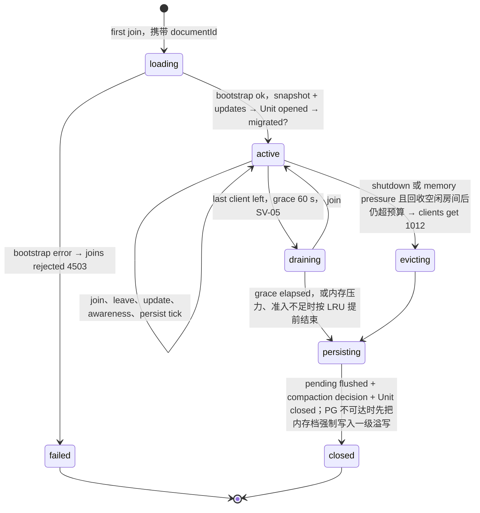

怎么读：箭头是 Room 生命周期转换，冒号后是触发条件或该转换伴随的动作；draining 的 60 s 宽限期内有人重新加入即回到 active。内存压力或准入不足时先按 LRU 提前结束 draining 房间（无在线客户端，不发 1012），仍超预算才驱逐 active 房间；没有 draining → evicting 这条边（rulings §4.18 CO-14）。本图是跨端协议的照抄源（CO-13），服务端机制（加入流程、名额原子判定、溢写档位与回放、控制频道）见 [60-backend/05](../60-backend/05-modules-collab-and-snapshots.md) §3–§6。

**七态到 Hocuspocus 生命周期的映射**（2026-09-26，rulings §4.21，ADR-0039 表 39-2）：Hocuspocus 自己只有「加载中、已加载、卸载中」三种状态，最后一个连接离开且无存储挂起即卸载；七态因此作为**派生状态**保留（进指标 `cordex_collab_rooms_active{state}`），由自有扩展驱动：

| 状态 | 由什么实现 |
|---|---|
| `loading` | `onLoadDocument` 执行中（并发加入共享同一个加载 Promise） |
| `active` | 文档已在 `hp.documents` 中且有连接；`persist`、`spillTier`、`replaying` 子状态不离开 `active` |
| `draining` | 最后一个连接离开后，`beforeUnloadDocument` 抛错取消卸载；60 s 到期或按 LRU 提前结束时主动 `hp.unloadDocument` |
| `evicting` | 停机或内存压力：对该文档的连接以原始 `ws.close(1012)` 关闭（`hp.closeConnections()` 发的是文档级 CLOSE、客户端只见 1000，不能代替） |
| `persisting` | 写入器 flush 与压缩判定；PG 不可达时把内存档强制写入一级溢写；有内存档时继续由 `beforeUnloadDocument` 钉住文档 |
| `closed` | `afterUnloadDocument` 之后释放 Unit、订阅与名额 |
| `failed` | `onLoadDocument` 抛错：已收到 `Authenticated` 的加入者各自再收 `PermissionDenied`，网关补 4503 并撤销名额 |

- 一个 Room = 服务端 cordis 宿主里的一个 **Unit**（同一份 store-yjs + model-slide 代码；D5/D8），因此 schema 校验、修复、迁移与客户端行为一致。2026-09-26 起 Room 的 Y.Doc 就是 Hocuspocus Document（继承 `Y.Doc`），Unit 在 `afterLoadDocument` 经 store-yjs 接管它（§2.3）；Hocuspocus 文档名为 `{docId}:{epoch}`，换纪元后新纪元天然是新文档（§9.4）。
- **PG 故障期与溢写回放期间 Room 保持 `active`**（`spillTier ≠ none` 或 `replaying = true` 只是 active 内的持久化子状态）：在线客户端不断连、不拒写；`persisting` 只通向 `closed`，不回 active（rulings §4.18 CO-15）。
- **PG 不可达时的收尾**（rulings §4.18 CO-16）：宽限到期、SIGTERM 或驱逐进入 `persisting` 时若 PG 不可达，不在 persisting 久等（SIGTERM 只有 30 s，ADR-0035 决策 9），先把内存档强制写入一级溢写再进入 `closed`；遗留溢写行的回放见 §6.4。
- 文档处于 `purging`（文档擦除编排，rulings §4.18 BE-15）时，加入房间一律拒绝；已打开的 Room 由擦除作业令 collab 踢出会话并关闭后才清理 update 与快照（落点 40-modules/08、09、12）。
- `loading` 的 bootstrap（Hocuspocus `onLoadDocument`）：读最新快照（`document_snapshots`）+ 其后 `document_updates` → `applyUpdate` 逐条 → 若 `meta.schemaVersion < 当前` 则在租约锁 `lock:migrate:{docId}` 下运行迁移事务（origin=`migration`，先落库）并立即落一个 `kind:'migration'` 快照 → 认领已下线实例的遗留溢写 → 顺带墓碑清扫 → 末尾 `document.flush()`（不 flush 时首个连接会多收一份整文档 update）。（原锁名「`collab:migrate:{doc}`」作废，键名以 60-backend/14 §3.1 为准。）
- 预算：8 MB 状态的 bootstrap ≤ 500 ms（p95）；测量：span `server.room.load`。

### 5.3 时序：加入 → 同步 → 编辑 → 离开（正常路径）

**加入 → 同步 → 编辑 → 离开（正常路径）**

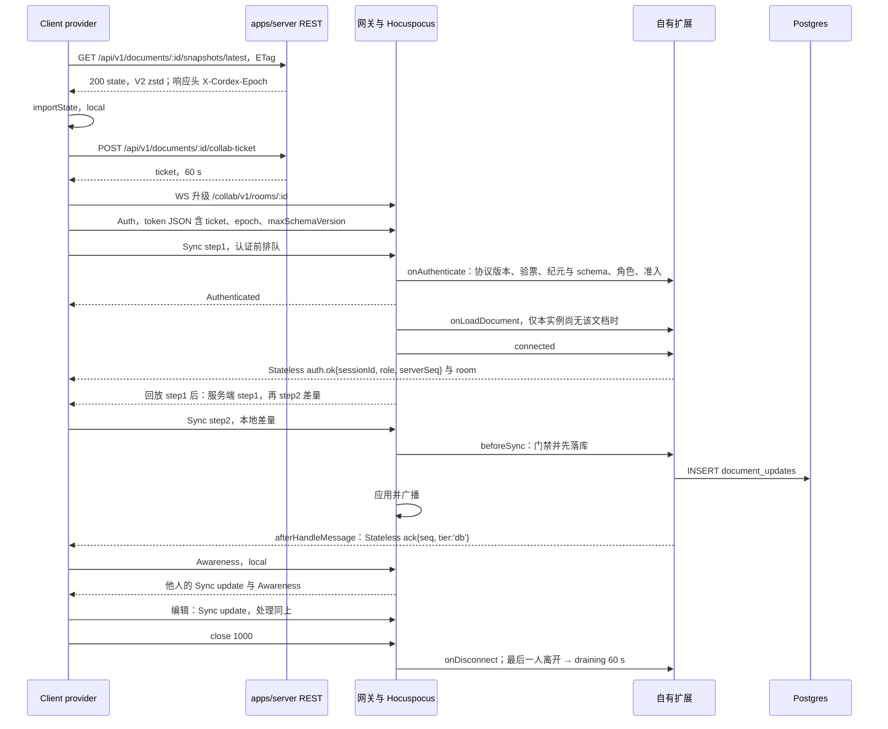

怎么读：从上到下是时间顺序，实线箭头是请求或推送，虚线箭头是响应；自指箭头是该方的内部处理。provider 不等认证结果就发 step1，它在 Hocuspocus 的认证前队列里等到认证与加载完成才被处理；`auth.ok` 与 step1/step2 的先后不保证（实测 `auth.ok` 在前），客户端以 `Authenticated` 进入 syncing；服务端对 step1 的应答顺序是先发自己的 step1、再发 step2。step2 视同一个 update 帧，恰好回一帧 db ack（空差量也回，§6.4）。快照响应头 `X-Cordex-Epoch` 下发文档纪元，客户端把它放进 Auth token 的 `epoch` 并据此拼出 provider 文档名 `{docId}:{epoch}`，服务端据此判定 4428（§6.3）；快照 > 1 MiB 时由服务端从 snapshots 桶流式代理，不返回预签名 URL（决策 MECH-INC 之 INC-14）。两个 HTTP 请求由 apps/server 的 Snapshots 与 Documents 模块提供，REST 统一挂 `/api/v1` 前缀、WS 维持 `/collab/v1/rooms/:id`（rulings §4.18 BE-11）；拆分部署时 `…/snapshots*` 由反代转给 collab 角色（BE-03）。握手的拒绝分支见 §6.3 下图，ack 的两级语义见 §6.4。2026-09-26 按 ADR-0039 重画（原图的「CONTROL.auth」首帧、「CONTROL.ack」「publish collab:doc:{id}」作废）。

---

## 6. 同步协议帧（Hocuspocus 帧，负载复用 y-protocols；CONTROL 载荷定义在 `@cordexjs/protocol`）

### 6.1 决策

- **复用 y-protocols** 的 sync（step1 / step2 / update）与 awareness 编码，不自造 CRDT 同步；理由：经过生产验证、编码紧凑（lib0）。2026-09-26 起线上帧由 **Hocuspocus 协议**承载（rulings §4.21 q-ws-gateway，[ADR-0039](adr/0039-collab-server-hocuspocus.md) 决策 3）：Sync 与 Awareness 就是 y-protocols，只有 Yjs V1 编码；鉴权走 Hocuspocus 的 Auth 帧；鉴权、权限、ack、错误、房间控制这些 y-protocols 不覆盖的信号走 **Stateless 帧**，载荷是本项目的 CONTROL 判别联合。
- **CONTROL 仍由我们定义**：CONTROL 的 zod 判别联合与握手 schema 在 `@cordexjs/protocol` 定义（protocol 是 L0、不 import y-protocols，也不 import `@hocuspocus/*`：Sync / Awareness 的载荷对 protocol 是 `Uint8Array` 不透明体，Stateless 载荷是 UTF-8 JSON 字符串）。详见 ADR-0023（部分被 0039 取代）与 ADR-0039。
- **一个 WS 只承载一个文档**：Hocuspocus 支持多路复用，本项目不用；网关适配层校验每帧地址等于 URL 所指文档，业务关闭一律用原始 `ws.close(码)`（§6.5）。

### 6.2 帧格式（Hocuspocus 帧；原二进制信封作废）

```
varString : 地址 = Hocuspocus 文档名 {docId}:{epoch}（URL 仍是 /collab/v1/rooms/{docId}；epoch 见 §9.4）
varUint   : 类型
  0  Sync               y-protocols sync（varUint 子类型：0 step1 | 1 step2 | 2 update），Yjs V1
  1  Awareness          y-protocols awareness
  2  Auth               子类型 0 Token（C→S：token 字符串 + provider 版本；S→C 不带载荷 = 请求重交 token）
                                1 PermissionDenied（S→C：reason 字符串，本项目放 {code} JSON）
                                2 Authenticated（S→C：scope 'readonly' | 'read-write'，只作初值参考）
  3  QueryAwareness     请求全量 awareness
  4  SyncReply          服务端对 step1 的应答，不再触发 step1
  5  Stateless          UTF-8 字符串；本项目的 CONTROL 判别联合（§6.3）
  6  BroadcastStateless 只在服务端内部与 extension-redis 之间使用；客户端发来即 4400
  7  CLOSE              文档级关闭，只带 reason；不作业务关闭（§6.5）
  8  SyncStatus         「已应用到内存」计数，不是落库确认；客户端忽略，以 §6.4 的 db ack 为准
  9  Ping / 10 Pong     Hocuspocus 4.7 服务端从不发 Ping；本项目不用
```

**帧的去向（服务端视角）**

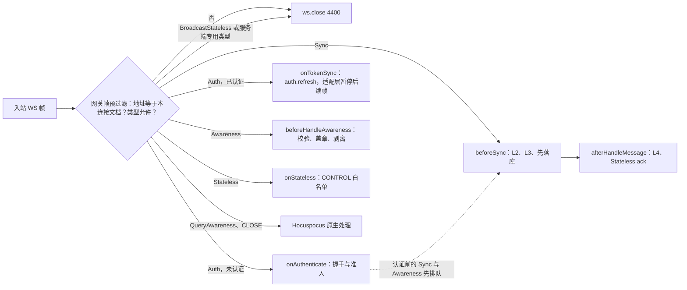

怎么读：左边是一条连接上的入站帧，菱形是网关适配层在帧进 Hocuspocus 之前做的判定，右边的方框是承接该帧的 Hocuspocus 钩子与自有扩展。虚线表示认证前到达的 Sync 与 Awareness 帧不拒绝，而是排队到认证与加载完成后再走各自的路径。出站方向（服务端 step1 / step2、广播、Stateless 的 `auth.ok` / `permission` / `ack` / `room` 等）由 Hocuspocus 与自有扩展发出，图中不画。

依据：ADR-0039 决策 2–4 与表 39-1；60-backend/16 §1、§3、§4。

帧编号与含义以 Hocuspocus 4.7.0 源码 `packages/server/src/types.ts:61-74` 为准（ADR-0039 精确钉版本）。原 1 字节信封（`SYNC 0 / AWARENESS 1 / CONTROL 2 / QUERY_AWARENESS 3`，与 y-websocket 编号兼容）与 protocol `collab/frame.ts` 的信封编解码作废（2026-09-26；Hocuspocus 帧带文档名前缀，与 y-websocket 不再互通，互操作测试改为 `@hocuspocus/provider` v3 / v4 互连）。

### 6.3 CONTROL 消息（Stateless 载荷，zod 判别联合 `type`，草案）

判别键统一为 `type`（含 `ack`；zod `discriminatedUnion` 只能有一个判别键，决策 INC-03/04/05）；联合定义在 protocol `ws/frames.ts`，握手（Auth token JSON）schema 在 `ws/handshake.ts`（不建 `collab/control.ts`，决策 INC-01）。本表是成员集合的唯一定义处（决策 INC-02）；服务端处理见 [60-backend/16](../60-backend/16-ws-protocol-server-view.md) §3，客户端处理见 [50-frontend/07](../50-frontend/07-collaboration-client.md) §2、§8、§9。2026-09-26 起除 `auth` 一行（改放 Auth 帧的 token）外，全部成员经 **Stateless 帧**收发（rulings §4.21，ADR-0039 决策 3）。

| 方向 | type | 字段 | 说明 |
|---|---|---|---|
| C→S | `auth`（**Auth 帧的 token**，不是 Stateless） | `ticket, protocolVersion: 1, clientId: number(Yjs clientID), capabilities: string[], appVersion, epoch?: number, maxSchemaVersion: number, pluginSet?: { catalog: string, policy: string }, traceparent?`（JSON 字符串，网关限 ≤ 8 KiB） | provider 的 `token` 是 async 函数，每次 WS 打开或 `sendToken()` 时现换票并返回本 JSON。认证前的 Sync / Awareness 帧由 Hocuspocus 有界排队、不应用；网关适配层 5 s 内未完成认证 → 4408（原：「连接后首帧；成功前拒绝一切 SYNC」，作废）。`epoch` 是客户端本地状态所属的文档纪元（取自 `GET snapshots/latest` 响应头 `X-Cordex-Epoch` 或 OfflineStore `meta.epoch`），同时构成 provider 文档名 `{docId}:{epoch}`；`maxSchemaVersion` 是客户端支持的最高文档 schema。服务端在 `onAuthenticate` 按「协议版本 → 票据 → 纪元 → schema → 插件集指纹」顺序判定（60/16 §12）。`pluginSet` 是插件集指纹（2026-10-01，rulings §4.23，PRD 09 PM-13；两段各为 base64url(sha256)，取自 `GET /api/v1/users/me/plugins`）：`catalog` 与部署不符 → `collab.plugins_outdated` / 4426；`policy` 不符照常准入，`connected` 后立即发 `plugins`；M3 起必带，M2 客户端不带时不判定。`documentId` 由 URL 给出，`roomId` 不上线 |
| S→C | `auth.ok` | `sessionId, role, serverSeq, schemaVersion, limits{maxUpdateBytes, msgRateHz, msgBurst}, serverTime, reason?: 'capacity' \| 'over_ceiling'` | 在 Hocuspocus 的 `connected` 钩子里经 Stateless 发出（此时文档已加载，`serverSeq` 可知）；它与 step1 / step2 的先后不保证，客户端以 `Authenticated` 进入 syncing、以本帧补齐参数。`limits` 以服务端配置为准，客户端 `maxUpdateBytes` 配置只是收到本帧前的兜底（决策 INC-07，废 `updateRateHz`）。`reason` 只在只读降级加入时出现：`capacity` = 编辑者名额满（§14），`over_ceiling` = 部署调低天花板后文档超限、只读打开；二者客户端文案不同 |
| S→C | `auth.denied`（**改为 `PermissionDenied` 的 reason**） | `code: 'collab.unauthenticated' \| 'collab.forbidden' \| 'collab.doc_not_found' \| 'collab.doc_purging' \| 'collab.schema_too_new' \| 'collab.protocol_mismatch' \| 'collab.epoch_changed' \| 'collab.room_full' \| 'collab.rate_limited' \| 'collab.plugins_outdated'` | `onAuthenticate` 抛错时 Hocuspocus 回 `PermissionDenied(reason)`，reason 为 `{code}` JSON；随后由钩子以原始 `ws.close` 按 §6.5 关闭：4401 / 4403 / 4404（含 `doc_purging`）/ 4426 / 4427 / 4428 / 4503 / 4429。`collab.rate_limited`（2026-09-26，rulings §4.20 BE-01+TX-03）只在握手期出现：票据验签通过后，同一用户在本实例的连接数超过 `limits.ws.maxConnectionsPerUser`（默认 32）即拒绝；protocol `ws/handshake.ts` 的 code 联合同步 |
| C→S | `auth.refresh`（**改为已认证后的 Auth 帧**） | `ticket`（在 Auth token JSON 里） | 客户端 `provider.sendToken()`（token 函数现换新票）发出 Auth 帧，服务端在 `onTokenSync` 处理：验签、`jti` 单次、`sub` / `doc` / `sid` 与当前会话一致后**重新绑定**会话并重算角色（直接写 `connection.readOnly`，变化则发 `permission`），失败以 `ws.close(4401)` 关闭；网关适配层转发该帧后暂停后续帧、等钩子完成再放行（`onTokenSync` 不被 await）。M1–M3 的 WS 会话寿命 = 票据 `sid` 指向的登录会话，本帧不延长寿命、成功不回应答帧；M4 集成方 JWT 复用本帧，以新 JWT 的 `exp` 续期（决策 INC-27，ADR-0029 修订 2026-09-25、2026-09-26） |
| S→C | `permission` | `role, reason: 'granted' \| 'revoked' \| 'changed', permVersion` | 权限即时生效（§10，由 `PermissionSync` 扩展发出）；帧名是 `permission`（`permission/changed` 只是客户端 cordis 事件，INC-02） |
| S→C | `ack` | `{type:'ack', tier:'spill'} \| {type:'ack', tier:'db', seq: number}`（形状以 40-modules/02 `ws/frames.ts` 为准，不含 `count`/`localCounter`） | 两级 ack（rulings §4.15 S-3a）：服务端在 `afterHandleMessage` 对每个通过门禁的写入帧（含重连的 step2，§6.4）按到达顺序恰好回一帧 `tier:'db'`，带**该帧落库时分配的 seq**（逐帧应答，不是累计确认；at-least-once 保证的可观察点，客户端以在途 FIFO 队首对应并清 pending，§6.4）；`tier:'spill'` 表示 PG 故障期已写入溢写存储，无 seq，客户端**保留** pending、不据它做对应。Hocuspocus 原生的 `SyncStatus` 照发，客户端忽略 |
| S→C | `error` | `code, retryable, details?` | 非致命错误（例如单个 update 被 L2 拒绝或超元素天花板）；被拒的帧不回 ack，且该连接进入污染态（§11），之后的写入帧都不落库、不回 ack，直到重连 |
| S→C | `repair` | `reason, paths[]` | 服务端发出修复事务时通知来源会话（§11） |
| S→C | `room` | `clients: number, draining?: boolean, persist?: 'ok' \| 'degraded', locked?: { reason, until }` | 房间元信息，加入后（`connected`）发一次、此后仅在变化时发，只对本实例连接 `sendStateless`（不经 extension-redis）。`clients` 是 UI「N 人在线」的权威值；`persist` 是 PG 持久化状态（PG 写失败 ≤ 1 s 推 `degraded`，回放完成且无溢写后推 `ok`，rulings §4.19 INC-09，§6.4）；`locked` 是文档锁定窗口的会话信号（`reason` 取 `'import' \| 'migration'`、`until` 为 `locked_until`，解锁时推不带 `locked` 的 `room`）——锁定不借 `permission{reason:'changed'}`，因为角色并未改变；锁定窗口只有覆盖导入与迁移，版本恢复不加锁（rulings §4.19 N1），覆盖导入成功时以 4428 收尾而不是解锁（§9.4） |
| S→C | `event` | `name, payload` | 服务端事件通道（决策 SG-03），已登记：`comments.changed{threadIds[]}`（评论镜像落库后）、`version.restored{snapshotId, name?, by}`（版本恢复提交后，供其他协作者提示）；由产生事件的实例以 `document.broadcastStateless` 发布一次，M3 起经 extension-redis 送达其他实例的会话。新增 `name` 须在本表登记 |
| S→C | `plugins`（2026-10-01，rulings §4.23） | `reason: 'policy_changed', policy: string` | 管理员保存插件策略后，部署的 `policy` 摘要变化：api 提交后发布 Valkey 频道 `plugins:ctl`，各 collab 实例对本实例 `policy` 不符的连接 `sendStateless`；另每 `plugins.policyPollSeconds`（默认 60 s）读库兜底，保证 ≤ 60 s 送达；握手时 `policy` 不符也在 `connected` 后立即发一次。客户端显示非阻断横幅「管理员更新了插件设置，重新加载后生效」[重新加载]（先 flush 再刷新，复用版本漂移流程，50-frontend/02 §12），不断连、不改角色。插件**版本**变化不走本消息，走 4426 `collab.plugins_outdated` |
| C→S / S→C | `rtt.ping` / `rtt.pong`（可选，2026-09-26 整合登记） | `t: number`（客户端单调时钟毫秒数） | RTT 探测，不参与判死：客户端只在诊断面板打开或 `collab/latency` 遥测采样命中时发（间隔 ≥ 5 s），服务端以 `connection.sendStateless` 原样回显 `t`、不带服务端时间；处理见 [60-backend/16](../60-backend/16-ws-protocol-server-view.md) §3 |

所有 CONTROL 消息经 zod `parse`（D2）；解析失败 → 4400 并记录 `collab.bad_frame`；未知 `type` 丢弃并计数、不关闭（ADR-0023 补充 v0.2）。**删除的成员**（2026-09-26，ADR-0039 决策 3）：心跳用的 `ping` / `pong` 删除——服务端空闲判死由网关适配层逐帧计时（每 5 s 查、45 s 无入站帧即 `ws.close(4408)`），客户端靠 awareness 15 s 续期与 provider 的 `messageReconnectTimeout`（30 s）；RTT 诊断改用上表可选的 `rtt.ping` / `rtt.pong`（2026-09-26 整合登记，不参与判死）。（原：「C↔S `ping` / `pong`，`t`，应用层心跳」，作废。）

**Ticket → WS 握手与拒绝分支**

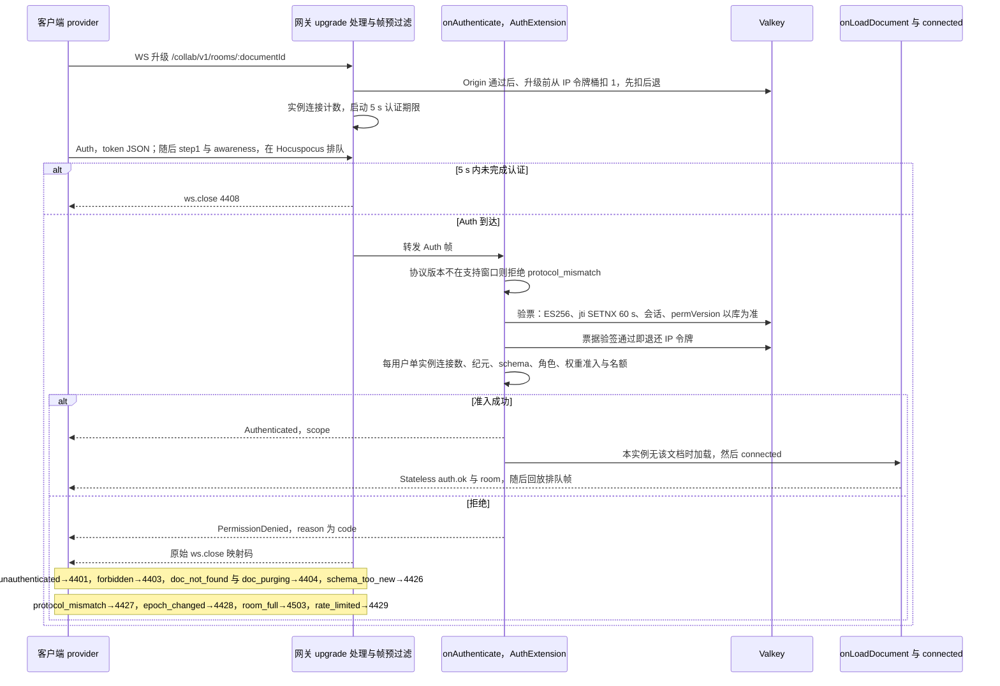

怎么读：两层 `alt` 分别是「5 s 内是否完成认证」与「鉴权和准入是否通过」；拒绝时先回 `PermissionDenied`（reason 为 `{code}`）再由钩子以原始 `ws.close` 按注记里的 code→关闭码映射关闭连接——Hocuspocus 自己的文档级关闭只带 reason、客户端恒见 1000，不能表达这些码。provider 发完 Auth 就发 step1 与 awareness，这些帧在 Hocuspocus 的认证前队列里等待（默认上限 5 MiB / 1000 条，超限 4205），认证通过、文档加载完后才回放，因此不再有「认证前 SYNC 即 4401」。判定顺序为协议版本（在票据之前：协议不兼容时票据的解析方式也不可信）→ 票据 → 每用户单实例连接数 → 纪元 → schema → 名额（60/16 §12）。**WS 升级限流是「先扣后退」**（rulings §4.20 BE-01+TX-03）：Origin 通过后、升级前从按 IP 的令牌桶扣 1，票据验签通过即退还（之后被 4503 / 4404 / 4426 / 4428 等准入规则拒绝也已退还）；4401（票据无效或重放）、4408（5 s 内未认证）、4427（协议不符）与升级后未认证就断开的连接不退，所以 IP 桶实际只约束未认证的升级，同一出口数十人被 1012 驱逐后约分 3 波、≤ 5 s 重连完（更大的出口由部署调高 `limits.ws.connectPerIpPerMin`）；已认证连接另受每用户单实例上限 `limits.ws.maxConnectionsPerUser`（默认 32，超出回 `collab.rate_limited` 并以 4429 关闭）约束。数值与键的事实源是 60/16 §1、§13；只读降级加入时 `auth.ok.reason` 为 `capacity` 或 `over_ceiling`。票据 claims 中 `sid` 是登录会话 id，`lnk` 是可选的分享链接 id（凭链接取得角色时才有，rulings §4.18 BE-02），供 §10 的角色重算复核链接状态。房间满时的只读降级见 §14 下图。2026-09-26 按 ADR-0039 重画（原图「首帧 CONTROL.auth」「CollabGateway → RoomManager.attach」「CONTROL.auth.ok 后客户端才发 SYNC」作废）。
依据：本文 §6.3、§6.5、§10、§18.5；ADR-0039 决策 1–4；60-backend/02 §8–§9（票据与 WS 鉴权）、60-backend/16 §1、§12；文件落点 40-modules/09 §4.1（`collab-upgrade.handler.ts`、`frame-prefilter.ts`、`ticket-verifier.ts`）与 §4.4（`interface/hp/auth.extension.ts`）。

### 6.4 ack 与 at-least-once 持久化

- 客户端为每个发出的 update 帧分配本地 `localSeq`；服务端在持久化（INSERT 提交）后回 `ack{seq, tier:'db'}`；客户端**只在收到 `tier:'db'` 时**清理 OfflineStore 中的已确认段并统计 `pendingLocalUpdates`。
- **挂点**（2026-09-26，rulings §4.21 H:Q1「逐帧落库 + 两级 ack」，ADR-0039 决策 5）：服务端在 Hocuspocus 的 `beforeSync`（被 await、早于应用与广播）里 await 写入器取得 seq（或进入降级档），返回后 Hocuspocus 才应用并广播；在 `afterHandleMessage`（被 await、同一连接串行）里经 Stateless 发出该帧的 ack，因此 ack 天然逐帧、按到达顺序、恰好一次。写入器的组提交为「空闲即刷、上限 100 ms 或 50 条」。Hocuspocus 原生的 `SyncStatus` 与 provider 的 `unsyncedChanges` / `synced` 只表示「已应用到内存」，**不作落库判据**。被 L2 / L3 拒绝的帧、以及污染态连接（§11）上的后续写入帧都不回 ack。
- **ack 与 localSeq 的对应**（以 40-modules/02 `ws/frames.ts` 的逐帧应答为唯一事实源，rulings §4.18 CO-09）：客户端按连接维护**在途 FIFO**（元素为 `localSeq`），每收到一帧 `tier:'db'` 弹出队首并 `ackUpTo(该 localSeq)`；`seq` 只更新 `meta.lastAckSeq`，从不与 `localSeq` 比较；`tier:'spill'` 不参与 FIFO 对应，只更新 `SessionStats`（degraded 标志、已接收计数）；断线清空 FIFO，未确认的 pending 留待重连发送（方式见下条）。
- **重连 step2 的应答**（rulings §4.18 CO-10；上限按 rulings §4.21 H:Q6 改写）：`SyncStep2` 视同一个入站 update 帧——服务端对每个 step2 恰好回一帧 `tier:'db'`（空 diff 也回，seq 取当前 head）；客户端以发送 step2 时 pending 的最大 `localSeq` 作为**一个** FIFO 条目，收到即 `ackUpTo`，被 step2 覆盖的 pending 不再逐帧重发（避免重复落库）。**step2 的大小上限**（2026-09-26，H:Q6「step2 单设 16 MiB」）：step2 由 provider 收到服务端 step1 时自动生成，无法先按 `localSeq` 切块；因此 update 帧仍 ≤ `maxUpdateBytes`（1 MiB，§11 L1），step2 单设上限 `step2MaxBytes` = 16 MiB（= ws `maxPayload`），超限按 4413 关闭，客户端导出未同步更改后重载。M2–M3 离线只在内存，超过 16 MiB 的离线差量极少，ADR-0023 验收的「离线累计 5 MiB 更改重连后全部同步且无 4413」仍成立；M4 IndexedDB 上线后再评估。服务端判空差量用 `Y.snapshotContainsUpdate`，空则不落库、`seq` 取当前 head。（原：「step2 超过 `maxUpdateBytes`（1 MiB，§11 L1）时，先按 `localSeq` 用 `mergeUpdates` 切成不超限的块、逐块以普通 update 帧发送……仍超限则上报遥测并提示导出、不无限重试」，作废。）
- **PG 故障溢写期（S-3，细化为两级 ack，rulings §4.15 S-3a）**：update 写入溢写存储（Valkey / 对象存储）成功后回 `ack{tier:'spill'}`，客户端保留 pending；溢写行以 provisional key `(instanceId, localCounter)` 排序，**正式 seq 在 PG 恢复后回放时由 PG 分配**，回放完成后逐个回 `ack{seq, tier:'db'}`（补发时原会话已断开即丢弃，由重连 step2 兜底）；回放完成前新到的 update 排在回放队列之后落库，以保持 db ack 顺序；回放 bootstrap 之后断言服务端 Y.Doc 无 `pendingStructs`。即使溢写数据丢失，客户端重连 step2 仍凭 update 幂等性补齐，NF-03「已 ack（db）零丢失」成立；多实例临时 seq 冲突与 seqRange 契约矛盾一并消除。
- **回放归属**（rulings §4.18 CO-16）：存活实例只回放自己 `instanceId` 的溢写行（`readAllOrdered(docId, instanceId)`），不读其他在线实例的行，避免两实例重复回放（ADR-0035 决策 3）；心跳过期实例留下的行，由下次加载该文档的 Room 在 bootstrap 之后持 `lock:spill:{doc}` 租约认领回放。
- **降级期照常广播**（rulings §4.18 CO-08）：PG 写失败即进入降级期，update 通过门禁、进入 none（内存退避重试）/ valkey / blob 任一档后，**立即**在本实例广播并跨实例扇出，不等持久化；`persistBeforeBroadcast` 只约束 PG 可用时的顺序。持久性由发起方 pending 兜底（收到 `tier:'db'` 才清），其他收到广播的客户端重连时经 step2 回填，风险窗口与 `persistBeforeBroadcast=false` 相同，NF-03 不受影响；指标 `cordex_collab_broadcast_before_persist_total` 记录降级广播次数。
- **「未保存到服务器」的判定与受众**（rulings §4.19 INC-09）：服务端显式信号为主——`CONTROL.room.persist`（§6.3），PG 写失败 ≤ 1 s 内推 `degraded`，回放完成且无溢写后推 `ok`，不新增帧类型。客户端判据 = `room.persist === 'degraded'` ∨ 在途含仅获 `tier:'spill'` 确认的项 ∨ 最老在途项等待 ≥ `unsavedWarnAfterMs`（collab-yjs 配置，默认 15000，不借用心跳间隔）。受众分级：有本地未获 db 确认项的**发起方**显示横幅「未保存到服务器 N 项」；**其余协作者**只在状态胶囊显示弱提示「服务器保存延迟」（他们此期间看到的他人修改可能丢失）。三条判据都可在故障注入测试中机械断言。
- `Session.flush()` = 等待 `pending == 0`；关闭页面前由 UI 调用（`beforeunload` 提示）。
- **落点**：本节是跨端协议语义；客户端在途 FIFO（provider 的 `outgoingMessage` 事件与垫片映射 `localSeq`）、step2 上限与「未保存」派生规则见 [50-frontend/07](../50-frontend/07-collaboration-client.md) §6，服务端 ack 发出规则见 [60-backend/16](../60-backend/16-ws-protocol-server-view.md) §5，溢写档位、`persist` 信号与回放见 [60-backend/05](../60-backend/05-modules-collab-and-snapshots.md) §6。
- 服务端崩溃于「已广播未落库」窗口：其他客户端已应用该 update 但库中缺失 → 它们下次同步时 step1/step2 会把该内容回填给服务端（CRDT 幂等），因此**最终不丢**；只有当所有持有该 update 的客户端都消失时才丢，故要求：PG 可用时广播前先落库（默认），或在配置 `persistBeforeBroadcast=false`（低延迟模式）时接受这一窄窗口。默认 `true`。

**update 两级 ack 时序**

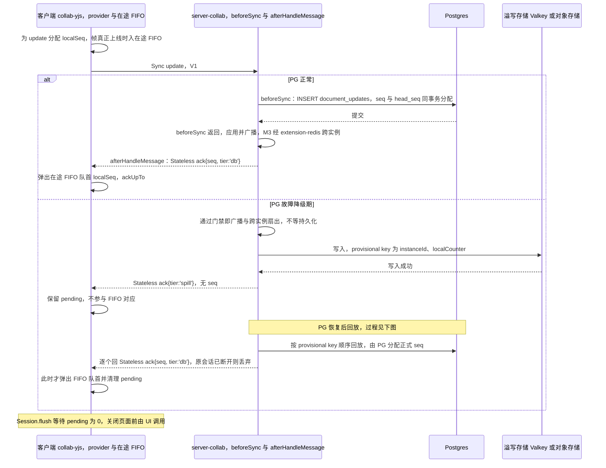

怎么读：`alt` 两个分支分别是 PG 可用与 PG 故障降级期；只有 `tier:'db'` 的 ack 让客户端弹出在途 FIFO 队首并清 pending，`tier:'spill'` 只表示已进溢写存储、客户端必须继续保留（S-3a）。PG 可用时先落库后广播（`persistBeforeBroadcast=true`，挂点是 `beforeSync`），降级期通过门禁即广播（rulings §4.18 CO-08）。2026-09-26 按 ADR-0039 标出挂点，ack 改经 Stateless（原图「LocalBatcher」「CONTROL ack」作废；provider 以 `flushDelay` 50 ms 合并出站）。
依据：本文 §6.3、§6.4；60-backend/11（CRDT 持久化形态）；60-backend/05 §5–§6、60-backend/16 §5；rulings §4.15 S-3a、§4.18 CO-08/CO-09。

**PG 故障溢写与回放**

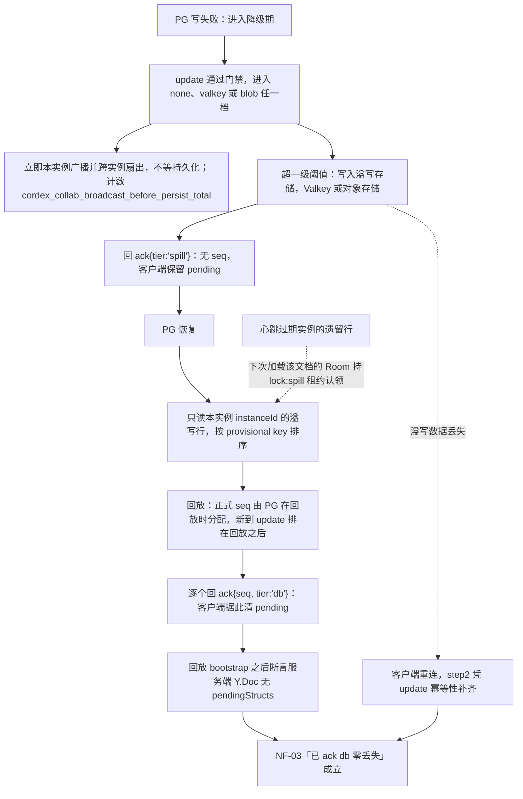

怎么读：实线是正常的降级—溢写—回放主路径，虚线是两条兜底：遗留溢写行由下次加载该文档的 Room 认领回放（CO-16），溢写数据本身丢失时由客户端 step2 补齐；两条路径都收敛到 NF-03。降级期的广播与持久化并行，Room 始终保持 active（§5.2）。由于正式 seq 只在回放时由 PG 分配，多实例临时 seq 冲突与 seqRange 契约矛盾一并消除。

### 6.5 关闭码约定（`@cordexjs/protocol/src/collab/close-codes.ts`）

本表补全后是 `close-codes.ts` 的唯一源（决策 INC-06），`close-policy.test` 覆盖全表（原名 `heartbeat-and-close-codes.test`，随应用层心跳删除而改名）；「客户端行为」列不同即分码。**发出方式**（2026-09-26，ADR-0039 决策 2）：一个 WS 只承载一个文档，服务端的业务关闭一律由网关或钩子调**原始 `ws.close(码)`** 发出，客户端才能拿到原码；Hocuspocus 钩子抛错产生的文档级 CLOSE 只带 reason、客户端恒见 1000，不作业务关闭手段。provider 本身不看关闭码，客户端在构造配置的 `onClose` 里按本表决定是否重连（`autoConnect:false`、`maxAttempts:1`，重连由自有调度器驱动）。服务端触发条件见 [60-backend/16](../60-backend/16-ws-protocol-server-view.md) §10，客户端行为与 UI 文案细则见 [50-frontend/07](../50-frontend/07-collaboration-client.md) §9。

| 码 | 含义（错误码） | 客户端行为 |
|---|---|---|
| 1000 | 正常 | closed |
| 1001/1006 | 网络/对端离开 | backoff 重连 |
| 1011 | 服务端内部错误（`kernel.invariant_violation` 及未知异常，不向客户端泄漏细节） | 退避重连并上报 |
| 1012 | 服务重启/驻留实例驱逐；连接污染后权限升级或解锁（reason `contaminated`，§11，2026-09-26） | 立即重连（不退避首轮）；reason 为 `contaminated` 或本地有被拒项时先按 §18.4 重建 |
| 4205 | 认证前排队超限：主触发是适配层对认证前入站帧的严格计数超过 `limits.ws.preAuthMaxFrames` / `preAuthMaxBytes`（默认 16 帧 / 64 KiB，只计到 `Authenticated`，[60-backend/16](../60-backend/16-ws-protocol-server-view.md) §13）；Hocuspocus 内部认证前队列或待认证文档数超限（宽上限，默认 5 MiB / 1000 条）只作兜底（错误码 `collab.pre_auth_overflow`，新增（§4.21），ADR-0039） | 退避重连并上报（正常客户端不应触发） |
| 4400 | 坏帧（`collab.bad_frame`；含帧地址与 URL 文档不符、CONTROL zod 失败、客户端发 BroadcastStateless、Auth 帧超 8 KiB） | 上报 bug，重连（计数超 3 次进入 quarantined） |
| 4401 | 未认证/票据过期/登录会话已吊销/`auth.refresh` 校验失败（`collab.unauthenticated`） | 换票据重连；换票 401 → 「登录已过期」 |
| 4403 | 无权限（`collab.forbidden`，含票据 `doc` 与 URL 不符） | denied（监听权限变化） |
| 4404 | 文档不存在/已删除/永久删除中（`collab.doc_not_found`、`collab.doc_purging`） | closed + 提示 |
| 4408 | 超时（`collab.auth_timeout` 认证超时：网关 5 s 内未完成认证；`collab.idle_timeout` 空闲超时（新增（§4.21））：网关每 5 s 查、45 s 无入站帧；2026-09-26 由认证超时扩为超时通用码） | 重连 |
| 4409 | 被隔离（`collab.quarantined`，重复触发修复） | quarantined，提示刷新 |
| 4413 | 帧过大（`collab.payload_too_large`：update 帧 > `maxUpdateBytes` 1 MiB，或 step2 > `step2MaxBytes` 16 MiB） | 丢弃该 update 到「未同步更改」并提示；step2 超限时导出未同步更改后重载 |
| 4426 | schema 过新，客户端需升级（`collab.schema_too_new`）；内容级插件集已随重新部署变化（`collab.plugins_outdated`，握手时 Auth token `pluginSet.catalog` 与部署不符，2026-10-01，rulings §4.23） | 提示刷新（`plugins_outdated` 同走版本漂移：先 flush 未确认更改再刷新，刷新前不接受新写入） |
| 4427 | 协议版本不兼容（`collab.protocol_mismatch`） | 提示刷新 |
| 4428 | 文档纪元已变更（`collab.epoch_changed`；运维换纪元或覆盖既有文档的导入，§9.4） | 丢弃本地 Y 状态、重新 bootstrap；pending 移入 `rejected` 并提供导出（不复用 4426：行为不同） |
| 4429 | 速率限制（`collab.rate_limited`；含握手期每用户单实例连接数超 `limits.ws.maxConnectionsPerUser`，rulings §4.20 BE-01+TX-03） | 退避后重连 |
| 4503 | 房间不可用/满/draining/bootstrap 失败（`collab.room_full`、`collab.bootstrap_failed`） | 退避重连 |

---

## 7. Awareness / Presence 模型（详见 ADR-0024）

### 7.1 状态 schema（`@cordexjs/protocol/src/collab/awareness.ts`，zod，草案）

```ts
interface AwarenessState {
  v: 1
  user: { id: UserId; name: string; color: string; avatar?: string }
  client: { id: number; device: 'desktop' | 'tablet' | 'phone'; appVersion: string }
  view?: { slideId: SlideId; zoom?: number }                        // Operation（视图状态）的广播形态
  selection?: { slideId: SlideId; shapeIds: ShapeId[] }
  caret?: { shapeId: ShapeId; anchor: string; head: string }        // RelativePosition(base64)
  editing?: ShapeId                                                 // 正在文本编辑的形状（用于「锁定提示」而非锁）
  idle?: boolean
  ts: number                                                        // 客户端时间，仅用于排序显示
}
```

- 大小上限 2 KiB/状态；服务端对超限或 schema 非法的状态条目**丢弃**并计数（不关闭连接）。**服务端中继**（2026-09-26，rulings §4.21，ADR-0024 修订、ADR-0039 决策 4）：房间级 Awareness 用 Hocuspocus Document 自带的实例，新连接的全量推送、断开时移除该连接全部 clientID 并广播、`QueryAwareness`、M3 跨实例同步（extension-redis）都是原生实现；自有逻辑只挂 `beforeHandleAwareness`：逐条 zod 校验、> 2 KiB 删除、clientID 与 Auth token 声明的 `clientId` 不符即删、盖 `user.id` 章、只读会话剥离 `selection` / `caret` / `editing`，**只就地删改、从不抛错**（抛错会关闭该文档连接）。只读连接仍能发 awareness（Hocuspocus 对 awareness 不检查 `readOnly`），因此剥离是必做项。
- 频率：`caret`/`selection` 变化最多 20 Hz；`view` 等 2 Hz；`idle` 在 60 s 无输入后置位。awareness 超时 30 s（y-protocols 默认）→ 服务端也在会话断开时主动广播「移除」。客户端 provider 以 `flushDelay` 50 ms 合并 update 与 awareness 出站；y-protocols 每 15 s 续期一次本地状态，这也是客户端到服务端的保活（本地 awareness 不可设为 null）。**满员合并**（rulings §4.21 H:Q5）：房间在线 ≥ 20 时服务端包装 `Connection.send`，只对 awareness 帧按连接每 100 ms 合并下发，文档更新帧直通（按文档调 `flushDelay` 会把文档更新 p50 从 1.5 ms 拖到约 103 ms，不采用）。
- Presence 服务是 UnitScope 服务，UI 覆盖层（07 §7）与设计 20-design/05 消费 `presence.remotes`。
- 不持久化、不审计内容（只审计 join/leave）。
- 落点：本节 schema 为跨端契约；客户端节流与在场 UI 见 [50-frontend/07](../50-frontend/07-collaboration-client.md) §10–§11，服务端 relay、校验与满员合并 tick 见 [60-backend/16](../60-backend/16-ws-protocol-server-view.md) §7。

**Awareness 广播时序**

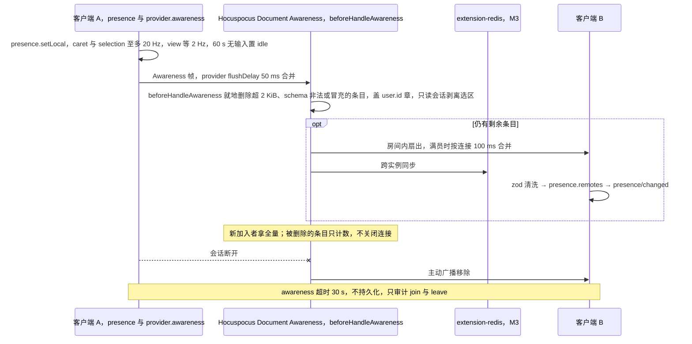

怎么读：实线是 awareness 状态的流向，`--x` 表示连接中断；`opt` 段是校验后仍有合法条目时的扇出。客户端 B 收到后由 UI 覆盖层（07 §7）消费 `presence.remotes`。2026-09-26 按 ADR-0039 改为 Hocuspocus 原生中继 + `beforeHandleAwareness`（原图「awareness-relay」「FanoutBus 按 instanceId 去重」作废）。
依据：本文 §7.1、§14；ADR-0024 修订 2026-09-26；60-backend/16 §7（awareness 的服务端处理与满员合并）。

### 7.2 「软锁」语义

文本编辑不加锁（Yjs 字符级合并），但 UI 显示「X 正在编辑」（来自 `editing`）；形状拖拽亦不加锁，靠 LWW 收敛。**不做排他编辑锁**（章程 Q16 已裁决，rulings §4.16：只有 awareness 软提示，冲突按 CO-08 软冲突规则）；如将来需要，可作为可选插件基于 awareness + 服务端仲裁另立项。

---

## 8. 软冲突语义（并发但无「冲突错误」；全部自动收敛）

| # | 场景 | 原语层结果 | 用户可见结果与缓解 |
|---|---|---|---|
| 1 | A、B 同时把形状 S 移到不同位置（`xfrm.off`） | 两键 LWW，B（更晚时钟/更大 clientID）胜 | A（本地 60 s 内写过该键且被远端覆盖的一方）看到 S「跳」到 B 的位置，并收到提示「B 移动了该形状」+「恢复我的值」（新的本地事务，写回 A 最后一次写入的值，可审计、可再撤销；不是撤销）；emit `collab/soft-conflict{type:'prop-lww'}`（rulings §4.15 Q3；PRD CO-08） |
| 2 | A 删除形状 S，B 同时编辑 S 文本 | 删除 = 写 `_deleted` 墓碑（rulings §4.15 Q3，04 §3.1a），实体与其 `XmlText` 仍在 Y.Doc 中；B 的文本编辑落在墓碑实体上、**不丢失**；读路径过滤使 S 不可见 | B 端：observe 到 S 被标墓碑且本地 60 s 内有对 S 的本地事务 → UI 提示「元素已被 A 删除」+「恢复」（清除墓碑，**原 id** 复活，连同 B 的编辑；这是 B 的新事务而非撤销）；A 撤销删除同样是清除墓碑、原 id 复活，二者并发不会产生重复元素；TTL（默认 24 h）后硬删除，或所有者对墓碑态元素做经审计的「彻底删除元素」（rulings §4.18 CO-07）后立即硬删除，之后不可恢复；删除方此后再撤销该步按整步跳过（`wholeStep:true`），与 TTL 到期同一路径 |
| 3 | A 删除幻灯片 P，B 在 P 中新增形状 | P 写墓碑；B 新增的形状 `containerId` 指向墓碑页 → 随 P 一并不可见（不变量：以包含关系 `containerId`/`parentId` 引用墓碑的形状视为已删除；`layoutId`/`masterId`/`themeId` 指向墓碑则读时容错、硬删时修复，见 05 §13.4、04 §12.3，rulings §4.20 FE-04） | 同 #2 的提示，粒度为页；「恢复此页」清除 P 的墓碑，P 以原 id、原 `order` 复活，B 新增的形状随之可见 |
| 4 | A、B 都在第 3 页之后插入新页 | 两页都存在；`order` 键都在 (k3, k4) 之间，比较 `(order, id)` 得到确定顺序 | 两页相邻出现，顺序在所有端一致；无提示 |
| 5 | A 把 X 放入组 G，B 同时把 G 放入 X（父子环） | 两个 `parentId` 各自 LWW 成功 → 形成环 | **修复规则**（客户端 observe 后与服务端软门禁都执行，结果确定）：沿环取 id 字典序最大的节点，把它 `parentId` 置为 null（回到页根）；记录 `collab/repair`。fuzz 断言：修复后无环且所有端一致 |
| 6 | A 改 S 填充色，B 改 S 位置 | 不同键，都存活 | 期望行为 |
| 7 | A、B 同时编辑同一段落不同位置 | Yjs 字符级合并 | 期望行为；光标经 RelativePosition 保持相对位置 |
| 8 | A 在段落中回车分段，B 同时给被移动的尾部文本加粗 | 尾部文本被 A 删除+重插，B 的 format 落空 | 尾部失去加粗；已知限制（y-prosemirror 同）；缓解：分段实现优先「保留头部、移动较短的一侧」以减小受影响范围（**这不改变正确性，只降低概率**） |
| 9 | A 更换幻灯片版式，B 编辑占位符文本 | `layoutId` 与 `txBody` 不同键，都存活 | 渲染按新版式解析继承（架构 04），文本保留 |
| 10 | A 撤销自己的移动，但其间 B 也移动了同一形状 | undo 包装层检测到 `xfrm.off` 已被 B 后写 → **跳过该键、不覆盖他人**（契约字段 `undo.remoteConflict:'skip'`，rulings §4.15 Q3，不采用 Yjs 默认）；该撤销单元的其余键照常回退；若整步都被跳过 → 本次撤销停下，不连撤更早一步 | A 看到提示条「部分内容已被 B 修改，未撤销」+「恢复我的值」（新的本地事务，写回 A 的旧值，可再被撤销）；emit `store/undo-skipped`（**单独统计**跳过次数与整步跳过次数，不计入 `collab/soft-conflict` 软冲突率，rulings §4.17 D5）；撤销目标已被他人删除（墓碑 TTL 内亦然）同样跳过并提示、**不复活**，恢复由删除方撤销或「恢复元素」完成（rulings §4.17 D4）；文档化于设计 05、PRD CO-08/CO-09 |
| 11 | 离线的 A 修改了 S，在线的 B 早已删除 S | S 为墓碑：重连后 A 的修改合入墓碑实体（不可见但不丢）；若 B 的删除已超过 TTL 被硬删除，A 的修改落在已删类型上被丢弃 | A 收到 #2 的提示，可「恢复」（TTL 内）；超 TTL 时 A 的离线更改可从「未同步更改」导出为 JSON |
| 12 | A 被降权为 viewer 时仍有 pending update | 服务端拒绝（`error{collab.forbidden}`），不落库不广播 | A 端把被拒的本地事务放入「未同步更改」（本地 OfflineStore 的 `rejected` 区），横幅提示可导出/复制；本地视图保留还是回滚？→ **回滚**到服务端状态（fail-closed 一致性优先），提供导出（待产品确认 P3） |
| 13 | 两人同时对同一文档执行「页眉和页脚 › 全部应用」（2026-09-26） | 页脚族占位符用确定性 id `deriveNodeId('hf', slideId, type)`（ADR-0014 决策 9），两端新建落到同一实体键 | 新建收敛为一个占位符；对已存在的页脚并发改写仍按文本合并，可能拼接两人的文字（50-frontend/21 §4） |
| 14 | 两人同时把内容填入同一个空内容占位符（2026-09-26） | 两个新元素带同一 `PlaceholderRef` 都存在 | 两者都保留；软不变量 I-PH1 由服务端软门禁修复一次：保留 `(order, id)` 最小者作占位符，其余转为普通元素（ADR-0018 决策 10） |
| 15 | A 取消组合，B 同时移动整组（2026-09-26） | A 给组写墓碑、子元素的 `parentId` 改回页根并折算变换；B 的 `xfrm` 写在墓碑组上 | 子元素保持 A 折算后的位置，B 的移动不生效（落在不可见的墓碑组上）；B 端按 #2 提示「组合已被 A 取消」 |

**机械验证**：每一行对应 `test/collab-sim/scenarios/<n>.test.ts` 的确定性脚本（固定 clientID 与时钟），加 fuzz 的随机覆盖。本表为跨端语义；客户端信号分流（哪类冲突向谁 emit、Toast 与恢复命令）见 [50-frontend/07](../50-frontend/07-collaboration-client.md) §12，「恢复我的值」「恢复元素」命令契约见 [50-frontend/04](../50-frontend/04-document-commands-and-undo.md) §6（决策 RESTORE-CMD）。

---

## 9. 大文档加载与体积治理（rulings §4.15 Q5 两层口径：性能保证包络 D200 / 20 编辑者 + 50 查看者 / 200 MB；系统天花板 200 页 / 单页 1,000 / 文档总元素 20,000）

### 9.1 加载策略：HTTP 快照 bootstrap + WS 增量

1. `GET /api/v1/documents/:id/snapshots/latest`（直接返回字节：zstd 压缩的 V2 update，> 1 MiB 由服务端从 snapshots 桶流式代理、不返回预签名 URL，决策 MECH-INC 之 INC-14；`ETag = snapshotId`、私有缓存每次以 `If-None-Match` 复核；响应头 `X-Cordex-Epoch` 下发文档纪元，供 `auth.epoch` 回报，§6.3）→ 客户端在空 Y.Doc 上 `applyUpdate`（origin=`import`，不入撤销栈）。M2 起应用壳打开服务端文档一律走本路径（rulings §4.19 D-M2-CONTENT，§0.1）。
2. 并行建立 WS；provider 以已应用快照的 Y.Doc 作 `document`，认证后 step1 / step2 只交换**差量**（通常几十 KB；2026-09-26，ADR-0039）。
3. 首屏渲染不等待 `live`：`syncing` 状态即可渲染与编辑（本地 pending 排队）。协同模式**不走** 50-frontend/04 §2 的「Worker 分批解析 + 首批装载、后台追加」打开路径（那条路径只用于本地打开 .pptx，rulings §4.18 CO-12）：Y 状态一次由 HTTP 快照 bootstrap。
4. 媒体字节按需拉取（`BlobRef.sha256` → `GET /api/v1/documents/:id/media/:sha256`：要求 `doc.read` 且该文档与媒体的关联存在，否则 404；返回 200 JSON `{url, expiresAt}`（1 h 预签名 GET，不 302，60-backend/15 §3.6），客户端再以不带凭据与自定义头的请求直取，决策 INC-21、INC-25），blob URL 生命周期由客户端 MediaCache 管理（决策 MEDIA-CLIENT），并受渲染层 LRU（07）约束。无文档作用域的 `/media/*` 端点已删除。

体积估算与预算（供设计容量）：200 页 × 30 形状 × ~25 键 × ~40 B ≈ 6 MB（未压缩 V2 update），富文本 200 页 × 600 字 ≈ 1 MB；**预算：单文档 Y 状态 ≤ 16 MB（未压缩）/ ≤ 4 MB（zstd）**（D200 包络内）。**内存按实测**（决策包实测 Yjs 约 13.8 KB 堆/元素）：D200（≈ 6,000 元素）≈ 85 MB、D50 ≈ 17.8 MB、天花板 20,000 元素 ≈ 276 MB；墓碑在 TTL 内计入元素数与 Y 状态体积。服务端房间准入据此改为**按文档实测权重**（§14），不再按固定 MB/房间；`store.limits` 在 64 MiB 触发告警（不阻断）。**时间预算：** 200 页文档在 10 Mbps 下 time-to-synced ≤ 3 s（p75），首页可见 ≤ 1.5 s（见 07）。测量：span `collab.bootstrap`（含 HTTP 与 step2）。

### 9.2 为什么不用 Yjs subdocs（按页懒加载）

- 200 页的 CRDT 状态在预算之内；subdocs 的 provider 支持不成熟（y-websocket 部分支持，Hocuspocus 不支持），跨 subdoc 的 UndoManager/RelativePosition/事务原子性（跨页移动形状）都要自造。
- **触发重评估的条件**（写入 ADR-0020 后果）：实测 p95 bootstrap 超预算 2 倍、或产品把规模上限提升到 ≥ 1000 页。届时方案：`slides/<id>` 值改为 `Y.Doc`（subdoc），页顺序仍在父文档。

### 9.3 更新流量治理

- 本地 50 ms 合并（键入 1 字 ≈ 30–60 B；合并后每帧 ≤ 数百 B）。2026-09-26 起由 provider 的 `flushDelay: 50` 以固定窗口合并 update 与 awareness（`Y.mergeUpdates`），出站约 20 + 20 帧/s，远低于 200 Hz，客户端自有的出站令牌桶删除；批次将超 1 MiB 前先 `flushPendingUpdates()`；运行期收到 4429 时 `flushDelay` 加倍（ADR-0039 决策 8；原「LocalBatcher 50 ms 合并 + 客户端令牌桶」作废）。
- 单 update 帧上限 1 MiB（超过多为粘贴大表格/导入）；超限 → 客户端**拆分事务**（命令层按形状分批，A 线契约：`commands` 支持 `chunked` 选项）或走 HTTP 导入路径；单个 update 本身超 1 MiB 无法再拆时，服务端 4413 后客户端导出重载。本条只覆盖编辑期；重连 step2 不再先拆块，单设 16 MiB 上限（§6.4，rulings §4.21 H:Q6）。（原：「按 §6.4 先拆块再发」，作废。）
- 速率上限：每连接 200 帧/s（突发 500，令牌桶；PRD CO-12）、10 MiB/min；awareness 节流 ≥ 50 ms（≤ 20 帧/s）；超限关闭 4429。令牌桶与单帧大小在网关适配层的帧预过滤里执行（Hocuspocus 没有消息速率与单帧门禁，ws `maxPayload` 设为 16 MiB 作硬顶），被拒帧不进 Hocuspocus。
- **更新回显**（2026-09-26，证据 K18-A）：Hocuspocus 把每个 update 广播给包括发起方在内的全部连接，1 MiB 的更新会让发起方再收 1 MiB；因合并批次里也有他人更新、无法可靠过滤，接受回显，计入客户端下行预算（PRD 04 §1.6 注脚）。
- **每连接串行**：同一连接的帧在 Hocuspocus 里串行处理，`beforeSync` 里 await 落库使 PG 提交时延直接限制单连接帧率，并阻塞同一连接的 awareness；写入器因此采用「空闲即刷、上限 100 ms 或 50 条」的组提交（ADR-0025 决策 1）。

### 9.4 长期增长：结构数与 epoch（已知限制）

Yjs 删除留下结构元数据（内容 GC 后仍占若干字节/结构）。监控 `cordex_ydoc_structs`（来自 `yjsBackend.stats()`），阈值 5M。超阈值的治理路径「**换纪元（epoch）**」：服务端在无在线编辑者的维护窗口把当前模型 `exportSnapshot()` 后导入全新 Y.Doc（`meta.epoch + 1`），旧纪元客户端连入时收到 `auth.denied{collab.epoch_changed}` 需刷新；其离线更改通过模型级 diff 转成新纪元的 Mutation（M5+ 才实现；M3 只做监控与手动触发，PRD 05 §0.3）。客户端判定纪元变化依据 `auth.epoch` 与关闭码 4428（§6.3、§6.5）。列入待决事项 P5。**文档名随纪元**（2026-09-26，ADR-0039 决策 7，证据 K8-B）：Hocuspocus 文档名为 `{docId}:{epoch}`（URL 仍是 `docId`），换纪元后新纪元天然是一个新文档，旧纪元的文档在会话以 4428 关闭后自然排空、卸载，extension-redis 的频道也随之隔离；压缩、清扫与溢写按 `(docId, epoch)` 键。

**覆盖导入同样换纪元**（2026-09-25，rulings §4.19 N1）：带 `docId` 的服务端导入整体替换既有文档的内容，导入期间文档 `locked`（在线会话收到 `room{locked:{reason:'import'}}` 转只读），worker 上的导入处理器写 `epoch + 1` 的 `import` 快照并在同一事务推进 `documents.epoch`、解锁，随后经既有的 `room:{docId}:ctl` 发 `epoch`；在线会话以 4428 断开后重新 bootstrap，未获 db 确认的本地更改移入 `rejected` 并可导出（与运维换纪元同一客户端流程，§18.4）。不新增 worker → collab 的触发通道，旧纪元副本漏收通知时由取号的纪元栅栏兜底。与此相对，**版本恢复不加锁、不换纪元**：它是持有 Room 的 collab 进程内的单个事务，在线会话不断连（ADR-0025 决策 6）。机制唯一源：[60-backend/06](../60-backend/06-modules-jobs-import-export-thumbnails.md) §6.5、[60-backend/05](../60-backend/05-modules-collab-and-snapshots.md) §9.2、§10。

---

## 10. 权限变更即时生效（D12 双点 fail-closed）

**权限变更即时生效链路**

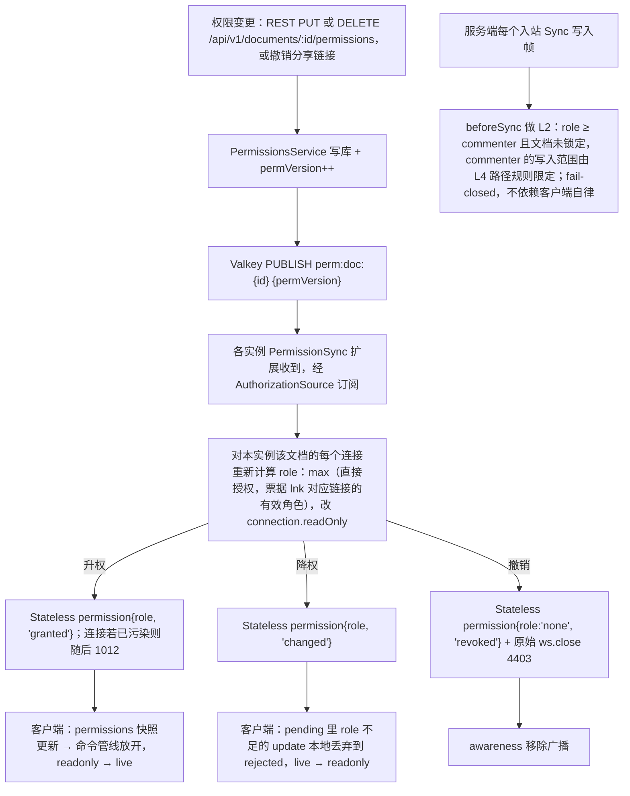

怎么读：上半部分是一次权限变更从 REST 写库到各实例、各会话的传播，三个分支按变更方向分别下发不同的 Stateless `permission`（2026-09-26 起由 server-collab 的 `PermissionSync` 扩展执行：改 Hocuspocus `connection.readOnly`、下一帧生效，Valkey 恢复后对本实例全部会话全量重算；原图「各实例 RoomManager」作废）；与主链不相连的最后两个节点是与传播并行、始终生效的服务端逐帧检查。客户端侧收到权限帧后经 `permissions.applyRemoteDecisions` 唯一入口生效（§18.3）。同一频道 `perm:doc:{id}` 还承载文档锁定通知：载荷为 `{docId, permVersion?, lockChanged?}`，锁定或解锁提交后发布 `{docId, lockChanged: true}`（不递增 `permVersion`），各实例重读 `documents.status` 后推 `CONTROL.room{locked}`，解锁推不带 `locked` 的 `room`（§6.3）；控制频道 `room:{docId}:ctl` 只承载 `close` 与 `epoch`（60-backend/14 §3.2、60-backend/16 §8）。

**D12 原则**：客户端命令管线与服务端网关两点都缺省拒绝；网关是安全边界。SYNC 写入门槛为 **≥ commenter**：评论的事实源是 ResourceHook `comments.threads`（包 `@cordexjs/comments`，经 `comments.*` 命令写 CRDT，rulings §4.19 D-COMMENTS-PKG、PRD PD-04），commenter 必须能写 CRDT；其写入范围由 L4 路径级规则限定在 `resources['comments.threads']`，且作者只能改自己的实体（§11，ADR-0034 补充 v0.2），viewer 的写入一律在 L2 拒绝（ADR-0029 决策 3 修订 2026-09-25）。服务端传播链路（`perm:doc` 频道、`perm:ver`、AuthzSource 重算、`PermissionSync` 扩展）见 [60-backend/02](../60-backend/02-auth-chain.md) §11；客户端降权处理（pending 丢入 `rejected`、横幅与导出）见 [50-frontend/07](../50-frontend/07-collaboration-client.md) §8。

- 票据（ticket）里携带 `permVersion`；连接时若与 Valkey 中的最新值不同则以库为准（防止用旧票据绕过）。
- **凭分享链接加入的会话**（rulings §4.18 BE-02，「解析归权限模块」）：票据增可选 claim `lnk`（shareLinkId；`sid` 仍指登录会话 id）。链接令牌的解析由 PermissionsModule 导出的 `ResolveShareLinkUseCase`（经 SECURITY DEFINER 函数只读 `share_links`）完成，REST 侧 ShareLinkGuard 与 WS 侧 AuthzSource 共用同一用例，两处解析结果必须一致；ShareLinks 模块只管创建、撤销、列表与守卫。AuthzSource 重算时取 `max(直接授权, lnk 对应链接仍有效时的角色)`，因此他人改动文档权限不会把只凭链接加入的会话误降为 none；链接撤销随 `permVersion` 广播，≤ 1 s 降权；会话记录 `linkExpiresAt`，到期由服务端主动重算降权，不等下一次权限事件。机械验证：集成用例「他人改权限不踢链接会话」「撤销链接后 ≤ 1 s 降权」「链接到期后主动降权」（落点 40-modules/08、09）。
- 传播预算：变更到所有在线会话生效 ≤ 1 s（p95；PRD 门禁 ≤ 2 s）；测量：审计事件时间戳与 `permission/changed` 的 telemetry 事件差。
- 客户端检查点（命令管线的 `permissions` waterfall，架构 05）是**UX 守卫**；服务端网关是**安全边界**。两者都缺省拒绝。

---

## 11. 服务端对 update 的校验策略（详见 ADR-0034）

| 层 | 挂点（2026-09-26，ADR-0039） | 检查 | 失败处理 | 成本 |
|---|---|---|---|---|
| 硬门禁 L1（帧） | 网关适配层帧预过滤，进 Hocuspocus 之前 | 帧地址等于 URL 文档、类型合法、客户端不得发 BroadcastStateless、Auth 帧 ≤ 8 KiB、update ≤ 1 MiB（step2 ≤ 16 MiB）、速率；CONTROL 的 zod 在 `onStateless` | 4400/4413/4429；被拒帧不进 Hocuspocus，不广播不落库 | O(1) |
| 硬门禁 L2（权限） | `beforeSync` | Sync 写入要求 `session.role ≥ commenter`（映射为 `connection.readOnly`）；文档非 `locked`；Awareness 各角色可发，只读会话在 `beforeHandleAwareness` 被剥离 | Stateless `error{collab.forbidden}`；计数；3 次 → 4403；连接进入污染态 | O(1) |
| 硬门禁 L3（结构） | `beforeSync` | `Y.decodeUpdate` 可解析（Yjs V1）；结构数 ≤ 50k/帧；元素总数不超天花板 | 不可解析或结构超限 4400；超天花板 Stateless `error{document.quota_exceeded}`，连接进入污染态 | O(帧大小) |
| 软门禁 L4（语义） | `afterHandleMessage` | 在服务端 Unit 上 `applyUpdate` 后，对 `ChangeSet.paths` 做 zod 校验（model-slide 的 schema，架构 04）与不变量检查（无父子环、`parentId` 存在、`layoutId` 存在、`order` 为合法 FracKey、`schemaVersion` 未被改）；路径级权限：commenter 的写入只能触及 `resources['comments.threads']`，且只能改自己作者的实体 | **修复事务**：服务端以 origin=`repair` 写补偿 Mutation（如置 `parentId=null`、恢复 `schemaVersion`、为非法 `order` 生成新键），先在 Room 上执行并广播、经 `onChange` 送写入器，向来源会话发 Stateless `repair`；同一 session 10 分钟内触发 ≥ 5 次 → 4409 quarantined | O(变更路径) |

- **连接污染规则**（2026-09-26，ADR-0039 决策 6，取代原「L2、L3 拒一帧、连接照常」的非致命语义）：一条连接一旦有写入帧被 L2 或 L3 丢弃（含运行中降权、锁定），之后的全部写入帧一律不落库、不回 ack，直到重连；其间不允许把 `readOnly` 恢复为 `false`；权限升级或解锁时若该连接丢过帧，先发 `permission` 再以 1012（reason `contaminated`）关闭，客户端按 §18.4 重建。原因：被拒帧之后同一客户端的更新可能因缺前驱挂在 `pendingStructs`，照常落库并 ack 就成了「已 ack 但不可见」且永久留在快照里的数据（证据 vB）。落库前另用 `Y.parseUpdateMeta` 加删除集缺口检查兜底（只含删除的帧查不出结构缺口，vD）。
- 为什么不「拒绝并回滚」：CRDT 已把 update 交给了其他客户端（或即将），单点拒绝会导致分叉；补偿事务保持全网收敛（I7）。
- 为什么仍要做：schema 与不变量是渲染/导出代码的前提（fail-closed 的另一面——数据层不能信任任意客户端）。
- 校验只在服务端做完整版；客户端 observe 时做**轻量**环/孤儿修复以保证本地渲染稳定（结果与服务端确定性一致，因为规则相同、输入相同）。

**入站 update 的四层门禁**

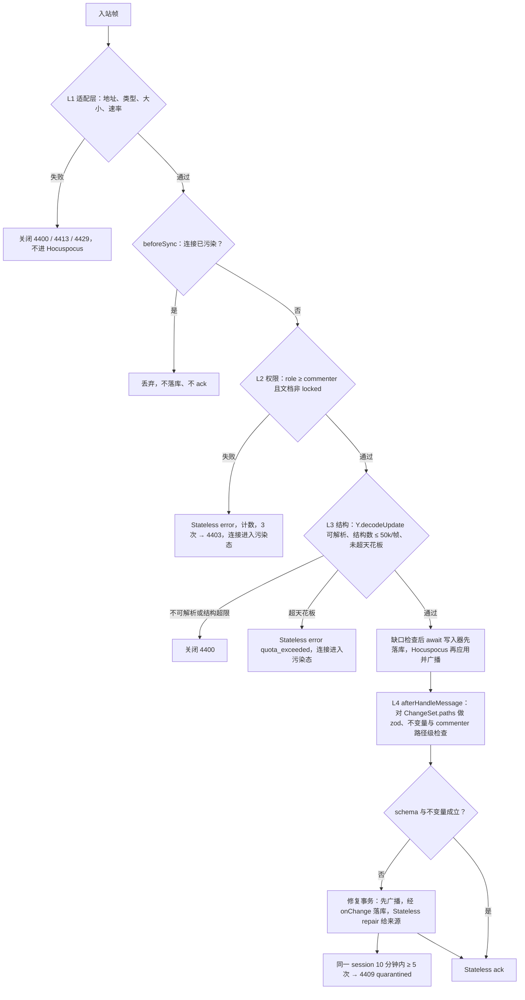

怎么读：菱形是逐层判定，L1–L3 是硬门禁，失败即拒绝且不扇出（I8）；L4 是软门禁，不拒绝而是追加修复事务以保持全网收敛（I7）。2026-09-26 起按 Hocuspocus 挂点画（ADR-0039）：L1 在进 Hocuspocus 之前，L2、L3 与落库都在 `beforeSync`（所以原 update 先落库、后广播），L4 在应用之后的 `afterHandleMessage`；多出的「连接已污染」判定见上方连接污染规则。L4 的行为受 `softGate` 配置（`repair`、`report-only`、`off`）控制：默认不变量 `repair`、schema 类型 `report-only`，已裁决（rulings §4.1 P8：采纳 ADR-0034，§18.5），随协同后端自 M2 生效（PRD 05 §0.3 CO-12）。门禁分层的服务端实现、数值与出口见 [60-backend/16](../60-backend/16-ws-protocol-server-view.md) §4（ADR-0034 仍为决策）。

---

## 12. 离线队列与重连（详见 ADR-0033）

> 里程碑（§0.1，PRD 05 §0.3）：基础重连（指数退避、先鉴权再同步、补发未获 db 确认的更改）随协同后端在 M2 交付；offline 判据与横幅、offline 后周期重连、离线积累更改的重连同步（step2 单设 16 MiB 上限，§6.4）属 M3 离线体验（CO-06）；跨刷新的 IndexedDB 持久化（`collab-offline-idb`）为 M4 P2（PD-05）。客户端实现（计时器、横幅、多标签页离线库独占锁，决策 OFFLINE-TABS）见 [50-frontend/07](../50-frontend/07-collaboration-client.md) §4、§7；本节保留跨端约束。

- Provider：`OfflineStore` 由 `y-indexeddb`-风格的 IndexedDB 实现；**collab-yjs 本身保持 iso**，IndexedDB 实现放在 dom 包 `@cordexjs/collab-offline-idb`（L4，总编排已批准 S1，进入章程 v0.2 包清单；未加载该 Provider 时 collab-yjs 降级为内存队列，刷新即丢）。
- 存储布局：`cordex-collab/<userId>/<documentId>`（单组织部署无租户维度，rulings §4.15 T-0；按用户分库便于登出清空）：`updates`（追加的本地 update，附 `localSeq`）、`state`（compact 后的完整状态）、`rejected`（被服务端拒绝的事务快照，供导出）、`meta{epoch, schemaVersion, lastAckSeq}`。上限 50 MiB/文档；超限停止写入并提示。
- 安全：登出时清空该用户全部本地库；内容属于文档，**不**做客户端加密（与产品确认 P4）。
- 重连：退避 1 s→2 s→…→30 s（±20% 抖动）；**自进入重连起累计 30 s 仍未连上**（`offlineAfterMs`，令牌刷新的网络失败共用同一计时）或 `navigator.onLine=false` 立即进入 `offline`（继续本地编辑；rulings §4.18 UX-03，按时间而非次数，测试用假时钟断言「29.9 s 未离线、30 s 离线」）。**offline 后不停止重试**（rulings §4.18 CO-03）：每 30 s（±20% 抖动）自动重连一次，`navigator.onLine=false` 期间暂停；收到 `online` 事件或用户点「立即重连」（`reconnectNow`）立即进入 `connecting`，因此服务端故障恢复后会话无需人工操作即可回连（契约场景用例：服务端恢复后 offline 会话 ≤ 36 s 自动回连、断网期间不发起连接，FixedClock 断言）。step1/step2 天然合并离线更改（step2 的应答与 16 MiB 上限见 §6.4）；随后 `ack` 清理本地 `updates`。

**离线编辑与重连合并**

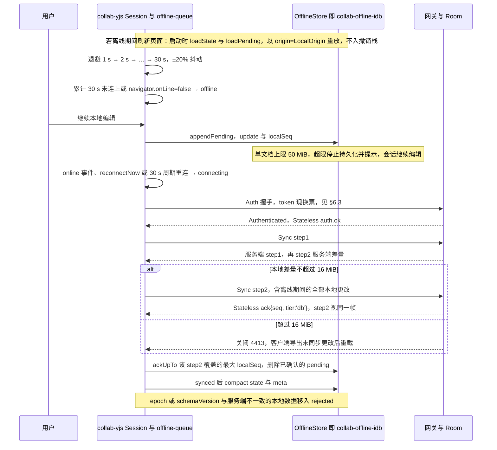

怎么读：时间自上而下；离线期间所有本地 update 只追加到 OfflineStore，重连后靠 step1/step2 的双向差量把离线更改合并进服务端，再由 `tier:'db'` 的 ack 清理；`alt` 两支是 step2 在 16 MiB 上限内外的两种结果（rulings §4.21 H:Q6；原图「本地差量超过 1 MiB 时先拆块」作废——step2 由 provider 自动生成，无法先切块）。provider 在重建 WS 时会清空自己的内部发送队列，离线更改靠 step1 / step2 补齐，与 OfflineStore 无关（ADR-0033）。进入 offline 按时间判据，离开 offline 有三条出口（UX-03、CO-03）。
依据：本文 §4.2 `offline-queue.ts`、§6.4、§12、§18.6。

---

## 13. 与 Univer 的对照

| Univer 条目 | Univer 做法 | 本项目 |
|---|---|---|
| 决策 #1（K1）：Mutation 是协同最小单元 | Mutation 作为 OT 变换单元，服务端 transform（闭源协同） | **继承语义、改变机制**：Mutation 仍是权限/审计/撤销的单元（05），但冲突解决下沉到 CRDT 原语（键级 LWW、字符级 YATA、实体 delete-wins），无需服务端 transform，也无闭源接缝（A13） |
| 缺陷 #3：手写逆操作 | 每个 Mutation 手写 undo mutation | `Y.UndoManager` 按 origin 推导；store-memory 用不可变 diff 推导；**代码库禁止手写逆操作**（lint：Mutation 定义中不允许 `inverse`/`undoMutation` 字段，由 09-02 承接） |
| A31：Worker 第二份模型靠 27 条白名单收敛 | Worker 内维护模型副本 | 单一事实源 Y.Doc；若未来需要 Worker 做纯计算（布局/缩略图），Worker 只接收 update 流并持有**只读**副本（同一份 store-yjs 代码），不接受写入 |
| A32：编辑态跨三个模型两个异步边界 | 编辑缓冲 → 文档模型 → 渲染模型 | 文本编辑直接写 `Y.XmlText`（07 §6：隐藏输入框仅转发按键/IME 事件，组合中文本为**瞬态覆盖层**而非缓冲模型） |
| A10：全局可变注册表污染多实例 | 全局 Registry | 每 Unit 一个 Fiber/Y.Doc；`isolate` 保证同页多文档互不可见（lifecycle 测试） |

---

## 14. 性能与可靠性预算汇总（测量方式见 10/11）

> 2026-09-26 起本节只保留跨端协议相关的几行（rulings §4.21 R 组 docPlan「§14 预算拆到 50/13、60/01 §12」）：客户端预算（本地回显、初始同步 time-to-synced、首页可见、键入 update 大小、重连重同步）的唯一源是 [50-frontend/13](../50-frontend/13-performance-and-bundling.md) §4；服务端预算（单 update 处理、Room bootstrap、软门禁、持久化滞后、房间内广播、跨实例传播、每实例房间准入、回放）的唯一源是 [60-backend/01](../60-backend/01-service-overview-and-roles.md) §12；门禁与测量方式见 [70-testing/09](../70-testing/09-performance-and-capacity.md)。

| 指标 | 预算 | 测量 |
|---|---|---|
| 端到端传播（客户端→服务端→其他客户端） | ≤ RTT + 100 ms p95（内部目标；PRD NF-01 §1.6 门禁 A→B 可见 p50 ≤ 150 / p95 ≤ 400 ms，§18.5） | e2e 双浏览器时间戳差 |
| 权限变更传播 | ≤ 1 s p95（门禁 ≤ 2 s） | 审计时间戳 vs 客户端事件 |
| 房间容量 | 20 编辑者 + 50 查看者（Q5/SV-05）；**名额按用户计**（同一用户多标签/多设备占 1；commenter 计入查看者；owner 保席、不占编辑者名额）；编辑者满 → 以 viewer 只读加入（`auth.ok.reason:'capacity'`，本次连接内不升回），查看者也满 → 拒绝（`collab.room_full`）；部署调低天花板后超限的文档只读打开（`auth.ok.reason:'over_ceiling'`）；满员房间由服务端只对 awareness 帧做 100 ms 合并（§7.1），查看者只上报 view | conformance「房间满」 |
| 每实例房间准入 | **按文档实测权重**（rulings §4.15 Q5）：权重 ≈ 13.8 KB/元素 × 元素数（墓碑计入），实例预算 = 容器内存上限 × `room.memoryAdmissionPct`（默认 75，rulings §4.18 BE-29）；预算不足先按 LRU 提前结束 draining 房间（CO-14）；数值与指标见 60-backend/01 §12 S18 | 指标 `cordex_collab_room_weight_bytes` |

**Hocuspocus 带来的预算注脚**（2026-09-26，ADR-0039；证据 SY-09、K18、exp4、vE、vF）：

- **每连接串行 await**：同一连接的下一帧要等上一帧的 `beforeSync` 落库与 `afterHandleMessage` 完成，PG 提交时延直接限制单连接帧率并阻塞同一连接的 awareness；写入器改为「空闲即刷、上限 100 ms 或 50 条」，持久化滞后的目标值不变（60-backend/01 §12 S5）。
- **更新回显**：update 会回显给发起方，大帧的下行字节翻倍，计入客户端下行预算（PRD 04 §1.6 注脚，K18-A 接受）。
- **跨实例**：M3 起经 extension-redis，Valkey 8.1 实测跨实例传播 2.6–7.1 ms（在 ≤ 50 ms 预算内）；无亲和时每次变更每对端一次 O(文档) 差量计算，D200 多人最可能超预算，因此反代按 `documentId` 哈希是默认配置（ADR-0035 决策 7）。
- **加载去重**：`onLoadDocument` 末尾必须 `document.flush()`，否则首个连接多收一份整文档 update，吃掉 time-to-synced 预算（exp8）。
- **客户端体积**：`@hocuspocus/provider` 4.7.0 连同 `@hocuspocus/common`、`@lifeomic/attempt` 约 10 KB（gzip），远低于 PRD 04 §1.5 协同增量 ≤ 200 KB。

**房间准入：实例权重与名额**

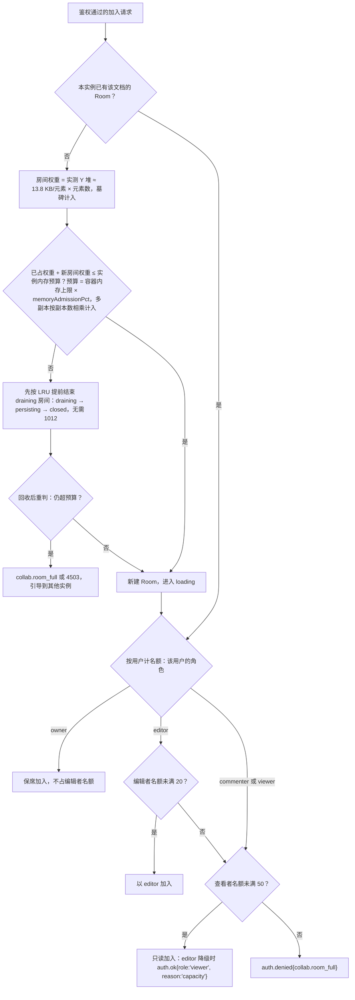

怎么读：上半段是实例级准入（按文档实测权重，rulings §4.15 Q5；预算不足时先回收空闲房间再重判，rulings §4.18 CO-14），下半段是房间内名额（按用户计：同一用户多标签/多设备占 1，commenter 计入查看者）。准入先于 loading，权重取 `documents.element_count`，不需预加载文档；本实例已有 Room 时只判名额。满员房间由服务端做 awareness 合并 tick、查看者只上报 view。
依据：本文 §14、§18.5 SV-05；60-backend/05 §4（准入与名额，预算取内存的 75%）、§5；60-backend/16 §11、§13。

---

## 15. 待决事项（需要谁决策）

| # | 事项 | 默认 | 决策人 |
|---|---|---|---|
| P1 | 是否需要「排他编辑锁」（形状级/页级） | **已裁决**（章程 Q16，rulings §4.16）：不做，只有 awareness 软提示 | 已裁决 |
| P2 | 版本历史保留策略（自动快照频率与保留期） | **已裁决**（章程 Q17，rulings §4.16；保留细则 rulings §4.19 C-06）：自动每 10 min 或 500 updates；auto 快照 30 天内全量保留，30 天后每天只留最后一个，保留至 `retention.autoSnapshotDailyDays`（默认 365，0 = 永久）；命名快照永久、每文档上限 200；import / migration / restore / epoch 事件快照按 auto 口径；全部进入部署配置可调（配置键以 60-backend/17 为准） | 已裁决 |
| P3 | 降权后本地未同步更改：回滚还是保留只读视图 | 回滚；仍有读权限的降权可导出本地副本，撤销访问（降为 none，4403）不提供导出（PRD CO-05 / CO-06，50-frontend/07 §8） | 产品/设计 |
| P4 | 离线本地库是否加密 | 不加密；登出清空 | 安全/产品 |
| P5 | epoch 换纪元的触发与 UX | M2 起结构数仅监控、手动维护；覆盖既有文档的导入固定换纪元（**已裁决**，rulings §4.19 N1，§9.4）；客户端经 4428 丢弃本地状态并重新 bootstrap | 架构 A + 产品 |
| P6 | 评论锚点在目标删除后的展示 | 转为「已分离」列表（50-frontend/08 §6） | 设计 |
| P7 | `persistBeforeBroadcast` 默认值 | `true`（一致性优先），只约束 PG 可用时的顺序；PG 故障降级期照常广播（rulings §4.18 CO-08，§6.4） | 架构 B（本文默认） |
| P8 | 服务端是否执行语义软门禁（PRD CO-12 说「不做」，ADR-0034 主张「不变量修复」） | **已裁决**（rulings §4.1 P8：采纳 ADR-0034）：`softGate: repair`（不变量）+ `report-only`（schema 类型） | 已裁决 |

## 16. 对章程的异议/建议

- **S1（已批准，进入章程 v0.2）**：新增 dom 包 `@cordexjs/collab-offline-idb`（L4，`OfflineStore` Provider，唯一 import `y-indexeddb` 或自写 IDB 适配）；否则 collab-yjs 无法保持 iso 又提供离线持久化。
- **S2**：§5.3 规则 4 的允许列表补充：`y-indexeddb` 仅 `collab-offline-idb`；`lib0` 仅 `collab-yjs`/`server-collab`（y-protocols 的编码依赖）。
- **S3**：术语表建议新增：Room、Session、Ticket、Update、StateVector、Compaction、Repair（见下）。
- **S5**（2026-09-26，rulings §4.21，ADR-0039）：§5.3 规则 4 的放行范围补充 `@hocuspocus/provider`（只在 collab-yjs、collab-transport-ws）、`@hocuspocus/server`（只在 server-collab）、`@hocuspocus/extension-redis` 与其传递依赖 ioredis（只在 apps/server 组装）；§5.2 包表的 collab-yjs、collab-transport-ws、server-collab 三行职责随之改写。
- **S4**：D12 建议补一句：「服务端软门禁（schema/不变量修复）是数据完整性边界，与权限边界并列」。

## 17. 跨条线要求（摘要，详见最终汇报）

- 对 A 线（03/04/05）：`DocumentStore` Definition 采用 §1.2 的 6 原语与 §2.2 的 `TransactionMeta.origin`/`ChangeSet.paths`；Mutation 载荷禁止数组下标；`history` 只做 Store 门面；`permissions` 支持外部更新快照；`units.open` 支持「先开空 Unit 后同步」；model-slide 提供 `validateChangeSet(paths)` 与不变量修复规则的纯函数（服务端与客户端共用）。
- 对类型治理线：store-yjs 公共 API 禁止出现 `Y.*` 类型（api-extractor）；Mutation schema 禁止 `index` 字段（lint `cordex/no-index-in-mutation`）；Mutation 定义禁止 `inverse` 字段（lint）。

## 术语补充

| 术语 | 定义 |
|---|---|
| Room | 服务端为一份文档维护的协同会话集合与其 Y.Doc 副本（= 服务端 Unit） |
| Session | 一个客户端与一个 Room 的连接生命周期（状态机见 §5.1） |
| Ticket | 短时（60 s）签名凭据，用于 WS 握手，携带 role 与 permVersion |
| Update | Yjs 的二进制增量；线上帧与 `document_updates` 日志为 V1 编码（Hocuspocus 协议只有 V1），快照为 V2（2026-09-26） |
| Stateless | Hocuspocus 帧里承载任意字符串的帧类型；本项目用它承载 CONTROL 判别联合（§6.3） |
| 连接污染 | 一条连接丢弃过写入帧后进入的状态：之后的写入帧一律不落库、不回 ack，直到重连（§11，ADR-0039 决策 6） |
| StateVector | Yjs 各 client 已知时钟的向量，用于差量同步 |
| Compaction | 用一个快照替换其前的 update 序列（ADR-0025） |
| Repair | 服务端软门禁发出的补偿事务（origin=`repair`） |
| FracKey | fractional index 字符串（ADR-0032） |

---

## 18. v0.2 补充：与架构 04/05 契约的对齐、PRD（CO/SV/EM）条目的承接

> 追加于 A 线 02/03/04/05 与产品线 10-prd 落盘之后。凡与前文冲突处以本节为准（前文保留以显示演进）。总编排已批准：S1（`@cordexjs/collab-offline-idb`）、服务名 `ctx.collabTransport`、UnitScope 服务 `ctx.selection`。

### 18.1 `StoreOp`（04 §2.3）→ Y 操作（store-yjs `mapping/apply-op.ts`）

04 定义的 **5 种** `StoreOp`（`set/delete/insert/remove/text`；总编排最终裁决去掉 `move`）是**本地**原语（不上网络）；本文 §1.2 的 6 种「值形状」是它们作用的对象。映射：

| StoreOp | 目标值形状 | Y 操作 | 并发语义 |
|---|---|---|---|
| `set(path, value)` | Record 键 / 叶子 | `Y.Map.set`（嵌套 Record 递归建 Y.Map；标量与 JSON 字串直接写） | 键级 LWW |
| `delete(path)` | Record 键 / 实体 | `Y.Map.delete` | delete-wins |
| `insert(path, index, items)` | **有序实体列表**（`slides`、`shapes`（`containerId` + `parentId` + `order`）、表格的 `rows` / `columns`（§1.3.3）、`txBody.paragraphs`） | **不用于实体列表**：命令层经 `@cordexjs/shared/order` 计算键，`lower()` 产出 `set(entities/<id>, record{ order })`（Snapshot 与 Y.Doc 都保留 `order` 键，ADR-0013 第 7 条） | 并发同位插入 → 都存在，按 `(order, id)` 全序 |
| `remove(path, index, count)` | 同上 | **不用于实体列表**：用户删除有身份实体时 `lower()` 产出 `set(entities/<id>/_deleted, {at, by})`（软删除墓碑，rulings §4.15 Q3，04 §3.1a）；`delete(entities/<id>)` 只由 TTL 硬删除作业、文档擦除（「永久删除文档」）与所有者经审计的「彻底删除元素」（只对墓碑态元素，经 `POST /api/v1/documents/:id/elements/purge` 交 server-collab 单写者以 `system('maintenance')` 执行，rulings §4.18 CO-07）产生 | 墓碑 = 键级 LWW（撤销 = 清除墓碑、同 id 复活）；硬删除后 delete-wins |
| （无 `move` 原语） | 有身份实体 | **弃用 `move` 的原因**（总编排裁决）：顺序已由 `order: FracKey` 承载，移动只是 `set(entities/<id>/order, key)`（**单键写**，ADR-0032）；跨父移动 = `set(parentId)` + `set(order)`；原子数组极少移动且 `Y.Array` 无原生 move，`remove` + `insert` 即可 | 实体移动：LWW，无重复无丢失 |
| `insert/remove` | **非身份数组**（schema 声明为 `list` 的渐变色标、几何路径命令、`a:gd` 调整值列表等；表格列宽自 §4.21 起是列记录 `columns/<ColId>/width` 的字段，不再是数组，ADR-0018 决策 6） | 直接落为 `Y.Array` 的 `insert/delete`；「移动」= `remove` + `insert`，并发时可能重复或丢失——**已知风险**，由幂等规则（同位同值去重）与 rekey/修复规则兜底；需要整体一致的小数组按 §1.5 用 JSON 叶子 `set` 整体 LWW | 元素级；移动无原生保证 |
| `text(path, delta)` | 段落的 `Y.XmlText` | `applyDelta`（与 Y.Text delta 同形；04 要求与 store-memory 语义一致） | 字符级 YATA |

- 列表形状由 `DocumentType.bodySchema` 注解决定（例：`z.array(idSchema).describe('ordered-entities')`；未注解数组一律按原子数组处理）——**对 A 线的要求**。
- 下标不进入 Store（总编排裁决，ADR-0032 第 7 条）：键由命令层计算，Mutation 携带最终键，`lower()` 纯函数；`TransactionRecord.ops` 因 `set` 自带键而天然可回放，无需锚点字段。索引式 `StoreOp.insert/remove` 只保留给非身份数组（`Y.Array`）；`StoreOp` 无 `move`。
- Snapshot ↔ Y.Doc：Snapshot 的归一化实体表（A-9）**保留 `order: FracKey` 键**（ADR-0013 第 7 条），`load`/`toSnapshotBody` 原样搬运，无数组转换；导出到 OOXML 时由编解码器按 `(order, id)` 排序。
- 富文本：`TextBody.paragraphs` = `Y.XmlFragment` 的子元素序列；`paragraphs[i]` 内文本 = 该 `<p>` 的 `Y.XmlText`。因此 `text` op 的 `path` 必须定位到**段落**（`…/txBody/paragraphs/{paragraphId}`）；段落级 `insert/remove` = XmlFragment 子元素插入/删除；段落移动 = `remove` + `insert`（XmlFragment 无键序，且 `StoreOp` 无 `move`），是本文唯一的删除+插入式移动；并发移动同一段落可能出现两份同 `id` 段落 → 修复规则保留位置靠前者（确定性），fuzz 覆盖。

### 18.2 `Origin` / `TransactOptions` / `ChangeSet` 的对齐

| 本文 v0.1 | 04/05 契约（以之为准） | 备注 |
|---|---|---|
| `TransactionMeta{origin, undoable}` | `TransactOptions{origin, label, meta?, undoable?}` | `label` 参与撤销合并（05 §6，`coalesceMs` 500） |
| `ChangeSet.paths` | `ChangeSet.touched`（前缀去重） | 语义相同 |
| `ChangeSet.ops` | 本地事务 = 已应用 StoreOp；**远端/修复事务**：由 Y 事件推导（`set/delete/text`，尽力而为），`touched` 为权威 | **对 A 线**：远端 `ops` 标注 `derived: true` 或允许为空 |
| `LocalOrigin/RemoteOrigin/ImportOrigin/RepairOrigin…` | `Origin = local(clientId) \| remote \| system(load\|import\|migration) \| replay` | **对 A 线的增补请求**：`system.reason` 增加 `'repair' \| 'restore' \| 'maintenance'`；`local` 增加可选 `via: 'undo' \| 'redo'`（EM-05 要求 `store/transaction` 区分撤销来源） |
| `runDocumentStoreConformance` | 同名（总编排裁决：契约套件统一命名 `run<Definition>Conformance`，位于 `model-core/testing`） | **store-yjs 的验收 = 通过该套件**；本文 §8 冲突表进入其「协同分节」，并新增两条用例：「并发同位插入按 `(order, id)` 全序一致」「rekey 后顺序不变」 |
| `yjsBackend` 服务 | 02 §4.7 `doc-access.ts`（unique symbol，`@internal`） | 二选一；本文建议 `yjsBackend`（可被测试替身替换、不外泄 Y 类型），由 A 线定稿 |
| `undo.captureTimeout: 500` | 02 写 300，05 写 `coalesceMs` 500 | 以 05 的 500 为准，请 A 线修正 02 |

### 18.3 权限、Selection、会话状态与 PRD 名称的对齐

- 网关下发的权限帧 → `permissions.applyRemoteDecisions(decisions)`（collab-core `permission-checkpoint.ts`，02 §4.11）→ 命令管线 `waterfall` 检查点即时生效并 emit `permission/changed`（PRD EM-05 名称）。**`applyRemoteDecisions` 是权限变更进入客户端的唯一入口**：collab-yjs 不维护自己的权限快照、不发权限事件；`permission/changed` 由 `permissions` 服务唯一发出，命令管线与 UI 都只订阅它（`collab/permission-changed` 弃用）。传播预算：**PRD/SV-05 门禁 ≤ 2 s**；内部目标 ≤ 1 s p95。
- `AwarenessState.selection: SerializedSelection` = `Selection<A>.serialize()`（05：`broadcast: true` 的 Operation 经 `presence` 序列化广播）；collab-core 对其内容不透明，由 `DocumentType.selectionKinds` 的 schema 校验。本文 §7.1 的 `selection`/`caret` 字段合并为该结构（幻灯片：`{ kind: 'slides'|'shapes'|'text'|'tableCells', slideId, ids[], range?: { anchor, head } }`，`range` 为 RelativePosition base64）。
- 会话状态：公开 `Session.state: SyncState`（02 §4.11：`disconnected|connecting|syncing|synced|offline|error`）是本文 §5.1 内部 FSM 的投影；PRD 名称对照：`readonly-degraded` = 本文 `readonly`（投影为 `synced` + `role` 降级标志）；`reconnecting` = `backoff`；`quarantined`/`denied` 投影为 `error`（附 code）。事件定稿 `collab/state-changed`（10 §11）。
- 令牌（CO-05/EM-03，决策 INC-27）：浏览器登录会话每次被动续期成功之后，客户端经 `getToken()` 换新 collab ticket 并以 CONTROL `auth.refresh{ticket}` 发送（不断连；2026-09-26 起即 `provider.sendToken()` 发出的 Auth 帧、服务端 `onTokenSync` 处理，网关转发后暂停后续帧直到钩子完成，§6.3、ADR-0039）；服务端验签 + `jti` + `sid` 一致后**重新绑定**会话、重算角色，**不延长** WS 会话寿命——M1–M3 的寿命 = 票据 `sid` 指向的登录会话，会话被吊销时服务端以 4401 关闭；M4 集成方 JWT 复用同一帧并以新 `exp` 续期（§6.3，ADR-0029 修订 2026-09-25）。**刷新失败按原因分流**（rulings §4.18 UX-02）：网络错误 → `reconnecting`（内部 `backoff`，与重连共用同一 30 s 离线计时，不另设计时器）；401（`server.auth.expired` / `collab.unauthenticated`）→ 直接进入「登录已过期」（内部 `denied`，投影 `error`），不经 `reconnecting → offline`，避免先给出误导性的「离线」。「重新登录」在弹窗或新标签完成 OIDC（服务端照常设 httpOnly cookie，回调页经 BroadcastChannel 通知原页），原页不跳转、pending 队列保留，拿到新票据后经 `denied → connecting` 重连 → 同步中 → 已恢复；回来的用户 id 与原会话不同则不重放队列、按只读处理并提供导出本地副本，该横幅处理前不可关闭（应用壳落点 40-modules/11）。M1–M3 令牌只来自 OIDC 登录（rulings §4.15 Q6）；集成方签名 JWT 与 API Key 降为 M4（届时 JIT 建影子用户），见 ADR-0029。客户端会话与重新登录的实现见 [50-frontend/02](../50-frontend/02-app-shell-routing-and-session.md) 与 [50-frontend/07](../50-frontend/07-collaboration-client.md) §8.3。

### 18.4 被拒 update 的本地回滚（05 §11 交由 06 决定）

被拒只发生在降权、锁定窗口或纪元变更（4428，含覆盖导入，§9.4）时：服务端未应用、他人未见，但本地 Y.Doc 已含这些事务。策略 = **导出后重载**：
1. `rejectedDiff = encodeStateAsUpdate(localDoc, serverStateVector)`（恰为未被 ack 的本地更改）连同对应 `TransactionRecord` 摘要写入 OfflineStore `rejected` 区（可导出为 JSON / 本地 pptx 副本）；
2. 丢弃本地 Y.Doc → HTTP 快照 + step1/2 重新 bootstrap（origin `system('load')`），撤销栈清空；
3. UI 横幅「你的 N 项更改未被保存（权限已变更）」+ 导出按钮（CO-05 措辞）。
`history` 不参与回退（`collab/update-rejected` 事件仅供 UI/遥测），不用撤销栈做一致性修复。客户端实现（含撤销访问时不提供导出的分支）见 [50-frontend/07](../50-frontend/07-collaboration-client.md) §8.2。

### 18.5 与 PRD CO/SV/EM 的逐条承接

「落点」列指向三条设计线中承接实现的文件（rulings §4.19：50 / 60 / 70 为各侧设计唯一事实源）。

| PRD | 承接 | 落点 |
|---|---|---|
| CO-12 / EM-04 资源上传通道 | 图片/媒体经 preset 选项 `media.upload(file) → { assetId, sha256 }`（集成方可替换，`apps/web` 默认实现：`POST /api/v1/documents/:id/media/presign` → 直传 `uploads/tmp/` → `…/media/commit`，≥ 10 MB 分片，不经 Nest 内存；URL 按 `storage.s3.publicEndpoint` 生成、经反代子域到达对象存储，rulings §4.18 BE-01，决策 INC-21、MEDIA-CLIENT）；CRDT 只存 `BlobRef`；上传中/失败元素显示占位并可重试（`pic.mediaId` 先指向本地临时 id，成功后一次 `set` 替换） | [50/05](../50-frontend/05-rendering-and-thumbnails.md)、[60/04](../60-backend/04-modules-documents-storage-media.md) |
| CO-12 消息限制 | 单帧 ≤ 1 MiB（`maxUpdateBytes`），step2 单设 ≤ 16 MiB（rulings §4.21 H:Q6）；**每连接 ≤ 200 帧/s（突发 500）**（`msgRateHz` / `msgBurst`，取代本文 §9.3 的 100/s），在网关适配层执行；awareness 节流 ≥ 50 ms；未知 CONTROL 类型丢弃并计数 | [60/16](../60-backend/16-ws-protocol-server-view.md) §13 |
| CO-12「服务端不做内容语义校验」 | 与 ADR-0034 软门禁不一致。本文坚持服务端**至少**执行不变量修复：非法结构一旦进入 CRDT 就会永久留在文档中，客户端「解码失败即忽略」无法把它从其他端移除，且服务端导出/缩略图作业自身会消费该模型。折中：配置 `softGate: 'repair' \| 'report-only' \| 'off'`，默认不变量 `repair`、schema 类型 `report-only`。**已裁决（rulings §4.1 P8：采纳 ADR-0034；PRD CO-12 已同步）** | [60/16](../60-backend/16-ws-protocol-server-view.md) §4 |
| SV-05 容量 | `maxEditors: 20`、`maxViewers: 50`，超限只读加入（`auth.ok{ role:'viewer', reason:'capacity' }`），再超 → `auth.denied{ collab.room_full }`；房间空置销毁延迟 **60 s**（取代 30 s）；协议版本协商失败 → `collab.protocol_mismatch`（关闭码 4427，与 schema 版本的 4426 区分） | [60/05](../60-backend/05-modules-collab-and-snapshots.md) §4 |
| SV-05 多实例与停机 | 跨实例 ≤ 50 ms（M3 经 extension-redis，实测 2.6–7.1 ms；反代默认按 `documentId` 哈希偏好亲和，ADR-0035 决策 7）、房间内广播 p95 ≤ 100 ms、持久化滞后 p99 ≤ 1 s、优雅停机 ≤ 30 s（自写 `drainAll`，1012 由原始 `ws.close` 发出）、客户端 ≤ 5 s 重连到其它实例（1012 首轮不退避）；单实例（RM-S 2 vCPU/4 GB）≥ 2,000 WS、CPU < 70%；房间**按文档实测权重准入**（rulings §4.15 Q5，§14、60-backend/05 §4），各档（按文档规模）房间数实测回填，不再写固定「≥ 200 活跃房间」 | [60/05](../60-backend/05-modules-collab-and-snapshots.md)、[70/09](../70-testing/09-performance-and-capacity.md) |
| CO-05 | 见 18.3/18.4；`permission/denied` 由命令管线发出 | [50/07](../50-frontend/07-collaboration-client.md) §8 |
| CO-08 | 每行收敛结果见 ADR-0020 补充表 D；「X 也在编辑此文本框」的预防性提示来自 presence `caret`/`editing` | [50/07](../50-frontend/07-collaboration-client.md) §11–§12 |
| CO-04 / PD-04 评论 | ADR-0031 v0.2：评论为 Snapshot 内 `ResourceHook` `comments.threads`（iso 包 `@cordexjs/comments`，文档类型盲，rulings §4.19 D-COMMENTS-PKG）为事实源；commenter 经 `comments.*` 命令写 CRDT，服务端软门禁执行路径与作者规则（§11）；PG 为镜像读模型，REST 只读 | [50/08](../50-frontend/08-comments-and-version-history.md)、[60/07](../60-backend/07-modules-comments-webhooks-audit.md) |
| NF-01 1.6 协同预算 | A→B 可见 p50 ≤ 150 / p95 ≤ 400 ms（门禁；本文 `RTT + 100 ms` 为内部目标）；初始同步 D50 ≤ 2 s / D200 ≤ 5 s（p75）；重连重同步（≤ 5,000 update）≤ 3 s；presence 传播 p95 ≤ 200 ms；权限 ≤ 2 s —— 一并进入 `test/perf/budgets.json` 的 `gate` 字段 | [50/13](../50-frontend/13-performance-and-bundling.md) §4、[70/09](../70-testing/09-performance-and-capacity.md) |

### 18.6 `OfflineStore` Definition（签名级草案；collab-core `contracts/offline.ts`；Provider：`@cordexjs/collab-offline-idb`，缺失时 collab-yjs 用同接口的内存实现）

```ts
// 草案
interface OfflineStore {
  open(scope: { userId: UserId; documentId: DocumentId }): Promise<OfflineDocStore>   // 无 tenantId（T-0）
  clearAll(scope: { userId: UserId }): Promise<void>                                  // 登出 / 切换账号
  estimate(): Promise<{ usedBytes: number; quotaBytes: number }>                     // navigator.storage.estimate 的封装
}
interface OfflineDocStore {
  readonly meta: OfflineMeta | null                                                   // { epoch, schemaVersion, lastAckSeq, savedAt }
  loadState(): Promise<Uint8Array | null>                                             // compact 后的完整状态（V2 update）
  loadPending(): Promise<readonly PendingUpdate[]>                                    // 未 ack 的本地 update，按 localSeq 升序：{ localSeq, update }
  appendPending(update: Uint8Array, localSeq: number): Promise<Result<void, CordexError<'collab.offline_quota_exceeded'>>>
  ackUpTo(localSeq: number): Promise<void>                                            // 删除 ≤ localSeq 的 pending
  compact(state: Uint8Array, meta: OfflineMeta): Promise<void>                        // 原子替换 state 并清空已 ack 的 pending
  moveToRejected(entries: readonly RejectedEntry[]): Promise<void>                    // { update, records: TransactionRecordSummary[], reason, at }（§18.4）
  listRejected(): Promise<readonly RejectedEntry[]>
  clearRejected(): Promise<void>
  close(): Promise<void>
}
```

- 约束：单文档上限 50 MiB（超限时 `appendPending` 返回 `err`，会话继续编辑但停止持久化并提示）；所有方法幂等；`compact` 与并发的 `appendPending` 在同一存储事务域内保证不丢追加；`epoch`/`schemaVersion` 与服务端不一致的本地数据由 collab-yjs 移入 `rejected`（ADR-0033）。
- 生命周期：`open()` 返回的句柄由 Unit 的 collab Fiber 以 `ctx.effect` 拥有，Unit 关闭时 `close()`。
