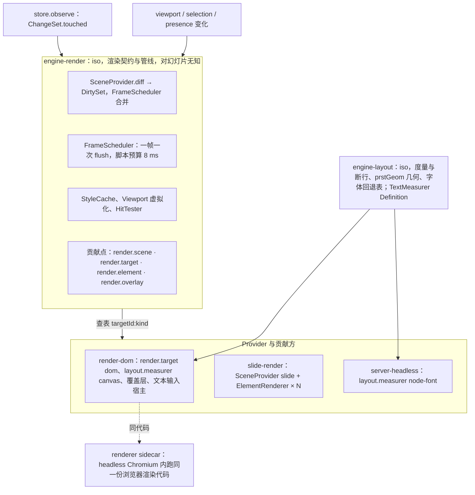
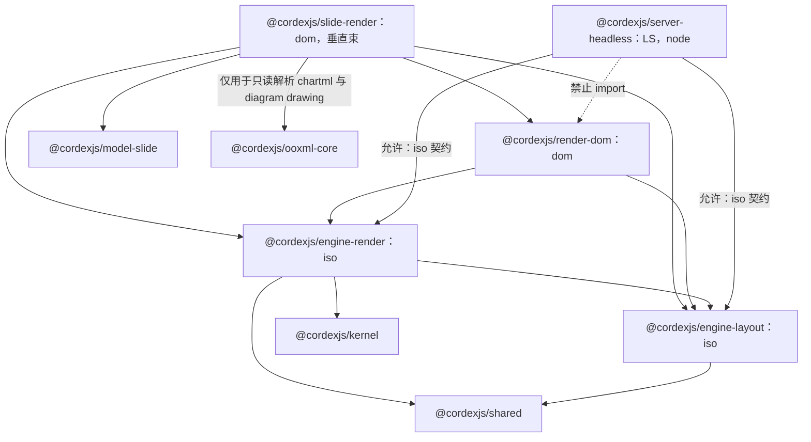
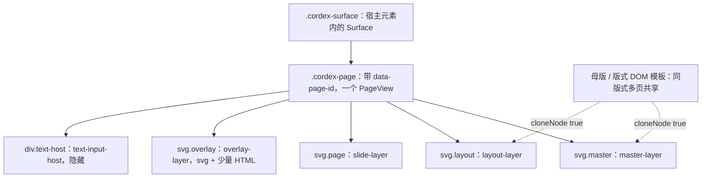
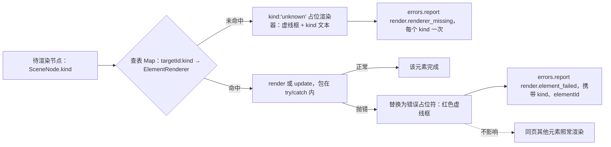
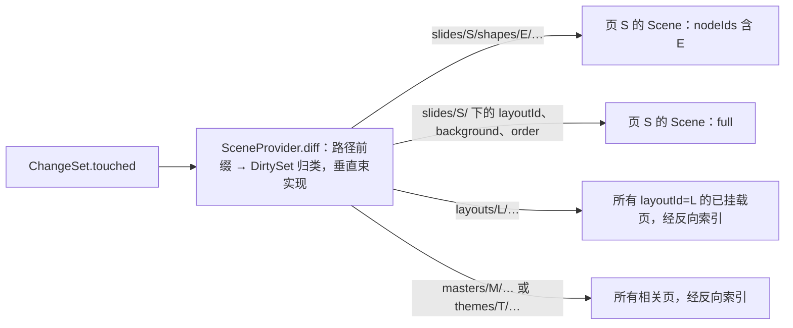
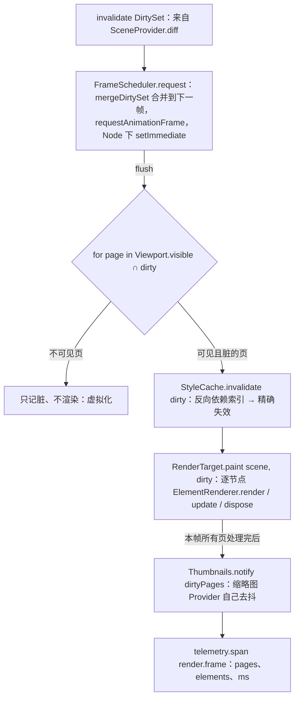

# 07 渲染跨端契约：介质与坐标、贡献点与帧管线、度量与断行、headless 跨端约束

> 状态：草稿 | 负责：架构-运行时 | 更新：2026-09-18（§11 按 14 §1 C-12 改「三处 LRU」为「四处」）；2026-09-24（rulings §4.15：Q4 DOM/SVG 单实现、canvas 三角色、toImage 主线程 + Web 字体 M2 spike、推翻 offscreen-canvas Provider、§14.6 删「导出在 Worker」；Q7 图表按 D16 与五类、SmartArt dsp 只读渲染、OLE 预览、EMF/WMF M2 惰性栅格化、chartex 占位、外链资源自动加载可收紧、文档内 SVG 只作图像上下文；Q5 堆预算与 20,000 元素关系；Q8 缩略图 M2 包内封面 / M3 renderer sidecar）；2026-09-24（rulings §4.16 Q19：R3 服务端字体包结案）；2026-09-24（复核修正，rulings §4.17：M13 renderer 契约 `render/sidecar.ts`、客户端 `remote-renderer.client.ts`、配置 `headless.mode/endpoint` 以 ADR-0037 为准；L11 服务端缩略图描述改 640 px WebP）；2026-09-25（补图）；2026-09-25（矛盾收口，rulings §4.18：CO-19 §0–§5、§7 统一换用 v0.2 契约名（SceneProvider / Scene / DirtySet / ElementRenderer.render·update(handle, node) / TextMeasurer，Provider `canvas`/`node-font`/`fixed`）；CO-01/CO-02 DX-1000 回退顺序与 200 ms 只作内部分解目标（§1）；FE-18 render-dom 不依赖 design（§0、§3.2）；GV-20 契约套件名（§2.4、§4.3、§5.4）；GV-21 章程锚点层带写法；CO-12/CO-11 打开管线首批装载后台追加、`unit/loaded`、`prioritize` 消息（§14.2）；FE-09 `/render` ready 判据（§10）；BE-04 renderer 注入单一路径）；2026-09-25（§4.19：§4.1 母版 / 版式占位符按 PowerPoint 行为一律不绘制（D-TEST-INFRA 视觉基线为 PowerPoint 365）；`layoutAlgoVersion` 统一命名（§5.1、§10）；§7、§8、§10 改为摘要 + 链接 50-frontend/05、10、12 与 60-backend/06）；2026-09-25（设计线拆分：§2.4、§3.2、§4.3、§5.4 目录树改链 40-modules/06、07；§6 保留 ADR-0028 决策段，其余链 50-frontend/06；§9、§14.6 链 50-frontend/13 与 70-testing/09；§14.2 浏览器侧流程链 50-frontend/04 §2；§14.4 链 50-frontend/05；§14.7 链 60-backend/06）；2026-09-26（§4.20）（FE-16：§2.1 `SceneNode` 增 `a11y?: A11yDescriptor`）；2026-09-26（§4.21：缩为「渲染跨端契约」：留 §1、§2、§5、§10；§3 render-dom、§4 页合成迁往 50/01 前端架构（§4a 节），§4.2 元素渲染器表迁往 50/19，§2.4 / §3.2 / §4.3 目录树删除留桩；§14.2 / §14.4 / §14.6 / §14.7 迁出留桩；§11–§13 标历史；§0 总览改为契约层；§1 canvas 补媒体与图标预处理用途；§5 断行表改由 UCD 生成、node-font 定 opentype.js；§6.1 补 EditContext 候选）；2026-09-26（§4.21 整合：§3、§4 桩改为正式引用 50/01 §4a.2–§4a.4，§4.2 桩指向 50/19 §6；§5.4 断行来源改为 UCD 生成表；§6 补 EditContext 第三实现）；2026-09-26（§4.21 Remap：本文对原 §2.4、§3、§4、§14.6、§14.7 的自引改指新位置）；2026-09-26（§4.21 复核：标题挪到首行；§6.1 决策段缩为一句链到 ADR-0028 与 50-frontend/06） | 依赖：charter v0.1

> 读者：实现 `@cordexjs/engine-layout`、`@cordexjs/engine-render`、`@cordexjs/server-headless`（缩略图部分）以及任何 `render.*` / `layout.*` 贡献方（含 `render-dom`、`slide-render` 与第三方元素渲染器）的工程师。
> **定位（rulings §4.21 R-d-04）**：本文只保留浏览器与服务端（renderer sidecar、node-font 度量）都要遵守的渲染契约——§1 介质与坐标、§2 贡献点与帧管线契约、§5 engine-layout、§10 headless 跨端约束；render-dom 与页合成（原 §3、§4）迁往 [50/01 前端架构](../50-frontend/01-overview-and-runtime-map.md) §4a，逐元素渲染器表（原 §4.2）迁往 [50/19 可追加元素目录](../50-frontend/19-insertable-elements-overview.md)；原节号保留为一行桩，供既有引用命中。
> 章程锚点：§2.3（不做 Canvas 优先）、§5.2 L5/V-render 包边界、§6.2 ADR-0021、§10 Q4/Q8、Univer A1/A4/A5（引擎对文档类型盲）、A28（脏区必须被消费）、A29（缓存淘汰必须接线）、A30（渲染热路径无拦截链）、A32（无第二份编辑缓冲）、A11（逐元素错误隔离）。
> 相关 ADR：0021（渲染介质）、0026（headless 渲染与缩略图）、0027（文本度量策略）、0028（文本编辑宿主）。
> 样式继承链解析（Element→Placeholder→Layout→Master→Theme）是 model-slide 的纯函数，见架构 04；本文只定义渲染层如何**缓存与失效**它的结果。

---

## 0. 一页总览

**渲染一页总览（契约层）**



怎么读：上方两个输入驱动 engine-render；engine-render 只持有契约、调度、缓存与命中，按 `${targetId}:${kind}` 查表把绘制交给 Provider 与贡献方；engine-layout 为浏览器 canvas 度量器与 Node 字体度量器提供同一套断行与几何；服务端不在 Node 里绘制，缩略图与 PDF 由 renderer 内的同一份浏览器代码完成（§10）。本文 §0–§7 使用 v0.2 契约名（§14.1 对照表保留旧名到新名的映射，rulings §4.18 CO-19）；render-dom 与 slide-render 的内部结构见 50/01 §4a（前端架构）。

**渲染相关包依赖**



怎么读：实线是 `package.json` 声明或 §14.5 允许的依赖，全部指向秩不高于自身的包，且 iso 包从不指向 dom 包；虚线是分层规则明确禁止的依赖（node 包不得 import dom 包）。M3 起图表渲染从 slide-render 拆为 `@cordexjs/slide-render-chart`（§13 S6），图中未单列。render-dom 不依赖 `@cordexjs/design`（章程秩表：L5 不得依赖 L7；50/01 §4a.2 已按此改，覆盖层主题色直接写 CSS 变量名字符串）。
依据：本文 §5.4、§14.5；40-modules/06 §4.2、§4.3（原 §2.4、§3.2）；40-modules/07 §4.1（原 §4.3）。

---

## 1. 渲染介质决策与坐标系（ADR-0021）

- **DOM/SVG 单实现**（rulings §4.15 Q4，ADR-0021 已接受）：主画布 = SVG（图形）+ 自绘文本行（SVG `<text>`），容器为 HTML。编辑、查看、放映、可见缩略图、服务端缩略图与 PDF **共用同一套 SVG 渲染**，不存在第二套渲染实现。选 SVG 而非 Canvas：任意缩放清晰、DOM 可检查/可测试（Playwright 断言节点属性）、a11y 有挂点、插件贡献一个 kind 的渲染器只需产出 SVG 节点、无自绘命中/无重绘管理负担。
- **canvas 只承担以下角色**：① `toImage` 的栅格化画板（主线程：游离 DOM → SVG 序列化 → `Image` → `<canvas>`，§8）；② `measureText` 度量器（`measurer-canvas.ts`，§5）；③ 为 `render.target` 预留的 `RenderTarget` 座位（`id:'canvas'`，当前无 Provider）；④ 插入前的媒体与图标预处理（压缩、GIF 首帧、SVG 与图标的 PNG 回退、视频海报帧，用 `createImageBitmap` + `canvas.toBlob`，不进入画布渲染，rulings §4.21 R-d-23，ADR-0021 补登用途）。「缩略图/放映走 canvas」的旧口径删除；14 §5.4 对 offscreen-canvas Provider 的采纳被推翻。
- **可替换性验证**：M3 末用一个最小 canvas Provider（只画矩形/图片/单行文本）跑 `runRenderTargetConformance`，证明 `render.target` 契约不含 DOM 偏置；它不进入产品。
- **DX-1000 回退规则**（按序执行，依据 ADR-0021 修订 2，rulings §4.18 CO-01）：单页 1,000 元素（DX-1000）若不达标，① 先做合成层优化（独立合成层、`content-visibility`、减少滤镜与 `<tspan>`）；② 仍不达标，再做静态层栅格化（SVG/DOM 路线内的最后手段：会碰上 Web 字体问题并破坏一元素一 DOM 节点）；③ 仍不达标才**仅在查看/放映**启用 canvas Provider；编辑态始终 DOM/SVG。**对外门禁只有 DX-1000**：首页可见 ≤ 2.5 s、交互 ≥ 30 fps；原「≤ 200 ms」只是引擎内部的分解目标（场景构建 + 首次挂载），不作门禁（ADR-0021 修订 1，rulings §4.18 CO-02）。
- **文档内 SVG 只以图像上下文渲染**：`asvg:svgBlip`、SVG 媒体一律经 `<image href=blob:…>` 渲染（浏览器在图像上下文中不执行脚本、不加载外部资源）；禁止以 `innerHTML`/`insertAdjacentHTML`/`DOMParser` 把文档内容注入 DOM（09-08 TD-081）。
- **单位**：模型是 `Emu`；SVG 用户单位 = **px@96dpi**（1 px = 9525 EMU），`viewBox = 0 0 W H`（如 960×540），缩放用容器 `transform: scale(z)`，保持 SVG 内数值量级稳定（避免 EMU 级大数导致的精度/抗锯齿问题）。字号 `sz`（百分点）→ px = sz/100 × 96/72。
- **层叠**：每个 `PageView`（render-dom 的内部实现名；对外契约是 `RenderTarget.mount()` 返回的 `TargetHandle`，§2.1）三层容器：`master-layer` / `layout-layer` / `slide-layer`（各一 `<svg>`），上面再叠 `overlay-layer`（`<svg>` + 少量 HTML）与 `text-input-host`（隐藏）。母版/版式层对同版式的多个页共享 DOM 模板（`cloneNode(true)`）。

**PageView 的 DOM 分层**



怎么读：实线是 DOM 父子关系，五个子层按 master、layout、page、overlay、text-host 的顺序由底到顶叠放；虚线表示母版层与版式层由共享模板克隆而来，不逐页重渲。
依据：本文 §1 层叠；50/01 §4a.2 职责（原 §3.1）。

---

## 2. `@cordexjs/engine-render`（iso）：契约与管线

### 2.1 贡献点（草案；ContributionPoint 机制见架构 03）

```ts
// 签名以 02 §4.13–4.16 与 40-modules/06 §2.5 为准（rulings §4.18 CO-19）；本块只作管线说明
// render.scene —— 文档类型把模型合成为 Scene（key = documentType；引擎对「幻灯片」无知，A5）
interface SceneProvider {
  readonly documentType: string
  build(unitScope: UnitScopeHandle, view: ViewDescriptor): Scene
  diff(changeSet: ChangeSetLike, prev: Scene): DirtySet               // 路径归类是垂直束的知识
}
interface Scene { id: string; size: { w: Emu; h: Emu }; nodes: SceneNode[]; background?: SceneNode }
interface SceneNode { id: NodeId; kind: string; bbox: Rect; transform: Transform; zIndex: number; children?: SceneNode[]; data: unknown; revision: number; a11y?: A11yDescriptor }
// a11y：类型盲的可访问描述 { role; name; position; order: { z; placeholder? }; missingAlt; decorative }，由 SceneProvider 为每个可见元素附上，render-dom 的 a11y-mirror 据此建语义树；
// 字段与取值以 50-frontend/05 §11 为准，decorative 为真时不入可访问树（2026-09-26 登记，rulings §4.20 FE-16；40-modules/06 §2.1）
interface DirtySet { nodeIds: ReadonlySet<NodeId>; full: boolean; changed?: ReadonlyMap<NodeId, PathKey[]> }   // 必须被 paint 消费（A28）
// render.target —— 输出介质（key = id）
interface RenderTarget {
  readonly id: string                                                  // 'dom'（唯一实现）| 'canvas'（预留座位，M3 末仅以最小 Provider 验证契约，§1）
  mount(container: unknown, opts?: MountOptions): TargetHandle         // 每个已挂载页一个句柄；PageView/LayerHandle 是 render-dom 内部实现名
  paint(scene: Scene, dirty: DirtySet): void
  hitTest(point: Point): HitResult | null
  toImage?(scene: Scene, opts: ToImageOptions): Promise<Blob | Uint8Array>   // 只在主线程（§8）
  dispose(): void
}
interface TargetHandle { readonly pageId: NodeId; setTransform(zoom: number, pan: Point): void; setSize(size: Size): void; dispose(): void }
// render.element —— 按 `${targetId}:${kind}` 注册的元素渲染器；无状态查表项
interface ElementRenderer<TData = unknown> {
  readonly targetId: string
  readonly kind: string                                                // 'sp' | 'pic' | … | 第三方
  render(node: SceneNode & { data: TData }, ctx: RenderContext): ElementHandle
  update(handle: ElementHandle, node: SceneNode & { data: TData }): void   // 只对 DirtySet 中的节点调用（A28）
  dispose(handle: ElementHandle): void
}
// render.overlay —— 覆盖层贡献（选中框、手柄、远端光标、评论钉、参考线）
interface OverlayRenderer { readonly id: string; readonly zIndex: number; mount(ctx: OverlayContext, target: TargetHandle): OverlayInstance }
```

- 渲染器选择 = `Map<`${targetId}:${kind}`, ElementRenderer>` **查表**，无链式拦截（A30）。找不到渲染器 → `kind:'unknown'` 的占位渲染器（虚线框 + kind 文本），并 `errors.report('render.renderer_missing')` 一次/kind。
- 每个节点的 `render/update` 包在 try/catch：异常 → 该元素替换为错误占位符（红色虚线框），`errors.report('render.element_failed', {kind, elementId})`，**不**影响同页其他元素（A11；借鉴 pptx-renderer 的逐节点隔离）。

**元素渲染器查表与错误隔离**



怎么读：选择渲染器是一次查表而非拦截链（A30）；两条失败路径都只替换当前元素并上报一次错误码，虚线强调同页其他元素不受影响（A11）。

### 2.2 帧管线

**帧管线：路径归类**



怎么读：边上的文字是路径前缀（S、E、L、M、T 分别代表页、元素、版式、母版、主题 id），箭头指向归类出的 `DirtySet`；归类规则由 slide-render 的 `SceneProvider.diff` 提供，engine-render 不识别 `slides`。

**帧管线：一帧的执行顺序**



怎么读：自上而下是一次 flush 内的步骤；菱形按可见性分流，只有可见且脏的页进入失效与渲染，不可见页的脏标记保留到下次可见（§2.3）。

- **帧预算**：脚本 ≤ 8 ms/帧（留给浏览器样式/布局/绘制 ≥ 8 ms）；超过预算时 `FrameScheduler` 把剩余脏页顺延到下一帧（时间切片，按可见性优先级），不会掉帧到 < 30 fps。
- **A28 反制测试**（`engine-render/__tests__/dirty-consumed.test.ts`）：用 spy 渲染器挂 100 个元素，改 1 个元素的 1 个属性，断言 `update` 恰被调用 1 次且 `DirtySet.changed` 中该节点的路径等于该路径；改 `layoutId` 断言整页（`full`）重合成但已有元素句柄被**复用**（`render` 不再调用，只调 `update`）。
- **A29 反制测试**：`StyleCache` 上限 = 已挂载页的元素数 × 2，塞入 3× 后断言 `evicted` 计数 > 0 且命中率统计可读；`MediaCache` 同理（按字节 LRU，默认 256 MiB）。

### 2.3 Viewport 与虚拟化

- `Viewport`（UnitScope 服务 `render` 的一部分）：`zoom`、`scroll`、`mode: 'single' | 'continuous' | 'grid' | 'show'`、`visiblePages()`（含 overscan 1 页）。
- 只对可见页 `RenderTarget.mount`（得到该页的 `TargetHandle`）；离开视口 + 超时 5 s → `TargetHandle.dispose()`（DOM 释放，元素句柄 dispose），其脏记录保留为 `full`，下次可见时全量重建。
- 单页编辑模式下同时挂载的页 ≤ 3（当前 ± 1）；连续滚动模式 ≤ 6。缩略图侧栏的可见项 ≤ 12（见 §8）。

### 2.4 目录结构（`packages/engine-render/`）

> 目录树已删（§4.21）：文件级目录与职责见 40-modules/06 §4；契约套件 `runRenderTargetConformance` 的用例见 [70-testing/02](../70-testing/02-contract-suites-and-pluggability.md)。

---

## 3. `@cordexjs/render-dom`（dom）：RenderTarget Provider

> 迁出（§4.21）：render-dom 的职责与内部结构迁往 [50/01 前端架构](../50-frontend/01-overview-and-runtime-map.md) §4a.2；它对外只经 §2 的 `render.target` / `layout.measurer` / `render.overlay` 契约出现。

### 3.1 职责

> 迁出（§4.21）：DOM/SVG 输出与分层、图元 API、FontFaceLoader、MediaResolver、覆盖层与文本输入宿主，见 [50/01 前端架构](../50-frontend/01-overview-and-runtime-map.md) §4a.2 与 [50-frontend/05](../50-frontend/05-rendering-and-thumbnails.md)。

### 3.2 目录结构（`packages/render-dom/`）

> 目录树已删（§4.21）：文件级目录见 40-modules/06 §4；包级约束（dom，不依赖 `@cordexjs/design`）由 [02](./02-layering-and-packages.md) 秩表机械保证。

---

## 4. `@cordexjs/slide-render`（dom，垂直束）：页合成与元素渲染器

> 迁出（§4.21）：页合成迁往 [50/01 前端架构](../50-frontend/01-overview-and-runtime-map.md) §4a.3，ElementRenderer 的注册、查表与降级见 50/01 §4a.4，逐元素渲染器迁往 [50/19 可追加元素目录](../50-frontend/19-insertable-elements-overview.md) §6；slide-render 对外只经 §2 的 `render.scene` 与 `render.element` 契约出现。

### 4.1 页合成（master → layout → slide）

> 迁出（§4.21）：`SlideSceneProvider`、占位符按 PowerPoint 行为不绘制、`LayerTemplateCache` 与 keyed reconcile，见 [50/01 前端架构](../50-frontend/01-overview-and-runtime-map.md) §4a.3。

### 4.2 元素渲染器（`render.element` 贡献，target `dom`）

> 迁出（§4.21）：逐元素渲染器表（sp、pic、grpSp、cxnSp、表格、图表、SmartArt、OLE、unknown）见 [50/19 可追加元素目录](../50-frontend/19-insertable-elements-overview.md) §6，按元素族分篇展开；注册、查表与降级见 50/01 §4a.4。

### 4.3 目录结构（`packages/slide-render/`）

> 目录树已删（§4.21）：文件级目录见 40-modules/07 §4；错误隔离与降级见 [50-frontend/05](../50-frontend/05-rendering-and-thumbnails.md)。

---

## 5. `@cordexjs/engine-layout`（iso）：度量与断行（ADR-0027）

### 5.1 策略：自己断行（layout-then-paint），度量器可插拔

- **为什么不用浏览器 CSS 排版文本**：PowerPoint 语义（`normAutofit` 的 `fontScale`/`lnSpcReduction`、`spAutoFit` 增高、`anchor`/`anchorCtr`、多栏 `numCol`、`wrap="none"`、缩进/悬挂/项目符号、`spcPct` 行距、东亚标点禁则、竖排）需要确定的几何来做命中、选区矩形、光标位置与缩略图一致性；CSS 排版的结果不可读取为行模型（只能用 Range 反推，代价高且不稳定），且服务端/客户端结果难以逐像素一致。
- **度量器 Definition**（`TextMeasurer`，贡献点 `layout.measurer`，key = id；签名以 40-modules/06 §2.5 为准）：`measure(text, font) → MeasureResult`（advance、ascent、descent、lineGap）、`supports(font)`，三个 Provider：
  - `canvas`（render-dom）：`OffscreenCanvas.measureText`，含实际字体回退行为，**客户端与 headless Chromium 都用它**，因此两端一致（同字体集）。
  - `node-font`（server-headless）：Node 端用 opentype.js 2.0（MIT）解析字体文件计算 advance（库只是实现手段，不是 Provider id；rulings §4.21 R-d-57），用于**无浏览器**的服务端路径（例如导出校验），标注为「近似一致」（无 shaping 差异保证）。
  - `fixed`（`engine-layout/testing`）：每字等宽的确定性度量，供单测使用。
- 断行算法：按 UAX#14 行断机会 + 东亚禁则；`Intl.Segmenter` 没有 line 粒度，行断机会表是主路径，由 tooling 从最新 UCD 生成（linebreak 只作 LineBreakTest 一致性对照，rulings §4.21 R-d-27，ADR-0027 决策 4 修订）；run 边界为字距重置点（与 PowerPoint 行为一致）；每行输出 `LineBox { y, ascent, descent, runs: [{ x, text, attrs }] }`。RTL 与复杂文种（M4 / M5）以 harfbuzzjs + bidi-js 作惰性度量器与双向算法，契约不变（R-d-28）。
- **一致性策略**：字体集受控（§5.3）+ 度量缓存键含 `fontKey + text`（按 word 缓存）+ 版本化的 `layoutAlgoVersion`（engine-layout 断行算法版本，与 ADR-0026 决策 5 同名）进入缩略图缓存键（服务端缩略图（640 px WebP）与客户端算法版本不一致时以客户端为准并触发重生成）。

### 5.2 API（草案）

```ts
interface LayoutService {                                 // ctx.layout（根作用域）
  layoutTextBody(body: TextBodyModel, box: Rect, style: ResolvedTextStyle, opts: { autofit: AutofitSpec }): TextLayout
  presetGeometry(name: string, adj: Record<string, number>, box: Rect): GeometryPath   // 187 种 prstGeom（编译期表）
  customGeometry(spec: CustomGeometrySpec, box: Rect): GeometryPath
  fonts: FontFallbackTable                                // 请求族 → 候选族（含度量兼容替身）
  measurer(): TextMeasurer                                // 当前 Provider（layout.measurer 贡献点）
}
interface TextLayout { lines: LineBox[]; contentHeight: number; overflow: boolean; fontScale: number; lnSpcReduction: number; caretMap: CaretMap }
```

### 5.3 字体回退表（客户端与服务端共用同一份 JSON）

| 请求 | 替身（度量兼容） | 说明 |
|---|---|---|
| Calibri | Carlito | 度量兼容开源字体（SIL OFL） |
| Cambria | Caladea | 同上 |
| Arial/Helvetica | Liberation Sans | 同上 |
| Times New Roman | Liberation Serif | 同上 |
| Courier New | Liberation Mono | 同上 |
| 微软雅黑/宋体/黑体 等 CJK | Noto Sans CJK SC / Noto Serif CJK SC | 度量不完全兼容，标注为 `approx` |
| 主题 `+mj-lt`/`+mn-lt`/`+mj-ea`/`+mn-ea` | 由 04 的主题解析替换为实际族后再查表 | — |

嵌入字体（`ppt/fonts/*.fntdata`）优先于回退表，单个 ≤ 20 MB、总计 ≤ 60 MB（PRD OF-17）；`fsType` 为受限（restricted / preview & print）的嵌入字体**只用于只读渲染**（查看、放映、缩略图），进入编辑态的文本框改用回退字体（rulings §4.15 Q7）；许可证不允许再分发的字体不会进入服务端字体包（运维清单）。

### 5.4 目录结构（`packages/engine-layout/`）

文件级目录以 [40-modules/06](../40-modules/06-layout-and-render-engine.md) §4–§5 为唯一源（2026-09-25 设计线拆分，本节原目录树删除）。包级约束：iso（内置 UAX#14 断行表由 tooling 从 UCD 生成，`tooling/scripts/gen-linebreak-table.ts`；不探测 `Intl.Segmenter` 作断行来源）；只依赖 `shared`；`plugin.ts` 以 `provide=['layout']` 定义 `layout.measurer` 贡献点，缺 Provider 时停在 PENDING（符合 primer）；187 种 `prstGeom` 公式表由 tooling 从 `presetShapeDefinitions.xml` 生成；`./testing` 提供 `FixedWidthMeasurer`（Provider id `fixed`）与 `runTextMeasurerConformance`（用例见 [70-testing/02](../70-testing/02-contract-suites-and-pluggability.md) §7.2）。度量与断行、字体供给的浏览器侧行为见 [50-frontend/05](../50-frontend/05-rendering-and-thumbnails.md) §6–§7。

---

## 6. 文本编辑宿主（ADR-0028）

### 6.1 决策：**单一隐藏 `textarea` + 自绘光标/选区**，不用每个文本框 `contenteditable`

决策与取舍（含 EditContext 作第三实现并入 R-M2-1 spike，rulings §4.21 R-d-31）只在 [ADR-0028](adr/0028-text-editing-host.md) 与 [50-frontend/06](../50-frontend/06-text-editing-and-ime.md) 维护；本文只保留下面 §6.2 的三条跨端约束。

### 6.2 事件 → Mutation 流

进入与退出编辑态、事件分流与意图链、IME 组合与候选窗定位、光标与选区、重排与 autofit 回写、表格单元格与备注、协同下的文本以及 R-M2-1 spike 的验收矩阵，唯一源是 [50-frontend/06](../50-frontend/06-text-editing-and-ime.md)（2026-09-25 设计线拆分，原对比表与事件流图迁出）。跨端约束保留三条：

- `TextInputHost` 只产出中性编辑意图（`TextEditIntent`），把意图变成 Mutation 并调用 `commands.execute` 是上层（slide-ui）的职责，渲染层保持文档类型盲。
- 光标位置 = `StablePosition`（06 §2.2）→ `CaretMap` → 像素；远端光标同理（presence）。
- 文本编辑期间只重排被编辑的 txBody（元素级脏），autofit 迭代上限 6 次；键入 → 屏幕的预算见 §9。

---

## 7. 命中测试与覆盖层

命中链、覆盖层与远端光标的实现唯一源是 [50-frontend/05](../50-frontend/05-rendering-and-thumbnails.md) §5（画布交互见 [50-frontend/10](../50-frontend/10-editor-shell-and-interaction.md) §7）。跨端约束保留三条：

- **命中链**：`ctx.bail('render/hit-test', point, ctx)`——覆盖层（手柄 > 评论钉 > 远端光标标签）优先接管；无人接管时 `RenderTarget.hitTest(point)` 先用 dom 的 `elementFromPoint → data-cordex-node`，几何命中（视口逆变换、`z` 逆序、旋转逆变换、精确路径采样）只作回退（§14.1）；组合的选择规则由交互层决定。
- **覆盖层不参与内容脏区**：覆盖层订阅 `selection`、`presence.remotes`、`comments` 服务等各自数据源，独立的 `overlay` 层重绘不触发内容渲染（测试：改变选区不会调用任何 `ElementRenderer.update`）。
- **远端光标**：`caret.anchor/head`（RelativePosition）→ `store.resolveStablePosition` → 像素；目标不可见时只在页缩略图显示头像。

---

## 8. 缩略图与放映模式

缩略图 Provider 的选用、`raster` 的 Web 字体 spike 与 DX-1000 回退的唯一源是 [50-frontend/05](../50-frontend/05-rendering-and-thumbnails.md) §10、§13；放映舞台见 [50-frontend/10](../50-frontend/10-editor-shell-and-interaction.md) §9 与 50-frontend/05 §12。跨端口径：

| 来源 | 用途 | 里程碑 |
|---|---|---|
| `dom-scaled`（缩放 DOM 克隆） | 可见缩略图的唯一方案；可见项 ≤ 12 个（`maxMounted`），模板层共享 | M1 起 |
| `raster`（主线程 `toImage`） | 复制为图片、导出单页 PNG；不做 Worker 版本；Web 字体在图像上下文不可用列为 M2 位图 spike，结论前不用于封面与批量 PNG | M2 |
| 包内封面 | 文档列表卡片过渡封面：服务端导入时取 `docProps/thumbnail.jpeg`（只做 JPEG 头校验不解码），标 `provisional`；无该部件显示占位 | M2（随服务端导入，rulings §4.19 D-M2-CONTENT） |
| `server-png`（ADR-0026） | 文档列表封面、全览网格、批量 PNG、分享预览：renderer sidecar 生成 640 px WebP（按需 1280 px），按页内容哈希失效；客户端读取为 `ETag = contentHash` + `private, no-cache`；本地脏页在图到达前用 `dom-scaled` 兜底 | M3 前半段 |

- offscreen-canvas 缩略图 Provider 已被推翻（rulings §4.15 Q4），canvas 只作 `raster` 的栅格画板。
- 放映：`Viewport.mode='show'` + Fullscreen API，渲染同一 Surface（DOM/SVG），不走 canvas、不播放动画/切换（Q7）；静态场景全部元素可见，放映按主动画序列的可见性终态显示（`p:timing` 只读解析，M2 P1）；预留 `slide.showTransition` 贡献点（M4+）。

---

## 9. 性能预算与测量方式

渲染侧预算的数值（首页可见、键入到玻璃、拖拽与缩放帧率、切页、单属性变更、内存与 MediaCache、缩略图刷新）以 [50-frontend/13](../50-frontend/13-performance-and-bundling.md) §2–§5、§12 为唯一源；测量方法、`test/perf/budgets.json` 的 `gate` / `target` 与 `envelope` / `ceiling` 两档、噪声控制与门禁规则以 [70-testing/09](../70-testing/09-performance-and-capacity.md) 为唯一源（2026-09-25 设计线拆分，原预算表迁出）。本文保留两条跨端口径：

- 门禁值取 PRD NF-01（RM-A，p75/p95），本文与 50/13 的更严值只作 `target`（50-frontend/13 §1、§12）。
- 300 MB 客户端堆预算只对性能保证包络（D200 ≈ 6,000 元素）承诺；系统天花板 20,000 元素时只保证「能打开、能编辑、不崩」，DX-20K 参考文稿只做监测、不设门禁（rulings §4.15 Q5）。

---

## 10. 服务端 headless 渲染路径（Q8，ADR-0026）

renderer sidecar、内部 RPC（传输、Ed25519 签名、注入清单、超时与池）与缩略图 / PDF 编排的唯一源是 [60-backend/06](../60-backend/06-modules-jobs-import-export-thumbnails.md) §8–§11（决策 SG-01）；`/render` 页的前端职责与 **ready 判据唯一源**是 [50-frontend/12](../50-frontend/12-viewer-embedding-and-render-page.md) §11；决策见 ADR-0026 与 ADR-0037。跨端约束：

- **注入是唯一路径**（rulings §4.18 BE-04）：`local`（worker 内 Playwright `page.evaluate`）与 `remote`（renderer sidecar 收到 RPC 后在页内调用）都由编排方调用 `window.__cordex.inject` 注入 state、资源与字体；`/render` 页零外呼，查询参数只带 `renderId` 作日志关联。机械验证：两种模式各跑一次 e2e，断言 `/render` 页网络请求数为 0。
- **ready 判据**（rulings §4.18 FE-09）：关闭惰性加载；所请求页全部 `render/page-mounted` ∧ 这些页的字体请求全部结算 ∧ 此后一次 `render/frame` 的 `pendingDirty` 为 0（10 §11.1）；注入等待超时（默认 60 s）与每页 10 s 渲染超时分开计。
- **同一渲染代码、同一字体包、同一布局算法版本** ⇒ 与客户端像素级一致（视觉 oracle 同时校验两端，70-testing/04）。
- **失效按页内容哈希**：输入 = 页子树 + 版式/母版/主题依赖闭包 + 媒体 BlobRef + slideSize + 页序号 + 内嵌字体集合 + `layoutAlgoVersion` + `fontProfile`；外链一律占位且不计入；压缩之后只把哈希变化的页入队。
- **安全与隔离**：renderer 零出站（服务端永不加载外链）、非 root、沙箱、无凭据，只接受 worker 的鉴权 RPC；不用 sharp（D13），服务端对不可信图片不解码。
- **里程碑**：M2 只有服务端导入时取出的包内过渡封面（不渲染）；renderer 缩略图 M3 前半段，PDF M3 后半段（60-backend/06 §9、§10）。

---

## 11. 与 Univer 的对照

> **历史**（§4.21 起不再维护）：保留作设计取舍的追溯。

| 编号 | Univer | 本项目 |
|---|---|---|
| A1/A5 | engine-render 66% 是产品组件；`IRange` 进通用契约 | engine-render 只有契约/调度/缓存/命中；元素渲染全在垂直束；契约只认 `kind`、几何盒、路径 |
| A4 | 布局基类跨三包继承 | engine-layout 纯函数 + TextMeasurer Definition；模型包不 import 引擎 |
| A28 | 脏矩形无人读 | SceneProvider.diff 产出 DirtySet → RenderTarget.paint 消费；反制测试 |
| A29 | 缓存淘汰未接线 | 四处 LRU：StyleCache / MediaCache / measure-cache（engine 侧）+ LayerTemplateCache（slide-render 侧），均有淘汰测试与统计指标（2026-09-18 由「三处」改，14 §1 C-12） |
| A30 | 热路径穿 20 个拦截器 | 渲染器查表；`waterfall` 在 engine-render/render-dom/slide-render 中被 lint 禁止（由 09-02 承接） |
| A11 | 一崩全崩 | 元素级 try/catch + 占位符 + errors 上报 |
| A32 | 三模型两边界 | 隐藏输入直写 Store；组合文本为瞬态覆盖层 |

---

## 12. 待决事项

> **历史**（§4.21 起不再维护）：R1、R3、R5 已结案；R2 的 a11y 目标见 [50-frontend/16](../50-frontend/16-i18n-and-accessibility.md)，R4 的 `/render` 路由见 [50-frontend/12](../50-frontend/12-viewer-embedding-and-render-page.md)。

| # | 事项 | 默认 | 决策人 |
|---|---|---|---|
| R1 | ~~图表 M3 的最小可编辑渲染范围~~ | **已结案**（rulings §4.12 U-06、§4.15 Q7）：可编辑五类 bar / line / pie / area / scatter；其余类型按 D16 只读解析渲染，chartex 占位 | — |
| R2 | a11y 目标级别（WCAG 2.2 AA 的哪些条款在 M2 必达） | 键盘可达 + 基本朗读 | 产品/设计 |
| R3 | ~~服务端字体包清单与许可~~ | **已结案**（章程 Q19，rulings §4.16）：内置 Noto（含 CJK）+ Liberation + Carlito/Caladea（均开源），随 renderer 镜像发布；**部署方可挂载自有授权字体目录**；不内置商业字体 | — |
| R4 | headless 渲染页放在 apps/web 的 `/render` 路由还是独立 `apps/render-page` | apps/web 路由（无章程改动） | 架构 A |
| R5 | ~~缩略图默认 Provider 在 M3 是否切到 server-png~~ | **已结案**（rulings §4.15 Q4/Q8）：可见项 dom-scaled；M2 封面取包内 thumbnail.jpeg；M3 起列表封面/网格/批量走 server-png（renderer sidecar） | — |

## 13. 对章程的异议/建议

> **历史**（§4.21 起不再维护）：S5、S6 已由章程 v0.2 采纳。

- **S5（由章程 v0.2 的 `package.json#cordex.iso` 逐包字段解决）**：`engine-render` 为 `iso`，`render-dom` 为 `dom`。
- **S6（已批准，进入章程 v0.2）**：`slide-render` 的图表渲染在 M3 拆为 `@cordexjs/slide-render-chart`（V-render，dom，可选插件，惰性 ≤ 400 KB），避免图表库体积进入基础束（A33）。

## 术语补充

| 术语 | 定义 |
|---|---|
| TargetHandle | `RenderTarget.mount()` 为每个已挂载页返回的句柄；dom target 内部以 Surface / PageView / LayerHandle 实现 |
| DirtySet | `SceneProvider.diff` 产出的脏节点集合（`nodeIds`、`full`、可选 `changed`；旧名 DirtyRegion） |
| TextMeasurer | 文本度量 Provider（`layout.measurer`：`canvas`、`node-font`、`fixed`；旧名 Measurer） |
| LayerTemplate | 母版/版式层渲染结果的可克隆 DOM 模板 |
| CaretMap | 文本偏移 ↔ 像素的双向映射 |
| Overlay | 不属于文档内容的覆盖层（选中、手柄、presence、评论钉） |

---

## 14. v0.2 补充：与架构 02/04 契约的对齐、PRD（NF-01/ED/PD/SV）条目的承接、章程 v0.2 裁决

> 追加于 A 线 02/04 与产品线落盘之后。签名以 02/04 为准，本文负责管线与性能；凡与前文冲突处以本节为准。2026-09-25 起 §0–§7 正文、代码块、目录树与图已按 §14.1 换用新名（rulings §4.18 CO-19），§14.1 表保留作旧名对照。

### 14.1 术语与签名对齐（02 §4.13–4.16、04 §10）

| 本文 v0.1 | 02/04（以之为准） | 说明 |
|---|---|---|
| `PageRenderer`（合成 + classify + dependencies） | `SceneProvider`（贡献点 `render.scene`，key = documentType）：`build(unitScope, view) → Scene`、`diff(changeSet, prev) → DirtySet` | `slide-render/scene/slide-scene-provider.ts` 实现 `SceneProvider('slide')`，输入 `slides.resolved.*` 与 `layout` 服务 |
| `CompositeSlide` / 元素 | `Scene` / `SceneNode{ id, kind, bbox, transform, zIndex, children?, data, revision }` | 母版/版式/页三层 = 一个 `Scene`，节点带 `data.layer` 标签，便于 dom target 做模板层缓存 |
| `DirtyRegion{ page, elementIds }` | `DirtySet{ nodeIds, full }` | **对 A 线的增补请求**：`DirtySet` 增加可选 `changed?: Map<NodeId, PathKey[]>`；否则渲染器只能整节点重绘（仍满足 A28「只重绘该形状」，但丢失属性级最小更新） |
| `ElementRenderer.mount` / `ElementInstance.update(model, changed, style)` | `ElementRenderer<TData>{ targetId, kind, render(node, ctx) → ElementHandle, update(handle, node), dispose(handle) }`，key `${targetId}:${kind}` | `node.data` = 已解析样式 + 布局输入，由 SceneProvider 产出 |
| `Surface` / `PageView` / `LayerHandle` | `RenderTarget{ mount(container) → TargetHandle, paint(scene, dirty), hitTest, toImage?, dispose }` | 每个已挂载页一个 `TargetHandle`（虚拟化窗口 ≤ 3/6）；模板层克隆是 dom target 内部优化 |
| `Measurer` / 服务 `measurer` | `TextMeasurer`，贡献点 `layout.measurer`（key = id：`canvas`、`node-font`、`fixed`） | `ctx.layout.measurer()` 取当前 Provider；原 Provider `fontkit` 并入 `node-font`（fontkit 只是实现说明）；本文正文已直接用 `TextMeasurer`（CO-19） |
| 事件 `render/frame`、`render/element-error` | 总编排定稿：cordis 事件 `render/frame(unitId, stats)`（进程内消费）+ 遥测事件 `perf/frame`（由前者派生，10 §3.4）；`render/element-failed`（保留）、`render/first-paint`、`render/element-degraded`、`render/font-fallback`；02 的 `render/painted` 弃用 | `render/frame` 每帧一次，只供进程内订阅（渲染统计、devtools、缩略图去抖）；对外只暴露 `perf/frame` 遥测事件（抽样）与 `render/first-paint`；本文各处 `render/element-error` 读作 `render/element-failed` |
| 命中：几何优先 | dom target：`elementFromPoint → data-cordex-node`，几何回退（旋转盒/组合） | 契约 `hitTest(point) → HitResult{ nodeId, region, local }` 不变；`bail` 链 overlay → target |
| 隐藏 `textarea` 宿主 | 02 `render-dom/layers/ime-host.ts` 写作 contenteditable | 由 ADR-0028 决定：`TextInputHost` 为可替换 Definition，Provider `hidden-textarea`（默认）与 `contenteditable-mirror`（备选），spike 后定稿（R-M2-1） |
| 缩略图 `dom-scaled` | `RenderTarget.toImage`（SVG 序列化 → Image → Canvas）用于客户端 PNG 导出 | `toImage` **只在主线程**执行（rulings §4.15 Q4），必须把 `blob:` 图片内联为 data URI（SVG-as-image 不允许外链）；Web 字体在图像上下文不可用列为 M2 spike；可见缩略图始终用 `dom-scaled`；封面与批量 PNG 在 spike 结论前走 M2 包内封面 / M3 server-png（renderer sidecar，ADR-0026） |
| 贡献点 id | camelCase（章程 v0.2）：`render.target`、`render.element`、`render.scene`、`render.overlay`、`layout.measurer`、`slide.shapeKind`、`slide.showTransition` | 本文命名已符合 |

### 14.2 打开管线：Worker 解析、分片加载与主线程预算（NF-01）

> 迁出（§4.21）：包络先于装载、首批装载与后台追加、跳转抢占、Worker 只做纯计算的契约与流程，唯一源是 50-frontend/04 §2（`ProgressiveImport` 契约落点见 40-modules/02、40-modules/04），打开路径的预算分解见 50-frontend/13 §2；跨端的打开总时序见 30/01 §4.1。

### 14.3 连接符路径重算（ED-28）

- M2：`cxnSp` 端点由 `stCxn/endCxn{ id, idx }` 解析到目标形状 `cxnLst` 连接点（`engine-layout/geometry` 从预设几何表得到连接点坐标与法向）；SceneProvider 维护「连接符 → 目标形状」依赖索引，目标 `xfrm` 变化 → 连接符节点进入 `DirtySet`；直线连接符端点跟随。
- M3：`engine-layout/geometry/connector-routing.ts`：`bentConnector2–5` / `curvedConnector2–5` 的调整值（`adj1…`）按 PowerPoint 规则由两端连接点坐标与法向重算（纯函数）；结果由命令层在端点变化时作为 Mutation 写回 `geom.adj`（导出一致）。预算：≤ 1 ms/连接符；每页 ≤ 50 连接符。

### 14.4 图表与内嵌工作簿（PD-06；S6 已批准：`@cordexjs/slide-render-chart`，V-render，dom，惰性 ≤ 400 KB）

> 迁出（§4.21）：图表的渲染与编辑路线定为 d3-scale / d3-shape / d3-array（ISC）加自研 OOXML 布局，M1 只读、M3 插入与五类编辑、内嵌 xlsx 用自研最小写出器加 numfmt（rulings §4.21 q-chart-route，ADR-0036）；渲染器的占位、惰性加载与降级见 50-frontend/05 §9，元素设计见 [50/24 表格与图表](../50-frontend/24-elements-tables-and-charts.md)，图表 chunk 的体积预算见 50-frontend/13 §6，文件落点见 40-modules/07 §4。

### 14.5 服务端渲染与分层规则（章程 v0.2 层号编码）

`server-headless`（`package.json#cordex = { layer: 'LS', iso: 'node' }`）允许依赖 `engine-layout` 与 `engine-render` 的 **iso** 契约（L5），**不得** import `render-dom`（dom）；缩略图/PDF 的实际绘制发生在 headless Chromium 加载的 `apps/web` `/render` 路由页面内（ADR-0026），`server-headless` 只编排；Chromium 运行在独立 renderer sidecar（`CORDEX_ROLE=renderer`，零出站、无凭据），`/render` 静态包内置于 renderer 镜像，state 与资源经鉴权内部 RPC 注入（§10，rulings §4.15 Q8/Q10）。slide-render 允许依赖 `ooxml-core` 仅用于只读解析 chartml 与 diagram drawing（rulings §4.15 Q7 修订 §4.11 C-28）。

### 14.6 性能预算：与 PRD NF-01 的对照（差异以本文技术判断为准并注明）

> 迁出（§4.21）：NF-01 门禁值与更严 `target` 的逐项对照、三条技术判断（键入与跳页取更严 target、客户端 pptx 编码在 Worker 对快照副本运行、内存拆为 heap 与 MediaCache 两项）的唯一源是 50-frontend/13 §1、§12；`budgets.json` 的汇编与门禁规则见 70-testing/09。

### 14.7 服务端 PDF（PD-16 / SV-02）

> 迁出（§4.21）：M3 后半段交付的服务端 PDF（renderer 池与分队列、`/render?mode=print`、RPC 字段、超时与重试）唯一源是 60-backend/06 §9、§10；跨端约束见本文 §10，D50 ≤ 10 s 的测量见 70-testing/09，与 PowerPoint 导出 PDF 的逐页 SSIM 见 [70-testing/04](../70-testing/04-visual-oracle.md)。
