> 状态：草稿 | 负责：架构-运行时 | 更新：2026-09-18（§11 按 14 §1 C-12 改「三处 LRU」为「四处」）；2026-09-24（rulings §4.15：Q4 DOM/SVG 单实现、canvas 三角色、toImage 主线程 + Web 字体 M2 spike、推翻 offscreen-canvas Provider、§14.6 删「导出在 Worker」；Q7 图表按 D16 与五类、SmartArt dsp 只读渲染、OLE 预览、EMF/WMF M2 惰性栅格化、chartex 占位、外链资源自动加载可收紧、文档内 SVG 只作图像上下文；Q5 堆预算与 20,000 元素关系；Q8 缩略图 M2 包内封面 / M3 renderer sidecar）；2026-09-24（rulings §4.16 Q19：R3 服务端字体包结案）；2026-09-24（复核修正，rulings §4.17：M13 renderer 契约 `render/sidecar.ts`、客户端 `remote-renderer.client.ts`、配置 `headless.mode/endpoint` 以 ADR-0037 为准；L11 服务端缩略图描述改 640 px WebP）；2026-09-25（补图）；2026-09-25（矛盾收口，rulings §4.18：CO-19 §0–§5、§7 统一换用 v0.2 契约名（SceneProvider / Scene / DirtySet / ElementRenderer.render·update(handle, node) / TextMeasurer，Provider `canvas`/`node-font`/`fixed`）；CO-01/CO-02 DX-1000 回退顺序与 200 ms 只作内部分解目标（§1）；FE-18 render-dom 不依赖 design（§0、§3.2）；GV-20 契约套件名（§2.4、§4.3、§5.4）；GV-21 章程锚点层带写法；CO-12/CO-11 打开管线首批装载后台追加、`unit/loaded`、`prioritize` 消息（§14.2）；FE-09 `/render` ready 判据（§10）；BE-04 renderer 注入单一路径） | 依赖：charter v0.1

# 07 渲染（Rendering）：DOM/SVG 管线、贡献点运行时、布局引擎、脏区、命中测试、文本编辑宿主、缩略图、性能预算、服务端 headless

> 读者：实现 `@cordexjs/engine-layout`、`@cordexjs/engine-render`、`@cordexjs/render-dom`、`@cordexjs/slide-render`、`@cordexjs/server-headless`（缩略图部分）的工程师。
> 章程锚点：§2.3（不做 Canvas 优先）、§5.2 L5/V-render 包边界、§6.2 ADR-0021、§10 Q4/Q8、Univer A1/A4/A5（引擎对文档类型盲）、A28（脏区必须被消费）、A29（缓存淘汰必须接线）、A30（渲染热路径无拦截链）、A32（无第二份编辑缓冲）、A11（逐元素错误隔离）。
> 相关 ADR：0021（渲染介质）、0026（headless 渲染与缩略图）、0027（文本度量策略）、0028（文本编辑宿主）。
> 样式继承链解析（Element→Placeholder→Layout→Master→Theme）是 model-slide 的纯函数，见架构 04；本文只定义渲染层如何**缓存与失效**它的结果。

---

## 0. 一页总览

**渲染一页总览**

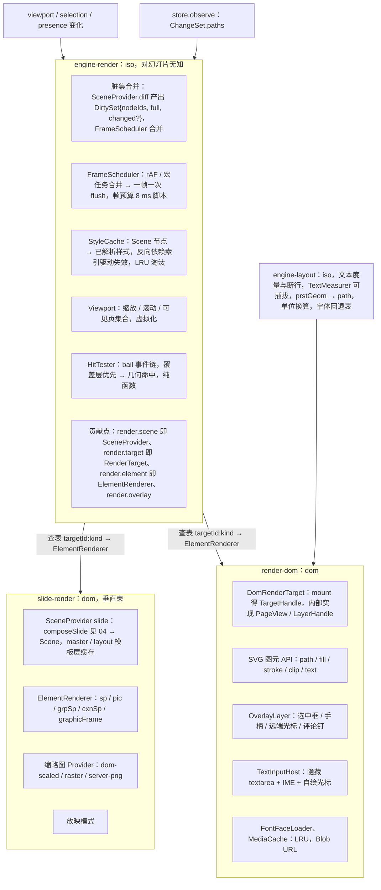

怎么读：上方两个输入驱动 engine-render；engine-render 只持有契约、调度、缓存与命中，按 `${targetId}:${kind}` 查表把绘制交给 render-dom（输出介质）与 slide-render（幻灯片垂直束）；engine-layout 为 render-dom 提供度量与几何。本文 §0–§7 使用 v0.2 契约名（§14.1 对照表保留旧名到新名的映射，rulings §4.18 CO-19）。

**渲染相关包依赖**

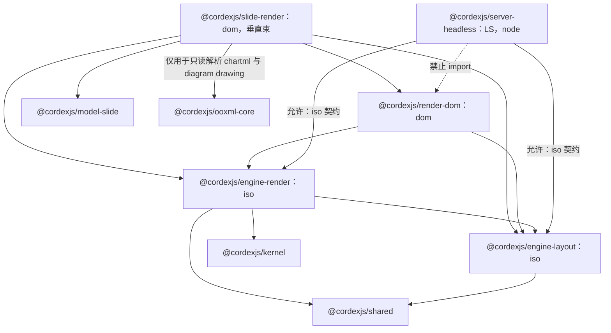

怎么读：实线是 `package.json` 声明或 §14.5 允许的依赖，全部指向秩不高于自身的包，且 iso 包从不指向 dom 包；虚线是分层规则明确禁止的依赖（node 包不得 import dom 包）。M3 起图表渲染从 slide-render 拆为 `@cordexjs/slide-render-chart`（§13 S6），图中未单列。render-dom 不依赖 `@cordexjs/design`（章程秩表：L5 不得依赖 L7；§3.2 已按此改，覆盖层主题色直接写 CSS 变量名字符串）。
依据：本文 §2.4、§3.2、§4.3、§5.4、§14.5。

---

## 1. 渲染介质决策与坐标系（ADR-0021）

- **DOM/SVG 单实现**（rulings §4.15 Q4，ADR-0021 已接受）：主画布 = SVG（图形）+ 自绘文本行（SVG `<text>`），容器为 HTML。编辑、查看、放映、可见缩略图、服务端缩略图与 PDF **共用同一套 SVG 渲染**，不存在第二套渲染实现。选 SVG 而非 Canvas：任意缩放清晰、DOM 可检查/可测试（Playwright 断言节点属性）、a11y 有挂点、插件贡献一个 kind 的渲染器只需产出 SVG 节点、无自绘命中/无重绘管理负担。
- **canvas 只承担三个角色**：① `toImage` 的栅格化画板（主线程：游离 DOM → SVG 序列化 → `Image` → `<canvas>`，§8）；② `measureText` 度量器（`measurer-canvas.ts`，§5）；③ 为 `render.target` 预留的 `RenderTarget` 座位（`id:'canvas'`，当前无 Provider）。「缩略图/放映走 canvas」的旧口径删除；14 §5.4 对 offscreen-canvas Provider 的采纳被推翻。
- **可替换性验证**：M3 末用一个最小 canvas Provider（只画矩形/图片/单行文本）跑 `runRenderTargetConformance`，证明 `render.target` 契约不含 DOM 偏置；它不进入产品。
- **DX-1000 回退规则**（按序执行，依据 ADR-0021 修订 2，rulings §4.18 CO-01）：单页 1,000 元素（DX-1000）若不达标，① 先做合成层优化（独立合成层、`content-visibility`、减少滤镜与 `<tspan>`）；② 仍不达标，再做静态层栅格化（SVG/DOM 路线内的最后手段：会碰上 Web 字体问题并破坏一元素一 DOM 节点）；③ 仍不达标才**仅在查看/放映**启用 canvas Provider；编辑态始终 DOM/SVG。**对外门禁只有 DX-1000**：首页可见 ≤ 2.5 s、交互 ≥ 30 fps；原「≤ 200 ms」只是引擎内部的分解目标（场景构建 + 首次挂载），不作门禁（ADR-0021 修订 1，rulings §4.18 CO-02）。
- **文档内 SVG 只以图像上下文渲染**：`asvg:svgBlip`、SVG 媒体一律经 `<image href=blob:…>` 渲染（浏览器在图像上下文中不执行脚本、不加载外部资源）；禁止以 `innerHTML`/`insertAdjacentHTML`/`DOMParser` 把文档内容注入 DOM（09-08 TD-081）。
- **单位**：模型是 `Emu`；SVG 用户单位 = **px@96dpi**（1 px = 9525 EMU），`viewBox = 0 0 W H`（如 960×540），缩放用容器 `transform: scale(z)`，保持 SVG 内数值量级稳定（避免 EMU 级大数导致的精度/抗锯齿问题）。字号 `sz`（百分点）→ px = sz/100 × 96/72。
- **层叠**：每个 `PageView`（render-dom 的内部实现名；对外契约是 `RenderTarget.mount()` 返回的 `TargetHandle`，§2.1）三层容器：`master-layer` / `layout-layer` / `slide-layer`（各一 `<svg>`），上面再叠 `overlay-layer`（`<svg>` + 少量 HTML）与 `text-input-host`（隐藏）。母版/版式层对同版式的多个页共享 DOM 模板（`cloneNode(true)`）。

**PageView 的 DOM 分层**

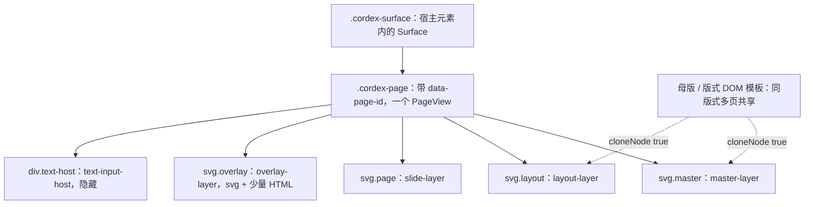

怎么读：实线是 DOM 父子关系，五个子层按 master、layout、page、overlay、text-host 的顺序由底到顶叠放；虚线表示母版层与版式层由共享模板克隆而来，不逐页重渲。
依据：本文 §1 层叠、§3.1 职责。

---

## 2. `@cordexjs/engine-render`（iso）：契约与管线

### 2.1 贡献点（草案；ContributionPoint 机制见架构 03）

```ts
// 签名以 02 §4.13–4.16 与 40-modules/06 §2.5 为准（rulings §4.18 CO-19）；本块只作管线说明
// render.scene —— 文档类型把模型合成为 Scene（key = documentType；引擎对「幻灯片」无知，A5）
interface SceneProvider {
  readonly documentType: string
  build(unitScope: UnitScopeHandle, view: ViewDescriptor): Scene
  diff(changeSet: ChangeSetLike, prev: Scene): DirtySet               // 路径归类是垂直束的知识
}
interface Scene { id: string; size: { w: Emu; h: Emu }; nodes: SceneNode[]; background?: SceneNode }
interface SceneNode { id: NodeId; kind: string; bbox: Rect; transform: Transform; zIndex: number; children?: SceneNode[]; data: unknown; revision: number }
interface DirtySet { nodeIds: ReadonlySet<NodeId>; full: boolean; changed?: ReadonlyMap<NodeId, PathKey[]> }   // 必须被 paint 消费（A28）
// render.target —— 输出介质（key = id）
interface RenderTarget {
  readonly id: string                                                  // 'dom'（唯一实现）| 'canvas'（预留座位，M3 末仅以最小 Provider 验证契约，§1）
  mount(container: unknown, opts?: MountOptions): TargetHandle         // 每个已挂载页一个句柄；PageView/LayerHandle 是 render-dom 内部实现名
  paint(scene: Scene, dirty: DirtySet): void
  hitTest(point: Point): HitResult | null
  toImage?(scene: Scene, opts: ToImageOptions): Promise<Blob | Uint8Array>   // 只在主线程（§8）
  dispose(): void
}
interface TargetHandle { readonly pageId: NodeId; setTransform(zoom: number, pan: Point): void; setSize(size: Size): void; dispose(): void }
// render.element —— 按 `${targetId}:${kind}` 注册的元素渲染器；无状态查表项
interface ElementRenderer<TData = unknown> {
  readonly targetId: string
  readonly kind: string                                                // 'sp' | 'pic' | … | 第三方
  render(node: SceneNode & { data: TData }, ctx: RenderContext): ElementHandle
  update(handle: ElementHandle, node: SceneNode & { data: TData }): void   // 只对 DirtySet 中的节点调用（A28）
  dispose(handle: ElementHandle): void
}
// render.overlay —— 覆盖层贡献（选中框、手柄、远端光标、评论钉、参考线）
interface OverlayRenderer { readonly id: string; readonly zIndex: number; mount(ctx: OverlayContext, target: TargetHandle): OverlayInstance }
```

- 渲染器选择 = `Map<`${targetId}:${kind}`, ElementRenderer>` **查表**，无链式拦截（A30）。找不到渲染器 → `kind:'unknown'` 的占位渲染器（虚线框 + kind 文本），并 `errors.report('render.renderer_missing')` 一次/kind。
- 每个节点的 `render/update` 包在 try/catch：异常 → 该元素替换为错误占位符（红色虚线框），`errors.report('render.element_failed', {kind, elementId})`，**不**影响同页其他元素（A11；借鉴 pptx-renderer 的逐节点隔离）。

**元素渲染器查表与错误隔离**

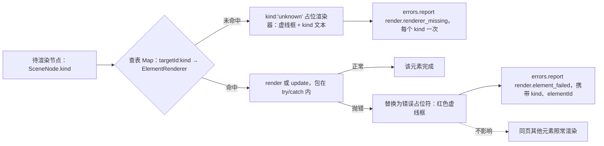

怎么读：选择渲染器是一次查表而非拦截链（A30）；两条失败路径都只替换当前元素并上报一次错误码，虚线强调同页其他元素不受影响（A11）。

### 2.2 帧管线

**帧管线：路径归类**

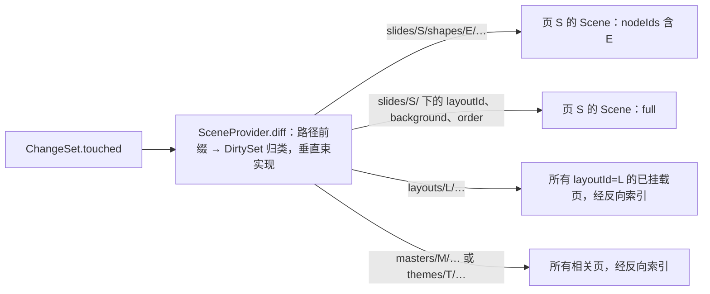

怎么读：边上的文字是路径前缀（S、E、L、M、T 分别代表页、元素、版式、母版、主题 id），箭头指向归类出的 `DirtySet`；归类规则由 slide-render 的 `SceneProvider.diff` 提供，engine-render 不识别 `slides`。

**帧管线：一帧的执行顺序**

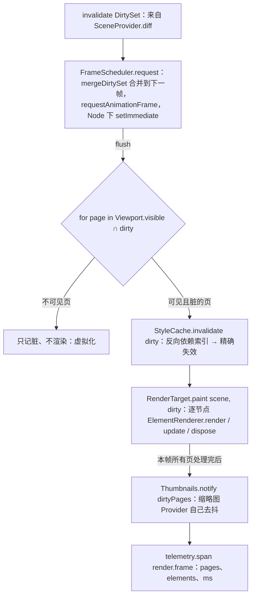

怎么读：自上而下是一次 flush 内的步骤；菱形按可见性分流，只有可见且脏的页进入失效与渲染，不可见页的脏标记保留到下次可见（§2.3）。

- **帧预算**：脚本 ≤ 8 ms/帧（留给浏览器样式/布局/绘制 ≥ 8 ms）；超过预算时 `FrameScheduler` 把剩余脏页顺延到下一帧（时间切片，按可见性优先级），不会掉帧到 < 30 fps。
- **A28 反制测试**（`engine-render/__tests__/dirty-consumed.test.ts`）：用 spy 渲染器挂 100 个元素，改 1 个元素的 1 个属性，断言 `update` 恰被调用 1 次且 `DirtySet.changed` 中该节点的路径等于该路径；改 `layoutId` 断言整页（`full`）重合成但已有元素句柄被**复用**（`render` 不再调用，只调 `update`）。
- **A29 反制测试**：`StyleCache` 上限 = 已挂载页的元素数 × 2，塞入 3× 后断言 `evicted` 计数 > 0 且命中率统计可读；`MediaCache` 同理（按字节 LRU，默认 256 MiB）。

### 2.3 Viewport 与虚拟化

- `Viewport`（UnitScope 服务 `render` 的一部分）：`zoom`、`scroll`、`mode: 'single' | 'continuous' | 'grid' | 'show'`、`visiblePages()`（含 overscan 1 页）。
- 只对可见页 `RenderTarget.mount`（得到该页的 `TargetHandle`）；离开视口 + 超时 5 s → `TargetHandle.dispose()`（DOM 释放，元素句柄 dispose），其脏记录保留为 `full`，下次可见时全量重建。
- 单页编辑模式下同时挂载的页 ≤ 3（当前 ± 1）；连续滚动模式 ≤ 6。缩略图侧栏的可见项 ≤ 12（见 §8）。

### 2.4 目录结构（`packages/engine-render/`）

```
packages/engine-render/
├── package.json                      deps: @cordexjs/kernel @cordexjs/engine-layout @cordexjs/shared；iso（无 DOM 类型；rAF 通过注入的 Scheduler 抽象）
├── src/
│   ├── index.ts
│   ├── plugin.ts                     name='engine-render'；provide=['render']（UnitScope）；注册贡献点定义；Config
│   ├── manifest.ts
│   ├── config.ts                     zod：{ frameBudgetMs: 8, overscanPages: 1, unmountDelayMs: 5000, styleCache: { maxEntriesFactor: 2 }, mediaCache: { maxBytes: 256 MiB } }
│   ├── render.contribution.ts        defineContributionPoint：render.scene / render.target / render.element / render.overlay；Context { render: RenderService }；Events：render/frame（进程内消费；遥测事件 perf/frame 由其派生）、render/element-failed、render/page-mounted|unmounted
│   ├── contracts/
│   │   ├── scene.ts                  Scene/SceneNode/Transform
│   │   ├── scene-provider.ts         SceneProvider Definition { documentType; build(unitScope, view) → Scene; diff(changeSet, prev) → DirtySet }：垂直束实现「一页如何由模型合成为 Scene」
│   │   ├── render-target.ts          RenderTarget/TargetHandle（PageView/LayerHandle 只是 render-dom 内部实现名，不进契约）
│   │   ├── element-renderer.ts       ElementRenderer<TData>/ElementHandle/RenderContext（layout 服务、media 解析器、onError）
│   │   ├── overlay.ts                OverlayRenderer/OverlayInstance/OverlayContext（selection、presence、viewport 只读句柄）
│   │   ├── hit-test.ts               HitTester 契约；'render/hit-test' bail 事件签名
│   │   └── dirty-set.ts              DirtySet/PathKey + 纯函数 mergeDirtySet（归类规则由垂直束的 SceneProvider.diff 提供，引擎不识别 'slides'）
│   ├── services/
│   │   └── render.service.ts         RenderService（name 'render'）：attach(target) / invalidate(dirty) / viewport / scheduler / caches / stats；组合下列模块
│   ├── scheduler/
│   │   ├── frame-scheduler.ts        请求合并、时间切片、优先级（可见 > 近邻 > 其他）；Scheduler 抽象（rAF | setImmediate | 手动步进用于测试）
│   │   └── dirty-merge.ts            DirtySet 合并与页级去重；反向依赖（layout/master/theme → pages）由 SceneProvider.diff 在垂直束内计算
│   ├── cache/
│   │   ├── style-cache.ts            (pageId, nodeId) → ResolvedStyle；依赖键集合；invalidate(DirtySet)；LRU；统计（hits/misses/evicted）
│   │   ├── media-cache.ts            sha256 → 已解码资源句柄（Blob URL 或 ImageBitmap 由 target 决定）；字节 LRU；引用计数与 revoke 钩子
│   │   └── lru.ts                    通用 LRU（带 onEvict 回调，测试可断言调用）
│   ├── viewport/
│   │   └── viewport.ts               zoom/scroll/mode/visiblePages；fit-to-width/height 计算；变化事件
│   ├── hit-test/
│   │   ├── hit-tester.ts             bail 链（overlay 优先）→ RenderTarget.hitTest（dom：elementFromPoint）→ 几何回退：逆变换 → 包围盒 → 精确路径采样
│   │   └── geometry.ts               旋转/翻转矩阵、包围盒、点-多边形（Path 采样）纯函数
│   ├── registry/
│   │   └── renderer-table.ts         贡献点 → `${targetId}:${kind}` 查表；unknown 占位；contribution/changed 时重建表（effect 拥有）
│   ├── errors.ts                     render.renderer_missing / render.element_failed / render.target_missing / render.frame_overrun
│   └── __tests__/
│       ├── dirty-consumed.test.ts    A28 反制
│       ├── cache-eviction.test.ts    A29 反制
│       ├── scheduler.test.ts         合并、时间切片、优先级（手动步进 Scheduler）
│       ├── hit-test.test.ts          旋转/翻转/组合下命中
│       ├── error-isolation.test.ts   抛错渲染器 → 占位符，其余元素正常（A11）
│       └── lifecycle.test.ts         attach/detach 后无 effect；多 Unit 各自 render 服务
└── testing/
    └── index.ts                      `@cordexjs/engine-render/testing`：ManualScheduler、SpyRenderer(kind)、RecordingTarget（记录 paint/render/update 调用而不需要 DOM）、runRenderTargetConformance(factory)
                                      （不设 ElementRenderer 契约套件，暂不落地，40-modules/06 G-8；实现方用 SpyRenderer/RecordingTarget 自测）
```

---

## 3. `@cordexjs/render-dom`（dom）：RenderTarget Provider

### 3.1 职责

- HTML/SVG 输出：`DomRenderTarget.mount()` 在宿主元素内创建 `.cordex-surface > .cordex-page[data-page-id] > (svg.master, svg.layout, svg.page, svg.overlay, div.text-host)`，返回该页的 `TargetHandle`；`DomSurface`/`PageView`/`LayerHandle` 是本包内部实现名，不进 `render.target` 契约（§14.1）。
- 图元 API（供垂直束渲染器使用，避免每个渲染器手写 DOM）：`svg.path()/rect()/image()/text()/group()/clipPath()/gradient()/pattern()`，返回带 `set(attrs)` 的薄句柄；属性 diff 由句柄做（只写变化的 attribute）。
- `FontFaceLoader`：把 `engine-layout` 的字体请求（`FontRequest{family, weight, style}`）解析为 `FontFace` 加载（嵌入字体 `fntdata` 由 ooxml-pptx 反混淆后以 `BlobRef` 提供；宿主字体经配置 URL），`document.fonts.load` 完成后触发 `layout/fonts-ready(families)` → 相关文本元素标脏重排。
- `MediaResolver`：`BlobRef` → `blob:` URL（`MediaCache` 持有，revoke 在淘汰/页卸载时；借鉴 pptx-renderer 的 Blob URL 生命周期）。
- `OverlayLayer` 与 `TextInputHost`（§6/§7）。

### 3.2 目录结构（`packages/render-dom/`）

```
packages/render-dom/
├── package.json                      deps: @cordexjs/engine-render @cordexjs/engine-layout；dom（不依赖 @cordexjs/design：L5 不得依赖 L7，
│                                     覆盖层主题色直接写 CSS 变量名字符串，rulings §4.18 FE-18）
├── src/
│   ├── index.ts
│   ├── plugin.ts                     name='render-dom'；inject=['render','layout']；contribute render.target{ id:'dom' }；contribute render.overlay（selection/handles/remote-cursors）
│   ├── manifest.ts
│   ├── config.ts                     zod：{ pixelRatioCap: 3, textHost: { imeCandidateOffsetPx: 2 }, overlays: { remoteCursorFadeMs: 3000 } }
│   ├── target/
│   │   ├── dom-render-target.ts      RenderTarget Provider（id 'dom'）：mount → TargetHandle、paint(scene, dirty)、hitTest（elementFromPoint → data-cordex-node）、toImage（主线程）
│   │   ├── dom-surface.ts            内部实现：页容器管理、ResizeObserver（effect 拥有）、DPR 变化监听
│   │   ├── dom-page-view.ts          内部实现 PageView（即 TargetHandle 的 dom 实现）：三层 svg + overlay + text-host；setTransform → CSS transform；模板层克隆
│   │   └── layer-handle.ts           内部实现 LayerHandle：z-order 插入（按 FracKey 比较后 insertBefore）、批量 DocumentFragment 提交
│   ├── primitives/
│   │   ├── svg.ts                    图元句柄工厂（属性 diff、命名空间、`<defs>` 管理）
│   │   ├── paint.ts                  fill/stroke → SVG 属性/`<linearGradient>`/`<pattern>`/`<image>` 平铺；混合模式与不透明度
│   │   ├── text-lines.ts             engine-layout 的 TextLayout → `<text>`/`<tspan>`：**按行分块**——每行一个 `<text>` 块，行内按 run 属性差异切 `<tspan>`；LTR/CJK 行可给 `<tspan>` 显式 x，**含 RTL 字符的行 run 不设 x，交由浏览器做 bidi 重排**（M1 不自研 UAX#9；rulings §4.15 Q7、ADR-0027）；下划线/删除线用 `<line>`；RTL 与竖排按 ADR-0027 分阶段交付（rulings §4.15 Q7）
│   │   └── clip.ts                   几何裁切、图片 srcRect 裁切
│   ├── fonts/
│   │   ├── font-face-loader.ts       FontFace 加载、去重、失败回退、fonts-ready 事件
│   │   └── measurer-canvas.ts        TextMeasurer Provider（贡献 layout.measurer，id 'canvas'）：OffscreenCanvas.measureText（+ fontBoundingBox）缓存（ADR-0027）；
│   │                                 __tests__ 实例化 runTextMeasurerConformance
│   ├── media/
│   │   └── media-resolver.ts         BlobRef → blob: URL；接入 engine-render MediaCache；`<image>` decode 事件
│   ├── overlay/
│   │   ├── overlay-layer.ts          覆盖层 svg 管理；zIndex 排序
│   │   ├── selection-overlay.ts      选中框（含旋转）、8 个缩放手柄 + 旋转手柄、调整点（adj 手柄由几何提供）
│   │   ├── remote-presence-overlay.ts 远端选区色框 + 名字标签 + 文本光标（RelativePosition → 行/列 → 像素）
│   │   ├── guides-overlay.ts         智能参考线/对齐线（由交互层提供数据）
│   │   └── comment-pins-overlay.ts   评论钉（数据来自 comments 客户端服务；无则不挂）
│   ├── text-host/
│   │   ├── text-input-host.ts        隐藏 textarea 宿主：聚焦管理、事件转发（beforeinput/input/composition*/keydown）→ 编辑意图对象
│   │   ├── ime-composition.ts        组合态：瞬态覆盖层文本 + 候选窗定位（把 textarea 移到光标像素位置）
│   │   ├── caret-renderer.ts         自绘光标（闪烁 timer 归 effect）、本地选区高亮（overlay）
│   │   └── a11y-mirror.ts            屏幕阅读器镜像：当前段落文本同步到 textarea 值 + aria-* 描述；只读时 role=document 的语义树
│   ├── errors.ts                     render.dom.font_load_failed / render.dom.media_decode_failed
│   └── __tests__/                    vitest browser mode（Chromium）：图元属性 diff、层克隆、字体回退、IME 组合事件序列（合成事件）、覆盖层坐标
└── testing/
    └── index.ts                      `@cordexjs/render-dom/testing`：mountTestSurface(html)、snapshotSvg(page)（规范化后的 SVG 字串用于快照测试）、FakeFontFace
```

---

## 4. `@cordexjs/slide-render`（dom，垂直束）：页合成与元素渲染器

### 4.1 页合成（master → layout → slide）

1. `SlideSceneProvider`（`slide-render/scene/slide-scene-provider.ts`，实现 engine-render 的 `SceneProvider('slide')`）的 `build(unitScope, view)` 调 model-slide 的合成纯函数 `composeSlide`（架构 04，输入 `slides.resolved.*` 与 `layout` 服务），产出一个 `Scene`：母版/版式/页三层 = 同一个 `Scene`，节点带 `data.layer` 标签；已按 `showMasterSp`、占位符覆盖规则（slide 有同 idx/type 占位符则隐藏 layout/master 的对应占位符）与 `(parentId, z)` 展开成绘制顺序；`dependencies`（themeId、masterId、layoutId）用于反向索引。
2. 绘制由 dom target 的 `paint(scene, dirty)` 驱动：
   - `master`/`layout` 层：以 `(layoutId, showMasterSp, themeVersion)` 为键缓存**渲染后的 DOM 模板**（`LayerTemplateCache`，LRU 32 项，dom target 内部优化），新页挂载时 `cloneNode`；相关路径脏时失效并重渲一次、再广播给共享它的页。
   - `slide` 层：按节点 id 做 keyed reconcile：新增 → `ElementRenderer.render(node, ctx)`；删除 → `dispose(handle)`；`z`/`parentId` 变化 → 只移动 DOM 节点；属性变化 → `update(handle, node)`（`DirtySet.changed` 给出属性级精度）。
   - `background`：`Scene.background` 节点，单独的 `<rect>` + paint，属于整页（`full`）脏。
3. `diff(changeSet, prev)`：把 `ChangeSet.touched` 的 `StorePath` 归类为 `DirtySet`（这是垂直束的知识，engine-render 不认识 `slides`）。

**页合成与三层渲染**

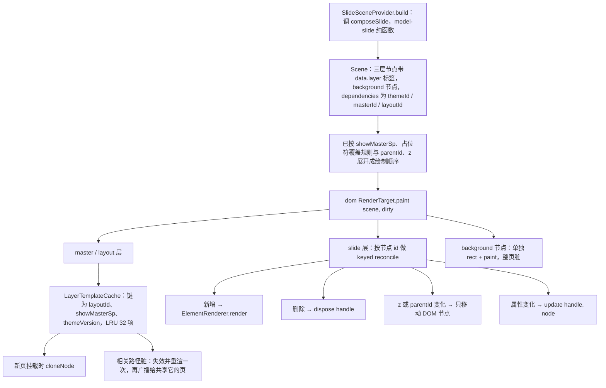

怎么读：自上而下是一页从模型到 DOM 的合成路径；`Scene` 交给 dom target 的 `paint` 后分三路处理三类内容，模板层走缓存与克隆，slide 层走按 id 的最小化协调。

### 4.2 元素渲染器（`render.element` 贡献，target `dom`）

| kind | 内容 | 关键点 |
|---|---|---|
| `sp` | 几何 + 填充/线 + 文本 | `prstGeom` → `engine-layout` 的路径生成（含 adj 手柄）；`custGeom` 解析；文本走 §5 布局后由 `text-lines` 绘制 |
| `pic` | 图片 | `srcRect` 裁切、`stretch/tile`、几何裁切（图片形状）；EMF/WMF：M1 显示占位 + 诊断，**M2（P1）起经 emf-converter（Apache-2.0）在惰性 Worker chunk 中栅格化**为位图显示（chunk 不计入查看器 350 KB 基线；记录数/像素/耗时受 OF-24 上限约束；server-headless 用同一份代码），矢量渲染放 M4+；外链图片（`r:link`，仅 http(s)）默认自动加载，受部署配置 `externalResources`（`auto`\|`confirm`\|`never`）收紧，`never`/加载失败显示占位并记 degraded 原因 `external-resource-blocked`（rulings §4.15 Q7） |
| `grpSp` | 组合 | 只产生一个 `<g transform>`（chOff/chExt → 子坐标映射）；子元素由合成结果扁平化后各自渲染进该 `<g>` |
| `cxnSp` | 连接线 | 几何同 sp；端点由 `stCxn/endCxn` 解析到目标形状连接点（布局纯函数），目标移动时因依赖索引标脏 |
| `graphicFrame/table` | 表格 | 行列尺寸、合并单元格、表格样式（tblStyle）继承（04）、单元格文本走 §5 |
| `graphicFrame/chart` | 图表 | **按章程 D16**：M1–M2 `c:chart` 部件不透明保留，渲染器经 `ooxml-core/chartml` **只读解析**部件与缓存数据（`numCache`/`strCache`/轴/图例/标题）直接绘制 SVG（查看 SSIM ≥ 0.80，PRD OF-09）。M3 起数据建模与编辑，可编辑类型为**五类 bar / line / pie / area / scatter**（U-06），由 `slide-render-chart` 提供。`cx:chart`（chartex）：直接显示占位 + 诊断 `chartex-unsupported`，**不**渲染其 Fallback 文本 |
| SmartArt（`dgm`） | 保留不编辑 | `ooxml-core` M1 只读解析 `dsp:drawing` 部件（含 `dsp:txXfrm`），复用 `sp` 画笔渲染其形状与文本；drawing 部件缺失时才占位 + 诊断 |
| `graphicFrame/ole` | 保留不编辑 | 显示 `Ole.preview`（`mc:Fallback` 中的 `p:pic`，由 ooxml-pptx 导入时提取）走 `pic` 路径；预览为 EMF/WMF 时同 `pic` 行；无预览时才占位 |
| `unknown` | — | 由 engine-render 占位 |

所有渲染器都是**无状态查表项**：状态只在 `render()` 返回的 `ElementHandle` 里（DOM 句柄与上次节点 revision），渲染器对象本身不持有实例。

### 4.3 目录结构（`packages/slide-render/`）

```
packages/slide-render/
├── package.json                      deps: @cordexjs/model-slide @cordexjs/engine-render @cordexjs/render-dom @cordexjs/engine-layout @cordexjs/ooxml-core（仅用于只读解析 chartml 与 diagram drawing，rulings §4.15 Q7 修订 §4.11 C-28）；dom
├── src/
│   ├── index.ts
│   ├── plugin.ts                     name='slide-render'；inject=['render','layout','slides']；contribute render.element × N、render.scene（SceneProvider 'slide'）、thumbnails Provider
│   ├── manifest.ts
│   ├── config.ts                     zod：{ layerTemplateCache: 32, thumbnails: { provider: 'dom-scaled' | 'server-png'（M3 起列表封面/网格；raster 只用于单页导出）, width: 192, debounceMs: 300, maxMounted: 12 }, charts: { enabled: true } }
│   ├── slide-render.contribution.ts  Context { thumbnails: ThumbnailService }（UnitScope）；Events：slide/thumbnail-updated、slide/show-changed
│   ├── scene/
│   │   ├── slide-scene-provider.ts   SceneProvider('slide') 实现：build（合成 → Scene）、diff（ChangeSet.touched → DirtySet，含反向依赖索引）
│   │   ├── layer-template-cache.ts   master/layout 模板缓存（LRU + 失效 + 统计）
│   │   └── background.ts            背景绘制
│   ├── elements/
│   │   ├── sp.renderer.ts
│   │   ├── pic.renderer.ts
│   │   ├── grp-sp.renderer.ts
│   │   ├── cxn-sp.renderer.ts
│   │   ├── table.renderer.ts
│   │   ├── chart.renderer.ts         D16 只读解析路径（ooxml-core/chartml → SVG；M1–M2 惰性子路径 `@cordexjs/slide-render/chart`，M3 拆为 slide-render-chart，五类）；chartex → 占位 + chartex-unsupported
│   │   ├── diagram.renderer.ts       SmartArt：dsp:drawing 只读解析结果 → 复用 sp 画笔（M1）
│   │   ├── ole.renderer.ts           OLE：Ole.preview 走 pic 路径；无预览 → 占位
│   │   ├── fallback.renderer.ts      未知 graphicData：占位 + 诊断
│   │   └── shared/
│   │       ├── geometry.ts           模型 geom → engine-layout 路径 + 文本内接矩形（txRect）
│   │       ├── paint-resolver.ts     已解析样式（04）→ render-dom paint 参数（颜色变换 lumMod/tint/alpha 等由 04 的 color 纯函数完成）
│   │       └── text-body.ts          txBody → engine-layout.layoutTextBody → text-lines；autofit 循环（normAutofit fontScale/lnSpcReduction）
│   ├── thumbnails/
│   │   ├── thumbnail.service.ts      ThumbnailService：get(slideId) → { url | element, version }；订阅 dirtyPages；去抖；Provider 选择
│   │   ├── dom-scaled.provider.ts    可见缩略图 = 独立的小 TargetHandle 挂载页（复用模板层）+ CSS scale；≤ maxMounted，IntersectionObserver 驱动
│   │   ├── raster.provider.ts        主线程 toImage 栅格化（游离 DOM → SVG 序列化 → Image → canvas）；Web 字体可用性待 M2 spike，结论前不用于封面与批量 PNG（替代原 offscreen-canvas Provider）
│   │   └── server-png.provider.ts    从 `GET /api/v1/documents/:id/thumbnails/:slideId` 取 640 px WebP（M3 起，renderer sidecar 生成，08/ADR-0026）；识别 `provisional`（M2 包内 thumbnail.jpeg 过渡封面）并在其后回退 dom-scaled；本地脏页在图到达前用 dom-scaled 兜底
│   ├── show/
│   │   └── slideshow.ts              放映模式：Viewport.mode='show'、全屏、键盘翻页、黑屏/白屏；动画/切换不播放（Q7），预留贡献点 slide.showTransition
│   ├── errors.ts                     slide.render.*（geometry_unsupported、chart_parse_failed、chartex_unsupported、external_resource_blocked、emf_raster_failed）
│   └── __tests__/
│       ├── compose-reconcile.test.ts 版式切换复用元素实例；z 变化只移动节点
│       ├── elements/*.test.ts        每个渲染器的 SVG 快照（规范化），用 engine-render/testing 的 SpyRenderer/RecordingTarget 断言调用次数（不设 ElementRenderer 契约套件）
│       ├── template-cache.test.ts    共享版式的页在 layout 改动后同时更新（且仅重渲模板一次）
│       ├── autofit.test.ts           normAutofit/spAutoFit 收敛（≤ 6 次迭代）
│       └── thumbnails.test.ts        去抖、maxMounted、Provider 切换
└── testing/
    └── index.ts                      `@cordexjs/slide-render/testing`：renderSlideToSvgString(snapshot, slideId)（headless 断言用）、fixtures（覆盖每个 kind 的最小 Snapshot）
```

---

## 5. `@cordexjs/engine-layout`（iso）：度量与断行（ADR-0027）

### 5.1 策略：自己断行（layout-then-paint），度量器可插拔

- **为什么不用浏览器 CSS 排版文本**：PowerPoint 语义（`normAutofit` 的 `fontScale`/`lnSpcReduction`、`spAutoFit` 增高、`anchor`/`anchorCtr`、多栏 `numCol`、`wrap="none"`、缩进/悬挂/项目符号、`spcPct` 行距、东亚标点禁则、竖排）需要确定的几何来做命中、选区矩形、光标位置与缩略图一致性；CSS 排版的结果不可读取为行模型（只能用 Range 反推，代价高且不稳定），且服务端/客户端结果难以逐像素一致。
- **度量器 Definition**（`TextMeasurer`，贡献点 `layout.measurer`，key = id；签名以 40-modules/06 §2.5 为准）：`measure(text, font) → MeasureResult`（advance、ascent、descent、lineGap）、`supports(font)`，三个 Provider：
  - `canvas`（render-dom）：`OffscreenCanvas.measureText`，含实际字体回退行为，**客户端与 headless Chromium 都用它**，因此两端一致（同字体集）。
  - `node-font`（server-headless）：Node 端以 opentype/fontkit 一类库解析字体文件计算 advance（fontkit 只是实现手段，不是 Provider id），用于**无浏览器**的服务端路径（例如导出校验），标注为「近似一致」（无 shaping 差异保证）。
  - `fixed`（`engine-layout/testing`）：每字等宽的确定性度量，供单测使用。
- 断行算法：按 UAX#14 行断机会（`Intl.Segmenter` 或内置表）+ 东亚禁则；run 边界为字距重置点（与 PowerPoint 行为一致）；每行输出 `LineBox { y, ascent, descent, runs: [{ x, text, attrs }] }`。
- **一致性策略**：字体集受控（§5.3）+ 度量缓存键含 `fontKey + text`（按 word 缓存）+ 版本化的 `layoutAlgorithmVersion` 进入缩略图缓存键（服务端缩略图（640 px WebP）与客户端算法版本不一致时以客户端为准并触发重生成）。

### 5.2 API（草案）

```ts
interface LayoutService {                                 // ctx.layout（根作用域）
  layoutTextBody(body: TextBodyModel, box: Rect, style: ResolvedTextStyle, opts: { autofit: AutofitSpec }): TextLayout
  presetGeometry(name: string, adj: Record<string, number>, box: Rect): GeometryPath   // 187 种 prstGeom（编译期表）
  customGeometry(spec: CustomGeometrySpec, box: Rect): GeometryPath
  fonts: FontFallbackTable                                // 请求族 → 候选族（含度量兼容替身）
  measurer(): TextMeasurer                                // 当前 Provider（layout.measurer 贡献点）
}
interface TextLayout { lines: LineBox[]; contentHeight: number; overflow: boolean; fontScale: number; lnSpcReduction: number; caretMap: CaretMap }
```

### 5.3 字体回退表（客户端与服务端共用同一份 JSON）

| 请求 | 替身（度量兼容） | 说明 |
|---|---|---|
| Calibri | Carlito | 度量兼容开源字体（SIL OFL） |
| Cambria | Caladea | 同上 |
| Arial/Helvetica | Liberation Sans | 同上 |
| Times New Roman | Liberation Serif | 同上 |
| Courier New | Liberation Mono | 同上 |
| 微软雅黑/宋体/黑体 等 CJK | Noto Sans CJK SC / Noto Serif CJK SC | 度量不完全兼容，标注为 `approx` |
| 主题 `+mj-lt`/`+mn-lt`/`+mj-ea`/`+mn-ea` | 由 04 的主题解析替换为实际族后再查表 | — |

嵌入字体（`ppt/fonts/*.fntdata`）优先于回退表，单个 ≤ 20 MB、总计 ≤ 60 MB（PRD OF-17）；`fsType` 为受限（restricted / preview & print）的嵌入字体**只用于只读渲染**（查看、放映、缩略图），进入编辑态的文本框改用回退字体（rulings §4.15 Q7）；许可证不允许再分发的字体不会进入服务端字体包（运维清单）。

### 5.4 目录结构（`packages/engine-layout/`）

```
packages/engine-layout/
├── package.json                      deps: @cordexjs/shared；iso（Intl.Segmenter 可用性检测 + 内置回退表）
├── src/
│   ├── index.ts
│   ├── plugin.ts                     name='engine-layout'；provide=['layout']；经 layout.measurer 贡献点取当前 TextMeasurer（缺失 → PENDING 等待 Provider，符合 primer）
│   ├── manifest.ts
│   ├── config.ts                     zod：{ fallbackTable: FontFallbackTable(默认内置), measureCache: { maxEntries: 50_000 }, autofit: { maxIterations: 6 } }
│   ├── layout.contribution.ts        Context { layout: LayoutService }；defineContributionPoint：layout.measurer（TextMeasurer，key = id）
│   ├── contracts/
│   │   ├── text-measurer.ts          TextMeasurer Definition + FontKey 规范化
│   │   ├── text-layout.ts            TextBodyModel(引擎视角的最小结构，与 model-slide 解耦：paragraphs[]→runs[]→attrs)、LineBox、CaretMap
│   │   └── geometry.ts               GeometryPath（命令序列 + 文本矩形 + 连接点 + adj 手柄描述）
│   ├── text/
│   │   ├── shaper.ts                 run 切分（字体/脚本/方向）、字体回退到具体族
│   │   ├── line-breaker.ts           UAX#14 机会点 + CJK 禁则 + wrap=none + 强制换行(br)
│   │   ├── paragraph-layout.ts       缩进/悬挂/项目符号/对齐/行距（spcPct/spcPts）/段前后
│   │   ├── body-layout.ts            多栏、anchor、insets、autofit 迭代
│   │   ├── caret-map.ts              (段落, 偏移) ↔ (行, x)；用于光标/选区/命中
│   │   └── measure-cache.ts          LRU（A29 测试）
│   ├── geometry/
│   │   ├── preset-table.ts           187 种 prstGeom 的公式表（由 tooling 从 presetShapeDefinitions.xml 生成，生成脚本在 tooling/）
│   │   ├── formula-eval.ts           OOXML 几何公式求值（gd/avLst/gdLst/ahLst/cxnLst）
│   │   ├── custom-geometry.ts        custGeom 路径
│   │   └── path-builder.ts           → SVG path 字串 / 采样多边形（命中）
│   ├── fonts/
│   │   ├── fallback-table.ts         默认表 + 合并策略
│   │   └── font-key.ts               family/weight/style/size → 规范化键
│   ├── units.ts                      Emu/Pt/px 换算（品牌类型来自 @cordexjs/shared）
│   ├── errors.ts                     layout.measurer_missing / layout.geometry_formula_error
│   └── __tests__/                    断行黄金用例（含 CJK/混排/禁则）、几何表全量求值不抛错、autofit 收敛、度量缓存淘汰
└── testing/
    └── index.ts                      `@cordexjs/engine-layout/testing`：FixedWidthMeasurer（Provider id 'fixed'，每字等宽，确定性）、runTextMeasurerConformance(factory)
```

---

## 6. 文本编辑宿主（ADR-0028）

### 6.1 决策：**单一隐藏 `textarea` + 自绘光标/选区**，不用每个文本框 `contenteditable`

| 维度 | 每文本框 contenteditable | 单一隐藏 textarea + 自绘（采用） |
|---|---|---|
| 与自有断行的一致性 | 浏览器会自行排版，与 §5 的行模型冲突；`foreignObject` 内 contenteditable 在 Safari 不稳定 | 渲染完全由我们控制，编辑态与只读态像素一致 |
| 协同映射 | DOM MutationObserver → 文本操作的反推极易出错（这正是 ProseMirror 的复杂度来源） | 输入事件直接转为 `text.insert/delete/format` Mutation（A32：无第二份编辑缓冲） |
| IME | 原生支持好 | `compositionstart/update/end` + `beforeinput`（`insertCompositionText`）可完整支持；组合中文字以**瞬态覆盖层**显示，`compositionend` 才提交事务；候选窗位置靠把 textarea 定位到光标像素处 |
| a11y | 原生语义最好 | 需要镜像：textarea 值 = 当前段落文本，选区同步；`aria-activedescendant` 指向当前形状；只读模式暴露 `role=document` 语义树（`a11y-mirror.ts`）。**局限**：屏幕阅读器只能按段落朗读（Google Slides 采用同类方案） |
| 移动端 | 好 | 虚拟键盘由 textarea 聚焦触发；可用 |
| 先例 | Notion/Quill 类 | Google Slides/Docs、Figma、VS Code（Monaco） |

### 6.2 事件 → Mutation 流

**文本输入事件 → Mutation**

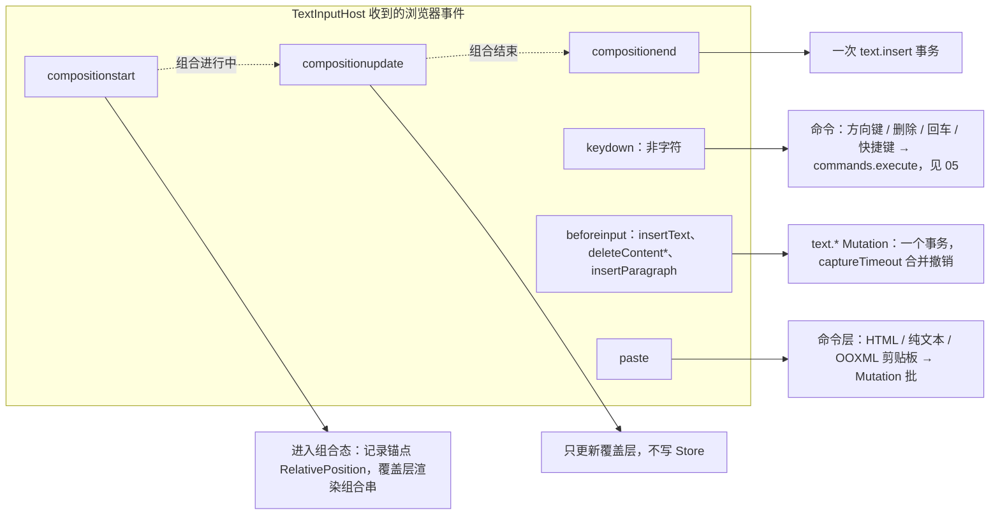

怎么读：左框是隐藏 textarea 上监听的事件，实线指向各事件的处理结果；虚线是 IME 组合的先后顺序——组合期间只动覆盖层，`compositionend` 才写一次 Store（A32：无第二份编辑缓冲）。

- 光标位置 = `StablePosition`（06 §2.2）→ `CaretMap` → 像素；远端光标同理（presence）。
- 文本编辑期间的重排：只重排被编辑的 txBody（元素级脏）；autofit 迭代上限 6 次；预算：键入 → 屏幕 ≤ 16 ms（p95 ≤ 33 ms）。

---

## 7. 命中测试与覆盖层

- **命中链**：`ctx.bail('render/hit-test', point, ctx)`：覆盖层（手柄 > 评论钉 > 远端光标标签）优先返回 `HitResult{ kind:'handle'|'pin'|…}`；无人接管 → `RenderTarget.hitTest(point) → HitResult{ nodeId, region, local }`：dom target 先用 `elementFromPoint → data-cordex-node`，几何回退为 `HitTester.geometric()`：视口逆变换 → 页坐标 → 自顶层 `z` 逆序遍历 `(包围盒 + 旋转逆变换)` → 命中候选再做精确路径采样（Path2D `isPointInPath` 在 dom 可用；Node 用多边形）→ 返回 `ShapeId`；组合：先命中子元素，按「组合选择规则」（首次点击选组，双击进组）由交互层决定。
- 覆盖层数据源：`selection`（A 线 UnitScope 服务）、`presence.remotes`、comments 客户端服务（可选）。覆盖层**不**参与内容脏区：它们订阅各自数据源，独立的 `overlay` 层重绘不触发内容渲染（测试：改变选区不会调用任何 `ElementRenderer.update(handle, node)`）。
- 远端光标渲染：`caret.anchor/head`（RelativePosition）→ `store.resolveStablePosition` → `CaretMap` → 像素；目标形状未挂载/不可见时只显示头像于页缩略图。

**命中链**

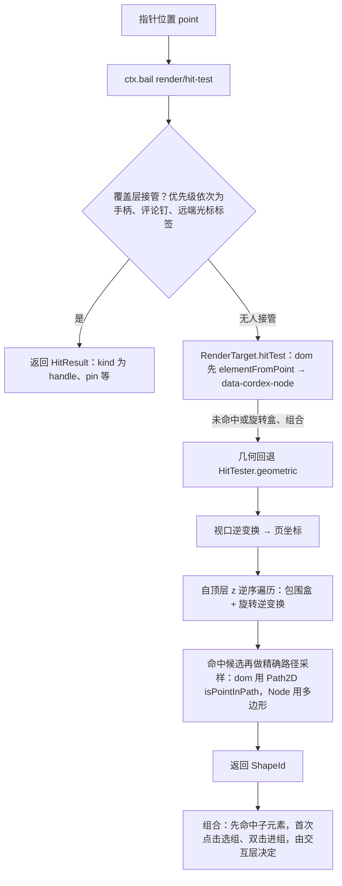

怎么读：自上而下是一次命中的判定顺序；菱形是 bail 链的短路点，覆盖层一旦接管就不再做几何命中。覆盖层自身不参与内容脏区，改变选区不会触发任何 `ElementRenderer.update`。dom target 先用 `elementFromPoint → data-cordex-node`，几何命中只作回退（§14.1）。
依据：本文 §7、§14.1。

---

## 8. 缩略图与放映模式

| 方案 | 何时用 | 成本 |
|---|---|---|
| `dom-scaled`（缩放 DOM 克隆） | **可见缩略图的唯一方案**（M1 起）；可见缩略图 ≤ 12 个（`maxMounted`，与 PRD OF-15「上下各 10 项」统一按 12 计），IntersectionObserver 驻留 | 每个 ≈ 一页 DOM；模板层共享；更新 = 与主页面共享的合成结果重挂 |
| `raster`（主线程 toImage 栅格化） | 需要位图时（复制为图片、导出单页 PNG）：游离 DOM → SVG 序列化 → `Image` → `<canvas>` → Blob；**只在主线程**，不做 Worker 版本；`blob:` 媒体先内联为 data URI | 已知问题：序列化后的 SVG 在图像上下文里**用不到页面已加载的 Web 字体**（CJK 尤甚）→ 列为 **M2 位图 spike**（候选：`@font-face` 以 data URI 内联子集）；spike 结论前，封面与批量 PNG 不走本方案 |
| 包内封面（M2 过渡） | 文档列表卡片封面：导入时取包内 `docProps/thumbnail.jpeg`（服务端只做 JPEG 头校验不解码），标 `provisional` | 零渲染成本；无该部件的文档显示占位 |
| `server-png`（Q8，ADR-0026） | **M3 前半段起**：文档列表封面、全览网格、批量 PNG、分享预览；由独立 renderer sidecar（headless Chromium，同一份渲染代码）生成 **640 px WebP**（分享/版本预览按需 1280 px）；按页内容哈希失效，导入后首页 ≤ 10 s、D200 全量 ≤ 90 s | 网络请求 + 缓存；本地脏页在图到达前用 dom-scaled 兜底 |

- 14 §5.4 采纳的 offscreen-canvas 缩略图 Provider 被推翻（rulings §4.15 Q4），由上表 `raster` 取代；canvas 在本节只作 `raster` 的栅格画板。

**缩略图 Provider 的选用**

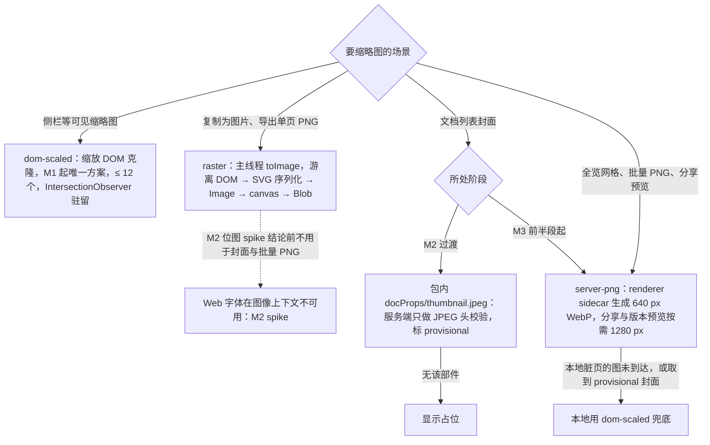

怎么读：从顶部菱形按场景分流到四种来源；边上文字是选用条件，虚线标出 raster 的已知限制。三个客户端 Provider 在 `slide-render/thumbnails/` 下，服务端图由 08 §3.3 的 renderer 路径生成（§10）。
依据：本文 §4.3 `thumbnails/`、§8；rulings §4.15 Q4、Q8。

放映模式：`Viewport.mode='show'` + Fullscreen API；渲染同一 Surface（DOM/SVG，fit 到屏幕），不走 canvas；不播放动画/切换（Q7）。**动画结束态按场景**（rulings §4.15 Q7）：编辑、缩略图、PDF 等静态场景一律全部元素可见；放映时按主动画序列的可见性终态显示（`p:timing` 只读解析，M2 P1）。预留 `slide.showTransition` 贡献点（M4+）。

---

## 9. 性能预算与测量方式

| 场景 | 预算 | 测量 |
|---|---|---|
| 首页可见（30 页/20 MB 文档，下载完成后） | ≤ 1.5 s p75 | Playwright trace：`unit/opened` → 首个 `render/frame`（`performance.mark`） |
| 首页可见（200 页） | ≤ 3.0 s p75 | 同上 |
| 键入 → 玻璃 | ≤ 16 ms p50，≤ 33 ms p95 | `beforeinput` 时间戳 → 该帧 `render/frame` 结束 |
| 拖拽形状 | ≥ 55 fps（帧脚本 ≤ 8 ms） | trace 帧统计 |
| 缩放/滚动 | ≥ 55 fps | 同上 |
| 切页（已缓存模板） | ≤ 50 ms 至绘制 | `viewport/changed` → `render/frame` |
| 单属性变更 | 恰 1 个元素 `update`；≤ 5 ms | 单测（A28）+ trace |
| 版式变更 | 页级重合成 ≤ 30 ms（30 元素） | bench |
| 内存（200 页，含 12 缩略图） | 堆 ≤ 300 MB；MediaCache ≤ 256 MiB | `performance.memory`/Playwright CDP `HeapProfiler` |
| 内存与元素上限的关系（rulings §4.15 Q5） | 300 MB 客户端堆预算只对**性能保证包络**（D200 ≈ 6,000 元素，Y 堆实测 ≈ 85 MB）承诺；系统天花板 20,000 元素时仅 Y 状态就约 276 MB，加上渲染缓存会超出 300 MB——天花板内保证「能打开、能编辑、不崩」，不承诺包络内的帧率与堆预算；新增 DX-20K（200 页 × 100 元素）参考文稿只做监测、不设门禁 | `test/perf/budgets.json` 的 `envelope` / `ceiling` 两档 |
| 缩略图刷新延迟 | ≤ 300 ms 去抖后 ≤ 100 ms | e2e |
| 字体到达后重排 | ≤ 1 帧内标脏，重排仅涉及该字体的文本 | 单测 |

预算文件：`test/perf/budgets.json`；门禁规则与噪声控制见 11 §9。

---

## 10. 服务端 headless 渲染路径（Q8，ADR-0026）

**服务端缩略图：renderer sidecar 时序**

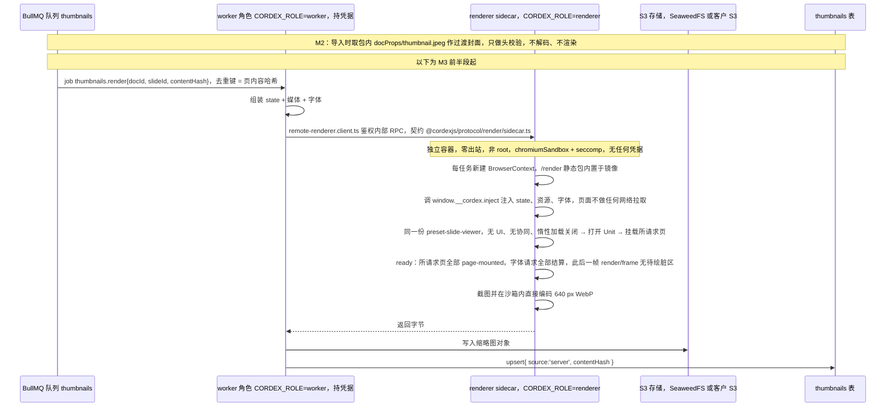

怎么读：从上到下是一次缩略图作业；只有 worker 持凭据并与存储交互，renderer 只接受 worker 的入站 RPC、自身不做任何网络访问，所有输入都由 worker 注入。

- **注入是唯一路径**（rulings §4.18 BE-04）：`local` 与 `remote` 两种模式都由编排方（`local`：worker 内 Playwright `page.evaluate`；`remote`：renderer sidecar 收到 RPC 后在页内调用）调用 `window.__cordex.inject` 注入 state、资源与字体，页面只有这一条路径；原 `/internal/render/:token/state` 的 RenderStateToken 网络拉取**已取消**（ADR-0026 决策 1），`/render` 的查询参数只带 `renderId` 作日志关联。机械验证：两种模式各跑一次 e2e，断言 `/render` 页的网络请求数为 0。
- **ready 判据**（rulings §4.18 FE-09，40-modules/11 与本节同一条）：`/render` 装配 viewer 时关闭惰性加载（`lazy.charts`、`lazy.locales` 置 false）；ready = 所请求页全部 `render/page-mounted` ∧ 这些页的字体请求全部结算（`layout/fonts-ready` 或 `render/font-fallback`；无字体需加载视为已结算）∧ 此后出现一次待绘脏区为空的 `render/frame`（`render/frame` 的 stats 补 `pendingDirty` 计数，或 render 服务提供只读 `hasPendingWork()`，落点 40-modules/06）。注入等待超时（页面常量，默认 60 s）与 ADR-0026 每页 10 s 渲染超时分开计；由 `render-page.spec.ts` 断言。
- 与客户端**同一渲染代码、同一字体包、同一布局算法版本** ⇒ 像素级一致（视觉 oracle 在 11 中同时校验客户端与服务端输出）。
- **失效**：按页内容哈希——输入 = 页子树 + 版式/母版/主题依赖闭包 + 媒体 BlobRef + slideSize + 页序号 + 内嵌字体集合 + `layoutAlgorithmVersion` + fontProfile；外链一律占位且不计入哈希。Compaction 之后只把哈希变化的页入队。
- 预算：导入完成后首页高优先生成 ≤ 10 s；D200 全量 ≤ 90 s；其余页按需惰性生成；失败重试 3 次。
- 安全：renderer 零出站（外链图片**服务端永不加载**，与客户端 `externalResources` 无关）；用 `--shm-size` 而非 `--ipc=host`；定期回收浏览器；镜像每周随 Chrome 稳定版重建、与 worker 锁步发布；不暴露无鉴权的 Playwright run-server WS。部署配置以 ADR-0037 为准：`headless.mode = 'remote'`（默认，配 `headless.endpoint` 指向 renderer sidecar，客户端文件 `remote-renderer.client.ts`）或 `'local'`；自带 Nest 的集成方（EM-10 b）可用 `headless.mode:'local'` 在 worker 内直接 launch，同一份代码。
- 不用 sharp（依赖 libvips，LGPL，违反 D13），服务端对不可信图片不解码。

---

## 11. 与 Univer 的对照

| 编号 | Univer | 本项目 |
|---|---|---|
| A1/A5 | engine-render 66% 是产品组件；`IRange` 进通用契约 | engine-render 只有契约/调度/缓存/命中；元素渲染全在垂直束；契约只认 `kind`、几何盒、路径 |
| A4 | 布局基类跨三包继承 | engine-layout 纯函数 + TextMeasurer Definition；模型包不 import 引擎 |
| A28 | 脏矩形无人读 | SceneProvider.diff 产出 DirtySet → RenderTarget.paint 消费；反制测试 |
| A29 | 缓存淘汰未接线 | 四处 LRU：StyleCache / MediaCache / measure-cache（engine 侧）+ LayerTemplateCache（slide-render 侧），均有淘汰测试与统计指标（2026-09-18 由「三处」改，14 §1 C-12） |
| A30 | 热路径穿 20 个拦截器 | 渲染器查表；`waterfall` 在 engine-render/render-dom/slide-render 中被 lint 禁止（由 09-02 承接） |
| A11 | 一崩全崩 | 元素级 try/catch + 占位符 + errors 上报 |
| A32 | 三模型两边界 | 隐藏输入直写 Store；组合文本为瞬态覆盖层 |

---

## 12. 待决事项

| # | 事项 | 默认 | 决策人 |
|---|---|---|---|
| R1 | ~~图表 M3 的最小可编辑渲染范围~~ | **已结案**（rulings §4.12 U-06、§4.15 Q7）：可编辑五类 bar / line / pie / area / scatter；其余类型按 D16 只读解析渲染，chartex 占位 | — |
| R2 | a11y 目标级别（WCAG 2.2 AA 的哪些条款在 M2 必达） | 键盘可达 + 基本朗读 | 产品/设计 |
| R3 | ~~服务端字体包清单与许可~~ | **已结案**（章程 Q19，rulings §4.16）：内置 Noto（含 CJK）+ Liberation + Carlito/Caladea（均开源），随 renderer 镜像发布；**部署方可挂载自有授权字体目录**；不内置商业字体 | — |
| R4 | headless 渲染页放在 apps/web 的 `/render` 路由还是独立 `apps/render-page` | apps/web 路由（无章程改动） | 架构 A |
| R5 | ~~缩略图默认 Provider 在 M3 是否切到 server-png~~ | **已结案**（rulings §4.15 Q4/Q8）：可见项 dom-scaled；M2 封面取包内 thumbnail.jpeg；M3 起列表封面/网格/批量走 server-png（renderer sidecar） | — |

## 13. 对章程的异议/建议

- **S5（由章程 v0.2 的 `package.json#cordex.iso` 逐包字段解决）**：`engine-render` 为 `iso`，`render-dom` 为 `dom`。
- **S6（已批准，进入章程 v0.2）**：`slide-render` 的图表渲染在 M3 拆为 `@cordexjs/slide-render-chart`（V-render，dom，可选插件，惰性 ≤ 400 KB），避免图表库体积进入基础束（A33）。

## 术语补充

| 术语 | 定义 |
|---|---|
| TargetHandle | `RenderTarget.mount()` 为每个已挂载页返回的句柄；dom target 内部以 Surface / PageView / LayerHandle 实现 |
| DirtySet | `SceneProvider.diff` 产出的脏节点集合（`nodeIds`、`full`、可选 `changed`；旧名 DirtyRegion） |
| TextMeasurer | 文本度量 Provider（`layout.measurer`：`canvas`、`node-font`、`fixed`；旧名 Measurer） |
| LayerTemplate | 母版/版式层渲染结果的可克隆 DOM 模板 |
| CaretMap | 文本偏移 ↔ 像素的双向映射 |
| Overlay | 不属于文档内容的覆盖层（选中、手柄、presence、评论钉） |

---

## 14. v0.2 补充：与架构 02/04 契约的对齐、PRD（NF-01/ED/PD/SV）条目的承接、章程 v0.2 裁决

> 追加于 A 线 02/04 与产品线落盘之后。签名以 02/04 为准，本文负责管线与性能；凡与前文冲突处以本节为准。2026-09-25 起 §0–§7 正文、代码块、目录树与图已按 §14.1 换用新名（rulings §4.18 CO-19），§14.1 表保留作旧名对照。

### 14.1 术语与签名对齐（02 §4.13–4.16、04 §10）

| 本文 v0.1 | 02/04（以之为准） | 说明 |
|---|---|---|
| `PageRenderer`（合成 + classify + dependencies） | `SceneProvider`（贡献点 `render.scene`，key = documentType）：`build(unitScope, view) → Scene`、`diff(changeSet, prev) → DirtySet` | `slide-render/scene/slide-scene-provider.ts` 实现 `SceneProvider('slide')`，输入 `slides.resolved.*` 与 `layout` 服务 |
| `CompositeSlide` / 元素 | `Scene` / `SceneNode{ id, kind, bbox, transform, zIndex, children?, data, revision }` | 母版/版式/页三层 = 一个 `Scene`，节点带 `data.layer` 标签，便于 dom target 做模板层缓存 |
| `DirtyRegion{ page, elementIds }` | `DirtySet{ nodeIds, full }` | **对 A 线的增补请求**：`DirtySet` 增加可选 `changed?: Map<NodeId, PathKey[]>`；否则渲染器只能整节点重绘（仍满足 A28「只重绘该形状」，但丢失属性级最小更新） |
| `ElementRenderer.mount` / `ElementInstance.update(model, changed, style)` | `ElementRenderer<TData>{ targetId, kind, render(node, ctx) → ElementHandle, update(handle, node), dispose(handle) }`，key `${targetId}:${kind}` | `node.data` = 已解析样式 + 布局输入，由 SceneProvider 产出 |
| `Surface` / `PageView` / `LayerHandle` | `RenderTarget{ mount(container) → TargetHandle, paint(scene, dirty), hitTest, toImage?, dispose }` | 每个已挂载页一个 `TargetHandle`（虚拟化窗口 ≤ 3/6）；模板层克隆是 dom target 内部优化 |
| `Measurer` / 服务 `measurer` | `TextMeasurer`，贡献点 `layout.measurer`（key = id：`canvas`、`node-font`、`fixed`） | `ctx.layout.measurer()` 取当前 Provider；原 Provider `fontkit` 并入 `node-font`（fontkit 只是实现说明）；本文正文已直接用 `TextMeasurer`（CO-19） |
| 事件 `render/frame`、`render/element-error` | 总编排定稿：cordis 事件 `render/frame(unitId, stats)`（进程内消费）+ 遥测事件 `perf/frame`（由前者派生，10 §3.4）；`render/element-failed`（保留）、`render/first-paint`、`render/element-degraded`、`render/font-fallback`；02 的 `render/painted` 弃用 | `render/frame` 每帧一次，只供进程内订阅（渲染统计、devtools、缩略图去抖）；对外只暴露 `perf/frame` 遥测事件（抽样）与 `render/first-paint`；本文各处 `render/element-error` 读作 `render/element-failed` |
| 命中：几何优先 | dom target：`elementFromPoint → data-cordex-node`，几何回退（旋转盒/组合） | 契约 `hitTest(point) → HitResult{ nodeId, region, local }` 不变；`bail` 链 overlay → target |
| 隐藏 `textarea` 宿主 | 02 `render-dom/layers/ime-host.ts` 写作 contenteditable | 由 ADR-0028 决定：`TextInputHost` 为可替换 Definition，Provider `hidden-textarea`（默认）与 `contenteditable-mirror`（备选），spike 后定稿（R-M2-1） |
| 缩略图 `dom-scaled` | `RenderTarget.toImage`（SVG 序列化 → Image → Canvas）用于客户端 PNG 导出 | `toImage` **只在主线程**执行（rulings §4.15 Q4），必须把 `blob:` 图片内联为 data URI（SVG-as-image 不允许外链）；Web 字体在图像上下文不可用列为 M2 spike；可见缩略图始终用 `dom-scaled`；封面与批量 PNG 在 spike 结论前走 M2 包内封面 / M3 server-png（renderer sidecar，ADR-0026） |
| 贡献点 id | camelCase（章程 v0.2）：`render.target`、`render.element`、`render.scene`、`render.overlay`、`layout.measurer`、`slide.shapeKind`、`slide.showTransition` | 本文命名已符合 |

### 14.2 打开管线：Worker 解析、分片加载与主线程预算（NF-01）

**打开管线：主线程与 Worker 分工**

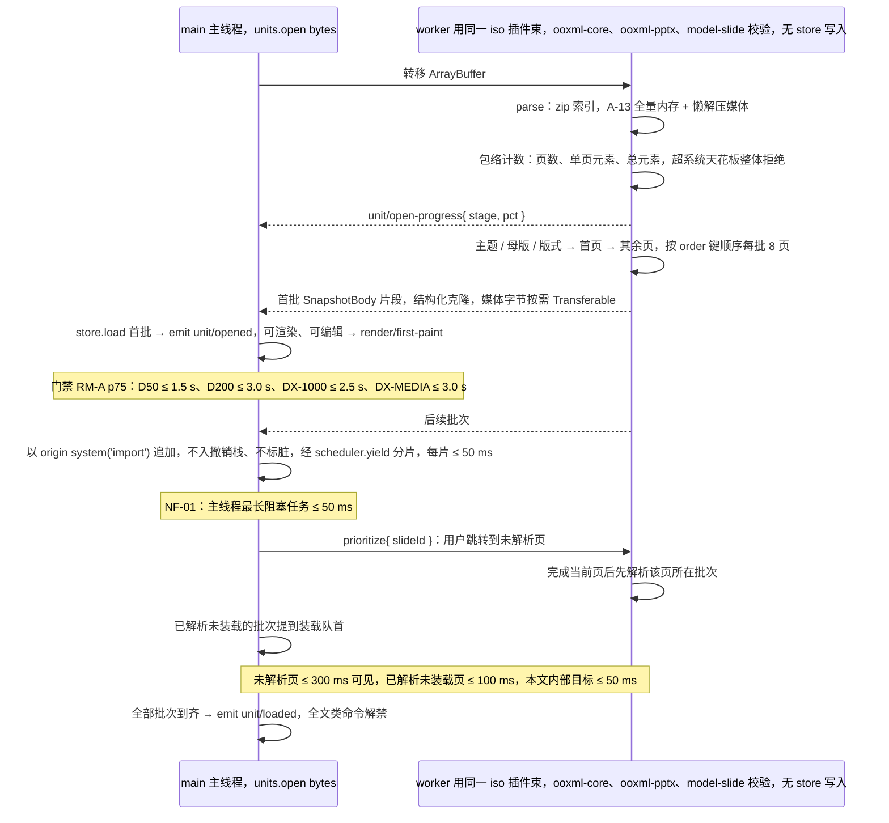

怎么读：左列主线程只做 store 装载与渲染，右列 Worker 只做纯计算解析、不持有可写模型（A31/D5）；虚线箭头是 Worker 回传的进度与分批结果，`M->>W` 的 `prioritize` 是主线程发给 Worker 的抢占消息；自指箭头是该方的内部步骤。包络计数在回传首批之前完成，超天花板整体拒绝，不会装到一半才失败（rulings §4.18 CO-12）。

- **首批装载、后台追加**（rulings §4.18 CO-12）：首批 `store.load` 后立即发 `unit/opened`（可渲染、可编辑）；后续批次以 origin `system('import')`（04 的 Origin 定义）追加进 Store，不入撤销栈，ooxml-core 的导出脏部件追踪（DirtyTracker）忽略该来源（打开 200 页后零编辑导出 = 零脏部件）；全部到齐后发新事件 `unit/loaded`（登记进事件表）。`loaded` 之前，全选、查找替换、导出、跨页重排等全文类命令等待或禁用（M-03 命令守卫）。DocumentStore 契约的追加语义与用例、`units.open` 第④⑥步、Worker 入口文件与分批协议分别由 40-modules/02、04 落地（02：`FormatCodec.importProgressive() → ProgressiveImport{ first, batches, prioritize, cancel, done }` 与 `units.prioritize(unitId, entityId)`/`units.whenLoaded`；04：`ooxml-pptx` 的 `infrastructure/import/import.worker.ts` 与 `batch-protocol.ts`，消息 `start / batch / prioritize / cancel / done / error`）。
- **跳转抢占**（rulings §4.18 CO-11）：「未解析页」指 Worker 尚未解析到的页，只重排主线程装载队列解决不了；主线程发 `prioritize{ slideId }` 消息给 Worker，Worker 完成当前页后先解析该页所在批次，主线程同时把已解析未装载的批次提到装载队首。
- **协同模式不走本路径**：协同打开时 Y 状态由 HTTP 快照 bootstrap（06 §9.1），不经 Worker 分批解析。
- Worker 只做**纯计算**且不持有可写模型（A31/D5）：解析结果进入主线程 Store；导出同理——`formats.export` 在 Worker 中对 `store.exportSnapshot()` 的结构化克隆副本运行（NF-01 1.4「导出期间 UI 可编辑」），基线包字节由 Worker 持有。
- 无 Worker 环境（旧宿主、Node 主线程）：同一代码在主线程分片执行，行为等价只是更慢。
- 度量：`unit/open-progress` 阶段时间戳 + `PerformanceObserver('longtask')` 在 perf 场景断言无 > 50 ms 任务。

### 14.3 连接符路径重算（ED-28）

- M2：`cxnSp` 端点由 `stCxn/endCxn{ id, idx }` 解析到目标形状 `cxnLst` 连接点（`engine-layout/geometry` 从预设几何表得到连接点坐标与法向）；SceneProvider 维护「连接符 → 目标形状」依赖索引，目标 `xfrm` 变化 → 连接符节点进入 `DirtySet`；直线连接符端点跟随。
- M3：`engine-layout/geometry/connector-routing.ts`：`bentConnector2–5` / `curvedConnector2–5` 的调整值（`adj1…`）按 PowerPoint 规则由两端连接点坐标与法向重算（纯函数）；结果由命令层在端点变化时作为 Mutation 写回 `geom.adj`（导出一致）。预算：≤ 1 ms/连接符；每页 ≤ 50 连接符。

### 14.4 图表与内嵌工作簿（PD-06；S6 已批准：`@cordexjs/slide-render-chart`，V-render，dom，惰性 ≤ 400 KB）

- M1–M2（章程 D16）：图表部件不透明保留，渲染器经 `ooxml-core/chartml` 只读解析部件与缓存数据后绘制 SVG（查看 SSIM ≥ 0.80，OF-09）；内嵌 `.xlsx` 原样保留；`cx:chart`（chartex）占位 + `chartex-unsupported` 诊断。
- M3：`slide-render-chart` 渲染并编辑五类 bar / line / pie / area / scatter 数据模型（A-11、U-06）；编辑数据 → 命令写图表数据缓存（`c:numCache/strCache`）并把图表部件与其 `embeddings/*.xlsx` 标脏；**默认策略「重生成最小内嵌工作簿」**（单工作表：类别列 + 序列列，与 `c:f` 引用一致），使 PowerPoint「编辑数据」可用；数据未变则原字节回写。工作簿生成器归 `ooxml-core`/`ooxml-pptx`（A 线），本文只定策略与触发点。

### 14.5 服务端渲染与分层规则（章程 v0.2 层号编码）

`server-headless`（`package.json#cordex = { layer: 'LS', iso: 'node' }`）允许依赖 `engine-layout` 与 `engine-render` 的 **iso** 契约（L5），**不得** import `render-dom`（dom）；缩略图/PDF 的实际绘制发生在 headless Chromium 加载的 `apps/web` `/render` 路由页面内（ADR-0026），`server-headless` 只编排；Chromium 运行在独立 renderer sidecar（`CORDEX_ROLE=renderer`，零出站、无凭据），`/render` 静态包内置于 renderer 镜像，state 与资源经鉴权内部 RPC 注入（§10，rulings §4.15 Q8/Q10）。slide-render 允许依赖 `ooxml-core` 仅用于只读解析 chartml 与 diagram drawing（rulings §4.15 Q7 修订 §4.11 C-28）。

### 14.6 性能预算：与 PRD NF-01 的对照（差异以本文技术判断为准并注明）

| 指标 | PRD NF-01（门禁；RM-A，p75/p95） | 本文目标 | 差异说明 |
|---|---|---|---|
| 首页可见 D50 / D200 | ≤ 1.5 s / ≤ 3.0 s（`open()` 起，字节已在内存） | 同 | 一致；DX-1000 ≤ 2.5 s、DX-MEDIA ≤ 3.0 s 一并采纳 |
| 首页可交互 | ≤ 2.0 / 3.5 s | 同 | 采纳（本文 v0.1 缺此项） |
| 视口内缩略图就绪 / 全部缩略图 | ≤ 2.5 / 4.0 s；≤ 4 / 15 s | 同 | 采纳；全部缩略图为后台任务，可被导航抢占 |
| 后台全部解析完成 | ≤ 6 / 20 s | 同 | 采纳；Worker 分批 |
| 跳转到未解析 / 已解析页 | ≤ 300 / 100 ms | 已解析页 ≤ 50 ms（模板已缓存） | **本文更严**，作为 `target` |
| 主线程最长任务 | ≤ 50 ms | 同 | 采纳；Long Tasks 断言 |
| 拖动/缩放/平移 | ≥ 55 fps，p95 帧 ≤ 33 ms（≤ 300 元素）；DX-1000 ≥ 30 fps | 帧脚本 ≤ 8 ms | 等价表达（8 ms 脚本 + 浏览器 8 ms ≈ 16 ms/帧） |
| 键入延迟（keydown → paint） | p95 ≤ 50 ms | p50 ≤ 16 / p95 ≤ 33 ms | **本文更严**：自绘文本行的重排只涉及一个 txBody，RM-A 可达；PRD 值为 `gate` |
| IME 组合更新 | p95 ≤ 80 ms | 同 | 采纳 |
| 命令执行 / 批量 100 元素 / 撤销 | ≤ 10 / 100 / 50 ms | 同 | 采纳（05 命令管线 + 本文渲染） |
| 命中 / 吸附与参考线 | ≤ 2 / 4 ms | 同 | 采纳 |
| 局部变更重绘范围 | 仅受影响元素 + 覆盖层 | 同（A28 反制测试） | 一致 |
| 缩略图更新 | ≤ 500 ms | 去抖 300 ms + 渲染 ≤ 100 ms | 一致 |
| 缩略图栏滚动（200 页） | ≥ 55 fps | 同 | 采纳（虚拟化 ≤ 12 挂载） |
| 内存 D50 / D200 稳态 | ≤ 250 / 700 MB（JS heap + 可回收资源） | heap ≤ 300 MB + MediaCache ≤ 256 MiB + DOM | 总量在 700 MB 内；本文拆成可分别测量的两项；峰值 ≤ 350 MB / 1.0 GB 采纳 |
| 20 次打开/关闭 heap 增长 | ≤ 5% | 同 | **采纳 5%**（取代本文 e2e 中的 10%）；`getEffects()` 为空、blob URL 泄漏 0 一并采纳 |
| 导出（客户端） | pptx ≤ 3 / 12 s；PNG 单页 ≤ 300 ms @1920；全量 ≤ 15 / 60 s @1280；导出期间可编辑 | pptx 同；PNG 见说明 | **修正**（rulings §4.15 Q4）：pptx 编码在 Worker 中对快照副本运行（14.2），满足「导出期间可编辑」；PNG 在 SVG 路线下**无法在 Worker 内完成**（需要 DOM 布局与序列化），单页 PNG 走主线程 `toImage` 并按页分片（每片 ≤ 50 ms 让出主线程），全量 PNG 批量从 M3 起走 server-png（renderer sidecar）；M2 位图 spike 结论前，客户端 PNG 预算只对「单页、无 Web 字体依赖」场景门禁 |
| 体积（gzip） | 查看器 ≤ 350 KB、编辑器 ≤ 900 KB、协同增量 ≤ 200 KB、图表 ≤ 400 KB（惰性）；超 5% 失败 | 同 | 采纳；Yjs 全家 ≈ 60–80 KB 在协同增量内；图表拆包（S6） |
| 文本搜索 / 全部替换 / 主题切换 | ≤ 200 / 500 / 100 ms | 同 | 采纳（搜索走模型索引，不走 DOM） |

`test/perf/budgets.json` 以本表为源：`gate` = PRD 值，`target` = 本文更严值（11 §17）。

### 14.7 服务端 PDF（PD-16 / SV-02）

**M3 后半段**交付（与缩略图共用 renderer 池，分队列）：renderer sidecar 中的 headless Chromium 加载 `/render?mode=print` → `page.pdf({ width: slideW, height: slideH, printBackground: true })`；页面尺寸 = 幻灯片尺寸（16:9 或原始比例），字体由 Chromium 子集嵌入；D50 ≤ 10 s（p95）；与 PowerPoint 导出 PDF 逐页 SSIM ≥ 0.85（11 §17）。自研矢量 PDF 为后续（PD-16 裁决）。渲染代码与客户端一致，度量器为 Chromium canvas（ADR-0027 补充）。
