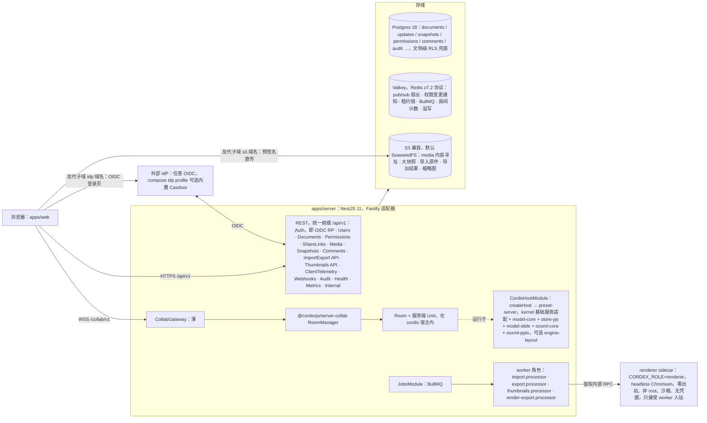
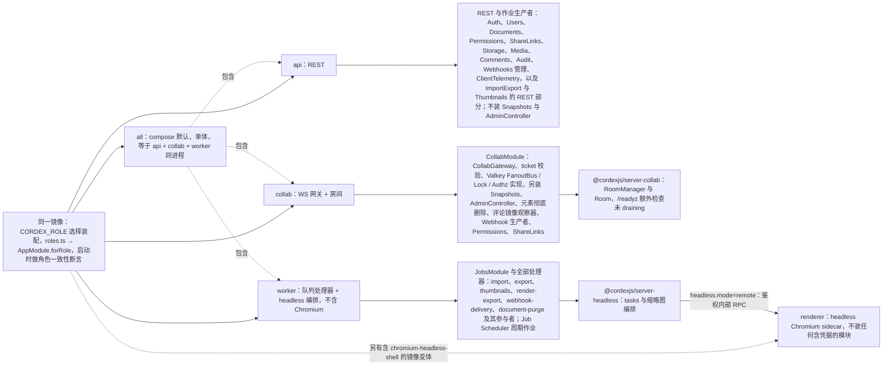

> 状态：草稿 | 负责：架构-运行时 | 更新：2026-09-21；2026-09-24（rulings §4.15：T-0 单组织完全去租户；Q6 外置 OIDC IdP（可选 Casdoor）、JWT/API Key 降 M4、`auth.selfSignup` 默认关、文档级 RLS、组管理推迟；Q10 Postgres 18 / Valkey / SeaweedFS / renderer sidecar / compose profiles；Q9 Node 26 镜像；Q8 缩略图按页内容哈希、640 px WebP；Q5 规模配置与房间按权重准入、导出 12 s；Q7 外部关系全部保留、内嵌字体上限；S-3a 两级 ack；Q3 墓碑硬删除作业）；2026-09-24（rulings §4.16：Q17 配置 `retention`/`compaction` 可调并列默认值、B5/B6 结案；Q19 `fonts.extraDirs` 自有授权字体目录；Q15 宏包拒绝导入）；2026-09-24（复核修正，rulings §4.17：D1 删除 `pending_invitations`/`invitations.service.ts`/`rest/invitations.ts`；H2 墓碑硬删除改由 server-collab `tombstone-sweeper.ts` + LeaseLock、删 BullMQ 路径；H3/M7 `users` 按 M-08 改 `platform_role`/`suspended` 并补 `user_identities`；H4/M12 RLS 会话变量与系统作业角色；M6 `principal_type` 只有 user；M13 `render/sidecar.ts`、`remote-renderer.client.ts`；M14 `render-export` 队列；M15 §10.1 compose profile 按 ADR-0037；L10 `tombstone.ttlHours`；L11 删 `client` 缩略图来源；L14 renderer 镜像二选一；L15 multipart ≤ 10 MB）；2026-09-25（补图）；2026-09-25（矛盾收口，rulings §4.18：BE-01 反代子域 `idp.*`/`s3.*` 与 `storage.s3.publicEndpoint`（§2、§6、§9.1、§10）；BE-02 分享令牌解析归 Permissions、票据 `lnk`；BE-03 快照 REST 与管理动作只挂 collab；BE-05/BE-06 守卫顺序与全局 `SessionGuard`、`@Public` 白名单；BE-08 Permissions/ShareLinks 平级模块、守卫归属各模块；BE-10 导入两步上传；BE-11 `/api/v1` 全局前缀与反代分流；BE-13 角色装配矩阵引用；BE-15 文档擦除单作业 + 参与者；BE-18 `job_runs` 幂等列；BE-19 `webhook-delivery` 队列与 Job Scheduler；BE-24 `tombstone.ttlHours`；BE-25 `anchor_key`/`baseline_key`；BE-26 缩略图 `client` 保留位；BE-27 schema 目录；BE-28 导入导出并发 4；BE-29 实例内存预算定义；BE-30 client-telemetry；BE-31 `document_user_marks`、删 `collab_sessions`；FE-01 server-headless 文档类型盲；CO-07 彻底删除元素；CO-08/CO-14/CO-15/CO-16 降级广播、空闲房间回收、回放期保持 active、遗留溢写认领；GV-20 契约套件名）；2026-09-25（§4.19：三线拆分后本文改为跨端原则与摘要，§1–§12、§16 各段改为摘要 + 链接 60-backend/01–18，SQL 草案与 ER 图删除（DDL 以 60/08–13 为准）；D-M2-CONTENT 服务端里程碑边界（§0.1）；§7 删可选 compaction 委托路径、导入幂等键改 `import:{docId}:{sha256}:{baseSeq}`（BE-10 / BE-18 / C-18）；§11 删 `collab/control.ts` 行（INC-01）；§16.6 评论路径 `resources['comments.threads']`）；2026-09-25（§4.19）；2026-09-26（§4.20）（§0.1 M3 行登记 BE-05+TX-22 唯一 owner 运维转移命令与 TX-01+BE-10 版本恢复撤销以 ADR-0038 定稿为前提） | 依赖：charter v0.1

# 08 后端（NestJS 11 壳 + cordis 宿主）：模块图、目录级结构、数据模型、存储布局、队列、网关扩展、安全、部署

> 读者：实现 `apps/server`、`@cordexjs/server-collab`、`@cordexjs/server-storage`、`@cordexjs/server-headless` 的工程师；运维。
> 章程锚点：R4、D8（Nest 只是传输壳，业务逻辑在 `server-*`，Nest 内嵌 cordis 宿主复用 iso 插件）、D11、D12、§5.3 规则 4（`@nestjs/*` 仅 `apps/server`）、§10 Q5/Q6/Q8/Q10。
> 相关 ADR：0022（存储栈）、0023（传输协议）、0025（update 持久化与压缩）、0026（headless 渲染）、0029（网关鉴权）、0030（观测栈）、0031（评论存储）、0034（服务端校验与修复）、0035（网关横向扩展）、0037（部署拓扑）。
> 协同语义见 06；渲染见 07；错误/日志/遥测见 10。REST/WS DTO 全部来自 `@cordexjs/protocol`（zod，D2）。
> **2026-09-25 起（rulings §4.19）后端设计的唯一事实源是 [60-backend](../60-backend/README.md)（含完整 DDL）**。本文保留一页总览、跨端原则与各节摘要，节号不变供他处引用；细节一律以 60 线为准，本文与 60 线不一致时以 60 线为准（已接受 ADR 与 rulings 除外）。

---

## 0. 一页总览

**后端一页总览**

怎么读：大框是同一个 apps/server 进程（按 `CORDEX_ROLE` 可拆成多个进程，见下文「进程角色」图）；框外左侧是调用方与 IdP，「存储」框里的圆柱是三类存储，renderer 是只接受 worker 入站的独立容器。从大框指向「存储」的箭头表示进程内有模块访问这三类存储，具体由哪个模块访问哪一类见 §1 与 §2。浏览器到 IdP 与对象存储都经反向代理的子域（`idp.<域名>`、`s3.<域名>`，保持 Host 头），两者仍只在 backend 网络、不开宿主端口（rulings §4.18 BE-01，§10.1）。

**部署边界（rulings §4.15 T-0）**：一次部署 = 一个组织。数据模型、API、权限、对象键、日志字段中**没有租户**；将来若做 SaaS 另立项、以迁移加回。

进程角色（同一镜像，`CORDEX_ROLE` 环境变量，rulings §4.15 Q10）：`all`（单体，compose 默认）、`api`（REST）、`collab`（WS 网关 + 房间）、`worker`（队列处理器 + headless 编排）、`renderer`（headless Chromium sidecar，另有含 chromium-headless-shell 的镜像变体）。`roles.ts` 含全部五值，并执行 rulings §4.13 的「角色一致性启动断言」。M1–M5 只交付集成方/自有的 docker-compose，不自营 SaaS；Helm/K8s 为 M4 P1（§10）。

**进程角色 CORDEX_ROLE 到模块的映射**

怎么读：左侧一个镜像按环境变量分出五个角色，实线指向该角色装配的模块或包；`all` 以虚线「包含」另外三个 Nest 角色，renderer 是只接受 worker 入站的独立容器，只装入口与精简健康探针。global 模块与 Health/Metrics/Internal 诊断在 api、collab、worker 三角色都装。**逐模块、逐部件（rest / producer / processor / observer / cron）的装配以 [60-backend/01](../60-backend/01-service-overview-and-roles.md) §5 的「模块 × 角色 × 部件」矩阵为准**（迁自 40-modules/12 §7.1，rulings §4.18 BE-13、§4.19），`roles.ts` 是该矩阵的代码形态，启动断言逐项核对；其中 `role=api` 不得装配 SnapshotsModule 与 AdminController（快照恢复与 compact/migrate/epoch 都要在持有 Room 的进程执行，BE-03），拆分部署时反代把 `/api/v1/documents/:id/snapshots*`、元素彻底删除与评论导入端点转给 collab（ADR-0037 决策 3 修订 2026-09-25，60-backend/01 §7）。
依据：ADR-0037 决策 1（角色装配表）；60-backend/01 §4–§5（`CORDEX_ROLE` 五值与装配矩阵）。

**跨端原则**（本文只保留这五条，实现细节见 60 线）：

1. **Nest 薄壳**（D8）：业务逻辑在 `server-*` 包与各模块的 domain / application 层，Nest 只做传输、装配与编排；`apps/server/src/modules/**` 不得 import `yjs` / `@cordexjs/model-*` / `@cordexjs/ooxml-*`（depcruise `server-app-thin`）。
2. **cordis 宿主内嵌**：每个进程一个宿主（`CordisHostModule`），一个 Room = 宿主里的一个服务端 Unit（与客户端同一份 store-yjs + 文档类型代码）；worker 的导入导出在 `worker_threads` 中每任务新建宿主（60-backend/01 §9、60-backend/06 §8）。
3. **fail-closed 双点**：REST `DocumentRoleGuard` 与 WS 网关（票据 + 每帧角色检查）都是「无显式允许即拒绝」；客户端命令管线是第三点（UX）；文档级 Postgres RLS 是纵深防御，不替代前两点（ADR-0029、ADR-0022 修订）。
4. **驱动放行边界**：`@nestjs/*` 只在 `apps/server`；`pg` / `ioredis` / `@aws-sdk` 只在 `apps/server` 的适配器目录与 `server-storage`（S3）；`server-collab` 只持有 pub/sub、锁、存储的端口，实现经注入（60-backend/01 §11）。
5. **文档类型盲**：`server-*` 不 import 任何垂直束；导入导出经 `formats` / `documentTypes` 按 `documentType` 取 codec，插件清单由组合根 `cordis-host/preset-server.ts` 提供（rulings §4.18 FE-01）；评论镜像按 `comments.` 前缀识别（决策 INC-39）；M5 新增 doc 类型时 `server-*` diff = 0。

### 0.1 服务端里程碑边界（rulings §4.19 D-M2-CONTENT）

协同后端从 M3 提前到 M2：M2 起参考应用中文档内容只以协同快照为事实源，不设过渡的 pptx 内容版本端点。逐项边界以 [PRD 05 §0.3](../10-prd/05-milestones-and-scope.md) 为准（冲突时以它为准）；服务端落点如下，模块级标注见 60-backend/01 §3。

| 里程碑 | 服务端范围 |
|---|---|
| M2 | OIDC 登录与会话、JIT 建号；文档目录（新建空白 / 模板、创建副本、列表与元数据、改名、回收站移入与恢复、最近与固定）；建档者即 owner，REST 与网关 fail-closed；**单实例**协同网关与票据、Room 生命周期与按权重准入、硬门禁与软门禁、update 落库后回 `ack{tier:'db'}`、awareness 中继、PG 故障两级溢写（`ack{tier:'spill'}`、降级期广播、回放与 `room.persist` 信号）、压缩生成 auto 快照、`GET snapshots/latest` bootstrap、墓碑 TTL 清扫、schema 迁移与换纪元（含管理动作）、配套保留期作业（C-06 稀疏化、update 7 天）；**服务端导入**（两步上传、`import` 快照、包内过渡封面；新建空白 / 模板 = 导入内置模板字节）；媒体上传通道；审计写入与 SV-12 基线（CSRF、WS Origin、限流）；单实例 `CORDEX_ROLE=all` 部署 |
| M3 | 按人分享、分享链接、四种角色与权限变更 ≤ 2 s 生效；多实例扇出、容量验收与名额按用户计（ADR-0035）、跨实例溢写认领；评论镜像与 Webhook；命名版本、版本列表与恢复（恢复的撤销以 [ADR-0038](adr/0038-version-restore-undo.md) 定稿为开工前提，rulings §4.20 TX-01+BE-10）；彻底删除元素、永久删除文档与用户擦除（用户停用或擦除后唯一 owner 文档的空窗由运维子命令 `cordex-ops documents:reassign-owner` 转移 owner，经 PermissionsModule 用例写授权、`perm_version` 加 1 并审计 `admin.owner_reassigned`，擦除与停用的响应附唯一 owner 文档数；M4 管理面板复用同一用例，rulings §4.20 BE-05+TX-22，命令语义见 60-backend/17 §9）；服务端导出、renderer 缩略图（前半段）与 PDF（后半段）；审计查询与哈希链；compose 洁净栈出口与按角色拆分部署；文档级 RLS 测试阻断合并 |
| M4 | 集成方签名 JWT 与 API Key（JIT 影子用户）；离线安装包、多架构、Helm（P1） |

依据：rulings §4.19 D-M2-CONTENT（覆盖决策 INC-37 中「WS 网关、快照 REST、服务端导入归 M3」一句；40-modules/09 所称「M2 切片」即 M2 交付）、D-TEST-INFRA（协同与服务端压测所需的自托管专用 runner 在 M2 前落地）；PRD 05 §0.3。

---

## 1. Nest 模块图与职责

Nest 模块清单（职责、所属表、装配角色、里程碑）与模块 imports 总图的唯一源是 [60-backend/01](../60-backend/01-service-overview-and-roles.md) §3、§8；各模块的用例与状态机见 60-backend/02–07。本节只保留跨模块不变量：

| 模块 | 依赖的 `server-*`/`@cordexjs` 包 | 关键不变量 |
|---|---|---|
| CollabModule | server-collab、protocol | Gateway 内**零协同逻辑**：只做连接适配、票据校验、限流计数 |
| ImportExportModule/ThumbnailsModule | server-headless、server-storage | 处理器只编排；转换逻辑全在 `server-headless.tasks` |
| DocumentsModule/PermissionsModule/ShareLinksModule/SnapshotsModule | server-collab（SnapshotService）、protocol | 权限变更与分享链接撤销必须 publish `perm:doc:{id}`（06 §10）；分享令牌只由 PermissionsModule 的 `ResolveShareLinkUseCase` 解析（BE-02） |
| MediaModule/StorageModule | server-storage | 媒体只按 sha256 寻址；从不信任客户端声明的 MIME |
| 所有 controller | protocol | 入参 `zod.parse`，出参也经 schema（防泄漏字段） |

Documents、Permissions、ShareLinks 是三个平级模块（rulings §4.13、§4.18 BE-08）；依赖单向 ShareLinks → Permissions，业务模块不为鉴权 import AuthModule（`SessionGuard` 全局注册，BE-06），因此无环（BE-02）。

---

## 2. `apps/server` 目录级结构

目录树的唯一源在 40 线（文件级）：身份、文档与存储 → 40-modules/08 §4；协同网关与 headless 宿主 → 40-modules/09 §4；作业、评论与运维 → 40-modules/12 §4。按模块的职责与装配见 [60-backend/01](../60-backend/01-service-overview-and-roles.md)。本文 2026-09-25 前的目录树草图删除，不再维护。

---

## 3. `server-*` 包目录级结构

| 包 | 定位 | 契约（唯一源） | 目录（文件级） |
|---|---|---|---|
| `@cordexjs/server-collab` | node；cordis 插件，提供 `collabServer`：房间、帧门禁、update 持久化与压缩策略、awareness 转发、跨实例扇出端口、墓碑清扫 | [60-backend/05](../60-backend/05-modules-collab-and-snapshots.md) §2 | 40-modules/09 §4 |
| `@cordexjs/server-storage` | node；`BlobStore` 服务端形态（S3 兼容，local-fs 仅 dev），预签名按 `storage.s3.publicEndpoint` 生成 | [60-backend/04](../60-backend/04-modules-documents-storage-media.md) §6 | 40-modules/08 §4 |
| `@cordexjs/server-headless` | node；`createHeadlessHost({ plugins })`、导入 / 导出 / 校验 / 迁移任务、`worker_threads` 运行器、renderer 编排；文档类型盲 | [60-backend/06](../60-backend/06-modules-jobs-import-export-thumbnails.md) §8–§10 | 40-modules/09 §4 |

---

## 4. Nest 内嵌 cordis 宿主：生命周期映射

映射表与 `preset-server` 插件清单的唯一源是 [60-backend/01](../60-backend/01-service-overview-and-roles.md) §9–§10。跨端约束：宿主在 Nest `onModuleInit` 建立、`onApplicationShutdown` 释放，Room 的 effect 随 Unit Fiber 回收（无模块级状态，A10）；插件清单只在组合根 `cordis-host/preset-server.ts` 选定（FE-01）；`@cordisjs/plugin-loader` 默认关闭（ADR-0010）。

---

## 5. 数据模型（Postgres 18）

2026-09-25 前的 SQL 草案与 ER 图删除（rulings §4.19）。表结构、约束、分区、角色与 GRANT、文档级 RLS、迁移编号的唯一源是 [60-backend/08](../60-backend/08-db-conventions-roles-rls-migrations.md)–[13](../60-backend/13-ddl-comments-webhooks-audit.md)（完整 DDL，已在 PostgreSQL 18 上执行校验）。跨端约束保留三条：

- **无租户**（T-0）：任何表、键、日志字段都没有 tenant；数据访问兜底 = 权限检查（D12）+ 文档级 RLS（`ENABLE` + `FORCE`，例外表显式登记，决策 C-21、RLS-GUC、DB-ROLES）。
- **CRDT 持久化形态**：`document_updates` 追加表 + `document_snapshots` 快照索引（字节在对象存储），`documents.head_seq` 在同一事务分配（ADR-0025）；正式 `seq` 只由 PG 分配（溢写回放同理，06 §6.4）。
- **列级写方**：`documents` 的协同列（`head_seq`、`epoch`、`latest_snapshot_id` 等）只由 M-09 写，元数据列由 M-08 写（决策 C-03，60-backend/04 §5）。

---

## 6. 对象存储布局（S3 兼容）

对象键布局、桶规划与保留期的唯一源是 [60-backend/14](../60-backend/14-valkey-object-storage-and-retention.md) §5–§8。摘要：两个桶——`snapshots`（开版本化 + 非当前版本过期）与 `data`（不开版本化：导入原件、基线、导出、缩略图、媒体、上传暂存、溢写块）；所有键以 `docs/{docId}/` 或内容寻址 `media/…` 为前缀，永久删除按 `docs/{docId}/` 前缀清除全部对象版本（决策 C-08/OBJ、C-07，rulings §4.18 BE-15）；带 TTL 的对象由 maintenance 周期作业清理，不依赖前缀型生命周期规则。M2 起没有 `docs/{docId}/content/` 一类 pptx 内容版本对象（rulings §4.19 D-M2-CONTENT）。

---

## 7. 任务队列（BullMQ / Valkey）

队列总表、JobRun 状态机、幂等键与周期作业清单的唯一源是 [60-backend/06](../60-backend/06-modules-jobs-import-export-thumbnails.md) §1–§4。摘要：

| 队列 | 生产者 → 处理器（role worker） | 幂等键 | 里程碑 |
|---|---|---|---|
| `import` | `POST /imports{uploadId}` 校验后入队（BE-10）→ import.processor → server-headless `tasks.import` | `import:{docId}:{sha256}:{baseSeq}`（`docId` 为更新目标或 `POST /imports/uploads` 预分配的新文档 id，`baseSeq` 为受理时 `head_seq`、新建为 0；成功行不再永久占键，BE-10 / BE-18 / C-18） | M2 |
| `export` | ExportsController → export.processor → server-headless `tasks.export` | `export:{docId}:{sourceRef}:pptx`（`sourceRef` = 指定版本或最新 `head_seq`；产物过期即释放键） | M3 |
| `thumbnails` | 导入完成（首页高优先）/ 压缩后哈希变化的页 / 按需 / admin → renderer sidecar | `doc:{id}:slide:{slideId}:hash:{contentHash}` | 包内封面 M2；renderer M3 前半段 |
| `render-export` | ExportsController（pdf / png / jpeg）→ renderer sidecar | `render-export:{docId}:{sourceRef}:{format}:{optsDigest}` | M3 后半段 |
| `maintenance` | Job Scheduler（只由 worker 注册，BE-19）→ reconciliation、audit-seal、保留期清理等 | 作业名 + 周期 | 随各作业 |
| `webhook-delivery` | Webhooks 生产者（collab）→ 出站守卫 + 签名投递 | `(subscriptionId, event, payloadHash)` | M3 |
| `document-purge` | schedule-purge（同事务写 `job_runs`）→ 踢会话 → 参与者清理 → finalize-purge | `document-purge:{docId}` | M3 |

- **压缩不走队列**：压缩只在持有 Room 的 collab 实例内、持 `lock:compact:{docId}` 租约执行（ADR-0025、ADR-0035）；原「本实例负载高时委托 `compaction` 队列」的可选路径删除（2026-09-25）。
- **周期作业的两个例外**：墓碑 TTL 硬删除由 server-collab `tombstone-sweeper.ts` 以 LeaseLock 单写者执行；审计分区轮换 `audit-rotate` 需要 DDL 权限，以 ops-cron（Helm 为 CronJob）调用 `cordex-ops` 执行（ADR-0037 决策 3 修订 2026-09-25）。其余周期作业全部经 Job Scheduler 挂 `maintenance`。
- **幂等语义**（BE-18）：同键命中 queued / running / succeeded 返回既有行，命中 failed 或 cancelled 则新建一行并以 `attempt_of` 指向上一行；状态查询统一走 `GET /jobs/:id`（决策 SG-08）。

---

## 8. 网关横向扩展（ADR-0035）

多副本 Room、跨实例扇出、名额原子判定与优雅停机的唯一源是 [60-backend/05](../60-backend/05-modules-collab-and-snapshots.md) §4–§5 与 [60-backend/16](../60-backend/16-ws-protocol-server-view.md) §11；决策见 ADR-0035。摘要：不要求房间亲和，任何实例都能服务任何文档，同一文档在多个实例各有 Room 副本、经 Valkey pub/sub 扇出（携带 `instanceId` 去重），每个实例只持久化自己客户端的 update；压缩与迁移由租约单写者执行；房间按文档实测权重准入（实例内存预算 = 容器内存上限 × `room.memoryAdmissionPct`，BE-29；不足时先回收 draining 房间，CO-14）；Valkey 故障时各实例内部仍一致、`/readyz` 返回 503。M2 为单实例，多实例扇出与容量属 M3（§0.1）。

---

## 9. 安全

### 9.1 鉴权与权限（ADR-0029）

鉴权链（OIDC RP、登录会话与吊销、CSRF 与 Origin、REST 守卫链、分享链接、协同票据、WS 鉴权、RLS 会话上下文、权限变更传播）的唯一源是 [60-backend/02](../60-backend/02-auth-chain.md)；决策见 ADR-0029。跨端约束：

- **外置 IdP，服务端只认 OIDC**（rulings §4.15 Q6，M1–M3 唯一凭据模式）：授权码 + PKCE 由服务端换码，服务端不持有密码；登录入口为顶层导航 `GET /api/v1/auth/oidc/login`（302，决策 INC-18）；issuer 用浏览器可达的对外 URL（内置 Casdoor 经反代子域 `idp.<域名>`，BE-01）；集成方签名 JWT 与 API Key 为 M4。
- **全局会话守卫与守卫顺序**：`SessionGuard` 以 `APP_GUARD` 全局注册、默认拒绝，只有 `@Public()` 白名单放行（BE-06，快照见 60-backend/15 §4）；顺序为限流 → `SessionGuard` → `ShareLinkGuard`（带 `X-Cordex-Share-Token` 头时生效，不接受 query，决策 INC-25）→ `DocumentRoleGuard`（BE-05）。
- **fail-closed 双点 + 纵深防御**：见 §0「跨端原则」第 3 条；角色格 `owner > editor > commenter > viewer > none`，能力位矩阵在 `protocol/permissions`；网关 SYNC 写入门槛 ≥ commenter、commenter 写入范围由软门禁路径规则限定（06 §10–§11，ADR-0029 决策 3 修订 2026-09-25）。
- **分享链接**：不匿名，链接角色叠加在已登录 Principal 上；令牌解析归 PermissionsModule 的 `ResolveShareLinkUseCase`（BE-02），票据带 `lnk` 供 WS 会话重算。
- **单组织、组管理推迟**：无租户（T-0）；M3 只按人分享，权限主体仅 `user`。

### 9.2 上传校验与 zip 资源限制

导入的输入限额（zip 条目 / 解压体积 / 压缩比、XML 深度与实体、媒体嗅探、SVG 消毒、宏包拒绝、嵌入字体上限、规模天花板）的唯一源是 [60-backend/06](../60-backend/06-modules-jobs-import-export-thumbnails.md) §6.3；数值与客户端 Worker 解析共用同一张表（04 §5.6、07 §14.2，OF-24）。跨端约束：超规模天花板**拒绝导入**（`format.quota_exceeded{dimension, limit, actual}`，不做只读降级）；外部关系全部原样保留、服务端永不抓取；服务端对不可信图片不解码（不用 sharp，D13），栅格化只在 renderer 沙箱内发生。

### 9.3 速率与配额

REST 限流与请求体上限见 [60-backend/15](../60-backend/15-rest-api-catalog.md) §8，WS 帧与连接限制见 [60-backend/16](../60-backend/16-ws-protocol-server-view.md) §13，配额与规模配置键见 [60-backend/17](../60-backend/17-deployment-and-config.md) §5、§7。配额码只有 D2 三码：`storage.quota_exceeded`（存储 / 文档数，按文档 owner 汇总，决策 G-09）、`format.quota_exceeded`（导入超天花板）、`document.quota_exceeded`（编辑期超元素上限）（rulings §4.17 D2）。

### 9.4 其他

CSP / CORS、密钥来源与启动校验、审计范围、依赖与镜像许可、renderer 隔离的唯一源分别是 [60-backend/02](../60-backend/02-auth-chain.md) §5、[60-backend/17](../60-backend/17-deployment-and-config.md) §3、§6、[60-backend/07](../60-backend/07-modules-comments-webhooks-audit.md) §7–§9 与 ADR-0026 / ADR-0037。「彻底删除元素」（只对墓碑态元素、只能由 owner 发起、经审计，rulings §4.18 CO-07）与「永久删除文档」（document-purge 编排）的术语与边界见 60-backend/04 §4、60-backend/14 §10。

---

## 10. 部署拓扑（rulings §4.15 Q10，ADR-0037）

M1–M5 的交付形态是**集成方/自有的自托管 docker-compose「洁净栈」**，不自营 SaaS；同一应用镜像按 `CORDEX_ROLE` 运行。决策见 ADR-0037；compose 服务与网络、web 容器（CSP nonce、RuntimeConfig 渲染）、配置 schema 全字段、按角色拆分与副本建议、迁移与 ops 命令、备份与主机规格的唯一源是 [60-backend/17](../60-backend/17-deployment-and-config.md)。

### 10.1 docker-compose（profiles）

默认 profile = 应用（`all`，可拆 api / collab / worker）+ web（静态前端 + 反向代理）+ Postgres 18 + Valkey + SeaweedFS + renderer（M3 起）+ OTel Collector / Jaeger / Prometheus；`idp` profile = Casdoor（可选）；`observability-agpl` profile = Grafana / Loki（显式开启）；`dev` profile = oidc-provider mock。三个网络 `edge` / `backend` / `render`；反代按 `/api`、`/collab`、其余静态文件分流，collab 专属 REST 路由与子域转发见 ADR-0037 决策 3（含 2026-09-25 修订）。M2 以单实例 `all` 运行，洁净栈出口（断网 e2e、digest、SBOM、镜像许可）是 M3 出口（§0.1）。

### 10.2 Kubernetes / Helm（M4 P1）

按角色拆 Deployment（api / collab / worker / renderer），collab 的 PDB、优雅停机与长连接超时沿用 ADR-0035；`audit-rotate` 为 CronJob（ADR-0037 决策 3 修订）；细则见 60-backend/17 §8。

---

## 11. 与 `@cordexjs/protocol` 契约的对应

文件登记的唯一源是 40-modules/02（M-02）；REST 路由与 DTO 见 [60-backend/15](../60-backend/15-rest-api-catalog.md)，WS 帧的服务端处理见 [60-backend/16](../60-backend/16-ws-protocol-server-view.md)。

| protocol 子路径 | 内容 | 使用方 |
|---|---|---|
| `collab/frame.ts` | 信封类型常量、`encodeFrame/decodeFrame`（payload 不透明） | collab-yjs、server-collab |
| `collab/close-codes.ts` | 关闭码**常量对象**（非 `enum`，A3；以 06 §6.5 补全后的表为唯一源） | 同上 |
| `collab/awareness.ts` | `AwarenessState` zod | collab-yjs、server-collab |
| `collab/ticket.ts` | ticket claims schema（`sub`、`doc`、`role`、`perm_ver`（TS 字段 `permVersion`）、`jti`、`exp`，可选 `sid`、`lnk`） | Auth、Gateway |
| `ws/frames.ts` / `ws/handshake.ts` | CONTROL 判别联合（判别键 `type`，含 `ack`；成员以 06 §6.3 为准）与握手 schema；不建 `collab/control.ts`（决策 INC-01） | collab-yjs、collab-transport-ws、Gateway |
| `permissions.ts` | `Role` 常量对象与能力位矩阵 | 三处检查点 |
| `errors/{codes,http-map}.ts` | 错误码字串联合、HTTP/WS 映射表（10 §1） | filter、客户端 |
| `rest/{auth, users, documents, share-links, media, snapshots, import-export, thumbnails, comments, webhooks, audit, telemetry, problem}.ts` | 请求/响应 DTO zod + 路由常量（相对 apiBase `/api/v1`）；`documents` 含权限段、pin、recent、purge、collab-ticket、elements/purge；`import-export` 含 uploads、cancel、exports、jobs 状态；`problem` 为 RFC 9457 problem+json（决策 INC-11/INC-13） | controllers、apps/web |
| `render/sidecar.ts` | worker ↔ renderer 的鉴权内部 RPC 契约（决策 SG-01） | server-headless、renderer、apps/web `/render` |

规则：controller 的 `@Body()` 类型只能是 `z.infer<typeof X>`，且 `X` 必须来自 protocol（lint `no-restricted-imports` + 类型测试，由 09 承接）。

---

## 12. 预算与测量

服务端预算总览的唯一源是 [60-backend/01](../60-backend/01-service-overview-and-roles.md) §12，指标统一名表、SLO 与默认告警见 [60-backend/18](../60-backend/18-observability-and-ops-endpoints.md) §4–§5，测量与门禁见 [70-testing/09](../70-testing/09-performance-and-capacity.md)；协同链路的跨端预算见 06 §14。溢写阈值默认 `spill.tier1MaxBytesPerDoc` 16 MiB、`spill.tier1MaxBytesPerInstance` 256 MiB、`spill.tier2ChunkBytes` 4 MiB（决策 SPILL，压测校准只收紧）。

---

## 13. 待决事项

| # | 事项 | 默认 | 决策人 |
|---|---|---|---|
| B1 | ORM：Drizzle vs Prisma | Drizzle（SQL 可见、无生成运行时、分区友好） | 架构 B + 团队 |
| B2 | HTTP 适配器：Fastify vs Express | Fastify | 架构 B |
| B3 | 上传方式：预签名 S3 vs 经服务端 multipart | 预签名（服务端只校验）；导入两步上传（BE-10） | 架构 B/运维 |
| B4 | 评论实时通知走 collab 控制帧 vs 独立 SSE | **已裁决**（决策 SG-03）：`CONTROL.event{name:'comments.changed', payload:{threadIds[]}}`（06 §6.3） | 已裁决 |
| B5 | `document_updates` 保留期 | **已裁决**（章程 Q17，rulings §4.16）：默认 7 天，配置键 `retention.updatesDays`（决策 RETENTION，键名以 60-backend/17 为准） | 已裁决 |
| B6 | 导入原件保留期 | **已裁决**（章程 Q17，rulings §4.16）：默认 30 天，配置键 `retention.importOriginalDays`；自动快照 30 天全量、之后按天稀疏至 `retention.autoSnapshotDailyDays`（默认 365，0 = 永久，rulings §4.19 C-06），命名快照永久、每文档上限 200，墓碑 TTL 24 h，全部可调 | 已裁决 |
| B7 | 是否允许 API Key 走 WS（服务端自动化编辑） | API Key 整体降为 M4（rulings §4.15 Q6），届时再定 | 产品 |

## 14. 对章程的异议/建议

- **S7**：D8 建议明确「Definition 的 Node 适配器（pg/Valkey/s3）作为 cordis 插件放在 `apps/server` 的对应模块目录下」——这些是 IO 适配而非业务逻辑，否则需要新增 `server-adapters-*` 包。
- **S8**：包清单建议给 `server-collab` 标注「cordis 插件（提供 `collabServer`）」，与 R2「每个包要么是插件要么是纯库」对齐。

## 15. 跨条线要求（摘要）

- A 线：`units.open` 支持 `source: Uint8Array(state)` 与空文档；`documentType.validateChangeSet(paths)`、`repairRules`、`diffSnapshots(a, b) → Mutation[]`、`migrations.run(unit, from, to)` 为服务端可调用的纯/半纯 API。
- 类型治理线：controller DTO 只能来自 protocol；`@nestjs/*` 单点引入；server-* 包禁止 import `pg`/`ioredis`/`@aws-sdk`（除 server-storage 的 S3）；`apps/server` 的 cordis 适配器目录允许 import 这些驱动。
- 产品：B7 与部署级配额策略。

---

## 16. v0.2 补充：与架构 02/04/05 契约的对齐、PRD（SV/EM/OF）条目的承接、章程 v0.2 裁决

> 追加于 A 线与产品线落盘之后；凡与前文冲突处以本节为准。2026-09-25 起 §16.2–§16.6 改为摘要 + 链接 60 线（rulings §4.19），§16.1 对齐表保留。

### 16.1 对齐表

| 项 | 结论 |
|---|---|
| `BlobStore` | `server-storage` 实现 model-core 的 `BlobStore{ get, put, has }`（04 §2.5）并扩展为 `ServerBlobStore{ head, delete, presignPut, presignGet, list }`；服务名 `blobStore`（原 `blobStorage` 作废）。浏览器侧不新建 BlobStore Provider 包：媒体上传经 preset 选项 `media.upload(file) → { assetId, sha256 }`（`apps/web` 默认实现），拉取经 `GET /documents/:id/media/:sha256`、blob URL 由 MediaCache 管理（决策 MEDIA-CLIENT；rulings C-30 已排除 `collab-offline-idb` 兼任，原「IndexedDB Provider 由 collab-offline-idb 顺带提供」作废） |
| `server-headless` | 使用 `createHost`（02 §4.24 `createHeadlessHost({ plugins })`：挂载调用方给定的 iso 插件集，插件清单由 apps/server 的 `preset-server.ts` 提供，本包不 import model-slide/ooxml-pptx，rulings §4.18 FE-01）；`@cordisjs/plugin-loader` **默认关闭**（A-8 / ADR-0010）；`tasks.import/export` 经 `formats` 按 documentType 取 codec，`tasks.migrate/validate` 调用 `migrations.run` 与 `validateSnapshot`（04 §10）；`worker.ts` 以 `worker_threads` 每任务新 host（超时/内存限额），按清单模块路径加载插件；`layout.measurer` Provider `node-font`（ADR-0027 补充） |
| 服务端写入路径（05 §11） | 导入 = `units.open` 的 load 路径（origin `system('import')`，不经命令）；迁移/恢复/修复 = 服务端事务（origin `system(reason)`）；需要命令语义的服务端编辑（模板填充等）经命令管线，`principal = system`，权限策略为服务端策略，审计落库 |
| 层号编码（章程 v0.2） | `package.json#cordex = { layer: 'LS', iso: 'node' }`；LS 可依赖 L5 的 iso 包（`engine-layout`、`engine-render` 契约），不得依赖 `render-dom` |
| `server-collab` 形态 | 02 定为 library；本文 S8 建议其同时暴露一个薄 cordis 插件外壳（`collabServer` 服务）以复用 effect 生命周期；两者不冲突：库函数 + `plugin.ts` |
| 事件/错误码 | PRD 斜杠形式（`collab/auth-failed`、`auth/invalid-token`、`format/limit-exceeded`…）→ 定稿映射见 10 §11 |

### 16.2 导出字节级一致（SV-02）

唯一源 [60-backend/06](../60-backend/06-modules-jobs-import-export-thumbnails.md) §7。跨端约束：`ooxml-pptx.encode(snapshot, baselinePackage)` 是纯函数（不读 `layout`、时钟、随机源；zip 写入器确定性），两端输入相同 ⇒ 输出字节相同；基线包是导入成功时服务端复制出的 `docs/{docId}/baseline/{snapshotId}.pptx`，随文档生命周期保留，`document_snapshots.baseline_key` 指向它（决策 C-07；导入原件本身按 30 天清理）；CI 对语料在浏览器与 Node 分别导出并断言 sha256 相等（70-testing/03）。

### 16.3 PDF 导出与缩略图（SV-02 / PD-16）

唯一源 [60-backend/06](../60-backend/06-modules-jobs-import-export-thumbnails.md) §9–§11 与 ADR-0026。M2：导入处理器取包内 `docProps/thumbnail.jpeg` 作过渡封面（只做 JPEG 头校验、不解码）；M3 前半段：renderer 生成 640 px WebP（按需 1280 px），按页内容哈希失效，导入后首页 ≤ 10 s、D200 全量 ≤ 90 s；M3 后半段：`render-export` 队列产出 PDF（D50 ≤ 10 s p95）。客户端读取缩略图为 `ETag = contentHash` + `private, no-cache`（ADR-0026 修订 2026-09-25）。

### 16.4 资源上传通道（EM-04 / CO-12 / SV-01）

唯一源 [60-backend/04](../60-backend/04-modules-documents-storage-media.md) §7（媒体）与 60-backend/06 §6.1（导入两步上传）。媒体端点全部带文档作用域：`POST /documents/:id/media/presign` → 直传 `uploads/tmp/{uploadId}` → `POST /documents/:id/media/commit`（`doc.write`，服务端校验后复制到内容寻址键）；读取 `GET /documents/:id/media/:sha256`（`doc.read` 且关联存在，返回 200 JSON `{url, expiresAt}`，1 h 预签名 GET，不 302，60-backend/15 §3.6）；无文档作用域的 `/media/*` 与通用 `/storage/presign` 删除（决策 INC-21，BE-10）。CRDT 只写 `BlobRef`（06 §18.5）。集成方自管元数据（EM-04 P2）列入待决 B8。

### 16.5 网关容量与限制的最终值（SV-05 / CO-12 / OF-24 / NF-01 1.7）

唯一源：名额与准入 [60-backend/05](../60-backend/05-modules-collab-and-snapshots.md) §4，帧与速率数值 [60-backend/16](../60-backend/16-ws-protocol-server-view.md) §13，zip / XML 限额 60-backend/06 §6.3。跨端口径不变：房间 20 编辑者 + 50 查看者、按用户计（commenter 计入查看者，owner 保席），编辑者满以 viewer 只读加入（`auth.ok.reason:'capacity'`），再超 `collab.room_full`；单帧 ≤ 1 MiB（`maxUpdateBytes`）、≤ 200 帧/s（突发 500）；实例按文档实测权重准入，实例内存预算 = 容器内存上限 × `room.memoryAdmissionPct`（默认 75%，即「≤ 75% 内存预算」，BE-29；RM-S 2 vCPU / 4 GB 为 collab 单实例口径）。

### 16.6 评论镜像（ADR-0031 v0.2）

唯一源 [60-backend/07](../60-backend/07-modules-comments-webhooks-audit.md) §1–§3。`comments` 表是**读模型**：collab 角色的 `CommentMirrorObserver` 观察 `resources['comments.threads']` 变更（任意 origin；按 `comments.` 前缀识别、不识别文档类型）→ upsert 镜像行（线程、锚点状态、@提及；`anchor_key` 由文档类型的 `deriveAnchorKey` 在写入时计算，BE-25）→ 用于跨文档查询（@我）、集成方 Webhook、审计；写路径全部经 CRDT（客户端 `comments.*` 命令，包 `@cordexjs/comments`，rulings §4.19 D-COMMENTS-PKG）；REST 只读，「导入为可编辑线程」（`POST …/comments/import`，P1）触发服务端事务。作者 / 角色规则由软门禁执行（ADR-0034）。

### 16.7 待决补充

| # | 事项 | 默认 | 决策人 |
|---|---|---|---|
| B8 | 公开表结构与迁移脚本供集成方自管元数据（EM-04 P2） | M4 评估 | 产品 |
