> 状态：草稿 | 负责：架构-运行时 | 更新：2026-09-21；2026-09-24（rulings §4.15：T-0 单组织完全去租户；Q6 外置 OIDC IdP（可选 Casdoor）、JWT/API Key 降 M4、`auth.selfSignup` 默认关、文档级 RLS、组管理推迟；Q10 Postgres 18 / Valkey / SeaweedFS / renderer sidecar / compose profiles；Q9 Node 26 镜像；Q8 缩略图按页内容哈希、640 px WebP；Q5 规模配置与房间按权重准入、导出 12 s；Q7 外部关系全部保留、内嵌字体上限；S-3a 两级 ack；Q3 墓碑硬删除作业）；2026-09-24（rulings §4.16：Q17 配置 `retention`/`compaction` 可调并列默认值、B5/B6 结案；Q19 `fonts.extraDirs` 自有授权字体目录；Q15 宏包拒绝导入）；2026-09-24（复核修正，rulings §4.17：D1 删除 `pending_invitations`/`invitations.service.ts`/`rest/invitations.ts`；H2 墓碑硬删除改由 server-collab `tombstone-sweeper.ts` + LeaseLock、删 BullMQ 路径；H3/M7 `users` 按 M-08 改 `platform_role`/`suspended` 并补 `user_identities`；H4/M12 RLS 会话变量与系统作业角色；M6 `principal_type` 只有 user；M13 `render/sidecar.ts`、`remote-renderer.client.ts`；M14 `render-export` 队列；M15 §10.1 compose profile 按 ADR-0037；L10 `tombstone.ttlHours`；L11 删 `client` 缩略图来源；L14 renderer 镜像二选一；L15 multipart ≤ 10 MB）；2026-09-25（补图）；2026-09-25（矛盾收口，rulings §4.18：BE-01 反代子域 `idp.*`/`s3.*` 与 `storage.s3.publicEndpoint`（§2、§6、§9.1、§10）；BE-02 分享令牌解析归 Permissions、票据 `lnk`；BE-03 快照 REST 与管理动作只挂 collab；BE-05/BE-06 守卫顺序与全局 `SessionGuard`、`@Public` 白名单；BE-08 Permissions/ShareLinks 平级模块、守卫归属各模块；BE-10 导入两步上传；BE-11 `/api/v1` 全局前缀与反代分流；BE-13 角色装配矩阵引用；BE-15 文档擦除单作业 + 参与者；BE-18 `job_runs` 幂等列；BE-19 `webhook-delivery` 队列与 Job Scheduler；BE-24 `tombstone.ttlHours`；BE-25 `anchor_key`/`baseline_key`；BE-26 缩略图 `client` 保留位；BE-27 schema 目录；BE-28 导入导出并发 4；BE-29 实例内存预算定义；BE-30 client-telemetry；BE-31 `document_user_marks`、删 `collab_sessions`；FE-01 server-headless 文档类型盲；CO-07 彻底删除元素；CO-08/CO-14/CO-15/CO-16 降级广播、空闲房间回收、回放期保持 active、遗留溢写认领；GV-20 契约套件名） | 依赖：charter v0.1

# 08 后端（NestJS 11 壳 + cordis 宿主）：模块图、目录级结构、数据模型、存储布局、队列、网关扩展、安全、部署

> 读者：实现 `apps/server`、`@cordexjs/server-collab`、`@cordexjs/server-storage`、`@cordexjs/server-headless` 的工程师；运维。
> 章程锚点：R4、D8（Nest 只是传输壳，业务逻辑在 `server-*`，Nest 内嵌 cordis 宿主复用 iso 插件）、D11、D12、§5.3 规则 4（`@nestjs/*` 仅 `apps/server`）、§10 Q5/Q6/Q8/Q10。
> 相关 ADR：0022（存储栈）、0023（传输协议）、0025（update 持久化与压缩）、0026（headless 渲染）、0029（网关鉴权）、0030（观测栈）、0031（评论存储）、0034（服务端校验与修复）、0035（网关横向扩展）。
> 协同语义见 06；渲染见 07；错误/日志/遥测见 10。REST/WS DTO 全部来自 `@cordexjs/protocol`（zod，D2）。

---

## 0. 一页总览

**后端一页总览**

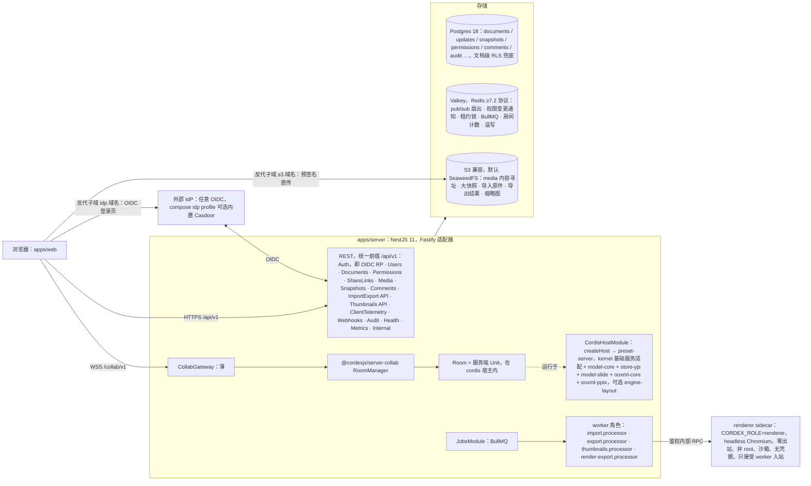

怎么读：大框是同一个 apps/server 进程（按 `CORDEX_ROLE` 可拆成多个进程，见下文「进程角色」图）；框外左侧是调用方与 IdP，「存储」框里的圆柱是三类存储，renderer 是只接受 worker 入站的独立容器。从大框指向「存储」的箭头表示进程内有模块访问这三类存储，具体由哪个模块访问哪一类见 §1 与 §2。浏览器到 IdP 与对象存储都经反向代理的子域（`idp.<域名>`、`s3.<域名>`，保持 Host 头），两者仍只在 backend 网络、不开宿主端口（rulings §4.18 BE-01，§10.1）。

**部署边界（rulings §4.15 T-0）**：一次部署 = 一个组织。数据模型、API、权限、对象键、日志字段中**没有租户**；将来若做 SaaS 另立项、以迁移加回。

进程角色（同一镜像，`CORDEX_ROLE` 环境变量，rulings §4.15 Q10）：`all`（单体，compose 默认）、`api`（REST）、`collab`（WS 网关 + 房间）、`worker`（队列处理器 + headless 编排）、`renderer`（headless Chromium sidecar，另有含 chromium-headless-shell 的镜像变体）。`roles.ts` 含全部五值，并执行 rulings §4.13 的「角色一致性启动断言」。M1–M5 只交付集成方/自有的 docker-compose，不自营 SaaS；Helm/K8s 为 M4 P1（§10）。

**进程角色 CORDEX_ROLE 到模块的映射**

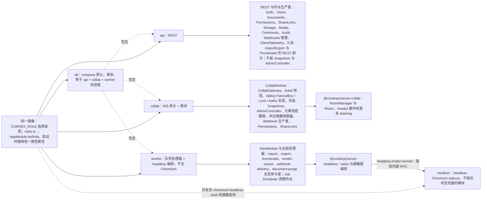

怎么读：左侧一个镜像按环境变量分出五个角色，实线指向该角色装配的模块或包；`all` 以虚线「包含」另外三个 Nest 角色，renderer 是只接受 worker 入站的独立容器，只装入口与精简健康探针。global 模块与 Health/Metrics/Internal 诊断在 api、collab、worker 三角色都装。**逐模块、逐部件（rest / producer / processor / observer / cron）的装配以 40-modules/12 §7.1 的「模块 × 角色 × 部件」矩阵为准**（rulings §4.18 BE-13），`roles.ts` 是该矩阵的代码形态，启动断言逐项核对；其中 `role=api` 不得装配 SnapshotsModule 与 AdminController（快照恢复与 compact/migrate/epoch 都要在持有 Room 的进程执行，BE-03），拆分部署时反代把 `/api/v1/documents/:id/snapshots*` 与元素彻底删除端点转给 collab（§10.1）。
依据：本文 §0、§1、§2 `config/roles.ts`、§4.2、§10；ADR-0037 决策 1（角色装配表）；40-modules/12 §7.1。

---

## 1. Nest 模块图与职责

**Nest 模块图**

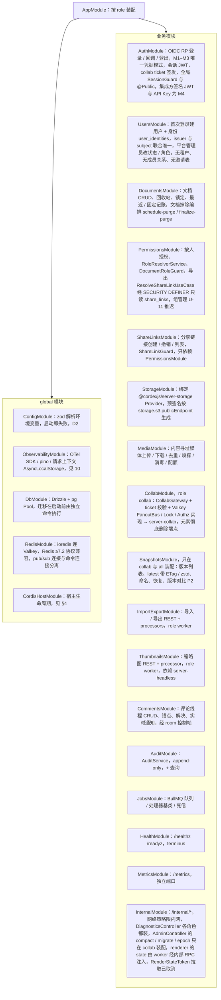

怎么读：AppModule 是根，「global 模块」框里的五个模块对所有业务模块可见，「业务模块」框里是按 `CORDEX_ROLE` 取舍的模块（取舍关系见 §0「进程角色」图与 40-modules/12 §7.1 矩阵）；节点内是各模块职责。Documents、Permissions、ShareLinks 是三个平级模块（rulings §4.13、§4.18 BE-08）；依赖单向：ShareLinks → Permissions，Permissions 不依赖 ShareLinks，业务模块也不为鉴权 import AuthModule（SessionGuard 全局注册，BE-06），因此无环（BE-02）。另有 ClientTelemetry（api 角色，BE-30）与 Webhooks 两个模块，职责见 §2 目录树。

**Nest 模块到 server-* 包**

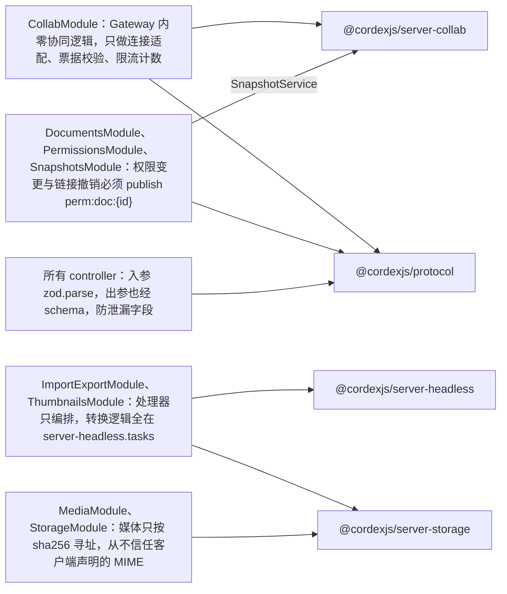

怎么读：左列是 Nest 模块及其关键不变量，右列是它们依赖的包；Nest 模块只做传输与编排，业务逻辑在 `server-*` 包里（D8）。
依据：本文 §1 模块表。

| 模块 | 依赖的 `server-*`/`@cordexjs` 包 | 关键不变量 |
|---|---|---|
| CollabModule | server-collab、protocol | Gateway 内**零协同逻辑**：只做连接适配、票据校验、限流计数 |
| ImportExportModule/ThumbnailsModule | server-headless、server-storage | 处理器只编排；转换逻辑全在 `server-headless.tasks` |
| DocumentsModule/PermissionsModule/ShareLinksModule/SnapshotsModule | server-collab（SnapshotService）、protocol | 权限变更与分享链接撤销必须 publish `perm:doc:{id}`（06 §10）；分享令牌只由 PermissionsModule 的 `ResolveShareLinkUseCase` 解析（BE-02） |
| MediaModule/StorageModule | server-storage | 媒体只按 sha256 寻址；从不信任客户端声明的 MIME |
| 所有 controller | protocol | 入参 `zod.parse`，出参也经 schema（防泄漏字段） |

---

## 2. `apps/server` 目录级结构

```
apps/server/
├── package.json                        唯一允许 @nestjs/*；deps：@cordexjs/server-collab @cordexjs/server-storage @cordexjs/server-headless @cordexjs/protocol @cordexjs/kernel，
│                                       以及 cordis-host/** 装配所需的 iso 包（model-core、store-yjs、model-slide、ooxml-core、ooxml-pptx、engine-layout）：apps/server
│                                       是组合根（cordex.compositionRoot:true），只有 cordis-host/preset-server.ts 可 import 垂直束（rulings §4.18 FE-01）
├── nest-cli.json · tsconfig.json · tsconfig.build.json
├── Dockerfile                          多阶段：build → runtime(node:26-slim + fonts 包)；**不含 Chromium**；按 CORDEX_ROLE 启动。renderer 镜像二选一（ADR-0037）：本镜像的 `renderer` 变体，或自建最小 `chromium-headless-shell` 镜像（均含同版本 /render 静态包 + 开源字体包〔Noto 含 CJK + Liberation + Carlito/Caladea；部署方可挂载自有授权字体目录，rulings §4.16 Q19〕，非 root；每周随 Chrome 稳定版重建，与 worker 锁步发布）；全部镜像按 digest 钉死
├── docker/
│   ├── entrypoint.sh                   迁移（可选）→ 按 CORDEX_ROLE 启动
│   └── healthcheck.sh
├── drizzle.config.ts
├── src/
│   ├── main.ts                         顺序：OTel SDK → 读配置 → NestFactory(Fastify) → `setGlobalPrefix('api/v1', { exclude: ['healthz', 'readyz', 'internal/(.*)'] })`（REST 统一前缀；
│   │                                   /metrics 走独立端口；/internal/* 不加前缀、反代不转发；WS 维持 /collab/v1/rooms/:id，rulings §4.18 BE-11；本文其余 REST 路径均相对 apiBase）
│   │                                   → WsAdapter(ws) → 全局 filter/pipe/interceptor → 优雅关闭钩子（SIGTERM：拒新连接 → drain rooms → flush jobs → 退出，上限 30 s）
│   ├── app.module.ts                   根模块；`forRole(role)` 组合；以 `APP_GUARD` 依次全局注册 SessionGuard（默认拒绝，`@Public()` 放行）与 ShareLinkGuard
│   │                                   （请求带 shareToken 时生效，否则直通）（rulings §4.18 BE-05/BE-06）
│   ├── config/
│   │   ├── config.schema.ts            zod：{ role: 'all'|'api'|'collab'|'worker'|'renderer', http:{port,trustProxy}, db:{url,poolMax}, redis:{url}（Valkey）, storage:{provider,s3:{endpoint（内网，服务端自身读写）, publicEndpoint（对外，如 https://s3.<域名>，预签名一律用它生成，rulings §4.18 BE-01）,…}}, auth:{oidc:{issuer（对外 URL，如 https://idp.<域名>）,clientId,clientSecret,redirectUri（https://<host>/api/v1/auth/oidc/callback，BE-11）}, selfSignup:false, jwt:{keys, ttl}, ticketTtlSec:60}, collab:{…server-collab Config，含 room.memoryAdmissionPct:75}, room:{countBy:'user', ownerReservedSeat:true, commenterCountsAs:'viewer', maxEditors:20, maxViewers:50, weightBudgetBytes?（可选绝对覆盖值；缺省时实例内存预算 = 容器内存上限 × collab.room.memoryAdmissionPct，rulings §4.18 BE-29）}, scale:{maxPages:200, maxElementsPerSlide:1000, maxElementsPerDoc:20000, softWarnElementsPerDoc:15000, maxUploadBytes}, tombstone:{ttlHours:24}（键名与 40-modules/09 `server-collab/config.ts` 一致，BE-24）, retention:{autoSnapshotDays:30, namedSnapshots:'forever', documentUpdatesDays:7, importSourceDays:30, softDeleteDays:30}, compaction:{everyUpdates:500, everyMinutes:10}, fonts:{extraDirs:[]}（部署方挂载的自有授权字体目录，只读）, externalResources:'auto'|'confirm'|'never', limits:{zip, rate}, headless:{mode:'remote'|'local', endpoint, poolSize}, telemetry:{otlpUrl, sampling} }；production 下 auth 未配置即拒绝启动；scale 超出默认包络时启动告警并在 /readyz 标注；`retention`/`compaction`/`tombstone` 全部为部署可调的默认值（rulings §4.16 Q17）
│   │   ├── config.module.ts            解析一次、注入 typed `AppConfig`；解析失败 → 进程退出码 78
│   │   └── roles.ts                    role → 「模块 × 部件（rest/producer/processor/observer/cron）」矩阵的代码形态（矩阵以 40-modules/12 §7.1 为准，rulings §4.18 BE-13）；
│   │                                   all/api/collab/worker/renderer 五值；角色一致性启动断言逐项核对（rulings §4.13），含 role=api 不装配 SnapshotsModule 与
│   │                                   AdminController（BE-03）、role=renderer 进程内无 DB/Valkey/S3 客户端（BE-14）
│   ├── common/                         只留与授权策略无关的纯机制（守卫按归属放进各模块的 interface/guards/，rulings §4.18 BE-08）
│   │   ├── filters/cordex-exception.filter.ts        CordexError → RFC 9457 problem+json（映射表：protocol/errors/http-map）；ZodError → 400；未知错误 → 500 + errors.report
│   │   ├── interceptors/request-context.interceptor.ts   requestId/traceparent/user → ALS；`ctx.extend` 元数据供日志；每个 DB 事务 `SET LOCAL app.user_id`（分享链接访问另设 `app.share_doc_id`）供 RLS（GUC 与 policy 以 40-modules/08 `rls-context.ts` 为准）
│   │   ├── interceptors/audit.interceptor.ts     `@Audited(action)` 的 handler 成功后写 audit_log（含前后差异摘要；装饰器与解释器同处）
│   │   ├── pipes/zod.pipe.ts                      protocol schema → parse
│   │   └── rate-limit/{rate-limit.guard.ts, redis-token-bucket.ts}   处理链最前（§9.1）
│   ├── cordis-host/
│   │   ├── cordis-host.module.ts       OnModuleInit：createHost；OnApplicationBootstrap：加载 preset-server 并 `await fiber.await()`；OnApplicationShutdown：dispose（§4）
│   │   ├── cordis-host.service.ts      `root: Context`；`openUnit(docId, source)`/`closeUnit`；`withRequestMeta(meta, fn)`；`diagnostics()`（dumpFiberTree/effects/PENDING）
│   │   ├── preset-server.ts            服务端插件束与默认配置（见 §4.2）
│   │   └── adapters/{pino-logger.adapter.ts, otel-telemetry.adapter.ts, errors-reporter.adapter.ts}   kernel 基础服务的 Node 实现（10）
│   ├── modules/
│   │   ├── auth/
│   │   │   ├── auth.module.ts · auth.controller.ts（/auth/oidc/login, /auth/oidc/callback, /logout, /me, /token/refresh, /auth/config, /auth/.well-known/jwks.json；
│   │   │   │                           login、callback、config、jwks 标 @Public()）· auth.service.ts
│   │   │   ├── interface/guards/{session.guard.ts（会话 JWT → Principal；AppModule 以 APP_GUARD 全局注册、默认拒绝；非 http 上下文直接放行，WS 靠首帧票据；
│   │   │   │                           M4 起增加集成方 JWT / API Key 分支）, platform-admin.guard.ts（users.platform_role='admin'：用户状态/角色、运维操作）}
│   │   │   ├── interface/decorators/{public.decorator.ts（@Public() 白名单标记，BE-06）, principal.decorator.ts}
│   │   │   ├── oidc/{oidc.client.ts（openid-client v6，discovery 缓存；对接部署方 IdP 或内置 Casdoor，国内 IM 登录经 Casdoor 代理）, pkce.ts, state-store.ts（Valkey, 10 min）}
│   │   │   ├── provisioning/first-login.ts  首次 OIDC 登录 JIT 建 `users` + `user_identities`（同一事务；`issuer` 须在受信 IdP 列表内）；`auth.selfSignup=false`（默认）时 IdP 侧不开放注册，账号由管理员在 IdP（如 Casdoor）内建号，服务端**不设邀请表**（rulings §4.17 D1）
│   │   │   ├── tokens/{jwt.service.ts（ES256、JWKS 轮换、kid；票据验签面导出给 CollabModule 的 TicketVerifier）, session-cookie.ts（httpOnly/SameSite=Lax）,
│   │   │   │           ticket.service.ts（collab ticket：sub/doc/role/permVersion/jti/exp 60 s，可选 sid = 登录会话 id、lnk = 分享链接 id，rulings §4.18 BE-02）}
│   │   │   ├── （M4）integrator-jwt/ 与 api-keys/：集成方签名 JWT 验签（JWKS）与 API Key，届时 JIT 建影子用户（rulings §4.15 Q6）
│   │   │   └── principal.ts            Principal = { kind:'user', id, scopes }（M4 增加 'integrator'；分享链接不产生独立 Principal，S-1）
│   │   ├── users/{users.module.ts, users.controller.ts（/me、平台管理员改 status/platformRole）, users.service.ts, quotas.service.ts（部署级配额）}
│   │   ├── documents/
│   │   │   ├── documents.module.ts · documents.controller.ts（GET/POST /documents, GET/PATCH/DELETE /documents/:id, POST /:id/restore, POST /:id/collab-ticket；
│   │   │   │                           「永久删除文档」经 schedule-purge，允许 active → purging）
│   │   │   ├── documents.service.ts · documents.repository.ts（documents + document_user_marks 最近/固定记账，BE-31）
│   │   │   └── purge/{schedule-purge.usecase.ts（同一事务置 purging 并写 job_runs(kind=document-purge)）, document-purge.processor.ts（worker）,
│   │   │             purge-participant.ts（@PurgeParticipant 登记，DiscoveryService 收集）, finalize-purge.usecase.ts（ListObjectVersions 删 docs/{docId}/ 全部版本 → 删行 → 审计）}
│   │   ├── permissions/                平级模块（rulings §4.13、§4.18 BE-08）
│   │   │   ├── permissions.module.ts · permissions.controller.ts（GET/PUT/DELETE /documents/:id/permissions…）· permissions.service.ts（写库 + permVersion++ + PUBLISH perm:doc:{id} + audit）
│   │   │   ├── role-resolver.ts        principal → Role：max(直接授权, Principal.scopes 中本文档的链接角色)；只缓存直接授权部分 5 s
│   │   │   ├── resolve-share-link.usecase.ts   token/linkId → {linkId, role, expiresAt}，经 SECURITY DEFINER 函数只读 share_links；导出给 ShareLinkGuard 与 CollabModule 的 AuthzSource（BE-02）
│   │   │   └── interface/guards/document-role.guard.ts   `@RequireDocRole('editor')`：无显式允许即 403（D12）
│   │   ├── share-links/                平级模块，只 import PermissionsModule
│   │   │   ├── share-links.module.ts · share-links.controller.ts · share-links.service.ts（创建 / 撤销（撤销即 permVersion++ 并 PUBLISH）/ 列表）
│   │   │   └── interface/guards/share-link-access.guard.ts   ShareLinkGuard：第二个 APP_GUARD，调 ResolveShareLinkUseCase 把链接角色叠加进已登录 Principal.scopes
│   │   ├── storage/{storage.module.ts（按 config 绑定 S3/local Provider；通用 presign 端点删除，预签名只由 media 与 imports 的专用端点签发，BE-10）}
│   │   ├── media/{media.module.ts, media.controller.ts（POST /media/presign, POST /media/commit, GET /media/:sha256）, media.service.ts（sha256 校验、MIME 嗅探、SVG 消毒、尺寸探测、配额、document_media 关联）, sniff.ts, svg-sanitize.ts}
│   │   ├── collab/
│   │   │   ├── collab.module.ts
│   │   │   ├── collab.gateway.ts       `@WebSocketGateway({ path: '/collab/v1/rooms/:documentId' })`（ws 适配器）：连接计数、IP 限流、首帧 5 s 超时、把 socket 包装为 ServerConnection 交给 RoomManager.attach()
│   │   │   ├── ws-connection.adapter.ts   ws.WebSocket → server-collab `ServerConnection`（send/close/onFrame/remoteInfo）
│   │   │   ├── ticket-verifier.ts      JWT 验签 + jti 防重放（Valkey SETNX 60 s）+ permVersion 对比
│   │   │   ├── redis-fanout.bus.ts     server-collab `FanoutBus` 的 Valkey 实现（channel collab:doc:{id}；instanceId 去重）
│   │   │   ├── redis-lease-lock.ts     `LeaseLock`（SET NX PX + 续租 + fencing token）
│   │   │   ├── pg-update-store.ts      `UpdateStore`（批量 INSERT document_updates；loadSince）
│   │   │   ├── pg-snapshot-store.ts    `SnapshotStore`（≤ 1 MiB 内联 bytea，否则 S3 引用）
│   │   │   ├── authz-source.ts         `AuthorizationSource`：重算取 max(直接授权 RoleResolverService, 票据 lnk 对应链接仍有效时的角色 ResolveShareLinkUseCase)；
│   │   │   │                           会话记录 linkExpiresAt，到期主动重算降权；perm:doc 订阅（链接撤销 ≤ 1 s 降权，rulings §4.18 BE-02，06 §10）
│   │   │   ├── element-purge.controller.ts   POST /documents/:id/elements/purge{ids}：DocumentRoleGuard（doc.manage，仅 owner）、只接受墓碑态元素；交 server-collab
│   │   │   │                           单写者以 system('maintenance') 立即硬删（复用 tombstone-sweeper 事务，Room 未加载时先加载），写审计 document.element_purged（CO-07）
│   │   │   └── purge-collab-data.participant.ts   @PurgeParticipant('collab')：只依赖 PgUpdateStore/PgSnapshotStore，可在 worker 装配而不激活 collabServer（BE-15）
│   │   ├── snapshots/{snapshots.module.ts（只在 collab 与 all 装配，BE-03；imports CordisHostModule 与 PermissionsModule——控制器守卫 DocumentRoleGuard 须经 imports 引入，BE-07，与 40-modules/09 §3.3 一致）, snapshots.controller.ts（GET /documents/:id/snapshots, GET …/latest（ETag、zstd、Cache-Control: private, max-age=0, must-revalidate）, GET …/:snapshotId, GET …/:a/diff/:b（P2）, POST …（命名）, POST …/:snapshotId/restore（在本实例打开 Room 执行，多副本经 FanoutBus 收敛））, snapshots.service.ts}
│   │   ├── import-export/
│   │   │   ├── import-export.module.ts · imports.controller.ts（两步上传，rulings §4.18 BE-10：POST /imports/uploads → 服务端预分配 jobId（新建文档时同时预分配 docId=UUIDv7），
│   │   │   │                           返回绑定该对象键的预签名 PUT 与绑定 userId、1 h 有效的一次性 uploadId；POST /imports{uploadId} → 校验归属 + HEAD 确认对象 → 建作业入队；
│   │   │   │                           提交他人 uploadId 或对象键 → 403；≤ 10 MB 可 multipart 直传（§16.4）；GET /imports/:jobId；POST /imports/:jobId/cancel 取消导入 → job_runs 置 cancelled 并清理原件与产物，UX-14）· exports.controller.ts（POST /documents/:id/export, GET /exports/:jobId）
│   │   │   ├── import.processor.ts     BullMQ `import`：拉原件 → server-headless tasks.import（文档类型无关，经 formats 按 documentType 取 codec，FE-01；含规模天花板检查：超限直接失败 `format.quota_exceeded{dimension}`，取值见 10 §1.4，不创建文档）→ 写 snapshot(kind import，记 baseline_key) + media 关联 → 取包内 `docProps/thumbnail.jpeg` 作 M2 过渡封面（只做 JPEG 头校验，不解码、不用 sharp）→ 创建/更新 document → audit
│   │   │   ├── export.processor.ts     BullMQ `export`：latest state → server-headless tasks.export → S3 exports/ → 24 h 签名 URL
│   │   │   └── import-export.service.ts
│   │   ├── thumbnails/{thumbnails.module.ts, thumbnails.controller.ts（GET /documents/:id/thumbnails/:slideId）, thumbnails.processor.ts（BullMQ `thumbnails`；去重键 = 页内容哈希；经 server-headless 调 renderer sidecar，640 px WebP）, render-export.processor.ts（BullMQ `render-export`：pdf/png/jpeg 导出）, thumbnails.service.ts（source: embedded|server（DB 约束另留 client 保留位，BE-26）、contentHash、S3 键、缓存头）}
│   │   ├── comments/{comments.module.ts, comments.controller.ts（留在 api）, comments.service.ts（线程/回复/解决/删除；锚点格式校验；权限 commenter+）, comment-mirror.observer.ts（只在 collab 注册，BE-03）, comments.notifier.ts（通过 server-collab Room.broadcastControl 发 `CONTROL.event{comments.changed}`）}
│   │   ├── webhooks/{webhooks.module.ts, webhooks.controller.ts（订阅管理）, webhook-producer.ts（collab 角色）, webhook-delivery.processor.ts（队列 webhook-delivery，worker）, egress-guard.ts}
│   │   ├── telemetry/{telemetry.module.ts（ClientTelemetryModule，只装在 api 角色）, client-telemetry.controller.ts（POST /telemetry/errors ≤ 64 KiB、POST /telemetry/otlp ≤ 512 KiB 且只转发 traces；要求登录、令牌桶限流）, otlp-proxy.service.ts}（rulings §4.18 BE-30；目录名与文件布局以 40-modules/12 §4.12 为准）
│   │   ├── audit/{audit.module.ts, audit.service.ts（append-only，批量写）, audit.controller.ts（部署管理员查询）, audit-seal.job.ts（每日，只由 worker 经 Job Scheduler 注册，BE-19）}
│   │   ├── jobs/{jobs.module.ts, queues.ts（队列名/默认重试/退避，含 webhook-delivery 与 document-purge；周期作业的 Job Scheduler 注册表）, base.processor.ts（trace 传播、错误分类、死信）, job-runs.repository.ts（PG 镜像用于审计/查询；findByIdempotencyKey 排除 failed 与 cancelled 行，BE-18/UX-14）}
│   │   ├── health/{health.module.ts, health.controller.ts（/healthz 进程活；/readyz：PG ping、Valkey ping、S3 head、宿主 ACTIVE、role=collab 时 RoomManager 未 draining；规模配置超出默认包络时附 `scaleEnvelopeExceeded`）；renderer 角色只装 `HealthModule.forRole('renderer')` 精简探针（/healthz 与 Chromium 池就绪，不 import Db/Redis/CordisHost，BE-14）}
│   │   ├── metrics/{metrics.module.ts, prometheus.controller.ts（内部端口 9464；renderer 角色不装）}
│   │   └── internal/{internal.module.ts, diagnostics.controller.ts（各角色；GET /internal/diagnostics/fibers|effects|pending|contributions）, admin.controller.ts（只在 collab 与 all 装配；POST /internal/admin/documents/:id/compact|migrate|epoch；epoch 递增后经 Valkey 通知其他持有该 Room 的实例一并踢出会话，BE-03）}
│   └── db/
│       ├── schema/{users.ts, user_identities.ts, documents.ts, document_user_marks.ts, document_updates.ts, document_snapshots.ts, media_blobs.ts, document_media.ts,
│       │           permissions.ts, document_perm_versions.ts, share_links.ts, comments.ts, thumbnails.ts, job_runs.ts, audit_log.ts, webhooks.ts（subscriptions + deliveries）}
│       │           （api_keys 随 M4 再加；collab_sessions 不建，rulings §4.18 BE-27/BE-31）
│       ├── migrations/                 SQL（drizzle-kit 生成 + 手写分区/索引）
│       ├── seed/dev-seed.ts
│       └── client.ts                   pg Pool（statement_timeout 30 s、application_name=cordex-{role}）；每个事务 `SET LOCAL app.user_id` / `app.share_doc_id`（RLS 上下文，40-modules/08）
└── test/
    ├── e2e/                            Nest Testing + testcontainers（Postgres 18 / Valkey / SeaweedFS）+ mock OIDC（oidc-provider）；PR 另跑 Casdoor 容器登录用例；nightly 跑 Keycloak/Entra/飞书等真实 IdP
    ├── fixtures/
    └── helpers/
```

**REST 请求处理链**

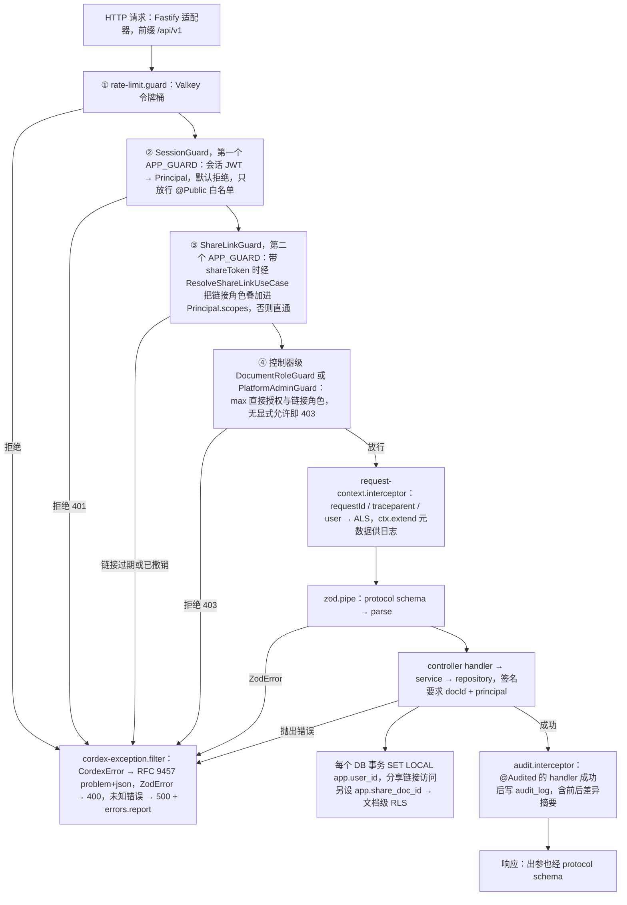

怎么读：自上而下是一次 REST 请求穿过守卫、拦截器、管道与处理器的顺序（Nest 固定顺序：guard → interceptor → pipe → handler）。守卫顺序是固定的（rulings §4.18 BE-05）：限流最前，然后全局 SessionGuard、ShareLinkGuard，最后才是控制器级的 DocumentRoleGuard——链接角色必须先进入 Principal，否则只凭链接、没有直接授权的用户会在叠加之前就被 403。任何一环拒绝或抛错都汇入异常过滤器，转成 problem+json。
依据：本文 §2 `common/`、`auth/`、`permissions/`、`share-links/`、`db/client.ts`，§9.1；ADR-0029 决策 1。

---

## 3. `server-*` 包目录级结构

### 3.1 `@cordexjs/server-collab`（node；cordis 插件，提供 `collabServer` 服务）

```
packages/server-collab/
├── package.json                        deps: yjs y-protocols lib0 @cordexjs/collab-core @cordexjs/store-yjs @cordexjs/model-core @cordexjs/protocol @cordexjs/kernel（无 Nest、无 pg、无 ioredis：这些能力经 Definition 注入）
├── src/
│   ├── index.ts
│   ├── plugin.ts                       name='server-collab'；inject=['units','updateStore','snapshotStore','fanoutBus','leaseLock','authzSource','telemetry']；provide=['collabServer']
│   ├── manifest.ts
│   ├── config.ts                       zod：{ room:{ drainGraceMs:60000, maxEditors:20, maxViewers:50, countBy:'user', ownerReservedSeat:true, commenterCountsAs:'viewer', admission:'weighted', weightBytesPerElement:14336, memoryAdmissionPct:75 }（按文档实测权重准入，rulings §4.15 Q5；取代固定 maxActiveRooms）, limits:{ maxFrameBytes:1 MiB, msgRateHz:200, msgBurst:500, updateBytesPerMin:10 MiB, awarenessMinIntervalMs:50, awarenessMaxBytes:2 KiB, structsPerUpdate:50000 }, persistence:{ flushMs:100, flushMaxUpdates:50, persistBeforeBroadcast:true }, compaction:{ maxPendingUpdates:500, maxPendingBytes:5 MiB, maxAgeMs:600000, retainUpdatesAfterSnapshotMs: 7 d }, softGate:{ mode:'repair'|'report-only'|'off', schemaMode:'report-only' }, repair:{ quarantineThreshold:5, windowMs:600000 } }（值见 §16.5）
│   ├── collab-server.contribution.ts   Context { collabServer, updateStore, snapshotStore, fanoutBus, leaseLock, authzSource }；Events：collab-server/room-opened|closed、collab-server/update-rejected、collab-server/repair
│   ├── contracts/
│   │   ├── connection.ts               ServerConnection{ id, remote:{ip,ua}, send(frame), close(code, reason), onFrame, onClose }
│   │   ├── update-store.ts             UpdateStore{ append(docId, rows[]) → seqs; loadSince(docId, seq) → AsyncIterable<row>; pruneBefore(docId, seq, olderThan) }
│   │   ├── snapshot-store.ts           SnapshotStore{ latest(docId); put(docId, snap); get(id); list(docId); }
│   │   ├── fanout-bus.ts               FanoutBus{ publish(docId, msg{instanceId, frame}); subscribe(docId, handler) → Disposable }
│   │   ├── lease-lock.ts               LeaseLock{ acquire(key, ttlMs) → Lease|null; Lease.renew()/release()/token }
│   │   └── authz-source.ts             AuthorizationSource{ resolveRole(docId, principal) ; onPermissionChanged(docId, cb) → Disposable }（principal 携带票据的可选 lnk；
│   │                                   结果含可选 linkExpiresAt，会话据此到期主动重算，rulings §4.18 BE-02；签名以 40-modules/09 为准）
│   ├── room/
│   │   ├── room-manager.ts             docId → Room；先准入后 loading（06 §14）：按权重准入（房间权重 = 实测 Y 堆 ≈ documents.element_count（墓碑计入）× weightBytesPerElement；
│   │   │                               D200 ≈ 85 MB；实例内存预算 = 容器内存上限 × memoryAdmissionPct，BE-29）；内存压力或准入不足时先按 LRU 提前结束 draining 房间，
│   │   │                               仍超预算才驱逐 active 房间（发 1012，CO-14）；drainAll(reason)；attach(connection, ticketClaims)
│   │   ├── room.ts                     状态机（06 §5.2）；持有 UnitHandle（store-yjs Unit）；sessions；awareness relay；persist ticker；加入时检查 documents.status，
│   │   │                               purging 一律拒绝（BE-15）；PG 故障与回放期间保持 active（CO-15）
│   │   ├── room-session.ts             role、令牌桶、ack 追踪（两级：spill / db）、最后活动时间、违规计数；名额按 userId 计（同一用户多连接占 1）
│   │   ├── awareness-tick.ts           满员房间的服务端 awareness 合并 tick（查看者只上报 view，不上报光标/选区）
│   │   ├── frame-router.ts             信封 → hardGate → sync/awareness/control 分派
│   │   └── broadcast.ts                本地 + FanoutBus；按 instanceId 去重；对 viewer 只发 awareness 与 sync
│   ├── gate/
│   │   ├── hard-gate.ts                L1（信封/大小/速率）、L2（role）、L3（decodeUpdateV2 + 结构数）
│   │   ├── soft-gate.ts                applyUpdate(origin remote) → ChangeSet → `documentType.validateChangeSet`（A 线 04）→ RepairPlanner
│   │   ├── repair-planner.ts           修复规则表 → repair 事务（origin repair）+ CONTROL.repair；隔离阈值
│   │   └── token-bucket.ts
│   ├── persistence/
│   │   ├── update-writer.ts            批量写（flushMs/flushMaxUpdates）→ 提交后回 `ack{seq, tier:'db'}`（逐帧应答，含重连 step2，06 §6.4）；persistBeforeBroadcast 分支只约束
│   │   │                               PG 可用时的顺序，PG 故障降级期通过门禁即广播（指标 cordex_collab_broadcast_before_persist_total，rulings §4.18 CO-08）
│   │   ├── spill-store.ts              PG 故障期溢写（S-3）：写 Valkey/对象存储成功 → `ack{tier:'spill'}`；provisional key `(instanceId, localCounter)`；PG 恢复后只回放本实例
│   │   │                               instanceId 的行（readAllOrdered(docId, instanceId)），心跳过期实例的遗留行由下次加载该文档的 Room 在 bootstrap 后持 lock:spill:{doc}
│   │   │                               租约认领；由 PG 分配正式 seq、逐个回 `ack{seq, tier:'db'}`（原会话已断开则丢弃）；回放后断言无 pendingStructs（rulings §4.15 S-3a、§4.18 CO-16）；
│   │   │                               关闭或 SIGTERM 时 PG 不可达 → 内存档强制写一级溢写后再 closed
│   │   ├── tombstone-sweeper.ts        墓碑 TTL 硬删除（以 40-modules/09 为准）：定时 → `LeaseLock` 选出单写者 → 扫描 Room 内 `_deleted.at + tombstone.ttlHours < now` 的实体 → 硬删除事务（origin system('maintenance')）→ 正常落库与广播；未打开的文档由压缩路径在加载时顺带执行；**不经 BullMQ**；所有者经审计的「彻底删除元素」复用同一事务立即硬删（CO-07）；文档擦除（「永久删除文档」）由 document-purge 作业调用 collab 参与者 `purgeAll`、不等 TTL（rulings §4.15 Q3、§4.18 BE-15）
│   │   ├── bootstrap-loader.ts         latest snapshot（内联/S3）+ loadSince → applyUpdate；schemaVersion 检查
│   │   ├── compactor.ts                触发判定 → leaseLock → encodeStateAsUpdateV2 → snapshotStore.put(kind auto) → pruneBefore（保留 7 d）
│   │   └── migration-runner.ts         leaseLock → `migrations.run(unit, from, to)`（A 线）→ snapshot(kind migration) → 通知客户端 4426（旧客户端）
│   ├── snapshot/
│   │   └── snapshot.service.ts         命名快照；restore：加载目标 state 到临时 Unit → 模型级 diff（A 线 `diffSnapshots`）→ 一次 repair-like 事务写回当前 Unit（origin restore）
│   ├── awareness/
│   │   └── awareness-relay.ts          服务端 Awareness 实例（新加入者拿全量；断开即移除广播）；schema 校验丢弃计数
│   ├── telemetry.ts                    span/metric 常量（10 §4）
│   ├── errors.ts                       collab.server.*（room_full、capacity、bootstrap_failed、lock_lost…）
│   └── __tests__/                      使用 testing/ 的内存实现：两实例去重扇出、崩溃后重放、限流、软门禁修复、容量驱逐（先回收空闲房间再驱逐活跃房间）、drain；
│                                       PG 断开时两客户端互见编辑且恢复后 seq 连续不丢（CO-08）；实例下线后新实例加载时回放、两实例各自回放无重复行（CO-16）；
│                                       他人改权限不踢链接会话、撤销链接 ≤ 1 s 降权、链接到期主动降权（BE-02）
└── testing/
    └── index.ts                        MemoryUpdateStore · MemorySnapshotStore · MemoryFanoutBus · MemoryLeaseLock · StaticAuthz · createServerCluster(n)（多实例 + 内存总线）· MemoryServerConnection
```

### 3.2 `@cordexjs/server-storage`（node）

```
packages/server-storage/
├── src/
│   ├── index.ts
│   ├── plugin.ts                       provide=['blobStore']（实现 model-core `BlobStore` + 服务端扩展，见 §16.1）；Config.provider ∈ 's3'|'local'
│   ├── config.ts                       zod：{ provider, s3:{ endpoint（内网）, publicEndpoint（对外，预签名一律用它签名，rulings §4.18 BE-01）, region, bucket, accessKeyId, secretAccessKey, forcePathStyle }, local:{ rootDir }, presign:{ putTtlSec:600, getTtlSec:3600 } }
│   ├── storage.contribution.ts         Context { blobStore: ServerBlobStore }
│   ├── contracts/blob-store.ts         ServerBlobStore extends BlobStore（model-core：get/put/has，04 §2.5）+ { head(key); delete(key); presignPut(key, {contentType, maxBytes}); presignGet(key, ttl); list(prefix); listVersions(prefix); deleteVersion(key, versionId) }
│   ├── providers/s3-blob-store.ts      @aws-sdk/client-s3 + lib-storage（分片）；S3 兼容（默认 SeaweedFS，生产推荐客户自有 S3；`snapshots/` 前缀须开启版本化以满足 SV-09 备份）；
│   │                                   presignPut/presignGet 以 publicEndpoint 为主机名签名，get/put/head/delete/list 走内网 endpoint
│   ├── providers/local-blob-store.ts   开发/测试
│   ├── keys.ts                         对象键布局函数（§6）
│   ├── hashing.ts                      流式 sha256（与客户端 WebCrypto 结果一致的十六进制小写）
│   ├── errors.ts                       storage.*（not_found、integrity_mismatch、quota_exceeded）
│   └── __tests__/                      runBlobStoreConformance（local；CI 中 testcontainers SeaweedFS）；换掉 MinIO 后 S-2 purge、S-3 二级溢写、导入原件与缩略图路径全部重跑契约；
│                                       含「按 publicEndpoint 生成的预签名 URL 经保持 Host 头的反代后仍可用」与「按版本删除后无残留版本」两条（BE-01、BE-15）
└── testing/index.ts                    MemoryBlobStore · runBlobStoreConformance(factory)（契约套件命名 run<Definition>Conformance，章程 §5.5；rulings §4.18 GV-20）
```

### 3.3 `@cordexjs/server-headless`（node）

```
packages/server-headless/
├── package.json                        deps: @cordexjs/kernel @cordexjs/model-core @cordexjs/store-yjs @cordexjs/ooxml-core @cordexjs/engine-layout @cordexjs/engine-render（iso 契约） @cordexjs/protocol（renderer RPC 契约）
│                                       playwright-core(可选 peer，仅 local 模式与 renderer 镜像)；**不 import model-slide/ooxml-pptx**（文档类型盲，rulings §4.18 FE-01）：
│                                       垂直束由 apps/server 的 cordis-host/preset-server.ts 装配后以插件清单传入
├── src/
│   ├── index.ts
│   ├── host/
│   │   ├── create-server-host.ts       createHeadlessHost({ plugins, adapters })：createHost + 挂载调用方（apps/server preset-server）给定的 iso 插件集（顺序无关，inject 反应式）；
│   │   │                               @cordisjs/plugin-loader 配置驱动默认关闭（A-8 / ADR-0010），preset 程序化组合
│   │   ├── worker.ts                   worker_threads 每任务新建 host（超时/内存限额），按 apps/server 提供的插件清单模块路径动态加载
│   │   └── unit-runner.ts              withUnit(source: Snapshot | Uint8Array(state), fn(unit)) → 结果；finally 关闭 Unit；dev 下 assertNoLiveEffects
│   ├── tasks/
│   │   ├── import.ts                   bytes → zipLimits 校验（§9.2）→ formats 服务按 documentType 取 codec → decode → Snapshot → withUnit(store-yjs importSnapshot) → { state(V2), mediaRefs[], warnings[] }
│   │   ├── export.ts                   state → withUnit → formats 服务按 documentType 取 codec → encode（脏部件 + 不透明保留）→ bytes；可选校验（OPC 完整性）
│   │   ├── validate.ts                 全量 schema + 不变量校验报告（供 admin/诊断）
│   │   ├── migrate.ts                  from → to 迁移（server-collab migration-runner 复用）
│   │   └── diff-snapshots.ts           两 state 的模型级 diff → Mutation 列表（restore 使用；经 documentTypes 取该类型的 diff 纯函数）
│   ├── thumbnails/
│   │   ├── remote-renderer.client.ts   headless.mode='remote'（默认，配 `headless.endpoint`，ADR-0037）：经鉴权内部 RPC 把 state + 媒体 + 字体注入 renderer sidecar，取回 WebP/PDF 字节；契约在 `@cordexjs/protocol`（`render/sidecar.ts`）
│   │   ├── browser-pool.ts             headless.mode='local'（EM-10 b 自带 Nest 的集成方）与 renderer 镜像内共用：chromiumSandbox=true + seccomp、非 root、每任务新 BrowserContext、定期回收浏览器、`--shm-size`（不用 --ipc=host）；生命周期归 effect；崩溃自愈
│   │   ├── thumbnail-renderer.ts       render(docState, slideIds, opts) → WebP[]（640 px；分享/版本预览按需 1280 px）：打开内置 /render 页、注入 state、等待 `window.__cordex.ready`、逐页截图并在沙箱内编码 WebP
│   │   └── content-hash.ts             页内容哈希（页子树 + 版式/母版/主题依赖闭包 + 媒体 BlobRef + slideSize + 页序号 + 内嵌字体集合 + layoutAlgorithmVersion + fontProfile；外链不计入）
│   ├── fonts/font-bundle.ts            字体包清单校验（与 engine-layout fallback 表一致；启动时缺失 → 告警）
│   ├── errors.ts                       headless.*（zip_limit_exceeded、decode_failed、browser_crashed、render_timeout）
│   └── __tests__/                      用 fixture 文档类型验证 import/export 编排、validate、缩略图（CI 有 Chromium 时）；pptx 语料 round-trip 与 server-collab 的
│                                       soft-gate-repair 用例迁到 apps/server 集成测试（只有组合根能同时 import server-* 与 model-slide，FE-01）
└── testing/index.ts                    createTestHost()、fixtures
```

**后端包依赖**

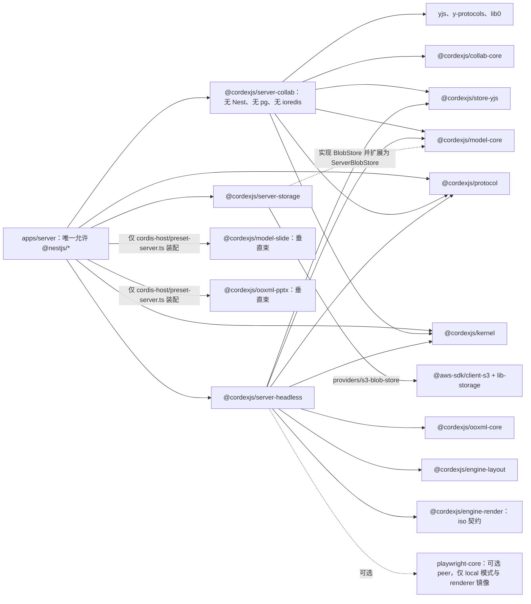

怎么读：实线是 `package.json` 依赖或实现所用的库，虚线是可选 peer 与 Definition 实现关系。`server-*` 包都不指向垂直束：slide 束只由组合根 apps/server 的 `preset-server.ts` 装配、以插件清单传给 server-headless（rulings §4.18 FE-01，M5 新增 doc 时 server-* 零改动）。pg、ioredis 等驱动只出现在 `apps/server` 的适配器目录里，`server-*` 包经 Definition 注入拿到这些能力（见下图）。
依据：本文 §2、§3.1–§3.3、§15。

**server-collab 的 Definition 与 apps/server 适配器**

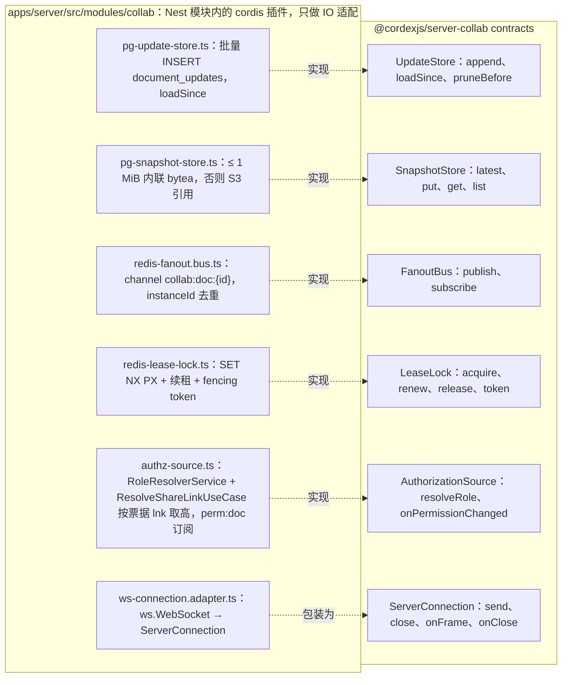

怎么读：左框是 Nest 进程里的 IO 适配器，右框是 server-collab 声明的契约，虚线表示「实现」；server-collab 的插件通过 inject 拿到这些服务，自身不直接依赖任何驱动（章程 D8、本文 S7）。测试时由 `@cordexjs/server-collab/testing` 的内存实现替换。

---

## 4. Nest 内嵌 cordis 宿主：生命周期映射

### 4.1 映射表

| Nest 生命周期 / 作用域 | cordis 动作 | 说明 |
|---|---|---|
| `main.ts` 最先 | 启动 OTel SDK | 在任何 import 有副作用之前（10） |
| `CordisHostModule.onModuleInit` | `createHost({ logger: PinoAdapter, telemetry: OtelAdapter, errors: ReporterAdapter })` → 根 ctx | 宿主是进程单例；不在 feature 模块里再建根 ctx（primer §14 规则） |
| `onApplicationBootstrap` | `ctx.plugin(presetServer, config)`；`await fiber.await()`；检查无 `PENDING` 关键插件 | 失败 → 抛出 → 进程退出（先失败，不部分激活） |
| `/readyz` | 宿主根 Fiber `ACTIVE` 且必需服务（`units`,`store` Provider 工厂,`formats`）可解析 | 否则 503 |
| 每个 Room | `collabServer` 内部：`ctx.units.open({ docType: documents.doc_type, store:'yjs', source })` → UnitScope（`isolate` store/history/…）；server-collab 不写死 `'slide'`（文档类型盲，FE-01） | 一个 Room 一个 Unit；服务端无 render/selection |
| 每个 HTTP 请求 / job | `ctx.extend({ requestId, traceId, principalId })` 仅作为日志/遥测元数据 | **不** isolate、不建 Fiber（避免每请求 Fiber 开销）；业务逻辑通过 `withRequestMeta` 拿到子 ctx |
| 每个 WS 连接 | 无 cordis 对象；`RoomSession` 普通对象 | 连接数量大，不映射为 Fiber |
| `beforeApplicationShutdown(signal)` | `collabServer.drainAll('shutdown')`（1012 → flush → persist）→ 队列 worker 暂停 → `host.dispose()` | 期限 30 s；超时强制退出并记录 |
| dev/test | `assertNoLiveEffects(rootFiber)` | A25 |

**Nest 生命周期与 cordis 宿主时序**

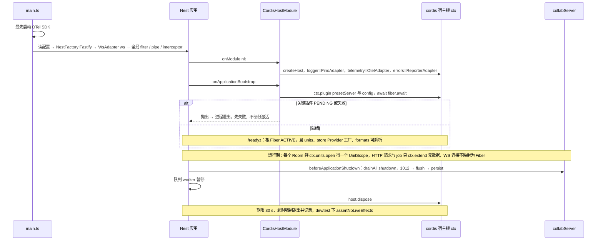

怎么读：时间自上而下，覆盖启动、运行与关闭三段；`alt` 是启动时宿主是否就绪的两种结局。宿主是进程单例，feature 模块不另建根 ctx。

### 4.2 `preset-server` 插件束（草案）

**preset-server 插件束**

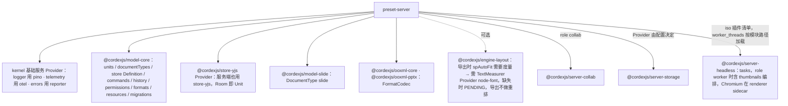

怎么读：preset-server 向下展开为它装配的插件；边上文字是按角色或配置的装配条件，无文字的实线表示原文未限定装配条件。preset-server 位于组合根 apps/server 的 `cordis-host/` 内，是服务端唯一 import 垂直束（model-slide、ooxml-pptx）的地方；server-headless 只接收它给定的插件清单（rulings §4.18 FE-01）。

`apps/server` 对 preset 的唯一职责是**配置**（章程：apps 零业务逻辑）；Definition 的 Node 实现（pg/Valkey 适配器）作为插件由 `apps/server/src/modules/collab/*.ts` 提供——它们是「Nest 模块内的 cordis 插件」，只做 IO 适配。

---

## 5. 数据模型（Postgres 18，草案；字段到草案级）

约定（rulings §4.15 T-0/Q6/Q10）：一次部署 = 一个组织，**全部表都没有 `tenant_id`**；`id uuid`（v7，在**应用层**生成，因此版本下限仍可为 16）、`created_at/updated_at timestamptz`、软删除用 `deleted_at`。数据访问兜底 = 文档权限检查（D12）+ **文档级 Postgres RLS**：凡带 `doc_id` 的业务表启用 RLS policy「当前 `app.user_id` 对该文档有 permissions 行，或 `app.share_doc_id` 命中该文档」，`db/client.ts` 每个事务 `SET LOCAL app.user_id` / `app.share_doc_id`（GUC 名与 policy 由 40-modules/08 `rls-context.ts` 定稿，ADR-0022 授权）；服务端系统作业（压缩、溢写回放、缩略图、墓碑硬删除）用**独立 DB 角色 + 显式系统作业上下文**，而非 `BYPASSRLS`；`BYPASSRLS` 只给迁移与维护（ADR-0022）；令牌查找（share link 等）走 `SECURITY DEFINER` 函数。

```sql
-- 用户（服务端不持有密码；身份来自外部 OIDC IdP；字段以 40-modules/08 §2.1 为准）
users(id pk, email_hash, display_name, avatar_url,
      platform_role text check in ('member','admin') default 'member',   -- 'admin' = 部署级平台管理员，至少保留一名
      status text check in ('active','suspended'), created_at, last_seen_at)
user_identities(id pk, user_id fk users, issuer, subject, email_at_login, last_login_at,
                unique(issuer, subject))
      -- 一个用户可绑定多个 IdP 身份（换 IdP 迁移用）；首次 OIDC 登录在同一事务内 JIT 建 users + user_identities；
      -- issuer 须在部署配置的受信 IdP 列表内。注册策略 = 部署级开关 `auth.selfSignup`（默认 false）：关闭时 IdP 侧
      -- 不开放注册，账号由管理员在 IdP（如 Casdoor）内建号；打开时 IdP 自助注册的身份也可建行。
      -- 服务端**无邀请表**（rulings §4.17 D1）：文档分享只对已存在账号生效，目标账号不存在 → 明确错误（提示联系管理员建号）。
      -- 分享链接始终要求登录（S-1 不匿名）；「个人账号」不再是独立概念（T-0 取代 S-1 的跨租户措辞）
-- （M4）api_keys / 集成方 JWT 的 JIT 影子用户：rulings §4.15 Q6 降为 M4，届时新增，不在 M1–M3 模型中
-- 组（U-11）：rulings §4.15 Q6 推迟，M3 只按人分享；groups/group_members 不建表

-- 文档
documents(id pk, title, doc_type text default 'slide', schema_version int, epoch int default 0,
          owner_id fk users, folder_id null, status text check in ('active','trashed','locked','purging'),
          head_seq bigint default 0,                 -- 已持久化的最大 update seq，唯一写者 M-09（server-collab），本表其余列由 M-08 写（评审 §3.4）
          latest_snapshot_id fk document_snapshots null,
          size_bytes bigint, media_bytes bigint, slide_count int,
          element_count int,                          -- 实体数（墓碑计入），服务端 Unit 维护；供规模天花板与房间权重准入（Q5）
          created_at, updated_at, deleted_at, index(updated_at desc), index(owner_id, updated_at desc))
          -- status='purging'（新增，rulings §4.13 S-2，2026-09-21）：回收站（trashed）满 30 天宽限期、收到 GDPR 擦除请求，或用户「永久删除文档」
          -- （允许 active → purging，不等宽限期），由 schedule-purge 用例在同一事务内置位并写 job_runs(kind=document-purge)，单向不可逆
          -- （rulings §4.18 BE-15）。worker 上的 document-purge 处理器三步：① 令 collab 踢出该文档会话、关闭 Room（加入房间时见 purging 一律拒绝）；
          -- ② 依次调用各模块以 @PurgeParticipant 登记的幂等清理用例，集合 = {permissions, share-links, media, collab, thumbnails, comments, user-marks}
          -- （各自清理"自己的表"，documents 不 import 下游；进度写 job_runs.result，失败整作业重试）；③ finalize-purge 用 ListObjectVersions
          -- 删 docs/{docId}/ 下全部对象版本、删除本行（或按 GDPR 策略替换为 deleted-user 占位）并写审计；outbox 对账扫描兜底

-- CRDT update 追加表（ADR-0025）
document_updates(doc_id fk, seq bigint,             -- seq 由 documents.head_seq 在同事务内递增分配（单写者按批）
                 update bytea, byte_size int, client_id bigint, session_id uuid, user_id fk null,
                 created_at, primary key(doc_id, seq))
                 -- 按 hash(doc_id) 16 分区；bytea 用 EXTERNAL 存储避免二次压缩

document_snapshots(id pk, doc_id fk, seq_upto bigint, kind text check in ('import','auto','named','migration','restore','epoch'),
                   name text null, state_inline bytea null, state_key text null,   -- ≤ 1 MiB 内联，否则 S3 键
                   state_vector bytea, byte_size int, schema_version int, epoch int, layout_algo_version int,
                   baseline_key text null,                   -- 仅 kind='import' 有值：导入原件对象键，导出复用不透明部件字节（§16.2）
                   created_by fk users null, created_at, index(doc_id, seq_upto desc))

-- 最近 / 固定记账（rulings §4.18 BE-31；归 M-08 documents，受文档级 RLS 且只返回本人行，是 document-purge 参与者 user-marks）
document_user_marks(user_id fk users, doc_id fk documents, last_opened_at timestamptz, pinned_at timestamptz null,
                    primary key(user_id, doc_id))

-- 媒体（内容寻址）
media_blobs(id pk, sha256 bytea, mime, byte_size bigint, storage_key, width int null, height int null,
            created_at, unique(sha256))
document_media(doc_id fk, media_id fk, first_seen_seq bigint, primary key(doc_id, media_id))   -- GC：无引用且 30 天 → 删除

-- 权限（fail-closed：无行即无权）
permissions(id pk, doc_id fk, principal_type text check in ('user'), principal_id uuid,   -- 按人分享；链接授权由 share_links 承载、不作为授权行主体；'group' 随 U-11 推迟（保留扩展位、不可写入），无 'tenant'（T-0）；以 40-modules/08 为准
            role text check in ('owner','editor','commenter','viewer'), granted_by fk users, created_at, expires_at null,
            unique(doc_id, principal_type, principal_id))
document_perm_versions(doc_id pk fk, perm_version int)   -- 权限变更计数，进入 ticket 与 Valkey
share_links(id pk, doc_id fk, token_hash, role, expires_at, created_by, created_at, revoked_at)
      -- 写方只有 share-links 模块（创建/撤销/列表）；令牌与链接状态的只读查询由迁移定义的两个 SECURITY DEFINER 函数承担，
      -- 只供 permissions 的 ShareLinkReader（ResolveShareLinkUseCase）调用（rulings §4.18 BE-02，40-modules/08 §2.5）：
      --   cordex_share_link_by_token(token_hash bytea) → (link_id, doc_id, role, expires_at, revoked_at)
      --   cordex_share_link_status(link_id uuid)       → 同形状；撤销或过期的行照常返回，由调用方判定有效性

-- 评论镜像 / 读模型（ADR-0031 v0.2：事实源是 Snapshot 内 ResourceHook `comments.*`；本表由服务端 Room 观察变更后 upsert，见 §16.6）
comments(id pk, doc_id fk, thread_id uuid,          -- 线程根评论 id
         parent_id fk comments null, author_id fk users, body text, body_format text default 'plain',
         anchor jsonb,                              -- 文档类型定义的锚点（幻灯片：{ slideId, shapeId?, range?: { anchor: base64 RelativePosition, head }, snapshotSeq }）
         anchor_key text not null,                  -- 文档类型无关的锚点索引键：comment-mirror 写入时调 deriveAnchorKey 计算（应用层派生列，非 PG GENERATED，rulings §4.13）
         anchor_state text check in ('attached','detached'),
         resolved_at null, resolved_by null, created_at, edited_at, deleted_at,
         index(doc_id, thread_id), index(doc_id, anchor_key))

-- 缩略图
thumbnails(doc_id fk, slide_id text, source text check in ('embedded','server','client'), content_hash bytea, layout_algo_version int,
           storage_key, width int, height int, created_at, primary key(doc_id, slide_id))
           -- source='embedded'：M2 包内 docProps/thumbnail.jpeg 过渡封面（provisional，slide_id 固定为 '__cover'）；'server'：M3 renderer 生成的 640 px WebP；'client' 为保留位，M1–M3 不写入（ADR-0026 决策 4，rulings §4.18 BE-26）；按页内容哈希失效（Q8）
           -- 'client' 为保留位：M1–M3 不写入，保留枚举免得将来恢复客户端上报时改表约束（ADR-0026 决策 4）；领域层不产生该值

-- 作业与审计
job_runs(id pk, kind text, doc_id null, status text check in ('queued','running','succeeded','failed','cancelled'), attempts int, error_code text null, payload jsonb, result jsonb,
         idempotency_key text null, attempt_of uuid null,   -- rulings §4.18 BE-18/UX-14：幂等只对未失败且未取消的行生效
         queued_at, started_at, finished_at, index(doc_id, kind, queued_at desc),
         unique(idempotency_key) where status not in ('failed','cancelled'))
         -- 同键命中 queued/running/succeeded → 返回既有行；命中 failed 或 cancelled → 新建一行并以 attempt_of 指向上一行（状态机保持单向）；
         -- cancelled：导入作业在 queued/running 被用户取消（POST /imports/:jobId/cancel），清理原件与已生成产物、不建文档（PRD SV-01，rulings §4.18 UX-14）；
         -- 新建文档的幂等由 BE-10 预分配的 docId 与本列保证，documents 不加 import_job_id 列
audit_log(id bigserial pk, actor_type text, actor_id uuid null, action text,    -- 'document.create' | 'permission.grant' | 'collab.join' | 'collab.leave' | 'document.element_purged' …
          target_type, target_id, doc_id null, session_id null, request_id, ip_hash, user_agent_hash, details jsonb,
          prev_hash bytea null, hash bytea, created_at)
          -- 按月分区；仅 INSERT（数据库角色无 UPDATE/DELETE 权限）
          -- prev_hash/hash 新增（rulings §4.12 U-15，M3）：hash = chainHash(prev_hash, entry)，形成链式校验；每日 seal 作业重算校验前一日全部行（见 40-modules/12 §2.3/§2.6）
-- collab_sessions：M1–M3 不建（rulings §4.18 BE-31）——会话统计走 Prometheus，加入/离开走 audit_log 的 collab.join / collab.leave

-- Webhook 出口（新增，rulings §4.12 U-14，M3；评论事件的服务端投递通道，与客户端 EM-05 回调并行）
webhook_subscriptions(id pk, target_url text, event_filter text[], signing_secret_hash, status text check in ('active','disabled'),
                       created_at, updated_at)
webhook_deliveries(id pk, subscription_id fk, event text, payload_hash bytea, attempt int default 0,
                    status text check in ('pending','succeeded','failed','dead-lettered'), response_code int null,
                    delivered_at null, created_at, index(subscription_id, created_at desc))
                    -- 状态语义（rulings §4.18 BE-19）：pending（含重试中）→ succeeded | failed（不可重试：出站守卫拒绝、订阅停用、非 408/429 的 4xx）
                    -- | dead-lettered（重试用尽）；投递队列 webhook-delivery（§7）
```

**数据模型 ①：用户、文档、权限、评论与最近 / 固定记账**

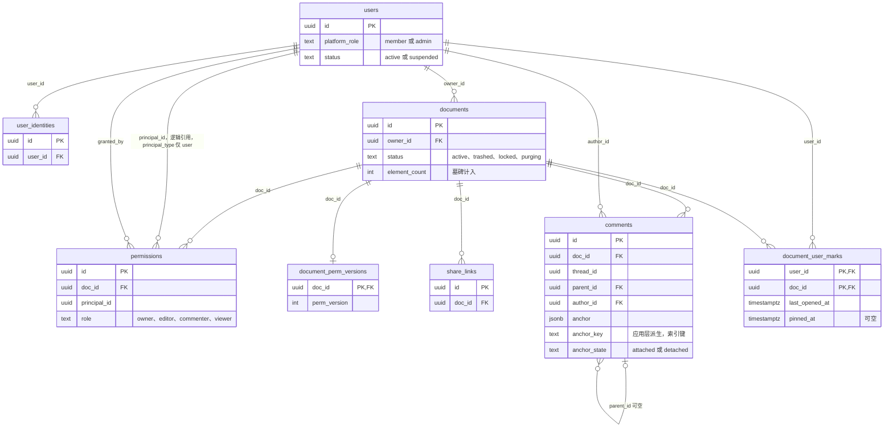

怎么读：连线两端的符号是基数（`||` 恰一、`o|` 零或一、`o{` 零或多），连线文字是外键列；表内只列主键、外键与有明确类型的关键列，完整字段见上方 SQL。`user_identities` 的 `(issuer, subject)` 联合唯一、`permissions` 的 `(doc_id, principal_type, principal_id)` 联合唯一未在图中表达。凡带 `doc_id` 的业务表都受文档级 RLS 约束；`document_user_marks` 另限只返回本人行（rulings §4.18 BE-31）；评论按文档类型无关的 `anchor_key` 建索引（BE-25）。

**数据模型 ②：协同持久化、媒体与缩略图**

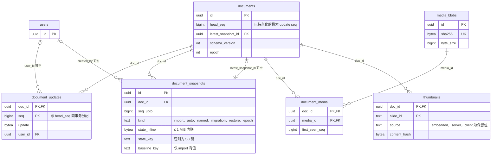

怎么读：以 `documents` 为中心，一组是 CRDT update 追加表与快照（恢复 = 最新快照 + `seq > seq_upto` 的 updates），另一组是内容寻址媒体的多对多关联表与按页缩略图表；`head_seq` 与 `document_updates.seq` 在同一事务内推进。

**数据模型 ③：作业、审计与 Webhook**

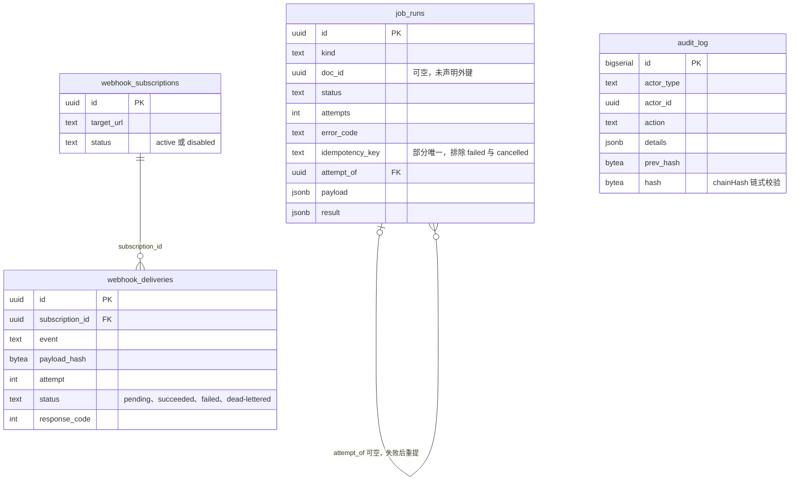

怎么读：这组表以追加和运维查询为主，除 Webhook 投递与 `job_runs.attempt_of` 自引用外都不声明外键（`doc_id` 仅作查询字段）；`audit_log` 按月分区、只允许 INSERT，`prev_hash`/`hash` 构成链式校验。`job_runs` 的幂等只对未失败且未取消的行生效，失败或取消后同键重提得到以 `attempt_of` 串起的新行（rulings §4.18 BE-18/UX-14）。原 `collab_sessions` 不建（BE-31）。

写路径关键约束：
- `document_updates` 的 `seq` 分配与 `documents.head_seq` 更新在**同一事务**，`ack{seq, tier:'db'}` 只在提交后发出。
- PG 故障溢写期例外（S-3，rulings §4.15 S-3a 两级 ack）：update 先进溢写存储并回 `ack{tier:'spill'}`（不含 seq，客户端保留 pending）；PG 恢复后按 `(instanceId, localCounter)` 顺序回放，**正式 seq 于回放时在上述同一事务中分配**，再回 `ack{seq, tier:'db'}`。降级期 update 通过门禁即广播、不等持久化（rulings §4.18 CO-08）；回放期间 Room 保持 `active`，回放完成前新到的 update 排在回放队列之后落库以保持 db ack 顺序（CO-15）；存活实例只回放自己 `instanceId` 的行，遗留行由下次加载该文档的 Room 认领（CO-16，06 §6.4）。
- 恢复顺序：`latest_snapshot(seq_upto)` + `updates where seq > seq_upto order by seq`。CRDT 本身与顺序无关，排序只是为了可复现。
- `document_updates` 裁剪：仅删除 `seq ≤ 最新 auto 快照.seq_upto` 且 `created_at < now() - 7 d` 的行（保留窗口用于审计回放与「按时间点恢复」）。

---

## 6. 对象存储布局（S3 兼容）

```
media/{sha256[0:2]}/{sha256}                       内容寻址媒体（不可变；Cache-Control: immutable）
docs/{docId}/snapshots/{seq_upto}-{kind}.yup2.zst  > 1 MiB 的快照
docs/{docId}/imports/{jobId}/source.pptx           导入原件（保留 30 天，可配置；用于「重新导入」与故障分析）；jobId 与新建文档的 docId 由服务端在
                                                   POST /imports/uploads 预分配，客户端从不提交任意对象键（rulings §4.18 BE-10）
docs/{docId}/exports/{jobId}/{filename}.pptx        导出结果（TTL 24 h，生命周期规则删除）
docs/{docId}/thumbs/{slideId}/{contentHash}.webp   M3 renderer 生成（640 px；1280 px 按需，文件名加 @1280）
docs/{docId}/thumbs/__cover/embedded.jpg           M2 过渡封面（包内 docProps/thumbnail.jpeg 原字节，仅头校验）
spill/{instanceId}/{localCounter}                  S-3 二级溢写（PG 故障期；回放后删除）
```

- 客户端上传走**预签名 PUT**（`POST /media/presign` 给出 key/URL/最大字节），完成后 `POST /media/commit{ sha256, byteSize }` 由服务端 `HEAD` + 流式重算 sha256 校验一致性，再写 `media_blobs`。
- 下载：`GET /media/:sha256` → 302 到预签名 GET（TTL 1 h）或经服务端流式代理（配置）。
- **浏览器如何到达对象存储**（rulings §4.18 BE-01）：预签名 URL 一律按 `storage.s3.publicEndpoint` 生成（默认栈为反代子域 `s3.<域名>` → SeaweedFS S3 网关，反代保持 Host 头，否则签名失效）；服务端自身读写走内网 `endpoint`。SeaweedFS 桶配 CORS：`AllowedOrigins` 为应用源，允许 PUT/GET，`ExposeHeaders` 含 `ETag`（分片上传收尾要用）。apps/web 的 CSP `connect-src`/`img-src` 与「只含同源」e2e 断言相应加入存储源（40-modules/11）。
- 对象键无租户前缀（T-0）；一次部署一个 bucket（或按用途分 bucket）。
- Bucket 策略：私有；服务端最小权限凭据；`snapshots/` **必须**开启版本化（SV-09 备份依赖，SeaweedFS 默认栈同样保留，不可改为可选）。因此文档擦除的收尾（`finalize-purge`）用 `ListObjectVersions` + 按 `versionId` 删除清掉 `docs/{docId}/` 下的全部历史版本，只删当前版本不算擦除（BE-15）。

**媒体上传：预签名直传与提交校验**

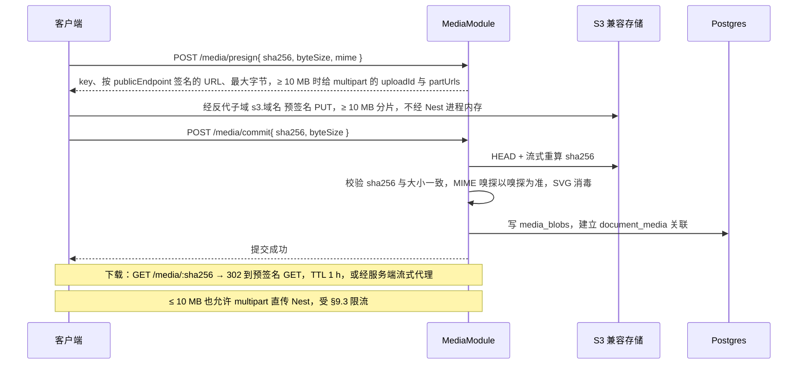

怎么读：时间自上而下；字节只在客户端与对象存储之间流动，Nest 只签发 URL 并在提交时复核，服务端从不信任客户端声明的 MIME。
依据：本文 §2 `media/`、§6、§9.2、§16.4。

---

## 7. 任务队列（BullMQ / Valkey）

| 队列 | 生产者 | 处理器（role worker） | 并发/重试 | 幂等键 |
|---|---|---|---|---|
| `import` | ImportsController（`POST /imports{uploadId}` 校验后入队，BE-10） | import.processor → server-headless tasks.import（文档类型无关，FE-01） | 并发 4/实例（部署可调）；重试 3（指数 10 s） | `job_runs.idempotency_key`（新建文档 `import:user:{userId}:{sha256}`；部分唯一、排除 failed 与 cancelled 行）；新建文档的幂等由预分配 docId 与该键保证（BE-18） |
| `export` | ExportsController | export.processor → server-headless tasks.export | 并发 4/实例（部署可调）；重试 2 | (docId, seq) |
| `thumbnails` | 导入完成（首页高优先，≤ 10 s）/ compactor 完成后哈希变化的页 / 按需请求 / admin | thumbnails.processor → server-headless → renderer sidecar（M3 前半段起） | 按 renderer 池容量；与 PDF 共池分队列 | `doc:{id}:slide:{slideId}:hash:{contentHash}`（按页内容哈希；哈希未变不入队） |
| `render-export` | ExportsController（`format ∈ pdf\|png\|jpeg`，经 thumbnails 模块 `render-export-producer.service.ts` 入队；PDF M3 后半段） | render-export.processor → renderer sidecar | 与 thumbnails 共池、独立队列；优先级 首页缩略图 > PDF > 批量缩略图（ADR-0026） | (docId, seq, format) |
| `compaction`（可选） | RoomManager 判定但本实例负载高时委托 | compaction.processor → server-collab.compactor | 并发 4 | `doc:{id}` |
| `maintenance` | BullMQ Job Scheduler（只由 worker 启动时注册，rulings §4.18 BE-19） | 周期作业：reconciliation（G-37 outbox 对账，每 1 min）、audit-seal（每日）、media GC、exports 清理、updates 裁剪、audit 分区维护 | 并发 1 | 作业名 + 周期 |
| `webhook-delivery` | Webhooks 生产者（collab 角色：评论镜像等事件，BE-13） | webhook-delivery.processor（出站守卫 + 签名投递） | 并发 4；指数退避，最多 8 次 | (subscriptionId, event, payloadHash)；状态 pending → succeeded \| failed \| dead-lettered（§5） |
| `document-purge` | schedule-purge（同一事务写 `job_runs(kind=document-purge)`，对账扫描兜底入队，BE-15） | document-purge.processor：踢会话关 Room → 依次调用 `@PurgeParticipant` 用例 → finalize-purge | 同文档串行；失败整作业重试 | `doc:{id}` |

- 墓碑 TTL 硬删除**不走 BullMQ**：由 `server-collab` 的 `tombstone-sweeper.ts`（`LeaseLock` 单写者）执行（§3.1，以 40-modules/09 为准）；原 `tombstone-purge` 队列作废；它是周期作业统一走 Job Scheduler 的唯一例外。
- 周期作业全部用 BullMQ Job Scheduler 挂在 `maintenance` 队列、只由 worker 启动时注册：多进程部署下不会像 global 模块那样每个进程各跑一次（例如 AuditModule 的 SealJob 只在 worker 注册，BE-19）；K8s 不另设 CronJob。
- 幂等（BE-18）：幂等键只对未失败且未取消的行生效——同键命中 queued/running/succeeded 返回既有行，命中 failed 或 cancelled（UX-14 的用户取消，同为终态）则新建一行、以 `attempt_of` 指向上一行；单测覆盖「并发同键只建一行」「失败后同键重提得新行」。
- 处理器基类：从 job 数据恢复 `traceparent` 建子 span；错误分类为 `retryable/terminal`（CordexError.retryable）；死信队列 + 告警。
- `job_runs` PG 镜像用于用户可见的进度查询（`GET /imports/:jobId`）与审计。

**队列拓扑：生产者 → 队列 → 处理器**

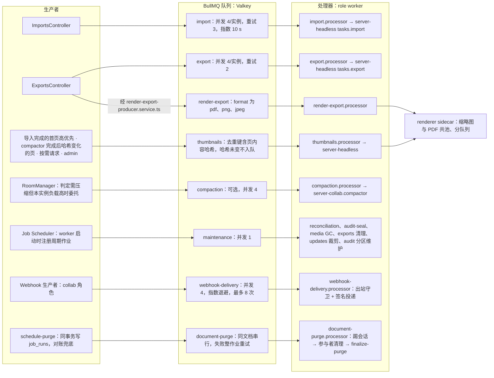

怎么读：每一行是一条「生产者 → 队列 → 处理器」链，renderer 池同时服务缩略图与导出渲染，优先级为首页缩略图、PDF、批量缩略图依次递减。周期作业全部经 Job Scheduler 进 `maintenance`（rulings §4.18 BE-19）；墓碑 TTL 硬删除是唯一不在队列体系内的周期作业，由 server-collab `tombstone-sweeper.ts` 以 LeaseLock 单写者执行（§3.1）。

**导入作业时序**

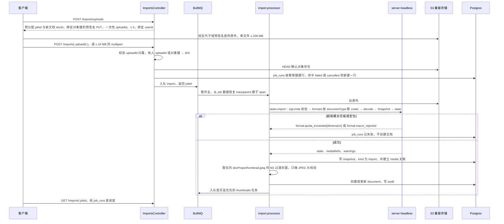

怎么读：时间自上而下；前四步是两步上传（rulings §4.18 BE-10）：对象键由服务端预分配，客户端全程不提交任意对象键，提交时校验 uploadId 归属并 HEAD 确认对象。`alt` 是导入校验的两种结局，拒绝时不创建文档、不做只读降级。封面在 M2 取包内缩略图，M3 起由 thumbnails 队列经 renderer 生成（§16.3）。
依据：本文 §2 `import.processor.ts`、§6、§7、§9.2、§16.3、§16.4。

---

## 8. 网关横向扩展（ADR-0035）

**collab 多实例：无亲和的多副本 Room**

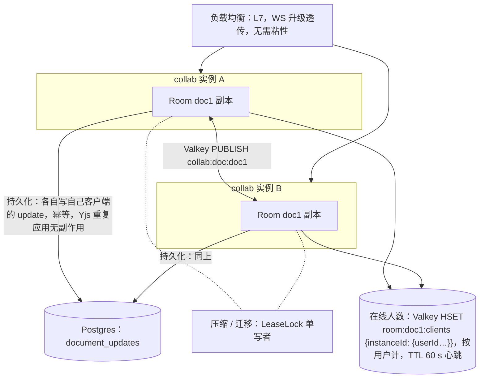

怎么读：同一文档在两个实例上各有一份 Room 副本，彼此经 Valkey pub/sub 互相扇出（携带 `instanceId` 去重）；实线是写入方向，虚线表示两副本竞争同一把租约锁，只有持锁者做压缩与迁移。

- 不要求房间亲和：任何实例都能服务任何文档；跨实例通过 Valkey pub/sub 扇出 sync/awareness/control 帧（携带 `instanceId` 去重）。
- 为什么不做亲和：滚动发布/实例故障时亲和会造成整房间断连；CRDT 让多副本天然正确。代价：热门文档在每个实例各有一份副本（内存 ≈ 副本数 × 文档实测权重，权重准入时按副本相乘计入，ADR-0035）。可选优化：LB 按 `documentId` 一致性哈希**偏好**同一实例（降低副本数），但不作为正确性前提。
- Valkey 故障：实例间扇出中断 → 各实例内部仍一致，跨实例延迟直到 Valkey 恢复后的下一次 step1/step2（客户端重连会触发）；`/readyz` 在 Valkey 不可用时返 503 让 LB 停止分配新连接（现有连接保留）。
- 容量：每实例 2,000 WS 连接；房间按**文档实测权重**准入（房间权重 ≈ 元素数（墓碑计入）× 约 14 KB，D200 ≈ 85 MB、D50 ≈ 17.8 MB），「已占权重 + 新房间权重 ≤ 实例内存预算」才接纳，不再用固定「200 活跃房间」；**实例内存预算 = 容器内存上限（cgroup 限额，Node `process.constrainedMemory()`；无限额时取物理内存）× `room.memoryAdmissionPct`（默认 75，部署可调）**（rulings §4.18 BE-29；§16.5 的「75% 内存预算」即此，应用配置的 `room.weightBudgetBytes` 只作可选绝对覆盖值）；预算不足时先按 LRU 提前结束 draining 房间再重判（CO-14，06 §14），仍超 → `auth.denied{collab.room_full}` / 4503（rulings §4.15 Q5）。

---

## 9. 安全

### 9.1 鉴权与权限（ADR-0029）

- **外置 IdP，服务端只认 OIDC**（rulings §4.15 Q6，M1–M3 唯一凭据模式）：授权码 + PKCE；服务端是 OIDC RP，**不持有密码**、不提供注册表单；会话为 httpOnly cookie（同站）或 Bearer JWT（嵌入场景，同一 OIDC 会话签发）。compose 可选 `idp` profile 内置 **Casdoor**（可换任意 OIDC IdP；国内 IM 登录经 Casdoor 代理）。集成方签名 JWT 验签与 API Key **降为 M4**，届时首次调用 JIT 建影子用户。
- **IdP 对外入口**（rulings §4.18 BE-01）：授权码流程要求浏览器直接打开 IdP 登录页，默认栈由反代子域 `idp.<域名>` 转 Casdoor（保持 Host 头），Casdoor 仍只在 backend 网络、不开宿主端口；`auth.oidc.issuer` 用对外 URL，应用侧的 OIDC 发现与 JWKS 请求经反代的网络别名访问，仍满足「唯一常规出站」；回调地址 `redirectUri = https://<host>/api/v1/auth/oidc/callback`（BE-11，Casdoor 应用配置同步）；Casdoor 管理后台建议在反代上按来源 IP 限制访问。
- **全局会话守卫与公开白名单**（rulings §4.18 BE-06）：`SessionGuard` 由 AppModule 以 `APP_GUARD` 全局注册、默认拒绝，只有 `@Public()` 标注的 `/auth/oidc/login`、`/auth/oidc/callback`、`/auth/config`、`/auth/.well-known/jwks.json` 与 `/healthz`、`/readyz` 放行；非 HTTP 上下文直接放行（WS 靠首帧票据）；业务模块不再为鉴权 import AuthModule（顺带消除 Auth ↔ Permissions 环）。机械验证：e2e 遍历路由表，除 `@Public` 快照清单外，无会话请求一律 401（11 §10）。
- **守卫顺序**（rulings §4.18 BE-05）：限流 → `SessionGuard` → `ShareLinkGuard`（请求带 `shareToken` 时生效，紧随 SessionGuard 注册为第二个 `APP_GUARD`，无 `shareToken` 直通）→ 控制器级 `DocumentRoleGuard`（取直接授权与 `Principal.scopes` 中本文档链接角色的较高者）；机械验证：只有链接、没有直接授权的用户访问 `GET /documents/:id` 与 `POST /documents/:id/collab-ticket` 返回 200。
- **注册策略**：部署级开关 `auth.selfSignup`，**默认关**——账号由管理员在 IdP（如 Casdoor）内建号；打开时 IdP 自助注册的身份首次登录即建用户。服务端**不设待接受邀请表**（rulings §4.17 D1）：文档分享邀请只对已存在账号生效，目标账号不存在时返回明确错误、提示联系管理员建号。分享链接始终要求登录（S-1 不匿名）。apps/web 的 `auth.mode:'none'` 只限 dev 构建；服务端在 production 下拒绝无鉴权启动。
- **单组织，无租户隔离层**（T-0）：不存在「按 tenant_id 限定查询」与租户对象键前缀；数据访问兜底 = 文档权限检查（D12，repository 签名要求 `docId` + `principal`）+ **文档级 Postgres RLS**（§5 约定；RLS 覆盖扫描器登记全部带 `doc_id` 的表，例外表显式登记）。
- **组管理（U-11）推迟**：M3 只按人分享（`permissions.principal_type = 'user'`；链接由 `share_links` 承载，40-modules/08）。
- CI 分层认证：PR 跑 Casdoor 容器 + `oidc-provider` mock；nightly 跑 Keycloak / Entra / 飞书等真实 IdP 兼容性。
- **fail-closed 双点**：REST `DocumentRoleGuard` 与 WS 网关（ticket role + 每帧检查）都是「无显式允许即拒绝」；命令管线的客户端检查点是第三点（UX）。角色格：`owner > editor > commenter > viewer > none`；操作矩阵在 `protocol/permissions`。
- collab ticket：60 s、单次使用（jti）、绑定 doc 与 permVersion；可选 claim `sid`（登录会话 id）与 `lnk`（凭分享链接取得角色时的链接 id，rulings §4.18 BE-02）；WS 不接受长时 access token。
- 权限变更即时生效：06 §10。
- 分享链接（新增，rulings §4.13 S-1，2026-09-21）：不支持匿名访问，需先登录（本部署内任意已登录账号；是否允许 IdP 自助注册由 `auth.selfSignup` 决定，默认关）；`ShareLinkGuard` 把链接角色叠加到已登录 Principal 的能力位集合（`Principal.scopes`），不产出匿名 Principal；每次外部访问写外部访问审计（`share-link.accessed`），详见 40-modules/08 §2.6/§2.4。**令牌解析归 PermissionsModule**（rulings §4.18 BE-02）：`ResolveShareLinkUseCase` 经 `SECURITY DEFINER` 函数只读 `share_links` 并导出，ShareLinkGuard、RoleResolverService 与 WS 侧 AuthzSource 共用它，令牌在各处的解析结果必须一致；ShareLinksModule 只管创建、撤销、列表与守卫，只 import PermissionsModule，依赖单向无环。WS 会话凭票据 `lnk` 在权限重算时复核链接状态，链接撤销 ≤ 1 s 降权、到期主动降权（06 §10）。

### 9.2 上传校验与 zip 资源限制（借鉴 pptx-renderer `ZipParseLimits`，按 Q5 放大）

| 限制 | 值 | 目的 |
|---|---|---|
| 文件魔数 | `PK\x03\x04` 且 `[Content_Types].xml` 存在 | 拒绝伪装 |
| 上传大小 | ≤ 200 MB（Q5 默认；部署配置可调） | — |
| `maxEntries` | 4,000（OF-24 默认；部署配置可收紧，放宽 ≤ 2×） | zip 炸弹（条目数） |
| `maxEntryUncompressedBytes` | 64 MiB | 单个超大 XML/媒体 |
| `maxTotalUncompressedBytes` | 512 MiB；且压缩比 > 100:1 拒绝 | zip 炸弹（体积） |
| `maxMediaBytes` | 256 MiB | 媒体总量 |
| 图表点数 / 位图预览 | ≤ 10,000 点/序列；≤ 16,777,216 px | 解析器内存（OF-24） |
| XML | 禁 DTD/外部实体（XXE）、深度 ≤ 256、属性 ≤ 1,024/元素、文本节点 ≤ 16 MiB | 解析器资源 |
| 解析时间 | ≤ 60 s/作业 | 处理器超时 |
| 规模天花板（rulings §4.15 Q5） | 页数 ≤ 200、单页元素 ≤ 1,000、文档总元素 ≤ 20,000（默认值，部署配置**完全可调**；超出默认包络时启动告警、`/readyz` 标注、性能承诺不再成立） | 超限**拒绝导入**：`format.quota_exceeded{ dimension, limit, actual }`（`dimension` 取值见 10 §1.4），不创建文档、不做只读降级 |
| 外部关系 `TargetMode="External"` | **全部原样保留**（任意 scheme，含 mailto/file，D7/OF-18）；仅 `http(s)` 可在客户端被激活（超链接、外链资源按 `externalResources` 自动加载）；服务端**永不**抓取（renderer 零出站） | SSRF；零编辑往返不丢关系 |
| 媒体 MIME | 嗅探与声明不符 → 以嗅探为准；不可识别 → 拒绝 | 内容混淆 |
| SVG 媒体 | 消毒（去脚本/事件/外链）；客户端只以 `<image>` 图像上下文渲染（07 §1） | XSS |
| OLE/VBA/宏 | OLE 原样保留为不透明部件，从不执行；**宏包（`.pptm` / macroEnabled 主内容类型 / 含 `vbaProject.bin`）拒绝导入**：`format.macro_rejected`（415），不创建文档、不保留宏部件（rulings §4.16 Q15） | 宏载荷落库与二次分发 |
| 嵌入字体 | 单个 ≤ 20 MB、总计 ≤ 60 MB（与 PRD OF-17 统一）；`fsType` 受限字体只用于只读渲染 | 资源 |
| 缩略图/封面图片 | 服务端对不可信图片**不解码**：包内 thumbnail.jpeg 只做 JPEG 头校验；不用 sharp（libvips LGPL，违反 D13）；栅格化只在 renderer 沙箱内进行 | 解码漏洞面 |

### 9.3 速率与配额

- REST：每 principal 600 req/min，上传 10/min；WS：连接 10/min/IP，帧限制见 06 §9.3；awareness 30 帧/s。
- 部署级配额（单组织，无租户维度）：每用户文档数与存储字节、全局存储、规模天花板；超限 → `storage.quota_exceeded`（存储/文档数，413/429 由场景定）；导入超天花板 → `format.quota_exceeded`；编辑中超元素上限 → `document.quota_exceeded`。房间名额按用户计（同一用户多标签/多设备占 1；commenter 计入查看者；owner 保席不占编辑者名额）。

### 9.4 其他

- CSP/CORS 由 apps/web 与网关配置（CSP 的 `connect-src`/`img-src` 含存储源 `s3.<域名>`，对象存储桶 CORS 见 §6，rulings §4.18 BE-01）；`Sec-WebSocket-Protocol` 不用于鉴权。
- 元素级「彻底删除元素」（rulings §4.18 CO-07）：只对墓碑态元素开放、只能由 owner 发起（`POST /documents/:id/elements/purge{ids}`，`doc.manage`），由 server-collab 单写者立即硬删并写审计 `document.element_purged`；只清当前文档状态，历史快照与 update 表按保留期存在，引用的图片原件按 30 天无引用 GC——界面须明示「历史版本仍含该内容，要连历史清除请永久删除文档」。文档级操作称「永久删除文档」（走 §5 的 document-purge 编排）。
- 密钥：JWT 私钥、OIDC secret、S3 凭据只从环境/密钥管理读取；启动校验。renderer 容器不挂载任何凭据。
- 审计：文档生命周期、权限、导入导出、协同加入/离开、管理操作；审计表只追加。
- 依赖：`pnpm audit` + 许可证白名单（D13）由 09-07 承接；镜像按主组件许可白名单解释 D13（rulings §4.15 Q10），镜像许可门禁、digest 钉死与镜像 SBOM 为 M3 出口条件（ADR-0037）。
- renderer（Chromium）：独立容器、非 root、`chromiumSandbox=true` + seccomp、零出站、无凭据、只接受 worker 经鉴权内部 RPC 的入站；每任务新 BrowserContext；这些作为 NF-04/SV-12 的 M3 出口自动化安全测试。

---

## 10. 部署拓扑（rulings §4.15 Q10，ADR-0037）

M1–M5 的交付形态是**集成方/自有的自托管 docker-compose「洁净栈」**，不自营 SaaS；同一应用镜像按 `CORDEX_ROLE` 运行。

### 10.1 docker-compose（profiles）

```
默认（不带 profile，`docker compose up`；ADR-0037 决策 2 为准）:
  app(CORDEX_ROLE=all，可拆 api/collab/worker) · web(静态前端 + 反向代理) · postgres:18 · valkey（钉次版本，Redis ≥7.2 协议兼容）
  · seaweedfs（S3 兼容；snapshots/ 版本化）· renderer（M3 起；CORDEX_ROLE=renderer 变体或自建最小 chromium-headless-shell 镜像，非 root，零出站网络，无凭据）
  · otel-collector · jaeger · prometheus（均 Apache-2.0；默认告警规则随 compose 提供，SV-10；ADR-0030）
profile idp（可选）:                casdoor（可换任意 OIDC IdP；未启用时必须配置外部 issuer，否则 production 拒绝启动）
profile observability-agpl（显式开启，附许可提示）: grafana · loki（+ tempo）（AGPL-3.0；仪表盘 JSON 仍入库）
profile dev（仅开发/CI）:           mock-oidc（oidc-provider）
volumes: pg-data · valkey-data · seaweedfs-data
network: edge（对外）· backend（internal）· render（internal，只有 worker/all 与 renderer；renderer 只接受 worker 入站）；/internal 只限内网；出站 SSRF 防护（S-4）
反向代理分流（web 容器；rulings §4.18 BE-11/BE-03/BE-01）:
  <host>/api/*                         → api（REST，全局前缀 /api/v1）
  <host>/api/v1/documents/:id/snapshots* 与 …/elements/purge → collab（all 模式同一进程，拆分部署时多这一条）
  <host>/collab/*                      → collab（WS /collab/v1/rooms/:id）
  <host>/internal/*                    → 不转发
  <host>/其余                          → 静态前端（SPA path 路由，/documents/:id 等深链不再与 REST 同路径）
  idp.<域名>                           → casdoor（保持 Host 头；仍只在 backend 网络、不开宿主端口；管理后台按来源 IP 限制）
  s3.<域名>                            → seaweedfs S3 网关（保持 Host 头；只接预签名请求；桶 CORS 见 §6）
  TLS 证书覆盖 <host>、idp.<域名>、s3.<域名> 三个名字
```

- 移除 MinIO 的理由：上游已归档、Docker Hub 镜像下架、CVE-2025-62506 无可拉取修复镜像、自行构建要承担 AGPL 分发义务。生产推荐客户自有 S3。
- 全部镜像按 **digest 钉死**；D13 对镜像按主组件许可白名单解释；M3 出口 = `ops:compose` + 断网（egress-deny）compose e2e + 镜像 SBOM + 镜像许可门禁。compose 最低主机规格在 ADR-0037 中实测后填入（与 RM-S「collab 单实例 2 vCPU / 4 GB」分开写）。
- 离线安装包、多架构镜像、Helm chart 为 **M4 P1**。

**compose 部署拓扑：服务、网络与 profile**

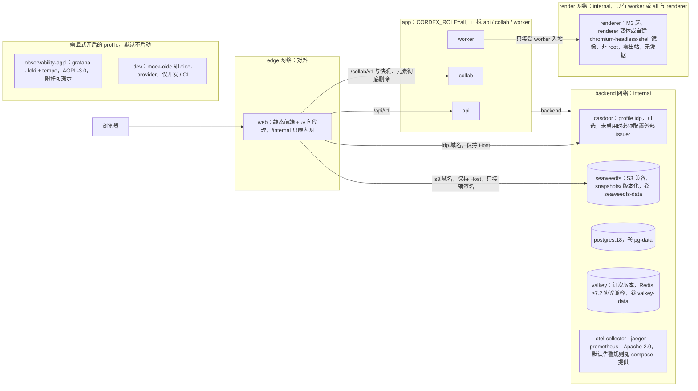

怎么读：方框是 compose 网络或 profile 分组，箭头是访问方向；默认 `docker compose up` 启动 edge、backend、render 三个网络里除 casdoor 以外的全部服务（renderer 自 M3 起；casdoor 属可选 `idp` profile），「需显式开启的 profile」分组里的两个 profile 默认不启动。web 里的反向代理是浏览器唯一入口：按路径前缀分流到 api / collab，按子域转发到 Casdoor 与 SeaweedFS S3 网关（rulings §4.18 BE-01），后两者不开宿主端口。出站 SSRF 防护见 S-4；全部镜像按 digest 钉死。
依据：本文 §10.1；ADR-0037 决策 1–3（网络成员以其为准）。

### 10.2 Kubernetes / Helm（M4 P1）

```
Deployment cordex-api      (role=api)      HPA by CPU/RPS      无状态
Deployment cordex-collab   (role=collab)   HPA by 连接数/内存    Service 长连接超时 ≥ 1 h；PDB minAvailable 1；terminationGracePeriod 40 s（drain 30 s）
Deployment cordex-worker   (role=worker)   HPA by 队列深度       不含 Chromium
Deployment cordex-renderer (role=renderer) HPA by 渲染队列深度   Chromium 沙箱；NetworkPolicy：只允许 worker 入站、禁止一切出站；内存 request 2 Gi
（周期作业由 worker 启动时经 BullMQ Job Scheduler 注册，不另设 CronJob，rulings §4.18 BE-19）
Postgres 18（托管或 operator）· Valkey（哨兵/托管，或任意 Redis ≥7.2 协议兼容服务）· 对象存储（云 S3 或 SeaweedFS）· OTel Collector DaemonSet
Ingress：WS 升级、`proxy-read-timeout` ≥ 3600、无粘性；路径分流同 §10.1（/api → api，快照与元素彻底删除 → collab，/collab → collab，/internal 不暴露）；
         idp.<域名>、s3.<域名> 两个子域按 §10.1 转发（客户自有 IdP / S3 时指向其对外地址）
```

- 滚动发布：collab 实例收到 SIGTERM → 停止接受新连接（`/readyz` 503）→ 向客户端发 1012 → flush → 退出；客户端立即重连到其他实例（06 §6.5）。
- 数据库迁移：独立 Job，在新版本上线前运行；向前兼容一版。

---

## 11. 与 `@cordexjs/protocol` 契约的对应

| protocol 子路径（草案，提请 A 线在 02 中采纳） | 内容 | 使用方 |
|---|---|---|
| `protocol/src/collab/frame.ts` | 信封类型常量、`encodeFrame/decodeFrame`（payload 不透明） | collab-yjs、server-collab |
| `protocol/src/collab/control.ts` | CONTROL 消息 zod 判别联合（06 §6.3） | 同上 + Gateway |
| `protocol/src/collab/close-codes.ts` | 关闭码枚举**常量对象**（非 `enum`，A3） | 同上 |
| `protocol/src/collab/awareness.ts` | `AwarenessState` zod | collab-yjs、server-collab |
| `protocol/src/collab/ticket.ts` | ticket claims schema（sub、doc、role、permVersion、jti、exp，可选 sid、lnk，rulings §4.18 BE-02） | Auth、Gateway |
| `protocol/src/permissions.ts` | `Role` 常量对象与操作矩阵 `can(role, action)` | 三处检查点 |
| `protocol/src/errors/{codes,http-map}.ts` | 错误码字串联合、HTTP/WS 映射表 | filter、客户端 |
| `protocol/src/rest/{auth,documents,permissions,share-links,media,snapshots,imports,exports,thumbnails,comments,jobs,users,webhooks}.ts`（无 tenants，T-0；无 invitations，rulings §4.17 D1；路由常量相对 apiBase `/api/v1`，BE-11；`imports` 含两步上传 `uploads`，BE-10；`documents` 含 `elements/purge`，CO-07） | 请求/响应 DTO zod + 推导类型 + 路由常量 | controllers、apps/web |
| `protocol/src/rest/problem.ts` | RFC 9457 problem+json schema | filter |
| `protocol/src/rest/telemetry.ts` | 客户端错误上报 DTO `ClientErrorReport`（10；OTLP 代理走标准 protobuf 不另建 schema；落点以 40-modules/02 §4.3 为准，rulings §4.18 BE-30，原草案路径 `telemetry/client-report.ts` 作废） | apps/web、api（`ClientTelemetryController`） |
| `protocol/src/render/sidecar.ts` | worker ↔ renderer sidecar 的鉴权内部 RPC 契约（state/资源/字体注入、ready 信号、WebP/PDF 结果）（14 C-27，rulings §4.15 Q8） | server-headless、renderer、apps/web `/render` |

规则：controller 的 `@Body()` 类型只能是 `z.infer<typeof X>`，且 `X` 必须来自 protocol（lint `no-restricted-imports` + 类型测试，由 09 承接）。

---

## 12. 预算与测量

| 指标 | 预算 | 测量 |
|---|---|---|
| REST p95（读） | ≤ 150 ms | OTel http span |
| Room bootstrap | ≤ 500 ms p95 @ 8 MB | span `server.room.load` |
| update 处理 | ≤ 20 ms p95 | span `server.collab.update` |
| 持久化延迟（收到 → 提交） | ≤ 150 ms p95（flush 100 ms） | `cordex_collab_persist_latency_ms` |
| 导入 50 MB pptx | ≤ 30 s p95 | job 时长 |
| 导出 200 页 | ≤ 12 s p95（按 ratchet 取 NF 值，rulings §4.15 Q5） | job 时长 |
| 缩略图（M3，renderer） | 导入后首页 ≤ 10 s；D200 全量 ≤ 90 s；单页 ≤ 400 ms p95 | span `thumbnail.render` |
| 权限传播 | ≤ 1 s p95 | 06 §10 |
| 优雅关闭 | ≤ 30 s，零 update 丢失 | 集成测试：kill -TERM 后重启对比状态 |
| 每实例（collab，RM-S 2 vCPU / 4 GB 口径） | 2,000 连接；房间按实测权重准入（D200 ≈ 85 MB、D50 ≈ 17.8 MB，多副本相乘计入）；房间数按文档规模分档、M1 实测后回填（取代旧「200 房间 / RSS ≤ 8 GiB」，与 RM-S 口径统一） | 指标 `cordex_collab_room_weight_bytes`、RSS |
| Room 背压溢写一级阈值（新增，rulings §4.13 S-3） | ≤ N MiB/文档未持久化字节（默认量级与 `compaction.maxPendingBytes` 同档，具体值由 `server-collab/config.ts` `spill.tier1MaxBytesPerDoc` 定案，见 40-modules/09 §2.2/§11） | `cordex_collab_spill_tier_current`（按 Room 打点，`none\|valkey\|blob`）；溢写成功回 `ack{tier:'spill'}`（S-3a） |
| Room 背压溢写二级阈值（新增，rulings §4.13 S-3） | 超一级阈值后继续累积则分块落 `BlobStore`（`spill.tier2ChunkBytes`，量级参考对象存储布局 §6） | 同上 + `cordex_collab_spill_tier2_bytes_total` |
| 故障恢复后回放耗时（新增，rulings §4.13 S-3） | PG 恢复 → 回放完成 ≤ 10 s p95（回放期间 Room 始终保持 `active`，rulings §4.18 CO-15）（按 D50 级文档溢写窗口估算，随二级溢写字节量线性增长，超大窗口另行观测） | span `server.collab.replay-spilled`；集成测试：故障注入（kill PG 连接 N 秒）后断言 `document_updates` 按回放时分配的 `seq` 完整无重复、溢写期客户端 pending 在收到 `ack{tier:'db'}` 前不被清理、回放后服务端 Y.Doc 无 `pendingStructs`（rulings §4.15 S-3a） |

---

## 13. 待决事项

| # | 事项 | 默认 | 决策人 |
|---|---|---|---|
| B1 | ORM：Drizzle vs Prisma | Drizzle（SQL 可见、无生成运行时、分区友好） | 架构 B + 团队 |
| B2 | HTTP 适配器：Fastify vs Express | Fastify | 架构 B |
| B3 | 上传方式：预签名 S3 vs 经服务端 multipart | 预签名（服务端只校验） | 架构 B/运维 |
| B4 | 评论实时通知走 collab 控制帧 vs 独立 SSE | 控制帧（复用房间） | 架构 B |
| B5 | `document_updates` 保留期 | **已裁决**（章程 Q17，rulings §4.16）：默认 7 天，部署配置 `retention.documentUpdatesDays` 可调 | 已裁决 |
| B6 | 导入原件保留期 | **已裁决**（章程 Q17，rulings §4.16）：默认 30 天，部署配置 `retention.importSourceDays` 可调；其余保留默认值（自动快照 30 天、命名快照永久、墓碑 TTL 24 h）同样可调 | 已裁决 |
| B7 | 是否允许 API Key 走 WS（服务端自动化编辑） | API Key 整体降为 M4（rulings §4.15 Q6），届时再定 | 产品 |

## 14. 对章程的异议/建议

- **S7**：D8 建议明确「Definition 的 Node 适配器（pg/Valkey/s3）作为 cordis 插件放在 `apps/server` 的对应模块目录下」——这些是 IO 适配而非业务逻辑，否则需要新增 `server-adapters-*` 包。
- **S8**：包清单建议给 `server-collab` 标注「cordis 插件（提供 `collabServer`）」，与 R2「每个包要么是插件要么是纯库」对齐。

## 15. 跨条线要求（摘要）

- A 线：`units.open` 支持 `source: Uint8Array(state)` 与空文档；`documentType.validateChangeSet(paths)`、`repairRules`、`diffSnapshots(a, b) → Mutation[]`、`migrations.run(unit, from, to)` 为服务端可调用的纯/半纯 API。
- 类型治理线：controller DTO 只能来自 protocol；`@nestjs/*` 单点引入；server-* 包禁止 import `pg`/`ioredis`/`@aws-sdk`（除 server-storage 的 S3）；`apps/server` 的 cordis 适配器目录允许 import 这些驱动。
- 产品：B5/B6/B7 与部署级配额策略。

---

## 16. v0.2 补充：与架构 02/04/05 契约的对齐、PRD（SV/EM/OF）条目的承接、章程 v0.2 裁决

> 追加于 A 线与产品线落盘之后；凡与前文冲突处以本节为准。

### 16.1 对齐表

| 项 | 结论 |
|---|---|
| `BlobStore` | `server-storage` 实现 model-core 的 `BlobStore{ get, put, has }`（04 §2.5）并扩展为 `ServerBlobStore{ head, delete, presignPut, presignGet, list }`；服务名 `blobStore`（§3.2 原 `blobStorage` 作废）。浏览器侧 `BlobStore` 的 IndexedDB Provider 由 `@cordexjs/collab-offline-idb`（S1 已批准）顺带提供（本地媒体缓存），与 presence 无关（04 §10） |
| `server-headless` | 使用 `createHost`（02 §4.24 `createHeadlessHost({ plugins })`：挂载调用方给定的 iso 插件集，插件清单由 apps/server 的 `preset-server.ts` 提供，本包不 import model-slide/ooxml-pptx，rulings §4.18 FE-01）；`@cordisjs/plugin-loader` **默认关闭**（A-8 / ADR-0010）；`tasks.import/export` 经 `formats` 按 documentType 取 codec，`tasks.migrate/validate` 调用 `migrations.run` 与 `validateSnapshot`（04 §10）；`worker.ts` 以 `worker_threads` 每任务新 host（超时/内存限额），按清单模块路径加载插件；`layout.measurer` Provider `node-font`（ADR-0027 补充） |
| 服务端写入路径（05 §11） | 导入 = `units.open` 的 load 路径（origin `system('import')`，不经命令）；迁移/恢复/修复 = 服务端事务（origin `system(reason)`）；需要命令语义的服务端编辑（模板填充等）经命令管线，`principal = system`，权限策略为服务端策略，审计落库 |
| 层号编码（章程 v0.2） | `package.json#cordex = { layer: 'LS', iso: 'node' }`；LS 可依赖 L5 的 iso 包（`engine-layout`、`engine-render` 契约），不得依赖 `render-dom` |
| `server-collab` 形态 | 02 定为 library；本文 S8 建议其同时暴露一个薄 cordis 插件外壳（`collabServer` 服务）以复用 effect 生命周期；两者不冲突：库函数 + `plugin.ts` |
| 事件/错误码 | PRD 斜杠形式（`collab/auth-failed`、`auth/invalid-token`、`format/limit-exceeded`…）→ 定稿映射见 10 §11 |

### 16.2 导出字节级一致（SV-02）

- 机制：`ooxml-pptx.encode(snapshot, baselinePackage)` 是**纯函数**——不读 `layout`（L3 不得 import L5）、不读时钟、不读随机源；zip 写入器确定性：固定 mtime（取模型 `modifiedAt`）、条目按部件名排序、固定压缩级别、无 extra 字段；`docProps/core.xml` 的时间戳来自模型字段而非 `Date.now()`。**对 A 线的要求**：`ooxml-core/opc` 的 zip 写入器满足上述确定性；`Snapshot.meta.modifiedAt` 由命令层写入。
- 排版相关的落盘量（autofit 缩放、`spAutoFit` 高度）由编辑端在布局时写回模型（ADR-0027 补充），导出不重排。
- 基线包：导入时把原文件存为 `imports/{jobId}/source.pptx`（§6）并在 `document_snapshots(kind import)` 记录 `baseline_key`；导出复用其不透明部件字节（D7）。客户端导出用内存中的同一原字节。两端输入相同 + 纯函数 ⇒ 输出字节相同。
- 验证：CI 对语料库每个样本在浏览器（Playwright）与 Node 分别导出同一 Snapshot，断言 sha256 相等（11 §17）。

### 16.3 PDF 导出与缩略图（SV-02 / PD-16）

- `render-export.processor`（队列 `render-export`，ADR-0026 / 40-modules/12；PDF **M3 后半段**；与 `thumbnails.processor` 共用 renderer 池、分队列）：renderer sidecar 中的 Chromium 加载内置 `/render?mode=print`，`page.pdf({ width: slideW, height: slideH, printBackground: true })`；字体由 Chromium 子集嵌入；D50 ≤ 10 s（p95）；与 oracle PDF 逐页 SSIM ≥ 0.85；结果入 `exports/`，预签名 URL 默认 1 h。
- 缩略图（ADR-0026 已接受，rulings §4.15 Q8）：M2 用包内 `docProps/thumbnail.jpeg` 作文档卡片过渡封面（服务端只做头校验、不解码）；M3 前半段起由 renderer sidecar 生成 640 px WebP（分享/版本预览按需 1280 px），按页内容哈希失效；D200 全量 ≤ 90 s；导入完成后首页 ≤ 10 s（导入 processor 完成即入队首页优先任务）。「客户端上传缩略图」不再作为可选优化。
- `docProps/thumbnail.jpeg` 是 `ooxml-pptx.encode()` 的显式输入（`thumbnailJpeg?: BlobRef`），缺省时保留原部件、零编辑不新增，保证 SV-02 的浏览器/Node 导出字节一致。
- 插件贡献的导出专用编解码器（`core.format` 且 `canImport:false`，如 Markdown；裁决：不新增 `export.target`）若为 iso 实现，在 `server-headless` 宿主中同样可用（PS-14）。

### 16.4 资源上传通道（EM-04 / CO-12 / SV-01）

- 预签名直传：`POST /media/presign{ sha256, byteSize, mime }` → `{ uploadUrl | multipart{ uploadId, partUrls[] }, key }`（URL 按 `storage.s3.publicEndpoint` 签名，经反代子域到达对象存储，rulings §4.18 BE-01）；≥ 10 MB 用 S3 分片，不经 Nest 进程内存；完成后 `POST /media/commit` 校验 sha256/大小/嗅探；≤ 10 MB 允许 multipart 直传 Nest（受 §9.3 限流）。文件导入改为两步（rulings §4.18 BE-10）：`POST /imports/uploads` 由服务端预分配 jobId（新建文档时同时预分配 docId=UUIDv7）并返回绑定该对象键的预签名 PUT 与一次性 `uploadId`（绑定 userId，1 h 有效）；浏览器直传后 `POST /imports{ uploadId }`，服务端校验归属并 `HEAD` 确认对象再建作业入队；客户端全程不提交任意对象键，通用 `/storage/presign` 删除；提交他人的对象键或 uploadId 返回 403（安全用例，11 §10）。
- 客户端：`uploadAsset(file) → { assetId }` 回调由集成方或 `apps/web` 默认实现；CRDT 只写 `BlobRef`（06 §18.5）。
- 集成方自管元数据（EM-04 P2）：公开表结构与迁移脚本，仅使用协同网关——列入待决 B8。

### 16.5 网关容量与限制的最终值（SV-05 / CO-12 / OF-24 / NF-01 1.7）

| 项 | 值 |
|---|---|
| 房间 | 20 编辑者 + 50 查看者，**按用户计**（多标签/多设备占 1；commenter 计入查看者；owner 保席不占编辑者名额）；超限只读加入；再超 `collab.room_full`；满员房间服务端 awareness 合并 tick、查看者只上报 view；空置销毁延迟 60 s |
| 帧 | ≤ 1 MiB；≤ 200 帧/s/连接（突发 500）；awareness ≥ 50 ms 节流；未知 CONTROL 丢弃计数 |
| 实例（RM-S：2 vCPU / 4 GB，collab 单实例口径） | ≥ 2,000 WS、CPU < 70%。房间准入按**文档实测权重**（rulings §4.15 Q5）：权重 = 实测 Y 堆（≈ 13.8 KB/元素，墓碑计入；D50 ≈ 17.8 MB、D200 ≈ 85 MB，取代旧估算 12/40 MB），「已占权重 + 新房间权重 ≤ 实例内存预算」才接纳（实例内存预算 = 容器内存上限 × `room.memoryAdmissionPct`，默认 75%，rulings §4.18 BE-29；预算不足先回收 draining 房间再重判，CO-14），否则 4503 触发重连到其他实例；多副本（ADR-0035）按副本数相乘计入。PRD NF-01 §1.7「≥ 200 房间」改为按文档规模分档、M1 实测后回填；compose 全家桶主机规格另见 ADR-0037 |
| 传播 | 房间内广播 p95 ≤ 100 ms；跨实例 ≤ 50 ms；持久化滞后 p99 ≤ 1 s（本文 flush 100 ms → p95 ≈ 150 ms）；权限 ≤ 2 s |
| zip/XML（OF-24 默认；部署配置可收紧，放宽不超过 2×） | 条目 ≤ 4,000；单条目 ≤ 64 MiB；总解压 ≤ 512 MiB；媒体 ≤ 256 MiB；深度 ≤ 256；实体扩展禁用；图表点 ≤ 10,000/序列；位图预览 ≤ 16,777,216 px；错误码 `format.limit_exceeded{ limit, actual }`。客户端 Worker 解析使用同一张表（07 §14.2） |
| 服务端作业 | 导入 D50 ≤ 5 s / D200 ≤ 20 s（p95）；超规模天花板的导入直接拒绝（`format.quota_exceeded`）；导出 pptx ≤ 3 / 12 s；PDF D50 ≤ 10 s；压缩 10,000 update ≤ 2 s；模板填充 + 导出 100 × D50（4 worker）≤ 60 s；导入/导出并发默认 **4/实例**（部署可调，与 §7 表一致）；优雅停机 ≤ 30 s |

### 16.6 评论镜像（ADR-0031 v0.2）

`comments` 表改为**读模型**：服务端 Room 观察 `resources.comments.*` 变更（任意 origin；观察器 `comment-mirror.observer` 只在 collab 角色注册，评论 REST 留在 api，rulings §4.18 BE-03）→ upsert 镜像行（线程、锚点状态、@提及；`anchor_key` 由文档类型的 `deriveAnchorKey` 在写入时计算，BE-25）→ 用于跨文档查询（@我）、集成方 webhook、审计；写路径全部经 CRDT（客户端命令）；REST 只读，另加「导入为可编辑线程」触发服务端事务。作者/角色规则由软门禁执行（ADR-0034 补充）。

### 16.7 待决补充

| # | 事项 | 默认 | 决策人 |
|---|---|---|---|
| B8 | 公开表结构与迁移脚本供集成方自管元数据（EM-04 P2） | M4 评估 | 产品 |
