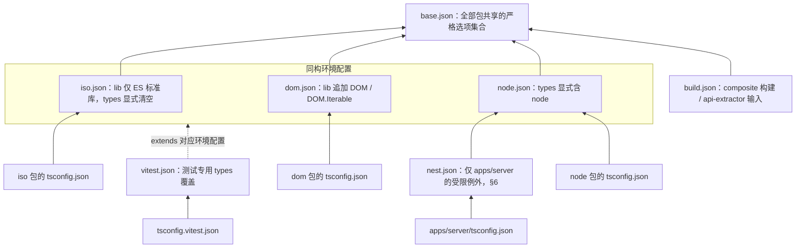
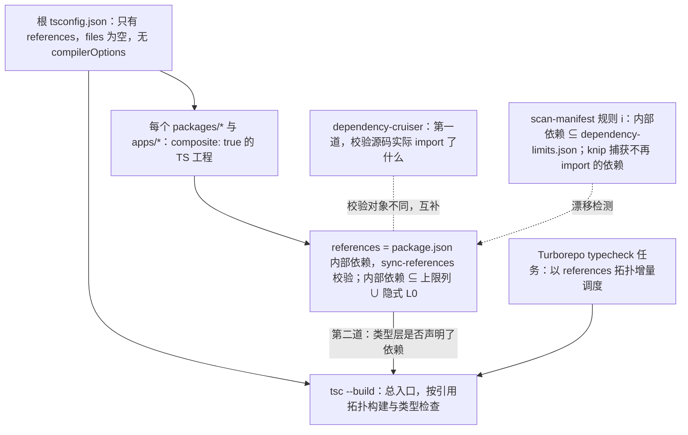

> 状态：草稿 | 负责：架构-类型治理 | 更新：2026-09-14；2026-09-24（复核修正，rulings §4.17：M18 锚点 `-oce` → `-cordex`）；2026-09-25（补图）；2026-09-25（矛盾收口，rulings §4.18）；2026-09-26（§4.20）（TX-11：指向 03 的失配锚点按目标文件现行标题改正） | 依赖：charter v0.1

# 01 · tsconfig 基线

本篇定义编译选项全集、三份同构基础配置（iso/dom/node）、`apps/server` 的受限例外（nest 配置）、项目引用拓扑，以及 TS 7 原生编译器（tsgo）在评估路径中的位置。本篇是**编译期**约束的唯一权威；运行期/边界校验见 [05](./05-runtime-boundaries.md)，静态但非编译器原生的约束（依赖方向、AST 语义规则）见 [02](./02-lint-rules.md)/[03](./03-boundaries.md)。

> 原则复述（详见 [README](./README.md)）：每个选项必须回答「关掉它会漏过哪一类真实错误」；不用「业界最佳实践」当理由，只用「本仓库会发生的失败模式」当理由。

---

## 1. `tooling/tsconfig/` 目录与继承树

```
tooling/tsconfig/
├── base.json     全部包共享的严格选项集合（不含 lib / types / module 解析等环境相关字段）
├── iso.json      extends ./base.json；同构包（iso）专用：lib 仅 ES 标准库，types 显式清空
├── dom.json      extends ./base.json；浏览器包（dom）专用：lib 追加 DOM/DOM.Iterable
├── node.json     extends ./base.json；Node 包（node）专用：types 显式含 "node"
├── nest.json     extends ./node.json；**仅 apps/server** 使用的受限例外（§6）
├── build.json     extends ./base.json；供 composite 构建 / api-extractor 输入使用（declaration 相关字段）
└── vitest.json    extends 对应环境配置；测试专用 types 覆盖（不引入 vitest/globals，显式 import）
```

**tsconfig 继承树**



怎么读：箭头方向是 `extends`（子配置指向被继承者）；各包与 apps 只能 extends iso/dom/node/nest 四者之一，不得重复书写编译选项，测试配置单独 extends vitest.json。

每个 `packages/<name>/tsconfig.json`、`apps/<name>/tsconfig.json` 不得重复书写编译选项，只能：

1. `extends` 上述五种基础配置之一（iso/dom/node/nest 四选一，vitest 单独用于 `tsconfig.vitest.json`）；
2. 声明 `compilerOptions.composite: true` 与本包的 `references`（指向它依赖的包）；
3. 声明 `include`/`exclude`。

任何包的 tsconfig 若出现 §2 表中列出的字段覆盖（除 §6 的 `nest.json` 例外路径），视为违反基线；机械校验见 [08](./08-policy-enforcement-matrix.md) 与 [06 scan-policy](./06-scanners.md#9-scan-policy) 的「tsconfig 派生一致性」检查项——该检查对每个包运行 `tsc --showConfig`，比对解析后的 `compilerOptions` 是否与其应继承的基线逐字段相等（`nest.json` 允许的差异字段除外）。

---

## 2. 编译选项全集与逐项理由（`base.json`）

选项按「关闭时会放过什么」分组；未特别注明的都设为 `true`/开启对应严格值。

### 2.1 strict 家族（`strict: true` 展开后逐项复核）

| 选项 | 关闭时漏过的错误 | 备注 |
|---|---|---|
| `noImplicitAny` | 任何未标注类型的形参/变量静默退化为 `any`，`any` 会沿调用链污染下游所有类型推断 | 与 [02](./02-lint-rules.md) 的 `no-explicit-any`（禁止*显式*写 `any`）互补：一个堵隐式，一个堵显式 |
| `strictNullChecks` | `null`/`undefined` 可赋给任意类型，OOXML 解析（大量可选属性）与协同（Yjs 类型稀疏）会在运行时才炸出 `Cannot read property of undefined` | 本项目最高频的真实 bug 来源（占位符继承链、贡献点可选字段） |
| `strictFunctionTypes` | 回调参数类型逆变检查被跳过，`ElementRenderer<T>`/事件监听器的参数型别会被错误地双向兼容 | 直接保护贡献点泛型（见 [09](./09-plugin-type-contracts.md)） |
| `strictBindCallApply` | `.bind/.call/.apply` 的参数类型检查被跳过 | 低频但零成本 |
| `strictPropertyInitialization` | 类字段可以「声明了但从未在构造函数里赋值」，运行时读到 `undefined` | 对 `Service` 子类与 Provider 类尤其重要（primer §3.5） |
| `noImplicitThis` | `this` 隐式为 `any` | 配合 `no-invalid-this` |
| `useUnknownInCatchVariables` | `catch (e)` 的 `e` 隐式为 `any`，绕过 [05](./05-runtime-boundaries.md) 的错误边界类型化要求 | 4.4 起随 `strict` 默认开启；本表显式列出因为它直接决定 [ADR-0043](../adr/0043-result-vs-exceptions.md) 能否被机械验证——`e` 是 `unknown` 时，任何对 `e.message` 的访问不经收窄会编译失败 |
| `alwaysStrict` | 不强制发出 `"use strict"` / 视为 ES 模块严格语义 | 与 `verbatimModuleSyntax` 组合冗余但无害，显式保留 |

### 2.2 超出 `strict` 的额外严格项（本表是 D9「最严格集」的主体）

| 选项 | 关闭时漏过的错误 | 备注 |
|---|---|---|
| `noUncheckedIndexedAccess` | `arr[i]`、`record[key]` 被当作永远存在，实际是 `T \| undefined`；OOXML 关系表（rels）、贡献点按 key 查找、Snapshot 的 `extensions` 命名空间访问全是索引访问 | 与品牌类型/Result 策略（[05](./05-runtime-boundaries.md)）配合：索引访问后必须显式收窄或走 `Result` |
| `exactOptionalPropertyTypes` | `{ x?: T }` 的 `?:` 被等同于「`T \| undefined`」，导致「显式传 `undefined`」与「完全不传该字段」在类型层不可区分；Standard Schema 推导出的可选字段、贡献点的可选配置都依赖这个区分 | 见 §5「与 zod 推导类型的交互」 |
| `noImplicitOverride` | 子类覆写父类方法不需要标 `override`，重命名基类方法时子类悄悄变成「新增方法」而不是报错 | 直接保护 `Service` 子类（Provider）与未来的抽象基类 |
| `noPropertyAccessFromIndexSignature` | 索引签名产生的属性可以用 `.` 访问，掩盖「这是一个可能不存在的动态字段」的事实 | 配合 `noUncheckedIndexedAccess`；强制 `config['field']` 显式化，提醒它来自用户输入 |
| `noFallthroughCasesInSwitch` | `switch` 分支贯穿是最常见的复制粘贴 bug 来源 | 对贡献点按 `kind` 分发的 `switch`（若存在）尤其重要 |
| `noImplicitReturns` | 函数在某些路径有返回值、某些路径没有，调用方拿到隐式 `undefined` 却类型上看不出来 | 对命令处理器（返回 `Mutation[]`）与 `FormatCodec` 尤其重要 |
| `noUnusedLocals` / `noUnusedParameters` | 死代码与「忘记接线」的参数（如声明了 `ctx` 却没用，暗示这个插件其实不需要该依赖）不会被编译器捕获 | tsc 是 CI 的最终真源（即使 ESLint 被跳过也拦得住）；[02](./02-lint-rules.md) 的 `@typescript-eslint/no-unused-vars` 提供更快的编辑期反馈与自动修复，两者不冲突（见 [ADR-0044](../adr/0044-eslint-and-biome-split.md)） |
| `noUncheckedSideEffectImports` | `import './x'`（无绑定的副作用导入）在目标模块不存在时不报错，常见于误删导出后忘记清理的导入 | 对 `*.contribution.ts` 的类型增强导入尤其重要——它是本项目里"看起来无副作用、实则决定类型环境"的导入 |
| `allowUnreachableCode: false` | 不可达代码不报错 | 显式设为 `false`（tsc 默认 `undefined` 即报告，此处显式声明避免依赖默认值） |
| `allowUnusedLabels: false` | 未使用的标签不报错 | 同上，显式声明 |
| `forceConsistentCasingInFileNames` | macOS/Windows 大小写不敏感文件系统下，`import './Foo'` 误写成 `import './foo'` 本地不报错、CI（Linux）才炸 | 本仓库开发机为 macOS（见环境信息），此项是**唯一**能在本地复现 CI 路径大小写错误的机制 |

### 2.3 R7 专项：`isolatedDeclarations` 与 `verbatimModuleSyntax`

| 选项 | 语义 | 本项目的强制理由 |
|---|---|---|
| `isolatedDeclarations` | `.d.ts` 生成不得依赖跨文件类型推断；每个导出声明的类型必须能**仅从该声明的语法**确定 | D9 明确要求；使 `.d.ts` 产出可被任意单文件编译器（esbuild/swc/oxc）并行生成，不必先跑一遍完整类型检查；副作用（本项目视为收益）：强制每个公开 API 在源码里"自证类型"，杜绝"看代码猜类型"的隐性 API。对贡献点定义、Manifest 常量的具体写法约束见 [09 §5](./09-plugin-type-contracts.md#5-isolateddeclarations-下的导出约束) |
| `verbatimModuleSyntax` | `import`/`export` 语句原样保留在输出中（不做类型擦除时的隐式判断），`import type`/`export type` 必须显式书写 | 使 Vite/esbuild 等**单文件转译器**能在不查看其他文件的情况下正确擦除类型导入；`@typescript-eslint/consistent-type-imports`（[02](./02-lint-rules.md)）在编辑期以自动修复的方式帮你写对，`verbatimModuleSyntax` 是编译期真源 |
| `isolatedModules` | 每个文件必须能被单文件转译（历史上早于 `verbatimModuleSyntax`，两者语义有重叠但检查维度不同：`isolatedModules` 还会拦「`const enum` 跨文件内联」「模糊的重导出」等） | Vitest（基于 esbuild/swc）与 Vite 构建都要求 |
| `erasableSyntaxOnly` | 只允许"擦除类型即可编译"的语法子集：禁止 `enum`、禁止带运行时语义的 `namespace`/`module`、禁止构造函数参数属性（`constructor(private x)`）、禁止 `import =`/`export =` | **这是 [ADR-0042](../adr/0042-no-enums-const-objects.md)（禁 enum）的编译器级后盾**——`enum` 从"lint error（可 `cordex-allow` 但预算为 0）"升级为"tsc 编译失败"，且无法被任何注释豁免。仅 `apps/server` 关闭（§6） |

### 2.4 模块系统与解析

| 选项 | 值 | 理由 |
|---|---|---|
| `module` | `"nodenext"` | 与 `package.json#exports`/`#type: "module"` 语义对齐；若 TS 7.1+ 稳定提供锁定版本的解析预设（如替代 `nodenext` 的固定 Node 版本预设），由 [ADR-0046](../adr/0046-native-typescript-compiler-evaluation.md) 的评估窗口一并复核，不在本文预先承诺具体名称 |
| `moduleResolution` | `"nodenext"` | 同上；与 `module` 保持一致是 TS 的硬性要求 |
| `moduleDetection` | `"force"` | 避免"看起来没有 import/export 的文件被当成脚本（全局作用域）"这一类隐蔽 bug；契约类型文件（`contracts/*.ts`）可能出现只含 `interface` 的文件 |
| `resolveJsonModule` | `true` | Manifest（`cordex-manifest.json`）、i18n 源文件、品牌类型的固定枚举数据以 JSON 存在 |
| `esModuleInterop` / `allowSyntheticDefaultImports` | `true` | 部分 Node 生态依赖仍是 CJS-only（默认导出语义不规范）；与 `verbatimModuleSyntax` 不冲突——后者管"类型导入怎么擦除"，前者管"运行时默认导出怎么互操作" |
| `allowJs` | `false` | 本仓库不允许 JS 源码混入 TS 项目；`.js` 只能作为第三方产物出现在 `node_modules` |
| `skipLibCheck` | `true` | 代价：可能放过第三方 `.d.ts` 里的类型错误；收益：monorepo 规模下第三方声明文件的类型检查耗时不可接受。**不能**掩盖我们自己发布的包——[04](./04-api-surface.md) 的 `@arethetypeswrong/cli` 门禁专门检查"打包后从外部消费"这条路径，不受 `skipLibCheck` 影响 |

### 2.5 构建与输出（`build.json` 追加，非 `base.json`）

| 选项 | 值 | 理由 |
|---|---|---|
| `composite` | `true` | 项目引用（§4）的前提 |
| `incremental` | `true` | 与 Turborepo 远端缓存配合（见 [07](./07-hooks-and-ci.md#5-缓存策略)） |
| `declaration` / `declarationMap` | `true` / `true` | 跨包"跳转到定义"落到源码而非 `.d.ts`；`declarationMap` 依赖 `isolatedDeclarations` 已经把类型显式化，生成成本更低 |
| `sourceMap` | `true` | 调试；`apps/web`/`apps/server` 的最终打包由各自构建工具（Vite/Nest CLI）另行处理下游 sourcemap 链，不在本基线范围 |
| `noEmitOnError` | `true` | CI 的类型检查真源：只要有一个类型错误，产物**不生成**，杜绝"类型报错但照样能跑"的侥幸 |
| `useDefineForClassFields` | `true` | 与 `target` ES2022+ 的类字段语义对齐；影响 `Service` 子类字段初始化时机，需与 `strictPropertyInitialization` 一起复核（子类字段若用 `declare` 提前声明，构造函数里赋值的时机在 `super()` 之后才生效） |

### 2.6 `target` 与 `lib`（环境相关，放在 iso/dom/node 三份文件而非 `base.json`）

`target: "ES2023"` 是三份配置共享的基线（`base.json` 设置），`lib` 数组按同构类在各自文件覆盖：

```
iso.json   lib: ["ES2023"]                         types: []
dom.json   lib: ["ES2023", "DOM", "DOM.Iterable"]   types: []
node.json  lib: ["ES2023"]                          types: ["node"]
```

- `iso.json` 的 `types: []` 是同构隔离三重保障的第一重（详见 [03 §4](./03-boundaries.md#同构隔离的三重保障)）：显式清空后，即使 `node_modules` 里因为幽灵依赖而存在 `@types/node` 或 `@types/web`，也不会被自动纳入全局类型环境——TS 默认会把 `node_modules/@types/*` 下所有包自动纳入，`types: []` 是唯一能关掉这个"自动包含"行为的选项。
- `dom.json` 不含 `types: ["node"]`：一个 `dom` 包如果引用了 `process.env`，必须报类型错误，而不是"因为同一 monorepo 里某处装了 `@types/node` 而意外可用"。
- `node.json` 不含 `DOM`：Node 包不应该引用 `document`/`window`（`server-headless` 需要无头渲染时，走的是显式的 headless 适配层，不是让 TS 把 `document` 当全局幽灵可用）。
- `nest.json`（§6）在 `node.json` 基础上追加 `experimentalDecorators`/`emitDecoratorMetadata`，`lib`/`types` 不变。

`apps/web` 自身的浏览器兼容目标（browserslist、esbuild target 等）由 Vite 构建配置决定，属于产物打包范畴，不受本文 `target: "ES2023"`（类型检查用途）约束——两者服务的目的不同：本文的 `target` 只影响"哪些语言特性在类型层可用且不需要降级填充的类型报错"，不代表"最终 bundle 支持哪些浏览器"。

---

## 3. 与 zod 推导类型的交互（`exactOptionalPropertyTypes`）

`exactOptionalPropertyTypes: true` 下，`{ theme?: string }` 和 `{ theme?: string | undefined }` 是两个不同的类型：前者禁止显式传 `theme: undefined`，后者允许。Zod 4（详见 [05 §3](./05-runtime-boundaries.md#3-schema-即类型源) 与下方来源）的 `.optional()` 在 `z.infer` 推导中产出的是后一种形态（字段可省略，也可显式为 `undefined`），与本项目的选项语义一致，不需要额外转换层。评审检查点：任何**手写**（非 `z.infer` 推导）的接口如果包含 `?:` 字段，作者必须明确该字段是否也允许显式 `undefined`；这是 `cordex/schema-type-must-be-inferred`（[02](./02-lint-rules.md#411-cordexschema-type-must-be-inferred新增超出建议清单)）存在的部分原因——手写接口正是这类歧义的来源。

---

## 4. 项目引用（Project References）拓扑

- 每个 `packages/*`、`apps/*` 是一个 `composite: true` 的 TS 工程。**口径**（2026-09-25，rulings §4.18 FE-02）：`references` = 该包 `package.json` 的内部依赖（`@cordexjs/*`，含 `peerDependencies`），由 `tooling/scripts/sync-references.ts` 双向校验、不多不少；而 package.json 内部依赖 ⊆ 章程 §5.2「依赖上限」列 ∪ 隐式 L0（`kernel`/`shared`/`protocol` 对非 L0 包隐式允许，`design`（R18）与 `shared`（R11）例外，L0 包之间仍逐条显式），由 [06 scan-manifest](./06-scanners.md#6-scan-manifest) 规则 (i) 读取上限列导出的 `tooling/policy/dependency-limits.json` 校验并配负向夹具（执行矩阵 TD-101）。原稿「`references` 指向依赖上限列出的包，不多不少」作废：依赖上限是**上限**且含通配（`model-*`、「上述」），不能同时充当逐包的实际依赖清单。`references` 与实际 `import` 不一致时，`tsc --build` 要么编译出多余的包（`references` 多列），要么无法解析导入（`references` 漏列，`isolatedModules`/`moduleResolution: nodenext` 会直接报模块找不到）。这使得 `references` 字段天然是依赖关系的**第二道**机械校验——第一道是 [03](./03-boundaries.md) 的 dependency-cruiser。两者校验的对象不同（`references` 校验"类型层是否声明了依赖"，dependency-cruiser 校验"源码里实际 import 了什么"），因此不是重复：常见的漂移模式是"`references`/package.json 里还挂着一个已经不再 import 的包"，这由 knip（[03 §4](./03-boundaries.md#4-knip--manypkg--syncpack-的分工)）与 [06 scan-manifest](./06-scanners.md#6-scan-manifest) 捕获，而非本节直接负责。
- 根 `tsconfig.json`（仓库根）只有一个 `references` 数组，`files: []`，用作 `tsc --build` 的总入口；不含任何 `compilerOptions`。
- Turborepo 的任务图（`turbo.json`，架构-结构条线拥有该文件的产品级配置，本篇只声明类型检查任务本身的输入输出契约）以 `references` 拓扑为基础做增量调度：`typecheck` 任务的 `outputs` 声明为各包的 `.tsbuildinfo` 与 `dist/*.d.ts`，缓存键包含 `tooling/tsconfig/**`。

**项目引用拓扑与依赖上限的双重校验**



怎么读：实线是配置的引用关系与构建入口；`references` 与 package.json 内部依赖逐一相等，dependency-cruiser 从源码层约束实际 import（虚线表示互补而非重复）；依赖是否超出章程上限由 scan-manifest 规则 (i) 判定。

---

## 5. 测试专用配置（`vitest.json`）

- 不启用 `vitest/globals` 类型（即不把 `describe`/`it`/`expect` 注入全局类型环境）；测试文件显式 `import { describe, it, expect } from 'vitest'`。理由：与 `isolatedModules`/`verbatimModuleSyntax` 的"显式优于隐式"原则一致，也避免生产代码不慎在无 `vitest/globals` 类型保护时误用同名全局。
- 类型测试文件（`*.type-test.ts`，见 [09 §6](./09-plugin-type-contracts.md#6-类型测试的组织方式)）额外 `include`，由独立的 `vitest --typecheck` CI job（`test-typecheck`，见 [07](./07-hooks-and-ci.md#3-ci-工作流矩阵)）运行，不混入常规单测任务的时间预算。

---

## 6. `apps/server` 的受限例外（`nest.json`）

NestJS 11 的依赖注入依赖 `emitDecoratorMetadata` 产出的 `design:paramtypes` 元数据，这是遗留（TC39 stage-2 时代，非标准）装饰器提案的专属能力，标准 TC39 装饰器（stage-3，无 `experimentalDecorators`）**不产生**这份元数据。Nest 生态（CLI 脚手架、绝大多数第三方模块）全面构建在遗留装饰器 + 构造函数参数属性（`constructor(private readonly foo: FooService) {}`）之上。

因此 `tooling/tsconfig/nest.json`（仅 `apps/server` 使用）在 `node.json` 基础上做两处偏离：

| 字段 | `node.json` | `nest.json` | 理由 |
|---|---|---|---|
| `experimentalDecorators` | 未设置（禁用） | `true` | Nest DI 元数据反射的硬需求 |
| `emitDecoratorMetadata` | 未设置（禁用） | `true` | 同上 |
| `erasableSyntaxOnly` | `true` | `false` | 遗留装饰器与构造函数参数属性本身不满足"仅靠擦除类型即可编译"的子集要求；两者是同一个偏离的两面，必须同时开关 |

**范围边界（不可扩散）**：

1. 这一例外**只**适用于 `apps/server`。`server-collab`/`server-storage`/`server-headless`（`LS` 层，charter §5.2 明确"与 Nest 解耦"）继续使用 `node.json`，不得引入遗留装饰器——如果这些包出现 Nest 装饰器导入，属于 [03](./03-boundaries.md) 单点引入规则（`@nestjs/*` 仅 `apps/server`）的直接违反，CI 阻断。
2. `apps/server` 不是 `packages/*`，不被发布、不经过 [04](./04-api-surface.md) 的 api-extractor/`isolatedDeclarations` 流程（章程 §5.2："apps/\* 只做组装，零业务逻辑"）——`erasableSyntaxOnly: false` 与 `isolatedDeclarations`（本就不适用于 apps）之间没有冲突。
3. `apps/server` 内部**新增**业务逻辑（Command 处理、编解码等）如果多于"装配/适配代码"，是架构越界（架构-结构条线 A 的职责），类型治理层面的信号是：该文件若同时出现在 `apps/server` 又不含任何 Nest 装饰器/依赖注入语法，[06 scan-policy](./06-scanners.md#9-scan-policy) 的全局不变式检查会将其标记为"可疑越界候选"（启发式、不阻断，仅报告）。

机械校验：CI `policy-check` job 对每个包运行 `tsc --showConfig`，断言"resolved compilerOptions 中 `experimentalDecorators`/`emitDecoratorMetadata` 为真"当且仅当包路径匹配 `apps/server`；任何其他包出现这两个字段为真，判定为 tsconfig 基线漂移，失败信息形如：

```
[policy-check] tsconfig drift: packages/server-collab resolves
experimentalDecorators=true, expected false (only apps/server may enable it).
See docs/30-architecture/09-type-discipline/01-tsconfig-baseline.md §6.
```

---

## 7. TS 7 原生编译器（tsgo）评估位置

本文**不**采用 tsgo/TypeScript 7 作为日常编译或类型检查工具链；结论、依据与再评估触发条件见 [ADR-0046](../adr/0046-native-typescript-compiler-evaluation.md)。此处只记录它在本文档体系里的位置：

- `tooling/tsconfig/*` 全部面向经典 `tsc`（章程 D9 锁定 TS ≥ 5.9 语义）语义编写，不预留 tsgo 专属分支配置。
- 一旦 ADR-0046 的触发条件达成（TS 7.1 programmatic API 稳定发布，且 [02](./02-lint-rules.md) 依赖的 typescript-eslint、[06](./06-scanners.md) 依赖的 ts-morph 均确认兼容），本文需要新增 §8「tsgo 迁移路径」，届时改动范围预计是：`module`/`moduleResolution` 的解析行为复核（§2.4 已预留措辞空间）与 CI `typecheck` job 的可执行文件切换，不改变本文其余选项的语义决策。

---

## 8. 如何被机械验证（汇总）

| 声明 | 验证方式 | 失败信息来源 |
|---|---|---|
| 每个包的 tsconfig 未偏离其应继承的基线 | `policy-check` job：`tsc --showConfig` 逐字段比对 | §6 示例 |
| 类型错误 0 容忍 | `typecheck` job：`tsc --build`，`noEmitOnError: true` | tsc 原生诊断，按包分组 |
| `references` 与实际依赖一致 | `06 scan-manifest`（见 [06](./06-scanners.md#6-scan-manifest)） | scan-manifest 报告 |
| iso 包不泄漏 DOM/Node 环境类型 | `iso.json` 的 `lib`/`types` + [03 §4](./03-boundaries.md#同构隔离的三重保障) | 见 03 |
| `enum`/遗留装饰器不出现在 `packages/*` | `erasableSyntaxOnly: true`（编译错误） | tsc 原生诊断：`TS(erasableSyntaxOnly 相关代码)` |
