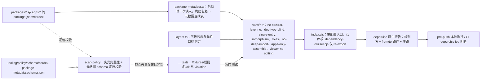
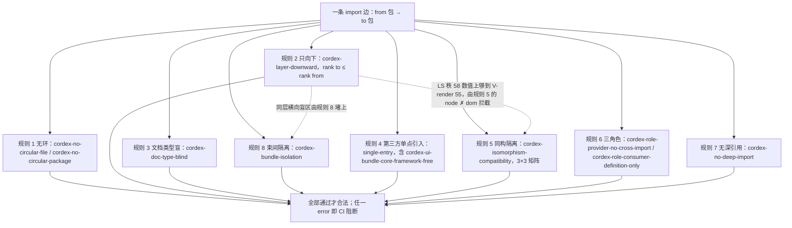

> 状态：草稿 | 负责：架构-类型治理 | 更新：2026-09-14；2026-09-24（rulings §4.15：§3.3 同步单点引入表与 `*-ui` domain/application 框架无关规则（Q2）；§4 syncpack 规则改为 peer `workspace:^`、其余 `workspace:*`（Q1），与 ADR-0002 §3 一致）；2026-09-24（复核修正，rulings §4.17：M17 `cordex-ui-bundle-core-framework-free` 定为全仓唯一名并指向 M-01 规则文件）；2026-09-25（补图）；2026-09-25（矛盾收口，rulings §4.18） | 依赖：charter v0.1

# 03 · 边界（dependency-cruiser）

本篇把章程 §5.3 的八条依赖规则（第 8 条「垂直束互不依赖」已由总编排裁决编入 §5.3，本文档此前按"七条 + §5.1 隐含一条"执行，现按章程口径统一改称"八条"，规则内容不变）转写为 dependency-cruiser 的语义规格：每条规则的 `from`/`to` 选择器语义、严重级别、反例。分层号/同构类/三角色如何从包元数据读取（§2）是本篇的基础设施，被 §3 全部规则复用。knip/manypkg/syncpack 的分工在 §7。

**设计原则：纵深防御**。章程 §5.3 规则 2（只向下）采用的是一个**粗粒度**的层号偏序（§3.1），它单独存在时有已知盲区（同层号的束间横向 import 不会被它拦下）；这个盲区由规则 8（束间隔离）专门堵上。本篇的八组规则彼此有意重叠而非互斥——这与 [02-lint-rules.md](./02-lint-rules.md) "编辑期代理 + 跨文件/跨图权威" 的分层设计是同一个哲学的两种体现：**没有一条规则被期望单独完备**，完备性来自多条规则的交集。

---

## 1. `tooling/depcruise/` 目录树

```
tooling/depcruise/
├── index.cjs               dependency-cruiser 主配置入口（.dependency-cruiser.cjs 的实际实现，
│                             仓库根 .dependency-cruiser.cjs 仅 re-export 本文件）
├── package-metadata.ts      启动时扫描 packages/*/package.json 与 apps/*/package.json 的
│                             cordex 字段，构建「包名 → 元数据」查找表（§2），供下方规则模块调用
├── layers.ts                层号秩表（§3.1）与「允许目标」判定函数的语义实现
├── rules/
│   ├── no-circular.ts       规则 1：包级 + 文件级循环检测
│   ├── layering.ts          规则 2：只向下（数值秩比较）
│   ├── doc-type-blind.ts    规则 3：文档类型盲（非组合根水平↛垂直）+ 束间隔离（垂直 A ↛ 垂直 B）
│   ├── single-entry.ts      规则 4：第三方库单点引入
│   ├── ui-bundle-core-framework-free.ts  规则 4 路径级补充：`*-ui` 的 domain/application 框架无关（§3.3，TD-082）
│   ├── isomorphism.ts       规则 5：同构隔离（包图层，与 02 §5.2/06 scan-isomorphic 互补）
│   ├── roles.ts              规则 6：三角色（Definition/Provider/Consumer）
│   ├── no-deep-import.ts     规则 7：无深引用（查询目标包 publicEntry）
│   ├── apps-only-assemble.ts 补充：组合根 apps 白名单（§3.7，02-layering R9）
│   └── viewer-no-editing.ts  补充：查看器 preset 不含编辑链与 React（§3.7）
└── __tests__/
    └── fixtures/              每条规则的最小违规/合规仓库夹具（独立 package.json + 源文件，
                                 供 depcruise 在夹具上运行并断言输出）
        ├── no-circular/{ok,violation}/
        ├── layering/{ok,violation}/
        ├── doc-type-blind/{ok,violation}/
        ├── single-entry/{ok,violation}/
        ├── isomorphism/{ok,violation}/
        ├── roles/{ok,violation}/
        ├── no-deep-import/{ok,violation}/
        ├── apps-only-assemble/{ok,violation}/
        └── viewer-no-editing/{ok,violation}/
```

每条规则的 `violation` 夹具就是该规则的**负向测试**（[lessons A17](../../00-charter/reference-univer-lessons.md) 对 depcruise 规则的同等要求，机制与 ESLint 侧一致，判定见 [06 scan-policy](./06-scanners.md#9-scan-policy)）。

**depcruise 规则求值与门禁流程**



怎么读：上半条是规则求值链（元数据 → 查找表 → 规则模块 → 报告 → 门禁）；下半条是治理闭环——scan-policy 校验每条规则都有夹具、每个包的元数据合法，depcruise 自身假定元数据已合法。

---

## 2. 包元数据 Schema

每个 `packages/*/package.json`、`apps/*/package.json` 必须包含 `cordex` 字段。**编码规则（总编排裁决，与架构-结构条线合一，章程 v0.2 §5.1/§5.3 已正式收录）**：垂直束包**不**借用水平层的数值层号（历史草案曾让 `model-slide`/`ooxml-pptx`/`slide-render`/`slide-ui` 分别顶着 `L2`/`L3`/`L6`/`L6` 的层号，与同号的水平层含义冲突，且掩盖了"两个垂直束包数值同层"这一真实存在的横向越界场景）；改为四个独立的 `V-*` 层带，`bundle` 字段在 `layer` 以 `V-` 开头时**必填**；`compositionRoot: true` 的 preset 选填（用于束间隔离判定，2026-09-25 rulings §4.18 FE-01）；其余包**必须省略或为 `null`**：

```jsonc
// 示意，非最终 JSON Schema 文本
{
  "name": "@cordexjs/model-slide",
  "cordex": {
    "layer": "V-model",                // "L0"|"L1"|"L3"|"L4"|"L5"|"L7"|"L8"|"LS"
                                        // |"V-model"|"V-codec"|"V-render"|"V-ui"，见 §3.1 秩表
    "iso": "iso",                      // "iso" | "dom" | "node"
    "bundle": "slide",                 // "slide" | "doc" | "sheet"；layer 以 "V-" 开头时必填；
                                        // compositionRoot 的 preset 选填（preset-slide* 标 slide、preset-doc 标 doc，
                                        // 填了即受束间隔离约束）；其余包省略（rulings §4.18 FE-01）
    "role": "definition",              // "definition" | "provider" | "consumer" | "n/a"（由 02 §4.0.1 七值折叠）
    "implements": [],                  // provider 必填：所实现的 Definition 服务名，如 ["store"]；三角色规则读取
    "compositionRoot": false,          // 仅 preset-*、apps/web、apps/server 可为 true，且这些包必须显式写 true
    "publicEntry": [".", "./testing"], // 必须是 package.json#exports 的 key 集合（见 04）
    "stability": "stable"              // 可选："stable" | "beta" | "experimental"；包级 API 稳定级，
                                        // 供 api-extractor release tag 默认值与 Changesets 分组消费（架构-结构条线新增字段）
  }
}
```

本节四值 `role` 是 `package.json#cordex.role`（[02-layering-and-packages.md](../02-layering-and-packages.md) §4.0.1 的 7 值：`library|plugin|definition|provider|bundle|app|tooling`）到本子线三角色判定的折叠结果，折叠映射表见 02 §4.0.1（2026-09-18，14 §1 C-11，落实 `40-modules/00-module-map.md` G-2/Q-M1）：`definition→definition`、`provider→provider`、其余五值→`consumer`（除非该包同时是某 Definition 的 Provider）。

`stability` 字段（可选，缺省视为 `stable`）：当一个包整体处于 `experimental`/`beta` 阶段（如 M5 的 `model-doc`/`model-sheet` 骨架），该包 `api-extractor.json` 的默认 release tag（[04 §2](./04-api-surface.md#2-api-md-基线与-pr-diff-流程)）从 `@public` 降级为对应级别，避免每个导出符号都要手工标注同一个稳定级；Changesets 依据此字段把变更分组展示（`stable` 包的变更单独高亮，`experimental` 包的变更默认折叠），具体分组规则由 [ADR-0002](../adr/0002-versioning-strategy.md)（架构-结构条线所有）定义，本子线只保证字段的类型与存在性。

新旧对照（供读过本文档早期版本或章程 v0.1 网格的读者核对）：`model-slide`/`model-doc`/`model-sheet` 原"L2" → `V-model`；`ooxml-pptx`/`ooxml-docx`/`ooxml-xlsx` 原"L3"（垂直行）→ `V-codec`（`ooxml-core` 本身仍是水平层，保留 `L3`，不受影响）；`slide-render`/`doc-render`/`sheet-render` 原"L6"（渲染行）→ `V-render`；`slide-ui`/`doc-ui`/`sheet-ui` 原"L6"（UI 贡献行）→ `V-ui`。`L2`、`L6` 自此不再是合法的 `layer` 取值。

**封闭八键**（2026-09-25，rulings §4.18 FE-21）：`cordex` 字段只允许 `layer`/`iso`/`bundle`/`role`/`implements`/`compositionRoot`/`publicEntry`/`stability` 八个键，schema 以 `additionalProperties: false` 拒绝其余键——包括 `rank`：秩由 `layer` 查 §3.2 秩表得出，**不写进** package.json（模块文档里写了 `rank: 70/75/80` 的示例一律删除）。`role` 为 `provider` 时 `implements` 必填且非空；`preset-*`、`apps/web`、`apps/server` 必须显式写 `compositionRoot: true`（§3.2 R3 豁免与 §3.5 三角色豁免都只读这个显式值）。执行矩阵 TD-102。

`package-metadata.ts` 在 depcruise 启动时一次性读入全部包的该字段，构建内存查找表；**不**在规则求值期间反复读盘（性能考量，见 [07](./07-hooks-and-ci.md#5-缓存策略) 的时间预算）。字段本身的 JSON Schema 合法性（`layer` 是否是受认可的十二个取值之一、`bundle` 是否满足"`V-` 前缀必填、组合根 preset 选填、其余省略"的条件约束、是否出现八键以外的键）由 `tooling/policy/schema/cordex-package-metadata.schema.json` 定义，[06 scan-policy](./06-scanners.md#9-scan-policy) 的全局不变式检查逐包校验，**不**由 depcruise 自身校验（depcruise 假定元数据已合法，若不合法会以规则误判的方式暴露，而非清晰的 schema 错误——这是已知的诊断体验短板）。该 schema 文件是架构-结构条线与本子线的共享产物：任何一方新增/调整 `layer`/`bundle`/`role` 的取值集合，须同步更新此文件并知会另一方，避免两份各自维护的"合法取值表"漂移。

---

## 3. 八条规则逐条规格

### 3.1 规则 1：无环（对应章程 §5.3-1）

| 规则名 | `from` | `to` | 严重级别 |
|---|---|---|---|
| `cordex-no-circular-file` | 任意模块 | 任意模块 | `error`；depcruise 原生 `circular` 判定，无 `collapsePattern`（逐文件） |
| `cordex-no-circular-package` | 任意模块 | 任意模块 | `error`；同上但配置 `collapsePattern: '^packages/[^/]+'`（把同一包内的全部文件折叠为一个图节点后再判定环） |

反例：`packages/model-slide/src/style.ts` `import` 了 `packages/model-slide/src/tree.ts`，后者又 `import` 回 `style.ts`（文件级环，即使两者都在同一个包、同一层号，也报错）；`packages/collab-core` 与 `packages/model-core` 互相 `import` 对方（包级环，即使各自内部无环）。失败信息含完整环路径（depcruise 原生 `cycle` 报告格式，逐跳文件列表）。

### 3.2 规则 2 + 规则 3：只向下 + 文档类型盲（对应章程 §5.3-2、§5.3-3）

**层号秩表**（总编排裁决定稿，架构-结构条线与本子线共同口径，章程 v0.2 §5.1/§5.3 已正式收录）：

```
L0=0  L1=10  V-model=15  L3=30  V-codec=35  L4=40  L5=50  V-render=55  LS=58  L7=70  V-ui=75  L8=80
```

推导依据（定稿版）：`V-model`（15）须高于 `L1`（10，model-\* 依赖 store 抽象所在的 model-core）且低于 `L3`（30）；`V-codec`（35）须同时高于 `L3`（30，ooxml-pptx 依赖 ooxml-core）与 `V-model`（15，依赖 model-slide），故取值介于两者与 `L4`（40）之间；`V-render`（55）须高于 `L5`（50，依赖 engine-render/render-dom）与 `V-model`；`V-ui`（75）须高于 `V-render`（55）与 `L7`（70，依赖 ui-react）。`LS`（服务端 `server-collab`/`server-storage`/`server-headless`）定为 58：`server-headless` 需要触达 `L5`（50）——`engine-layout` 用于服务端文本度量、`engine-render` 的契约用于 headless 渲染管线——故 `LS` 秩值必须 > 50；同时不得让 `LS` 数值上"顺便"够到 `L7`/`V-ui`/`L8`（不需要也不应该），58 满足"> 50 且 < 70"这一区间，是当前依赖上限下的定稿值。`LS` 是否会数值上"够到" `V-render`（55，58 ≥ 55）？会，但这不构成漏洞：`V-render` 是 `dom`，`LS`（`server-headless` 等）是 `node`，两者被 §3.4 的同构类规则（`node` 不得 `import` `dom`）结构性拦截——这正是本篇段首"纵深防御"原则的又一实例：数值秩规则只需要防住"同构类规则管不到"的越界，不需要独自做到滴水不漏。

- **`cordex-layer-downward`**（规则 2）：`from` = 任意模块；`to` = 任意模块；违规条件 = `rank(to 所属包) > rank(from 所属包)`。这是**粗粒度**规则，唯一职责是"不允许向层号更高的包导入"，**不**单独承担"同层横向"或"同构越界"的判定（分别是下面 `cordex-bundle-isolation` 与 §3.4 同构类规则的职责）。
- **`cordex-doc-type-blind`**（规则 3 前半）：`from` = `cordex.bundle` 为空（水平层）**且 `cordex.compositionRoot !== true`** 的包；`to` = `cordex.layer` 以 `V-` 开头（垂直束）的包（与章程 §5.3 规则 3 同一判据；带 `bundle` 的 preset 是组合根，不作 to 侧判据，更低层包指向它已被规则 2 秩拦截）；无条件违规（不比较层号——非组合根的水平层任何理由都不能 import 垂直束）。**组合根豁免**（2026-09-25，rulings §4.18 FE-01）：`compositionRoot: true` 的 preset-*、apps/web、apps/server 的职责就是装配垂直束，按元数据显式豁免本条；豁免不是放任——preset 带 `bundle` 后受下方 `cordex-bundle-isolation` 约束（preset-doc 不得 import slide 束），apps/web 仍受 §3.7 `cordex-apps-only-assemble` 白名单约束（不得直接 import 束包），apps/server 只允许 `src/cordis-host/**` 装配 iso 插件、`src/modules/**` 仍禁 `model-*`/`ooxml-*`（02-layering `server-app-thin`）；`server-headless` 不是组合根，仍文档类型盲（插件清单由 apps/server 的 `preset-server.ts` 传入）。判定面包含测试文件（`__tests__/`、`testing/`、`*.test.ts` 不排除）：非组合根水平层的测试同样只能用 `model-core/testing` 的 `fixture`/`fixture-grid` 类型（即原称 `horizontal-tests-use-fixture-only` 的要求，并入本条，rulings §4.18 GV-15，08 §11.1）。负向夹具：`engine-render → model-slide` 拒绝、`preset-doc → model-slide` 被规则 8 拒绝、`apps/web → model-slide` 被 §3.7 拒绝；正向夹具：`apps/web → preset-slide`、`preset-slide → model-slide` 通过。反例：`packages/engine-render`（水平，`bundle` 省略）出现 `import type { SlideShape } from '@cordexjs/model-slide'`（`layer: 'V-model'`，即使只是类型导入）→ 报错。这是章程给出的原始反例场景（Univer A1：`engine-render` 66% 是三产品专用组件）。
- **`cordex-bundle-isolation`**（规则 3 后半，即章程 §5.3 第 8 条"垂直束互不依赖"）：`from` = `cordex.bundle === X`（X 非空）；`to` = `cordex.bundle === Y` 且 `Y !== X`（Y 非空）；无条件违规。反例：`packages/model-slide`（`layer: 'V-model'`, `bundle: 'slide'`）`import` 了 `packages/model-doc`（`layer: 'V-model'`, `bundle: 'doc'`）——两者不仅数值秩相等，`layer` 取值本身完全相同，仅 `bundle` 不同，规则 2 对此完全不拦截，本规则拦截。`V-*` 层带编码相比旧的"借用水平层数值"方案，让这一横向越界场景在包元数据层面**结构性可见**（同一个 `layer` 字符串、不同 `bundle` 字符串），不再依赖"凑巧数值相等"这一容易被忽视的巧合，这是本次编码调整额外带来的诊断收益。

### 3.3 规则 4：第三方库单点引入（对应章程 §5.3-4）

与 [02 §5.1](./02-lint-rules.md#51-no-restricted-imports章程-53-规则-4) 同一张静态表（含章程 v0.2 补充的 `lib0`/`y-indexeddb`/`pg`/`ioredis`/`@aws-sdk/*` 五行），depcruise 侧的规则形态：`from` = 不在允许包（或允许路径）列表内的所有包；`to` = 匹配 `node_modules/(cordis|yjs|y-protocols|lib0|@y/y|@y/protocols|y-indexeddb|react|react-dom|react-router|radix-ui|class-variance-authority|clsx|tailwind-merge|lucide-react|cmdk|sonner|react-resizable-panels|tw-animate-css|tailwindcss|@tailwindcss|@fontsource-variable/geist|@nestjs|pg|ioredis|@aws-sdk)` 的外部模块解析路径（允许包见 02 §5.1；apps/web 对 react/react-dom/react-router/tailwindcss/@tailwindcss/* 的放行、`react-router` 仅限 apps/web 均为 rulings §4.15 Q2 口径）。与 ESLint 版本的**互补覆盖**：depcruise 是在**已解析的模块图**上判定，因此能捕获 ESLint 规则难以覆盖的路径——`export * from 'yjs'` 之类的再导出、动态 `import()`、以及构建产物层面才浮现的依赖（例如某个包的 `dist/*.js` 被另一个包误直接引用而非通过 `exports` 子路径，见规则 7）。`server-collab`/`server-headless` 若出现 `pg`/`ioredis`/`@aws-sdk` 的任何解析路径（无论直接导入还是经由某个未预期的间接依赖被打包进来），均判定为违规——这两个 `LS` 层包不在这三个模块的允许列表内，理由见 [02 §5.1](./02-lint-rules.md#51-no-restricted-imports章程-53-规则-4)"路径级例外"段落的三角色说明。

**路径级补充规则 `cordex-ui-bundle-core-framework-free`**（2026-09-24，rulings §4.15 Q2；与 02-layering §7 R14a 同一语义）：`from` = `packages/*-ui/src/{domain,application}/**`；`to` = `react`、`react-dom`、`radix-ui` 的解析路径与 `@cordexjs/ui-react`；severity `error`，附 `ok`/`violation` 夹具。全仓唯一规则名（ADR-0017、02-layering R14a、40-modules/10/13 的旧名 `ui-domain-framework-free`/`ui-bundle-core-no-framework` 等作废，2026-09-24 复核 M17）；登记为 40-modules/01 §5.5 第 9 条依赖规则（`tooling/depcruise/rules/ui-bundle-core-framework-free.ts`，TD-082）。它把章程 D10「框架在绑定层可换」落成可验证范围：ui-core 与各 `*-ui` 的 domain/application 不依赖 UI 框架；换框架需要重写的只是 ui-react、各 `*-ui` 的 `ui/` 层与第三方 custom 组件。

### 3.4 规则 5：同构隔离（对应章程 §5.3-5）

本条在 depcruise 层面的规则名为 `cordex-isomorphism-compatibility`，语义是一张 3×3 同构类兼容矩阵（`from` 的 `cordex.iso` 取值 × `to` 的 `cordex.iso` 取值），而不只是"iso 包不得依赖 dom/node 包"这一个方向——这是对本文档早期版本的修正：`iso` 包不得依赖 `dom`/`node` 包只覆盖了矩阵的三分之一，遗漏了 `dom` 包与 `node` 包互相不得依赖这一同样真实的约束（例如 `server-headless`，`iso: 'node'`，秩值 58，数值上"够得到" `V-render`，`iso: 'dom'`，秩值 55——若只检查"iso 包不得依赖 dom/node"，这条边不会被任何规则拦下）：

| `from` \ `to` | `iso` | `dom` | `node` |
|---|---|---|---|
| **`iso`** | 允许 | 违规 | 违规 |
| **`dom`** | 允许 | 允许 | **违规** |
| **`node`** | 允许 | **违规** | 允许 |

（加粗的两格是本次修正新增的检查方向。）这是**包图层**的同构隔离——防止一个包通过依赖一个环境不兼容的包而"传递性地"变得不可移植，即使它自己的源码一行 `window`/`process` 都没写；同时也是 §3.2 秩表把 `LS` 定为 58（而非更保守的 < 50）依然安全的**直接原因**：`LS`（`node`）数值上能"够到" `V-render`（`dom`，55）与 `L5` 里的 `render-dom`（`dom`，50），但本规则结构性禁止 `node → dom`，与数值秩规则形成纵深防御。

#### 同构隔离的三重保障

依赖图规则（上一段）只保证"不依赖已标记为环境相关的包"，无法保证"自身源码没有偷偷引用环境全局"或"运行时真的能在另一环境启动"。因此同构隔离一共由四层机制构成，前三层是章程 §5.3-5 点名的"三重保障"（作用于单个包内部），第四层是本节新增的图层规则：

| 层 | 机制 | 捕获什么 | 捕获不了什么 |
|---|---|---|---|
| 1 | [01](./01-tsconfig-baseline.md#26-target-与-lib环境相关放在-isodomnode-三份文件而非-basejson) `iso.json` 的 `lib`/`types: []` | 源码里任何**类型层面可见**的 DOM/Node 全局引用，编译期报错 | 通过 `globalThis as any` 之类绕过类型系统的引用（但这本身已违反 [02](./02-lint-rules.md) 的 `any`/`as` 禁令，属于双重违规） |
| 2 | [02 §5.2](./02-lint-rules.md#52-no-restricted-globals章程-53-规则-5同构隔离三重保障之一) `no-restricted-globals` | 同上，但不依赖类型检查是否运行（ESLint 独立通道），且给出更聚焦的架构性错误信息 | 与层 1 有意重叠，非互补 |
| 3 | [06 scan-isomorphic](./06-scanners.md#4-scan-isomorphic) 的静态扫描 + `iso-smoke` CI job（`node --import` 冒烟） | **运行时**事实：某个 iso 包间接依赖的第三方库在模块求值阶段就访问了 `document`（这是层 1/2 都看不见的——它发生在别人的编译产物里，不在我们的 TS 源码里） | 需要真正执行到该代码路径才能触发；不做覆盖率保证 |
| 4（图层） | 本节 `cordex-isomorphism-compatibility` | 结构性地阻止"直接依赖一个同构类不兼容的**内部**包"（含 `iso→dom`/`iso→node`/`dom→node`/`node→dom` 四个方向） | 不覆盖外部 npm 依赖本身的环境假设（外部依赖的同构性由人工评审 + `iso-smoke` 兜底） |

### 3.5 规则 6：三角色（对应章程 §5.3-6）

- **`cordex-role-provider-no-cross-import`**：`from` = `cordex.role === 'provider'`；`to` = `cordex.role === 'provider'`（且 `to` 所属包名 ≠ `from` 所属包名）；违规。反例：`store-yjs` 不得 `import` `store-memory`（没有场景需要一个存储后端依赖另一个存储后端的实现）。
- **`cordex-role-consumer-definition-only`**：`from` = `cordex.role === 'consumer'` 且 `cordex.compositionRoot !== true`；`to` = `cordex.role === 'provider'`；违规。`compositionRoot: true` 的包（`preset-*`、`apps/web`、`apps/server`）被结构性豁免——它们的职责就是选择并装配具体 Provider，这是唯一允许 `consumer` 触达 `provider` 的路径，且该豁免本身要求包元数据显式声明（可审计，而非按包名模式隐式判断）。

### 3.6 规则 7：无深引用（对应章程 §5.3-7）

`cordex-no-deep-import`：`from` = 任意包；`to` = 解析路径为 `@cordexjs/<pkg>/<subpath>`、且 `./<subpath>` **不在目标包 `cordex.publicEntry` 中**的导入（例如 `@cordexjs/model-core/src/store`、未登记的 `@cordexjs/kernel/internal`）；违规。判定改为**查询目标包元数据**而非固定正则（2026-09-25，rulings §4.18 FE-04：原正则 `@cordexjs/[^/]+/(?!testing$)` 会拦下 C-07 的 `@cordexjs/kernel/preset`、A-9 的 `@cordexjs/shared/order`、R17 的 `@cordexjs/ui-react/ui` 等已裁定子路径）。各包 `exports` 只暴露 `publicEntry` 显式登记的子路径（`.` 必有、`./testing` 仅供测试、其余逐个登记、禁 `./*` 通配，[04](./04-api-surface.md#3-exports-显式子路径策略) 的职责），depcruise 在**模块解析**层面验证"即使有人试图绕过 exports 直接深引用源码路径，也会被识别为一次深引用违规"——`exports` 字段本身在 Node/bundler 的模块解析算法里已经会让这类导入直接报"找不到模块"，本规则的增量价值是在**类型检查通过、看似只是路径写法问题**的场景下（例如某些打包工具的宽松解析模式）依然给出明确的架构性错误，而不是一个模糊的"模块未找到"。子路径专项限制另由 02-layering R17（`ui-react/ui` 只供 ui-react、`*-ui`、apps）与 R18（design 只导出 css）承担。负向夹具三个：未登记子路径、`src` 深引用、`./*` 通配（`tooling/depcruise/__tests__/fixtures/no-deep-import/violation`，TD-009）。

### 3.7 补充规则：组合根白名单与查看器纯度（2026-09-25，rulings §4.18 FE-05 / GV-15）

章程八条之外，02-layering §7 另有两条只作用于组合根的依赖规则，这里给出 depcruise 形态（均 `error`，均附 `ok`/`violation` 夹具）：

- **`cordex-apps-only-assemble`**（02-layering §7 R9，执行矩阵 TD-093）：`from` = `apps/web/**`；`to` 允许集合 = `@cordexjs/preset-*`、`@cordexjs/protocol`、`@cordexjs/design`、`@cordexjs/ui-react`（`EditorHost`、壳组件、`./ui`、`./styles.css`）、`@cordexjs/i18n`、`@cordexjs/shared`、`@cordexjs/kernel`，以及章程 §5.3 规则 4 放行的 `react`/`react-dom`/`react-router`/`tailwindcss`/`@tailwindcss/*`；其中 `@cordexjs/kernel` 的**值导入**只许出现在 `apps/web/src/application/host/**`，其余位置只许 `import type`（以 11 §10 为准，2026-09-25 rulings §4.18 FE-05）；集合外的 `@cordexjs/*`（`model-*`、`ooxml-*`、`engine-*`、`render-dom`、`slide-*`、`collab-*`、`store-*`）一律违规。`from` = `apps/server/**`：`src/modules/**` 只许 `@cordexjs/server-*`、`@cordexjs/protocol`、`@cordexjs/kernel`（类型）；`src/cordis-host/**`（`preset-server.ts`）另可 import 装配所需的 iso 插件包（FE-01/FE-02）。负向夹具：`apps/web → @cordexjs/model-slide`、`apps/web/src/pages/** → @cordexjs/kernel`（值导入）、`apps/server/src/modules/** → @cordexjs/model-slide`；正向夹具：`apps/web/src/application/host/create-editor-host.ts → @cordexjs/kernel`。
- **`cordex-viewer-no-editing`**（原扫描器名 `no-editing-in-viewer`，执行矩阵 TD-094）：`from` = `packages/preset-slide-viewer/**`（及其传递依赖图）；`to` = `@cordexjs/model-slide/editing`、`@cordexjs/ui-core`、`@cordexjs/ui-react`、`@cordexjs/slide-ui`、`react`、`react-dom`；违规。它是 ADR-0015「查看器两道只读保证」第一道（清单里没有编辑链）的依赖图执行点，第二道（`read-only` 权限策略）由 `readonly.test.ts` 与 06 scan-effects 规则 (3) 保证。

**纵深防御：一条 import 边同时经过的规则**



怎么读：实线表示同一条边被每组规则独立求值，结果取交集；虚线标出粗粒度规则 2 的已知盲区分别由哪条规则兜住——没有一条规则被期望单独完备。

---

## 4. knip / manypkg / syncpack 的分工

三者都做"工作区依赖卫生"，但检查的维度不同，刻意不合并成一个工具：

| 工具 | 检查维度 | 典型失败场景 | 与规则 4/[04](./04-api-surface.md) 的关系 |
|---|---|---|---|
| **knip** | 未使用的导出/文件/依赖；"仅类型导入却声明为运行时依赖"（[lessons A34](../../00-charter/reference-univer-lessons.md)） | 某个包的 `dependencies` 里有一条包从未被任何源码 `import`（值或类型） | A34 的主要机械执行点之一；另一部分交给 [06 scan-manifest](./06-scanners.md#6-scan-manifest) 的"类型-only 依赖应归 devDependencies"专项检查（knip 报告"未使用"，scan-manifest 报告"用了但只在类型位置用"，两者互补覆盖 A34 的两种子情形） |
| **manypkg** | 工作区结构不变式：关键第三方依赖（`typescript`/`zod`/`react`/`cordis`）在全工作区版本一致；每个声明的依赖确实存在于某处 `node_modules` 可解析 | `packages/slide-ui` 用了 `react@19.0.0`，`packages/ui-react` 用了 `react@19.1.0` | 版本不一致会让 [01](./01-tsconfig-baseline.md) 的项目引用类型解析在不同包之间产生细微不一致，是隐蔽的类型漂移来源 |
| **syncpack** | 依赖版本**范围写法**的一致性：内部依赖**必须**使用 `workspace:` 协议——`peerDependencies` 写 `workspace:^`，`dependencies`/`devDependencies` 写 `workspace:*`（rulings §4.15 Q1，与 ADR-0002 §3、02-layering §4.0.1 一致）；外部依赖走 `catalog:`，semver range 前缀风格统一 | 某个包用 `"@cordexjs/kernel": "^0.1.0"` 引用同工作区包（pnpm 11 下 semver 范围会走 registry，形成依赖混淆面）；或 peer 写成 `workspace:*`（发布后被替换为精确版本，过度收紧宿主） | 纯格式一致性，不涉及类型正确性，收益是让 manypkg 的"版本一致"检查有一个干净的输入格式 |

三者均在 `pre-push`（本地）与 CI `scanners` job 运行（见 [07](./07-hooks-and-ci.md#3-ci-工作流矩阵)），不单独占用 job 名额。

---

## 5. 文件级循环检测的补充说明

包级循环（§3.1 `cordex-no-circular-package`）是架构性红线，**文件级**循环（`cordex-no-circular-file`）在实践中更常见且更容易被无意引入（两个同包内的模型文件互相引用对方的类型）。区分对待的原因：文件级循环在 ES 模块语义下**不一定**导致运行时错误（值的循环引用会，纯类型的循环引用不会），但会：(a) 破坏 `isolatedDeclarations` 单文件可推导的前提（[01 §2.3](./01-tsconfig-baseline.md#23-r7-专项isolateddeclarations-与-verbatimmodulesyntax)一致性要求的隐含依赖），(b) 让 Turborepo/`tsc --build` 的增量缓存失效范围扩大（一个文件改动导致循环里的所有文件都需要重新检查）。两条规则**都**是 `error`，不因"值循环 vs 类型循环"区别对待严重级别——区分留给违规信息本身（depcruise 报告会指出环路是否经过 `import type`-only 边）。

---

## 6. 如何被机械验证（汇总）

| 声明 | 验证方式 | 失败信息来源 |
|---|---|---|
| 八条规则全部配置为 `error` 且在 CI 阻断 | [07](./07-hooks-and-ci.md#3-ci-工作流矩阵) `depcruise` job；`pre-push` 本地执行同一配置 | depcruise 原生 JSON 报告（规则名 + from/to 路径 + 环路，如适用） |
| 每条规则都有 `ok`/`violation` 夹具（负向测试） | [06 scan-policy](./06-scanners.md#9-scan-policy) | scan-policy 报告，列出缺失夹具的规则名 |
| 包元数据字段合法（封闭八键，拒绝 `rank` 等未知键） | scan-policy 全局不变式检查（§2 已述，TD-102） | scan-policy 报告 |
| 组合根补充规则（`cordex-apps-only-assemble`、`cordex-viewer-no-editing`）为 `error` 且有夹具 | `depcruise` job + scan-policy 夹具完整性（§3.7，TD-093/TD-094） | depcruise 原生报告 |
| 秩表（含 `LS=58`）与架构-结构条线 02 文档一致 | 已由总编排裁决定稿（本文 §3.2），架构-结构条线在 `02-layering-and-packages.md` 中采用同一数值；人工评审 + `scan-policy` 读取该文档中若存在的同名层号表做字符串级比对（该文档若含机器可解析的层号表则可自动比对，否则退化为人工评审——记录于 [README](./README.md) 已知盲区，非待决） | 见 README |
