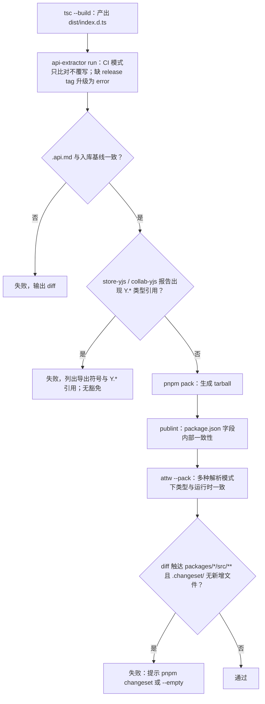

> 状态：草稿 | 负责：架构-类型治理 | 更新：2026-09-14；2026-09-25（补图）；2026-09-25（矛盾收口，rulings §4.18） | 依赖：charter v0.1

# 04 · API 表面（api-extractor / exports / publint / attw）

本篇管辖"一个包对外承诺了什么类型/运行时表面"，是 [lessons A21](../../00-charter/reference-univer-lessons.md)（"API 稳定性四级策略声明了、api-extractor 从未落地"）与 [A27](../../00-charter/reference-univer-lessons.md)（`exports: "./*"` 编译过、运行崩，59/59 包复现）的直接反制。范围仅限 `packages/*`（可发布的 SDK 包）；`apps/web`/`apps/server` 是终端应用（章程 §5.2："apps/\* 只做组装，零业务逻辑"），不经过本篇任何门禁（`tooling/*` 同理，属构建期工具，不对外发布）。

---

## 1. `tooling/api-extractor/` 目录树

```
tooling/api-extractor/
├── api-extractor.base.json   公共规则：report 路径约定、release tag 处理策略、消息严重级别覆盖
├── api-extractor.iso.json    extends base；iso 包专用（入口解析走 iso tsconfig）
├── api-extractor.dom.json    extends base；dom 包专用
└── api-extractor.node.json   extends base；node 包专用
```

每个 `packages/<name>/api-extractor.json` 只 `extends` 三者之一并声明 `mainEntryPointFilePath`（固定为 `./dist/index.d.ts`，由该包自身的 `tsc --build` 产出）与 `projectFolder`。三份基础配置字段完全一致，拆分三份只是为了让「iso 包的报告不应出现任何 DOM/Node 类型」这类未来可能追加的校验有独立挂载点；当前阶段（M0）三者内容相同，属预留结构而非当前的行为差异。

---

## 2. `.api.md` 基线与 PR diff 流程

- 每个包的 API 报告落盘在 `packages/<name>/etc/<name>.api.md`（api-extractor 默认约定路径，本项目不改名），**入库**（git 跟踪，不 `.gitignore`）。
- CI `api-surface` job（见 [07](./07-hooks-and-ci.md#3-ci-工作流矩阵)）对每个包运行 `api-extractor run`，若产出与入库的 `.api.md` 不一致，job 失败并把 diff 作为失败信息的一部分输出（`api-extractor` 原生行为：`--local` 模式在本地会直接覆写文件供 `git diff` 查看，CI 模式下不覆写、只比对并报错）。
- **审阅规则**：任何 PR 若导致 `.api.md` 产生非空 diff，该 PR 的描述必须包含对该 diff 的说明（这是评审纪律，非机械可验证项，机械层面只保证"diff 存在时 CI 会失败、审阅者一定会看到它"）；同时触发 §5 的 Changesets 检查——公开 API 变更且没有 changeset 文件，判定为不完整的 PR。
- **release tag 处理策略**：`.api.md` 报告包含 `@public` 与 `@beta` 标记的成员，**裁剪**（trim）`@internal` 成员；同时额外生成 `etc/<name>-internal.d.ts`（未裁剪版本，供包管理者审阅"内部到底暴露了多少东西"，不入库、仅 CI 产物，作为 artifact 上传）。裁剪后的 `dist/<name>.d.ts`（真正随包发布的类型文件）走 `dtsRollup.publicTrimmedFilePath`，绝不包含 `@internal` 成员的类型签名——防止内部实现细节通过类型文件泄漏给下游（下游 IDE 自动补全不应看到 `@internal` API）。

### 2.1 `@public` / `@internal` / `@beta` 的使用规范

| 标记 | 语义 | 使用场景 |
|---|---|---|
| `@public` | 承诺稳定；变更需走 semver（架构-结构条线 A 的 ADR-0002「版本策略」，本篇只负责让变更**可见**，不定义 bump 规则） | `ContributionPoint` 定义、`Manifest` 类型、`DocumentStore`/`Command`/`Mutation` 等 Definition 接口 |
| `@beta` | 已发布但语义可能变化；下游需显式选择接入（体现在文档而非类型层——TS 类型系统不区分 `@public`/`@beta` 的可用性，只有 api-extractor 报告区分） | 新引擎能力的早期形态（如首个 `model-doc` 骨架的公开接口，M5 阶段） |
| `@internal` | 包内跨文件可用，但**不**出现在发布的 `.d.ts` 里 | Provider 内部辅助类型、`kernel` 与其余包的桥接细节 |
| 缺失标记 | api-extractor 默认报告为警告（本项目升级为 `error`——每个导出符号都必须显式标注三者之一，不允许"忘记标"这种默认状态） | 无——这是本篇对 api-extractor 默认行为的加严：`api-extractor.base.json` 设置 `apiReport.enabled` 且把"缺少 release tag"的诊断消息类别从默认级别提升为 `error` |

### 2.2 `store-yjs`/`collab-yjs` 公共 API 禁止暴露 `Y.*` 类型（响应架构-运行时条线）

`@cordexjs/store-yjs`、`@cordexjs/collab-yjs` 是章程 §5.3 规则 4 指定的 `yjs` 唯一入口包（[02 §5.1](./02-lint-rules.md#51-no-restricted-imports章程-53-规则-4)）；单点引入规则保证**其余包不能 `import 'yjs'`**，但如果这两个包的**公开类型签名**里出现 `Y.Doc`/`Y.Text`/`Y.Array`/`Y.Map` 等 Yjs 具体类型（如 `DocumentStore` 的某个方法返回类型标注为 `Y.Text` 而非该包自己的抽象类型），消费方依然会被迫在类型层面"认识" Yjs 的具体形状——这是单点引入规则在**值导入**维度生效、但在**类型签名泄漏**维度失效的一个典型缺口，等价于章程 §5.3 规则 4 的目的（"防止 yjs 成为隐性的全仓依赖"）被绕过。

**机制**：CI `api-surface` job 在 `api-extractor run` 产出 `.api.md` 后，对 `packages/store-yjs`、`packages/collab-yjs` 两个包的报告文本做一次正则扫描，匹配任何形如 `Y\.[A-Z]\w*`（Yjs 具体类型的惯用命名前缀）的类型引用；命中即失败，失败信息列出具体的导出符号与其签名里出现的 `Y.*` 引用。**修复方式**：该方法/属性的公开类型改为 `store-yjs`/`collab-yjs` 自己定义的抽象类型（如返回 `RichText`/`SharedArray` 一类领域类型，内部实现用 `Y.Text`/`Y.Array` 包装），只在包内部、不导出到 `.d.ts` 的私有实现里使用具体的 `Y.*` 类型。

**豁免**：无——这是章程 §5.3 规则 4 已经确立的架构边界在类型签名维度的延伸，不应比值导入维度更宽松，无 `cordex-allow` 通道（架构性禁止，同 [03](./03-boundaries.md) 依赖类规则的立场）。

---

## 3. exports 显式子路径策略

每个 `packages/<name>/package.json` 的 `exports` 字段只允许**显式登记**的子路径：`"."` 为必有项，`"./testing"` 按需（有测试辅助或契约套件的包必有），其余子路径按需显式登记，且 `exports` 的 key 集合必须与包元数据 `cordex.publicEntry` 逐一相等（2026-09-25，rulings §4.18 FE-04：原稿「只允许 `.` 与 `./testing` 两个 key」与后续裁决冲突，C-07 的 `@cordexjs/kernel/preset`、A-9 的 `@cordexjs/shared/order`、§4.7 R17 的 `@cordexjs/ui-react/ui` 都以显式子路径为前提）。当前逐包登记的非 `./testing` 子路径：kernel `./preset`；shared `./order`；model-slide `./editing`；protocol `./permissions`、`./render/page` 等；ui-react `./ui`、`./styles.css`；design 的四个 css 文件（逐个列出，不写通配）；preset-slide 与 preset-slide-viewer `./entries`；slide-render `./chart`（M1–M2）。元数据入口 `./package.json`、`./cordex-manifest.json` 同样登记在 `publicEntry`。

```jsonc
// 示意
{
  "type": "module",
  "exports": {
    ".": {
      "types": "./dist/index.d.ts",
      "import": "./dist/index.js"
    },
    "./testing": {
      "types": "./dist/testing.d.ts",
      "import": "./dist/testing.js"
    },
    "./preset": {                        // 仅 kernel 登记（C-07）；其他包按各自 publicEntry
      "types": "./dist/preset/index.d.ts",
      "import": "./dist/preset/index.js"
    }
  }
}
```

- **禁止** `"./*"` 通配（[lessons A27](../../00-charter/reference-univer-lessons.md)：Univer 59/59 包的该写法"编译过、运行崩"——通配 exports 让 TS 类型解析与 Node 运行时解析在某些工具链组合下走向不同的实际文件，编译期看不出问题，只有实际 `import` 到未预期路径时才炸）。
- **禁止** `"./lib/*"`/`"./src/*"` 一类的目录深路径导出。
- 每个**代码**子路径（`.`、`./testing` 以外的 `./preset`、`./entries` 等）都须纳入 api-extractor 基线（每个入口一份 `etc/<name>[.<subpath>].api.md`，§2 的 diff 流程同样适用）；`.css` 文件与元数据 JSON 入口不需要 api 基线。
- 消费侧：跨包 import 只能落在目标包 `publicEntry` 列出的子路径上，由 [03 §3.6](./03-boundaries.md#36-规则-7无深引用对应章程-53-7) 的 `cordex-no-deep-import` 查询目标包元数据判定（不再是固定正则）。
- `"./testing"` 子路径**唯一**用途：导出 [09 §7](./09-plugin-type-contracts.md#7-provider-一致性套件的类型接口) 描述的 Provider 契约套件（`run<Definition>Conformance`，如 `runDocumentStoreConformance`）与少量测试专用的构造/断言工具；不得导出生产代码会用到的任何符号（用生产代码若 `import` 了 `"./testing"` 子路径，属于 [03](./03-boundaries.md) 深引用规则的变体违规——虽然路径本身合法，但**用途**违规，机械检测见 [06 scan-manifest](./06-scanners.md#6-scan-manifest) 的"`./testing` 导出符号是否被非 `__tests__/` 目录引用"专项检查）。
- `publicEntry` 字段（[03 §2](./03-boundaries.md#2-包元数据-schema) 的包元数据）必须与 `exports` 的 key 集合逐一相等；不一致时判定为元数据漂移（scan-policy 全局不变式检查项）。
- 内部包（`tooling/*`）不受本节约束（不发布，`exports` 可以是任意形态或完全不设置）。

---

## 4. `publint` 与 `@arethetypeswrong/cli`（attw）门禁

两者都对**打包产物**（`npm pack` 生成的 tarball），而不是对仓库源码运行——这是本节存在的核心理由：`isolatedDeclarations`/`exports` 字段的正确性只有在"下游实际怎么解析这个包"的语境下才能被验证，仓库内的 `tsc --build` 通过不代表包被正确消费。

| 工具 | 检查什么 | 典型失败场景 | 严重级别 |
|---|---|---|---|
| **publint** | `package.json` 字段的内部一致性（`exports` 条件顺序——`types` 必须排在同一条件对象的首位，否则部分工具链会解析到错误的运行时文件而拿到过期/缺失的类型提示；`files` 字段是否遗漏了 `exports` 实际引用的产物；`main`/`module` 遗留字段与 `exports` 的兼容性） | `exports['.'] = { import: '...', types: '...' }`（`types` 顺序在后）→ 部分打包工具按声明顺序解析条件，可能匹配到 `import` 而忽略 `types` | `error`，零豁免 |
| **@arethetypeswrong/cli (attw)** | 跨模块解析模式（`node10`、`node16-cjs`、`node16-esm`、`bundler`）的类型解析结果是否与运行时解析结果一致；专门捕获"伪装成 CJS"（"masquerading as CJS"）与"假 ESM"问题 | 包用 `"type": "module"` 但某个历史遗留字段组合让 `node16-cjs` 解析模式下类型解析失败或指向错误文件 | 默认 `error`；允许通过 attw 自身的规则级忽略列表（`ignoreRules`，写在该包 `package.json` 的 `attw` 字段）豁免**特定已知且评审过**的规则项，豁免同样计入 [06](./06-scanners.md#1-scan-type-escapes) 的豁免预算体系（豁免格式与 `cordex-allow` 统一：`attw` 字段旁必须有紧邻的 JSON 注释❌（标准 JSON 不支持注释）——改为要求在同目录 `ATTW_WAIVERS.md` 写明每条豁免的 issue 链接，由 scan-policy 校验该文件与 `package.json#attw.ignoreRules` 条目数一致） |

两者都在 CI `api-surface` job 内、`api-extractor` 之后运行（顺序：`tsc --build` → `api-extractor run` → `pnpm pack` → `publint` → `attw --pack`）。

**api-surface job 执行流**



怎么读：自上而下是 job 内的串行步骤，菱形是会使 job 失败的判定；本地 `pre-push` 的 `api-extractor run --local` 会直接覆写 `.api.md`，与这里 CI 的只比对模式不同。

依据：本文 §2、§2.2、§4、§5；07 §2.3。

---

## 5. 与 Changesets / 版本策略（ADR-0002「版本策略」，架构-结构条线所有）的对接

本篇的职责边界：**判定"是否需要 changeset"**（机械、基于 `.api.md` diff 是否非空，以及 `dist` 产物的运行时行为是否可能变化——后者无法机械判定，保守地把"任何 `packages/*` 下的非文档、非测试文件改动"也纳入需要 changeset 的范围），**不判定**"changeset 里应该写 major/minor/patch"（这是 ADR-0002 的语义，由人在 changeset 文件里自己写，CI 不代为判断语义化版本的幅度）。

CI 检查（`coverage-patch` job 之外，属 `api-surface` job 的收尾步骤）：若一次 PR 的 diff 触达任意 `packages/*/src/**` 且 `.changeset/` 下没有新增文件，job 失败，信息：

```
[api-surface] packages/model-slide changed but no changeset found.
Run `pnpm changeset` and describe the change (see ADR-0002 for version
bump semantics). If this change is truly internal (no consumer-visible
effect, e.g. test-only), add an empty changeset via `pnpm changeset --empty`.
```

---

## 6. 类型专用依赖归 `devDependencies`（[lessons A34](../../00-charter/reference-univer-lessons.md)）

判定与工具分工已在 [03 §4](./03-boundaries.md#4-knip--manypkg--syncpack-的分工) 给出（knip 负责"完全未使用"，[06 scan-manifest](./06-scanners.md#6-scan-manifest) 负责"仅类型位置使用却在 `dependencies`"）。本篇补充**为什么**这条规则属于"API 表面"范畴而不只是依赖卫生：一个包如果把仅供类型使用的依赖错放进 `dependencies`，会被 attw/publint 的下游解析检查间接放大——消费者安装该包时会连带拉入一个运行时完全用不到的包（Univer 报告的具体案例：`@grpc/grpc-js` 类型依赖被声明为运行依赖，下游体积多 7.4 MB），这直接影响"这个包对外的运行时表面"，故在本篇交叉引用而非重复定义检查逻辑。

---

## 7. 如何被机械验证（汇总）

| 声明 | 验证方式 | 失败信息来源 |
|---|---|---|
| `.api.md` 与实际导出一致 | `api-surface` job：`api-extractor run` diff | api-extractor 原生 diff 输出 |
| 每个导出符号有 release tag | `api-extractor.base.json` 加严的诊断级别 | api-extractor 诊断（symbol 名 + 文件位置） |
| `exports` 只含显式登记的子路径且 = `publicEntry`，无通配 | [06 scan-manifest](./06-scanners.md#6-scan-manifest) 规则 (c) + [03](./03-boundaries.md#36-规则-7无深引用对应章程-53-7) 深引用规则 | scan-manifest / depcruise 报告 |
| 打包产物可被三种解析模式正确消费 | `api-surface` job：`publint` + `attw --pack` | 两工具原生输出 |
| 公开 API 变更必有 changeset | `api-surface` job 收尾步骤（§5） | 自定义检查脚本输出（属 `tooling/scripts/lib` 的共享工具，非独立 scan-* 脚本，见 [06](./06-scanners.md) 开篇范围声明） |
| 类型专用依赖不进 `dependencies` | knip（CI `scanners` job）+ scan-manifest | 见 03/06 |
