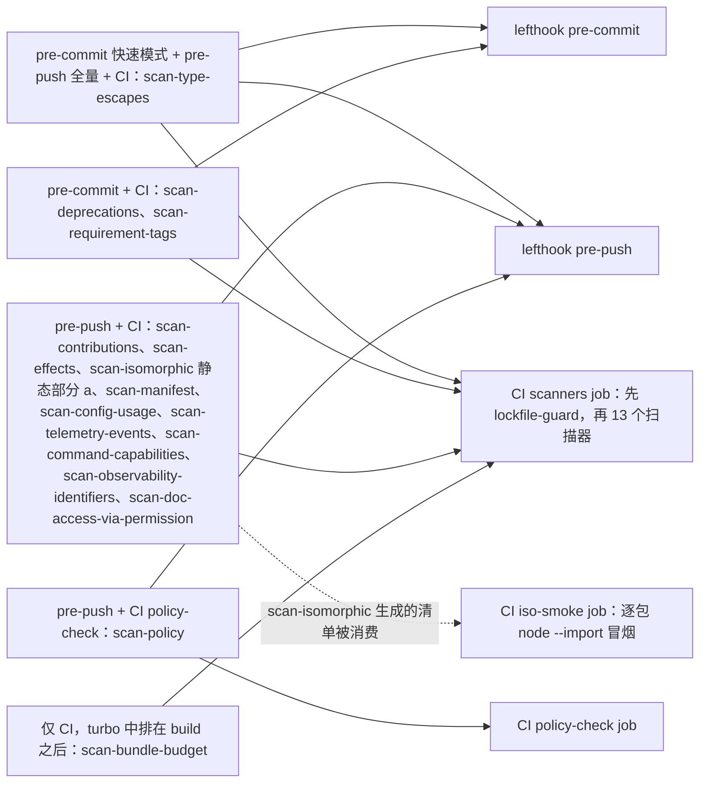
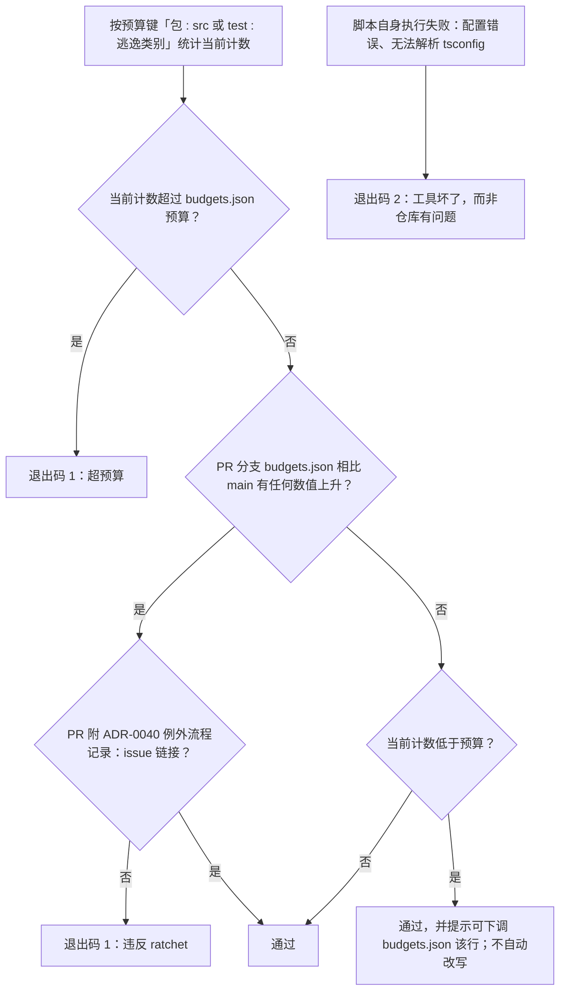

> 状态：草稿 | 负责：架构-类型治理 | 更新：2026-09-14；2026-09-24（rulings §4.15 Q1：§6 scan-manifest 增规则 (g) 包名 scope / workspace 协议 / publishConfig 与 private）；2026-09-24（复核修正，rulings §4.17：D3 登记第 14 个扫描器 `scan-doc-access-via-permission`（§1、§18），「十三个」口径改十四；M16 规则 (g) 的 `workspace:` 协议部分移交 `check-workspace-protocol.ts`；L1 更名语句；M18 锚点 `-oce` → `-cordex`）；2026-09-25（补图）；2026-09-25（矛盾收口，rulings §4.18）；2026-09-25（§4.19 登记的 T-KITS、T-REQ、T-BUNDLE、INC-33、T-0：§6 scan-manifest 规则 (e) 扩范围与 kit 自测子项、(f) 豁免 `src/testing/**`；§10 事件名 `<域>/<动作>` + `telemetry.event` 与属性名黑名单；§12 三类标签；§14 体积预算唯一阻断点；§15 两份预算文件区分；§18 仓储签名不出现 `tenantId`；TD-103～TD-109）；2026-09-25（§4.19）；2026-09-26（§4.20）（FE-06：§3 scan-contributions 规则 (e) 扩到 `enablement` 子句，校验 `can.<x>` 属于能力位、第三方不得登记 `can.` 前缀；TX-09：§6 scan-manifest 增子项 (e3)「每个 Definition 至少一个 `*.type-test.ts`」，TD-111；TX-11：指向 01、03、04 与本文 §1 的失配锚点按现行标题改正）；2026-09-26（§4.21 整合：§12 scan-requirement-tags 增 @cap 语法、capabilities.json 存在性来源与 tag 取值 cap（子规则扩充，扫描器数量不变）） | 依赖：charter v0.1

# 06 · 自研扫描脚本规格

本篇定义 `tooling/scripts/` 下的自研扫描器。扫描器与 [02](./02-lint-rules.md) 自定义 ESLint 规则、[03](./03-boundaries.md) dependency-cruiser 规则的分工原则一致且已在两篇反复出现：**扫描器负责单文件/单符号规则无法判断的跨文件、跨包、跨时间事实**。十四个扫描器均输出「JSON（机器可读，CI 消费）+ 人类可读摘要（终端/PR 评论）」双格式，遵循同一套预算/ratchet 机制（[ADR-0040](../adr/0040-type-budgets-and-ratchet.md)）。

**范围声明**：本篇覆盖章程要求的八个具名扫描器（§2–§9：`scan-type-escapes`、`scan-contributions`、`scan-effects`、`scan-isomorphic`、`scan-manifest`、`scan-config-usage`、`scan-deprecations`、`scan-policy`），加上响应产品 PRD（`06-metrics-and-analytics.md` 埋点、CO-05 权限、需求 id 可追溯性）与架构-结构/架构-运行时条线新增需求追加的五个（§10–§14：`scan-telemetry-events`、`scan-command-capabilities`、`scan-requirement-tags`、`scan-observability-identifiers`、`scan-bundle-budget`），以及 rulings §4.17 D3 正式登记的第 14 个（§18：`scan-doc-access-via-permission`，按文档读写的仓储方法必须经权限服务；与文档级 RLS 构成代码层 + 数据库层两道防线）。[04](./04-api-surface.md#5-与-changesets--版本策略adr-0002版本策略架构-结构条线所有的对接) 提到的"changeset 存在性检查"等零散一次性检查，仍实现为 `tooling/scripts/lib/` 下的共享小函数，由某个既有 CI job 的收尾步骤调用，不升格为独立具名扫描器——十四个是当前的完整清单，继续新增需要与本节同等分量的独立价值论证（避免扫描器清单无节制膨胀导致维护面模糊）。

**名字对账（2026-09-25，rulings §4.18 GV-15）**：ADR、架构正文与模块文档里写成「扫描器 `x`」的其余约 31 个名字不是第 15、16…个扫描器，而是逐个归并为本篇扫描器的子规则（如 `provider-runs-conformance` = scan-manifest (e)、`manifest-present` = scan-manifest (a)、`peer-policy` = scan-manifest (h)、`when-keys-declared`/`i18n-keys-sync` = scan-contributions (e)/(f)、`command-id-format` = scan-command-capabilities (c)、`preset-has-order-test` 等 = scan-effects (3)、`deprecated-expiry` = scan-deprecations）、lint 规则或测试断言，逐名对照与执行矩阵行见 [08 §11](./08-policy-enforcement-matrix.md#11-命名对照架构-结构条线规则别名)；已作废的（`repo-requires-tenant-id`）只在对照表留档。今后文档中写成「扫描器 `x`」的名字必须能在本篇或 08 §11 查到（由 `docs/_tools` 的文档检查守护），十四个的上限与 scan-policy 的职责不变。

---

## 1. `tooling/scripts/` 目录树

```
tooling/scripts/
├── scan-type-escapes.ts           §2
├── scan-contributions.ts          §3
├── scan-effects.ts                §4
├── scan-isomorphic.ts             §5
├── scan-manifest.ts               §6
├── scan-config-usage.ts           §7
├── scan-deprecations.ts           §8
├── scan-policy.ts                 §9
├── scan-telemetry-events.ts       §10
├── scan-command-capabilities.ts   §11
├── scan-requirement-tags.ts       §12
├── scan-observability-identifiers.ts  §13
├── scan-bundle-budget.ts              §14
├── scan-doc-access-via-permission.ts  §18（第 14 个，rulings §4.17 D3）
├── lib/
│   ├── ts-project.ts        基于 ts-morph 的项目加载封装（按包/按 tsconfig 批量加载，供全部扫描器复用）
│   ├── report.ts             统一的 JSON + 人类可读双格式输出器；预算/ratchet 比对与失败退出码约定
│   ├── budget.ts              读写 tooling/policy/budgets.json 的类型化访问层
│   └── changed-files.ts       git diff 范围计算（供 pre-commit 的"仅扫描本次改动"快速模式复用）
└── __tests__/
    ├── scan-type-escapes.test.ts    每个脚本一个测试文件，对 __fixtures__/ 下的最小示例仓库运行脚本
    ├── scan-contributions.test.ts    并断言输出 JSON 的关键字段（而非快照整份输出——快照测试
    ├── scan-effects.test.ts          对这类"输出里带文件路径/行号"的报告类脚本容易变成脆弱的
    ├── scan-isomorphic.test.ts        大快照，一次无关改动就需要重新生成，掩盖真正的回归）
    ├── scan-manifest.test.ts
    ├── scan-config-usage.test.ts
    ├── scan-deprecations.test.ts
    ├── scan-policy.test.ts
    ├── scan-telemetry-events.test.ts
    ├── scan-command-capabilities.test.ts
    ├── scan-requirement-tags.test.ts
    ├── scan-observability-identifiers.test.ts
    ├── scan-bundle-budget.test.ts
    ├── scan-doc-access-via-permission.test.ts
    └── __fixtures__/<scanner-name>/{ok,violation}/...
```

**脚本自身的类型与测试要求**：

- 全部脚本用 TypeScript 编写，纳入 `tooling` 自身的 tsconfig（`node.json` 基线），与其余仓库代码同等 strict 姿态——扫描器是保护类型规约的工具，工具自身松散类型没有正当理由。
- 全部脚本**不**使用 `any`/`as`（除极少数必须与 TS 编译器 API/AST 库交互处，需 `cordex-allow` + 说明，这类豁免计入 `tooling` 自身的预算行，见 [ADR-0040](../adr/0040-type-budgets-and-ratchet.md)）。
- 每个脚本至少一个 `ok` 夹具（不应报告任何问题）与一个 `violation` 夹具（应报告至少一个问题），后者是本篇对 [lessons A17](../../00-charter/reference-univer-lessons.md) 的执行——`scan-policy`（§9）反过来校验这一点对全部十四个脚本都成立，形成校验闭环（谁来校验扫描器本身有负向测试？答案是 scan-policy，它的负向测试则由 [08](./08-policy-enforcement-matrix.md) 引用的固定检查列表 + 人工评审兜底，这是唯一无法自指校验的最外层，记录在 [README](./README.md) 的原则说明中）。
- 输出退出码约定：`0` = 通过（含"有豁免但未超预算"）；`1` = 超预算或发现未豁免违规；`2` = 脚本自身执行失败（配置错误、无法解析某个 tsconfig 等，与"业务性失败"区分，便于 CI 区分"这个仓库有问题"还是"这个工具坏了"）。

**十四个扫描器在 hook / CI 中的执行位置**



怎么读：左侧每个节点按「在哪些阶段运行」把扫描器分组，箭头指向运行它们的 hook 或 CI job；scan-policy 单独占 `policy-check` job，scan-isomorphic 的冒烟部分由独立的 `iso-smoke` job 执行。

依据：本文 §2–§14、§18 各表「CI job」「本地 hook 阶段」两行；07 §3。

---

## 2. scan-type-escapes

| 项目 | 内容 |
|---|---|
| **目的** | R7 核心度量：统计全部"类型逃逸"（`any`/`as`（非 `as const`/`satisfies`）/`!`/`@ts-ignore`——理论上应为 0，出现即视为规则被绕过而非豁免/`@ts-expect-error`/`cordex-allow` 注释），按包、按 `src` vs `test` 分组，与 [ADR-0040](../adr/0040-type-budgets-and-ratchet.md) 的预算比对 |
| **输入** | 全部 `packages/*/src/**`、`packages/*/__tests__/**`、`apps/*/src/**`、`tooling/**` 的 `.ts`/`.tsx` 源文件（AST 遍历，不依赖类型检查，纯语法扫描，速度优先） |
| **规则** | 对每个文件统计：`TSAsExpression`（排除 `as const`）计数、`TSNonNullExpression` 计数、`TSTypeAssertion`（尖括号断言 `<T>x`，同样禁止，理由同 `as`）计数、`@ts-expect-error` 且描述不匹配 [02 §3](./02-lint-rules.md#3-禁用清单--具体规则映射) 格式的计数、`// cordex-allow(...)` 计数（按规则名分组）。**不**统计 `any` 本身的出现次数（那是 ESLint `no-explicit-any` 的职责，纯语法扫描无法可靠区分"类型位置的 any"与巧合同名标识符）；`any` 的预算改由 `eslint --format json` 的诊断计数在同一预算文件里记账（脚本内 `lib/report.ts` 统一合并两个数据源） |
| **输出格式** | JSON：`{ package: string, file: string, kind: 'as'\|'non-null'\|'angle-assertion'\|'ts-expect-error-undescribed'\|'cordex-allow', rule?: string, count: number }[]`；人类可读：按包分组的表格，超预算行高亮 |
| **预算与 ratchet** | `tooling/policy/budgets.json` 按 `<package>:<src\|test>:<kind>` 记录整数上限；CI 对比 PR 分支与 `main` 分支的 `budgets.json`，**任何数值上升**（无论该 PR 是否是导致数值上升的直接原因）判定为违反 ratchet，除非该 PR 同时包含一个指向 [ADR-0040](../adr/0040-type-budgets-and-ratchet.md) 描述的例外流程记录（issue 链接）；数值下降始终允许，脚本会额外提示"可将 budgets.json 中该行下调"（不自动改写，避免脚本产生"未经评审的代码变更"） |
| **CI job** | `scanners` |
| **本地 hook 阶段** | `pre-commit`（快速模式：仅扫描 `lib/changed-files.ts` 计算出的本次暂存文件，目标 < 2 秒）+ `pre-push`（全量模式，目标 < 15 秒，当前仓库规模假设见 §16） |
| **运行时长目标** | 见上；数值为**设计预算**，非已测量值（M0 阶段仓库无生产代码），M1 起用真实规模重新校准并回写本文 |

失败信息示例：

```
[scan-type-escapes] budget exceeded: packages/ooxml-pptx:src:as
  current=7 budget=5 (delta +2)
  new occurrences:
    packages/ooxml-pptx/src/decode/geometry.ts:42
    packages/ooxml-pptx/src/decode/geometry.ts:58
  Either remove the assertions, or open an exception PR per
  docs/30-architecture/adr/0040-type-budgets-and-ratchet.md and raise
  the budget with a linked issue.
```

**预算 ratchet 判定**



怎么读：菱形依次判定「是否超预算」「预算是否被上调」「是否可下调」；预算只能由人在 PR 里手动下调或经例外流程上调，扫描器从不自动改写；退出码 2 与业务性失败分开。

---

## 3. scan-contributions

| 项目 | 内容 |
|---|---|
| **目的** | 章程 §5.5（贡献点 id 命名模式）+ D3/D9 的清单一致性：`ctx.contribute()` 调用点、`defineContributionPoint()` 声明、`manifest.ts` 的 `contributes` 字段三者互相印证 |
| **输入** | 每个包的 `*.contribution.ts`（贡献点定义与声明合并）、`plugin.ts`/`services/*.service.ts`（`ctx.contribute()` 调用点）、`manifest.ts` |
| **规则** | (a) 每个 `ctx.contribute(pointRef, item)` 调用，`pointRef` 必须能静态追溯到一个 `defineContributionPoint()` 返回值（同包或显式导入）；(b) 每个 `defineContributionPoint({ id, ... })` 的 `id` 必须匹配 `^[a-z][a-zA-Z0-9]*\.[a-z][a-zA-Z0-9]*$`（章程 §5.5 的 `<域>.<名>` 模式，域与名两段均定稿为 camelCase，如 `ui.statusBar`；不接受 kebab-case/snake_case 段——三套命名空间以分隔符**加**大小写风格双重区分：贡献点 id 用 `.` + camelCase，事件名用 `/` + kebab-case，遥测事件名用 `_` + snake_case，见 [02 §4.15](./02-lint-rules.md#415-cordextelemetry-events-must-be-declared新增响应-prd-06-metrics-and-analyticsmd-埋点需求)）；(c) `manifest.ts` 的 `contributes` 数组列出的每一项，必须在该包源码中存在至少一个对应的 `ctx.contribute()` 调用（除非该贡献项标注为 `optional: true`，用于"贡献点本身在此包定义、但由其他包实际贡献"的场景）；(d) 反向：源码里存在的 `ctx.contribute()` 调用，其贡献必须出现在 `manifest.ts` 里（防止 manifest 漏报）；(e)（2026-09-25，rulings §4.18 GV-15，原名 `when-keys-declared`；2026-09-26 扩展，rulings §4.20 FE-06）`ui.*` 贡献项（含 `ui.shortcut`、`ui.command`）`when` **与 `enablement`** 子句中出现的每个上下文键，必须在 ui-core `STANDARD_KEYS` 或某个 `*.contribution.ts` 的前缀键声明合并（`registerPrefixedKey`）中登记；标准键族 `can.<x>` 的 `<x>` 必须属于 protocol `permissions/actions.ts` 导出的能力位集合（拼错如 `can.doc.writ` 即违规）；`can.` 为 ui-core 保留前缀，ui-core 以外的包（垂直束与第三方）调用 `registerPrefixedKey('can.…')` 即违规（[30/03 §3.6](../03-kernel-and-plugin-model.md#36-贡献点总表v01章程-55-列表的完整版readme-c-3)）；(f)（同上，原名 `i18n-keys-sync`）每个贡献 `i18n.bundle` 的包，其各语言 `locales/*.json` 的键集合两两相等，且等于该包 `*.contribution.ts` 对 `I18nKeys` 的声明合并集合（多出或缺失都报）。规则 (a) 即 ADR-0006 所称 `contribute-static-ident`。执行矩阵 TD-089 |
| **输出格式** | JSON：每条规则违规各自成行，含 `rule: 'a'\|'b'\|'c'\|'d'\|'e'\|'f'`、文件位置、涉及的贡献点 id（(e) 附未登记键名，(f) 附语言与键名差集）；人类可读：按包分组，(c)/(d) 类失败额外打印"清单 vs 源码"的并排 diff；(e) 另附键所在子句（`when` / `enablement`）与违规类别（未登记键 / 未知能力位 / 越权登记 `can.` 前缀） |
| **预算与 ratchet** | 本扫描器**不设预算**——这是一致性检查，不是"允许一定数量违规"的逃逸统计；任何违规即失败，无 `cordex-allow` 通道（清单与代码不一致没有"可接受的豁免理由"，只有"清单没写全"或"代码没实现"两种情况，都应直接修复） |
| **CI job** | `scanners` |
| **本地 hook 阶段** | `pre-push` only（需要整包视图，不适合按暂存文件增量运行） |
| **运行时长目标** | < 10 秒（全量，设计预算） |

---

## 4. scan-effects

| 项目 | 内容 |
|---|---|
| **目的** | 落实 primer MUST #7「测试卸载/重载，不只测试启动」+ [lessons A25](../../00-charter/reference-univer-lessons.md)（内存/dispose 门禁文档被重构删除）；与 [02 §4.3 `cordex/effect-owned-resources`](./02-lint-rules.md#43-cordexeffect-owned-resources) 互补——该 ESLint 规则证明"资源获取在词法上被 `ctx.effect` 包裹"，本扫描器证明"卸载后确实无残留 effect"这一运行时断言**存在对应测试**，把两者串成完整闭环。规则 (2) 响应架构-运行时条线"每个 `plugin.ts` 有 lifecycle 测试"，把覆盖范围从"含 effect 的包"扩大到"全部定义了插件的包"（含零 effect 的简单插件） |
| **输入** | 每个包的 `plugin.ts`（是否存在）+ 是否定义了至少一个 `ctx.effect()`/`ctx.contribute()`/`ctx.on()` 调用 + 该包 `__tests__/**` 目录 |
| **规则** | (1) 对每个"含 effect 的包"（原有规则，不变），其 `__tests__/` 内必须存在至少一个测试，满足：调用了一个名称匹配 `/assertNoLiveEffects\|getEffects/` 的断言辅助（`@cordexjs/kernel` 导出的诊断工具，primer §5.1 `assertNoLiveEffects(fiber)`），且该断言出现在"先 dispose/unload、再断言"的语句顺序之后（简化的顺序启发式：断言调用在同一测试函数体内，位于最后一次 `dispose()`/`fiber.dispose()` 调用之后）。(2) 对**每一个**定义了 `plugin.ts` 的包（不论是否含 effect），其 `__tests__/` 内必须存在至少一个"生命周期烟雾测试"：加载插件（`ctx.plugin(plugin, config)`）、断言 Fiber 达到 `ACTIVE` 状态（或在预期依赖缺失时达到 `PENDING`，不视为失败）、随后 `dispose()` 且不抛出。规则 (1) 是规则 (2) 在"含 effect 场景"下的加强版（规则 (1) 通过的包自动满足规则 (2)，不重复计违规）。(3)（2026-09-25，rulings §4.18 GV-15，归并原名 `preset-has-order-test`、`preset-pluggable-matrix`、`viewer-readonly-test-present`）对每个 `preset-*` 包（`compositionRoot: true` 且 `layer: 'L8'`）：`__tests__/order-independence.test.ts` 必须存在并调用 `defineLifecycleSuite`；`__tests__/pluggable.test.ts` 必须存在且以该包导出的条目清单（`*_ENTRIES`）为数据源逐条 `exclude` 非 `required` 条目（覆盖由构造保证，扫描器只核对测试以清单常量为输入）；`preset-slide-viewer` 另须有 `__tests__/readonly.test.ts` 且断言 `PERMISSION_DENIED`。任一规则不满足即违规；执行矩阵 TD-071（规则 (2)）、TD-095（规则 (3)） |
| **输出格式** | JSON：`{ package: string, hasEffects: boolean, hasDisposeTest: boolean, hasLifecycleSmokeTest: boolean, presetTests?: { order: boolean, pluggable: boolean, readonly?: boolean }, testFiles: string[] }[]`；人类可读：仅列出任一布尔值为 `false` 的包 |
| **预算与 ratchet** | 不设数值预算（是/否判定，不是计数）；`cordex-allow` 级别的豁免在此处**不适用**——若某个包确有理由暂时缺失该测试，需在包的 `__tests__/README.md`（若存在）说明并由 scan-policy（§9）统计为一种特殊的「已知缺口」登记项，避免与其余"计数型"豁免混用同一注释语法造成 [08](./08-policy-enforcement-matrix.md) 矩阵的豁免格式约定不一致 |
| **CI job** | `scanners` |
| **本地 hook 阶段** | `pre-push` |
| **运行时长目标** | < 5 秒（静态扫描，不实际运行测试；是否语义正确由 `test` job 实际跑测试来保证，本扫描器只保证"测试存在"这个前置条件） |

---

## 5. scan-isomorphic

| 项目 | 内容 |
|---|---|
| **目的** | 同构隔离三重保障中的静态部分（[03 §4](./03-boundaries.md#同构隔离的三重保障) 层 3 的静态子集）+ 生成 `iso-smoke` CI job 消费的冒烟清单 |
| **输入** | 全部 `cordex.iso === 'iso'` 包的 `src/**` |
| **规则** | (a) 复用 [02 §5.2](./02-lint-rules.md#52-no-restricted-globals章程-53-规则-5同构隔离三重保障之一) **同一份**全局名单（`lib/`下共享模块，避免两处名单漂移）做独立的语法扫描，作为 ESLint 未覆盖路径（如被 `.eslintignore` 意外排除的文件）的兜底；(b) 生成 `dist/iso-smoke-manifest.json`：列出每个 iso 包的 `publicEntry`（来自包元数据），供 `iso-smoke` CI job 逐条执行 `node --import tsx --eval "await import('<entry>')"` 并断言进程以 0 退出码结束、且 stderr 不含 `ReferenceError: window is not defined` 一类特征字符串（这类错误说明依赖链深处有环境假设，即使我们自己的源码干净） |
| **输出格式** | JSON：(a) 类问题列表同 §2 的 `kind` 扩展一个 `'iso-global-leak'` 分类；(b) 单独文件 `iso-smoke-manifest.json`（非"问题报告"，是**产物**，供下一个 job 使用；[scan-requirement-tags](#12-scan-requirement-tags) 的产物 (c) 是同类先例的第二例） |
| **预算与 ratchet** | (a) 类问题走标准预算/ratchet（同 §2 机制，键为 `<package>:iso-global-leak`）；(b) 不适用预算概念（它是清单生成，不是问题计数） |
| **CI job** | `scanners`（(a) 部分）+ 独立的 `iso-smoke` job（(b) 生成的清单被消费，实际冒烟由该 job 执行，不在 `scanners` job 内跑——冒烟需要真实 `node` 进程逐个启动，比纯静态扫描慢一个量级，拆分 job 便于并行与失败归因） |
| **本地 hook 阶段** | `pre-push`（仅 (a) 静态部分；冒烟测试因耗时不进入本地 hook，只在 CI 跑，这是本文档少数几个"本地不做、只在 CI 做"的检查之一，需在 PR 描述模板里提醒——记录为 [README](./README.md) 的待决事项：是否要为常改动的 iso 包提供一个可选的本地冒烟命令） |
| **运行时长目标** | (a) < 5 秒；(b) 清单生成 < 1 秒，`iso-smoke` job 本身（非本脚本）目标 < 30 秒（并行执行各包冒烟） |

---

## 6. scan-manifest

| 项目 | 内容 |
|---|---|
| **目的** | ADR-0003（架构-结构条线所有，清单生成策略）的类型侧执行，本脚本即 ADR-0003/03 §4.2 所称的 manifest-gen（`tooling/manifest-gen` 与本文件是同一物，40-modules/01 D-1）：源码是唯一事实源，`manifest.ts` 是入库的生成物，`cordex-manifest.json` 是构建时由 `manifest.ts` 序列化的产物，生成结果与入库文件不一致即失败（[lessons A9](../../00-charter/reference-univer-lessons.md)；2026-09-25 rulings §4.18 GV-17 统一为「生成物」口径）；同时承担两项与"清单"性质相近但独立的检查：`exports`/`publicEntry` 一致性（[04 §3](./04-api-surface.md#3-exports-显式子路径策略)）与类型专用依赖归属（[lessons A34](../../00-charter/reference-univer-lessons.md)，与 knip 互补，见 [03 §4](./03-boundaries.md#4-knip--manypkg--syncpack-的分工)） |
| **输入** | 每个包的 `plugin.ts`、`*.contribution.ts`、`services/*.service.ts`、`manifest.ts`、`package.json`；规则 (i) 另读 `tooling/policy/dependency-limits.json`（章程 §5.2 依赖上限列导出，rulings §4.18 FE-02；负向夹具「依赖超上限」「非 L0 且未列入上限的边」，TD-101） |
| **规则** | (a) 从源码（`plugin.ts`/`services/*.service.ts`/`*.contribution.ts`）静态分析推导实际的 `provides`/`injects`/`contributes`/`points`/`events` 事实（`provide`/`inject` 字段字面量、`Service` 子类构造函数第二参数、`ctx.contribute` 调用点），**重新生成** `src/manifest.ts`（头部标记 `generated`，`export const manifest: Manifest` 显式标注类型），`--check` 模式下与入库文件比对，有 diff 即失败并展示 diff；`cordex.role ∈ {plugin, provider, definition}` 的包缺 `manifest.ts` 即违规（原名 `manifest-present`；`library`/`app`/`tooling` 不要求）；(b) `cordex-manifest.json` 只在构建时由 `manifest.ts` 序列化（先过 `ManifestSchema.parse`，[09 §3](./09-plugin-type-contracts.md#3-manifest-类型与-json-schema)），随包发布、**不入库**：检查 `package.json#files` 含该文件、`exports` 登记 `./cordex-manifest.json`，仓库中出现入库副本即违规（原稿「生成 `cordex-manifest.json` 入库并比对」作废，比对对象改为 `manifest.ts`）；(c) `package.json#exports` 的 key 集合与 `package.json#cordex.publicEntry` 逐一相等（跨包可达子路径 = publicEntry，`.` 必有；禁 `./*` 通配与 `./src/*`、`./lib/*` 目录导出，2026-09-25 rulings §4.18 FE-04）；`exports` 条件不得含 `development`/`source` 或指向 `src/`（原名 `no-src-conditions`，ADR-0004）；(d) 对每个 `import` 语句，判定其是否为纯类型导入（`import type` 或 `verbatimModuleSyntax` 下可静态确认的等价形式），若某个包整体只以类型导入方式使用、却出现在 `dependencies`（而非 `devDependencies`），报告为 A34 违规；(e) 对每个 `cordex.role === 'provider'` 的包，其 `__tests__/` 内必须存在至少一处对该 Provider 所属 Definition 包 `./testing` 子路径导出的契约套件函数（`run<Definition>Conformance`，如 `runDocumentStoreConformance`，charter §5.5）的调用（[09 §7](./09-plugin-type-contracts.md#7-provider-一致性套件的类型接口)），缺失即报违规——响应架构-运行时条线"每个 `provide` 有对应 conformance 套件调用"（原名 `provider-runs-conformance`）；扫描范围另含 `apps/server/test/integration/conformance/`（需要容器的服务端适配器——PG / Valkey / S3 Provider——在此以 `*.int-spec.ts` 调用契约套件，40-modules/09 §10，决策 T-NAMING；2026-09-25 补）；子项 (e2)：`cordex.role === 'definition'` 的包，其 `./testing` 导出的每个契约 kit 必须在本包 `__tests__/` 有一处 `runKitSelfTest(kit, …)` 调用（kit 自带负向样例，证明套件能失败，70-testing/02 §2，决策 T-KITS；2026-09-25，TD-103）；子项 (e3)（2026-09-26，rulings §4.20 TX-09，TD-111；先例 (e2)，不新增扫描器）：Definition 集合 = 全部包的 `cordex.implements` 值（与 (e) 同一张映射）∪ 各包 `defineContributionPoint()` 的导出（与 [scan-contributions](#3-scan-contributions) 规则 (a) 同一索引）∪ kernel 的 `Manifest`；对集合中每个 Definition，定义它的包 `__tests__/**/*.type-test.ts` 中至少一个文件以标识符引用它（`import` 或类型位置），缺失报 `rule:'e3'` 并附 Definition 名——即 [09 §6](./09-plugin-type-contracts.md#6-类型测试的组织方式)「每个 Definition 至少一个 `*.type-test.ts`」的机械核对；(f) 任意包 `src/**`（非 `__tests__/**`）内若出现对任意包 `./testing` 子路径的 `import`，报违规（[04 §3](./04-api-surface.md#3-exports-显式子路径策略)"`./testing` 唯一用途是测试"约束的权威执行点）；**豁免**：包自身的 `src/testing/**`（即其 `./testing` 子路径的源码）可以 import 其它包的 `./testing` 子路径，用于组合测试替身与套件（先例：`model-core/testing` 组合 `kernel/testing`、`preset-slide-collab/testing` 组合 collab 替身；2026-09-25，TD-104）——`./testing` 本身只被测试消费，传递依赖不会进入生产包；(g)（2026-09-24，rulings §4.15 Q1，执行矩阵 TD-080）`packages/*` 与 `apps/*` 的 `name` 必须匹配项目 npm scope（`^@cordexjs/`；已于 2026-09-24 完成全仓更名）；内部依赖的 `workspace:` 协议（`peerDependencies` 为 `workspace:^`，其余为 `workspace:*`）由治理检查脚本 `check-workspace-protocol.ts` 承担（40-modules/01 §5.7，复核 M16），本规则不重复检查；无 `private: true` 的包必须带 `publishConfig.access: "public"`，`private: true` 的包不得带 `publishConfig`；(h)（2026-09-25 rulings §4.18 GV-15，原名 `peer-policy`，ADR-0002）`cordex.role ∈ {plugin, provider, definition}` 的包，对 `@cordexjs/*`（`shared` 除外）的运行时依赖必须写在 `peerDependencies`（开发副本在 `devDependencies`），不得出现在 `dependencies`；(i)（2026-09-25 rulings §4.18 FE-02）每包 `package.json` 的内部依赖（`@cordexjs/*`，含 `peerDependencies`）⊆ 章程 §5.2「依赖上限」列 ∪ 隐式 L0（`kernel`/`shared`/`protocol` 对非 L0 包隐式允许；`design` 受 R18、`shared` 受 R11 约束，不享受隐式放行；L0 包之间仍逐条显式）；上限列由 `tooling/policy/dependency-limits.json` 导出，`model-*`/`preset-*` 一类通配在该文件中展开为包名清单；tsconfig `references` 与 package.json 内部依赖相等由 `tooling/scripts/sync-references.ts` 保证（[01 §4](./01-tsconfig-baseline.md#4-项目引用project-references拓扑)），本规则只管「⊆ 上限」 |
| **输出格式** | JSON：按 (a)–(i) 九类（含子项 (e2)、(e3)）分别列出违规；(a) 类额外输出统一 diff 块 |
| **预算与 ratchet** | (a)(b)(c)(e)（含 (e2)、(e3)）(f)(g)(h)(i) 不设预算（一致性检查，同 §3 scan-contributions 的立场）；(d) 走标准预算/ratchet（`<package>:type-only-dep-misplaced`，允许极少数因下游工具链限制暂时无法挪动的例外，需 `cordex-allow` 等价的 package.json 级豁免，格式与 [04 §4](./04-api-surface.md#4-publint-与-arethetypeswrongcliattw门禁) 的 `ATTW_WAIVERS.md` 模式一致，登记在同目录 `DEPENDENCY_WAIVERS.md`） |
| **CI job** | `scanners` |
| **本地 hook 阶段** | `pre-push` |
| **运行时长目标** | < 15 秒（全量，是十四个脚本里最重的一个——需要同时做 AST 分析与文件生成 diff） |

---

## 7. scan-config-usage

| 项目 | 内容 |
|---|---|
| **目的** | [lessons A26](../../00-charter/reference-univer-lessons.md)（规模保护配置的消费点"not implemented yet"）的跨文件权威裁决；配对 [02 §4.9 `cordex/config-fields-must-be-read`](./02-lint-rules.md#49-cordexconfig-fields-must-be-read)——该 ESLint 规则只做同文件启发式检测（漏报率高，见 02 §4.9 的说明），本扫描器做全包范围的权威核对，CI 阻断以本扫描器为准。覆盖范围包含**全部** Config 字段，不区分"业务字段"与"配额/规模保护字段"（如 `maxPages`/`maxConcurrentEditors`/`maxFileSizeMb` 一类对应章程 Q5 规模目标的字段）——两者在本扫描器眼中是同一类检查对象，不做特殊路径，这也是"未被消费的配额字段"这一具体反例（与 Univer A26 同型）天然被覆盖、无需额外规则的原因 |
| **输入** | 每个包的 `contracts/*.schema.ts`（Config 的 Standard Schema 定义）+ 该包 `src/**` 全部源码文件 |
| **规则** | 对 Config schema 的每个顶层字段（`z.object({...})` 的 key；嵌套 object 内的字段按同样规则递归检查一层，更深层级出于成本考虑不强制，记录为已知覆盖率边界）：在该包**全部**源码文件（不限于 `plugin.ts`）中搜索是否存在至少一个引用点——`config.<field>`、解构 `{ <field> }`/`{ <field>: renamed }`、或经由中间变量的属性访问（简单的一层别名追踪，不做完整数据流分析）。全包范围内找不到任何引用即判定违规 |
| **输出格式** | JSON：`{ package: string, field: string, path: string[] }[]`（`path` 为嵌套字段的访问路径） |
| **预算与 ratchet** | 不设预算（一致性检查，同 [scan-contributions](#3-scan-contributions) 的立场：一个字段"完全未被消费"没有"可接受数量"这种预算语义，要么修 schema、要么补消费代码） |
| **CI job** | `scanners` |
| **本地 hook 阶段** | `pre-push`（需要整包视图，不适合按暂存文件增量运行） |
| **运行时长目标** | < 10 秒（全量，设计预算） |

---

## 8. scan-deprecations

| 项目 | 内容 |
|---|---|
| **目的** | [lessons A22](../../00-charter/reference-univer-lessons.md)（废弃流程声明了但 `deprecate()` 调用为 0）的时间维度执行；与 [02 §4.8 `cordex/deprecated-must-have-removal-version`](./02-lint-rules.md#48-cordexdeprecated-must-have-removal-version) 互补——该 ESLint 规则保证格式正确（有 `@removeIn`），本扫描器保证"到期即失败" |
| **输入** | 全部导出符号的 JSDoc（含 `@deprecated`/`@removeIn` 标签）+ `tooling/policy/milestones.json`（里程碑 → 目标日期/版本号的映射，由总编排/产品条线维护，本篇只读取消费）+ 各包 `package.json#version` |
| **规则** | 对每个 `@removeIn <token>` 标签：若 `token` 是里程碑（`M<N>`），比对 `milestones.json` 中该里程碑的状态是否已"到达"（`milestones.json` 记录每个里程碑的完成日期，一旦填入即视为到达）；若 `token` 是 semver，比对该包当前 `package.json#version` 是否 ≥ 该版本。到达/超过即报告为「应移除但未移除」的失败 |
| **输出格式** | JSON：`{ package, symbol, removeIn, reason: 'milestone-reached'\|'version-reached' }[]` |
| **预算与ratchet** | 不设预算——一旦到期就是确定性失败，不存在"允许保留一定数量的过期废弃 API"这种预算语义；唯一的例外通道是修改 `@removeIn` 本身（视为一次新的废弃决策，需在 PR 里说明为什么延期，评审纪律而非机械豁免） |
| **CI job** | `scanners` |
| **本地 hook 阶段** | `pre-commit`（快速——只读 JSDoc 标签与两个小文件，不需要整包视图） |
| **运行时长目标** | < 3 秒 |

---

## 9. scan-policy

| 项目 | 内容 |
|---|---|
| **目的** | 章程 R7 的元层级闭环："规范↔执行"矩阵（[08](./08-policy-enforcement-matrix.md)）本身被 CI 校验，防止矩阵与实际配置/代码漂移；同时承担两项低成本的全局不变式检查（下表「额外的全局不变式」行），不足以各自升格为独立扫描器 |
| **输入** | [08-policy-enforcement-matrix.md](./08-policy-enforcement-matrix.md) 的表格文本、`tooling/policy/schema/policy-row.schema.json`、CI 工作流定义文件（[07](./07-hooks-and-ci.md) 所述）、`eslint-plugin-cordex/rules/*.ts` 与 `__tests__/*.test.ts` 的文件名集合、`tooling/depcruise/rules/*.ts` 与 `__tests__/fixtures/*` 的目录集合、全部包的 `package.json#cordex` 字段、全部包的 `tsconfig.json` 解析结果 |
| **规则** | **(1) 矩阵自校验**：按 [08 §1](./08-policy-enforcement-matrix.md#1-表格格式约定) 定义的固定列顺序与 id 正则解析表格为行对象数组，逐行做 JSON Schema 校验（`policy-row.schema.json`）；逐行检查「配置路径」列指向的文件/目录在磁盘上存在；「负向测试路径」列指向的文件存在且非空；「CI job 名」列的值出现在 [07](./07-hooks-and-ci.md#3-ci-工作流矩阵) 描述的 job 名集合里（本脚本内维护一份与 07 文档同步的 job 名清单常量，drift 由人工评审保证，机械层面只做"值是否在已知集合内"的封闭性检查）；另含两个子检查（2026-09-25，70-testing/12 §12 第 3 条）：工作流文件中的 job 名 ⊆ 07 §3 的 13 个封闭集合；工作流的 matrix（步骤 × runner 标签）与 `tooling/ci/steps.json` 一致（步骤表唯一源 70-testing/12 §2）。**(2) 覆盖率检查**：内置一份硬编码的"必须被矩阵覆盖"的来源 id 清单（章程 §5.3 八条、primer §4 全部 MUST/MUST NOT、lessons A6/A8/A10/A12/A14/A16–A27/A30/A34/K9/K10），逐一确认矩阵中存在至少一行的「来源」列引用了它；缺失即失败并打印缺失的来源 id 列表。**(3) 规则/扫描器自身的负向测试完整性**：对 `eslint-plugin-cordex` 与 `depcruise` 的规则文件名集合，分别确认存在同名测试文件/夹具目录且非空；对全部十四个 `scan-*.ts` 脚本，确认 `__fixtures__/<scanner-name>/{ok,violation}` 均存在且 `violation` 非空（本节内容已在 [01 首段](#1-toolingscripts-目录树)、[02 §1](./02-lint-rules.md#1-toolingeslint-config-目录树)、[03 §1](./03-boundaries.md#1-toolingdepcruise-目录树) 提前说明，此处为汇总执行点，不重复定义规则） |
| **额外的全局不变式（次要职责）** | (a) 除 `apps/server` 外，任何包的 `tsc --showConfig` 解析结果中 `experimentalDecorators`/`emitDecoratorMetadata` 均不为真（[01 §6](./01-tsconfig-baseline.md#6-appsserver-的受限例外nestjson)）；(b) 全部包的 `package.json#cordex` 字段通过其 JSON Schema 校验（[03 §2](./03-boundaries.md#2-包元数据-schema)） |
| **输出格式** | JSON：`{ check: 'row-schema'\|'config-path'\|'negative-test'\|'ci-job-name'\|'coverage'\|'rule-test-completeness'\|'tsconfig-invariant'\|'metadata-schema', rowId?: string, detail: string }[]`；人类可读：按 `check` 分组的摘要 |
| **预算与 ratchet** | 不设预算——治理产物的自洽性是二元的（自洽/不自洽），没有"允许一定数量的矩阵漂移" |
| **CI job** | `policy-check`（独立于 `scanners`，见 §首段范围声明与 [07](./07-hooks-and-ci.md#3-ci-工作流矩阵) 的 job 划分理由：矩阵校验失败的排查路径与其余扫描器完全不同，混在一起会拖慢"我的 lint 到底是规则本身错了还是规则登记漏了"的判断） |
| **本地 hook 阶段** | `pre-push`（轻量，主要是文件存在性检查与文本解析，不需要 `pre-commit` 级别的极致速度） |
| **运行时长目标** | < 5 秒 |

失败信息示例（覆盖率检查）：

```
[scan-policy] coverage gap: charter §5.3 rule "8 (bundle isolation)"
has no row in 08-policy-enforcement-matrix.md whose 来源 column
references it. Add a row before merging.
```

---

## 10. scan-telemetry-events

| 项目 | 内容 |
|---|---|
| **目的** | PRD `06-metrics-and-analytics.md` 埋点需求的跨文件权威裁决："未在注册表声明的 telemetry 事件名拒绝"；配对 [02 §4.15 `cordex/telemetry-events-must-be-declared`](./02-lint-rules.md#415-cordextelemetry-events-must-be-declared新增响应-prd-06-metrics-and-analyticsmd-埋点需求)——该 ESLint 规则只做单一调用点的字面量/命名检查，本扫描器额外做**反向**核对（注册表里声明的事件是否真的被调用）与跨包一致性 |
| **输入** | `packages/kernel/src/telemetry/events.ts`（草案路径，中心化注册表，`as const` 数组，与 PRD 06 事件表一一对应）+ 全部包内 `telemetry.event(...)` 调用点 |
| **规则** | (a) 每个调用点的事件名必须存在于注册表（与 lint 规则重叠部分用于兜底 lint 未覆盖的路径，如生成代码/动态加载场景）；(b) 注册表中声明的事件必须存在至少一个调用点，否则报告为"声明但从未发出"（[lessons A21/A24](../../00-charter/reference-univer-lessons.md) 一类"声明了但没执行"问题在遥测场景的特化）；(c) 命名模式校验：`<域>/<动作>`（与 cordis `Events` 同形，PRD 06 为权威清单，决策 MECH-INC 之 INC-33；2026-09-25 修订，原「`<域>_<动作>`，snake_case」与 `ctx.telemetry.track` 写法作废，30/10 §3.1、§3.4）；(d) 属性名黑名单：注册表中每个事件的属性 schema 不得出现可能携带文档内容或个人信息的属性名（`text`、`title`、`name`、`content`、`url`、`email`，清单以 PRD 06 §5 为准，存于 `tooling/policy/telemetry-attr-denylist.json`），调用点传入的对象字面量同样检查（2026-09-25，TD-105） |
| **输出格式** | JSON：按 (a)(b)(c)(d) 四类分别列出违规 |
| **预算与 ratchet** | 不设预算（一致性检查，同 [scan-contributions](#3-scan-contributions) 的立场） |
| **CI job** | `scanners` |
| **本地 hook 阶段** | `pre-push` |
| **运行时长目标** | < 8 秒 |

---

## 11. scan-command-capabilities

| 项目 | 内容 |
|---|---|
| **目的** | PRD CO-05（fail-closed 权限）的跨文件权威裁决；配对 [02 §4.16 `cordex/command-must-declare-capabilities`](./02-lint-rules.md#416-cordexcommand-must-declare-capabilities新增响应-prd-co-05-fail-closed-权限要求架构-结构条线别名-command-declares-capability)——该 ESLint 规则保证单个 Command 定义对象的 `capabilities` 字段格式合法，本扫描器保证**没有旁路**：每一个真正通过 `commands` 贡献点注册、因而会被执行管线实际调用的 Command，都能追溯到一个满足该规则的声明 |
| **输入** | 每个包的 `commands/*.command.ts`（草案路径约定，与既有 `services/*.service.ts` 同构）+ `ctx.contribute(commandsPoint, ...)` 调用点 + `CapabilityBit` 封闭集合定义（归属由架构-结构条线的 `permissions` 服务设计决定，本扫描器只读取消费） |
| **规则** | (a) 每个 `ctx.contribute(commandsPoint, ...)` 调用贡献的 Command，其对象字面量（或可静态追溯到的引用）必须满足 `capabilities: CapabilityBit[]` 非空字段的存在性（与 lint 规则重叠部分用于兜底"字段合法但从未真正贡献注册"这类 lint 单文件视角看不见的绕过）；(b) 声明的 `capabilities` 取值全部落在当前 `CapabilityBit` 封闭集合内，防止能力位集合变更后出现"孤儿引用"；(c)（2026-09-25，rulings §4.18 GV-15，原名 `command-id-format`）每个经 `core.command` 贡献的命令 id 匹配 `<domain>.<name>`（两段 camelCase），每个 Mutation type 匹配 `<docType>.<entity>.<verb>` 三段式（`05-command-and-history.md` §12）；执行矩阵 TD-061（(a)(b)）、TD-099（(c)） |
| **输出格式** | JSON：按 (a)(b)(c) 三类分别列出违规 |
| **预算与 ratchet** | 不设预算（fail-closed 的一致性检查没有"允许一定数量未声明权限的 Command"这种预算语义） |
| **CI job** | `scanners` |
| **本地 hook 阶段** | `pre-push` |
| **运行时长目标** | < 8 秒 |

---

## 12. scan-requirement-tags

| 项目 | 内容 |
|---|---|
| **目的** | PRD 需求 id（形如 `OF-09`/`ED-12`/`CO-05`）与编辑器能力 id（形如 `TBL-01`，2026-09-26 起）与测试的可追溯性约定的类型侧执行（子规则扩充，扫描器数量不变，70-testing/13 §11 第 9 条）：标签格式合法、引用的需求 id（若有清单可核对）确实存在，并把标签数据**结构化产出**供架构-运行时条线 B 的 `11-testing-strategy.md` 消费。**职责边界**：本扫描器产出"需求 id → 测试文件位置"的原始映射数据；是否每个 PRD 需求都被覆盖（矩阵的**完整性判定**与不通过时的阻断策略）由 B 的测试策略文档定义并消费本扫描器的产出，本扫描器自身不对"覆盖率是否达标"下判断，避免越界代管其他条线的验收标准 |
| **输入** | 全部测试文件（Vitest、Playwright、`*.int-spec.ts`、`*.e2e-spec.ts`、`*.type-test.ts`）里写在 `describe` / `it` / `test` 正上方 JSDoc（或文件级首个 JSDoc）中的四类追溯标签（`@cap` 为 2026-09-26 新增），以及 `test/evidence/**` 证据文件头的同名字段；存在性来源 `tooling/policy/requirements.json`（由 `tooling/scripts/gen-requirements.ts` 从 PRD 03/04 生成）、`tooling/policy/capabilities.json`（2026-09-26 新增，同一脚本从 50-frontend/18 生成，40-modules/01 §5.7）、`tooling/policy/rulings.json`、`tooling/policy/adrs.json`（2026-09-25 按决策 T-REQ 与 70-testing/13 §1.1–§1.3 改写；原「`// @req <id>` 注释 + 可选 `requirements.json`」作废） |
| **规则** | (a) 语法：`@req PRD:<域>-<nn>`（域 ∈ OF/ED/CO/PS/EM/SV/ML/AS/NF）、`@ruling <节>/<id>`（如 `4.18/CO-08`、`4.19/INC-09`）、`@adr <编号>/<决策号>`（如 `0029/3`）、`@cap <能力 id>`（2026-09-26 新增，rulings §4.21；正则 `(SEL|ALN|ARR|INS|TXT|FMT|PIC|MED|TBL|CHT|ML|SLD|VIEW|FND|CLP|UND|CMT|SHW|EXP|COL|OFF|KEY|UI|A11Y|I18N|DOC)-\d{2}`，能力 id 定义见 50-frontend/18），正则以 70-testing/13 §1.1 为准；旧写法 `^[A-Z]{2,3}-\d{2,3}$` 报错并提示新写法（PRD 编号与裁决编号同形，前缀消歧）；(b) 存在性：标签引用的 id 必须能在对应清单（requirements / capabilities / rulings / adrs）中找到；(c) 生成 `dist/requirement-test-matrix.json`（**产物**，非"问题报告"，条目 `{ tag: 'req' \| 'cap' \| 'ruling' \| 'adr', id, tests: [{ file, title, line, scope: 'file' \| 'describe' \| 'test' }] }[]`），供 `test` job 的 requirement-matrix 步骤（判定器 `test/traceability/judge.ts`）消费；**完整性判定（缺 P0 即失败）不在本扫描器**，见 70-testing/13 §1.3（2026-09-25，TD-106） |
| **输出格式** | JSON：(a)(b) 按类分别列出违规；(c) 单独文件（产物，同 [scan-isomorphic](#5-scan-isomorphic) 的 `iso-smoke-manifest.json` 先例，本扫描器是第二个产出非报告类文件的） |
| **预算与 ratchet** | 不设预算（格式/存在性检查；(c) 不适用预算概念） |
| **CI job** | `scanners` |
| **本地 hook 阶段** | `pre-commit`（纯文本扫描，无需整包视图，速度预算与 [scan-deprecations](#8-scan-deprecations) 同量级） |
| **运行时长目标** | < 3 秒 |

---

## 13. scan-observability-identifiers

| 项目 | 内容 |
|---|---|
| **目的** | 错误码/tracing span 名/metric 名的登记与消费者核对——章程 D11（`errors`/`telemetry`/`logger` L0 服务）与架构-运行时条线 `10-observability-and-errors.md` 的类型侧执行；与 [scan-telemetry-events](#10-scan-telemetry-events) 结构同构（都是"声明在中心注册表 ↔ 调用点/消费点核对"），但注册表**所有者不同**——遥测事件是产品分析指标（PRD 所有），错误码/span/metric 是可观测性基础设施（架构-运行时条线所有），因此拆成两个独立扫描器，各自对应各自的登记文件与责任人，避免一个扫描器要向两个不同条线报告问题时职责不清 |
| **输入** | `packages/kernel/src/errors/codes.ts`（草案路径，`CordexError` 子类可用的 `code` 封闭集合注册表）+ 全部 `throw new <XxxError>(...)` 调用点的 `code` 取值 + tracing span/metric 名称的中心注册表（草案路径同上目录下 `spans.ts`/`metrics.ts`）+ 全部埋点调用点 |
| **规则** | 对错误码/span/metric 三类，各自执行同一对检查：(a) 调用点使用的标识符必须在对应注册表声明；(b) 注册表声明的标识符必须至少有一个调用点消费（防止"声明了但没执行"，[lessons A24](../../00-charter/reference-univer-lessons.md)）；(c) 注册表内同类标识符不得重复（错误码全仓唯一，ADR-0011 所称 `error-codes-unique` 即本条，2026-09-25 rulings §4.18 GV-15 归并） |
| **输出格式** | JSON：按 `{ category: 'error-code'\|'span'\|'metric', rule: 'a'\|'b', ... }` 分类列出违规 |
| **预算与 ratchet** | 不设预算（一致性检查） |
| **CI job** | `scanners` |
| **本地 hook 阶段** | `pre-push` |
| **运行时长目标** | < 10 秒 |

---

## 14. scan-bundle-budget

| 项目 | 内容 |
|---|---|
| **目的** | 垂直束/预设构建产物的体积预算，验证 [ADR-0040](../adr/0040-type-budgets-and-ratchet.md) 的 ratchet 机制并非只适用于"类型逃逸计数"这一种度量，同一套「只减不增 + cordex-allow 风格例外流程」直接复用到**构建产物字节数**——响应架构-运行时条线"保真/性能阈值的 ratchet 复用 cordex-allow 例外流程"与架构-结构条线 `bundle-budget` 需求。本扫描器是该复用的**具体实例**；保真度/渲染性能阈值等其余非类型预算，若架构-运行时条线选择采用同一模式，应比照本扫描器的结构实现，不需要类型治理条线重复设计机制 |
| **输入** | 各 preset 包（`preset-slide-viewer`、`preset-slide`、`preset-slide-collab`）与 `apps/web` 路由 chunk 的生产构建 stats（要求本扫描器在 `build` 任务之后运行——CI job 依赖顺序见下）；预算文件为各 preset 的 `config/bundle-budget.json`（**唯一阻断点**，决策 T-BUNDLE；2026-09-25 修订，原「`budgets.json` 的 `<package>:bundle-size-bytes` 键」作废） |
| **规则** | 初始加载 = 入口 chunk 及其静态 import 闭包的 JS 与 CSS，**逐文件 gzip**（zlib 级别 9）后求和，不含字体与 peer 依赖；惰性 chunk 各自对照自己的预算；预算值 = PRD NF-01 §1.5 / EM-07，文件内显式登记 `tolerancePct: 5`：超出「预算 × (1 + tolerancePct)」即违规，在预算与容差之间只报告；preset 的 `bundle-budget.test.ts` 与 `ui-react` 的 `perf.spec.ts` 降为信息性断言（测量口径以 70-testing/09 §11 为准，TD-107） |
| **输出格式** | JSON：`{ package: string, chunk: string, actualGzipBytes: number, budgetBytes: number, tolerancePct: number, delta: number }[]` |
| **预算与 ratchet** | 预算值只收紧（下调走普通 PR，上调须 issue 链接并经评审，与 [ADR-0040](../adr/0040-type-budgets-and-ratchet.md) 的例外流程同形）；`config/bundle-budget.json` 与 `tooling/policy/budgets.json`（类型逃逸类）、`test/perf/budgets.json`（性能门禁）互不引用，见 §15 |
| **CI job** | `scanners`（**依赖顺序说明**：本脚本要求对应包已完成构建，`turbo.json` 的任务图需把本检查步骤声明为 `build` 任务的下游，不能与其余静态扫描器并列在同一无依赖并行批次——这是十四个脚本里唯一有这一前置依赖的） |
| **本地 hook 阶段** | 不在本地 hook（需要完整构建产物，耗时与 [iso-smoke](./07-hooks-and-ci.md#3-ci-工作流矩阵) 同理不适合 `pre-commit`/`pre-push`，只在 CI 跑） |
| **运行时长目标** | < 20 秒（不含构建本身的时间） |

---

## 15. 输出与预算文件的落点

```
tooling/policy/
├── budgets.json               §2/§5/§6/§14 消费的预算基线（ratchet 只减不增，见 ADR-0040；
│                                键前缀区分度量类型：无前缀/`iso-global-leak`/`type-only-dep-misplaced`
│                                均为类型逃逸类；2026-09-25 起不再含 `bundle-size-bytes`——体积预算唯一在
│                                各 preset 的 `config/bundle-budget.json`（§14，T-BUNDLE），性能门禁在
│                                `test/perf/budgets.json`（70-testing/09），三份文件互不引用）
├── milestones.json             §8 消费的里程碑 → 日期/版本映射
├── requirements.json            §12 消费的 PRD 需求 id 清单（`gen-requirements.ts` 从 PRD 03/04 生成，T-REQ）
├── rulings.json / adrs.json     §12 消费的裁决条目 id 与 ADR 决策号清单（T-REQ）
├── telemetry-attr-denylist.json §10 规则 (d) 消费的遥测属性名黑名单（PRD 06 §5）
├── event-domains.json           [02 §4.4](./02-lint-rules.md#44-cordexevents-must-be-declared含域白名单子检测响应架构-结构条线-event-domain-whitelist) 消费的第一方事件域清单
└── schema/
    ├── policy-row.schema.json     §9 消费的矩阵行结构校验
    └── cordex-package-metadata.schema.json  §9 全局不变式 (b) 消费，定义见 [03 §2](./03-boundaries.md#2-包元数据-schema)
```

`budgets.json` 的写入权限：只能由人在 PR 里手动下调，或在 [ADR-0040](../adr/0040-type-budgets-and-ratchet.md) 描述的例外流程下上调；扫描器自身**不**在 CI 运行时自动改写该文件（避免"CI 自动放宽预算"这种会消解 ratchet 意义的行为）。

---

## 16. 时长预算的假设前提

上述全部"运行时长目标"基于**设计阶段假设**：约 20–30 个 `packages/*` 包、单包平均 < 3000 行源码、单包平均 < 20 个测试文件。这是与章程 §7 里程碑骨架大致匹配的规模估计（M2 阶段），**不是**已实测数据（M0 阶段仓库尚无生产代码）。M1 里程碑验收时应用真实规模重新测量并回写本文各表格的目标值；若实测值显著偏离（如超出目标 3 倍以上),视为扫描器本身需要性能优化（如引入增量缓存），而非直接放宽预算。

---

## 17. 如何被机械验证（汇总）

| 声明 | 验证方式 | 失败信息来源 |
|---|---|---|
| 十四个扫描器均输出双格式 | `policy-check`：检查每个脚本的输出契约（简单的 schema 校验：JSON 输出符合本篇各节声明的形状） | scan-policy 报告 |
| 每个扫描器有 ok/violation 夹具 | `policy-check`（§9 规则 3） | scan-policy 报告 |
| 预算文件只减不增 | `scanners`/`scan-type-escapes` 等各自的 job 步骤：对比 `budgets.json` 与 `main` 分支版本 | 见各扫描器"失败信息示例" |
| 扫描器自身无类型逃逸 | `scan-type-escapes` 把 `tooling/**` 纳入扫描范围（§1 已述，自举） | 同 §2 |

---

## 18. scan-doc-access-via-permission

（2026-09-24，rulings §4.17 D3 正式登记为第 14 个扫描器；执行矩阵 [TD-085](./08-policy-enforcement-matrix.md#12a-章程-10-q1q10-裁决落地2026-09-24rulings-415)；文件与夹具以 40-modules/01 §5.7 为准）

| 项目 | 内容 |
|---|---|
| **目的** | 把 charter D12「数据访问兜底 = 文档权限检查」从评审约定变成编译期可检事实：凡按文档读写的仓储方法必须经权限服务取得访问凭证后才能调用。与治理检查脚本 `check-rls-coverage`（TD-083，数据库层文档级 RLS）构成**代码层 + 数据库层两道防线**；取代 T-0 去租户后作废的 `repo-requires-tenant-id` |
| **输入** | `apps/server/src/modules/**/infrastructure/*.repository.ts`；M-08 的 `DocAccess` / `SystemContext` 品牌类型声明 |
| **规则** | 以 `docId` 为键的仓储**公共方法**，首参类型必须是 `DocAccess`（仅 `RoleResolverService.authorize()` 可构造）或 `SystemContext`（仅系统用例/作业可构造）；首参为裸 `string`/`DocumentId` 即违规。豁免仅限权限服务自身的数据源 `PermissionRepository` / `ShareLinkRepository`，以脚本内常量显式登记，新增须评审。子检查（2026-09-25，T-0 的执行点，取代作废的 `repo-requires-tenant-id`，TD-108）：全部 `*.repository.ts` 的公共方法签名与参数对象类型中不得出现 `tenantId` / `tenant_id` / `tid`（单组织部署，rulings §4.15 T-0）。2026-09-25 rulings §4.18 BE-02：分享链接**解析**归 PermissionsModule（`ResolveShareLinkUseCase` 经 SECURITY DEFINER 函数按令牌只读 `share_links`，入参是链接令牌而非 `docId`，不落入本规则的判定面）；`ShareLinkRepository` 豁免只覆盖 share-links 模块的创建/撤销/列表 |
| **输出格式** | JSON：`{ file: string, method: string, firstParamType: string }[]`（仅列违规项） |
| **预算与 ratchet** | 零预算（架构性禁止，不走 `budgets.json`）；豁免只经脚本内常量登记 |
| **CI job** | `scanners` |
| **本地 hook 阶段** | `pre-push`（只扫描本次改动涉及的 `*.repository.ts`，快速模式复用 `lib/changed-files.ts`） |
| **负向测试** | `tooling/scripts/__tests__/scan-doc-access-via-permission.test.ts` + `__fixtures__/scan-doc-access-via-permission/{ok,violation}/`（violation：以 `docId` 为键的方法首参为裸 `string`；非豁免仓储直查 permissions 表） |
| **运行时长目标** | < 5 秒（只加载 `apps/server` 的仓储文件与两个品牌类型声明） |

