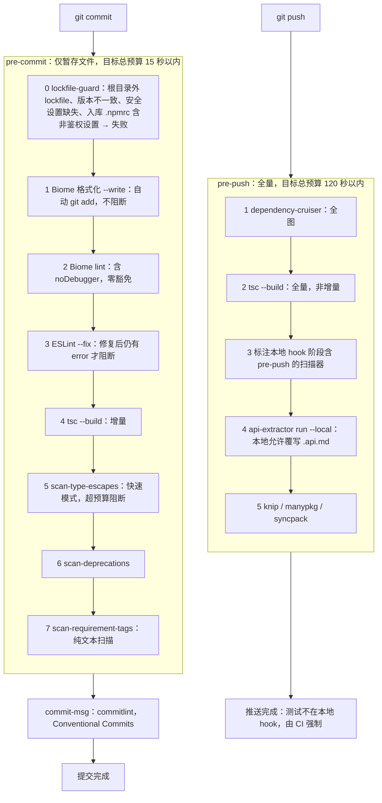
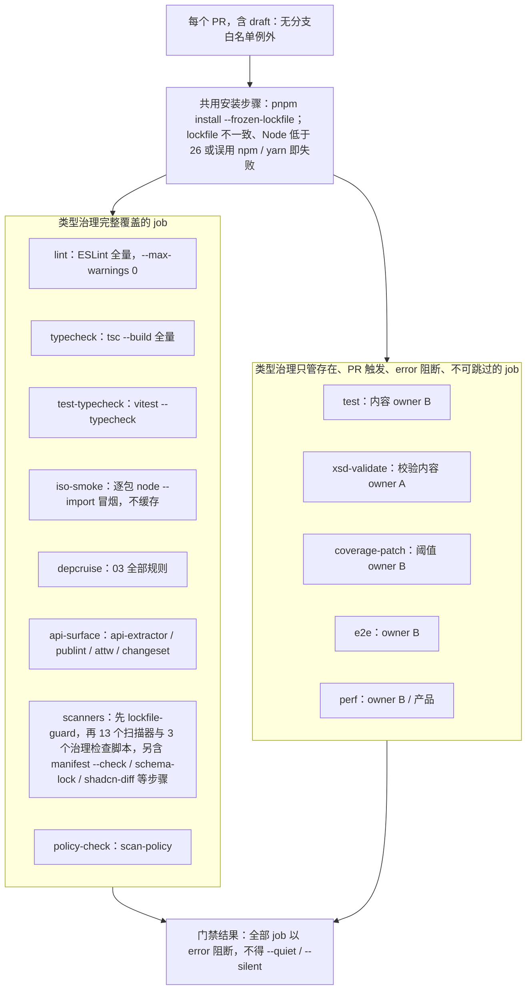

> 状态：草稿 | 负责：架构-类型治理 | 更新：2026-09-14；2026-09-24（rulings §4.15 Q9：pre-commit 与 CI 加 lockfile-guard（并入既有 `scanners` job，不新增 job 名）；CI 安装一律 `pnpm install --frozen-lockfile`）；2026-09-24（复核修正，rulings §4.17：D3 `scanners` job 扫描器数随第 14 个扫描器更新，并列三个治理检查脚本）；2026-09-25（补图）；2026-09-25（矛盾收口，rulings §4.18）；2026-09-25（§4.19）；2026-09-25（设计线拆分：§3 `test` / `e2e` / `perf` 行的步骤清单改链 70-testing/12，保留 job 名与四条治理；§2.3 链 70-testing/01 §9 本地命令） | 依赖：charter v0.1

# 07 · Hooks 与 CI

本篇定义本地 git hooks（lefthook）各阶段的组成与时间预算、CI 工作流矩阵的完整 job 列表与触发规则、失败示例与修复指引、缓存策略。核心纪律（呼应 [lessons A16/A18](../../00-charter/reference-univer-lessons.md)）：**CI 禁止 `--quiet`；全部规则为 `error`，不存在 `warn` 级别；全部门禁 job 在 PR 上触发，不允许"配置了但只在特定分支/从不运行"的门禁**。

---

## 1. `tooling/` 内本节归属的文件

```
tooling/
├── lefthook.yml              §2 本地 hook 各阶段定义（内容归属登记；物理位于仓库根，见下注）
└── commitlint.config.ts      §2.2 commit-msg 阶段的规则配置（Conventional Commits）
```

注：`lefthook.yml` **物理位于仓库根**（lefthook 的配置发现约定要求与 `.git` 同级；40-modules/01 §12 D-2），此处只登记其内容设计归属于本篇；`commitlint.config.ts` 留在 `tooling/`，由根 `lefthook.yml` 的 `commit-msg` 阶段以 `--config` 显式指向（2026-09-25，rulings §4.18 GV-13）。

（`tooling/scripts/`、`tooling/policy/` 已在 [06](./06-scanners.md) 详述；`tooling/eslint-config/`、`tooling/depcruise/`、`tooling/api-extractor/`、`tooling/tsconfig/` 已在各自章节详述；本篇不重复目录树，只描述它们如何被 hook/CI **调用**。）

---

## 2. lefthook 阶段

### 2.1 `pre-commit`（目标总预算：< 15 秒，仅作用于暂存文件）

| 步骤 | 内容 | 失败即阻断提交 |
|---|---|---|
| 0 | `lockfile-guard`（`tooling/scripts/lockfile-guard.ts`，rulings §4.15 Q9）：暂存区出现根目录以外的任何 lockfile（`pnpm-lock.yaml`/`package-lock.json`/`yarn.lock`/`bun.lock*`）即失败；根 `package.json` 的 `packageManager` 与 `devEngines.packageManager.version` 必须逐字相等；`pnpm-workspace.yaml` 的安全设置（`strictPeerDependencies`、`autoInstallPeers`、`nodeLinker`、`minimumReleaseAge`、`blockExoticSubdeps`、`allowBuilds`）必须显式存在；入库 `.npmrc` 含非鉴权设置即失败。耗时 < 1 秒 | 是 |
| 1 | Biome 格式化（`--write`，仅暂存文件；写入后自动重新 `git add`） | 否（自动修复，不阻断） |
| 2 | Biome lint（仅暂存文件，含 `no-debugger`/`noDebugger` 检查——**零豁免**，见 [02 §3](./02-lint-rules.md#3-禁用清单--具体规则映射)） | 是 |
| 3 | ESLint（`--fix`，仅暂存文件，Turborepo 缓存命中时跳过未变更包） | 是（`--fix` 后仍有 `error` 才阻断） |
| 4 | `tsc --build`（增量，仅重新检查受影响的项目引用节点） | 是 |
| 5 | `scan-type-escapes`（快速模式，仅暂存文件，见 [06 §2](./06-scanners.md#2-scan-type-escapes)） | 是（超预算） |
| 6 | `scan-deprecations`（见 [06 §8](./06-scanners.md#8-scan-deprecations)） | 是 |
| 7 | `scan-requirement-tags`（见 [06 §12](./06-scanners.md#12-scan-requirement-tags)；纯文本扫描，< 3 秒；2026-09-25 rulings §4.18 GV-12 补登，与 06 §12「本地 hook 阶段 = pre-commit」一致） | 是 |

不在 `pre-commit` 的检查：dependency-cruiser（需要整图，成本与暂存文件规模不成比例）、api-extractor（需要先构建）、其余十一个扫描器（需要整包视图或构建产物）、测试（见 §2.3 的取舍说明）。

### 2.2 `commit-msg`

`commitlint`，规则集 Conventional Commits（`feat`/`fix`/`refactor`/`docs`/`test`/`chore`/`build`/`ci` 等类型前缀），与 Changesets 的语义化版本流程对齐（[04 §5](./04-api-surface.md#5-与-changesets--版本策略adr-0002架构-结构条线所有的对接)）。失败信息为 commitlint 原生输出，指出不符合的具体子规则（如缺少类型前缀、描述以大写字母开头等，具体子规则集由 `tooling/commitlint.config.ts` 固化，本篇不逐条列举，因其与类型规约无直接关系，仅作为提交流程完整性的记录）。

### 2.3 `pre-push`（目标总预算：< 120 秒，全量）

| 步骤 | 内容 |
|---|---|
| 1 | `dependency-cruiser`（全图，[03](./03-boundaries.md)） |
| 2 | `tsc --build`（全量，非增量，确保本地缓存未被误用掩盖真实错误） |
| 3 | 十四个扫描器中标注"本地 hook 阶段含 pre-push"的全部（[06](./06-scanners.md) 各节已逐条标注，实质是除运行时较重的 `iso-smoke` 冒烟本体外的全部静态检查） |
| 4 | `api-extractor run --local`（本地模式，直接更新 `.api.md`，与 CI 的"仅比对不覆写"模式不同——本地允许覆写是为了让开发者在推送前就能看到 diff 并决定是否需要写 changeset） |
| 5 | knip / manypkg / syncpack（[03 §4](./03-boundaries.md#4-knip--manypkg--syncpack-的分工)） |

**为什么测试（`test`/`test-typecheck`/`e2e`）不在本地 hook 中**：测试套件的运行时长预算由测试设计线拥有（本地与 CI 分工、本地复现命令见 [70-testing/01](../../70-testing/01-strategy-and-layers.md) §9 与 [70-testing/12](../../70-testing/12-ci-gates-mapping.md) §12；原由架构-运行时条线 B 的 [11-testing-strategy.md](../11-testing-strategy.md) 承担），本篇不预先给出数值假设；作为跨条线要求（见本次任务汇报），若 B 确认单测套件可在合理时间内（如 < 30 秒）跑完，`pre-push` 应追加该步骤——当前版本先把"本地不强制跑全部测试、但 CI 强制跑"作为默认姿态，避免在未获得 B 的实际预算数据前对本地开发体验做出unfounded 的承诺。

**本地 lefthook 三阶段执行流**



怎么读：两条纵向主线分别是提交与推送；子图内是该阶段的串行步骤，除注明不阻断的格式化外任一步失败即中止提交或推送。

---

## 3. CI 工作流矩阵

全部 job 共用同一安装步骤：`pnpm install --frozen-lockfile`（lockfile 与 package.json 不一致即失败；根 `devEngines` 使 Node 版本低于 26 或误用 npm/yarn 时以 EBADDEVENGINES 失败）。全部 job 在**每个 PR**（含 draft PR，不区分）上触发，无分支白名单例外（直接反制 [lessons A18](../../00-charter/reference-univer-lessons.md)："key 在 main、开发在 dev → 从不运行"）；全部 job **不**使用任何形式的 `--quiet`/`--silent`/等价的"只报告不阻断"参数（反制 [lessons A16](../../00-charter/reference-univer-lessons.md)）。

| Job 名 | 内容 | 内容owner | 本篇覆盖范围 |
|---|---|---|---|
| `lint` | ESLint 全量（类型感知，`--max-warnings 0`——由于全部规则本就是 `error`，本参数是双保险，防止未来有人误将某条规则降级为 `warn` 而不被察觉） | 类型治理 | 完整 |
| `typecheck` | `tsc --build`（全量，项目引用图） | 类型治理 | 完整 |
| `test` | Vitest 单测、契约测试、生命周期、保真往返、协同模拟与快照迁移语料等步骤（旧 job 名一律是本 job 的步骤，见下方「封闭集合」）；步骤清单、激活里程碑与本地复现命令以 [70-testing/12](../../70-testing/12-ci-gates-mapping.md) §2、§7、§12 为唯一源（2026-09-25 设计线拆分，本行不再列步骤） | 测试设计线（[70-testing](../../70-testing/README.md)） | 仅 job 存在性与"必须在 PR 触发、不得 `--quiet`"的治理要求 |
| `test-typecheck` | `vitest --typecheck`（[09 §6](./09-plugin-type-contracts.md#6-类型测试的组织方式) 的类型测试套件；11 旧称 `types` 即本 job） | 类型治理 | 完整 |
| `iso-smoke` | 消费 [06 scan-isomorphic](./06-scanners.md#5-scan-isomorphic) 生成的清单，逐包 `node --import` 冒烟（11 旧称 `iso` 即本 job） | 类型治理 | 完整 |
| `depcruise` | [03](./03-boundaries.md) 全部规则 | 类型治理 | 完整 |
| `api-surface` | [04](./04-api-surface.md) 全部检查（api-extractor diff / publint / attw / changeset 存在性） | 类型治理 | 完整 |
| `scanners` | 先执行 `lockfile-guard` 全量模式（与 §2.1 步骤 0 同一脚本；并入本 job 是为了不改动 job 名封闭集合，rulings §4.15 Q9），再执行 [06](./06-scanners.md) 十三个扫描器（十四个中除 scan-policy，含 rulings §4.17 D3 登记的 `scan-doc-access-via-permission`）与治理检查脚本 `check-workspace-protocol`/`check-rls-coverage`/`check-image-policy`（08 矩阵 TD-080/083/084，不计入扫描器数；`scan-bundle-budget` 在 Turborepo 任务图中被声明为 `build` 任务的下游，仍属本 job，只是执行顺序受约束，非独立 job）。另含以下**步骤**（2026-09-25 rulings §4.18 GV-14/GV-16，不新增 job 名）：`scan-manifest --check`（ADR-0003 旧称 job `manifest-check`）、`schema-lock`（ADR-0009）、`shadcn-diff`（ADR-0017，报告，M2 稳定后阻断）、`horizontal-freeze`（ADR-0016，M5 起）；`check-image-policy` 同时静态检查 renderer 镜像非 root、无凭据、Chromium 沙箱开启 | 类型治理 | 完整 |
| `policy-check` | [06 scan-policy](./06-scanners.md#9-scan-policy) | 类型治理 | 完整 |
| `xsd-validate` | 脏部件重生成结果的 OOXML XSD 有效性校验（D7 不透明保留/保真契约的一部分）；校验逻辑与具体 XSD 版本归属架构-结构条线（`ooxml-core` 设计），本篇只登记 job 存在性、触发条件（每个 PR）与不可跳过性，与其余门禁同等对待 | 架构-结构 A（校验内容）+ 类型治理（job 治理机制） | 仅 job 存在性与治理要求，工具本身见 `tooling/xsd/`（README `tooling/` 全景索引） |
| `coverage-patch` | 新增/改动代码的行覆盖率阈值（patch coverage，反制 [lessons A19](../../00-charter/reference-univer-lessons.md)："`patch: off`"） | 架构-运行时 B（阈值数值与统计口径） + 类型治理（"必须存在且不可关闭"的门禁机制） | 阈值数字由 B 确认，机制由本篇管辖：见跨条线要求 |
| `e2e` | Playwright 端到端：视觉 oracle、PR 冒烟子集（含 `security:rls` 与 renderer 零出站）与 main 全量段（含断网 compose e2e）等步骤；步骤清单、触发段与激活里程碑以 [70-testing/12](../../70-testing/12-ci-gates-mapping.md) §2–§4、§7 为唯一源（2026-09-25 设计线拆分，本行不再列步骤） | 测试设计线（70-testing） | 仅 job 存在性治理要求 |
| `perf` | 性能预算（渲染 / 加载 / 协同延迟）：每个 PR 跑 D50 关键指标的绝对 gate，超 gate 即失败，相对回归只报告（决策 T-PERF-GATE）；步骤、runner 标签与门禁规则以 [70-testing/12](../../70-testing/12-ci-gates-mapping.md) §2 与 [70-testing/09](../../70-testing/09-performance-and-capacity.md) §9–§10 为唯一源 | 测试设计线（70-testing）/ 产品 | 仅 job 存在性治理要求 |

**封闭集合**：上表 13 个 job 名是 CI 的完整清单（scan-policy 校验 08 矩阵「CI job」列只取这些值）。其余文档里出现过的 job 名——`unit`/`contract`/`lifecycle`/`roundtrip`/`fidelity-roundtrip`/`collab-sim`/`snapshot-migration-corpus`（→ `test`）、`types`（→ `test-typecheck`）、`iso`（→ `iso-smoke`）、`oracle`/visual oracle（→ `e2e`）、`manifest-check`/`schema-lock`/`horizontal-freeze`/`shadcn-diff`（→ `scanners`）、`doc-type-blindness`（拆回 `depcruise`/`lint`/`test`）、`compose-airgap-e2e`（→ `e2e` main 段）——一律是上述 job 的**步骤**，不是新 job（2026-09-25 rulings §4.18 GV-14；先例 ADR-0004:18、本节 lockfile-guard、40-modules/01:643）。

对"内容 owner 非类型治理（或非独占）"的 job（`test`/`e2e`/`perf`/`coverage-patch` 的阈值、`xsd-validate` 的校验内容，以及广义上 `test-typecheck` 之外的测试策略细节），本篇的立场是：**job 必须存在、必须在每个 PR 上运行、必须以 error 级别阻断、不得配置为可跳过**——这四条是类型治理对"机械约束机制"这一硬约束（R7）的普遍主张，适用于全部门禁而不只是类型相关的门禁；job **内部**测什么、阈值多少，由内容 owner 决定并写入其各自文档。

**CI 工作流矩阵执行流**



怎么读：每个 PR 先走同一安装步骤，再运行两组 job；左组由本篇完整定义内容，右组的内容由其 owner 决定，本篇只保证 job 存在且不可静默；任一 job 失败都阻断该 PR。

---

## 4. 失败示例与修复指引（按 job 分组的統一格式）

每个 job 的失败信息遵循统一结构（`lib/report.ts` 与各工具原生输出共同保证）：`[<job/工具名>] <一句话问题> \n <具体位置> \n <修复指引，含指向本文档体系的锚点>`。已在 [01](./01-tsconfig-baseline.md)/[02](./02-lint-rules.md)/[03](./03-boundaries.md)/[06](./06-scanners.md) 各节给出具体示例，本节不重复，只补充一条**跨 job 边界**的常见情形：

**「lint 通过但 typecheck 失败」**：ESLint 的类型感知规则依赖 `parserOptions.project` 指向的 tsconfig 做类型解析，但 ESLint 本身不执行 `noEmitOnError`/项目引用的完整构建图检查；某些跨包类型错误（如包 A 的 `.d.ts` 产物过期、包 B 引用了 A 尚未重新构建的旧类型）只会在 `tsc --build` 全量运行时暴露。修复指引：`typecheck` job 失败但 `lint` 通过时，优先怀疑项目引用/构建顺序问题而非规则配置问题，检查 [01 §4](./01-tsconfig-baseline.md#4-项目引用project-references拓扑) 的 `references` 是否完整。

---

## 5. 缓存策略

- **Turborepo 远端缓存**：`lint`/`typecheck`/`scanners`/`depcruise` 四个 job 的任务定义（`turbo.json`，架构-结构条线拥有该文件本身，本篇只声明这四个任务的输入输出契约）以包为粒度声明 `inputs`（源文件 + 相关 `tooling/*` 配置的 hash）与 `outputs`（`.tsbuildinfo`、扫描器 JSON 报告、ESLint 缓存文件），未变更的包直接复用远端缓存结果，不重新执行。
- **失效边界**：`tooling/eslint-config/**`、`tooling/tsconfig/**`、`tooling/depcruise/**`、`tooling/policy/budgets.json` 任一文件变更，视为使**全部**包的对应缓存失效（这些文件定义的是跨包共享的规则语义，局部失效判断的复杂度收益不成正比，直接全量失效更安全）。
- **`iso-smoke` 不缓存**：该 job 涉及真实进程启动，其"冒烟通过"结果依赖当前 `node_modules` 的实际内容（含间接依赖的补丁版本升级也可能引入新的环境假设泄漏），缓存复用会让这类问题被掩盖到下一次依赖变更时才暴露，故本 job 每次全新运行。
- **本地与 CI 缓存互通**：Turborepo 远端缓存对本地 `pre-push` 与 CI 使用同一远端存储，开发者本地已跑过的检查结果可以直接在 CI 命中，反之亦然——这是把 §2 的"120 秒本地预算"与 §3 的 CI 矩阵运行时长同时控制在可接受范围的关键机制，而非两套独立预算各自优化。

---

## 6. 如何被机械验证（汇总）

| 声明 | 验证方式 | 失败信息来源 |
|---|---|---|
| 全部 CI job 在每个 PR 触发、无分支例外 | [06 scan-policy](./06-scanners.md#9-scan-policy) 的 CI job 名封闭性检查（间接：矩阵引用的 job 名若在工作流文件里被限定了分支触发条件，属于 CI 工作流定义本身的配置问题，机械校验的边界见 README 待决事项——scan-policy 目前只校验"job 名存在"，不解析工作流文件的触发条件表达式，这是已知盲区） | 见 README 待决事项 |
| 无 `--quiet` 等价参数 | 代码评审 + CI 工作流文件的 PR diff 可见性（同上，非完全机械） | 同上 |
| `pre-commit`/`pre-push` 预算达标 | M1 起用真实规模测量并回写本文（同 [06 §14](./06-scanners.md#14-时长预算的假设前提) 的假设前提说明） | 见 06 |
| 缓存失效边界正确 | Turborepo 自身的 hash 机制（第三方工具原生保证，非本项目自研） | Turborepo 原生诊断 |
