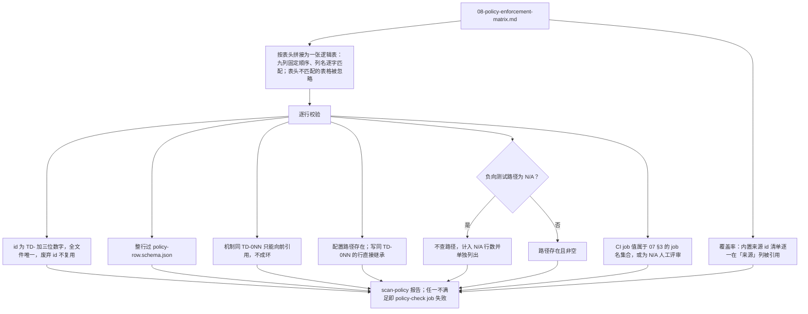

> 状态：草稿 | 负责：架构-类型治理 | 更新：2026-09-14；2026-09-24（rulings §4.15：新增 §12a TD-079～TD-082——lockfile/packageManager/devEngines、内部依赖 `workspace:` 协议与包名 scope、文档内容禁 HTML 注入、`*-ui` domain/application 框架无关）；2026-09-24（复核修正，rulings §4.17：D3/M16 §12a 补 TD-083 RLS 覆盖、TD-084 镜像策略、TD-085 `doc-access-via-permission`，总数 82→85；TD-080/081/082 执行落点以 40-modules/01 文件为准；「十三个扫描器」改十四；M18 锚点 `-oce` → `-cordex`；L1 更名语句）；2026-09-25（补图）；2026-09-25（矛盾收口，rulings §4.18） | 依赖：charter v0.1

# 08 · 规范↔执行矩阵

本篇是 R7「每条规范都要有机械执行点，且『规范↔执行』的对应关系本身要被 CI 校验」的直接落地物。矩阵覆盖章程 §5.3 全部八条（第 8 条"垂直束互不依赖"已由总编排裁决编入，章程 v0.2 已收录）、cordis primer §4 全部 16 条铁律（MUST 1-8、MUST NOT 1-8）、[reference-univer-lessons.md](../../00-charter/reference-univer-lessons.md) 的 A16–A27 全部 12 项、A6/A8/A10/A12/A14/A30/A34/K9/K10，以及本方案为落实章程已定决策（D2/D4/D7/D9/D11/D13）、自身完备性、与产品 PRD、架构-结构、架构-运行时三条线新增需求而追加的条目，和章程 §10 Q1–Q10 裁决落地条目、2026-09-24 复核补登条目及 2026-09-25 矛盾收口补登条目（共 102 行，§2–§12b）。本文件被 [06 scan-policy](./06-scanners.md#9-scan-policy) 机器解析，格式约定见 §1，**任何编辑本文件表格的人都必须遵守 §1**，否则 `policy-check` job 会因解析失败而阻断（失败信息会指出具体哪一行/哪一列不符合格式，而不是笼统的"解析错误"）。

---

## 1. 表格格式约定

- 本文件可包含多个 markdown 表格，每个表格必须使用与本节完全一致的表头（九列，顺序固定，列名逐字匹配）；`scan-policy` 按文件内出现顺序拼接全部匹配表头的表格为一张逻辑表，不匹配表头的表格（如本文件其他说明性表格，若有）被忽略。
- **固定列顺序**：`id` | `陈述` | `来源` | `执行机制` | `配置路径` | `负向测试路径` | `CI job` | `豁免方式` | `owner`。
- **id 正则**：`^TD-\d{3}$`，全文件唯一，单调但允许跳号（跳号用于预留插入空间，不要求连续），**不得**重复使用已废弃的 id（废弃的规范行整行保留、`执行机制` 列标注"~~已废弃：<原因>~~"，不删除、不复用其 id——避免历史 PR/issue 里引用的 id 失效指向错误内容）。
- **来源列**格式：`charter§5.3-<n>` / `charter§5.1` / `charter-D<n>` / `primer§4-MUST-<n>` / `primer§4-MUSTNOT-<n>` / `lessons-A<n>` / `lessons-K<n>` / `本方案`（无直接上游条文、为落实 R7 整体目标而新增）/ `用户全局开发纪律（CLAUDE.md）`；一行可引用多个来源（分号分隔），代表同一机制同时满足多条上游要求。
- **执行机制列**格式：工具名 + 本目录内锚点（如 `cordex/no-register-methods-outside-kernel（02§4.1）`）；若与另一行机制完全相同，写 `机制同 TD-0NN`（**只能向前引用**——引用的目标 id 数值必须小于当前行 id，保证不存在引用环，`scan-policy` 校验这一点）。
- **配置路径列**：仓库内真实（或本方案约定将创建的）路径，`scan-policy` 逐行检查该路径存在；写 `机制同 TD-0NN` 的行，本列同样允许写 `同 TD-0NN`（不重复检查，直接继承）。
- **负向测试路径列**：同上，可为 ESLint 规则测试文件、depcruise 夹具目录、扫描器测试夹具，或（对"无法机械判定意图"的少数行，见 §4/§5 说明）填 `N/A（见执行机制列说明）`——`scan-policy` 对这类显式标注 `N/A` 的行不做路径存在性检查，但会统计"N/A 行数"并在人类可读报告中单独列出，供架构评审定期复核是否有新的机械化手段可以补上。
- **CI job 列**：取值必须是 [07 §3](./07-hooks-and-ci.md#3-ci-工作流矩阵) 定义的 job 名之一，或 `N/A（人工评审）`。
- **豁免方式列**：`cordex-allow（预算制）` / `无（架构性禁止）` / `无（零豁免）` / `package.json 字段登记`（attw/依赖类豁免） / `N/A`。
- **owner 列**：本文件全部行填 `架构-类型治理`；若某行的阈值/内容由其他条线共同决定（如 coverage-patch 的具体百分比），额外注明，格式 `架构-类型治理（机制）+ <条线>（阈值/内容）`。

**scan-policy 对本矩阵的逐行校验**

怎么读：左支是逐行的格式与存在性检查，右支是对整张矩阵的覆盖率检查，二者汇总为同一份报告；N/A 行不做路径检查但会被计数，供定期复核。

依据：本节格式约定；06 §9 scan-policy。

---

## 2. 章程 §5.3 依赖规则 + §5.1 铁律

| id | 陈述 | 来源 | 执行机制 | 配置路径 | 负向测试路径 | CI job | 豁免方式 | owner |
|---|---|---|---|---|---|---|---|---|
| TD-001 | 包级依赖图无环 | charter§5.3-1 | `cordex-no-circular-package`（03§3.1） | `tooling/depcruise/rules/no-circular.ts` | `tooling/depcruise/__tests__/fixtures/no-circular/violation` | depcruise | 无（架构性禁止） | 架构-类型治理 |
| TD-002 | 文件级依赖图无环 | charter§5.3-1 | `cordex-no-circular-file`（03§3.1） | `tooling/depcruise/rules/no-circular.ts` | `tooling/depcruise/__tests__/fixtures/no-circular/violation` | depcruise | 无（架构性禁止） | 架构-类型治理 |
| TD-003 | 只向下：import 目标层号秩 ≤ 自身秩 | charter§5.3-2 | `cordex-layer-downward`（03§3.2，粗粒度，定义防御纵深） | `tooling/depcruise/layers.ts`、`tooling/depcruise/rules/layering.ts` | `tooling/depcruise/__tests__/fixtures/layering/violation` | depcruise | 无（架构性禁止） | 架构-类型治理 |
| TD-004 | 文档类型盲：**非组合根**的水平层不得 import 垂直束（`compositionRoot: true` 的 preset-*、apps/web、apps/server 豁免，另受 R4 束间隔离与 R9 白名单约束；2026-09-25 rulings §4.18 FE-01） | charter§5.3-3 | `cordex-doc-type-blind`（03§3.2，from 侧排除 `compositionRoot: true`） | `tooling/depcruise/rules/doc-type-blind.ts` | `tooling/depcruise/__tests__/fixtures/doc-type-blind/violation`（engine-render→model-slide 拒绝、preset-doc→model-slide 被 R4 拒绝、apps/web→model-slide 被 R9 拒绝）、`.../doc-type-blind/ok`（apps/web→preset、preset-slide→model-slide 通过） | depcruise | 无（架构性禁止）；`compositionRoot` 是元数据显式声明的结构化豁免 | 架构-类型治理 |
| TD-005 | 束间隔离：垂直束互不依赖 | charter§5.3-8 | `cordex-bundle-isolation`（03§3.2，堵住 TD-003 的同层横向盲区；`V-*` 层带编码使该盲区在包元数据层面结构性可见） | `tooling/depcruise/rules/doc-type-blind.ts` | `tooling/depcruise/__tests__/fixtures/doc-type-blind/violation`（同文件覆盖两条规则，夹具内分别构造两种违规） | depcruise | 无（架构性禁止） | 架构-类型治理 |
| TD-006 | 第三方库单点引入（cordis/yjs/react/@nestjs） | charter§5.3-4 | ESLint `no-restricted-imports`（02§5.1）+ depcruise `single-entry`（03§3.3） | `tooling/eslint-config/rules/restricted-imports.ts`、`tooling/depcruise/rules/single-entry.ts` | `tooling/eslint-config/eslint-plugin-cordex/__tests__/`（同機制共用，见 02§5.1 说明）、`tooling/depcruise/__tests__/fixtures/single-entry/violation` | lint、depcruise | 无（架构性禁止） | 架构-类型治理 |
| TD-007 | 同构隔离（iso/dom/node 三者兼容矩阵 + 三重保障） | charter§5.3-5 | depcruise `cordex-isomorphism-compatibility`（3×3 兼容矩阵，含 `dom↔node` 互斥） + tsconfig lib/types + `no-restricted-globals` + `scan-isomorphic`/`iso-smoke`（03§4 四层机制） | `tooling/depcruise/rules/isomorphism.ts`、`tooling/tsconfig/iso.json`、`tooling/eslint-config/rules/restricted-globals.ts`、`tooling/scripts/scan-isomorphic.ts` | `tooling/depcruise/__tests__/fixtures/isomorphism/violation`、`tooling/scripts/__tests__/__fixtures__/scan-isomorphic/violation` | depcruise、lint、scanners、iso-smoke | 无（架构性禁止，静态部分）；`iso-smoke` 运行时问题走 issue 修复而非豁免 | 架构-类型治理 |
| TD-008 | 三角色：Provider 互不 import；Consumer 只 import Definition | charter§5.3-6 | depcruise `cordex-role-*`（03§3.5）+ `cordex/no-provider-import-in-consumer`（02§4.7，编辑期代理） | `tooling/depcruise/rules/roles.ts`、`tooling/eslint-config/eslint-plugin-cordex/rules/no-provider-import-in-consumer.ts` | `tooling/depcruise/__tests__/fixtures/roles/violation`、`.../__tests__/no-provider-import-in-consumer.test.ts` | depcruise、lint | 无（架构性禁止）；`compositionRoot: true` 是结构化豁免，非临时豁免 | 架构-类型治理 |
| TD-009 | 无深引用：跨包只走目标包 `exports` 显式登记的子路径（= `cordex.publicEntry`），禁通配与 `src`/`lib` 深引用，`./testing` 仅限测试（2026-09-25 rulings §4.18 FE-04） | charter§5.3-7 | depcruise `cordex-no-deep-import`（03§3.6，查询目标包 `publicEntry`，非固定正则） | `tooling/depcruise/rules/no-deep-import.ts` | `tooling/depcruise/__tests__/fixtures/no-deep-import/violation`（未登记子路径、`src` 深引用、`./*` 通配各一） | depcruise | 无（架构性禁止） | 架构-类型治理 |

---

## 3. cordis primer §4 · MUST

| id | 陈述 | 来源 | 执行机制 | 配置路径 | 负向测试路径 | CI job | 豁免方式 | owner |
|---|---|---|---|---|---|---|---|---|
| TD-010 | 硬依赖写进 `inject`；可选能力走 `ctx.get()` | primer§4-MUST-1 | cordis 自身的 `Context` 反应式类型（服务是否可用取决于声明合并与 `store` 快照）+ PR 评审判断"是否应为硬依赖"——**"可选 or 硬依赖"是语义判断，无法 AST 化**，本行机械化程度低，如实标注 | N/A（无独立配置，依赖 cordis 自身类型 + kernel 封装） | N/A（见执行机制列说明） | N/A（人工评审） | N/A | 架构-类型治理 |
| TD-011 | 激活期资源必须归属 `ctx.effect()` | primer§4-MUST-2 | `cordex/effect-owned-resources`（02§4.3）+ `scan-effects`（06§4） | `tooling/eslint-config/eslint-plugin-cordex/rules/effect-owned-resources.ts`、`tooling/scripts/scan-effects.ts` | `.../__tests__/effect-owned-resources.test.ts`、`tooling/scripts/__tests__/scan-effects.test.ts` | lint、scanners | cordex-allow（预算制） | 架构-类型治理 |
| TD-012 | 禁止模块级可变状态（假定插件可多次激活） | primer§4-MUST-3；lessons-A10 | `cordex/no-module-level-mutable-state`（02§4.2） | `tooling/eslint-config/eslint-plugin-cordex/rules/no-module-level-mutable-state.ts` | `.../__tests__/no-module-level-mutable-state.test.ts` | lint | cordex-allow（预算制，逐案登记，不做目录级豁免） | 架构-类型治理 |
| TD-013 | Config 走 Standard Schema，启动前校验，先失败不部分激活 | primer§4-MUST-4 | cordis 原生 `ValidationError`（primer§3.2）+ `cordex/contribution-file-naming` 规则 3（02§4.6，强制 `plugin.ts#Config` 引用 `contracts/*.schema.ts`）+ [05§1](./05-runtime-boundaries.md#1-必须校验的边界清单) | `tooling/eslint-config/eslint-plugin-cordex/rules/contribution-file-naming.ts` | `.../__tests__/contribution-file-naming.test.ts` | lint | cordex-allow（预算制，文件形状部分） | 架构-类型治理 |
| TD-014 | 三角色：Consumer 不得 import 具体 Provider | primer§4-MUST-5 | 机制同 TD-008 | 同 TD-008 | 同 TD-008 | depcruise、lint | 无（架构性禁止） | 架构-类型治理 |
| TD-015 | `waterfall` 监听器非有意否决必须调用 `next()` | primer§4-MUST-6 | **无可靠机械检测**：是否调用 `next()` 属于"是否有意否决"的语义判断，强制要求调用会对合法否决产生假阳性；执行手段是文档规范 + PR 评审 + primer 本身的说明 | N/A | N/A（见执行机制列说明） | N/A（人工评审） | N/A | 架构-类型治理 |
| TD-016 | 测试卸载/重载：`getEffects()` 卸载后为空 | primer§4-MUST-7 | `scan-effects`（06§4，核心职责） | `tooling/scripts/scan-effects.ts` | `tooling/scripts/__tests__/scan-effects.test.ts` | scanners | 无（存在性判定，见 06§4 的"已知缺口登记"特殊通道） | 架构-类型治理 |
| TD-017 | 服务名/事件名带域前缀，避免碰撞 | primer§4-MUST-8；charter§5.5 | `cordex/events-must-be-declared`（02§4.4）+ `cordex/services-must-be-declared`（02§4.5） | `tooling/eslint-config/eslint-plugin-cordex/rules/{events,services}-must-be-declared.ts` | `.../__tests__/{events,services}-must-be-declared.test.ts` | lint | cordex-allow（预算制，命名模式不匹配的历史遗留场景） | 架构-类型治理 |

---

## 4. cordis primer §4 · MUST NOT

若干行的机械化程度低（语义/意图判断，非 AST 可判定的模式），如实标注，不虚构覆盖率——这是本矩阵本身对 README「先失败、不虚假承诺」原则的执行。

| id | 陈述 | 来源 | 执行机制 | 配置路径 | 负向测试路径 | CI job | 豁免方式 | owner |
|---|---|---|---|---|---|---|---|---|
| TD-018 | 不依赖 yaml/数组顺序保证就绪 | primer§4-MUSTNOT-1 | cordis 框架自身的反应式依赖解析天然顺序无关；仅当 `server-headless` 使用 `plugin-loader` YAML 配置时，人工评审确保配置注释不暗示顺序依赖 | N/A | N/A（见执行机制列说明） | N/A（人工评审） | N/A | 架构-类型治理 |
| TD-019 | 不在 effect 之外留下原生 timer/listener/watcher | primer§4-MUSTNOT-2 | 机制同 TD-011 | 同 TD-011 | 同 TD-011 | lint、scanners | cordex-allow（预算制） | 架构-类型治理 |
| TD-020 | 不跨激活期缓存 Provider 引用 | primer§4-MUSTNOT-3 | `cordex/no-module-level-mutable-state`（02§4.2，覆盖模块顶层缓存这一常见子情形）——**长生命周期闭包内缓存**（非模块顶层）是已知残留盲区，标注不虚报 | `tooling/eslint-config/eslint-plugin-cordex/rules/no-module-level-mutable-state.ts` | `.../__tests__/no-module-level-mutable-state.test.ts` | lint | cordex-allow（预算制，部分覆盖） | 架构-类型治理 |
| TD-021 | 不把 `PENDING` 当错误处理 | primer§4-MUSTNOT-4 | 无独立机械检测；诊断 UI/日志分级规范由架构-运行时 B 的 10-observability 承接，本行标注跨条线依赖 | N/A | N/A（见执行机制列说明） | N/A（人工评审） | N/A | 架构-类型治理（机制）+ 架构-运行时 B（诊断呈现规范） |
| TD-022 | 不把 `isolate` 当安全沙箱 | primer§4-MUSTNOT-5 | 文档纪律（章程 §2.3 已声明威胁模型）；无 AST 可判定模式，架构评审在涉及插件信任边界变更时把关 | N/A | N/A（见执行机制列说明） | N/A（人工评审） | N/A | 架构-类型治理 |
| TD-023 | 不发明 `ctx.fork()` 等不存在的框架核心 API | primer§4-MUSTNOT-6 | `no-restricted-properties`（02§3 新增行"自造框架核心方法"） | `tooling/eslint-config/rules/restricted-imports.ts`（保留名单与单点引入表同文件维护，避免多处名单漂移） | `tooling/eslint-config/eslint-plugin-cordex/__tests__/`（并入 `no-mixin-outside-kernel` 测试套件的相邻用例，因两者共享"合法声明合并范围"这一判定基础） | lint | cordex-allow（预算恒为 0，见 02§3 说明） | 架构-类型治理 |
| TD-024 | 内核之外禁止 `ctx.mixin`/原型赋值 | primer§4-MUSTNOT-7；lessons-A12 | `cordex/no-mixin-outside-kernel`（02§4.10）+ 全局 `prototype` 赋值 `no-restricted-syntax`（02§3） | `tooling/eslint-config/eslint-plugin-cordex/rules/no-mixin-outside-kernel.ts`、`tooling/eslint-config/rules/style.ts` | `.../__tests__/no-mixin-outside-kernel.test.ts` | lint | 无（架构性禁止，仅 `packages/kernel` 结构化豁免） | 架构-类型治理 |
| TD-025 | 插件销毁不可撤销外部历史（网络请求/文件写入） | primer§4-MUSTNOT-8 | 文档纪律；涉及不可逆副作用的 Provider 设计评审要求显式说明补偿/幂等策略，落在该 Provider 自身契约文档与架构-运行时 B 的 10-observability | N/A | N/A（见执行机制列说明） | N/A（人工评审） | N/A | 架构-类型治理（机制）+ 架构-运行时 B（补偿策略规范） |

---

## 5. lessons · 扩展点治理（A8/A10/A12/A14）

| id | 陈述 | 来源 | 执行机制 | 配置路径 | 负向测试路径 | CI job | 豁免方式 | owner |
|---|---|---|---|---|---|---|---|---|
| TD-026 | 唯一注册抽象 ContributionPoint，禁 `register*` 泛滥 | lessons-A8；charter-D3 | `cordex/no-register-methods-outside-kernel`（02§4.1） | `tooling/eslint-config/eslint-plugin-cordex/rules/no-register-methods-outside-kernel.ts` | `.../__tests__/no-register-methods-outside-kernel.test.ts` | lint | cordex-allow（预算制） | 架构-类型治理 |
| TD-027 | 禁全局可变注册表/顶层副作用注册 | lessons-A10 | 机制同 TD-012 | 同 TD-012 | 同 TD-012 | lint | cordex-allow（预算制） | 架构-类型治理 |
| TD-028 | 禁 facade 原型 monkey-patch 组装 | lessons-A12 | 机制同 TD-024 | 同 TD-024 | 同 TD-024 | lint | 无（架构性禁止） | 架构-类型治理 |
| TD-029 | 服务/组件类型必有 Definition 接口；禁幽灵泛型（`ComponentType<T> = any`） | lessons-A14 | `no-explicit-any`（覆盖类型参数默认值位置，02§3）+ `defineContributionPoint` 的 T 由 schema 推导、调用方不可自由指定（09§1，结构性消除该失配的根因） | `tooling/eslint-config/rules/type-safety.ts`、`packages/kernel/src/contribution.ts`（09 描述的运行时实现落点） | `tooling/eslint-config/eslint-plugin-cordex/__tests__/`（并入 no-explicit-any 覆盖范围的标准 typescript-eslint 测试，非本项目自定义）、[09](./09-plugin-type-contracts.md) 的类型测试套件 | lint、test-typecheck | cordex-allow（预算制） | 架构-类型治理 |

---

## 6. lessons · 声明了但没执行（A16–A27）

| id | 陈述 | 来源 | 执行机制 | 配置路径 | 负向测试路径 | CI job | 豁免方式 | owner |
|---|---|---|---|---|---|---|---|---|
| TD-030 | 禁 `--quiet`；规则全部 `error`，无 `warn` | lessons-A16 | CI 工作流姿态（07§3）+ `policy-check` 对 ESLint 解析配置的 severity 断言（02§7） | `.github/workflows/*.yml`（CI 工作流定义，属仓库骨架，非本目录；本篇只声明约束语义） | N/A（见 07§6 的已知盲区说明：当前只能机械校验"规则 severity"，无法完全机械校验"CI 参数里确实不含 --quiet"，记录于 [README](./README.md) 待决事项） | policy-check | 无（架构性禁止） | 架构-类型治理 |
| TD-031 | 自定义规则/depcruise 规则必须有负向测试 | lessons-A17 | `scan-policy` 规则 3（06§9） | `tooling/scripts/scan-policy.ts` | `tooling/scripts/__tests__/scan-policy.test.ts` | policy-check | 无（架构性禁止） | 架构-类型治理 |
| TD-032 | 全部门禁 job 在每个 PR 触发，无分支例外 | lessons-A18 | CI 工作流姿态（07§3，"全部 job 在每个 PR 上触发"） | `.github/workflows/*.yml` | N/A（同 TD-030 的已知盲区） | 全部 job | 无（架构性禁止） | 架构-类型治理 |
| TD-033 | Patch 覆盖率门禁不可关闭 | lessons-A19 | `coverage-patch` job 存在性与不可跳过性（机制，07§3）；阈值数值由 B 确认 | `tooling/lefthook.yml`（job 触发登记）+ B 的覆盖率工具配置 | N/A（阈值相关测试属 B 范畴） | coverage-patch | 无（机制层面架构性禁止） | 架构-类型治理（机制）+ 架构-运行时 B（阈值） |
| TD-034 | 同构声明（ISOMORPHIC）真被执行 | lessons-A20 | 机制同 TD-007 | 同 TD-007 | 同 TD-007 | depcruise、lint、scanners、iso-smoke | 无（架构性禁止，静态部分） | 架构-类型治理 |
| TD-035 | API 稳定性策略真被执行（api-extractor + `.api.md`） | lessons-A21 | [04](./04-api-surface.md) 全篇（api-extractor 基线 + PR diff 流程） | `tooling/api-extractor/*.json`、各包 `etc/*.api.md` | `tooling/api-extractor` 无独立单测——机制本身即 CI 中 api-extractor 原生 diff，不需要额外夹具（工具自身已在其上游有充分测试覆盖，本项目不重复造轮子验证第三方工具正确性，只验证"配置生效"） | api-surface | 无（架构性禁止） | 架构-类型治理 |
| TD-036 | 废弃流程真被执行（到期失败） | lessons-A22 | `cordex/deprecated-must-have-removal-version`（02§4.8）+ `scan-deprecations`（06§8） | `tooling/eslint-config/eslint-plugin-cordex/rules/deprecated-must-have-removal-version.ts`、`tooling/scripts/scan-deprecations.ts` | `.../__tests__/deprecated-must-have-removal-version.test.ts`、`tooling/scripts/__tests__/scan-deprecations.test.ts` | lint、scanners | 无（到期后零豁免，延期需修改 `@removeIn` 本身并评审） | 架构-类型治理 |
| TD-037 | `schemaVersion`/迁移注册表真实完整 | lessons-A23 | [05§1](./05-runtime-boundaries.md#1-必须校验的边界清单) Snapshot 边界（判别联合按 `schemaVersion` 分发，tsc 穷尽性检查）；迁移注册表运行时设计由架构-结构 A 的 04-document-model.md 拥有，本行覆盖其**类型侧**约束 | `packages/model-core/src/snapshot/`（草案路径，A 拥有实现） | [09](./09-plugin-type-contracts.md) 类型测试套件中针对 Snapshot 判别联合的穷尽性用例 | test-typecheck | cordex-allow（预算制，类型侧部分） | 架构-类型治理（类型侧）+ 架构-结构 A（迁移注册表运行时设计） |
| TD-038 | 错误码/telemetry 真被使用，禁裸 `throw` | lessons-A24 | 裸 `throw new Error` 禁令（02§3）+ [05§5](./05-runtime-boundaries.md#5-result-类型与异常的边界) Result/异常类型契约 | `tooling/eslint-config/rules/style.ts` | `tooling/eslint-config/eslint-plugin-cordex/__tests__/`（并入 `no-restricted-syntax` 标准用例） | lint | cordex-allow（预算制） | 架构-类型治理（类型契约）+ 架构-运行时 B（错误码取值体系） |
| TD-039 | 内存/dispose 门禁不可被静默重构删除 | lessons-A25 | 机制同 TD-016（`scan-effects` 每次从源码重新推导"哪些包需要该测试"，无法通过删除注册项而失效，见 06§4） | 同 TD-016 | 同 TD-016 | scanners | 无 | 架构-类型治理 |
| TD-040 | Config 字段必有消费点 | lessons-A26 | `cordex/config-fields-must-be-read`（02§4.9，编辑期启发式）+ `scan-config-usage`（06§7，权威；覆盖范围含配额类字段，如 `maxPages`/`maxConcurrentEditors` 一类章程 Q5 规模目标对应的 Config 字段） | `tooling/eslint-config/eslint-plugin-cordex/rules/config-fields-must-be-read.ts`、`tooling/scripts/scan-config-usage.ts` | `.../__tests__/config-fields-must-be-read.test.ts`、`tooling/scripts/__tests__/scan-config-usage.test.ts` | lint、scanners | cordex-allow（预算制） | 架构-类型治理 |
| TD-041 | 禁 `exports: "./*"` 通配 | lessons-A27 | [04§3](./04-api-surface.md#3-exports-显式子路径策略)（作者侧）+ `cordex-no-deep-import`（03§3.6，消费侧） | `packages/*/package.json#exports`（各包自身，规范由 04 定义）、`tooling/depcruise/rules/no-deep-import.ts` | `tooling/depcruise/__tests__/fixtures/no-deep-import/violation` | api-surface、depcruise | 无（架构性禁止） | 架构-类型治理 |

---

## 7. lessons · 依赖卫生与治理模式（A34/K9/K10）

| id | 陈述 | 来源 | 执行机制 | 配置路径 | 负向测试路径 | CI job | 豁免方式 | owner |
|---|---|---|---|---|---|---|---|---|
| TD-042 | 类型专用依赖归 `devDependencies` | lessons-A34 | knip（03§4）+ `scan-manifest` 规则 (d)（06§6） | `tooling/knip.config.ts`（草案路径）、`tooling/scripts/scan-manifest.ts` | `tooling/scripts/__tests__/scan-manifest.test.ts` | scanners | package.json 字段登记（`DEPENDENCY_WAIVERS.md`，见 06§6） | 架构-类型治理 |
| TD-043 | 依赖从源码派生，零幽灵依赖 | lessons-K9 | knip + manypkg（03§4） | `tooling/knip.config.ts`、`tooling/manypkg.config.ts`（草案路径） | N/A（第三方工具自身测试覆盖，同 TD-035 的立场） | scanners | 无（架构性禁止） | 架构-类型治理 |
| TD-044 | facade 边界受控（本项目：无 facade，公开 API 由基线守护） | lessons-K10 | [04](./04-api-surface.md) 全篇（api-extractor 基线）+ `cordex/no-mixin-outside-kernel`（02§4.10，"无 facade monkey-patch"的直接对应） | 同 TD-035、TD-024 | 同 TD-035、TD-024 | api-surface、lint | 无（架构性禁止） | 架构-类型治理 |

---

## 8. 章程已定决策的类型化具体化（D2/D9/D11/D13）

| id | 陈述 | 来源 | 执行机制 | 配置路径 | 负向测试路径 | CI job | 豁免方式 | owner |
|---|---|---|---|---|---|---|---|---|
| TD-045 | Standard Schema 边界校验；schema 即类型唯一来源 | charter-D2 | [05](./05-runtime-boundaries.md) 全篇 + `cordex/schema-type-must-be-inferred`（02§4.11） | `tooling/eslint-config/eslint-plugin-cordex/rules/schema-type-must-be-inferred.ts` | `.../__tests__/schema-type-must-be-inferred.test.ts` | lint | cordex-allow（预算制） | 架构-类型治理 |
| TD-046 | 采用 `isolatedDeclarations` | charter-D9 | [01§2.3](./01-tsconfig-baseline.md#23-r7-专项isolateddeclarations-与-verbatimmodulesyntax)（tsc 选项）+ [09§5](./09-plugin-type-contracts.md#5-isolateddeclarations-下的导出约束)（导出写法约束）；决策记录 [ADR-0045](../adr/0045-isolated-declarations.md) | `tooling/tsconfig/base.json` | tsc 编译错误本身即负向测试（违反 `isolatedDeclarations` 语法约束会在任意故意违规的 fixture 包上触发编译失败；`tooling/tsconfig/__tests__/`，草案路径） | typecheck | 无（编译器强制，无豁免通道——`isolatedDeclarations` 不支持逐文件关闭） | 架构-类型治理 |
| TD-047 | 采用 `verbatimModuleSyntax` | charter-D9 | [01§2.3](./01-tsconfig-baseline.md#23-r7-专项isolateddeclarations-与-verbatimmodulesyntax)（tsc 选项）+ `@typescript-eslint/consistent-type-imports`（02§2.1，编辑期自动修复代理） | `tooling/tsconfig/base.json`、`tooling/eslint-config/base.ts` | tsc 编译错误 + ESLint 标准规则测试（typescript-eslint 自带，非本项目自定义） | typecheck、lint | 无（编译器强制） | 架构-类型治理 |
| TD-048 | typescript-eslint `strict-type-checked`/`stylistic-type-checked` 全开为 error | charter-D9 | [02§2](./02-lint-rules.md#2-typescript-eslint-预设姿态) 全篇 | `tooling/eslint-config/base.ts` | 预设规则自带标准测试（typescript-eslint 上游维护）+ `policy-check` 的 severity 断言（同 TD-030） | lint、policy-check | 见 02§2.1 偏离表（逐条已注明） | 架构-类型治理 |
| TD-049 | 禁止裸 `throw new Error` | charter-D11 | 机制同 TD-038 | 同 TD-038 | 同 TD-038 | lint | cordex-allow（预算制） | 架构-类型治理 |
| TD-050 | 依赖许可证须为 MIT/Apache-2.0/BSD/ISC 兼容，禁 AGPL | charter-D13 | 第三方许可证扫描工具（自身完整规格：输入=全部 `node_modules` 依赖的 `package.json#license`；规则=命中允许清单以外或缺失 license 字段即失败；输出=JSON 违规列表，含依赖名/版本/声明的许可证） | `tooling/policy/license-allowlist.json` | `tooling/scripts/__tests__/__fixtures__/license/violation`（一个声明 GPL-3.0 依赖的最小 fixture） | scanners（追加一步，非独立 job） | package.json 字段登记（已评审例外，如某依赖实际是 dual-license 但 `package.json` 只写了限制性的一个） | 架构-类型治理 |

---

## 9. 本方案新增机制（服务于 R7 整体目标，无直接单一上游条文）

| id | 陈述 | 来源 | 执行机制 | 配置路径 | 负向测试路径 | CI job | 豁免方式 | owner |
|---|---|---|---|---|---|---|---|---|
| TD-051 | 贡献点/Manifest 常量导出需显式类型标注（`isolatedDeclarations` 语法可推导性要求） | 本方案（D9 推论） | [09§5](./09-plugin-type-contracts.md#5-isolateddeclarations-下的导出约束) | 同 TD-046 | 同 TD-046 | typecheck | 无（编译器强制） | 架构-类型治理 |
| TD-052 | 品牌类型：裸 number/string 不得穿越度量/标识边界 | 本方案（R7 推论） | [05§4](./05-runtime-boundaries.md#4-品牌类型branded-types) + `as`/`any`/`!` 禁令（间接闭合）；决策记录 [ADR-0047](../adr/0047-branded-primitive-types.md) | `packages/shared/src/branding.ts`（草案路径） | [09](./09-plugin-type-contracts.md) 类型测试套件中的品牌类型误用负例 | lint、test-typecheck | cordex-allow（预算制，经由 as/any 禁令间接） | 架构-类型治理 |
| TD-053 | 预期失败用 `Result`，不变量违反用类型化异常 | 本方案（R7 推论） | [05§5](./05-runtime-boundaries.md#5-result-类型与异常的边界)；决策记录 [ADR-0043](../adr/0043-result-vs-exceptions.md) | `packages/shared/src/result.ts`（草案路径） | [09](./09-plugin-type-contracts.md) 类型测试套件 + 机制同 TD-038 | lint、test-typecheck | cordex-allow（预算制） | 架构-类型治理（类型契约）+ 架构-运行时 B（错误码取值体系） |
| TD-054 | `debugger` 语句零豁免 | 用户全局开发纪律（CLAUDE.md） | `no-debugger`（02§3）+ pre-commit 强制阶段（07§2.1） | `tooling/eslint-config/rules/style.ts`、`tooling/lefthook.yml` | `tooling/eslint-config/eslint-plugin-cordex/__tests__/`（并入标准 `no-debugger` 覆盖范围） | lint | 无（零豁免） | 架构-类型治理 |
| TD-055 | `apps/server` 遗留装饰器方言是唯一例外，不扩散 | 本方案（NestJS 生态约束推论） | [01§6](./01-tsconfig-baseline.md#6-appsserver-的受限例外-nestjson) + `scan-policy` 全局不变式（a）（06§9） | `tooling/tsconfig/nest.json`、`tooling/scripts/scan-policy.ts` | `tooling/scripts/__tests__/scan-policy.test.ts` | policy-check | 无（架构性禁止，仅 `apps/server` 结构化豁免） | 架构-类型治理 |
| TD-056 | 公开 API 变更必须有 changeset | 本方案（D9 Changesets 决策的类型侧推论） | [04§5](./04-api-surface.md#5-与-changesets--版本策略adr-0002架构-结构条线所有的对接) | `tooling/scripts/lib/`（changeset 存在性检查，并入 `api-surface` job 收尾步骤，非独立扫描器，见 [06 首段范围声明](./06-scanners.md)） | `tooling/scripts/__tests__/`（草案：并入 api-surface 相关测试） | api-surface | 无（架构性禁止，可用 `pnpm changeset --empty` 显式声明"无版本影响"） | 架构-类型治理 |
| TD-057 | 类型测试用 Vitest `expectTypeOf`；`@ts-expect-error` 负向类型测试需说明 | 本方案（D9 Vitest 决策的类型侧推论） | [09§6](./09-plugin-type-contracts.md#6-类型测试的组织方式)；决策记录 [ADR-0048](../adr/0048-type-testing-tooling.md) | `tooling/tsconfig/vitest.json` | 各包 `__tests__/*.type-test.ts` 自身即负向测试载体 | test-typecheck | cordex-allow（`@ts-expect-error` 无说明部分，机制同 TD-006 所在文件的 `ban-ts-comment` 配置，见 02§3） | 架构-类型治理 |
| TD-058 | 每包 tsconfig 不得偏离其应继承的基线 | 本方案（R7 推论） | [01§1](./01-tsconfig-baseline.md#1-toolingtsconfig-目录树) + `scan-policy` 全局不变式（06§9） | `tooling/tsconfig/*.json`、`tooling/scripts/scan-policy.ts` | `tooling/scripts/__tests__/scan-policy.test.ts` | policy-check | 无（架构性禁止，`nest.json` 是结构化例外非豁免） | 架构-类型治理 |

---

## 10. PRD 与架构-结构条线新增需求（本轮追加）

响应产品条线 PRD（`06-metrics-and-analytics.md` 埋点清单、CO-05 fail-closed 权限）与架构-结构条线 README 提出的规则清单，本节追加四行；§11 给出与架构-结构条线命名的对照表，避免同一机制两套名字并存。

| id | 陈述 | 来源 | 执行机制 | 配置路径 | 负向测试路径 | CI job | 豁免方式 | owner |
|---|---|---|---|---|---|---|---|---|
| TD-059 | 模型运行时对象图与持久化 Snapshot 需有类型化边界，派生字段不得混入持久化 | lessons-A6 | `Derived<T>`/`Persisted<M>`（[05§4.4](./05-runtime-boundaries.md#44-派生字段标记derivedt)）+ 类型测试（[09§6](./09-plugin-type-contracts.md#6-类型测试的组织方式)） | `packages/model-core/src/branding.ts`（草案路径，与品牌类型相邻定义） | [09](./09-plugin-type-contracts.md) 类型测试套件中的 `Derived<T>` 负例 | test-typecheck | cordex-allow（预算制，经由 `as`/`any` 间接） | 架构-类型治理 |
| TD-060 | 遥测事件名必须在中心化注册表声明，未声明拒绝 | 产品 PRD `06-metrics-and-analytics.md` | `cordex/telemetry-events-must-be-declared`（[02§4.15](./02-lint-rules.md#415-cordextelemetry-events-must-be-declared新增响应-prd-06-metrics-and-analyticsmd-埋点需求)）+ `scan-telemetry-events`（[06§10](./06-scanners.md#10-scan-telemetry-events)） | `tooling/eslint-config/eslint-plugin-cordex/rules/telemetry-events-must-be-declared.ts`、`tooling/scripts/scan-telemetry-events.ts` | `.../__tests__/telemetry-events-must-be-declared.test.ts`、`tooling/scripts/__tests__/scan-telemetry-events.test.ts` | lint、scanners | cordex-allow（预算制） | 架构-类型治理 |
| TD-061 | 每个 Command 必须显式声明所需权限能力位，fail-closed（省略即拒绝，不等价于公开） | 产品 PRD CO-05 | `cordex/command-must-declare-capabilities`（[02§4.16](./02-lint-rules.md#416-cordexcommand-must-declare-capabilities新增响应-prd-co-05-fail-closed-权限要求架构-结构条线别名-command-declares-capability)）+ `scan-command-capabilities`（[06§11](./06-scanners.md#11-scan-command-capabilities)） | `tooling/eslint-config/eslint-plugin-cordex/rules/command-must-declare-capabilities.ts`、`tooling/scripts/scan-command-capabilities.ts` | `.../__tests__/command-must-declare-capabilities.test.ts`、`tooling/scripts/__tests__/scan-command-capabilities.test.ts` | lint、scanners | cordex-allow（预算制，`CapabilityBit` 取值集合变更过渡期） | 架构-类型治理（机制）+ 架构-结构 A（`CapabilityBit` 集合取值与 `permissions` 服务设计） |
| TD-062 | 测试元数据中的需求 id 标签（`OF-09`/`ED-12`/`CO-05` 一类格式）必须格式合法、可追溯 | 产品 PRD（需求编号约定） | `scan-requirement-tags`（[06§12](./06-scanners.md#12-scan-requirement-tags)） | `tooling/scripts/scan-requirement-tags.ts` | `tooling/scripts/__tests__/scan-requirement-tags.test.ts` | scanners | N/A（格式/存在性检查，不适用预算概念） | 架构-类型治理（格式机制）+ 架构-运行时 B（需求-测试覆盖率矩阵本身，见 11-testing-strategy.md） |
| TD-063 | `schemaVersion` 一旦发布，其对应 schema 形状不可变更，形状变化必须新开一个 `schemaVersion` | 本方案（响应架构-结构条线 "schema-lock" 概念；**语义存在歧义，待确认**，见 [README](./README.md) 待决事项） | `scan-manifest` 扩展检查（草案：对比 PR 分支与 `main` 分支中已发布 `schemaVersion` 对应 schema 文件的结构哈希，不一致即失败；[06§6](./06-scanners.md#6-scan-manifest) 待扩展新增规则 (e)） | `tooling/scripts/scan-manifest.ts`（待扩展）、`packages/model-core/src/snapshot/schemas/`（草案路径） | 待建（见 [README](./README.md) 待决事项） | scanners | 无（架构性禁止，新开 `schemaVersion` 是唯一合法路径） | 架构-类型治理（机制）+ 架构-结构 A（`schemaVersion`/migrations 运行时设计，见 [lessons-A23](../../00-charter/reference-univer-lessons.md)/TD-037） |

---

## 11. 命名对照：架构-结构条线规则别名

本节**不**是 §1 定义的九列规范行表格（`scan-policy` 按表头匹配跳过本节，不纳入覆盖率/格式校验），仅作人类可读的命名对照，避免"同一机制两套名字"。架构-结构条线 README 引用的规则名 → 本子线对应机制：

| 结构线名称 | 本子线对应机制 | 关系说明 |
|---|---|---|
| `no-register-methods` | `cordex/no-register-methods-outside-kernel`（02§4.1，TD-026） | 同一概念，建议双方统一采用本子线全名 |
| `no-module-level-mutable-state` | `cordex/no-module-level-mutable-state`（02§4.2，TD-012） | 命名完全一致，无需对齐 |
| `no-bare-throw` | ESLint `no-restricted-syntax` 禁裸 `throw new Error`（02§3，TD-038/TD-049） | 同一概念，当前未封装为独立具名 `cordex/*` 规则；如结构线需要引用具名规则用于自身文档交叉引用，可协商正式命名为 `cordex/no-bare-throw` 并拆出独立规则文件 |
| `no-doc-type-literals` | `cordex/no-doc-type-literals`（02§4.12，本轮新增） | 命名完全一致 |
| `contribution-file-purity` | `cordex/contribution-file-naming` 规则 2（02§4.6，"零运行时导入"子条款） | 结构线的 "purity" 是本子线 "naming" 规则的一个子条款，非独立规则；如结构线希望拆分为独立规则，请提出，当前保持合并以维持"文件组织类规则集中"的设计原则（见 README §2） |
| `no-unit-scoped-inject-at-root` | `cordex/no-unit-scoped-inject-at-root`（02§4.13，本轮新增，启发式） | 命名完全一致；检测逻辑依赖 `openUnitScope` 的最终 API 形态，待架构-结构条线确认后收敛精度（跨条线依赖，见任务汇报） |
| `events-declared` | `cordex/events-must-be-declared`（02§4.4，TD-017） | 同一概念，建议双方统一采用本子线全名 |
| `no-enum-in-protocol` | [ADR-0042](../adr/0042-no-enums-const-objects.md) 仓库级 `enum` 禁令（覆盖 `@cordexjs/protocol` 及全部包，TD 见 08§8 D9 相关行） | 结构线诉求已被本子线更严格的仓库级规则覆盖，无需单独规则 |
| `no-boolean-command-result` | `cordex/no-boolean-command-result`（02§4.14，本轮新增） | 命名完全一致 |
| `exports-explicit` | [04§3](./04-api-surface.md#3-exports-显式子路径策略) exports 策略 + `scan-manifest` 规则 (c)（exports key = `publicEntry`）+ `cordex-no-deep-import`（03§3.6，读目标包 `publicEntry`，TD-009/TD-041） | 同一概念（2026-09-25 rulings §4.18 FE-04：放行集合由「`.` 与 `./testing`」改为「目标包 `publicEntry` 显式登记的子路径」） |
| `schema-lock` | TD-063（本节 §10），语义为"已发布 `schemaVersion` 的 schema 形状不可变"；作为 `scanners` job 的 `schema-lock` 步骤执行 | ADR-0009「如何被机械验证」的 `schema-lock` 即此义（快照 schema 版本锁），歧义结案；ADR-0009 所写「CI job」按 07§3 封闭集合改读为步骤（2026-09-25 rulings §4.18 GV-14） |
| `manifest-diff` / `manifest-gen` | `scan-manifest`（06§6，即 `tooling/scripts/scan-manifest.ts`，40-modules/01 D-1；TD-090） | 同一物：manifest-gen 生成 `manifest.ts` 并入库，`--check` 重新生成无 diff（2026-09-25 rulings §4.18 GV-17），文档交叉引用统一写 `scan-manifest` |
| `Derived<T>` 类型测试 | [05§4.4](./05-runtime-boundaries.md#44-派生字段标记derivedt) + [09§6](./09-plugin-type-contracts.md#6-类型测试的组织方式)（本轮新增，TD-059） | 已覆盖 |
| `package.json#cordex` 字段 schema | `tooling/policy/schema/cordex-package-metadata.schema.json`（[03§2](./03-boundaries.md#2-包元数据-schema)，本轮补充落地路径） | 已覆盖，双方共享维护该 schema 文件（见 03§2 说明） |
| `no-index-in-mutation` | `cordex/no-index-in-mutation`（02§4.17，TD-065） | 命名完全一致（架构-结构条线本轮明确给出此名，与架构-运行时条线的诉求一致，双线收敛到同一名字） |
| `command-declares-capability` | `cordex/command-must-declare-capabilities`（02§4.16，TD-061，字段名已按本轮对齐为 `permission`） | 概念一致，规则全名保留本子线既有命名（历史延续性），字段名已按结构线 `CommandDef.permission` 对齐 |
| `capabilities-in-protocol` | `cordex/capability-vocabulary-single-source`（02§4.19，TD-067） | 概念一致，命名风格差异（结构线用连字符短语，本子线沿用 `cordex/*` 规则的动宾式命名惯例） |
| `store-transact-callsites` | `cordex/store-transact-in-commands-only`（02§4.20，TD-068） | 概念一致，命名风格差异同上 |
| `telemetry-events-declared` | `cordex/telemetry-events-must-be-declared`（02§4.15，TD-060） | 同一概念，命名高度接近，建议双方统一采用本子线全名 |
| `error-codes-catalog` | `scan-observability-identifiers`（06§13，TD-073，覆盖错误码/span/metric 三类，不止错误码） | 结构线诉求是本扫描器覆盖范围的一个子集（三分之一），已覆盖 |
| `event-domain-whitelist` | `cordex/events-must-be-declared` 规则 3（02§4.4，域白名单子检测，TD-074） | 已并入既有事件声明规则，非独立规则文件 |
| `bundle-budget` | `scan-bundle-budget`（06§14，TD-075） | 命名完全一致 |

### 11.1 扫描器名对账（2026-09-25，rulings §4.18 GV-15）

ADR、架构正文与模块文档中写成「扫描器 `x`」、但此前在 06/本表都查不到的名字逐个归并如下（不新增扫描器，十四个的上限与 scan-policy 职责不变）。对得上既有机制的写原机制；对不上的落为既有扫描器子规则、lint 规则或测试断言，并在 §12b 补执行行。各出处原文改用本表「本子线对应机制」列的正式名；今后文档中出现的扫描器名必须能在 06 或本节查到（`docs/_tools` 文档检查守护）。

| 结构线名称（出处） | 本子线对应机制 | 关系说明 |
|---|---|---|
| `provider-runs-conformance`（ADR-0007、40-modules/02/06/08/09/10） | `scan-manifest` 规则 (e)（06§6，TD-070） | 同一机制 |
| `manifest-present`（ADR-0003、40-modules/02/10/16） | `scan-manifest` 规则 (a)：`plugin`/`provider`/`definition` 角色缺 `manifest.ts` 即违规（TD-090） | 已并入 |
| `deprecated-expiry`（ADR-0002；30-arch/02 §5 旧目录） | `scan-deprecations`（06§8，TD-036） | 同一机制 |
| `contribute-static-ident`（ADR-0006） | `scan-contributions` 规则 (a)（06§3，TD-089） | 同一机制 |
| `lifecycle-test-present`（30-arch/03 §11、40-modules/17） | `scan-effects` 规则 (2)（06§4，TD-071） | 同一机制 |
| `when-keys-declared`（30-arch/03 §3.6、40-modules/10） | `scan-contributions` 规则 (e)（06§3，TD-089） | 新子规则 |
| `i18n-keys-sync`（30-arch/02 §5 旧目录、40-modules/00） | `scan-contributions` 规则 (f)（06§3，TD-089） | 新子规则；06 没有「i18n 专项扫描器」 |
| `command-id-format`（30-arch/05 §12、40-modules/03） | `scan-command-capabilities` 规则 (c)（06§11，TD-099） | 新子规则 |
| `peer-policy`（30-arch/02 §4.0.1、ADR-0002） | `scan-manifest` 规则 (h)（06§6，TD-100） | 新子规则 |
| `no-src-conditions`（ADR-0004） | `scan-manifest` 规则 (c) 子检查 + publint（04§4，TD-090） | 已并入 |
| `error-codes-unique`（ADR-0011） | `scan-observability-identifiers` 规则 (c)（06§13，TD-073） | 已并入 |
| `index-pure`（30-arch/03 §2.3、40-modules/17） | ESLint `no-restricted-syntax`：`**/src/index.ts` 只许 `export … from`（02§3，TD-096） | 落为 lint 规则 |
| `codec-no-clock`（30-arch/04 §11） | ESLint `no-restricted-properties`/`no-restricted-syntax`：`ooxml-*` 禁 `Date.now`、无参 `new Date()`、`performance.now`、`Math.random`（02§3，TD-097） | 落为 lint 规则 |
| `no-doc-type-literals-server`（40-modules/08、14 N-7） | `cordex/no-doc-type-literals` 扫描路径扩至 `apps/server/src/modules/**`（02§4.12，TD-086） | 不新造规则名 |
| `no-doc-fields-in-contracts`（ADR-0016、12） | `cordex/no-doc-type-literals` 子检测：`engine-render`/`model-core` 导出类型的属性名禁文档类型词根（02§4.12，TD-086）+ api-extractor 基线审查 | 已并入 |
| `shadcn-components-sync`、`single-shadcn-copy`、`shadcn-overrides`（ADR-0017、30-arch/02 R17、40-modules/10） | 测试断言 `packages/ui-react/src/__tests__/shadcn-copy.test.ts`（`test` job）+ `scanners` job 的 `shadcn-diff` 步骤（报告，M2 稳定后阻断）（TD-091） | 落为测试断言 |
| `theme-vars-contract`（ADR-0017、30-arch/02 R18、40-modules/10） | 测试断言 `packages/design/src/__tests__/theme-vars-contract.test.ts`（TD-092） | 落为测试断言 |
| `no-domain-defs-in-apps`、`single-create-host-callsite`（30-arch/02 §3、40-modules/11） | ESLint `no-restricted-syntax`（`apps/**` override，02§3）+ depcruise `cordex-apps-only-assemble`（03§3.7）（TD-093） | 落为 lint 与依赖规则 |
| `no-editing-in-viewer`（40-modules/11） | depcruise `cordex-viewer-no-editing`（03§3.7，TD-094） | 落为依赖规则 |
| `preset-glue-thin`（40-modules/11） | ESLint `max-lines-per-function`（60）+ `no-restricted-imports`（`@cordexjs/model-*` 仅允许 `import type`），作用于 preset 胶水插件（02§3，TD-094） | 落为 lint 规则 |
| `preset-has-order-test`、`preset-pluggable-matrix`、`viewer-readonly-test-present`（40-modules/11） | `scan-effects` 规则 (3)（06§4，TD-095） | 新子规则 |
| `no-bytes-in-snapshot`（ADR-0008）、`no-numeric-model-ids`（ADR-0014）、`no-execution-flags`（ADR-0015）、`single-model`（ADR-0007） | 类型测试断言（`*.type-test.ts`，09§6，`test-typecheck` job；`no-execution-flags` 另有 api-extractor 基线）（TD-098） | 落为类型测试 |
| `unit-events-carry-unitId`（ADR-0005、40-modules/02） | 类型测试断言：`model-core` 的 `Events` 声明里 `unit/*`、`store/*`、`history/*`、`selection/*` 事件参数元组首元素为 `UnitId`（`packages/model-core/__tests__/unit-events.type-test.ts`，09§6，`test-typecheck` job）（TD-098） | 落为类型测试；原称「扫描器」 |
| `ui-writes-via-commands`（40-modules/10） | `cordex/store-transact-in-commands-only`（02§4.20，TD-068） | 同一机制 |
| `doc-access-via-permission`（ADR-0022/0029、40-modules/00/01/08/12） | `scan-doc-access-via-permission`（06§18，TD-085） | 同一扫描器，短名可用 |
| `repo-requires-tenant-id`（40-modules/01/08、14 N-6） | ~~已作废~~：T-0 单组织去租户（rulings §4.15），由 `scan-doc-access-via-permission` 与文档级 RLS（TD-083/TD-085）取代 | 仅留档，出处应删去或标注作废 |
| `type-budget`、`config-fields-read`、`policy-check`（30-arch/02 §5 旧目录名） | `scan-type-escapes` 预算（06§2）、`scan-config-usage`（06§7）、`scan-policy`（06§9；CI job 名仍为 `policy-check`） | 旧目录名，30-arch/02 §5 已改指 `tooling/scripts/` |
| `horizontal-tests-use-fixture-only`（ADR-0016、30-arch/12 §6、40-modules/00/05/13） | depcruise `cordex-doc-type-blind`（03§3.2，TD-004）：判定面含各包 `__tests__/`、`testing/` 与 `*.test.ts`，非组合根的水平层测试同样不得 import 垂直束，只能用 `@cordexjs/model-core/testing` 的 `fixture`/`fixture-grid` 类型 | 已并入 R3（不另立规则文件；原写作 R3/R10 的「姐妹规则」） |
| `horizontal-freeze`（ADR-0016、40-modules/13） | M5 起 `scanners` job 的步骤；若正式纳入为第 15 个扫描器 `scan-horizontal-freeze`（需追加 06§19，40-modules/01 Q-01） | 当前不计入十四个 |

---

## 12. 架构-运行时/架构-结构条线第二轮追加需求

| id | 陈述 | 来源 | 执行机制 | 配置路径 | 负向测试路径 | CI job | 豁免方式 | owner |
|---|---|---|---|---|---|---|---|---|
| TD-064 | `store-yjs`/`collab-yjs` 公共 API 不得暴露 `Y.*` 类型 | 本方案（响应架构-运行时条线，章程 §5.3 规则 4 在类型签名维度的延伸） | api-extractor `.api.md` 正则扫描（[04 §2.2](./04-api-surface.md#22-store-yjscollab-yjs-公共-api-禁止暴露-y-类型响应架构-运行时条线)） | `tooling/api-extractor/api-extractor.base.json`（扫描步骤，草案：并入 `api-surface` job 收尾脚本） | `packages/store-yjs/etc/`（草案：一个刻意暴露 `Y.Text` 返回类型的违规 fixture 包） | api-surface | 无（架构性禁止） | 架构-类型治理 |
| TD-065 | Mutation schema 禁 `index` 字段；Mutation 定义禁 `inverse` 字段 | charter-D4；lessons-K1（逆操作由 Store 推导）；架构-结构条线 `no-index-in-mutation` | `cordex/no-index-in-mutation`（02§4.17） | `tooling/eslint-config/eslint-plugin-cordex/rules/no-index-in-mutation.ts` | `.../__tests__/no-index-in-mutation.test.ts` | lint | cordex-allow（预算制） | 架构-类型治理 |
| TD-066 | 渲染热路径（`engine-render`/`render-dom`/`*-render`）禁用 `ctx.waterfall` | lessons-A30 | `cordex/no-waterfall-in-render-hot-path`（02§4.18） | `tooling/eslint-config/eslint-plugin-cordex/rules/no-waterfall-in-render-hot-path.ts` | `.../__tests__/no-waterfall-in-render-hot-path.test.ts` | lint | cordex-allow（预算制） | 架构-类型治理 |
| TD-067 | `CapabilityBit` 权限词汇表只能在 `@cordexjs/protocol` 定义 | 本方案（响应架构-结构条线 `capabilities-in-protocol`） | `cordex/capability-vocabulary-single-source`（02§4.19） | `tooling/eslint-config/eslint-plugin-cordex/rules/capability-vocabulary-single-source.ts` | `.../__tests__/capability-vocabulary-single-source.test.ts` | lint | 无（架构性禁止） | 架构-类型治理 |
| TD-068 | `store.transact` 只能在 commands 管线内调用 | charter-D4（延伸）；架构-结构条线 `store-transact-callsites` | `cordex/store-transact-in-commands-only`（02§4.20，启发式） | `tooling/eslint-config/eslint-plugin-cordex/rules/store-transact-in-commands-only.ts` | `.../__tests__/store-transact-in-commands-only.test.ts` | lint | cordex-allow（预算制，漏报由 code review 兜底） | 架构-类型治理（机制）+ 架构-结构 A（命令管线边界运行时设计） |
| TD-069 | `apps/server` Controller 的 DTO 只能来自 `@cordexjs/protocol` | 本方案（响应架构-运行时条线，[05§1](./05-runtime-boundaries.md#1-必须校验的边界清单) REST DTO 边界延伸） | `cordex/nest-controller-dto-from-protocol`（02§4.21，仅 `apps/server`） | `tooling/eslint-config/eslint-plugin-cordex/rules/nest-controller-dto-from-protocol.ts` | `.../__tests__/nest-controller-dto-from-protocol.test.ts` | lint | cordex-allow（预算制） | 架构-类型治理 |
| TD-070 | 每个 `provide` 的 Provider 包必须调用对应 Definition 的 conformance 套件 | 本方案（响应架构-运行时条线） | `scan-manifest` 规则 (e)（[06§6](./06-scanners.md#6-scan-manifest)） | `tooling/scripts/scan-manifest.ts` | `tooling/scripts/__tests__/scan-manifest.test.ts` | scanners | 无（架构性禁止） | 架构-类型治理 |
| TD-071 | 每个 `plugin.ts` 有 lifecycle 测试（不限于含 effect 的包） | primer§4-MUST-7（覆盖范围延伸，响应架构-运行时条线） | `scan-effects` 规则 (2)（[06§4](./06-scanners.md#4-scan-effects)） | `tooling/scripts/scan-effects.ts` | `tooling/scripts/__tests__/scan-effects.test.ts` | scanners | 无（存在性判定） | 架构-类型治理 |
| TD-072 | `./testing` 子路径不被 `src` 引用 | lessons-A27（延伸）；本方案（响应架构-运行时条线） | `scan-manifest` 规则 (f)（[06§6](./06-scanners.md#6-scan-manifest)） | `tooling/scripts/scan-manifest.ts` | `tooling/scripts/__tests__/scan-manifest.test.ts` | scanners | 无（架构性禁止） | 架构-类型治理 |
| TD-073 | 错误码/tracing span/metric 名的登记与消费者核对 | charter-D11；架构-结构条线 `error-codes-catalog` | `scan-observability-identifiers`（06§13） | `tooling/scripts/scan-observability-identifiers.ts` | `tooling/scripts/__tests__/scan-observability-identifiers.test.ts` | scanners | 无（架构性禁止） | 架构-类型治理（机制）+ 架构-运行时 B（注册表取值内容） |
| TD-074 | 事件名 `<域>` 段须落在第一方保留域清单或带 `<vendor>:` 前缀 | 本方案（响应架构-结构条线 `event-domain-whitelist`） | `cordex/events-must-be-declared` 规则 3（02§4.4） | `tooling/policy/event-domains.json`、`tooling/eslint-config/eslint-plugin-cordex/rules/events-must-be-declared.ts` | `.../__tests__/events-must-be-declared.test.ts` | lint | cordex-allow（预算制，历史遗留域迁移期） | 架构-类型治理 |
| TD-075 | 垂直束/预设构建产物体积预算，ratchet | 本方案（响应架构-结构条线 `bundle-budget`，[ADR-0040](../adr/0040-type-budgets-and-ratchet.md) 机制复用实例） | `scan-bundle-budget`（06§14） | `tooling/scripts/scan-bundle-budget.ts` | `tooling/scripts/__tests__/scan-bundle-budget.test.ts` | scanners | cordex-allow（预算制，键 `bundle-size-bytes`） | 架构-类型治理 |
| TD-076 | `server-*` 禁止 import `pg`/`ioredis`/`@aws-sdk`（`server-storage` 的对应 Provider 与 `apps/server` 适配器目录除外）；`lib0`/`y-indexeddb` 单点引入 | charter-D9（章程 v0.2 §5.3 单点引入补充项） | ESLint `no-restricted-imports`（[02§5.1](./02-lint-rules.md#51-no-restricted-imports章程-53-规则-4)）+ depcruise `single-entry`（[03§3.3](./03-boundaries.md#33-规则-4第三方库单点引入对应章程-53-4)） | `tooling/eslint-config/rules/restricted-imports.ts`、`tooling/depcruise/rules/single-entry.ts` | `tooling/depcruise/__tests__/fixtures/single-entry/violation` | lint、depcruise | 无（架构性禁止；`server-storage`/`apps/server/src/adapters/**` 是路径级结构化例外，非豁免） | 架构-类型治理 |
| TD-077 | 包级 API 稳定级字段 `stability`（`stable`/`beta`/`experimental`） | 本方案（架构-结构条线新增字段） | `package.json#cordex.stability`（[03§2](./03-boundaries.md#2-包元数据-schema)）+ api-extractor release tag 默认值联动（[04](./04-api-surface.md)） | `tooling/policy/schema/cordex-package-metadata.schema.json` | `tooling/scripts/__tests__/scan-policy.test.ts`（元数据 schema 校验用例） | policy-check | N/A（可选字段，缺省合法） | 架构-类型治理 |
| TD-078 | 脏部件重生成结果的 OOXML XSD 有效性校验 | charter-D7（不透明保留/保真契约） | `tooling/xsd/`（工具目录，校验逻辑与具体 XSD 版本归属架构-结构条线；本子线登记 job 存在性） | `tooling/xsd/`（草案，内容由架构-结构条线 `ooxml-core` 设计提供） | 待建（内容属架构-结构条线，见任务汇报跨条线要求） | `xsd-validate` | N/A（内容非本子线所有，机制层面无豁免） | 架构-类型治理（job 治理机制）+ 架构-结构 A（校验内容/XSD 版本） |

---

## 12a. 章程 §10 Q1–Q10 裁决落地（2026-09-24，rulings §4.15）

| id | 陈述 | 来源 | 执行机制 | 配置路径 | 负向测试路径 | CI job | 豁免方式 | owner |
|---|---|---|---|---|---|---|---|---|
| TD-079 | 包管理器双锁与唯一 lockfile：根 `packageManager` 版本逐字等于 `devEngines.packageManager.version`（onFail:error），`devEngines.runtime` 与 `engines.node` 为 `>=26`；全仓只允许根 `pnpm-lock.yaml`；`pnpm-workspace.yaml` 安全设置（strictPeerDependencies、autoInstallPeers、nodeLinker、minimumReleaseAge、blockExoticSubdeps、allowBuilds）显式存在；入库 `.npmrc` 不得含非鉴权设置 | charter-D9（rulings §4.15 Q9 修订）；lessons-K9 | `lockfile-guard`（07§2.1 步骤 0；CI 并入 `scanners` job）+ CI `pnpm install --frozen-lockfile` | `tooling/scripts/lockfile-guard.ts`、`pnpm-workspace.yaml`、`package.json` | `tooling/scripts/__tests__/__fixtures__/lockfile-guard/violation`（子目录 package-lock.json；packageManager 与 devEngines 版本不等；缺 strictPeerDependencies；根目录 `npm install` 须报 EBADDEVENGINES） | scanners | 无（零豁免） | 架构-类型治理 |
| TD-080 | 内部依赖只用 `workspace:` 协议（`peerDependencies` 写 `workspace:^`，其余写 `workspace:*`）；`packages/*` 与 `apps/*` 的 `name` 必须匹配项目 npm scope（`^@cordexjs/`；已于 2026-09-24 完成全仓更名）；可发布包带 `publishConfig.access: public`，其余 `private: true` | charter§5.1；rulings §4.15 Q1；ADR-0002 §3 | 治理检查脚本 `check-workspace-protocol`（`workspace:` 协议部分；执行落点以 40-modules/01 §5.7 为准，2026-09-24 复核 M16；CI 并入 `scanners` job；不计入十四个扫描器）+ `scan-manifest` 规则 (g)（包名 scope、`private`/`publishConfig` 二选一，[06§6](./06-scanners.md#6-scan-manifest)）+ syncpack 规则（03§4，版本单一性辅助） | `tooling/scripts/check-workspace-protocol.ts`、`tooling/scripts/scan-manifest.ts` | `tooling/scripts/__tests__/check-workspace-protocol.test.ts`（负向：内部依赖写 `^0.1.0`；peer 写 `workspace:*`；包名不在 scope 内；公开包缺 publishConfig） | scanners | 无（架构性禁止） | 架构-类型治理 |
| TD-081 | 文档内容禁以 HTML 注入渲染：渲染包不得对文档派生内容使用 `innerHTML`/`outerHTML`/`insertAdjacentHTML`/`DOMParser`/`document.write`；文档内 SVG（`asvg:svgBlip` 等）只能经 `<image>`/`` 图像上下文渲染 | rulings §4.15 Q4；PRD EM-14（客户端安全基线） | `no-restricted-properties` + `no-restricted-syntax`（02§3 新增行，作用于 `engine-render`/`render-dom`/`*-render`/`*-ui`；不新增具名扫描器，06 的十四个扫描器清单不因本行变化） | `tooling/eslint-config/rules/dom-injection.ts`（执行落点以 40-modules/01 §5.3 为准，2026-09-24 复核 M16） | `tooling/eslint-config/eslint-plugin-cordex/__tests__/`（并入 `no-restricted-syntax` 标准用例：`el.innerHTML = svgText`、`new DOMParser()`、`insertAdjacentHTML`） | lint | 无（架构性禁止） | 架构-类型治理（机制）+ 架构-结构 A（渲染路径清单） |
| TD-082 | `*-ui` 的 `domain/`、`application/` 不依赖 UI 框架（禁 `react`/`react-dom`/`radix-ui`/`@cordexjs/ui-react`），使「框架可换」成为可验证范围 | charter-D10（rulings §4.15 Q2 改写） | depcruise `cordex-ui-bundle-core-framework-free`（03§3.3）+ ESLint `no-restricted-imports` 路径级行（02§5.1） | `tooling/depcruise/rules/ui-bundle-core-framework-free.ts`（40-modules/01 §5.5 第 9 条依赖规则）、`tooling/eslint-config/rules/restricted-imports.ts` | `tooling/depcruise/__tests__/fixtures/ui-bundle-core-framework-free/violation` | depcruise、lint | 无（架构性禁止） | 架构-类型治理 |
| TD-083 | 文档级 Postgres RLS 覆盖：`apps/server` 迁移中凡带 `doc_id` 的业务表必须 `ENABLE ROW LEVEL SECURITY` 且存在按文档权限（D12）判定的 policy；不启用者须在 `policy/rls-exceptions.json` 显式登记理由 | charter-D12；rulings §4.15 Q6；ADR-0022 决策 3；2026-09-24 复核 M16 补登 | 治理检查脚本 `check-rls-coverage`（CI 并入 `scanners` job；不计入十四个扫描器）+ M3 出口故障注入 e2e `security:rls`（11） | `tooling/scripts/check-rls-coverage.ts`、`policy/rls-exceptions.json` | `tooling/scripts/__tests__/check-rls-coverage.test.ts`（负向：文档数据表未启用 RLS 且未登记例外） | scanners | `policy/rls-exceptions.json` 逐表登记理由，新增须评审 | 架构-类型治理（机制）+ 架构-运行时（表清单与 policy 形态，40-modules/08/12） |
| TD-084 | 镜像策略：compose 文件与 Dockerfile 中全部镜像按 digest 钉死；默认 profile 各镜像主组件许可 ∈ `policy/image-license-allowlist.json`，AGPL/SSPL/RSAL 只允许出现在显式 profile；renderer 镜像/Chromium 版本与 `server-headless` 声明的版本锁一致 | charter-D13（按主组件许可解释，rulings §4.15 Q10）；ADR-0037；2026-09-24 复核 M16 补登 | 治理检查脚本 `check-image-policy`（CI 并入 `scanners` job；不计入十四个扫描器）+ 断网 compose e2e（并入 `e2e` job 的 main 全量段，M3 起阻断） | `tooling/scripts/check-image-policy.ts`、`policy/image-license-allowlist.json` | `tooling/scripts/__tests__/check-image-policy.test.ts`（负向：tag 未钉 digest；AGPL 镜像进默认 profile） | scanners、e2e | 无（许可白名单的增补走评审，不是逐镜像豁免） | 架构-类型治理（机制）+ 架构-运行时（compose/镜像清单） |
| TD-085 | 按文档读写的仓储方法必须经权限服务：`apps/server/src/modules/**/infrastructure/*.repository.ts` 中以 `docId` 为键的公共方法首参类型必须是 `DocAccess`（仅 `RoleResolverService.authorize()` 可构造）或 `SystemContext`（仅系统用例/作业可构造）；与 TD-083 文档级 RLS 构成代码层 + 数据库层两道防线 | charter-D12；rulings §4.17 D3 | 扫描器 `doc-access-via-permission`（[06§18](./06-scanners.md#18-scan-doc-access-via-permission)，第 14 个扫描器） | `tooling/scripts/scan-doc-access-via-permission.ts` | `tooling/scripts/__tests__/scan-doc-access-via-permission.test.ts`（负向：以 docId 为键的仓储方法首参为裸 `string`；非豁免仓储直查） | scanners | 仅权限服务自身数据源 `PermissionRepository`/`ShareLinkRepository`，以脚本内常量显式登记，新增须评审 | 架构-类型治理（机制）+ 架构-运行时（40-modules/08/09/12 仓储清单） |

---

## 12b. 矛盾收口补登（2026-09-25，rulings §4.18）

TD-086…TD-090 即 40-modules/01 §13 Q-07 所提的五行（D-6/D-7 覆盖缺口，按复核 H5 顺延后的编号），其余各行来自 GV-15 扫描器名对账（§11.1）与 FE-02/FE-21 的包元数据约束。

| id | 陈述 | 来源 | 执行机制 | 配置路径 | 负向测试路径 | CI job | 豁免方式 | owner |
|---|---|---|---|---|---|---|---|---|
| TD-086 | 非垂直束代码不得以文档类型 id 字面量分支；`engine-render`/`model-core` 导出类型的属性名不得含文档类型词根；范围含 `apps/server/src/modules/**` | charter§5.1；本方案（02§4.12，doc-type-blind 值层对偶）；ADR-0016 | `cordex/no-doc-type-literals`（02§4.12，含服务端路径与导出属性名子检测） | `tooling/eslint-config/eslint-plugin-cordex/rules/no-doc-type-literals.ts` | `tooling/eslint-config/eslint-plugin-cordex/__tests__/no-doc-type-literals.test.ts` | lint | 无（架构性禁止） | 架构-类型治理 |
| TD-087 | UnitScope 服务（store/history/selection/render/presence）不得在根 Context inject | 本方案（02§4.13，UnitScope 隔离约定） | `cordex/no-unit-scoped-inject-at-root`（02§4.13，启发式） | `tooling/eslint-config/eslint-plugin-cordex/rules/no-unit-scoped-inject-at-root.ts` | `tooling/eslint-config/eslint-plugin-cordex/__tests__/no-unit-scoped-inject-at-root.test.ts` | lint | cordex-allow（预算制，启发式漏报由 code review 兜底） | 架构-类型治理 |
| TD-088 | Command 处理器不得返回裸 `boolean` | charter-D4 | `cordex/no-boolean-command-result`（02§4.14） | `tooling/eslint-config/eslint-plugin-cordex/rules/no-boolean-command-result.ts` | `tooling/eslint-config/eslint-plugin-cordex/__tests__/no-boolean-command-result.test.ts` | lint | 无（架构性禁止） | 架构-类型治理 |
| TD-089 | 贡献清单一致：`ctx.contribute` 引用可静态追溯、贡献点 id 命名合规、manifest `contributes` 与源码双向一致、`when` 上下文键已登记、各语言 i18n 键集合与 `I18nKeys` 声明一致 | charter§5.5；charter-D3；ADR-0006 | `scan-contributions` 规则 (a)–(f)（06§3） | `tooling/scripts/scan-contributions.ts` | `tooling/scripts/__tests__/scan-contributions.test.ts` | scanners | 无（一致性检查） | 架构-类型治理 |
| TD-090 | `manifest.ts` 由源码生成并入库、`--check` 无 diff；`cordex-manifest.json` 构建时序列化不入库；`exports` key 集合 = `publicEntry`，不含 `development`/`source` 条件 | ADR-0003；ADR-0004；charter§5.3-7 | `scan-manifest` 规则 (a)(b)(c)（06§6） | `tooling/scripts/scan-manifest.ts` | `tooling/scripts/__tests__/scan-manifest.test.ts` | scanners | 无（一致性检查） | 架构-类型治理 |
| TD-091 | shadcn 复制件唯一且与 `components.json`、桶文件一致；改动过的复制件文件头标 `// Cordex override` 并单列 | 本方案（ADR-0017） | 测试断言 `shadcn-copy.test.ts` + `scanners` job 的 `shadcn-diff` 步骤（报告，M2 稳定后阻断） | `packages/ui-react/components.json`、`packages/ui-react/src/components/ui/` | `packages/ui-react/src/__tests__/shadcn-copy.test.ts` | test、scanners | 无（架构性禁止） | 架构-类型治理（机制）+ 前端 M-10（复制件清单） |
| TD-092 | ui-react、`*-ui`、apps 使用的主题变量与 `@theme inline` 名必须在 `design` 的 tokens CSS 声明；`--cordex-*` 前缀出现即失败 | 本方案（ADR-0017；rulings C-22） | 测试断言 `theme-vars-contract.test.ts` | `packages/design/css/tokens.css` | `packages/design/src/__tests__/theme-vars-contract.test.ts` | test | 无（架构性禁止） | 架构-类型治理（机制）+ 前端 M-10（变量表） |
| TD-093 | apps 只组装：`apps/**` 不含领域定义（`defineCommand`/`defineMutation`/`defineOperation`/`defineContributionPoint`/`ctx.contribute(`）；`createHost(`、`createSlide*Preset(` 只在 `create-editor-host.ts` 出现；apps/web 只 import 白名单包、kernel 值导入只在 `application/host/**` | charter§5.2（apps 只组装）；本方案（30-arch/02 §3、§7 R9；rulings §4.15 Q2） | ESLint `no-restricted-syntax`（`apps/**` override，02§3）+ depcruise `cordex-apps-only-assemble`（03§3.7） | `tooling/eslint-config/rules/assembly.ts`、`tooling/depcruise/rules/apps-only-assemble.ts` | `tooling/eslint-config/__tests__/assembly.test.ts`、`tooling/depcruise/__tests__/fixtures/apps-only-assemble/violation` | lint、depcruise | 无（架构性禁止） | 架构-类型治理 |
| TD-094 | preset 只装配：查看器不含编辑链与 React（不 import `@cordexjs/model-slide/editing`、ui-core、ui-react、slide-ui、react）；胶水插件 `apply` ≤ 60 行且对 `@cordexjs/model-*` 只许 `import type` | 本方案（ADR-0015；40-modules/11 §10） | depcruise `cordex-viewer-no-editing`（03§3.7）+ ESLint `max-lines-per-function`/`no-restricted-imports`（preset override，02§3） | `tooling/depcruise/rules/viewer-no-editing.ts`、`tooling/eslint-config/rules/assembly.ts` | `tooling/depcruise/__tests__/fixtures/viewer-no-editing/violation`、`tooling/eslint-config/__tests__/assembly.test.ts` | depcruise、lint | 无（架构性禁止） | 架构-类型治理 |
| TD-095 | 每个 preset 必有顺序无关测试与可插拔矩阵测试；查看器必有只读测试 | charter§5.4；ADR-0010；ADR-0015 | `scan-effects` 规则 (3)（06§4） | `tooling/scripts/scan-effects.ts` | `tooling/scripts/__tests__/scan-effects.test.ts` | scanners | 无（存在性判定） | 架构-类型治理 |
| TD-096 | 包入口 `src/index.ts` 只含 `export … from` 再导出，无顶层可执行语句（`sideEffects: false` 的保证） | 本方案（30-arch/03 §2.3） | ESLint `no-restricted-syntax`（`**/src/index.ts` override，02§3） | `tooling/eslint-config/rules/assembly.ts` | `tooling/eslint-config/__tests__/assembly.test.ts` | lint | 无（架构性禁止） | 架构-类型治理 |
| TD-097 | 编解码导出确定性：`ooxml-*` 不读时钟与随机源 | charter-D7；本方案（30-arch/04 §11，SV-02） | ESLint `no-restricted-properties`/`no-restricted-syntax`（`ooxml-*` override，02§3） | `tooling/eslint-config/rules/determinism.ts` | `tooling/eslint-config/__tests__/determinism.test.ts` | lint | cordex-allow（预算恒为 0） | 架构-类型治理 |
| TD-098 | 模型与执行入口的类型层不变式：`Snapshot` 不含字节类型（只许 `BlobRef`）；`model-*` 实体表键为 `NodeId` 品牌；`commands.execute` 的 opts 不得新增键；文档 body 在 store Provider 外为深只读；Unit 级事件（`unit/*`、`store/*`、`history/*`、`selection/*`）签名首参为 `unitId`（2026-09-25 补，GV-15） | 本方案（ADR-0005、ADR-0007、ADR-0008、ADR-0014、ADR-0015） | 类型测试断言（`*.type-test.ts`，09§6）+ api-extractor 基线（04§2） | `packages/model-core/__tests__/`、`packages/kernel/__tests__/` | `packages/model-core/__tests__/snapshot-invariants.type-test.ts`、`packages/model-core/__tests__/unit-events.type-test.ts`、`packages/kernel/__tests__/execute-options.type-test.ts` | test-typecheck、api-surface | 无（架构性禁止） | 架构-类型治理（机制）+ 架构-结构 A（类型定义） |
| TD-099 | 命令 id 为 `<domain>.<name>`、Mutation type 为 `<docType>.<entity>.<verb>` | charter§5.5；本方案（30-arch/05 §12） | `scan-command-capabilities` 规则 (c)（06§11） | `tooling/scripts/scan-command-capabilities.ts` | `tooling/scripts/__tests__/scan-command-capabilities.test.ts` | scanners | 无（一致性检查） | 架构-类型治理 |
| TD-100 | 需要单实例的 `@cordexjs/*` 依赖写在 `peerDependencies`（`shared` 例外） | 本方案（ADR-0002） | `scan-manifest` 规则 (h)（06§6） | `tooling/scripts/scan-manifest.ts` | `tooling/scripts/__tests__/scan-manifest.test.ts` | scanners | 无（架构性禁止） | 架构-类型治理 |
| TD-101 | 每包内部依赖 ⊆ 章程 §5.2 依赖上限 ∪ 隐式 L0（kernel/shared/protocol；design、shared 例外）；tsconfig `references` = package.json 内部依赖 | charter§5.2；rulings §4.18 FE-02 | `scan-manifest` 规则 (i)（06§6）+ `sync-references`（01§4） | `tooling/policy/dependency-limits.json`、`tooling/scripts/scan-manifest.ts`、`tooling/scripts/sync-references.ts` | `tooling/scripts/__tests__/scan-manifest.test.ts`（负向：依赖超上限；上限列未含且非 L0 的边） | scanners | 无（上限变更须经章程 §5.2 修订） | 架构-类型治理（机制）+ 架构-结构 A（上限列内容） |
| TD-102 | 包元数据 `cordex` 字段为封闭八键（layer/iso/bundle/role/implements/compositionRoot/publicEntry/stability），`rank` 等未知键拒绝；`provider` 必填 `implements`；`compositionRoot: true` 仅 preset-*、apps/web、apps/server 且须显式声明；`bundle` V-* 必填、preset 选填、其余省略 | charter§5.2；rulings §4.18 FE-21、FE-01 | scan-policy 全局不变式（包元数据 schema 校验，06§9）+ `cordex-package-metadata.schema.json`（03§2） | `tooling/policy/schema/cordex-package-metadata.schema.json` | `tooling/scripts/__tests__/scan-policy.test.ts`（元数据 schema 负向用例：`rank` 键、provider 缺 `implements`、非组合根写 `compositionRoot: true`） | policy-check | 无（schema 封闭） | 架构-类型治理 |

---

## 13. 覆盖率自检（人工版本，供本文件初次评审使用；机器版本见 scan-policy）

- 章程 §5.3 八条（含第 8 条"垂直束互不依赖"）：TD-001 ～ TD-009，覆盖 8/8。
- primer §4 MUST 1-8：TD-010、TD-011、TD-012、TD-013、TD-014、TD-015、TD-016、TD-017，覆盖 8/8。
- primer §4 MUST NOT 1-8：TD-018 ～ TD-025，覆盖 8/8。
- lessons A16–A27：TD-030（A16）、TD-031（A17）、TD-032（A18）、TD-033（A19）、TD-034（A20）、TD-035（A21）、TD-036（A22）、TD-037（A23）、TD-038（A24）、TD-039（A25）、TD-040（A26）、TD-041（A27），覆盖 12/12。
- lessons A8/A10/A12/A14：TD-026/TD-027/TD-028/TD-029，覆盖 4/4。
- lessons A34/K9/K10：TD-042/TD-043/TD-044，覆盖 3/3。
- lessons A6：TD-059，覆盖 1/1。
- 产品 PRD（`06-metrics-and-analytics.md`/CO-05/需求编号约定）：TD-060/TD-061/TD-062，覆盖 3/3（PRD 侧需求点数量以产品条线文档为准，此处仅登记本子线已追加的机制行数，非 PRD 全量需求覆盖率——后者属 [11-testing-strategy.md](../11-testing-strategy.md) 的需求-测试矩阵职责）。
- lessons A30：TD-066，覆盖 1/1。
- 架构-运行时/架构-结构条线第二轮追加需求（§12）：TD-064 ～ TD-078，共 15 行，逐行来源见 §12 表格「来源」列（含 charter-D4/D7/D9/D11 延伸、lessons-A27/K1 延伸、本方案响应两条线具体提案）；命名对照见 §11。
- 章程 §10 Q1–Q10 裁决落地（§12a）：TD-079 ～ TD-082，共 4 行（Q9 lockfile 双锁、Q1 workspace 协议与包名 scope、Q4 禁 HTML 注入、Q2 `*-ui` 核心框架无关）；2026-09-24 复核补登（rulings §4.17）：TD-083 ～ TD-085，共 3 行（Q6 文档级 RLS 覆盖、Q10 镜像策略、D3 `doc-access-via-permission`）。
- 2026-09-25 矛盾收口补登（§12b，rulings §4.18）：TD-086 ～ TD-102，共 17 行（TD-086…090 即 40-modules/01 Q-07 的五行；TD-091…100 来自 GV-15 扫描器名对账；TD-101 FE-02 依赖上限；TD-102 FE-21 包元数据封闭 schema）；另改写 TD-004（FE-01 组合根豁免）与 TD-009（FE-04 publicEntry）两行的陈述与夹具。

**总计**：TD-001 ～ TD-102，共 102 行规范行（当前为连续编号，未出现废弃跳号；后续若有行废弃，按 [08§1](#1-表格格式约定) 约定保留 id 不复用，届时总行数与最大 id 数值会出现差值，具体以 [06 scan-policy](./06-scanners.md#9-scan-policy) 的机器版逐行解析结果为准，不依赖人工数数）。

---

## 14. 如何被机械验证（本文件自身）

| 声明 | 验证方式 | 失败信息来源 |
|---|---|---|
| 本文件格式合法、id 唯一、引用不成环 | `scan-policy` §1 规则 | 见 [06 scan-policy](./06-scanners.md#9-scan-policy) |
| 每行的配置路径/负向测试路径存在（非 N/A 行） | `scan-policy` | 同上 |
| 覆盖率完整（§12 的机器版本） | `scan-policy` 规则 2 | 同上 |
| 「机制同 TD-0NN」不构成引用环、只能向前引用 | `scan-policy` | 同上 |
| §11 命名对照表不被 `scan-policy` 误判为规范行表格 | `scan-policy` 的表头匹配逻辑（[08§1](#1-表格格式约定)"不匹配表头的表格被忽略"） | 同上 |
