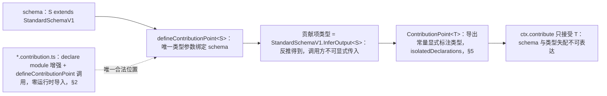
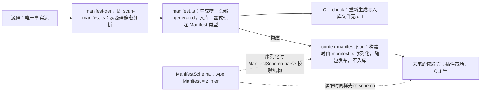
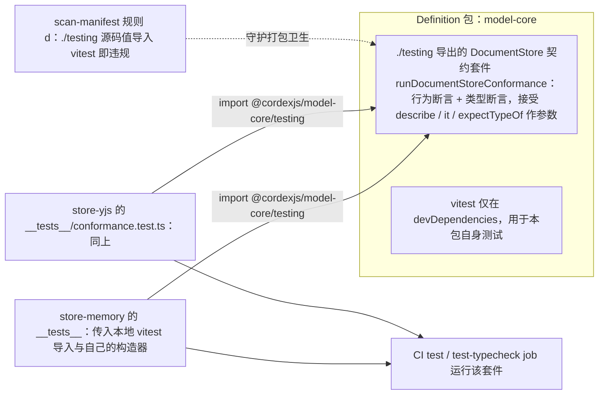

> 状态：草稿 | 负责：架构-类型治理 | 更新：2026-09-14；2026-09-24（复核修正，rulings §4.17：M18 锚点 `-oce` → `-cordex`）；2026-09-25（补图）；2026-09-25（矛盾收口，rulings §4.18）；2026-09-26（§4.20）（TX-09：§6「每个 Definition 至少一个 `*.type-test.ts`」登记机械核对点 scan-manifest (e3)、TD-111） | 依赖：charter v0.1

# 09 · 插件类型契约

本篇是 R7 在"插件如何对内核类型化承诺"这一具体面上的落地：`ContributionPoint`/`Manifest` 的类型形状、声明合并的合法边界、`isolatedDeclarations` 对贡献点写法的具体约束、类型测试的组织方式、Provider 一致性套件的类型接口。本篇描述的是**类型契约**；`ContributionPoint`/`Manifest`/`UnitScope` 的**运行时设计**（`ctx.contribute` 的调度语义、Fiber 生命周期与贡献项的绑定关系等）属架构-结构条线 A 的 `03-kernel-and-plugin-model.md`，本篇只消费该设计并声明其类型边界，不重新定义运行时行为。

---

## 1. ContributionPoint 的类型约束

### 1.1 泛型签名与 schema/T 一致性

历史上"贡献点类型与其校验 schema 各自独立声明、两者随时间漂移"是 [lessons A14](../../00-charter/reference-univer-lessons.md)（幽灵泛型）的一种具体表现。本项目的设计选择是**结构性消除**这一失配可能性，而不是靠额外规则检测它：

```ts
// 示意（草案，非实现），定义于 @cordexjs/kernel
function defineContributionPoint<S extends StandardSchemaV1>(options: {
  id: `${string}.${string}`
  schema: S
  key: (item: StandardSchemaV1.InferOutput<S>) => string
  conflict?: 'error' | 'replace'   // 缺省 'error'；'replace' 须在定义时显式声明（rulings K-3）
  describe?: (item: StandardSchemaV1.InferOutput<S>) => string
}): ContributionPoint<StandardSchemaV1.InferOutput<S>>
```

关键约束：**调用方不能显式传入贡献项的类型参数**——签名里唯一的类型参数 `S` 绑定的是 `schema` 本身，贡献项类型 `StandardSchemaV1.InferOutput<S>` 是从 `S` **反推**出来的返回类型位置，不对调用方开放书写。这意味着"schema 与类型不一致"这种失配在类型层面**不可表达**：贡献项类型永远等于 schema 的推导输出，不存在第二个独立声明的机会。与 [05§3](./05-runtime-boundaries.md#3-schema-即类型源)「schema 即类型源」是同一原则在贡献点场景下的具体化。`conflict`、`describe` 两个可选字段只描述运行时行为（语义见 `03-kernel-and-plugin-model.md` §3.2/§3.3），不引入第二个类型参数（2026-09-25，rulings §4.18 GV-18 补齐 K-3 已确认存在的 `conflict` 字段）。

**贡献点类型推导链**



怎么读：实线是类型从 schema 一路推导到调用点的方向，中间没有第二处手写类型的机会；虚线标出贡献点定义只能出现在 `*.contribution.ts`。

### 1.2 唯一键类型

`key: (item: T) => string` 是贡献点内部用于去重/查找的键提取函数，`ContributionPoint<T>` 内部以 `Map<string, T>` 形式维护贡献集合。**键冲突处理**（2026-09-25，rulings §4.18 GV-18：运行时语义归 `03-kernel-and-plugin-model.md` §3.3，本篇只消费）：同一贡献点内两个不同 Fiber 贡献了相同 `key(item)` 结果时，按该贡献点定义时声明的 `conflict` 策略处理——
- `conflict: 'error'`（缺省）：**拒绝后来的那一项**，记 `ContributionDiagnostic{ reason: 'duplicate' }` 并经 `errors.report` 上报，`ctx.contribute()` 返回一个 no-op disposer，**不抛异常**、不静默覆盖——一个坏贡献不应拖垮整个插件的 `apply`（lessons A11），先到者继续生效；
- `conflict: 'replace'`：后者覆盖前者并发 `replaced` 诊断；只有在定义时显式声明的贡献点可用（当前取值见 `03-kernel-and-plugin-model.md` §3.6 总表 conflict 列，rulings K-3 / §4.18 GV-24）。

原稿的 `DuplicateContributionError` 作废：它与 `03-kernel-and-plugin-model.md` §3.3、ADR-0006 与 `ContributionDiagnostic.reason` 的 `'duplicate'` 取值相矛盾。类型层面的约束只有一条：`ctx.contribute()` 的返回类型恒为 disposer，被拒绝与被接受在类型上不可区分，调用方如需确认只能读诊断（`contributions.diagnostics()`）。

### 1.3 与旧式 `register*`/switch-on-kind 的对比

`defineContributionPoint` 按**类型键索引**而非字符串 switch 分发（继承 [lessons K11](../../00-charter/reference-univer-lessons.md)：`Plugin.static type` 与按类型键索引优于 switch），内核代码不包含任何"认识某个具体 `kind` 值"的分支逻辑——这是"文档类型盲"（章程 §5.1）在实现层面的直接体现，也是 [03](./03-boundaries.md) `cordex-doc-type-blind` 规则在类型系统里的对偶：depcruise 从**依赖图**禁止水平层认识垂直束的包，`defineContributionPoint` 的类型设计从**类型系统**禁止水平层认识垂直束的值形状。

---

## 2. `declare module` 的合法位置与内容

- **合法位置**：仅 `*.contribution.ts` 文件（primer §5.3 文件约定；文件名与内容的双向约束机械化见 [02§4.6 `cordex/contribution-file-naming`](./02-lint-rules.md#46-cordexcontribution-file-naming)）。
- **合法目标模块**：`declare module '@cordexjs/kernel'`（首选）；若 ADR-0001「声明合并策略」（架构-结构条线所有，primer §5.2 标注为"需 spike 验证类型可行性"）的 spike 结论是桥接不可行，退路是允许 `declare module 'cordis'` 直接增强，但**同等地**限定在 `*.contribution.ts` 且零运行时导入——本篇的 `cordex/contribution-file-naming` 规则在设计时已覆盖两种目标模块名（规则的选择器匹配 `declare module` 的字符串字面量属于 `'@cordexjs/kernel'` 或 `'cordis'` 二者之一，两种情形适用完全相同的"零运行时导入"约束），因此 ADR-0001 无论最终结论如何，本篇规则**不需要**随之修改，只是把哪个目标模块名判定为"合法"的开关切换一下（该开关的具体落点是 `cordex/contribution-file-naming` 规则的配置项，非规则逻辑本身）。
- **禁止内容**：`*.contribution.ts` 内除 `declare module` 增强块与 `defineContributionPoint(...)` 调用外，不得出现其他可执行语句（见 [02§4.6](./02-lint-rules.md#46-cordexcontribution-file-naming) 规则 2）。这保证该文件在任何打包场景下都是"零运行时体积"的——类型擦除后，`*.contribution.ts` 参与构建的唯一产物是 `defineContributionPoint` 调用本身产生的贡献点对象；`declare module` 块整体被擦除，不留痕迹。

---

## 3. Manifest 类型与 JSON Schema

```ts
// 示意（草案）
const ManifestSchema = /* z.object({ id, version, iso, provides, injects, contributes, events, peer? }) */
type Manifest = z.infer<typeof ManifestSchema>
```

- `Manifest` 本身遵循 [05§3](./05-runtime-boundaries.md#3-schema-即类型源)「schema 即类型源」——`type Manifest` 不是手写接口，是 `z.infer` 的产物，与 `cordex-manifest.json`（构建时由 `manifest.ts` 序列化）共用同一份 schema 校验：生成时用 `ManifestSchema.parse()` 校验生成结果的结构合法性，未来任何工具（如插件市场、CLI）读取 `cordex-manifest.json` 时同样先过这道 schema，不需要重新理解 TS 类型定义——这是"把 Manifest 当成一个真正的边界产物"的直接体现（[05§1](./05-runtime-boundaries.md#1-必须校验的边界清单) 清单可延伸追加"Manifest 读取"这一行，当有非 TS 工具消费 `cordex-manifest.json` 时生效；M0 阶段消费方仅为本仓库自身的 CI，暂不追加为独立边界行，避免为尚不存在的消费者预先设计校验路径）。
- `Manifest` 每个包一份（`manifest.ts` 导出）。**生成策略归结构线 `03-kernel-and-plugin-model.md` §2.3/§4.2 与 ADR-0003**（2026-09-25，rulings §4.18 GV-17，依据 charter 术语「Manifest……由源码生成」与 §6.2「静态分析生成并入库，CI 无 diff」）：`manifest.ts` 由 manifest-gen（即 `tooling/scripts/scan-manifest.ts`，40-modules/01 D-1）从源码静态分析**生成**，头部标记 `generated`、禁止人工编辑、**入库**；CI 以 `--check` 模式重新生成，要求与入库文件无 diff；`cordex-manifest.json` 是构建时由 `manifest.ts` 序列化的产物，随包发布、**不入库**。源码是唯一事实源——一个尚未实现的 `provides` 项不可能出现在生成的 `manifest.ts` 里，手改 `manifest.ts` 会在 `--check` 时以 diff 失败，这同样防住 [lessons A9](../../00-charter/reference-univer-lessons.md) 的反面失败模式「manifest 存在但与事实脱节」。原稿「`manifest.ts` 人工编写以获得意图声明」的三层写法作废（ADR-0003 已否决「手写 manifest.ts」备选）。

**Manifest 的生成链**



怎么读：源码经生成器得到入库的 manifest.ts，CI 用重新生成比对防止手改与漂移；发布用的 JSON 只在构建时从 manifest.ts 派生；虚线表示同一份 schema 同时约束生成与读取两端。

---

## 4. Events / Context 声明合并的检查

类型层面的声明合并本身（`interface Events { ... }`/`interface Context { ... }` 的增量扩展）是 TS 语言特性，不需要本项目额外的类型契约；本项目的机械约束集中在**声明合并发生的位置与命名规范**：

- 位置约束：同 §2（仅 `*.contribution.ts`）。
- 命名与使用约束：[02§4.4 `cordex/events-must-be-declared`](./02-lint-rules.md#44-cordexevents-must-be-declared含域白名单子检测响应架构-结构条线-event-domain-whitelist)、[02§4.5 `cordex/services-must-be-declared`](./02-lint-rules.md#45-cordexservices-must-be-declared)——两条规则既检查"调用点使用的名字是否已声明"，也隐含检查"声明是否符合命名模式"（不匹配模式的声明本身不违规，但任何**使用**该名字的调用点会因模式不匹配而报错，间接给声明者反馈）。
- 一个声明合并块可以扩展 `Events` 或 `Context` 之一或两者；不要求一一对应（一个贡献点定义文件可能只扩展 `Context`，不涉及新事件）。

---

## 5. `isolatedDeclarations` 下的导出约束

[01§2.3](./01-tsconfig-baseline.md#23-r7-专项isolateddeclarations-与-verbatimmodulesyntax) 已说明 `isolatedDeclarations` 要求"每个导出声明的类型只能从该声明的语法确定"。对贡献点/Manifest 这类由**函数调用**产生的导出值，这一要求有具体的写法后果：

```ts
// 违规（示意）：defineContributionPoint(...) 是函数调用，其返回类型对
// isolatedDeclarations 而言不是"语法上可确定"的——即使 TS 完整类型检查能推导出来，
// 孤立声明（不看函数实现、只看调用点语法）做不到，因此编译失败。
export const shapeKindPoint = defineContributionPoint({ id: 'slide.shapeKind', schema, key })

// 正确（示意）：显式标注返回类型，恢复"语法上可确定"
export const shapeKindPoint: ContributionPoint<ShapeKindContribution> =
  defineContributionPoint({ id: 'slide.shapeKind', schema, key })
```

同样的要求适用于 `manifest.ts` 的 `export const manifest: Manifest = {...}`（对象字面量初始化器本身通常语法可推导，但本项目**仍然**要求显式标注——不是因为 `isolatedDeclarations` 强制，而是 [02§4.6](./02-lint-rules.md#46-cordexcontribution-file-naming) 规则 4 的独立要求，理由是"显式标注让 `manifest.ts` 的读者不需要跳转到 `Manifest` 类型定义就能确认这是一份 Manifest，而不是恰好长得像的普通对象"）。

**通用规则**（供作者判断"什么时候需要显式标注"，不止适用于贡献点）：导出声明的初始化器是字面量（字符串/数字/布尔/数组字面量/对象字面量/`as const`）或 `new` 一个具名类时，通常语法可推导，可省略标注；初始化器是函数调用（尤其是泛型函数调用）、条件表达式、或依赖控制流收窄的结果时，**必须**显式标注。`policy-check` 不对这条通用规则做独立机械检查（它就是 `isolatedDeclarations` 编译器行为本身，违反即编译失败，不需要额外工具复述编译器已经做的事）。

---

## 6. 类型测试的组织方式

**工具选型**：Vitest 内建的 `expectTypeOf`/`assertType`（配合 `vitest --typecheck` 运行模式），**不**引入 `tsd` 或独立的 `expect-type` 包作为额外依赖。理由与备选方案对比见 [ADR-0048](../adr/0048-type-testing-tooling.md)；核心考量是 D9 已经选定 Vitest 作为测试运行时，复用同一工具链避免"运行时测试用 Vitest、类型测试用另一套断言语法与另一套 CLI"的双运行时心智负担。

**组织约定**：

- 类型测试文件命名 `*.type-test.ts`，与同名的行为测试（`*.test.ts`）分开存放，均在各包 `__tests__/` 目录下。
- 每个 Definition（如 `DocumentStore`、`ContributionPoint<T>` 的具体贡献点、`Manifest`）至少一个 `*.type-test.ts`，用 `describe`/`it` 组织，每个 `it` 对应一个"这个类型契约应该拒绝/接受什么形状"的具体断言。机械核对：[06 §6](./06-scanners.md#6-scan-manifest) 子项 (e3)，TD-111（2026-09-26，rulings §4.20 TX-09；Definition 集合 = `cordex.implements` 值 ∪ `defineContributionPoint()` 导出 ∪ kernel `Manifest`）。
- `@ts-expect-error` 用于负向类型测试（"这段代码应该编译失败"），**每一处**必须带说明注释，格式与 [02§3](./02-lint-rules.md#3-禁用清单--具体规则映射) 的 `@ts-expect-error` 全局格式要求一致（`cordex-allow` 引用格式不适用于类型测试场景——类型测试里的 `@ts-expect-error` 本身就是**预期行为**，不是逃逸，因此改用更简单的行内说明格式：紧跟一行注释说明"这里应该因为什么原因编译失败"，机械校验只检查"说明非空"，不要求 `cordex-allow`/issue 链接格式，两者用途不同不应共用同一格式约定，避免开发者误把"合法的负向类型测试"当成"需要走豁免流程的违规"）。

```ts
// 示意
describe('ContributionPoint<ShapeKindContribution>', () => {
  it('accepts a valid shape-kind item', () => {
    expectTypeOf(shapeKindPoint.contribute).parameter(0).toMatchTypeOf<ShapeKindContribution>()
  })
  it('rejects an item missing the required "render" field', () => {
    // @ts-expect-error: schema 要求 render 字段必填，此处故意省略以验证类型层面会拒绝
    shapeKindPoint.contribute({ kind: 'custom-badge' })
  })
})
```

- 独立 CI job `test-typecheck`（[07§3](./07-hooks-and-ci.md#3-ci-工作流矩阵)）运行，不与常规 `test` job 混合——类型测试的失败信息是 tsc 诊断（指向具体类型不匹配的原因），与运行时测试失败信息（断言差异）性质不同，混合报告会让排查变慢。

---

## 7. Provider 一致性套件的类型接口

每个 Definition 包（如 `model-core` 之于 `DocumentStore`）在其 `"./testing"` 导出子路径（[04§3](./04-api-surface.md#3-exports-显式子路径策略)）下提供一个**共享的契约套件**（统一命名 `run<Definition>Conformance`，charter §5.5；2026-09-25 rulings §4.18 GV-19 由旧名 `run…ComplianceSuite`/「合规套件」改正），形状示意：

```ts
// 示意，定义于 @cordexjs/model-core 的 ./testing 子路径
function runDocumentStoreConformance(
  createStore: () => DocumentStore,
): void   // 内部调用 describe/it，注册一组行为 + 类型双重断言
```

每个 Provider 包（`store-memory`、`store-yjs`）的 `__tests__/` 内导入并调用该函数，传入自己的构造器：

```ts
// 示意，定义于 @cordexjs/store-yjs/__tests__/conformance.test.ts
import { runDocumentStoreConformance } from '@cordexjs/model-core/testing'
runDocumentStoreConformance(() => new YjsDocumentStore(/* ... */))
```

**这一设计与 [04§3](./04-api-surface.md#3-exports-显式子路径策略) `"./testing"` 导出策略互相印证**：章程 §5.3 规则 7 要求禁止深引用、跨包只走目标包 `exports` 显式登记的子路径（= `cordex.publicEntry`，其中 `"."` 与 `"./testing"` 为必有项，2026-09-25 rulings §4.18 FE-04），`"./testing"` 存在的**理由**在本篇第一次给出具体场景——它不是一个"顺手加上的测试工具口子"，而是「三角色」（Definition/Provider/Consumer）模式要求"每个 Provider 必须能被同一套断言验证"这一治理目标的直接实现载体。契约套件本身同时包含**行为断言**（运行时正确性，如"写入后能读回"）与**类型断言**（`expectTypeOf`，如"`transact` 的回调参数类型与 `DocumentStore.transact` 声明一致"），后者部分与 §6 的类型测试组织约定共用同一工具链。

**打包卫生说明**：`runDocumentStoreConformance` 内部使用 `describe`/`it`/`expectTypeOf` 时，`vitest` 不应成为 `model-core` 这类 Definition 包的 `dependencies`（它是终端 SDK 包，不应强制消费者安装测试框架）。做法：`vitest` 只作为 `model-core` 的 `devDependencies` 用于**本包自身**测试，`./testing` 子路径导出的 `runDocumentStoreConformance` 改为接受 `describe`/`it`/`expectTypeOf` 作为参数（由调用方——即 Provider 包自己的测试文件——传入其本地 `vitest` 导入），而不是在 `model-core` 内部直接 `import { describe } from 'vitest'`。这一约束是 [lessons A34](../../00-charter/reference-univer-lessons.md)（类型/测试专用依赖不得渗入运行时依赖表）在"契约套件"这一具体场景下的应用，机械校验点与 A34 共用（[06 scan-manifest](./06-scanners.md#6-scan-manifest) 规则 (d) 会把"`./testing` 子路径源码里出现 `import ... from 'vitest'` 的值导入"识别为同一类违规）。

**Provider 一致性套件的调用关系**



怎么读：每个 Provider 的测试从 Definition 包的 `./testing` 子路径导入同一套件并注入自己的构造器；测试框架由调用方传入，Definition 包不把 vitest 带进运行时依赖（虚线为对应的机械守护）。

---

## 8. 如何被机械验证（汇总）

| 声明 | 验证方式 | 失败信息来源 |
|---|---|---|
| 贡献项类型必由 schema 推导，调用方不可另行指定 | `defineContributionPoint` 自身签名（TS 编译器强制，见 §1.1） | tsc 诊断 |
| `declare module` 只出现在合法位置、零运行时导入 | [02§4.6](./02-lint-rules.md#46-cordexcontribution-file-naming) | ESLint 诊断 |
| Manifest 与源码事实一致 | [06 scan-manifest](./06-scanners.md#6-scan-manifest) | scan-manifest 报告 |
| 贡献点/Manifest 常量导出类型显式 | `isolatedDeclarations`（[01](./01-tsconfig-baseline.md)） | tsc 诊断 |
| 类型测试的负向用例有说明 | `@typescript-eslint/ban-ts-comment`（[02§3](./02-lint-rules.md#3-禁用清单--具体规则映射)，格式扩展至类型测试场景） | ESLint 诊断 |
| 每个 Provider 通过其 Definition 的契约套件 | `test`/`test-typecheck` job 运行该套件 | Vitest 原生输出（含具体失败的行为/类型断言） |
