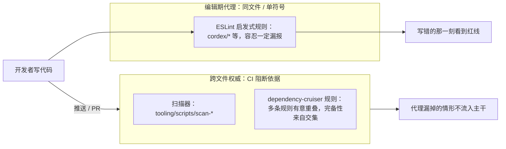

> 状态：草稿 | 负责：架构-类型治理 | 更新：2026-09-14；2026-09-24（rulings §4.15：矩阵增至 82 行（§12a TD-079～082）；lint-guard/workspace 协议/HTML 注入/`*-ui` 框架无关落点见 02/03/07/08）；2026-09-24（复核修正，rulings §4.17：D3 扫描器十三个 → 十四个；M18 锚点 `-oce` → `-cordex`）；2026-09-25（补图）；2026-09-25（矛盾收口，rulings §4.18）；2026-09-25（§4.19：矩阵增至 109 行（08 §12c）；02 §4.12 / §4.15、06 §6 / §10 / §12 / §14 / §18 按三条设计线收口回写） | 依赖：charter v0.1

# 09 · 类型治理 —— 强类型规约与机械约束机制

本子线回答章程 R7（「尽管使用 TS，但要求强类型规约，不能跨出类型规约要求，需要设计一系列约束机制，如 hooks、扫描脚本等」）：**不是写一份"应该怎么做"的规范文档，而是为每一条规范设计一个会在具体某一步、以具体某种信息失败的机械检查点**。这一立场直接来自 [reference-univer-lessons.md](../../00-charter/reference-univer-lessons.md) 的核心论点——Univer 在几乎每一类问题上都至少做对过一次，但没有机制保证那个正确做法被持续采用；82% 的提交来自 3 个人时靠人的纪律撑住了架构，团队扩张或换人后就会滑坡。

---

## 1. 原则

以下五条原则贯穿全部九个子文档与九个 ADR，任何一条规则/脚本/门禁的设计若违反这五条，视为本子线内部的设计缺陷，应被修正而非绕过。

### 1.1 规范必有执行点

每一条写进文档的规范，必须能回答：「违反它时，哪一步（pre-commit / pre-push / CI 的哪个 job）、哪个工具（ESLint 规则名 / depcruise 规则名 / 扫描器名 / tsc 选项）、以什么信息失败」。回答不出这三问的陈述不是规范，是愿望——[08-policy-enforcement-matrix.md](./08-policy-enforcement-matrix.md) 的每一行都是这三问的结构化答案。

**诚实的例外**：极少数规范（cordis primer §4 的部分 MUST/MUST NOT，如"waterfall 监听器除非有意否决否则必须调用 next()"）涉及**意图判断**而非**模式匹配**，AST 规则会对合法情形产生大量假阳性。对这类规范，「机械执行点」允许退化为「文档纪律 + PR 评审」，但矩阵仍必须显式登记该规范与其真实的执行强度（标注 `N/A（人工评审）`），**不允许**用一条名不副实的规则去"装作"覆盖了它——这本身就是对"声明了但没执行"（lessons A16-A27）的反向防范：宁可承认某处没有机械化，也不能让文档说"已覆盖"而实际是摆设。

### 1.2 先失败，不部分激活

任何校验失败（类型错误、配置校验失败、依赖规则违反）导致的结果是**整体拒绝**，不是"降级运行"或"跳过这一项继续"。这一原则在编译期体现为 `noEmitOnError`（[01](./01-tsconfig-baseline.md)），在插件加载体现为 cordis 原生的 `ValidationError`（primer §3.2，未通过 Config 校验的插件不会"部分启动"），在 CI 体现为"没有 `--quiet`，没有 `warn` 级别，只有 `error` 或不存在"（[07](./07-hooks-and-ci.md)）。

### 1.3 预算只减不增（ratchet）

无法立即归零的类型逃逸（`any`/`as`/`!`/`@ts-ignore`/未说明的 `@ts-expect-error`）不是靠"暂时容忍、以后再治理"的口头承诺管理，而是靠 [ADR-0040](../adr/0040-type-budgets-and-ratchet.md) 定义的预算文件：数值可以下降，**不能**在没有走例外流程的情况下上升。这把"技术债不会自动变好，但至少不会在无人察觉的情况下变坏"变成一个 CI 能验证的属性。

### 1.4 负向测试是准入门槛

任何声称"能拦住某种违规"的规则/扫描器，如果没有一个"故意违规"的测试用例证明它真的会触发，就还没有资格进入配置（直接反制 [lessons A17](../../00-charter/reference-univer-lessons.md)：Univer 的穿透/barrel import 规则"有 docstring，实现是 no-op"）。[06 scan-policy](./06-scanners.md#9-scan-policy) 把这条原则本身变成一个 CI 门禁：没有负向测试的规则会被它揪出来，而不是靠评审者肉眼发现。

### 1.5 无 `--quiet`，门禁不可静默降级

`--quiet`/`--silent`/把 `error` 降级为 `warn`/CI 配置成"只在特定分支运行"，都是同一类失败模式的变体：规则依然"存在"，但不再产生后果。本方案的立场是**存在但不生效的规则比不存在更危险**——它给团队制造"这里有把关"的错觉。[07](./07-hooks-and-ci.md) 逐条声明这一姿态，[08](./08-policy-enforcement-matrix.md) 的覆盖率检查确保这一姿态本身也被校验（见 §4）。

---

## 2. 一个反复出现的设计模式：编辑期代理 + 跨文件权威

读者会在 [02](./02-lint-rules.md)、[03](./03-boundaries.md)、[06](./06-scanners.md) 里反复看到同一种分工：凡是"事实分散在多个文件才能判断"的规范（Provider/Consumer 关系是否越界、Config 字段是否被消费、effect 是否真的在卸载后清空），本方案配两层检查——一层是**同文件/单符号的 ESLint 启发式规则**，给出编辑期的即时红线，容忍一定漏报；另一层是**跨文件/跨图的扫描器或 dependency-cruiser 规则**，是 CI 阻断的权威依据。这不是重复劳动，是刻意的纵深防御：编辑期代理让开发者在写错的那一刻就知道，跨文件权威保证"代理漏掉的情形"不会真的流入主干。[03](./03-boundaries.md) 的依赖规则同样遵循"没有一条规则被期望单独完备，完备性来自多条规则的交集"这一姿态（层号秩序 + 束间隔离 + 同构标记 + 三角色，四条规则彼此有意重叠）。

**编辑期代理 + 跨文件权威**



怎么读：同一条规范配两层检查——左侧编辑期代理给即时反馈，右侧跨文件、跨图的权威检查在 CI 阻断；事实分散在多个文件才能判断的规范（Provider/Consumer 越界、Config 字段是否被消费、effect 是否在卸载后清空）以右侧为准。

---

## 3. 阅读指引

| 文件 | 一句话 |
|---|---|
| [01-tsconfig-baseline.md](./01-tsconfig-baseline.md) | 编译选项全集、iso/dom/node/nest 四套基线、项目引用、`apps/server` 的受限例外 |
| [02-lint-rules.md](./02-lint-rules.md) | typescript-eslint 预设姿态、禁用清单（含 apps/preset/index.ts/编解码确定性四类路径级内建规则配置）、21 条 `cordex/*` 自定义规则、ESLint/Biome 切分 |
| [03-boundaries.md](./03-boundaries.md) | dependency-cruiser 八条规则的语义规格、包元数据、三重保障、knip/manypkg/syncpack 分工 |
| [04-api-surface.md](./04-api-surface.md) | api-extractor、`.api.md`、exports 策略、publint/attw、Changesets 对接 |
| [05-runtime-boundaries.md](./05-runtime-boundaries.md) | 必须校验的边界清单、schema 即类型源、品牌类型、`Derived<T>` 派生字段标记、Result 与异常的边界 |
| [06-scanners.md](./06-scanners.md) | 十四个自研扫描器的完整规格（第 14 个 `doc-access-via-permission`，rulings §4.17 D3）；其余文档中出现的「扫描器」名按 rulings §4.18 GV-15 归并为子规则，见 08 §11.1 |
| [07-hooks-and-ci.md](./07-hooks-and-ci.md) | lefthook 阶段、CI job 矩阵、缓存策略 |
| [08-policy-enforcement-matrix.md](./08-policy-enforcement-matrix.md) | 规范↔执行矩阵（109 行，机器可解析）+ 架构-结构条线规则命名对照与扫描器名对账（§11.1） |
| [09-plugin-type-contracts.md](./09-plugin-type-contracts.md) | ContributionPoint/Manifest 类型契约、声明合并边界、类型测试组织 |

建议阅读顺序：先读本文件，再按 01→09 顺序通读一遍建立全貌，之后以 [08](./08-policy-enforcement-matrix.md) 为索引按需跳转（"这条规范在哪、谁执行、违反了会怎样"这类问题直接查矩阵比重新通读全文快）。

### `tooling/` 全景索引

以下是 `tooling/` 顶层目录与其详细规格所在文档，非完整文件级展开（完整展开见各文件 §1）：

```
tooling/
├── eslint-config/     ESLint flat config + eslint-plugin-cordex（21 条自定义规则）   → 02
├── tsconfig/           iso/dom/node/nest/build/vitest 六套基础配置                → 01
├── depcruise/           八条依赖规则的实现 + 每条规则的夹具化负向测试              → 03
├── api-extractor/       iso/dom/node 三套 api-extractor 基础配置                  → 04
├── scripts/              十四个 scan-* 扫描器 + 共享 lib/                        → 06
├── policy/                budgets.json / milestones.json / requirements.json /
│                            event-domains.json / policy-row schema / 包元数据 schema → 06 §15
├── xsd/                    OOXML 脏部件重生成结果的 XSD 有效性校验工具；内容归属
│                            架构-结构条线（ooxml-core 设计），本子线登记目录与 CI job → 07 §3
├── lefthook.yml            pre-commit / commit-msg / pre-push 三阶段（物理位于仓库根，此处只登记内容归属）→ 07
└── commitlint.config.ts    Conventional Commits 规则                             → 07
```

---

## 4. 「规范→工具→门禁」矩阵入口

[08-policy-enforcement-matrix.md](./08-policy-enforcement-matrix.md) 是本子线的核心可审计产物：109 行（2026-09-25 按 rulings §4.19 补 §12c TD-103～TD-109），覆盖章程 §5.3 全部八条依赖规则（9 行）、cordis primer §4 全部 16 条 MUST/MUST NOT（15 行）、[lessons](../../00-charter/reference-univer-lessons.md) A6/A8/A10/A12/A14/A30（6 行）、A16–A27 全部 12 项（12 行）、A34/K9/K10（3 行）、章程已定决策 D2/D4/D7/D9/D11/D13 的类型化具体化（6 行）、本方案为完备性新增的机制（8 行）、产品 PRD 新增需求（3 行）、架构-结构/架构-运行时条线两轮追加需求（15 行）、章程 §10 Q1–Q10 裁决落地与 2026-09-24 复核补登（7 行，§12a）、2026-09-25 矛盾收口补登（17 行，§12b：40-modules/01 Q-07 的五行、GV-15 扫描器名对账、FE-02 依赖上限、FE-21 包元数据封闭 schema）。矩阵本身的格式约定（固定列顺序、id 正则 `^TD-\d{3}$`）见该文件 §1，[§11](./08-policy-enforcement-matrix.md#11-命名对照架构-结构条线规则别名) 提供与其他条线规则命名的对照表，矩阵自身被 [06 scan-policy](./06-scanners.md#9-scan-policy) 逐行机器校验——这不是一份"写完就过时"的文档，是一份被 CI 持续验真的清单。

---

## 5. 术语补充

（仅补充章程 §4 未定义、本子线新造或收窄语义的术语；已在章程定义的术语不重复。）

| 术语 | 英文/标识 | 定义 |
|---|---|---|
| 类型逃逸 | type escape | `any`/`as`（非 `as const`/`satisfies`）/`!`/`@ts-ignore`/未说明的 `@ts-expect-error` 的统称；[06 scan-type-escapes](./06-scanners.md#2-scan-type-escapes) 的统计对象 |
| 棘轮预算 | ratchet budget | 只能下调、不能在无例外流程的情况下上调的数值上限，用于管理暂时无法归零的类型逃逸；见 [ADR-0040](../adr/0040-type-budgets-and-ratchet.md) |
| 秩 | rank | 章程 v0.2 §5.1/§5.3 定稿的分层网格（L0/L1/L3/L4/L5/L7/L8/LS + V-model/V-codec/V-render/V-ui）数值偏序，供 depcruise「只向下」规则比较；见 [03§3.2](./03-boundaries.md#32-规则-2--规则-3只向下--文档类型盲对应章程-53-2-53-3) |
| 层带 | `V-*` layer band | 垂直束包的层号编码前缀（`V-model`/`V-codec`/`V-render`/`V-ui`），与水平层的 `L<n>` 编码并列但不复用同一数字，取代早期"借用水平层数值"的方案；见 [03§2](./03-boundaries.md#2-包元数据-schema) |
| 组合根 | compositionRoot | 包元数据字段，仅 `preset-*`/`apps/web`/`apps/server` 为 `true`；结构化标记"允许依赖具体 Provider 而非只依赖 Definition"的例外包 |
| 三重保障 | 同构隔离的三层内部一致性机制 | tsconfig lib/types 限制 + `no-restricted-globals` + `node --import` 冒烟；与依赖图层的 `cordex-isomorphism-compatibility`（iso/dom/node 3×3 兼容矩阵）规则共同构成四层防御，见 [03§4](./03-boundaries.md#4-同构隔离的三重保障) |
| 品牌类型 | branded type | `Brand<T, TName> = T & { readonly __brand: TName }` 模式；用于阻止裸 `number`/`string` 冒充度量单位/标识符穿越边界，见 [05§4](./05-runtime-boundaries.md#4-品牌类型branded-types) |
| 派生字段标记 | `Derived<T>` | 与品牌类型同构的标记模式，标注 Model 中计算得出、不应写入 Snapshot 的字段；`Persisted<M>` 从 Model 类型结构性剔除该类字段，见 [05§4.4](./05-runtime-boundaries.md#44-派生字段标记derivedt) |
| 能力位 | `CapabilityBit` | fail-closed 权限模型的最小可声明单元，封闭集合，唯一权威定义于 `@cordexjs/protocol`；`CommandDef.permission` 消费该类型，见 [02§4.16/4.19](./02-lint-rules.md#416-cordexcommand-must-declare-capabilities新增响应-prd-co-05-fail-closed-权限要求架构-结构条线别名-command-declares-capability) |
| 包级稳定级 | `stability` | `package.json#cordex.stability`（`stable`/`beta`/`experimental`，可选字段），驱动 api-extractor release tag 默认值与 Changesets 分组，见 [03§2](./03-boundaries.md#2-包元数据-schema) |
| 编辑期代理 / 跨文件权威 | fast proxy / authoritative gate | 本方案反复使用的双层检查模式，见本文 §2 |
| 规范行 | policy row | [08](./08-policy-enforcement-matrix.md) 矩阵的一行，`TD-\d{3}` 编号 |
| 结构性禁止 | 豁免方式的一种取值 | 表示该规则无 `cordex-allow` 逃逸通道，违反即必须直接修复（区别于"预算制豁免"） |
| 语法可推导性 | syntactic determinability | `isolatedDeclarations` 判断"是否需要显式类型标注"的标准：初始化器的类型能否**仅从语法**（不查看被调用函数的实现）确定 |
| 预算复用 | budget reuse | [ADR-0040](../adr/0040-type-budgets-and-ratchet.md) 的 ratchet 机制（只减不增 + 例外流程）不专属于类型逃逸，`scan-bundle-budget` 是其在"构建产物体积"度量上的复用实例，见 [06§14](./06-scanners.md#14-scan-bundle-budget) |

---

## 6. 待决事项

| # | 问题 | 当前默认/临时处理 | 需要谁决策 |
|---|---|---|---|
| ~~Q-T1~~ | ~~`LS` 数值层号~~ | **已解决**：总编排裁决秩值 58（[03§3.2](./03-boundaries.md#32-规则-2--规则-3只向下--文档类型盲对应章程-53-2-53-3)），章程 v0.2 §5.1/§5.3 已收录完整秩表与第 8 条规则，本子线按此口径执行，不再是待决事项 | — |
| Q-T2 | `packages/*` 是否全部独立发布到 npm registry，还是存在"仅工作区内部消费、不对外发布"的包（若存在，其 `isolatedDeclarations`/api-extractor/exports 门禁应可豁免） | 假定全部可发布，统一套用 [04](./04-api-surface.md) 全部门禁；新增的 `stability` 字段（[03§2](./03-boundaries.md#2-包元数据-schema)）部分缓解了这一问题（`experimental` 包可降级 release tag 默认值），但不改变"是否发布"本身 | 产品 + 架构-结构 A |
| Q-T3 | `coverage-patch`（[07§3](./07-hooks-and-ci.md#3-ci-工作流矩阵)）job 存在性与不可跳过性由本子线保证，但具体阈值百分比与统计口径（是否含分支覆盖率）未定 | 机制先就位，阈值留空，job 处于"存在但暂不设阈值"的过渡态 | 架构-运行时 B |
| Q-T4 | zod 主版本锁定为 4（见 [05§2](./05-runtime-boundaries.md#2-standard-schema--zod-的放置约定)），基于 2026-09-14 检索到的 Standard Schema 支持现状；是否与其余条线已经隐含的假设冲突 | 采用 zod 4 | 总编排 / 架构-结构 A |
| Q-T5 | `no-restricted-globals`/`no-restricted-imports` 的具体名单（[02§5](./02-lint-rules.md#5-单点引入与同构全局生成规则的语义)）是人工维护的静态表，未随包元数据自动派生；包清单变化需要人工同步该表，是否要投入把它也改成从 `cordex.role`/包名模式自动派生 | 暂维持人工维护 + PR 评审 | 架构-类型治理（自评估，非阻塞） |
| Q-T6 | `scan-policy` 对"CI job 是否真的在每个 PR 无分支例外触发""是否真的不含 `--quiet`"目前只能做 job **名称**的封闭性检查，无法解析工作流文件的触发条件/参数表达式（[07§6](./07-hooks-and-ci.md#6-如何被机械验证汇总) 已标注此盲区） | 记录为已知盲区，暂不新增机制 | 架构-类型治理 + 总编排 |
| Q-T7 | 是否需要为常改动的 iso 包提供一个可选的本地冒烟命令（当前 `iso-smoke` 只在 CI 跑，见 [06§5](./06-scanners.md#5-scan-isomorphic)） | 暂不提供，M1 视开发体验反馈决定 | 架构-类型治理 |
| Q-T8 | `CommandDef.permission` 字段的最终形状（单值 `CapabilityBit` 还是数组 `CapabilityBit[]`）未定——[02§4.16](./02-lint-rules.md#416-cordexcommand-must-declare-capabilities新增响应-prd-co-05-fail-closed-权限要求架构-结构条线别名-command-declares-capability) 暂时透传两种可能，不预设 | `cordex/command-must-declare-capabilities` 规则按"非空/非默认值"通用判定，不假设具体形状 | 架构-结构 A（`CommandDef` 类型定义） |
| ~~Q-T9~~ | ~~"`schema-lock`"的确切语义~~ | **已结案（2026-09-25，rulings §4.18 GV-14/GV-15）**：ADR-0009「如何被机械验证」即快照 schema 版本锁，TD-063 语义成立，与 TD-045 并存；执行形态为 `scanners` job 的 `schema-lock` 步骤（[08§11](./08-policy-enforcement-matrix.md#11-命名对照架构-结构条线规则别名)） | — |
| Q-T10 | `tooling/policy/requirements.json`（需求 id 清单镜像）与 `tooling/policy/event-domains.json`（第一方事件域清单）两个文件由谁建立与维护未定；`scan-requirement-tags`/`cordex/events-must-be-declared` 域白名单子检测在这两个文件不存在时分别退化为"仅格式校验，跳过存在性核对"与"无法拒绝未知域" | 两文件均视为可选输入，缺失时功能性降级而非报错 | 产品条线（requirements.json）+ 架构-结构 A（event-domains.json） |
| Q-T11 | `tooling/xsd/` 的具体 XSD 版本、校验粒度（全量 OOXML schema 还是仅脏部件涉及的子集）未定，本子线只登记目录与 `xsd-validate` job | job 存在但校验逻辑留空，等待架构-结构条线 `ooxml-core` 设计产出 | 架构-结构 A |
| Q-T12 | `cordex/store-transact-in-commands-only`、`cordex/no-unit-scoped-inject-at-root` 两条规则的精确检测逻辑依赖 `openUnitScope`/命令管线的最终运行时 API 形态，当前按启发式实现 | 按当前启发式上线，待 API 定稿后收窄漏报面 | 架构-结构 A |

---

## 7. 对章程的异议/建议

### 7.1 已裁决（历史记录）

以下两条建议在提出后已由总编排裁决采纳，章程 v0.2 §5.1/§5.3 已正式收录；本节保留原始论证作为历史记录，不再是待决事项。

1. **§5.3 的"七条"与实际需要的规则数不一致**——原建议：章程 §5.1 的"铁律"段落额外声明了「垂直束互不依赖」，但未编入 §5.3 的七条编号列表，导致 [08](./08-policy-enforcement-matrix.md) 矩阵的覆盖率审计口径与章程字面数字不一致。**裁决结果**：章程 v0.2 §5.3 正式增补第 8 条「垂直束互不依赖」，本子线全文档已按八条规则口径改写（[03§3.2](./03-boundaries.md#32-规则-2--规则-3只向下--文档类型盲对应章程-53-2-53-3)）。
2. **§5.2 包清单缺少 `LS` 的显式数值层号**——原建议：`LS` 在章程分层网格里没有数值层号，本子线曾自行推导秩值 45 作为过渡。**裁决结果**：总编排与架构-结构条线重新核算，定稿 `LS=58`（[03§3.2](./03-boundaries.md#32-规则-2--规则-3只向下--文档类型盲对应章程-53-2-53-3) 的推导依据）；同时定稿垂直束包不再借用水平层数值，改用独立的 `V-model`/`V-codec`/`V-render`/`V-ui` 层带编码（[03§2](./03-boundaries.md#2-包元数据-schema)），章程 v0.2 已收录完整秩表。本子线原推导的 45 已废弃，全文档已更新为 58。

### 7.2 当前状态

本子线在方案设计过程中没有发现与章程已定决策（D1-D13）相冲突、需要请求豁免或修改的情形；§7.1 的两条历史建议均属"章程本身可以更精确"，不是"本方案无法在当前章程下落地"的阻塞项，且均已被采纳。本轮（响应 PRD、架构-结构、架构-运行时三条线新增需求）新出现的、尚未解决的疑问已归入 §6 待决事项（Q-T8～Q-T12），不在本节重复。
