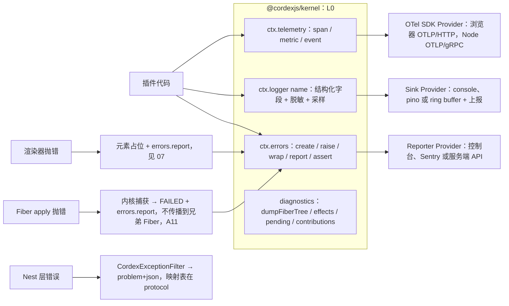
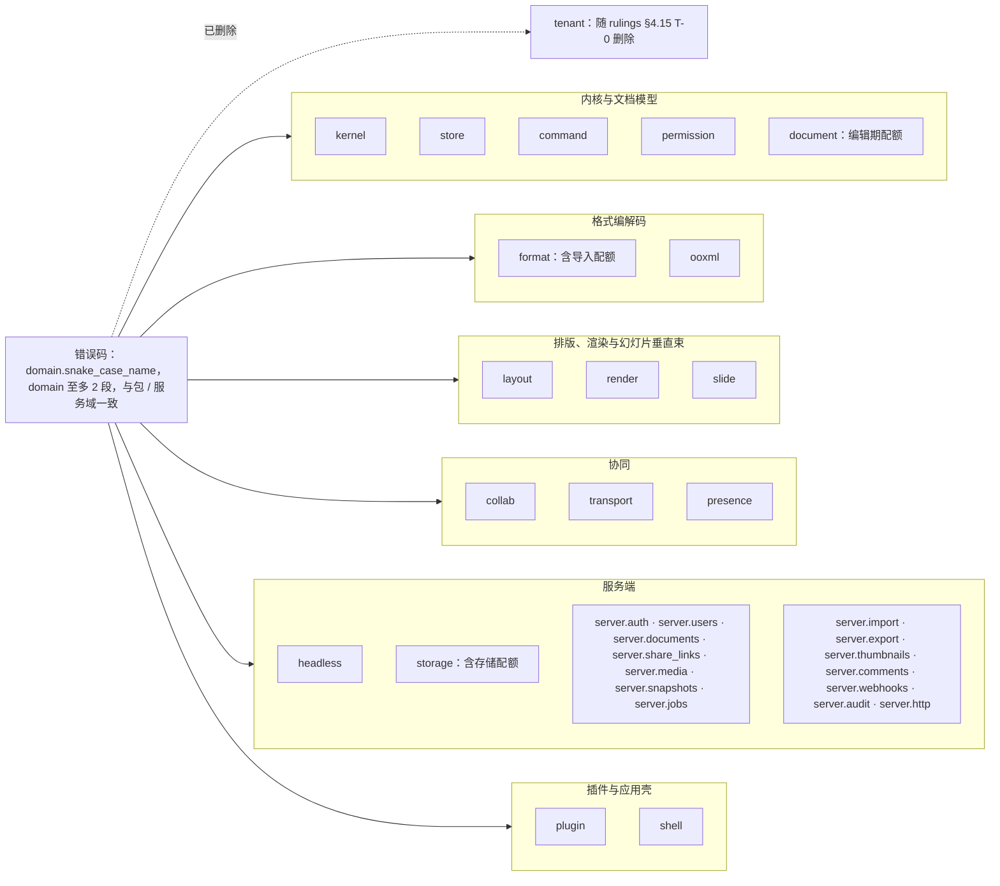
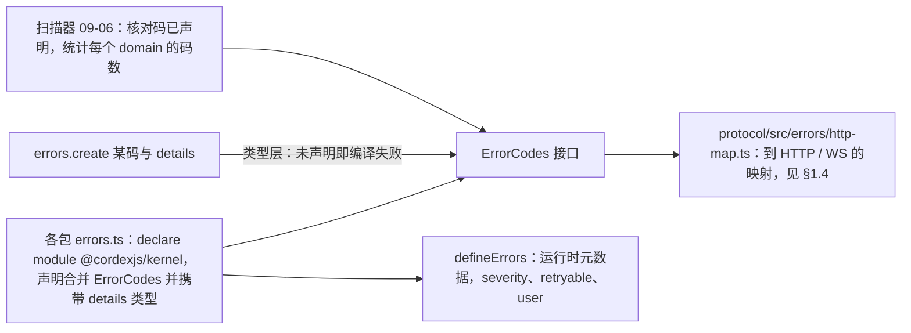
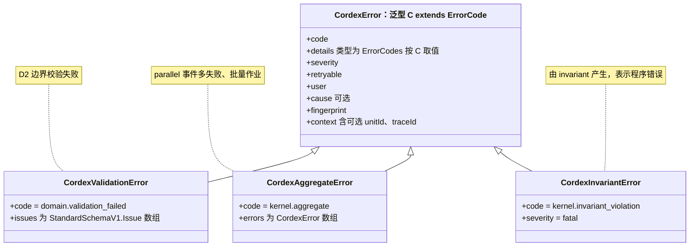
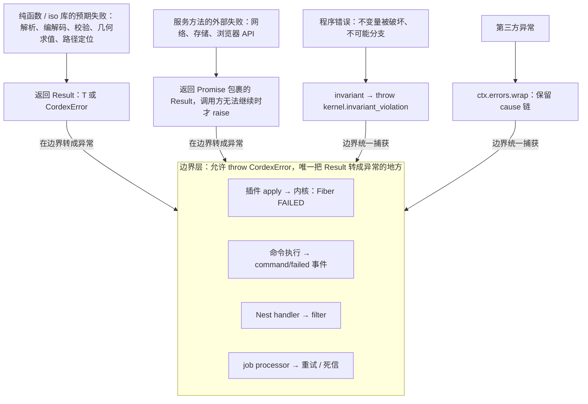
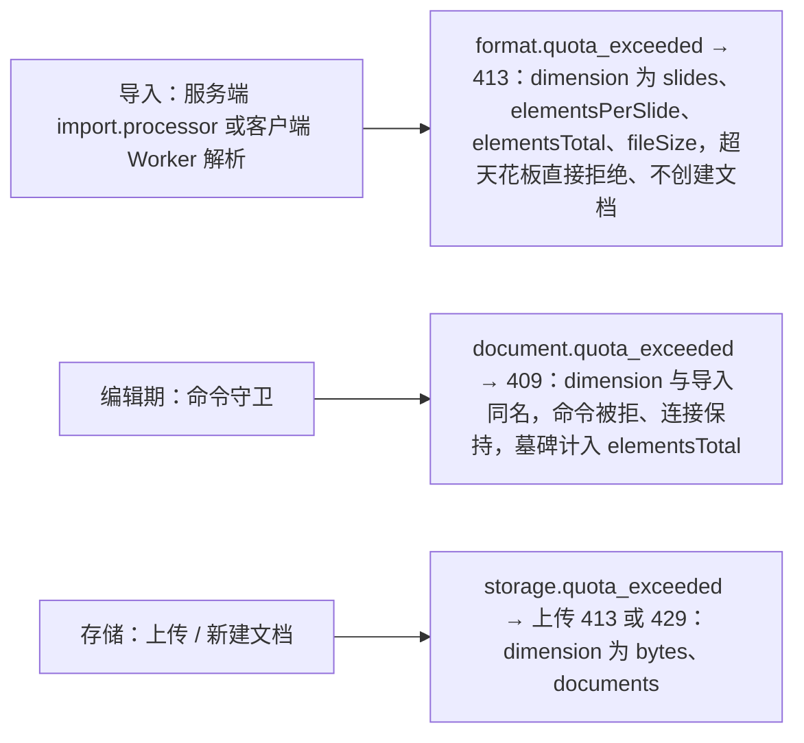
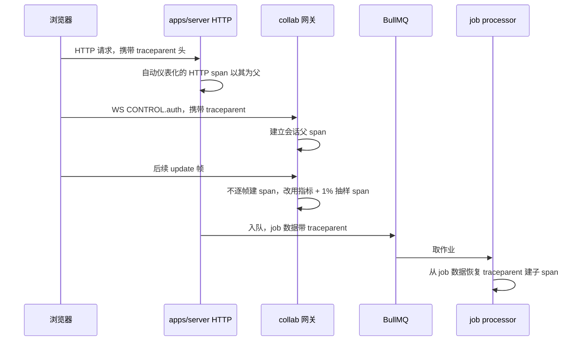
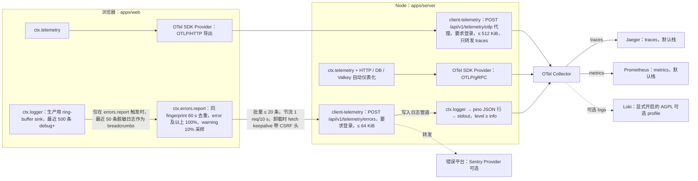

> 状态：草稿 | 负责：架构-运行时 | 更新：2026-09-14；2026-09-24（rulings §4.15：T-0 去租户——删 `cordex.tenant_id` 日志字段与 `tenant.quota_exceeded`，改 `document.quota_exceeded`；Q10 日志默认进 OTel Collector，Loki/Grafana 为 AGPL 可选 profile；Q3 `store/undo-skipped` 事件）；2026-09-24（rulings §4.16 Q15：§1.4 登记 `format.macro_rejected` → 415）；2026-09-24（复核修正，rulings §4.17：D2 `document.quota_exceeded` 定为编辑期上限码、WS 关闭码改「—」、§1.4 登记配额三码 `dimension` 取值表；H6 登记 `format.encrypted`；D5/M-02 `store/undo-skipped` 载荷 `{skipped, wholeStep}` 与单独计数）；2026-09-25（补图）；2026-09-25（矛盾收口，rulings §4.18：BE-30 浏览器上报端点由 client-telemetry 控制器承接（api 角色、要求登录、限流与体积上限），流图补 Collector→Jaeger / Prometheus（§5）；CO-08 指标 `cordex_collab_broadcast_before_persist_total`（§3.3）；CO-12 事件 `unit/loaded`、FE-09 `render/frame` 载荷补 `pendingDirty`（§11.1）；UX-02 令牌刷新 401 与网络错误分流（§11.2）；GV-15 `events-declared` 改写正式名 `cordex/events-must-be-declared`、lifecycle 检查指明 `scan-effects` 规则 (2)（§7、§11.1））；2026-09-25（§4.19 登记的 INC-10 / SG-04、INC-08、INC-24、INC-25、INC-33、TELEMETRY-DEFAULT：§1.1 新域与码一次登记（§1.1a）、§1.4 http-map 补表（含 `format.unsupported_binary`）、§2.3 脱敏头、§3.4 产品事件以 PRD 06 为权威、§5 `fetch` keepalive、§11.1 `render/frame` 与 `perf/frame` 字段；各节加 50 / 60 线链接）；2026-09-25（§4.19）；2026-09-25（设计线拆分：§2.4 Sink、§3.2 span 清单、§3.3 指标清单、§4 诊断、§5 客户端错误上报改为跨端规则摘要 + 链接 50-frontend/15 与 60-backend/18；§1、§2.1–§2.3、§3.1、§3.4、§11 保留） | 依赖：charter v0.1

# 10 观测性与错误（Observability & Errors）：错误码体系、结构化日志、telemetry、诊断、客户端上报

> 读者：所有包的实现者（错误与日志是横切约束）；实现 kernel `errors`/`telemetry`/`logger` 适配器的工程师；运维。
> 章程锚点：D11（`errors`/`telemetry`/`logger` 为 L0 服务，M1 起接入；禁止裸 `throw new Error`）、§5.4（基础服务可替换、移除后降级 no-op）、§5.5（服务名 `errors`/`telemetry`/`logger`）、Univer A24（声明零实现）、A25（dispose 门禁被删）、A11（一崩全崩）、A16（豁免需登记）。
> 相关 ADR：0030（观测栈）。kernel 的目录结构由 A 线在 02/03 定型；本文列出运行时线对 kernel 三个服务的**契约要求**与期望的文件位置（提请 A 线采纳）。

---

## 0. 一页总览

**观测与错误一页总览**



怎么读：kernel 框内是四项基础能力，其中三项各连到一个可替换的 Provider；框外 Fiber、渲染器、Nest 层三条链是三个边界各自捕获错误的方式，其中内核与渲染两条最终汇入 `errors.report`。

三条铁律：
1. **没有裸错误**：生产代码中 `throw new Error(...)`/`new Error(...)`/`throw '...'` 被 lint 禁止（由 09-02 承接）；只能 `throw ctx.errors.create(code, details)`、`return err(...)` 或 `invariant(...)`。
2. **没有无主日志**：`console.*` 在包内被禁止（测试与 tooling 除外）；只能 `ctx.logger(name)`。
3. **每个配置项有读取点、每个指标有消费者**（A26/A24）：`telemetry` 声明的 span/metric 名称都在本文清单中，且各有一个仪表盘/告警或测试引用；扫描器核对（09-06）。

---

## 1. 错误码体系

### 1.1 编码格式

- 代码为**字串字面量** `<domain>.<snake_case_name>`，如 `collab.forbidden`、`store.target_missing`、`format.pptx.invalid_package`。domain ≤ 2 段，与包/服务域一致：`kernel` `store` `command` `permission` `format` `ooxml` `layout` `render` `slide` `collab` `transport` `presence` `headless` `storage` `document` `plugin` `shell`；服务端 REST 域 `server.auth` `server.users` `server.documents` `server.share_links` `server.media` `server.snapshots` `server.jobs` `server.import` `server.export` `server.thumbnails` `server.comments` `server.webhooks` `server.audit` `server.http`（2026-09-25 按决策 INC-10 / SG-04 一次登记，逐码见 §1.1a；废 `share_link.*`、`user.*`、`snapshot.*` 与 `collab.server.room_full`——统一为 `server.share_links.*`、`server.users.*`、`server.snapshots.*` 与 `collab.room_full`；`plugin` 与章程 §5.5 事件域 `plugin/*` 同名；`tenant` 域随 rulings §4.15 T-0 删除；配额/规模类错误按阶段分三码：导入 `format.quota_exceeded`、编辑期 `document.quota_exceeded`、存储 `storage.quota_exceeded`，见 §1.4 取值表，rulings §4.17 D2）。
- 不用数字编号（A3：避免闭合枚举与人为分配冲突）；不用 TS `enum`（lint 禁止）。
- 每个错误码在其所属包的 `errors.ts` 中通过声明合并注册到 `ErrorCodes` 接口，携带 `details` 类型：

```ts
// 草案：packages/collab-core/src/errors.ts
declare module '@cordexjs/kernel' {
  interface ErrorCodes {
    'collab.forbidden':        { unitId: UnitId; role: Role; action: string }
    'collab.room_full':        { unitId: UnitId; limit: number }
    'collab.schema_too_new':   { unitId: UnitId; server: number; client: number }
    'collab.bad_frame':        { frameType?: number; reason: string }
  }
}
export const collabErrors = defineErrors({          // 运行时元数据（严重度、可重试、默认 i18n key）
  'collab.forbidden':      { severity: 'warning', retryable: false, user: true },
  'collab.room_full':      { severity: 'warning', retryable: true,  user: true },
  'collab.schema_too_new': { severity: 'error',   retryable: false, user: true },
  'collab.bad_frame':      { severity: 'error',   retryable: false, user: false },
})
```

- 扫描器（09-06）：任何 `errors.create('x.y', …)` 的 `'x.y'` 必须在 `ErrorCodes` 中声明；未声明即编译失败（类型层）+ 扫描器统计每个 domain 的码数。

**错误码域**



怎么读：左侧是编码格式，右侧分组列出全部 domain（分组只为阅读，按所属包的层次归类）；虚线指向已删除的域。配额类错误按阶段分属 `format`、`document`、`storage` 三个域，见 §1.4；服务端 REST 域于 2026-09-25 按决策 INC-10 / SG-04 补齐（§1.1a）。

**错误码登记与校验**



怎么读：错误码的唯一来源是各包的 `errors.ts`；类型层与扫描器两道检查都指向同一个 `ErrorCodes` 接口，协议层映射表再据此给出对外的状态码。

#### 1.1a 域与码登记表（2026-09-25，决策 INC-10 / SG-04 一次登记）

下表登记 60 线与 50 线（60-backend/03 §9、05 §14、06 §12、07 §10、15 §7；50-frontend/12 §11、03）提出的新域与新码；各码的 `details` 类型与运行时元数据仍在所属包的 `errors.ts` 声明（本节只登记名与出口），HTTP / WS 映射见 §1.4。已在 §1.4 与 §11.2 出现的码不再重复。60 线各码表的「待登记」「INC-10」标注以本表为准结案。

| 域 | 码（`<域>.` 省略） | 出口 | 触发（唯一源） |
|---|---|---|---|
| `server.auth` | `csrf_rejected` / `origin_rejected` | 403 / 403（WS 升级） | 非安全方法缺 `X-Cordex-Request` 或 Origin 不在白名单；WS 升级 Origin 不在白名单（INC-24，60/02 §5） |
| `server.auth` | `account_disabled` / `idp_unavailable` / `unavailable` | 回调 `?error=` / 503 / 503（retryable） | 停用或已擦除用户登录；IdP 发现或令牌端点不可达；会话复核所需 Valkey 或 PG 不可达（60/03 §9） |
| `server.users` | `not_found` / `last_admin` / `validation_failed` | 404 / 409 / 400 | 目标用户不存在；停用、降级或擦除最后一名平台管理员（原 `user.last_admin`）（60/03 §9） |
| `server.documents` | `locked` / `element_not_tombstoned` | 409 / 409 | 对 `locked` 文档写；彻底删除元素的 ids 含非墓碑态（60/04、60/05） |
| `server.share_links` | `not_found` / `validation_failed` | 404 / 400 | 链接不存在或不属于该文档（原 `share_link.not_found`） |
| `server.media` | `not_found` / `unsupported_type` / `payload_too_large` | 404 / 415 / 413 | 无 `document_media` 关联；MIME 不在白名单；超单文件 / SVG / 像素上限（60/04 §7） |
| `server.snapshots` | `not_found` / `named_limit_reached` / `persist_degraded` | 404 / 409 / 503（retryable） | 快照不存在；命名版本超每文档上限 200（非配额码，C-06；原 `snapshot.quota_exceeded`）；命名或恢复时 Room `persist ≠ ok`（60/05 §10） |
| `server.jobs` | `not_found` / `invalid_transition` / `orphaned` | 404 / 409 / 作业结果 | 作业不存在或不可见；违反 JobRun 状态机；孤儿超放弃时限（60/06 §2–§3） |
| `server.import` | `upload_forbidden` / `source_missing` / `checksum_mismatch` / `job_terminal` | 403 / 409 / 作业结果 / 409 | `uploadId` 不存在、过期或非本人；受理时对象缺失；处理器 sha256 不符；取消已终态作业（60/06 §6） |
| `server.export` | `not_ready` / `expired` | 409 / 410 | 导出未成功；对象已过 24 h 保留期（60/06 §7.3） |
| `server.thumbnails` | `not_found` | 404（带 `Retry-After`） | 变体未生成（已惰性入队）或 slideId 不存在（60/06 §11） |
| `server.comments` | `not_found` / `import_unsupported` | 404 / 409 | 线程不存在；无可导入的只读评论（60/07 §10） |
| `server.webhooks` | `not_found` / `invalid_url` / `egress_blocked` / `invalid_event_filter` | 404 / 422 / 422 / 422 | 订阅不存在；URL 不合法；出站守卫拒绝；事件过滤非法（60/07 §10） |
| `server.audit` | `range_too_large` / `export_too_large` / `verify_busy` | 400 / 422 / 409 | 查询区间超 366 天；导出超 1,000,000 行；链校验进行中（60/07 §10） |
| `server.http` | `rate_limited` / `payload_too_large` / `unsupported_media_type` | 429（`Retry-After`）/ 413 / 415 | REST 上 `*.rate_limited`、`*.payload_too_large` 的唯一落点；Content-Type 不被路由接受（60/15 §8） |
| `permission` | `principal_not_found` / `principal_unsupported` / `last_owner` | 404 / 400 / 409 | 授权目标不存在或非 active；`principalType ≠ 'user'`；撤销或降级最后一个 owner（60/03 §9） |
| `storage` | `integrity_mismatch` / `upload_not_found` | 422 / 404 | commit 时 sha256 或字节数不符；`uploadId` 不存在或过期（60/04 §6–§7） |
| `collab` | `doc_purging` / `protocol_mismatch` / `epoch_changed` / `bootstrap_failed` / `auth_timeout` / `quarantined` / `payload_too_large` / `validation_failed` / `lock_lost` | 4404 / 4427 / 4428 / 4503 / 4408 / 4409 / 4413 / 4400 / 仅日志与计数 | WS 握手与门禁（06 §6.3、§6.5；60/16 §10）；`lock_lost` = 单写者租约在写入前失效，不对外 |
| `headless` | `task_timeout` / `task_oom` / `worker_crashed` / `bad_request` / `rpc_unauthorized` / `request_too_large` / `version_mismatch` / `renderer_busy` / `inject_timeout` / `browser_crashed` / `render_timeout` / `response_invalid` | 作业结果或内部 RPC 400 / 401 / 413 / 409 / 503 / 504 / 500（60/06 §10.4） | worker 解析线程与 renderer RPC（60/06 §12.2）；`headless.zip_limit_exceeded`、`headless.decode_failed` 不再使用（改为 `format.limit_exceeded`、`format.pptx.*`） |
| `render` | `bad_query` / `bad_payload` / `version_mismatch` / `state_expired` | `/render` 页 `window.__cordex.error` | 查询非法；注入载荷校验失败；`appVersion` 与页面不一致；60 s 未注入（50-frontend/12 §11） |
| `plugin` | `incompatible` / `wrong_environment` | 插件 `FAILED` + 事件 `plugin/incompatible` | `hostApi` 范围不满足（`details{required, actual}`，PRD 04 PS-07）；dom 插件被 Node 宿主加载（PS-14） |
| `shell` | `no_host` | 诊断（不抛） | `shell.intent` 的宿主未提供 `onIntent`（50-frontend/03 §8，40-modules/11） |

### 1.2 错误类层次（刻意扁平）

**错误类层次**



怎么读：空心三角箭头指向父类；层次刻意只有一层，分类靠 `code`、`severity`、`user` 而非子类。

- 不为每个 domain 建子类；分类靠 `code`/`severity`/`user`（是否可向用户展示）。理由：子类层次会诱导 `instanceof` 分支，而 `code` 判别联合能被穷尽检查。
- 与 cordis：`CordisError`/`ValidationError` 在 kernel 边界被 `wrap` 为 `kernel.cordis_error` / `kernel.config_invalid`。

### 1.3 `Result` vs `throw` 的使用边界

| 情形 | 用法 | 理由 |
|---|---|---|
| 纯函数/iso 库的**预期失败**（解析、编解码、校验、几何求值、路径定位） | `Result<T, CordexError>`（`@cordexjs/shared`：`ok/err/map/andThen/unwrapOr/collect`） | 可组合、可穷尽、不依赖异常栈 |
| 服务方法的**外部失败**（网络、存储、浏览器 API） | `Promise<Result<…>>`；只有在调用方无法继续时由调用方 `raise` | 让调用方决定重试/降级 |
| **程序错误**（不变量被破坏、不可能分支） | `invariant(cond, 'kernel.invariant_violation', details)` → throw | 立刻暴露；不进入 Result |
| **边界层**（插件 `apply`、命令执行、Nest handler、job processor） | 允许 `throw CordexError`；边界统一捕获：内核 → Fiber `FAILED`；commands → `command/failed` 事件；Nest → filter；job → 重试/死信 | 边界是唯一把 Result 转成异常的地方 |
| 第三方异常 | `ctx.errors.wrap(cause, code, details)` | 保留 `cause` 链 |

**错误从产生到边界的流向**



怎么读：上排四类失败各有固定的表达方式，箭头指向调用方不就地处理（重试、降级）时最终收口的边界；边界框内列出四个边界各自的收口动作。

替代写法速查（禁止 → 允许）：`throw new Error('x')` → `throw ctx.errors.create('domain.name', {...})`；`if (!x) throw …` → `invariant(x, …)` 或 `return err(...)`；`catch (e) { throw e }` → `catch (e) { throw ctx.errors.wrap(e, 'domain.name') }`；`console.error(e)` → `ctx.errors.report(e)`。

### 1.4 到 HTTP / WS 的映射（`protocol/src/errors/http-map.ts`）

| 码（前缀/示例） | HTTP | WS 关闭码 | problem+json `type` |
|---|---|---|---|
| `*.validation_failed` | 400 | 4400 | `/errors/validation` |
| `server.auth.unauthenticated` / `collab.unauthenticated` | 401 | 4401 | WS 握手用 `collab.unauthenticated`（决策 INC-10） |
| `permission.denied` / `collab.forbidden` | 403 | 4403 | — |
| `server.documents.not_found` / `collab.doc_not_found` | 404 | 4404 | — |
| `collab.schema_too_new` | 409 | 4426 | — |
| `collab.room_full`（原 `collab.server.room_full` 作废） | 503 | 4503 | — |
| `*.payload_too_large` | 413 | 4413 | — |
| `*.rate_limited` | 429 | 4429 | — |
| `format.quota_exceeded`（导入超规模天花板，直接拒绝导入，rulings §4.15 Q5） | 413 | — | `details: { dimension, limit, actual }` |
| `format.encrypted`（加密包：`EncryptionInfo` CFB 容器，M1–M4 拒绝导入并提示先去除密码，rulings §4.16 Q15；登记于 `ooxml-core` errors，检测点在导入校验的魔数/容器判定阶段、先于 `format.pptx.invalid_package`，见 40-modules/04） | 415 | — | `details: { container: 'cfb' }`；取 415 理由同 `format.macro_rejected`：加密包不是 OOXML zip 媒体类型；**不得**回落为 `format.pptx.invalid_package`；用户文案「文件已加密，请先去除密码后再导入」 |
| `format.macro_rejected`（`.pptm` / macroEnabled 主内容类型 / 含 `vbaProject.bin` 的宏包直接拒绝导入，rulings §4.16 Q15；登记于 `ooxml-core` errors，检测见 40-modules/04 §2.6） | 415 | — | `details: { reason: 'extension' \| 'content_type' \| 'vba_part' }`；取 415 而非 422：拒绝依据是**文件类型本身**（宏启用的媒体类型不受理），而非内容语义校验失败——与 `format.unsupported_binary` 同类；用户文案「请另存为 .pptx 后再导入」 |
| `document.quota_exceeded`（**编辑期**上限码：编辑中新增页/元素触及天花板，命令守卫拒绝，rulings §4.17 D2；M-03 的 `SLIDE_LIMIT_EXCEEDED`/`ELEMENT_LIMIT_EXCEEDED` 常量映射到本码） | 409 | —（命令守卫拒绝、**不关连接**；4429 专属速率限制） | `details: { dimension, limit, actual }` |
| `storage.quota_exceeded`（部署级存储/每用户文档数配额） | 413（上传）/ 429 | — | `details: { dimension, limit, actual }` |
| `format.unsupported_binary`（旧二进制 `.ppt` 等非 OOXML 容器，直接拒绝导入） | 415 | — | 与 `format.macro_rejected`、`format.encrypted` 同类：拒绝依据是文件类型本身（2026-09-25 补登 HTTP 映射，60-backend/15 §7） |
| `server.auth.expired` / `server.auth.invalid_token` | 401 | 4401 | 见 §11.2 |
| `server.auth.csrf_rejected` / `server.auth.origin_rejected` / `server.auth.forbidden` | 403 | —（WS 升级 Origin 拒绝在升级前以 HTTP 403 返回） | INC-24；`forbidden` 为 `PlatformAdminGuard` 拒绝 |
| `server.auth.idp_unavailable` / `server.auth.unavailable` / `server.snapshots.persist_degraded` | 503 | — | `retryable: true`；OIDC 回调中的 IdP 失败与 `account_disabled` 一律以 302 带 `?error=<code>` 回前端 |
| `*.not_found`（`server.users` `server.share_links` `server.media` `server.snapshots` `server.jobs` `server.thumbnails` `server.comments` `server.webhooks`、`permission.principal_not_found`、`storage.upload_not_found`） | 404 | — | `server.thumbnails.not_found` 带 `Retry-After`（已惰性入队） |
| 冲突类（`server.documents.locked` `server.documents.element_not_tombstoned` `server.users.last_admin` `permission.last_owner` `server.snapshots.named_limit_reached` `server.jobs.invalid_transition` `server.import.source_missing` `server.import.job_terminal` `server.export.not_ready` `server.comments.import_unsupported` `server.audit.verify_busy`） | 409 | — | — |
| `server.export.expired` | 410 | — | 导出对象已过保留期 |
| `server.import.upload_forbidden` | 403 | — | `uploadId` 不存在、过期或非本人不区分（防枚举） |
| 语义校验类（`storage.integrity_mismatch` `server.webhooks.invalid_url` `server.webhooks.egress_blocked` `server.webhooks.invalid_event_filter` `server.audit.export_too_large`） | 422 | — | — |
| `permission.principal_unsupported` / `server.audit.range_too_large` | 400 | — | 与 `*.validation_failed` 同档 |
| `server.media.unsupported_type` / `server.http.unsupported_media_type` | 415 | — | — |
| `server.http.rate_limited` / `server.http.payload_too_large` | 429 / 413 | — | REST 上 `*.rate_limited`、`*.payload_too_large` 的具体码（60-backend/15 §8）；WS 侧为 `collab.rate_limited`（4429）与 `collab.payload_too_large`（4413） |
| `collab.doc_purging` / `collab.protocol_mismatch` / `collab.epoch_changed` / `collab.bootstrap_failed` / `collab.auth_timeout` / `collab.quarantined` | — | 4404 / 4427 / 4428 / 4503 / 4408 / 4409 | 客户端行为见 06 §6.5 |
| `kernel.invariant_violation` 及未知 | 500 | 1011 | `/errors/internal`（不泄漏 details） |

**配额三码并列与 `dimension` 取值表**（rulings §4.17 D2；各处——PRD 06、设计 13、40-modules/03/04/08/12——照抄本表，不另起名）：

| 码 | 阶段 | `dimension` 取值 | 说明 |
|---|---|---|---|
| `format.quota_exceeded` | 导入（服务端 `import.processor` / 客户端 Worker 解析） | `slides` \| `elementsPerSlide` \| `elementsTotal` \| `fileSize` | 超天花板直接拒绝导入，不创建文档；`fileSize` 为单文件（含媒体）上限，默认 200 MB |
| `document.quota_exceeded` | 编辑期（命令守卫） | `slides` \| `elementsPerSlide` \| `elementsTotal`（与导入同名） | 409，命令被拒、连接保持；墓碑计入 `elementsTotal` |
| `storage.quota_exceeded` | 存储（上传/新建文档） | `bytes` \| `documents` | 部署级存储字节与每用户文档数 |

**配额三码按阶段分流**



怎么读：三行互不相交，按错误发生的阶段选码；三码的 `details` 都是 `{ dimension, limit, actual }`，编辑期码不占用 WS 关闭码（4429 专属速率限制）。

`problem+json` 字段：`type/title/status/detail/instance/code/traceId/retryable`；`details` 只有 `user:true` 的错误才回传。

### 1.5 `errors` 服务 API（草案；kernel 提供，Provider 可替换）

```ts
interface ErrorsService {
  create<C extends ErrorCode>(code: C, details: ErrorCodes[C], opts?: { cause?: unknown; severity?; retryable? }): CordexError<C>
  wrap<C extends ErrorCode>(cause: unknown, code: C, details: ErrorCodes[C]): CordexError<C>
  raise<C extends ErrorCode>(code: C, details: ErrorCodes[C]): never
  report(error: unknown, context?: ErrorContext): void       // 去重（fingerprint）、采样、脱敏，转交 Reporter
  isOce(value: unknown): value is CordexError
  onReport(listener: (e: CordexError, ctx: ErrorContext) => void): Disposable   // 供 UI 通知、telemetry 计数
}
interface ErrorReporter { report(e: CordexError, ctx: ErrorContext): void }        // Provider：console / sentry / server-api
```

- **Fiber 集成**：kernel 在 `internal/error`（cordis 事件）上监听：`apply` 抛错 → `report` + `fiber/failed(name, error)` 事件；兄弟 Fiber 不受影响（单测：注入抛错插件，其余功能可用，A11）。
- 去重：`fingerprint = hash(code + 归一化 message + 顶层 stack frame)`；同 fingerprint 60 s 内最多上报 1 次 + 计数。
- 移除 Provider：`report` 降级为 `ctx.logger('errors').error`；不抛。

---

## 2. 结构化日志

### 2.1 命名与级别

- `ctx.logger('<pkg>:<component>')`，如 `collab-yjs:sync`、`server-collab:room`、`render-dom:fonts`；名称字串只能是常量（扫描器）。
- 级别：`debug`（开发/诊断，生产默认关闭）、`info`（生命周期与业务里程碑，低频）、`warn`（可恢复异常、降级）、`error`（需人工关注）。**热路径（每帧/每 update）禁止 `info` 及以上**；用 `debug` + 采样或用指标。
- API（kernel 在 cordis logger 之上的适配）：`logger.info(msg: string, fields?: LogFields)`；`logger.child(fields)` 绑定上下文字段；不接受插值对象作为 msg（`msg` 是低基数模板，变量进 `fields`）。

### 2.2 字段规范（OTel 语义约定风格，`cordex.*` 为自定义）

| 字段 | 类型 | 来源 |
|---|---|---|
| `time` `level` `logger` `msg` | 基础 | sink |
| `trace_id` `span_id` | string | 当前 span（自动注入） |
| `cordex.unit_id` `cordex.room_id` `cordex.session_id` | string | UnitScope / Room / Session（`child` 绑定） |
| `cordex.user_id`（已哈希） `cordex.request_id` `cordex.job_id` | string | 请求上下文（`ctx.extend` 元数据；单组织部署无租户字段，T-0） |
| `cordex.plugin` `cordex.fiber_uid` | string/number | 由 kernel 从 `ctx.fiber` 注入 |
| `cordex.error_code` `cordex.error_fingerprint` | string | errors.report |
| `duration_ms` `bytes` `count` | number | 计时/大小 |
| `cordex.command_id` `cordex.mutation_kind` | string | 命令管线 |

### 2.3 脱敏（sink 前统一执行，`kernel/logger/redact.ts`）

- **从不记录文档内容**：任何 `text`/`body`/`update`/`state`/`snapshot` 字段被拒绝（开发模式抛 `kernel.log_content_forbidden`，生产模式替换为 `[redacted:content]`）。
- 用户标识：邮箱/姓名 → sha256 前 12 位；IP → /24 掩码；token/ticket/cookie/authorization → `[redacted]`；请求头 `x-cordex-share-token`（分享令牌，决策 INC-25）与 `x-cordex-ops-token`（运维令牌，决策 INC-26）在日志与 trace 属性中一律 `[redacted]`（2026-09-25 补）。
- 路径类字段（`StorePath`）允许，但富文本偏移不携带文本。

### 2.4 Sink Provider

Sink 是可替换 Provider：浏览器开发期为 `console`，生产为 `ring-buffer`（最近 500 条 `debug+`，只在 `errors.report` 触发时随错误上报，§5）；Node 为 `pino` JSON 行 → stdout → OTel Collector（Loki 为显式开启的 AGPL 可选 profile，rulings §4.15 Q10），`level ≥ info`，`debug` 按 logger 名开关。实现与配置的唯一源：服务端见 [60-backend/18](../60-backend/18-observability-and-ops-endpoints.md) §1–§2，客户端见 [50-frontend/15](../50-frontend/15-events-errors-and-telemetry.md) §6（2026-09-25 设计线拆分，原 Provider 表迁出）；§2.1–§2.3 的命名与脱敏规则是两端共同约束。

---

## 3. Telemetry（OTel）

### 3.1 服务 API（草案）

```ts
interface TelemetryService {
  span<T>(name: SpanName, attrs: SpanAttrs[typeof name], fn: (span: SpanHandle) => T): T          // 同步/异步均可
  counter(name: MetricName).add(n, labels)
  histogram(name: MetricName).record(v, labels)
  gauge(name: MetricName).set(v, labels)
  event(name: EventName, props: EventProps[typeof name]): void                                     // 产品埋点（PRD 06）
  context(): { traceparent?: string }                                                              // 传播到 WS CONTROL/HTTP 头/job 数据
}
```

`SpanName`/`MetricName`/`EventName` 通过声明合并登记（同错误码机制）；未登记名称编译失败。移除 Provider → no-op（§5.4）。

### 3.2 Span 清单（名称、关键属性、所在包）

span 清单按运行位置分属两条设计线（2026-09-25 设计线拆分，原清单表迁出）：浏览器与 iso 包的 span（`unit.open`、`format.import` / `format.export`、`command.execute`、`store.transaction`、`render.frame`、`render.page_compose`、`layout.text_body`、`collab.bootstrap`、`collab.sync_roundtrip`）以 [50-frontend/15](../50-frontend/15-events-errors-and-telemetry.md) §7.1 为唯一源；服务端 span（`server.<子系统>.<操作>`、`job.<kind>`、`render.rpc`、`thumbnail.render`，以及 HTTP / DB / Valkey 自动仪表化）与采样规则以 [60-backend/18](../60-backend/18-observability-and-ops-endpoints.md) §3 为唯一源。两端共同约束：名称经 `SpanName` 声明合并登记（§3.1），由扫描器 `scan-observability-identifiers` 核对登记与调用点；span 属性不携带文档内容、令牌、完整 URL 与查询串（§2.3）。

传播：HTTP `traceparent` 头；WS 的 CONTROL.auth 携带 `traceparent` 建立会话父 span，每个 update 帧不建 span（用指标 + 1% 抽样 span）；BullMQ job 数据带 `traceparent`。

**trace 上下文传播**



怎么读：三种跨进程边界各有一个 traceparent 载体——HTTP 头、WS 首帧 CONTROL.auth、job 数据；自指箭头是接收方据此建立或续接 span 的动作，update 帧本身不携带 traceparent。
依据：本文 §3.2；08 §7 处理器基类。

### 3.3 Metric 清单（Prometheus 命名；单位在名内）

指标名表同样按运行位置分属两线（2026-09-25 设计线拆分，原清单表迁出）：服务端 `/metrics` 暴露的统一名表（含旧名别名列、标签值集合与消费者）以 [60-backend/18](../60-backend/18-observability-and-ops-endpoints.md) §4 为唯一源；浏览器侧指标（只进开发者面板、诊断包与遥测，不进服务端 `/metrics`）以 [50-frontend/15](../50-frontend/15-events-errors-and-telemetry.md) §7.2 为唯一源，二者不重名。两端共用的命名规则（决策 METRICS）：

- 名称形如 `cordex_<subsystem>_<name>_<unit>`，协同类一律 `cordex_collab_*`；计数器以 `_total` 结尾，大小用 `_bytes`；服务端时长用 `_seconds`（Prometheus 基本单位，旧 `_ms` 名只作别名），浏览器侧沿用 `_ms`（如 `cordex_render_frame_ms`）。
- 标签值集合封闭；禁止 `doc_id`、`user_id`、`session_id`、`jti`、URL 等高基数或标识性标签。
- 名称经 `MetricName` 声明合并登记，每项带消费者（告警、面板或测试）；扫描器 `scan-observability-identifiers` 核对「调用点 ⊆ 登记表」与「登记项至少一个调用点」（ADR-0030 决策 5）。
- kernel 两端共用的指标沿用原名：`cordex_errors_total{code,severity}`、`cordex_fiber_state{plugin,state}`、`cordex_effects_live{plugin}`、`cordex_cache_events_total{cache,event}`，两张事实源表都登记同名条目。

### 3.4 产品事件（`telemetry.event`，与 PRD 06 对应）

产品遥测以 **PRD 06 为权威**（事件清单、属性、采样率、隐私级，决策 MECH-INC 之 INC-33）；前端管线、事件 schema 注册与出口见 [50-frontend/15](../50-frontend/15-events-errors-and-telemetry.md)。本节只定跨端规则：

- **命名**：`<域>/<动作>`（与 cordis 事件同形，如 `unit/open-progress`、`perf/frame`、`collab/latency`），经 `telemetry.event(name, props)` 发出；PRD 06 事件表逐行标注「cordis 事件」或「遥测专用」。原 snake_case `<域>_<动作>`（`doc_opened`、`collab_joined` 等）与 `ctx.telemetry.track` 写法作废（09-02 §4.15、09-06 §10 同步）。
- **派生事件**：`perf/frame` 是由 cordis 事件 `render/frame` 派生的遥测专用事件，载荷 `{ frameMs, interaction, pages, elementsUpdated, overrun }`（决策 INC-08），二者并存、不是改名；帧级数据只走遥测。
- **采样**：高频事件（`perf/frame`、`collab/latency` 等）默认 1%，部分事件按 PRD 06 事件表的采样率，错误与生命周期事件不采样；全部可配置（ADR-0030 决策 6 修订 2026-09-25）。
- **隐私与默认值**（决策 TELEMETRY-DEFAULT）：不含文档内容与自由文本，用户 id 哈希，属性名黑名单见 PRD 06 §5（扫描器 09-06 §10）；SDK 默认 no-op，`apps/web` 的产品遥测默认关、客户端错误上报默认开（§5），Preferences 提供 `diagnostics.productTelemetry` 与 `diagnostics.errorReports` 两个开关。

---

## 4. 诊断

kernel 提供四个两端共用的诊断 API：`dumpFiberTree(ctx)`（Fiber 树）、`fiber.getEffects()` 聚合（卸载后应为空，断言函数 `assertNoLiveEffects`，A25）、`listPending(ctx)`（用 `Inject.resolve(plugin.inject)` 与 `ctx.get(name)` 比对得出缺失服务名）、`listContributionPoints(ctx)`（与 Manifest 对比，ADR-0003）；另有 `ctx.collab.session(unitId).stats` / `yjsBackend.stats()` 与 `ctx.render.stats()` 两组运行统计，以及 `cordex-headless diag <file.pptx>` 命令行诊断（server-headless）。消费端的唯一源（2026-09-25 设计线拆分，原能力表迁出）：

- 浏览器：开发者面板（`ui.panel` 贡献 `cordex.devtools`）、`diagnostics.dump()` 诊断包与 e2e 诊断通道见 [50-frontend/15](../50-frontend/15-events-errors-and-telemetry.md) §10。
- 服务端：`/internal/diagnostics/{fibers|effects|pending|contributions}` 与管理端点（内部端口、运维令牌、fail-closed）、`/readyz` 附带的 PENDING 信息见 [60-backend/18](../60-backend/18-observability-and-ops-endpoints.md) §6–§8。

---

## 5. 客户端错误上报

客户端管线（fingerprint 与去重、环形缓冲 breadcrumbs、sink 选择、发送队列与节流、卸载补发、同意与默认）以 [50-frontend/15](../50-frontend/15-events-errors-and-telemetry.md) §6、§9 为唯一源；服务端端点（`client-telemetry` 控制器、限流、体积上限、OTLP 代理只转发 traces、错误平台转发）以 [60-backend/18](../60-backend/18-observability-and-ops-endpoints.md) §9 为唯一源，路由见 [60-backend/15](../60-backend/15-rest-api-catalog.md) §3.14（2026-09-25 设计线拆分，原细则迁出）。跨端约束：

- 两个端点：`POST /api/v1/telemetry/errors`（DTO `protocol/rest/telemetry.ts` 的 `ClientErrorReport`，落点 40-modules/02 §4.3）与 `POST /api/v1/telemetry/otlp`（浏览器 OTLP/HTTP 代理）；只装在 api 角色，**要求登录**（不在 `@Public` 白名单），errors ≤ 64 KiB、otlp ≤ 512 KiB（rulings §4.18 BE-30）。
- 卸载补发用 `fetch(…, { keepalive: true })` 并照常携带 CSRF 头 `X-Cordex-Request: 1`，不用 `sendBeacon`（决策 INC-24，与 PRD 06 §5 同一口径）。
- 采样 `severity ≥ error` 100%、`warning` 10%，同 fingerprint 60 s 去重；载荷只含脱敏后的 message、源映射前的 stack 与最近 50 条脱敏日志，不含文档内容。
- 默认值（决策 TELEMETRY-DEFAULT）：SDK 默认 no-op；`apps/web` 的客户端错误上报默认开、用户可在设置里关闭（`diagnostics.errorReports`），数据只进部署方自己的服务端。

**遥测、日志与错误上报流**



怎么读：左框是浏览器侧的三条出口，右框是服务端侧；实线是默认链路，虚线是可选 Provider 或可选 profile。所有日志在进入 sink 前统一脱敏（§2.3），从不记录文档内容。浏览器 OTLP/HTTP 经服务端 client-telemetry 代理端点进入 Collector（ADR-0030 决策 1，rulings §4.18 BE-30），两个浏览器端点都要求登录并限流。Collector 在默认栈里有两条出口：traces 进 Jaeger、metrics 进 Prometheus（ADR-0037 默认观测组件）；Loki 只在显式开启 AGPL profile 时接 logs。
依据：本文 §2.4、§3.1、§3.2、§5；ADR-0030 决策 1–2；rulings §4.15 Q10（观测默认 OTel Collector + Jaeger + Prometheus，Loki/Grafana 为 AGPL 可选 profile）。

---

## 6. 对 kernel 目录的期望（提请 A 线纳入 02/03）

```
packages/kernel/src/
├── errors/{cordex-error.ts, define-errors.ts, errors.service.ts, invariant.ts, fingerprint.ts, reporters/console.reporter.ts}
├── logger/{logger.service.ts（cordis logger 适配 + fields）, redact.ts, sinks/{console.sink.ts, ring-buffer.sink.ts}}   // pino sink 在 apps/server 适配器
├── telemetry/{telemetry.service.ts, names.ts（登记接口）, noop.provider.ts}                                              // OTel Provider 在 apps/web、apps/server 适配器
├── diagnostics/{dump-fiber-tree.ts, list-pending.ts, assert-no-live-effects.ts, list-contribution-points.ts}
└── augment.ts（ErrorCodes / SpanAttrs / MetricName / EventProps 的登记接口）
```

---

## 7. 与 Univer 的对照与机械验证

| 编号 | Univer | 本项目 | 机械验证 |
|---|---|---|---|
| A24 | `ILogContext`/错误码/telemetry 零实现、1 个消费者 | 三服务 M1 接入；每个 span/metric 有消费者登记 | 扫描器：`telemetry.span('x')` 的 `'x'` 必在 §3.2/3.3 登记表且有 `consumer` 字段；`console.*` 与裸 `Error` lint 报错（09-02/06） |
| A25 | dispose 门禁文档被删 | `assertNoLiveEffects` 是每个插件生命周期测试的必含断言；`cordex_effects_live` 告警 | 测试模板（11 §4）+ 扫描器 `scan-effects` 规则 (2) 检查每个 `plugin.ts` 有对应 lifecycle 测试 |
| A11 | 一崩全崩 | Fiber FAILED 隔离 + 元素级隔离 | 单测：抛错插件/渲染器不影响其余 |
| A16 | 门禁 warn 全失效 | 所有规则 `error`；豁免 `// cordex-allow(<rule>): <issue-url>` 计数进预算 | 09-06 |
| D 级观测 | — | 错误码/日志字段/指标名三张登记表由类型系统 + 扫描器守护 | 类型测试 + 扫描器 |

---

## 8. 待决事项

| # | 事项 | 默认 | 决策人 |
|---|---|---|---|
| O1 | 错误平台：自建（OTel logs）vs Sentry | OTel 全链路 + Sentry 可选 Provider | 运维 |
| O2 | 客户端诊断上报是否需用户同意开关 | **已裁决**（决策 TELEMETRY-DEFAULT）：错误上报默认开、设置可关；产品遥测默认关 | 已裁决 |
| O3 | 日志保留期 | 14 天热、90 天冷 | 运维 |
| O4 | `debug` 日志在生产是否允许按文档/用户开启 | 允许（环境变量 + 5 分钟 TTL；单组织部署无租户维度） | 运维 |

## 9. 对章程的异议/建议

- **S9**：D11 建议补充「`console.*` 在包内禁止；错误码/span/metric 名称通过声明合并登记并由扫描器校验」以把 A24 的反制写成章程级约束。

## 10. 跨条线要求

- A 线（kernel）：按 §1.5/§2/§3.1/§4/§6 提供三服务与诊断 API；Fiber `apply` 异常转 `FAILED` 并 `errors.report`；`ErrorCodes/SpanAttrs/MetricName/EventProps` 登记接口位于 `@cordexjs/kernel` 的 augment。
- 类型治理线：lint 禁裸 `Error`/`console`/`enum`；扫描器校验错误码/span/metric 登记与消费者；lifecycle 测试存在性检查。
- 产品：PRD 06 埋点清单以 §3.4 命名规则落地；O2。

---

## 11. v0.2 补充：公开事件名定稿提案（EM-05 ↔ 03/10）、PRD 错误码映射、05 §11 的落地

> 追加于产品线与 A 线落盘之后。事件登记表本体在 03（kernel `Events` 增强）；本节是运行时线对「一套定稿名」的提案，供总编排合并；PRD EM-05 表在定稿后同步。

### 11.1 公开事件定稿提案（`<域>/<动作>`；全部在 `Events` 接口声明，lint 规则 `cordex/events-must-be-declared` 校验，原称 `events-declared`，09-08 §11 对照）

| 域 | 事件（定稿） | 分发 | 载荷要点 | 发出者 | 取代（PRD / A 线 / 本线草稿） |
|---|---|---|---|---|---|
| unit | `unit/opened` `unit/loaded` `unit/open-progress` `unit/open-failed` `unit/closed` `unit/dirty-changed` `unit/saved` `unit/migrated` | emit | unitId、阶段/百分比、code、schemaVersion；`unit/opened` 在首批装载后发（可渲染、可编辑），`unit/loaded` 在全部批次到齐后发（全文类命令据此解禁，rulings §4.18 CO-12，07 §14.2） | model-core | – |
| command | `command/executed` `command/rejected` `command/failed` `command/audited` | emit | id、durationMs、reason、审计摘要 | 命令管线（05） | – |
| store | `store/transaction`（公开订阅 ≥ 50 ms 合并）、`store/loaded` | emit | transactionId、`origin{ kind, via? }`、touched 数、影响元素数 | store Provider | 本线 `store/history-changed` → `history/changed` |
| history | `history/changed` | emit | canUndo / canRedo / depth | history | – |
| store | `store/undo-skipped` | emit | `{ skipped: UndoSkip[]; wholeStep: boolean }`（载荷以 40-modules/02 §2.4 为准；撤销时同键已被他人后写而跳过，rulings §4.15 Q3） | store Provider | – |
| selection / view | `selection/changed`；`view/page-changed` `view/zoom-changed` `view/mode-changed` | emit | 摘要（类型、数量、页；无文本） | `selection` / viewport | – |
| render | `render/first-paint` `render/frame`（cordis 事件，进程内消费）`render/element-failed` `render/element-degraded` `render/font-fallback` | emit | unitId、pageId、kind、reason、font；`render/frame(unitId, stats)`，`stats = { pages, elementsUpdated, ms, overrun, pendingDirty }`（`pendingDirty` 为本帧后仍待绘的脏节点数，`/render` ready 判据用，rulings §4.18 FE-09，07 §10；决策 INC-08：40-modules/06 的 `elements` 改名 `elementsUpdated` 并补 `overrun`） | engine-render / render-dom | 总编排定稿：弃 02 的 `render/painted`；遥测事件 `perf/frame{ frameMs, interaction, pages, elementsUpdated, overrun }` 由 `render/frame` 派生（§3.4，采样 1%），不是 cordis 事件，二者并存非改名（INC-08）；A `render/error` 与本线 `render/element-error` → `render/element-failed` |
| layout | `layout/fonts-ready` `layout/measurer-changed` | emit | families / measurerId | render-dom / engine-layout | – |
| export | `export/started` `export/completed` `export/failed` | emit | format、pages、ms、bytes | formats | – |
| collab | `collab/state-changed` `collab/synced` `collab/soft-conflict` `collab/auth-failed` `collab/reconnect` `collab/update-rejected` `collab/repair` | emit | prev/next、type、code、reason、paths | collab-yjs | 本线 `collab/session-state` 与 A `collab/status-changed` → `collab/state-changed`；本线 `collab/rejected` → `collab/update-rejected`；`collab/backpressure` 降为指标 |
| presence | `presence/joined` `presence/left` `presence/changed` | emit | clientId、userId、page | presence | – |
| permission | `permission/changed` `permission/denied` | emit | 能力位差异、被拒命令 id | **`permissions` 服务唯一发出**（`applyRemoteDecisions` 之后 / 命令管线拒绝时） | 本线与 A 线的 `collab/permission-changed` 弃用；collab-yjs 不发权限事件 |
| comment | `comment/added` `comment/replied` `comment/resolved` `comment/reopened` `comment/deleted` `comment/mentioned` | emit | threadId、authorId、mentioned、锚点摘要（正文可配置脱敏） | `@cordexjs/comments`（观察 `resources['comments.threads']`，rulings §4.19 D-COMMENTS-PKG） | – |
| plugin | `plugin/loaded` `plugin/failed` `plugin/incompatible` | emit | id、version、code | kernel | – |
| error | `error/raised` | emit | code、severity、retryable、unitId? | `errors.report` | – |

`collab/latency`（PRD CO-13）是**遥测专用**事件：不进 `Events` 接口、不经 cordis 事件总线，由 collab-yjs 经 `telemetry.event` 发出，默认采样 1%（§3.4），自 M2 起随协同客户端上报。

规则：载荷不含文档文本（评论正文除外且可脱敏）；同一 Unit 内按发生顺序；`store/transaction` 先于 `command/executed`；`waterfall` 拦截点（如 `command/before-execute`）属 05 管线内部契约，不进公开表；公开事件订阅返回 disposer（`ctx.on` 语义）。

### 11.2 PRD 斜杠形式错误码 → 定稿码（§1.1 格式）

| PRD | 定稿 | HTTP / WS |
|---|---|---|
| `auth/invalid-token` `auth/expired` `auth/forbidden` | `server.auth.invalid_token` `server.auth.expired` `server.auth.forbidden` | 401 / 401 / 403；4401 / 4401 / 4403。令牌刷新失败按原因分流（rulings §4.18 UX-02，06 §18.3）：401（`server.auth.expired`）直接进入「登录已过期」、不经 reconnecting/offline；只有网络错误才走 `collab/reconnect{reason:'auth-refresh'}` 并共用 30 s 离线计时 |
| `collab/auth-failed` | 事件 `collab/auth-failed`，载荷 code ∈ `collab.unauthenticated \| collab.forbidden \| collab.doc_not_found \| collab.doc_purging \| collab.schema_too_new \| collab.protocol_mismatch \| collab.epoch_changed \| collab.room_full` | 见 06 §6.5（`protocol_mismatch` = 4427，`epoch_changed` = 4428，`doc_purging` = 4404） |
| `format/limit-exceeded{limit, actual}` | `format.limit_exceeded` | 413 |
| `collab/soft-conflict{type}` | 事件（非错误）；指标 `cordex_collab_soft_conflicts_total{type}`；`type` **不含** `undo-skipped`——撤销跳过走 `store/undo-skipped` 单独统计（rulings §4.17 D5） | – |
| `collab/reconnect{reason:"server-shutdown"}` | 事件 `collab/reconnect`，reason ∈ `server-shutdown \| network \| auth-refresh \| capacity` | – |

### 11.3 05 §11 要求的落地（日志字段 / 指标名）

| 事件 | 日志字段（§2.2 规范） | 指标 |
|---|---|---|
| `command/audited` | `cordex.command_id` `cordex.unit_id` `cordex.user_id`（哈希）`cordex.mutations` `cordex.elements` `cordex.veto?` | `cordex_commands_total{command_id,result}` |
| `command/failed` | + `cordex.error_code` `cordex.error_fingerprint` | `cordex_command_failures_total{command_id,code}` |
| `permission/denied` | + `cordex.permission_action` `cordex.role` | `cordex_permission_denied_total{action}` |
| `collab/soft-conflict` | `cordex.conflict_type` | `cordex_collab_soft_conflicts_total{type}`（CO-08 健康指标；**不含**撤销跳过，rulings §4.17 D5） |
| `store/undo-skipped` | `cordex.undo_skipped_keys`（`skipped.length`）`cordex.whole_step` | `cordex_store_undo_skipped_total{whole_step}`（**单独统计**跳过次数与整步跳过次数，不计入软冲突率，rulings §4.17 D5） |
| `collab/update-rejected` / `collab/repair` | `cordex.reason` `cordex.rule` | `cordex_collab_updates_rejected_total{reason}` / `cordex_collab_repairs_total{rule}` |
| awareness 丢弃 | – | `cordex_collab_awareness_dropped_total{reason}` |
