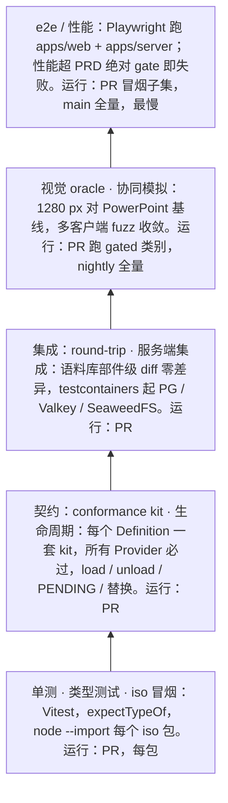

> 状态：草稿 | 负责：架构-运行时 | 更新：2026-09-14；2026-09-24（rulings §4.15：§7 表格/图表/SmartArt 改为 M1 gated（阈值按 PRD OF-08/09/10）；Q3 撤销语义进契约与协同模拟；Q5 DX-20K 与满员房间扇出压测；Q10 testcontainers 改 Valkey/SeaweedFS；Q6 CI 分层认证）；2026-09-24（复核修正，rulings §4.17：D1 删「邀请兑现仅限 email_verified」改为「邀请仅对已存在账号生效」；M3 撤销契约用例名照抄 M-02 §2.5；D4 撤销不复活他人删除）；2026-09-25（补图）；2026-09-25（矛盾收口，rulings §4.18：GV-14 job 名改为 09-07 的 13 个封闭集合并标注各测试类别所在 job（§0、§12）；GV-16 `security:rls` 与 renderer 零出站进 PR 冒烟子集、M3 起阻断（§0 门禁流①、§10）；GV-20 契约套件名（§3）；BE-06 路由鉴权覆盖 e2e、BE-05/BE-02 链接会话用例、BE-10 越权上传用例、BE-04 `/render` 零网络请求、FE-09 ready 判据、BE-01 反代后预签名（§10）；CO-03/UX-03/CO-10/CO-08/CO-14/CO-16 协同与服务端集成用例（§8、§10）；CO-11 已解析未装载页 ≤ 100 ms（§17）；GV-15 扫描器写正式名 `scan-manifest` (e)、`scan-effects` (2)（§3、§16）；FE-04 S10 被规则 7 新口径取代（§15）；FE-01/BE-15 服务端集成用例（§12））；2026-09-25（§4.19：三线拆分后本文改为跨端原则与门禁口径摘要，各节细则链接 70-testing；§0 按 T-PERF-GATE（PR 超绝对 gate 失败、内存增长 ≤ 5%）、T-BUNDLE、T-CI、T-REQ 改写；§7 按 T-ORACLE（1280 px gated、不用 LFS）与 D-TEST-INFRA；§9 runner 时点；§10、§12 按 T-NAMING；§14 T1–T4 结案） | 依赖：charter v0.1

# 11 测试策略（Testing Strategy）：金字塔、conformance kit、iso 冒烟、生命周期、OOXML round-trip、视觉 oracle、协同模拟、e2e、性能门禁、语料库

> 读者：搭建测试基础设施的工程师；每个包的实现者（知道自己必须交付哪些测试）；CI 维护者。
> 章程锚点：D9（Vitest/Playwright）、§5.3 规则 5（`node --import` 冒烟）、§7（M1 部件级 diff 零差异；store 替换仅改 preset 的可插拔证据）、Univer A17（规则须有负向测试）、A19（patch 覆盖率）、A20（同构零测试）、A25（卸载断言）、K5。
> 借鉴：pptx-renderer 的「PowerPoint 真机导出为 oracle 的视觉回归（SSIM/IoU）+ 语料库元数据入库、二进制不入库」。
> **2026-09-25 起（rulings §4.19）测试设计的唯一事实源是 [70-testing](../70-testing/README.md)**：本文保留跨端测试原则、门禁口径摘要与 Univer 对照，各节细则改为摘要 + 链接，节号不变供他处引用；本文与 70 线不一致时以 70 线为准。lint/CI 工作流的 job 名封闭集合仍由 09-07 承接。

---

## 0. 金字塔与门禁一览

**测试金字塔**



怎么读：自下而上是金字塔从底座到塔尖，越往上用例越少、越慢、越接近真实部署；每层节点内写明内容与运行时机。

门禁口径摘要（完整门禁表、13 个 job × 步骤、三个触发段、PR 冒烟清单与 flaky 策略的唯一源是 [70-testing/12](../70-testing/12-ci-gates-mapping.md)，门禁三级见 [70-testing/01](../70-testing/01-strategy-and-layers.md) §10）：

| 门禁 | 阈值 | 失败即阻断？ | 所在 CI job（09-07 §3 的 13 个封闭集合，rulings §4.18 GV-14） |
|---|---|---|---|
| 单测 / 契约 / 生命周期 / 服务端集成 | 全绿 | 是 | `test` 的对应步骤（服务端集成为 `server-integration` 步骤，托管 runner 自带 Docker，Docker 不可用即失败不跳过，决策 T-CI） |
| patch 覆盖率 | 改动行 ≥ 80%、分支 ≥ 70%；包级总覆盖率不下降（ratchet） | 是（A19） | `coverage-patch`（包级下限只作目标，决策 T-COVERAGE-EVIDENCE） |
| 类型测试 / iso 冒烟 | 全绿 | 是（A20） | `test-typecheck` / `iso-smoke` |
| round-trip | gated 样本部件级 diff 零差异 | 是（M1 起） | `test` 的 `fidelity-roundtrip` 步骤 |
| 视觉 oracle | 1280 px gated：单样本类别阈值与矩阵行聚合两层都须通过；SSIM 中位数比上一里程碑下降 > 0.01 即失败 | 是；非 gated 与 1920 px 只报告 | `e2e` 的 `oracle-gated` 步骤（PR），nightly 全量 |
| 协同模拟 | 固定种子集全部收敛 + 随机 200 轮无失败 | 是 | `test` 的 `collab-sim` 步骤 |
| e2e 冒烟 | 全绿；含 `security-rls`、`renderer-egress`（M3 起阻断，GV-16） | 是 | `e2e`（PR 冒烟子集，分片后 ≤ 15 min） |
| 性能 | PR：D50 关键指标超 PRD 绝对 gate 即失败，相对 main 的回归只写 PR 注释；main 与 nightly：相对滚动中位数回归 > 10% 失败并自动建 issue；内存 20 次开关增长 ≤ 5%（NF-01 §1.3） | 是（「报告」= job 通过 + 产物或注释，与 09-07「无 warn 级别」相容） | `perf`（决策 T-PERF-GATE） |
| 体积预算 | 各 preset `config/bundle-budget.json`，超「预算 × 1.05」即失败 | 是 | `scanners` 的 `scan-bundle-budget`（唯一阻断点，决策 T-BUNDLE，09-06 §14） |
| 需求追溯 | P0 需求在里程碑出口前有测试覆盖 | 是（出口期） | `test` 的 `requirement-matrix` 步骤（决策 T-REQ，70-testing/13） |
| 规则负向测试 | 每条自定义 lint / 扫描规则有 fixture 触发失败 | 是（A17，由 09 执行） | `lint`、`scanners`、`depcruise` 各自的负向夹具 |

依据：决策 T-PERF-GATE、T-ORACLE、T-BUNDLE、T-CI、T-REQ、T-COVERAGE-EVIDENCE（rulings §4.19 登记，高于本文旧正文）；PRD 04 NF-01 / NF-02 / NF-09。原「性能 PR 上仅告警」「内存增长 ≤ 10%」「视觉基线 1920 px」「体积预算三处执行」作废。

---

## 1. 单元测试（Vitest）

原则（保留）：**不 mock 内核**——用 `@cordexjs/kernel/testing` 的 `createTestHost()` 启动真实 cordis 宿主，**只 mock IO**（transport、storage、fetch）；**确定性**——id、时钟、随机源一律注入（`FixedClock`、`SeededRandom` 归 `@cordexjs/shared/testing`，服务端 Clock 端口在 `apps/server/src/shared/clock.ts`，决策 T-DETERMINISM）；iso 包在 node 环境、dom 包在 happy-dom，涉及度量 / 字体 / IME / 滚动的用例走 Vitest browser mode，不用 jsdom。运行环境、文件命名与落点见 [70-testing/01](../70-testing/01-strategy-and-layers.md) §3–§4，确定性工具与数据隔离见 [70-testing/11](../70-testing/11-test-data-fixtures-and-determinism.md)。

## 2. 类型测试

类型测试文件后缀统一为 `*.type-test.ts`（ADR-0048，决策 T-NAMING；`*.test-d.ts` 作废），`vitest --typecheck` 在 `test-typecheck` job 运行；必测清单（品牌类型不可互赋、Mutation schema 无 `index`、未登记错误码编译失败、事件签名等）见 [70-testing/01](../70-testing/01-strategy-and-layers.md) §7。

## 3. Definition 的 Provider 一致性套件（conformance kit）

规则（保留）：**每个 Definition 在 `@cordexjs/<pkg>/testing` 导出 `run<Definition>Conformance(factory, options)`，每个 Provider 必须调用**；扫描器 `scan-manifest` 规则 (e)（09-06 §6，扫描范围含 `apps/server/test/integration/conformance/`）核对，子项 (e2) 要求每个 kit 在本包有 `runKitSelfTest`（kit 自带「故意错误的 Provider」证明能失败，决策 T-KITS）。kit 清单（含 `runPermissionPolicyConformance` 新增、`SceneProvider` 不设）、kit 设计约束与服务端适配器套件的落点见 [70-testing/02](../70-testing/02-contract-suites-and-pluggability.md)。

## 4. 插件生命周期测试

每个 `plugin.ts` 必配 lifecycle 测试（load / PENDING / unload 无残留 effect / Provider 替换 / 无重复注册 / 多实例 / 配置校验），`scan-effects` 规则 (2) 核对存在性；模板与断言见 [70-testing/02](../70-testing/02-contract-suites-and-pluggability.md)。

## 5. 同构冒烟（iso）

每个 iso 包在 Node（`node --import`）与浏览器（Vitest browser mode）各 import 并在最小宿主中加载一次；细则见 [70-testing/01](../70-testing/01-strategy-and-layers.md) §6。

## 6. OOXML 语料库 round-trip（M1 验收）

原则（保留）：`pptx → decode → Snapshot → store（memory 与 yjs 各一次）→ encode → pptx'`，未修改部件字节相同（或经登记的规范化后 XML 相同），允许差异必须在样本清单显式登记；改后导出只有相关部件变化（D7）；双 store 产物部件级相同。流程、规范化器与双端导出一致（SV-02）见 [70-testing/03](../70-testing/03-fidelity-roundtrip-and-corpus.md)。

## 7. 视觉 oracle（借鉴 pptx-renderer）

oracle 三通道、基线生成、三层判定与 `capabilities.json` 的唯一源是 [70-testing/04](../70-testing/04-visual-oracle.md)。跨端口径：

- **尺寸**（决策 T-ORACLE）：gated 判定在 PRD 定义的 **1280 px 宽**上进行，基线与被测同尺寸比较；1920 px 只作报告。
- **判定**：单样本类别阈值（几何 / 西文 / CJK / 图片 / 表格 / 图表 / SmartArt / OLE 预览等，表格、图表、SmartArt M1 gated）与矩阵行聚合（PRD 01 §4.2、NF-02 的中位数与 P10）两层都须通过；SSIM 中位数比上一里程碑下降 > 0.01 即失败。
- **基线机器**（rulings §4.19 D-TEST-INFRA）：一台 Windows + PowerPoint 365 维护机生成基线（不进 CI，脚本生成、提 PR、评审签字）；macOS 基线在 M2 加入。
- **存储**（决策 T-CORPUS）：基线与大样本按 sha256 存对象存储、CI 预取缓存，**不用 Git LFS**；清单入库。
- 客户端 render-dom 与服务端 renderer 输出互相一致（像素差 ≤ 0.5%）；字体 profile 两端相同，否则度量无效。

## 8. 协同模拟（fuzz）

原则（保留）：多客户端 + 内存服务端、网络模型（延迟、乱序、丢包、分区、离线突发）、随机命令；静止后断言状态一致、不变量成立、撤销不回退他人后写的键且整步跳过不连撤、软门禁修复全网一致、被拒 update 不外泄；失败种子自动最小化后入库作确定性回归。PR 固定种子 50 个 + 随机 200 轮，nightly 10,000 轮。集群与网络模型位于仓库根 `test/collab-sim/`（不在 `collab-yjs/testing`，决策 T-NAMING），细则与重连 / 离线确定性场景见 [70-testing/05](../70-testing/05-collab-simulation-and-property-tests.md)。

## 9. 性能基准与预算门禁

数值口径唯一在 PRD 04 NF-01（gate）与 [50-frontend/13](../50-frontend/13-performance-and-bundling.md)、[60-backend/01](../60-backend/01-service-overview-and-roles.md) §12（target）；`test/perf/budgets.json`、场景、噪声控制与门禁规则的唯一源是 [70-testing/09](../70-testing/09-performance-and-capacity.md)。runner（rulings §4.19 D-TEST-INFRA）：M1 用 GitHub larger runner（4 核）；协同与服务端压测所需的自托管专用 runner 在 **M2 前**落地（随协同后端提前）；低配机型 RM-B 用 CDP CPU 4× 节流近似；5 次取中位数、预热、压测负载驱动为自写 Node WS 客户端（决策 T-IDP）。门禁口径见 §0。

## 10. e2e（Playwright）

前端组件与 e2e 见 [70-testing/06](../70-testing/06-frontend-component-and-e2e.md)，服务端集成与 API e2e 见 [70-testing/07](../70-testing/07-backend-integration-and-api-e2e.md)，部署与环境 e2e（断网 compose）见 [70-testing/08](../70-testing/08-deployment-and-environment-e2e.md)，安全测试见 [70-testing/10](../70-testing/10-security-testing.md)。跨端口径：

- **落点**（决策 T-NAMING）：浏览器 e2e 在 `apps/web/e2e/**/*.spec.ts`；服务端 e2e 在 `apps/server/test/e2e/**/*.e2e-spec.ts`；原 `test/e2e/` 废止。
- **认证分层**（决策 T-IDP，rulings §4.15 Q6）：PR 跑 `oidc-provider` mock 与 Casdoor 容器两条登录路径（含 `auth.selfSignup` 开 / 关）；nightly 跑 Keycloak；Entra 与飞书（经 Casdoor）为发布前人工清单。
- **PR 冒烟子集**（决策 T-CI）：默认 8 条 + `security-rls` + `renderer-egress` + `login-oidc-mock` + `login-casdoor` + `oracle-gated`，分片后 ≤ 15 min；安全两项自 M3 起阻断（GV-16）；renderer 的非 root / 无凭据 / 沙箱由 `scanners` 的 `check-image-policy` 静态检查；断网 compose e2e 在 main 全量段（M3 出口）。
- **鉴权与越权**：路由鉴权覆盖（除 `@Public` 快照清单外无会话一律 401，BE-06）、分享链接会话（BE-05 / BE-02）、越权上传 403（BE-10）、CSRF 与 WS Origin（INC-24）、`/render` 页零网络请求与 ready 判据（BE-04、FE-09）——用例清单以 70-testing/07、10 为准。
- **内存**：e2e 结尾断言堆预算与「打开 / 关闭 20 次堆增长 ≤ 5%」（NF-01 §1.3，决策 T-PERF-GATE；原「≤ 10%」作废）。
- **重试**：gated 步骤（`fidelity-roundtrip`、`collab-sim`、`oracle-gated`、`security-rls`）不重试，其余 e2e 最多重试 1 次并标 flaky，连续 3 次 flaky 自动建 issue；`it.skip` / `test.fixme` 由 lint 拦截（09-02 §3，TD-109）。

## 11. 语料库来源与管理

语料单一落点（决策 T-CORPUS）：≤ 2 MB、可入 git 的小样本在仓库根 `fixtures/pptx/{minimal,features}`（T1）；真实语料 T2 与压力语料 T3 只登记在 `test/corpus/manifest.json`，文件按 sha256 存对象存储、CI 预取缓存，不用 Git LFS；`tier` 字段是三层与目录的唯一映射。来源、许可与「先加样本再实现」的规则见 [70-testing/03](../70-testing/03-fidelity-roundtrip-and-corpus.md)。

## 12. 测试目录级布局

文件命名与根 `test/` 工作区布局的唯一源是 [70-testing/01](../70-testing/01-strategy-and-layers.md) §4–§5（决策 T-NAMING）：

```
packages/<pkg>/src/**/__tests__/*.test.ts        单测、契约调用、生命周期；浏览器模式 *.browser.test.ts
packages/<pkg>/src/**/*.type-test.ts             类型测试（ADR-0048）
packages/<pkg>/src/testing/                      ./testing 子路径：kit、fakes、确定性工具（仅测试消费，09-06 §6 (f)）
apps/server/test/integration/**/*.int-spec.ts    服务端集成（含 conformance/ 下需要容器的适配器套件、role-assembly、route-auth-coverage）
apps/server/test/e2e/**/*.e2e-spec.ts            服务端 e2e
apps/web/e2e/**/*.spec.ts                        浏览器 e2e（Playwright）
test/<suite>/                                    跨包全链路：corpus、roundtrip、oracle、collab-sim、perf、plugin-compat、evidence、traceability
fixtures/pptx/{minimal,features}/                ≤ 2 MB 的入库样本（T1）
```

原 `test/e2e/`、`test/server-integration/` 与 `*.test-d.ts` 废止；soft-gate-repair 的 model-slide 协同分节在组合根 `apps/server/test/integration/soft-gate-repair.int-spec.ts`（FE-01）。

## 13. 与 Univer 的对照

| 编号 | Univer | 本项目 |
|---|---|---|
| A17 | lint 规则实现是 no-op | 每条自定义规则/扫描器必须有负向 fixture（09 执行）；每个 conformance kit 必须有「故意错误的 Provider」用例证明 kit 能失败（`runKitSelfTest`） |
| A19 | `patch: off` | patch 覆盖率门禁 |
| A20 | 0 个 node 测试 | iso 冒烟双环境 + browser mode 真 DOM |
| A25 | 无 dispose 门禁 | lifecycle 模板 + e2e 内存增长断言 |
| A28/A29 | 脏区/缓存无人读 | 反制单测在 engine-render（07 §2.2） |
| K5 | Disposable 纪律靠人 | `assertNoLiveEffects` 在 kit 与 lifecycle 模板中自动执行 |

## 14. 待决事项

全部结案（rulings §4.19 与其登记的遗留口径），处理结果汇总见 [70-testing/README](../70-testing/README.md) §6：

| # | 事项 | 结论 |
|---|---|---|
| T1 | 大基线/样本的存储 | **已裁决**（决策 T-CORPUS）：对象存储 + sha256 清单，不用 Git LFS |
| T2 | 性能 runner | **已裁决**（rulings §4.19 D-TEST-INFRA）：M1 GitHub larger runner；自托管专用 runner 在 M2 前落地；RM-B 用 CPU 4× 节流近似 |
| T3 | PowerPoint 基线的生成机器与版本锁定 | **已裁决**（D-TEST-INFRA）：Windows + PowerPoint 365 维护机（不进 CI，脚本生成基线提 PR 并评审签字）；macOS 基线 M2 加入 |
| T4 | e2e 在 PR 上的范围 | **已裁决**（决策 T-CI）：冒烟 8 条 + 安全两项 + 两条登录路径 + `oracle-gated`，≤ 15 min |

## 15. 对章程的异议/建议

- **S10**（2026-09-25 由 rulings §4.18 FE-04 取代）：原建议把 §5.3 规则 7 的允许子路径限为 `.`、`./testing`；现规则 7 定为「跨包只能走目标包 exports 显式登记的子路径（= `cordex.publicEntry`），禁止通配与 src/lib 深引用」，本文保留的只有「`./testing` 仅限测试代码与其他包的 `testing/` 引用」这一半，由 dependency-cruiser 规则执行（09-03）。

## 16. 跨条线要求

已由 70 线承接（各包 `./testing` 导出物、扫描器子规则、job 矩阵），清单见 [70-testing/README](../70-testing/README.md) §2、§8。

---

## 17. v0.2 补充：与 A 线命名的对齐、PRD 验收口径的承接

保留两条跨端约定，其余用例清单见 [70-testing/02](../70-testing/02-contract-suites-and-pluggability.md)（套件命名与运行矩阵）、[70-testing/12](../70-testing/12-ci-gates-mapping.md)（PRD 检查名 → CI 步骤）、[70-testing/13](../70-testing/13-requirements-traceability.md)（需求追溯）：

- **命名**：契约套件统一 `run<Definition>Conformance`；`runDocumentStoreConformance` 是 store-yjs 的验收，其「协同分节」承载 06 §8 与 ADR-0020 补充表的并发用例；运行矩阵 `{ memory, yjs } × { 单机, 双客户端同步 } × { 单人策略, 协同分节 }` 在 `test` job 内执行，不另设 job 名。
- **需求追溯**（决策 T-REQ）：标签三类 `@req PRD:<id>`、`@ruling <节>/<id>`、`@adr <编号>/<决策号>`，写在 `describe` / `it` 上方的 JSDoc（文件级也可）；原「文件顶部 `// @req CO-08`」作废；扫描器只产出矩阵，P0 完整性由 `test` job 的 requirement-matrix 步骤判定。
