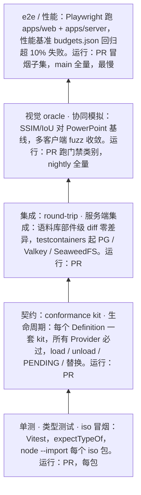
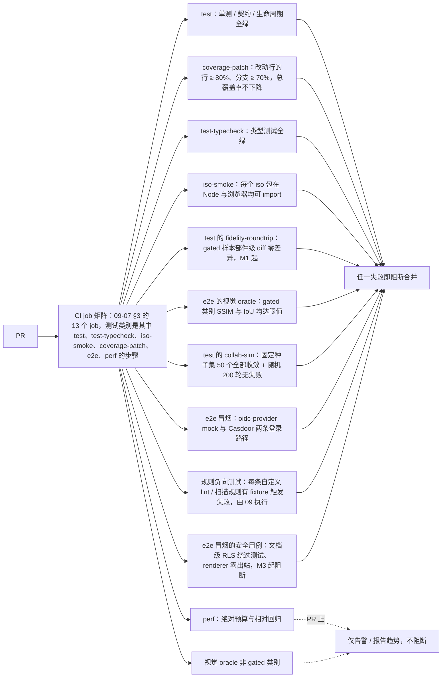
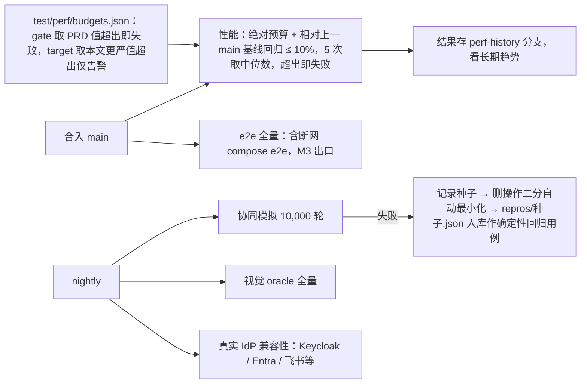
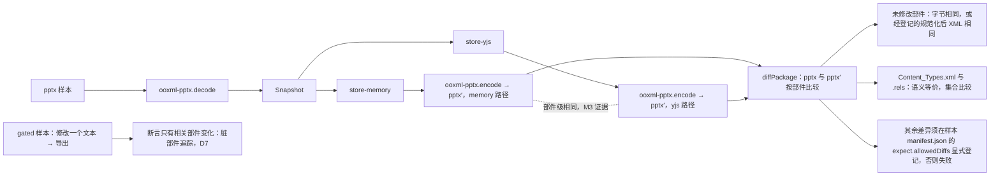
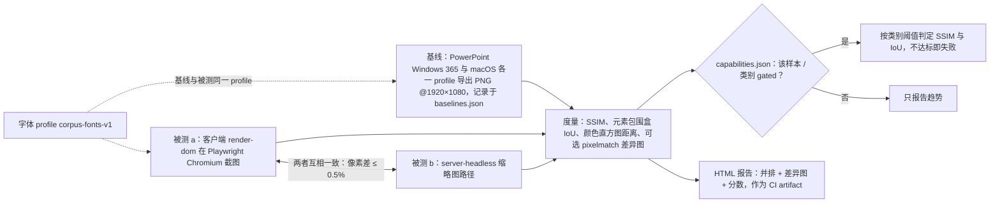
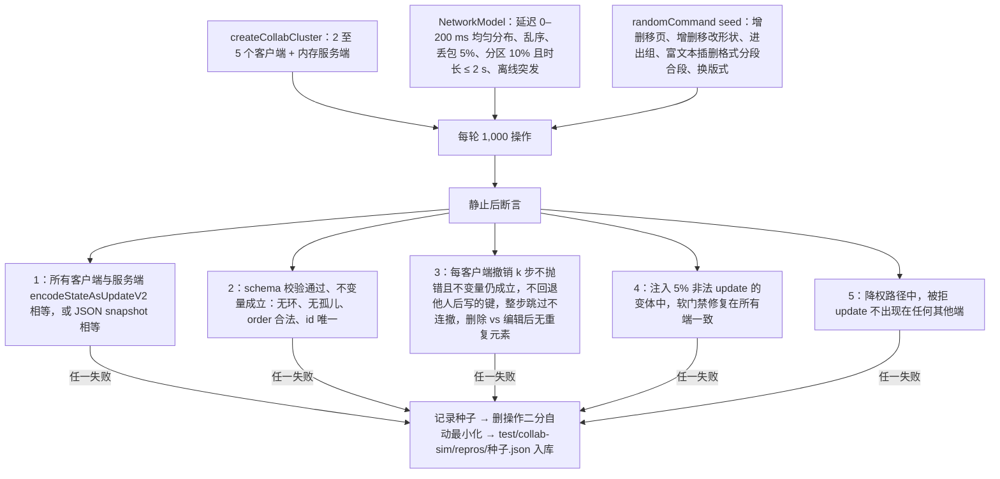

> 状态：草稿 | 负责：架构-运行时 | 更新：2026-09-14；2026-09-24（rulings §4.15：§7 表格/图表/SmartArt 改为 M1 gated（阈值按 PRD OF-08/09/10）；Q3 撤销语义进契约与协同模拟；Q5 DX-20K 与满员房间扇出压测；Q10 testcontainers 改 Valkey/SeaweedFS；Q6 CI 分层认证）；2026-09-24（复核修正，rulings §4.17：D1 删「邀请兑现仅限 email_verified」改为「邀请仅对已存在账号生效」；M3 撤销契约用例名照抄 M-02 §2.5；D4 撤销不复活他人删除）；2026-09-25（补图）；2026-09-25（矛盾收口，rulings §4.18：GV-14 job 名改为 09-07 的 13 个封闭集合并标注各测试类别所在 job（§0、§12）；GV-16 `security:rls` 与 renderer 零出站进 PR 冒烟子集、M3 起阻断（§0 门禁流①、§10）；GV-20 契约套件名（§3）；BE-06 路由鉴权覆盖 e2e、BE-05/BE-02 链接会话用例、BE-10 越权上传用例、BE-04 `/render` 零网络请求、FE-09 ready 判据、BE-01 反代后预签名（§10）；CO-03/UX-03/CO-10/CO-08/CO-14/CO-16 协同与服务端集成用例（§8、§10）；CO-11 已解析未装载页 ≤ 100 ms（§17）；GV-15 扫描器写正式名 `scan-manifest` (e)、`scan-effects` (2)（§3、§16）；FE-04 S10 被规则 7 新口径取代（§15）；FE-01/BE-15 服务端集成用例（§12）） | 依赖：charter v0.1

# 11 测试策略（Testing Strategy）：金字塔、conformance kit、iso 冒烟、生命周期、OOXML round-trip、视觉 oracle、协同模拟、e2e、性能门禁、语料库

> 读者：搭建测试基础设施的工程师；每个包的实现者（知道自己必须交付哪些测试）；CI 维护者。
> 章程锚点：D9（Vitest/Playwright）、§5.3 规则 5（`node --import` 冒烟）、§7（M1 部件级 diff 零差异；M3 store 替换仅改 preset）、Univer A17（规则须有负向测试）、A19（patch 覆盖率）、A20（同构零测试）、A25（卸载断言）、K5。
> 借鉴：pptx-renderer 的「PowerPoint 真机导出为 oracle 的视觉回归（SSIM/IoU）+ 语料库元数据入库、二进制不入库」。
> lint/CI 工作流细节由 09-07 承接；本文定义**测什么、用什么、放在哪、门禁阈值**。

---

## 0. 金字塔与门禁一览

**测试金字塔**



怎么读：自下而上是金字塔从底座到塔尖，越往上用例越少、越慢、越接近真实部署；每层节点内写明内容与运行时机。

| 门禁 | 阈值 | 失败即阻断？ | 所在 CI job（09-07 §3 的 13 个封闭集合；本文不另设 job 名，rulings §4.18 GV-14） |
|---|---|---|---|
| 单测/契约/生命周期 | 全绿 | 是 | `test` 的 `unit`、`contract`、`lifecycle` 步骤 |
| patch 覆盖率（改动行） | 行 ≥ 80%，分支 ≥ 70%；总覆盖率**不下降** | 是（A19） | `coverage-patch` |
| 类型测试 | 全绿 | 是 | `test-typecheck` |
| iso 冒烟 | 每个 iso 包在 Node 与浏览器均可 import | 是（A20） | `iso-smoke` |
| round-trip | 语料库「gated」样本部件级 diff 零差异 | 是（M1 起） | `test` 的 `fidelity-roundtrip` 步骤（失败在该 job 日志中查看） |
| 视觉 oracle | `capabilities.json` 标记 gated 的类别：SSIM ≥ 阈值且 IoU ≥ 阈值 | 是；非 gated 仅报告趋势 | `e2e` 的视觉 oracle 步骤（PR 跑 gated 类别，nightly 全量） |
| 协同模拟 | 固定种子集全部收敛 + 随机 200 轮无失败 | 是 | `test` 的 `collab-sim` 步骤 |
| e2e 冒烟 | 全绿 | 是 | `e2e`（PR 冒烟子集） |
| 安全：文档级 RLS 绕过测试、renderer 零出站 | 全绿 | 是（M3 起；rulings §4.18 GV-16） | `e2e`（PR 冒烟子集）；renderer 非 root / 无凭据 / 沙箱开启由 `scanners` 的 `check-image-policy` 静态检查 |
| 性能 | 绝对预算 + 相对回归 ≤ 10%（5 次取中位数） | 是（main 分支）；PR 上仅告警 | `perf` |
| 规则负向测试 | 每条自定义 lint/扫描规则有 fixture 触发失败 | 是（A17，由 09 执行） | `lint`、`scanners`、`depcruise` 各自的负向夹具 |

**门禁流 ①：PR**



怎么读：PR 触发 09-07 §3 的整套 job（13 个封闭集合，本文各测试类别只是其中的步骤，rulings §4.18 GV-14），实线汇入「阻断」的是硬门禁，虚线汇入「仅告警」的是 PR 上不阻断的项。g12 是 `security:rls` 与 renderer 零出站测试，属 e2e 的 PR 冒烟子集、M3 起阻断（GV-16）；断网 compose e2e 仍在 main 全量段。e2e 冒烟条数默认 8 条，待 T4 决定。

**门禁流 ②：main 与 nightly**



怎么读：从「合入 main」出发的是合入后才执行的门禁，从「nightly」出发的是每晚的全量与兼容性任务；协同模拟失败会被自动最小化，并作为确定性回归用例入库。
依据：本文 §0、§7、§8、§9、§10、§14 T4、§17。

---

## 1. 单元测试（Vitest）

- 位置：`packages/<pkg>/src/**/__tests__/*.test.ts`（与源码同树），文件名与被测模块同名。
- 环境：iso 包默认 `environment: 'node'`（**不**用 jsdom，避免掩盖 DOM 依赖）；dom 包默认 `happy-dom`（纯逻辑、DOM 结构、属性 diff；A 线 C-8 定稿），凡涉及 `measureText`/`getBBox`/字体加载/IME 事件/滚动与 IntersectionObserver 的用例必须走 `vitest browser mode`（Chromium，真实 DOM/字体/Canvas）——文件名后缀 `.browser.test.ts` 由共享配置自动路由；jsdom 一律不用。
- 共享配置：`tooling/vitest-config`（coverage provider v8、reporters、`test.typecheck`）。
- 约定：不 mock 内核；用 `@cordexjs/kernel/testing` 的 `createTestHost()` 启动真实 cordis 宿主（快，< 5 ms）；只 mock IO（transport、storage、fetch）。
- 确定性：所有涉及 id/时钟/随机的测试通过 `testing` 子路径注入 `FixedClock`、`SeededRandom`、固定 Yjs `clientID`。

## 2. 类型测试

- `*.test-d.ts` 与 vitest `expectTypeOf`（或 `expect-type`）；`vitest --typecheck` 作为独立 job `test-typecheck`（09-07 §3 封闭集合，旧称 `types`，rulings §4.18 GV-14）。
- 必测清单：品牌类型不可互赋（`Emu` ≠ `Pt`）；Mutation schema **无** `index` 字段（06 I4）；`EntityTable` 值不为数组；`ErrorCodes` 未登记码编译失败；事件参数类型与 `Events` 声明一致；`ElementRenderer<T>` 泛型推断；Config `z.infer` 与插件签名一致；`protocol` DTO 无 `any`。
- 负向类型测试：`// @ts-expect-error` 用例必须存在于每个 Definition 的 `contracts/*.test-d.ts`。

## 3. Definition 的 Provider 一致性套件（conformance kit）

规则：**每个 Definition 在 `@cordexjs/<pkg>/testing` 子路径导出 `runXxxConformance(factory, options)`；每个 Provider 的 `__tests__/conformance.test.ts` 必须调用它。** 扫描器 `scan-manifest` 规则 (e)（09-06 §6，原称 `provider-runs-conformance`，rulings §4.18 GV-15）核对：凡 `provide=['x']` 的插件，其包内必有对该 Definition kit 的调用。

| Definition（所在包） | kit | 覆盖 |
|---|---|---|
| `DocumentStore`（model-core） | `runDocumentStoreConformance` | 6 原语读写、事务原子性、observe 路径精确性、undo/redo 按 origin、stablePosition 在并发插入后稳定、snapshot 幂等、无下标 API；**中性撤销语义分节**（rulings §4.15 Q3，store-memory 与 store-yjs 同语义；用例名照抄 40-modules/02 §2.5）：`remote-conflict-skip`（同键被他人后写 → 跳过并发 `store/undo-skipped{skipped, wholeStep}`）、`undo-skip-no-cascade`（整步被跳过 → 停下不连撤）、`soft-delete-tombstone`（删除写墓碑、id 稳定）、`delete-vs-edit-undo`（撤销删除 = 同 id 复活、与并发编辑无重复元素；撤销目标被他人删除 → 跳过、不复活，rulings §4.17 D4）、`read-path-filters-tombstone`（读路径过滤墓碑）；另断言墓碑计入元素数 |
| `CollabTransport`/`OfflineStore`（collab-core） | `runCollabTransportConformance`、`runOfflineStoreConformance` | transport：握手成功/超时、断线触发重连、超过 `outboundHighWater` 触发背压事件、乱序/重复帧不崩、`close(code)` 精确传递；offline：`appendPending → loadPending` 顺序一致、`ackUpTo` 幂等、`compact` 原子、配额超限返回 `Result.err`、rejected 区往返。`collab`（`CollabService`）与 store-yjs 强耦合，**不设独立套件**：收敛由 `runDocumentStoreConformance` 协同分节覆盖，状态机/事件由 collab-yjs 自身测试与 collab-core 场景脚本覆盖（40-modules/05 §2.5） |
| `RenderTarget`（engine-render） | `runRenderTargetConformance` | 重复 `paint` 同一 `dirty` 只触发 `update`、`dirty.full` 访问全部可见节点、空场景 `hitTest` 为 `null`、`dispose` 后无残留 effect；`ElementRenderer` **暂不设**契约套件（40-modules/06 G-8），实现方用 `SpyRenderer`/`RecordingTarget` 自测，错误隔离由 engine-render 自身单测覆盖 |
| `TextMeasurer`（engine-layout） | `runTextMeasurerConformance` | 空串宽度 0、单调性、`ascent + descent > 0`、`supports` 对未知字体返回 `false`、CJK；`canvas` 与 `node-font` 两个 Provider 都必跑 |
| `BlobStore` / `ServerBlobStore`（server-storage） | `runBlobStoreConformance` | put/get/head/delete、预签名、完整性；按 `publicEndpoint` 生成的预签名 URL 经保持 Host 头的反代后仍可用（rulings §4.18 BE-01）；按版本删除后无残留版本（BE-15） |
| `UpdateStore`/`SnapshotStore`/`SpillStore`/`CollabServer`/`FanoutBus`/`LeaseLock`（server-collab） | `runUpdateStoreConformance`、`runSnapshotStoreConformance`、`runSpillStoreConformance`、`runCollabServerConformance`、`runFanoutBusConformance`、`runLeaseLockConformance` | 顺序、幂等、`purgeAll` 后为空、溢写按 `instanceId` 读取、两实例去重扇出、崩溃后重放、租约过期与 fencing（原合并套件 `runServerCollabAdaptersConformance` 按 Definition 拆开，rulings §4.18 GV-20；FanoutBus/LeaseLock 两套在 40-modules/09 §2.5 补登） |
| `FormatCodec`（model-core，A 线） | `runFormatCodecConformance` | 引用 A 线；round-trip 见 §6 |
| kernel 基础服务 `errors/logger/telemetry` | `runKernelServiceConformance` | no-op 降级、脱敏、登记校验 |

kit 设计约束：只依赖 Definition 与 `testing` fakes；参数 `factory()` 返回 `{ ctx, provider, dispose }`；每个用例后断言 `assertNoLiveEffects`。

## 4. 插件生命周期测试（每个 `plugin.ts` 必配 `__tests__/lifecycle.test.ts`）

模板（`@cordexjs/kernel/testing` 提供 `describePluginLifecycle(plugin, { config, deps })`）：
1. **load**：在提供全部 `inject` 的宿主里加载 → `ACTIVE`；`provide` 的服务可解析。
2. **PENDING**：缺任一 `inject` → 状态 `PENDING`（不是错误、不抛）；补齐后自动 `ACTIVE`。
3. **unload**：`fiber.dispose()` 后 `getEffects()` 为空；提供的服务不可解析；贡献从 `ctx.contributions` 消失。
4. **Provider 替换**：替换某个依赖的 Provider → 本插件重跑（消费者不缓存旧引用；用 spy 断言重新初始化）。
5. **无重复注册**：`restart()` 两次后事件监听/贡献数量不变（A10、cordis 指南 §108）。
6. **多实例**：同一插件在两个 UnitScope 各加载一次，互不可见、互不干扰。
7. **配置校验**：非法 Config → `ValidationError`，不部分激活。

## 5. 同构冒烟（iso）

- `test/iso-smoke/node.mjs`：对每个 `isomorphism: 'iso'` 的包执行 `node --import ./register.mjs -e "import('@cordexjs/<pkg>')"`，并调用 `plugin` 在最小宿主中加载一次（不只 import）。
- 浏览器侧：vitest browser mode 中 `import('@cordexjs/<pkg>')` 并加载；两者都在 CI 矩阵中。
- 附加断言：iso 包的构建产物不含 `document`/`window`/`node:` 字面引用（扫描器）；tsconfig 无 `dom` lib（09-01）。

## 6. OOXML 语料库 round-trip（M1 验收）

- 流程：`pptx → ooxml-pptx.decode → Snapshot → store(memory 与 yjs 各一次) → ooxml-pptx.encode → pptx'`；`diffPackage(pptx, pptx')`（`@cordexjs/ooxml-core/testing`）按部件比较：
  - 未修改部件：字节相同（或经**登记的规范化**后 XML 相同：属性顺序、空白、命名空间前缀、Strict→Transitional 归一化——规范化规则列于 `test/corpus/normalizers.md`，每条有测试）。
  - `[Content_Types].xml`/`.rels`：语义等价（集合比较）。
  - 允许差异必须在样本 `manifest.json` 的 `expect.allowedDiffs` 中显式登记，否则失败。
- 变更后导出：对 gated 样本执行「修改一个文本 → 导出」并断言**只有**相关部件变化（脏部件追踪，D7）。
- 双 store 一致：memory 与 yjs 路径产出的 `pptx'` 部件级相同（M3 证据）。

**OOXML round-trip 流程**



怎么读：主线从左到右是解码—双 store—编码—按部件比对，比对后分三类规则判定；虚线表示两条 store 路径的产物彼此也要一致；与主线不相连的一条是「改后导出」的脏部件断言。

## 7. 视觉 oracle（借鉴 pptx-renderer）

- 基线：PowerPoint（Windows 365 与 macOS 各一 profile）导出 PNG @1920×1080；记录 `{ pptx sha256, png sha256, ppVersion, os, fontProfile }` 于 `test/oracle/baselines.json`；PNG 二进制在 Git LFS（小）或对象存储（大，按 sha256 拉取）。
- 被测输出：(a) 客户端 render-dom 在 Playwright Chromium 截图；(b) server-headless 缩略图路径；两者互相也要一致（像素差 ≤ 0.5%）。
- 度量：`ssim.js`（SSIM）、元素包围盒 IoU（从 DOM 读取几何 vs 基线的人工/半自动标注框）、颜色直方图距离、可选 `pixelmatch` 差异图；阈值按类别：

| 类别 | SSIM | IoU | 说明 |
|---|---|---|---|
| 几何/填充/线（无文本） | ≥ 0.97 | ≥ 0.95 | gated（M1） |
| 文本（西文） | ≥ 0.93 | ≥ 0.90 | gated（M1，字体 profile 固定） |
| 文本（CJK/混排） | ≥ 0.90 | ≥ 0.88 | gated（M2） |
| 表格 | ≥ 0.90（表格区域裁剪比对） | — | **gated（M1）**，PRD OF-08（8 案例原生矩阵 + 语料库表格子集） |
| 图片/裁切 | ≥ 0.95 | ≥ 0.95 | gated |
| 图表（`c:chart`，D16 只读解析） | ≥ 0.80（单图表页） | 数据墨迹区域 IoU ≥ 0.85 | **gated（M1）**，PRD OF-09；chartex 只断言占位 + `chartex-unsupported` 诊断 |
| SmartArt（有 `dsp:drawing`） | ≥ 0.85 | — | **gated（M1）**，PRD OF-10；无 dsp 部件的样本只断言占位 + 诊断 |
| OLE（预览图） | 同「图片」 | 同「图片」 | gated（M1，预览为 EMF/WMF 的样本 M2 起 gated） |
| EMF/WMF 栅格化 | 仅报告 | 仅报告 | M2 P1 起报告；矢量渲染 M4+ |
| 效果/3D | 仅报告 | 仅报告 | 非 gated |

- `test/oracle/capabilities.json` 声明每个样本/类别是否 gated；报告为 HTML（并排 + 差异图 + 分数），作为 CI artifact。
- 字体 profile：CI 容器安装 `corpus-fonts-v1`（Noto/Liberation/Carlito/Caladea + 语料库嵌入字体）；基线与被测使用同一 profile，否则度量无效。

**视觉 oracle 流程**



怎么读：左侧三个图像来源汇入同一套度量，菱形按 `capabilities.json` 决定该类别是门禁还是只看趋势；虚线表示字体 profile 是比对有效的前提。类别阈值见上表。

## 8. 协同模拟（fuzz）

- `test/collab-sim/`：`createCollabCluster(n ∈ [2,5])`（内存服务端 + 客户端，来自 `@cordexjs/collab-yjs/testing`）+ `NetworkModel{ delay: U(0,200ms), reorder, drop 5%, partition 10% 时长 ≤ 2 s, offlineBursts }` + 随机操作生成器（来自 `@cordexjs/model-slide/testing` 的 `randomCommand(seed)`：增删移页、增删移改形状、进出组、富文本插删格式分段合段、换版式）。
- 每轮 1,000 操作，静止后断言：
  1. 所有客户端与服务端 `encodeStateAsUpdateV2` 相等（或 JSON snapshot 相等）；
  2. schema 校验通过、不变量成立（无环、无孤儿、order 合法、id 唯一）；
  3. 每客户端撤销 k 步不抛错且不变量仍成立；撤销不回退任何他人后写的键（同键跳过）、整步被跳过时不连撤（rulings §4.15 Q3）；删除 vs 编辑 × 删除方撤销后无重复元素；
  4. 服务端软门禁若触发修复，所有端一致（注入 5% 非法 update 的变体）；
  5. 降权路径：被拒 update 不出现在任何其他端。
- 失败处理：记录种子；自动最小化（删操作二分）生成 `test/collab-sim/repros/<seed>.json`，作为确定性回归用例入库。
- PR：固定种子集 50 个 + 随机 200 轮（≈ 2 min）；nightly：10,000 轮。
- 重连与离线的确定性场景（rulings §4.18；`MemoryTransport` + `FixedClock`，落在 collab-core 场景脚本与 collab-yjs `batcher.test`）：重连 step2 后 pending 一次清空且不重复落库；离线累计 5 MiB 更改重连后全部同步、无 4413 断连、不重复落库（CO-10）；离线判据断言「累计 29.9 s 未离线、30 s 离线」（UX-03）；服务端恢复后 offline 会话 ≤ 36 s 自动回连、`navigator.onLine=false` 期间不发起连接（CO-03）；ack 在途 FIFO 对应与连续 `tier:'spill'` 用例（CO-09）。

**协同模拟一轮的流程**



怎么读：上排三个输入组合出一轮随机协同，静止后并行检查五条断言；任一断言失败都产出可复现的最小化种子，作为确定性回归用例。

## 9. 性能基准与预算门禁

- `test/perf/budgets.json`：07 §9、06 §14、08 §12 的数字（单一事实源；文档引用它）。
- 场景：`open-30p`、`open-200p`、`type-latency`、`drag-fps`、`zoom-fps`、`layout-switch`、`collab-roundtrip-2clients`、`bootstrap-200p`、`server-update-p95`（k6 或自写压测对 server-collab）；rulings §4.15 Q5 新增：`open-dx20k`（DX-20K 参考文稿，200 页 × 100 元素 = 系统天花板；只监测、不设帧率/堆门禁，断言能打开、能编辑、不崩）、`room-full-fanout`（满员房间 20 编辑者 + 50 查看者的扇出压测，含服务端 awareness 合并 tick）、`room-weight-admission`（按文档实测权重准入）、`import-over-ceiling`（超天花板导入被拒 `format.quota_exceeded`）。
- `budgets.json` 分两档：`envelope`（性能保证包络：D200 / DX-1000 / 20+50 / 200 MB，门禁只收紧）与 `ceiling`（系统天花板，只监测）。
- 运行：Playwright trace + `performance.mark` 由 telemetry Provider 在测试模式下写入；5 次取中位数；专用 runner（GitHub larger runner 或自托管）以控噪声。
- 门禁：绝对预算超出 → 失败；相对上一 main 基线回归 > 10% → 失败（main）/告警（PR）。结果存 `perf-history/`（分支，长期趋势）。

## 10. e2e（Playwright）

- `test/e2e/`：启动 `apps/server`（testcontainers：Postgres 18 / Valkey / SeaweedFS + mock OIDC `oidc-provider`）与 `apps/web` 预览构建。
- 认证分层（rulings §4.15 Q6）：PR 跑 `oidc-provider` mock 与 Casdoor 容器两条登录路径（含 `auth.selfSignup` 开/关；分享邀请仅对已存在账号生效，目标账号不存在返回明确错误、不建待定邀请，rulings §4.17 D1）；nightly 跑 Keycloak / Entra / 飞书等真实 IdP 兼容性。
- **安全用例的运行时机**（rulings §4.18 GV-16）：`security:rls`（testcontainers 起 PG，绕过应用层直连 PG 验证文档级 RLS）与 renderer 零出站测试都属于 `e2e` job 的 **PR 冒烟子集**，M3 起阻断；renderer 的非 root、无凭据、Chromium 沙箱开启改由 `scanners` job 的 `check-image-policy` 静态检查；断网 compose e2e 仍在 main 全量段。
- **鉴权与越权用例**（PR 冒烟子集）：
  - 路由鉴权覆盖（BE-06）：遍历 Nest 路由表，除 `@Public` 快照清单（`/auth/oidc/login`、`/auth/oidc/callback`、`/auth/config`、`/auth/.well-known/jwks.json`、`/healthz`、`/readyz`）外，无会话请求一律 401；白名单变化须同时改快照。
  - 分享链接（BE-05/BE-02）：只有链接、没有直接授权的用户访问 `GET /documents/:id` 与 `POST /documents/:id/collab-ticket` 返回 200；凭链接加入的协同会话在他人改权限后不被踢出、撤销链接后 ≤ 1 s 降权、链接到期后主动降权。
  - 导入上传（BE-10）：提交他人的对象键或他人的 `uploadId` 返回 403。
  - 反代与存储（BE-01）：apps/web 的「网络请求只含 apiBase / wsBase / 同源」断言加入存储源；预签名直传经保持 Host 头的反代成功。
- **renderer `/render` 页**（BE-04、FE-09）：`local` 与 `remote` 两种模式各跑一次，断言 `/render` 页的网络请求数为 0（state 只经 `window.__cordex.inject` 注入）；`render-page.spec.ts` 断言 ready 判据 = 所请求页全部 `render/page-mounted` ∧ 字体请求全部结算 ∧ 此后一帧 `render/frame` 的 `pendingDirty = 0`（07 §10）。
- M3 出口：断网（egress-deny）compose e2e（`ops:compose` + `ops:airgap` + `ops:image-licenses`，rulings §4.15 Q10）。
- 用例族：打开与渲染、编辑与撤销、导出下载与 round-trip 校验、双浏览器协同（presence 可见、编辑传播、断网重连、降权横幅、撤销跳过提示与「恢复我的值」、删除后恢复）、离线编辑恢复、评论、版本恢复、插件启停（示例插件的 ribbon 按钮出现/消失、卸载后无残留 DOM）。
- 页面对象放 `page-objects/`；选择器只用 `data-testid`（由 ui 包保证，不依赖文案）。
- 内存预算：e2e 结尾用 CDP `HeapProfiler.collectGarbage` + `Runtime.getHeapUsage` 断言 07 §9 的堆预算与「打开/关闭 20 次不增长 > 10%」（A25 的 e2e 版）。

## 11. 语料库来源与管理

| 来源 | 说明 | 许可 |
|---|---|---|
| 自建（PowerPoint 365 Win/mac） | 每个特性一个最小 deck（几何、填充、文本、表格、组合、占位符继承、Strict 模式、嵌入字体、媒体） | 自有 |
| 合成（python-pptx 生成器） | `test/corpus/generators/`：参数化批量样本（借鉴 pptx-renderer `generate_pypptx_cases.py`） | 自有 |
| 其他产出方 | Keynote/Google Slides/LibreOffice/WPS 导出的同一内容 deck（产出方差异） | 自有 |
| 公共领域/CC0 | 少量真实世界 deck | 需登记 |
| 用户报告 | 复现用样本经脱敏与授权后加入 | 授权 |

管理：`test/corpus/manifest.json` 每条 `{ id, path|sha256, source, license, generator?, features[], sizeBytes, gated: boolean, expect: { roundtrip: 'exact'|'normalized', allowedDiffs[] }, oracle?: { baselineId } }`；> 2 MB 的文件不入 git（LFS 或对象存储，按 sha256 校验）。新增特性支持 → 先加样本再实现（测试先行）。

## 12. 测试目录级布局

```
repo/
├── packages/<pkg>/
│   ├── src/**/__tests__/*.test.ts            单测/契约调用/生命周期（每个 plugin.ts 必配 lifecycle.test.ts）
│   ├── src/**/*.test-d.ts                    类型测试
│   ├── testing/                              `@cordexjs/<pkg>/testing`：conformance kit、fakes、fixtures、确定性工具（不得被 src 引用：depcruise）
│   └── vitest.config.ts                      继承 tooling/vitest-config（node 或 browser 环境）
├── test/                                      根级 workspace 包 `@cordexjs/test-suite`（不发布）
│   ├── corpus/
│   │   ├── manifest.json                     样本清单（见 §11）
│   │   ├── decks/**.pptx                     小样本；大样本 LFS/对象存储
│   │   ├── generators/{gen_cases.py, requirements.txt, README.md}
│   │   └── normalizers.md                    允许的规范化差异（每条有测试）
│   ├── roundtrip/{runner.test.ts, diff-report.ts}
│   ├── oracle/
│   │   ├── baselines.json · baselines/**.png（LFS）
│   │   ├── capabilities.json · thresholds.json
│   │   ├── runner/{render-client.ts, render-server.ts, metrics.ts（ssim/iou/histogram）, report.ts}
│   │   └── fonts/corpus-fonts-v1.lock        字体 profile 清单（sha256）
│   ├── collab-sim/{cluster.ts, network-model.ts, op-generator.ts, invariants.ts, minimize.ts, seeds.json, repros/*.json, sim.test.ts}
│   ├── e2e/{playwright.config.ts, fixtures/, page-objects/, specs/**.spec.ts, mock-oidc/}
│   ├── perf/{budgets.json, scenarios/*.ts, runner.ts, compare.ts, README.md}
│   ├── iso-smoke/{node.mjs, browser.test.ts, register.mjs}
│   ├── server-integration/{testcontainers.ts, collab-cluster.test.ts（两实例扇出/崩溃恢复/drain；PG 断开时两客户端互见编辑、恢复后 seq 连续不丢，CO-08；
│   │                        实例下线后新实例加载时回放遗留溢写、两实例各自回放无重复行，CO-16；先回收空闲房间再驱逐活跃房间，CO-14）,
│   │                        import-export.test.ts（pptx 语料经 apps/server 组合根装配，FE-01）, document-purge.test.ts（在线编辑中永久删除后无 update 落库、对象存储无版本残留、
│   │                        中途失败重试结果一致，BE-15）}；soft-gate-repair 的 model-slide 协同分节自 server-collab 迁到组合根
│   │                        apps/server/test/integration/soft-gate-repair.int-spec.ts（只有组合根能同时 import server-* 与 model-slide，FE-01，40-modules/09 §9）
│   └── plugin-compat/                        M4：外部插件兼容套件（manifest 校验、生命周期、版本协商）
├── tooling/vitest-config/                    共享配置、coverage 阈值、reporters
└── .github/workflows/                        由 09-07 承接（13 个 job 的封闭集合：lint · typecheck · test · test-typecheck · iso-smoke · depcruise · api-surface ·
                                              scanners · policy-check · xsd-validate · coverage-patch · e2e · perf；本文各测试类别是其中的步骤，见 §0 表，rulings §4.18 GV-14）
```

## 13. 与 Univer 的对照

| 编号 | Univer | 本项目 |
|---|---|---|
| A17 | lint 规则实现是 no-op | 每条自定义规则/扫描器必须有负向 fixture（09 执行）；每个 conformance kit 必须有一个「故意错误的 Provider」用例证明 kit 能失败 |
| A19 | `patch: off` | patch 覆盖率门禁 |
| A20 | 0 个 node 测试 | iso 冒烟双环境 + browser mode 真 DOM |
| A25 | 无 dispose 门禁 | lifecycle 模板 + e2e 内存增长断言 |
| A28/A29 | 脏区/缓存无人读 | 反制单测在 engine-render（07 §2.2） |
| K5 | Disposable 纪律靠人 | `assertNoLiveEffects` 在 kit 与 lifecycle 模板中自动执行 |

## 14. 待决事项

| # | 事项 | 默认 | 决策人 |
|---|---|---|---|
| T1 | 大基线/样本的存储：Git LFS vs 对象存储 | 对象存储 + sha256 清单（LFS 配额与 fork 体验差） | 团队/运维 |
| T2 | 性能 runner：GitHub larger runner vs 自托管 | larger runner 起步 | 运维 |
| T3 | PowerPoint 基线的生成机器与版本锁定 | 一台 Windows 365 固定版本 + 一台 macOS | 团队 |
| T4 | e2e 在 PR 上的范围 | 冒烟 8 条 | 团队 |

## 15. 对章程的异议/建议

- **S10**（2026-09-25 由 rulings §4.18 FE-04 取代）：原建议把 §5.3 规则 7 的允许子路径限为 `.`、`./testing`；现规则 7 定为「跨包只能走目标包 exports 显式登记的子路径（= `cordex.publicEntry`），禁止通配与 src/lib 深引用」，本文保留的只有「`./testing` 仅限测试代码与其他包的 `testing/` 引用」这一半，由 dependency-cruiser 规则执行（09-03）。

## 16. 跨条线要求

- A 线：`@cordexjs/model-core/testing` 提供 `runDocumentStoreConformance`、`runFormatCodecConformance`；`@cordexjs/model-slide/testing` 提供 `randomCommand(seed)`、不变量检查器、最小 Snapshot fixtures；`@cordexjs/ooxml-core/testing` 提供 `diffPackage` 与规范化器；`@cordexjs/kernel/testing` 提供 `createTestHost`、`describePluginLifecycle`、`assertNoLiveEffects`。
- 类型治理线：`scan-manifest` 规则 (e) 核对「每个 provide 有 conformance 调用」、`scan-effects` 规则 (2) 核对「每个 plugin.ts 有 lifecycle 测试」、depcruise 核对「testing 子路径不被 src 引用」（名字对账见 09-08 §11.1）；patch 覆盖率与 job 矩阵（09-07）。
- 产品：T3/T4；视觉阈值是否需要产品验收参与。

---

## 17. v0.2 补充：与 A 线命名的对齐、PRD 验收口径的承接

- **命名对齐**（总编排裁决：契约套件统一命名 `run<Definition>Conformance`）：`runDocumentStoreConformance`（`model-core/testing`）**是 store-yjs 的验收**，其「协同分节」承载 06 §8 与 ADR-0020 补充表的并发用例，并新增「并发同位插入按 `(order, id)` 全序一致」「rekey 后顺序不变」两条；`runFormatCodecConformance` 等同理；生命周期套件沿用 A 线 `defineLifecycleSuite`（`kernel/testing`，本文 `describePluginLifecycle` 读作此名）；`command-harness`（05）与 `runDocumentStoreConformance` 的运行矩阵：`{ memory, yjs } × { 单机, 双客户端同步 } × { 单人策略, 协同分节 }`，在 `test` job 中对 model-core、store-memory、store-yjs、collab-yjs 四个包各跑一次（不另设 job 名，rulings §4.18 GV-14）。
- **双端导出一致（SV-02）**：`test/roundtrip/export-parity.test.ts`：同一 Snapshot（含图片、嵌入字体、不透明部件样本）在 Playwright Chromium 与 Node 各导出一次，断言 sha256 相等；前提是 zip 写入器确定性（08 §16.2，对 A 线的要求）。
- **协同模拟规模（CO 验收）**：20 客户端 × 1,000 随机命令（文本插删、形状增删移、页重排、组合/取消组合）、随机分区与重连；收敛后模型哈希一致且导出 pptx 通过 XSD 校验（`test/collab-sim/xsd/`，ECMA-376 Transitional schema）。CO-08 每行有确定性脚本，并断言 `collab/soft-conflict` 提示出现率 100%。
- **视觉 oracle 增补**：PDF 通道——服务端 PDF 逐页栅格化后与 PowerPoint 导出 PDF 比对，SSIM ≥ 0.85（SV-02）；OF-05 的「行数一致率 ≥ 95%、行首字符一致率 ≥ 90%」作为文本类别的结构断言（从 DOM 行模型读取）；服务端 PNG 与客户端截图像素差 ≤ 0.5%。
- **预算来源单一化**：`test/perf/budgets.json` 的 `gate` = PRD 04 NF-01 各表，`target` = 07 §14.6 / 06 §18.5 / 08 §16.5 的更严值；`gate` 超出即失败，`target` 超出仅告警。参考文稿 D50 / D200 / DX-1000 / DX-DEEP / DX-MEDIA 是语料库 `manifest.json` 中 `perf: true` 的固定成员（T3）；参考机 RM-A/RM-B/RM-S 的 runner 标签进入 perf job 矩阵，RM-B 以「预算 × 2 仍须满足」执行。
- **打开管线用例**（NF-01）：`open-*` 场景断言 `PerformanceObserver('longtask')` 无 > 50 ms 任务、`unit/open-progress` 阶段时间戳满足 07 §14.6 表、跳转未解析页 ≤ 300 ms、跳转**已解析未装载**页 ≤ 100 ms（主线程发 `prioritize` 后该批提到装载队首，rulings §4.18 CO-11）；首批装载后即发 `unit/opened`、全部到齐发 `unit/loaded`，`loaded` 前全文类命令等待或禁用；打开 200 页后零编辑导出 = 零脏部件（追加批次以 `system('import')` 进入、不标脏，CO-12）。
- **IME spike 用例**（ADR-0028 补充）：`test/e2e/specs/ime/*.spec.ts` 的场景矩阵与真机手测清单。
- **需求追溯（NF-09）**：每个测试文件顶部 `// @req CO-08 CO-05`（或 `test.meta({ req: [...] })`）；类型治理线的扫描器校验 id 存在于 PRD 并生成需求 ↔ 测试矩阵；无 `@req` 的新测试文件在 PR 上告警。
