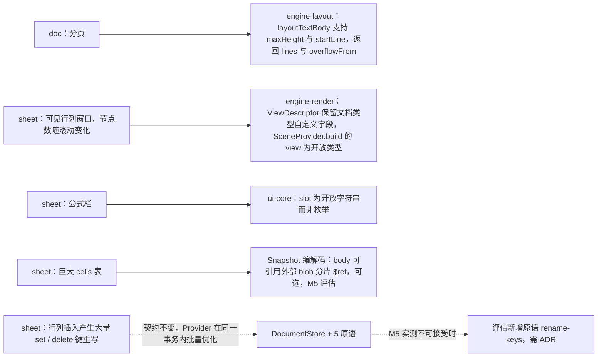
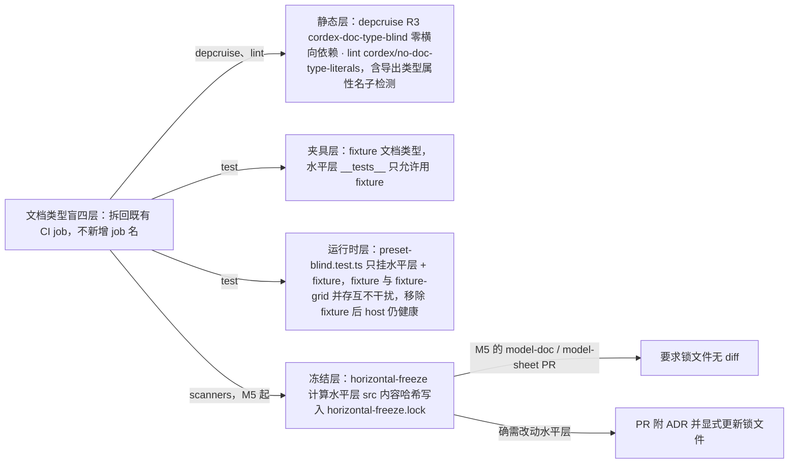

# 12 向 doc / sheet 扩展：文档类型盲的验证方案

> 状态：草稿 | 负责：架构-结构 | 更新：2026-09-15；2026-09-25（补图）；2026-09-25（矛盾收口，rulings §4.18：FE-01 R3 只约束非组合根的水平层、组合根豁免，冻结范围改为「无 bundle 且非组合根的包」，server-headless 文档类型盲（§2 图、§4.1、§4.4）；GV-14 「doc-type-blindness」不是 job，四层拆回 depcruise / lint / test / scanners（§4）；GV-15 扫描器名改正式名、`horizontal-freeze` 路径改 `tooling/scripts/`（§4.1、§4.4）） | 依赖：charter v0.1
> 目标（章程 R5、M5）：`model-doc` 与 `model-sheet` 骨架落地时，**水平层零改动**（dependency-cruiser 零横向依赖 + 水平层文件哈希冻结）。本文列出这两种类型会对水平层提出的抽象要求，标明哪些已在 M1 设计中满足、哪些必须参数化，并定义自动化「盲测套件」。

---

## 1. 方法：用两个假想类型反推水平层的抽象

我们不在 M1 实现 doc/sheet，但在设计 `model-core`、`engine-*`、`ui-core` 时，用它们的**最小骨架**做「设计时验证」：每个水平层抽象都要回答「doc 会怎么用？sheet 会怎么用？」，回答不出来就是形状泄漏（Univer A2：`unitId + subUnitId` 是 workbook 的形状）。

### 1.1 `model-doc`（流式文本 + 分页）最小骨架

```
 body = { doc: { sectionProperties; styles: Record<StyleId, Style>; numbering; properties; extensions }
          blocks: Record<BlockId, (Paragraph | Table | SectionBreak | Unknown) & { order: FracKey }>   // 顺序 = (order, id)，无数组（ADR-0032）
          media; opaqueParts }
 Paragraph.runs 为富文本（text op）；表格嵌套段落；分页是**派生**（layout 服务），不入模型
 Mutation：doc.block.insert/remove/setOrder、doc.text.applyDelta、doc.paragraph.setProperties、doc.table.*
 Selection 锚点：{ kind:'text'; blockId; start; end } | { kind:'block'; blockIds } | { kind:'tableCell' }
 Scene：view = { page: number }（派生页）；SceneNode kind = 'doc:paragraph-lines' | 'doc:table' | 'doc:image' | 'doc:page-decoration'
```

### 1.2 `model-sheet`（网格寻址；公式暂不做）最小骨架

```
 body = { workbook: { definedNames; styles: Record<StyleId, CellStyle>; properties; extensions }
          sheets: Record<SheetId, { name; order: FracKey; dimensions; rows: Record<row, RowProps>; cols: Record<col, ColProps>; merges: Range[]; extensions }>
          cells: Record<`${SheetId}:${row}:${col}`, Cell>          // 稀疏；键为字符串（set/delete 原语）
          media; opaqueParts }
 Mutation：sheet.cell.set/clear、sheet.range.setStyle、sheet.row.insert/remove、sheet.col.insert/remove、sheet.sheet.insert/remove/setOrder、sheet.merge.add/remove
 Selection 锚点：{ kind:'range'; sheetId; r0; c0; r1; c1 } | { kind:'sheet'; sheetId }
 Scene：view = { sheetId; viewport: 可见行列窗口 }；SceneNode kind = 'sheet:grid' | 'sheet:cell-text' | 'sheet:merge' | 'sheet:frozen-pane'
```

---

## 2. 逐个水平层抽象的检验

| 抽象（所在层） | doc 的用法 | sheet 的用法 | 结论 |
|---|---|---|---|
| `Unit` / `UnitScope`（L1） | 一份 .docx 一个 Unit | 一份 .xlsx 一个 Unit；工作表**不是** Unit（是 body 内实体） | ✅ 共享；不引入 subUnit |
| `DocumentType<S>`（L1） | `id:'doc'`，`unitServices:['docs']`，`selectionKinds:['text','block','tableCell']` | `id:'sheet'`，`unitServices:['sheets']`，`selectionKinds:['range','sheet']` | ✅ 共享；selectionKinds 已参数化 |
| `DocumentStore<S>` + 5 原语（L1） | `text` op 是主角；块顺序 = `blocks.<id>.order` 单键 `set` | `set/delete` 于稀疏 cells 键；工作表顺序 = `sheets.<id>.order`；行列插入 = 大量键重写（见 §3.2） | ✅ 原语足够；⚠ sheet 行列插入的性能需 Provider 侧批量优化（不改契约） |
| `order: FracKey`（`@cordexjs/shared/order`，L0） | 块顺序；并发插入同位按 `(order, id)` 确定 | 工作表顺序 | ✅ 与 slide 完全相同的机制（ADR-0032） |
| `Snapshot`/`Migration`/`ResourceHook`（L1） | 同 | 同（cells 表大 → SnapshotBundle 的 body 可能需分片，见 §3.3） | ✅ 共享；⚠ 大 body 分片是 Snapshot 编解码的可选扩展点，M5 评估，不影响接口 |
| Command/Mutation 管线（L1） | `doc.*` Mutation 贡献 | `sheet.*` Mutation 贡献 | ✅ 共享；`type` 三段式命名已容纳 |
| `permissions`（L1） | 段落级/区域级权限用 `resource: { kind:'block', id }` | 区域权限 `resource: { kind:'range', id: 'sheetId!A1:B2' }` | ✅ `resource` 为开放字符串 |
| `Selection<A>`（L1） | 文本范围锚点 | 矩形范围锚点 | ✅ 泛型 |
| `FormatCodec`（L1）+ `ooxml-core`（L3） | `ooxml-docx`：WordprocessingML；共用 OPC/XML/DrawingML（图片、形状） | `ooxml-xlsx`：SpreadsheetML；共用 OPC/XML；共享字符串表、样式表是 xlsx 特有 | ✅ OPC/XML/DrawingML 共享；`preserve/*` 的 DirtyTracker 按 Path 前缀 → Part 的注册是通用的 |
| `model-core/drawing`（L1） | 文档内嵌形状/图片用同一 DrawingML 词汇 | 单元格内图形同 | ✅ 这就是把 DrawingML 放 L1 的原因（02 §4.9） |
| `engine-layout`（L5） | **核心用户**：段落布局 + 分页（分页在 `doc-render` 的 SceneProvider 内基于 LayoutResult 计算） | 单元格文本度量、自动行高 | ✅ `LayoutBodyInput` 中性输入；⚠ 分页需要 `layoutTextBody` 支持「给定高度上限，返回可放入的行数与剩余」——M1 必须把这个能力放进契约（`layoutTextBody(input, box, { maxHeight, startLine })` 返回 `{ lines; overflowFrom? }`） |
| `engine-render` Scene（L5） | 页为单位的 Scene；节点是行/表格 | Scene 是可见窗口的网格，节点数随滚动变化 → `SceneProvider.build(view)` 的 `view` 必须是开放类型 `ViewDescriptor & Record<string, unknown>`；虚拟化由 SceneProvider 与 `viewport/virtualization.ts` 协作 | ✅ `kind: string` + bbox 足够；⚠ `ViewDescriptor` 需保留文档类型自定义字段（M1 设计已如此） |
| `RenderTarget`（L5）/ `render-dom` | SVG 文本行 | 大量文本节点 → DOM 数量压力；sheet-render 可贡献自己的 `render.target:'canvas-grid'`（Provider 可替换，章程 §5.4） | ✅ 契约无假设 |
| `ui-core` 贡献点（L7） | ribbon（开始/插入/布局）、面板（导航/样式） | ribbon、公式栏（`ui.toolbar` slot）、状态栏（求和） | ✅ `slot` 字符串 + `when` 子句；⚠ 公式栏是 sheet 专有 slot：`slot` 必须是开放字符串而非枚举（M1 设计已如此） |
| `i18n.bundle`（L0） | 'doc' 命名空间 | 'sheet' 命名空间 | ✅ |
| `collab-*`（L4） | Y.Text 富文本是最佳映射 | 稀疏 Y.Map；范围锁 | ✅ 契约按 Unit；具体映射在各 store 的 06 分节 |

**结论**：M1 设计中需要为 doc/sheet **预先参数化**的 4 处（表中 ⚠）都是**接口形状**问题，不是后补功能：
1. `layoutTextBody` 支持高度上限与续排（分页基础）；
2. `ViewDescriptor` 开放扩展字段；
3. `ui.*` 的 `slot` 为开放字符串；
4. Snapshot 编解码保留 body 分片扩展点（可选，不阻塞 M1）。

**水平层与三类垂直束**

```mermaid
flowchart TB
  subgraph verticals["垂直束：layer 为 V-* 的包，cordex.bundle 必填"]
    direction LR
    slideB["slide：model-slide · slide-render · ooxml-pptx"]
    docB["doc，M5 骨架：model-doc · doc-render · ooxml-docx"]
    sheetB["sheet，M5 骨架：model-sheet · sheet-render · ooxml-xlsx"]
  end
  inject["注入口：DocumentType 声明 + 贡献点 core.mutation、core.command、render.scene、render.element、core.format、ui.*，见 §3.2"]
  subgraph horizontal["水平层：无 cordex.bundle 且非组合根的包，含 server-*，M5 零改动、文件哈希冻结"]
    direction TB
    l7["L7 ui-core：贡献点 slot 为开放字符串 + when 子句"]
    l5["L5 engine-layout · engine-render 的 Scene / RenderTarget / ElementRenderer 契约 · render-dom"]
    l4["L4 collab-*：契约按 Unit"]
    l3["L3 ooxml-core：OPC / XML / DrawingML 编解码与不透明保留引擎"]
    l1["L1 model-core：Unit / UnitScope、DocumentType、DocumentStore + StoreOp、Snapshot / Migration / ResourceHook、Command 管线、permissions、Selection、FormatCodec、drawing"]
    l0["L0 shared/order 的 FracKey、i18n、errors / telemetry"]
  end
  slideB & docB & sheetB --> inject
  inject --> horizontal
  horizontal -. "反向依赖被禁止：depcruise R3 cordex-doc-type-blind" .-> verticals
  roots["组合根 compositionRoot:true：preset-*、apps/web、apps/server，豁免 R3"] --> verticals
  roots --> horizontal
```



怎么读：「垂直束」框里三列平行存在、互不依赖，都只经同一个注入口使用同一套水平层；虚线是被 depcruise 禁止的反向依赖。组合根是唯一能同时 import 水平层与垂直束的包（rulings §4.18 FE-01）：preset 可带 `bundle` 并受 R4 束间隔离约束（preset-doc 不得 import slide 束），apps/web 仍受 R9 白名单约束、不能直接 import 束包，apps/server 只在 `cordis-host/preset-server.ts` 装配束并把插件清单交给 server-headless。sheet 可另行贡献 `render.target:'canvas-grid'` 作为 Provider 替换，不改水平层契约。
依据：本文 §2 表、§3.1、§3.2、§4.1。

**M1 需预先参数化的四处与 sheet 行列插入**



怎么读：左列是 doc/sheet 的具体需求，实线指向必须在 M1 就定好的接口形状（表中 ⚠ 的四处）；虚线是不改契约的性能兜底与其升级路径。

---

## 3. 必须参数化 vs 可以共享

### 3.1 共享（水平层拥有、零改动）

Unit/UnitScope、DocumentStore + StoreOp、Transaction/History、Snapshot/Migration/ResourceHook、Command 管线、permissions、Selection 泛型、FormatCodec、OPC/XML/DrawingML 编解码与不透明保留引擎、TextMeasurer/段落布局/几何、Scene/RenderTarget/ElementRenderer 契约、ui-core 贡献点与输入管线、i18n、collab 契约、errors/telemetry、preset 机制。

### 3.2 参数化（由 `DocumentType` 与贡献点注入）

| 参数 | 注入方式 |
|---|---|
| body 类型 `S` 与 schema | `DocumentType<S>.bodySchema` |
| Mutation 联合 | `core.mutation` 贡献 |
| 命令与操作 | `core.command` 贡献 |
| 选区锚点类型与 kinds | `DocumentType.selectionKinds` + 类型参数 |
| 单元级服务（`slides`/`docs`/`sheets`） | `DocumentType.unitServices` + `unitPlugins` |
| 场景构造与脏映射 | `render.scene` 贡献 |
| 元素渲染 | `render.element` 贡献 |
| 格式编解码 | `core.format` 贡献 |
| Path 前缀 → Part 的注册 | codec 调用 `registerPartPrefixes` |
| UI | `ui.*` 贡献 + `when` 子句上下文键（`unitType`） |

sheet 行列插入的性能：`sheet.row.insert` 的 `lower` 会产生大量 `set/delete`（键重写）。契约不变，但允许 Provider 对同一事务内的批量原语做**内部**优化（store-yjs 在一次 `Y.transact` 内应用；store-memory 一次 produce）。若 M5 测得不可接受，再评估新增原语 `rename-keys`（会是 M5 对水平层的唯一契约扩展，需 ADR）。

### 3.3 Snapshot 分片（可选扩展点）

`SnapshotBundle` 允许 `body` 引用外部 blob 分片（`{ $ref: BlobRef }`）；`decodeSnapshot` 在 M1 实现中支持 `$ref` 解析但 slide 不使用。这样 sheet 的巨大 cells 表不必改接口。

---

## 4. 「文档类型盲」自动化测试套件（ADR-0016）

四层，**不单设 CI job**：`doc-type-blindness` 只是这四层检查的统称，按 09-07 §3 的 13 个 job 封闭集合拆回既有 job 执行（rulings §4.18 GV-14）——静态层归 `depcruise` 与 `lint`，夹具层与运行时层归 `test`，冻结层是 M5 起 `scanners` job 的 `horizontal-freeze` 步骤：

**文档类型盲测试的四层**



怎么读：四层检查分别落在边上所写的既有 CI job 里；冻结层是 M5 验收的出口，两条出边分别是常规情况与经 ADR 审计的例外。

### 4.1 静态层

| 检查 | 机制 | 失败示例 |
|---|---|---|
| 水平层零横向依赖 | depcruise R3 `cordex-doc-type-blind`（**非组合根**的水平层包 → 垂直束包禁止：`from` = 无 `cordex.bundle` 且 `compositionRoot !== true`，`to` = layer 为 `V-*` 的包；组合根 preset-*、apps/web、apps/server 豁免，另受 R4 与 R9 约束，rulings §4.18 FE-01） | `model-core` import `@cordexjs/model-slide`；`server-headless` import `@cordexjs/ooxml-pptx` |
| 水平层无文档类型字面量 | lint `no-doc-type-literals`：水平层源码中禁止字符串字面量/标识符片段 `slide|slides|sheet|workbook|docx|pptx|xlsx|paragraph`（允许列表：`fixtures`、注释、`model-core/testing/fixture-*`、`ooxml-core` 中的 MIME 常量表——后者是格式知识不是模型知识，单独审查） | `model-core/unit/unit.ts` 出现 `'slide'` |
| 通用契约无文档字段 | api-extractor 基线审查 + lint `cordex/no-doc-type-literals` 的子检测（原写作扫描器 `no-doc-fields-in-contracts`，已并入该规则，09-08 §11.1，rulings §4.18 GV-15）：`engine-render`/`model-core` 导出类型属性名不得含上述词根；同一规则的扫描路径含 `apps/server/src/modules/**` | `SceneNode.slideId` |

### 4.2 夹具层（`fixture` 文档类型）

`@cordexjs/model-core/testing/fixture-document-type.ts` 提供一个**与三种真实类型都不同**的最小类型：

```
 body = { nodes: Record<NodeId, { kind: 'box' | 'group'; props: JsonObject; children: NodeId[] }>; texts: Record<NodeId, TextDelta>; root: NodeId[] }
 Mutation：fixture.node.insert / fixture.node.setOrder / fixture.text.applyDelta
 Command：fixture.addBox（有权限）、fixture.rename（只读命令示例）
 Operation：fixture.select
 FormatCodec：'fixture-json'（JSON 往返）
 ResourceHook：'fixture-plugin.notes'
 Migration：v1 → v2（props 改名）
 SceneProvider：每个 box 一个 SceneNode（kind 'fixture:box'）；ElementRenderer 在 RecordingTarget 上记录
 UI：一个 ui.ribbon 项、一个 ui.shortcut
```

规则：**所有水平层包的 `__tests__` 只允许使用 `fixture` 类型**（depcruise R10 的姐妹规则 `horizontal-tests-use-fixture-only`：水平层 `__tests__` 不得 import `@cordexjs/model-slide*`）。若某水平层功能无法用 `fixture` 测试，说明它依赖了文档形状——先改抽象。

### 4.3 运行时层（preset 矩阵）

`preset-blind.test.ts`：只挂载水平层插件 + `fixture` 类型，断言：
- `units.open({ documentType:'fixture', source:{kind:'empty'} })` 成功；
- 两个不同 documentType（`fixture` 与第二个夹具 `fixture-grid`——网格键空间，模拟 sheet）同时打开、互不干扰；
- 移除 `fixture` 后打开返回 `UNIT_UNKNOWN_DOCUMENT_TYPE`，host 仍健康（章程 §5.4「打开空壳」）。

### 4.4 冻结层（M5 验收）

`horizontal-freeze`：`tooling/scripts/scan-horizontal-freeze.ts`（M5 起作为 `scanners` job 的步骤；当前不计入十四个扫描器，若正式纳入为第 15 个需追加 09-06 §19，rulings §4.18 GV-11/GV-15）计算所有**无 `cordex.bundle` 且非组合根**的包 `src/**`（排除 `__tests__`）的内容哈希并写入 `fixtures/horizontal-freeze.lock`（FE-01：组合根可随新文档类型装配而改动，不在冻结范围）。冻结范围含 `server-*`：server-headless 已按 FE-01 改为文档类型盲（导入导出经 `formats` 按 documentType 取 codec，插件清单由 apps/server 的 `preset-server.ts` 提供），因此 M5 新增 doc 时 `server-*` 的 diff 为 0（PRD 05 M5 验收）。M5 的 `model-doc`/`model-sheet` PR 要求锁文件**无 diff**；若确需改动水平层，PR 必须附 ADR 并显式更新锁文件（可审计的「水平层改动」）。

---

## 5. M5 骨架的验收清单（供 PRD 05 引用）

| 项 | 验收 |
|---|---|
| `model-doc` 骨架 | `DocumentType 'doc'` + 3 个 Mutation + 2 个命令 + JSON 编解码 + SceneProvider 渲染出段落行（用 `engine-layout/testing` 的 FixedWidthMeasurer，即 TextMeasurer Provider `fixed`，07 §5.1）；`horizontal-freeze` 无 diff |
| `model-sheet` 骨架 | `DocumentType 'sheet'` + 稀疏 cells + 行插入 Mutation + Scene 网格窗口；`horizontal-freeze` 无 diff |
| depcruise | 报告零横向依赖（R3/R4） |
| 同页多类型 | 一个 host 同时打开 slide + doc + sheet 三个 Unit，各自渲染，关闭任一不影响其余 |
| 服务端 | `server-*` diff 为 0：doc 的服务端导入导出只需在 apps/server 的 `preset-server.ts` 插件清单里加 `model-doc`/`ooxml-docx`（组合根改动，不在冻结范围，rulings §4.18 FE-01） |
| 性能 | sheet 10 万 cells 打开 < 预算（PRD 04 定）；若不达标触发 §3.2 的 `rename-keys` ADR 评估 |

---

## 6. 与其它文档的关系

- 抽象定义：04（模型）、05（命令）、02（包结构）；
- 渲染契约的开放字段（`ViewDescriptor`、`kind`）：07（B）；
- 协同映射的按类型差异：06（B）；
- lint/depcruise/扫描器细节：09-02/03/06（类型治理）。
