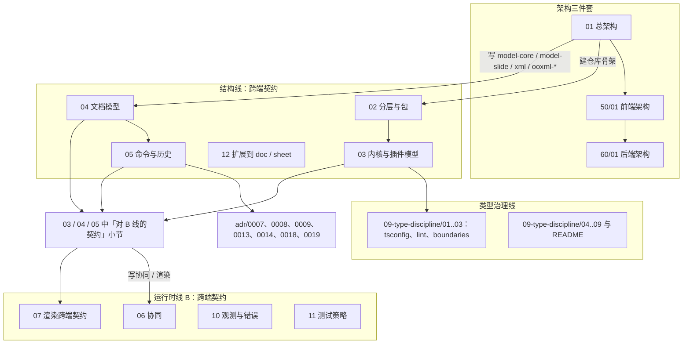

# 架构入口（总架构，30-architecture）

> 状态：草稿 | 负责：架构-结构 | 更新：2026-09-18；2026-09-24（rulings §4.15：C-9 结案——删「全局 yarn」前提，改 pnpm 11 双锁 + Node 26；A-9 注明 Q3 未覆盖；UI 组件库行 shadcn 命令改 pnpm dlx）；2026-09-25（补图）；2026-09-25（矛盾收口，rulings §4.18）；2026-09-25（§4.19：§2 登记三条设计线与三线总边界表，08 / 11 改为摘要 + 链接、06 §0.1 与 08 §0.1 写 M2/M3 新边界）；2026-09-25（设计线拆分：§2 首加「前端 / 后端 / 测试设计以 50 / 60 / 70 为准」，07、10 索引行改注摘要 + 链接）；2026-09-26（§4.20）（FE-01：§3 UnitScope 行登记 Unit 默认 Provider 登记表）；2026-09-26（§4.21：顶部置「架构三件套」表；§1 原则并入 01 §3 统一原则表；§2 索引去掉 08、07 改名「渲染跨端契约」、01 升格总架构、02 去目录树，三线边界表改链 docs/README；§3 补 ADR-0018、0019；§4 A-2 按 ADR-0019 结案、补 B1 / B2 结案行、A-11 链 ADR-0036；§5、§7 标为历史；§6 补术语）；2026-09-26（§4.21 整合：§4 新增 A-14 SVG 消毒器共享落点待决）；2026-09-26（§4.21 Remap：原 30/08 引用按 60-backend/README §6.1 改指新位置，30/08 已删除） | 依赖：charter v0.1
> 本 README 由架构-结构条线起草；「文档索引」中 06/07/10/11 由架构-运行时条线撰写，09-type-discipline/ 由类型治理条线撰写。总编排合并时以此为入口。

## 架构三件套（先读这三篇）

架构只有一份总架构，接下来是前端架构和后端架构（rulings §4.21 q-arch-reorg 方案 B）：30 目录只留总架构与跨端契约，50/01、60/01 就地升格为前端架构、后端架构。阅读顺序固定为 ① → ② → ③。

| 顺序 | 文档 | 回答什么 | 唯一源 |
|---|---|---|---|
| ① | [30/01 总架构](./01-overview.md) | 系统边界与容器、前后端分工、统一原则、技术栈与复用总口径、打开 / 编辑 / 协同 / 导入导出四条跨端数据流、M1–M4 里程碑边界 | C4 L1/L2、统一原则表 P1–P14、技术栈与复用总表与许可分级口径、M1–M4 里程碑边界表 |
| ② | [50/01 前端架构](../50-frontend/01-overview-and-runtime-map.md) | 浏览器执行上下文、包在浏览器中的层带分布、前端铁律 F1–F14、运行时对象关系、前端主干、编辑器能力地图 | 前端铁律与浏览器侧对象图；复用全表 [50/17](../50-frontend/17-reuse-and-dependency-catalog.md)、能力总表 [50/18](../50-frontend/18-editor-capabilities.md)、可追加元素目录 [50/19](../50-frontend/19-insertable-elements-overview.md)–25 |
| ③ | [60/01 后端架构](../60-backend/01-service-overview-and-roles.md) | Nest 模块、`CORDEX_ROLE`、装配矩阵、cordis 宿主生命周期、驱动放行边界、服务端预算 | 模块清单、装配矩阵、服务端预算；复用全表 [60/19](../60-backend/19-reuse-and-dependency-catalog.md) |

三件套之外，30 目录保留跨端契约（02 分层、03 内核、04 模型、05 命令、06 协同、07 渲染跨端契约、10 错误与事件、12 扩展）、类型治理（09）与 ADR；原 08「后端一页总览」已撤销（五条原则并入 01 §3，其余见 [60-backend/README](../60-backend/README.md) §6 映射），文件已在 Remap 阶段统一改完引用后删除。

---

## 0. 这套文档解决什么问题

章程（`docs/00-charter/charter.md`）定义了**要建什么**：一个以 cordis 4 为内核、每一级可插拔、文档类型盲的办公文档 SDK。本目录回答**怎么建**，并且细化到能让一名资深工程师直接创建仓库骨架、写出 `@cordexjs/kernel` 与 `@cordexjs/model-core` 的程度：

- `02` 给出分层秩表（全仓唯一源）、仓库根目录、每个包 `package.json` 的字段策略、第三方单点表与依赖规则；逐包目录树与逐文件职责已迁到 40-modules 各篇 §4（§4.21，02 各包标题保留一行桩）；
- `03`/`04`/`05` 给出内核、文档模型、命令系统的**签名级草案**；
- 每一条架构规则都标明**如何被机械验证**（哪个 lint / dependency-cruiser 规则 / 测试套件 / CI job），细节由 `09-type-discipline/` 承接；
- 每一个抽象都写明**为什么不像 Univer 那样做**（引用 `reference-univer-lessons.md` 的 K/A 编号）。

---

## 1. 架构原则（与章程 §0 一致；统一原则表见 01 §3）

原 P1–P8（本节旧表）、原 01「四大原则」与原 08 §0 五条跨端原则已合并为 [01](./01-overview.md) §3 的**统一原则表 P1–P14**（§4.21），落地解读、执行点、对应的前端铁律 F1–F14 与后端落点只在那里维护，本节只列名称索引：

P1 SDK 优先 · P2 每一级可插拔 · P3 文档类型盲 · P4 规范必有执行点 · P5 唯一注册抽象 · P6 时间可组合 · P7 单一事实源 · P8 失败可传播、可隔离 · P9 服务端薄壳（原 08 §0 第 1 条）· P10 同一份 iso 代码两端运行（第 2 条）· P11 fail-closed 多点 + 纵深防御（第 3 条）· P12 驱动与第三方单点放行（第 4 条）· P13 服务端文档类型盲（第 5 条）· P14 复用优先、许可分级准入（§4.21 新增）

---

## 2. 文档索引

> **前端 / 后端 / 测试设计以 [50-frontend](../50-frontend/README.md) / [60-backend](../60-backend/README.md) / [70-testing](../70-testing/README.md) 为准**（rulings §4.19）：本目录只保留总架构、跨端原则、跨端协议、iso 契约与 ADR；下表中标注「摘要 + 链接」的文件，其运行侧细节已迁入三条设计线，冲突时以设计线为准（已接受 ADR 与 rulings 除外）。三线分工与边界表只在 [docs/README](../README.md) 维护，本目录不再重复（§4.21）。

| 文件 | 内容 | 负责 |
|---|---|---|
| [`01-overview.md`](./01-overview.md) | ★ **总架构**（全仓唯一，跨端）：C4 L1/L2、前后端分工、统一原则表 P1–P14、技术栈与复用总表与许可分级、打开 / 编辑 / 协同 / 导入导出端到端数据流、运行时对象总图、阅读路径、M1–M4 里程碑边界唯一表 | 结构 |
| [`02-layering-and-packages.md`](./02-layering-and-packages.md) | 分层秩表（全仓唯一源，含 L0 `@cordexjs/xml`）、仓库根目录、`package.json` 策略、第三方单点表、依赖规则表；逐包目录树已删，各包标题留一行桩指 40-modules 对应 §4 | 结构 |
| [`03-kernel-and-plugin-model.md`](./03-kernel-and-plugin-model.md) | kernel 封装、ContributionPoint、Manifest、UnitScope、插件形态与生命周期、失败隔离、preset/loader、版本协商 | 结构 |
| [`04-document-model.md`](./04-document-model.md) | model-core 抽象、model-slide 对象模型、OOXML 映射表、不透明保留、样式继承、单位、稳定 id、schema 迁移 | 结构 |
| [`05-command-and-history.md`](./05-command-and-history.md) | 命令三分法契约、执行管线、Mutation 类型化与降级、Store 推导逆操作、协同撤销、失败传播 | 结构 |
| [`06-collaboration.md`](./06-collaboration.md) | CRDT 映射、同步协议、presence、离线、权限即时性、冲突语义 | 运行时（B） |
| [`07-rendering.md`](./07-rendering.md) | **渲染跨端契约**：渲染介质与坐标、贡献点与帧管线契约、engine-layout 度量与断行、headless 渲染跨端约束；render-dom 与页合成迁往 50/01 前端架构，元素渲染器表迁往 50/19，其余为摘要 + 链接（40-modules/06、07，50-frontend/04–06、13，60-backend/06） | 运行时（B） |
| [`09-type-discipline/`](./09-type-discipline/README.md) | 类型治理：tsconfig、lint、boundaries、api-surface、runtime-boundaries、scanners、hooks-and-ci、policy 矩阵、plugin 类型契约 | 类型治理 |
| [`10-observability-and-errors.md`](./10-observability-and-errors.md) | 错误码体系（格式、域登记、HTTP/WS 映射）、日志命名与脱敏、遥测 API 与命名规则、公开事件定稿；Sink、span / 指标清单、诊断与客户端错误上报为摘要 + 链接（50-frontend/15、60-backend/18） | 运行时（B） |
| [`11-testing-strategy.md`](./11-testing-strategy.md) | 测试原则与门禁口径摘要；各类测试细则链接 70-testing | 运行时（B） |
| [`12-extension-to-doc-and-sheet.md`](./12-extension-to-doc-and-sheet.md) | 文档类型盲验证方案、model-doc/model-sheet 对水平层的抽象要求、盲测套件定义 | 结构 |
| [`adr/README.md`](./adr/README.md) | ADR 索引：0001–0019 结构（§4.21 新增 0018 可追加元素模型与插入命令族、0019 XML 词法与保真树）、0020–0039 运行时（新增 0036 图表渲染与编辑路线、0039 协同服务端采用 Hocuspocus 4）、0040–0049 类型治理（新增 0049 依赖准入与许可分级） | 结构（索引）|

原 `08-backend-nestjs.md`（后端一页总览）已撤销（§4.21）：五条跨端原则并入 01 §3（P9–P13），两张后端总图与服务端里程碑迁往 60/01，其余各节按 [60-backend/README](../60-backend/README.md) §6 的映射改指 60-backend 各篇；文件已在 Remap 阶段统一改完引用后删除。

里程碑口径：M1–M4 的边界只在 [01](./01-overview.md) §7 维护一张表；协同后端（网关、Room、update 持久化与快照、服务端导入）随 M2 交付，M3 为多人协同体验层（rulings §4.19 D-M2-CONTENT；验收细则以 PRD 05 为准）。

### 阅读顺序建议

1. 先读架构三件套：`01` 总架构 → [50/01](../50-frontend/01-overview-and-runtime-map.md) 前端架构 → [60/01](../60-backend/01-service-overview-and-roles.md) 后端架构；
2. 要建仓库骨架：`02` → `03` → `09-type-discipline/01..03`；
3. 要写 `model-core`/`model-slide`/`xml`/`ooxml-*`：`04` → `05` → `adr/0007`、`0008`、`0009`、`0013`、`0014`、`0018`、`0019`；
4. 要写协同 / 渲染：读 `03`/`04`/`05` 中「对 B 线的契约」小节后转 `06`/`07`；服务端细节直接读 60-backend。

**文档地图与阅读路径**

怎么读：顶部子图是固定阅读顺序的架构三件套；其余三个子图对应三条撰写条线，箭头是上面「阅读顺序建议」的路径：读完 01 后按目的分叉为「建仓库骨架」与「写模型 / 格式」两条；第 4 条从 03/04/05 中「对 B 线的契约」小节转入 06/07（指向契约节点的三条边表示该小节所在文档）；没有箭头的文档按需查阅。

---

## 3. 结构线的关键设计决策速览（详见 ADR）

| 决策 | 一句话 | ADR |
|---|---|---|
| 声明合并桥接 | kernel 自有 `Events`/`Context` 空接口，cordis 的同名接口 `extends` 它们；插件只 `declare module '@cordexjs/kernel'` | 0001 |
| 版本策略 | 水平 L0–L1 lockstep（Changesets fixed 组）；垂直束与 Provider 独立 semver；`peerDependencies` 在**加载期**校验，失配即 FAILED（不是 log） | 0002 |
| Manifest | `src/manifest.ts` 由静态分析**生成并入库**，CI 校验无 diff；运行时与实际 provide/contribute/on 比对 | 0003 |
| 工具链 | pnpm + Turborepo；库用 `tsc -b` 产出未打包 ESM + 逐文件 `.d.ts`；apps 用 Vite；Changesets | 0004 |
| UnitScope | 每个 Unit 是一个插件 Fiber，其 `apply` 内 `ctx.isolate()` 隔离 `store/history/selection/render/presence` + 文档类型声明的服务；挂哪些 Provider 由 `units.registerUnitProvider` 登记表决定（model-core 只登记 history、selection，其余由 preset 的 `scope:'unit'` 条目登记，同一 `provides` 只登记一次，03 §5.1a，rulings §4.20 FE-01） | 0005 |
| 唯一注册 | `defineContributionPoint` / `ctx.contribute` / `ctx.contributions`；贡献由 effect 拥有 | 0006 |
| Store 与撤销 | `DocumentStore` 是 Definition；逆操作由 Provider 在 `StoreOp` 层推导；`history` 是策略层 | 0007 |
| 不透明保留 | 部件级 verbatim + 节点级 `OpaqueXml` 槽 + 脏部件重生成；二进制走内容寻址 blob | 0008 |
| Snapshot 版本 | 每个 `documentType` 一个整数 `schemaVersion`；`core.migration` 贡献点；schema-lock 防止未升版本改 schema | 0009 |
| preset vs loader | 浏览器与服务端默认程序化 preset；loader 仅 `server-headless` 可选 | 0010 |
| errors/telemetry | L0 服务、默认控制台/no-op Provider；`throw new Error` 被 lint 禁止 | 0011 |
| 权限放置 | fail-closed；两处检查点：`commands` 管线（含 Mutation 级）与服务端网关；Store 不检查 | 0012 |
| Mutation 降级 | 语义 Mutation（文档类型贡献）→ 纯函数 `lower()` → 5 种 `StoreOp` 原语（`set/delete/insert/remove/text`）；有序实体用 `order: FracKey`（ADR-0032），无 `move` 原语；Store 只懂原语 | 0013 |
| 稳定 id | 模型节点用 CRDT 友好 `NodeId`（UUIDv7）；OOXML `cNvPr/@id` 与 `a16:creationId` 作为字段保留并双向映射 | 0014 |
| 单一执行入口 | Command 与 Operation 都经 `commands.execute`；Mutation 只能在事务内产生，外部**不可执行** | 0015 |
| 盲测夹具 | `model-core/testing` 提供 `fixture` 文档类型；水平层测试禁 import 垂直束；M5「水平层零改动」以文件哈希冻结校验 | 0016 |
| UI 组件库 | **shadcn/ui 复制模式**（CLI 4.21，`radix-rhea` 风格——2026-09-16 起，原 `radix-nova`；Radix + Tailwind 4 + Lucide + Geist）：源码复制进 `ui-react/src/components/ui/`，`components.json` 入库，升级走 `pnpm dlx shadcn@4.21.0 diff`（仓库根禁用 npx，rulings §4.15 Q9）；`@cordexjs/design` 只交付主题变量 CSS（shadcn 变量 + `--cordex-*`），组件依赖全部落在 ui-react/`*-ui`；`ui-core` 仍无 React；设计 playground 是 ui-react 的种子（用户指令，章程 D10 修订） | 0017 |
| 可追加元素与插入命令族 | 补齐可追加元素的模型字段与插入命令 / Mutation 族；表格在 M3 结构编辑前改为归一化模型（`columns` / `rows` 为 `Record<Id, {order: FracKey, …}>`，`cells` 以 `"RowId:ColId"` 为键，合并记在锚格），不变量 I-TBL1 / I-TBL2 兜底（rulings §4.21 q-table-depth） | 0018 |
| XML 词法与保真树 | 自研词法、保真树与序列化，抽为独立 iso 包 `@cordexjs/xml`（L0 · 秩 0 · 零依赖）；`scan`（不建树，计数与限额）与 `parseDocument`（整树）两个入口，都支持 write/end 与时间片让出；XML 限额只在 XmlLimits 表定义一次；ooxml-core 运行时零 XML 依赖（rulings §4.21 X 组） | 0019 |

---

## 4. 待决事项（按默认值推进；决策人见右列）

| # | 事项 | 当前默认 | 影响 | 决策人 |
|---|---|---|---|---|
| A-1 | ~~`StoreOp.move` 在 CRDT 下的语义~~ | **已解决**：采纳 B 线 ADR-0032——有序实体 = 实体表 + `order: FracKey`，移动 = 单键 `set`；`move` 原语删除（ADR-0013）；04 §2.3、05 §4 已同步 | — | 已结（保留追溯） |
| A-2 | ~~同构 XML 解析器：自研 / @rgrove/parse-xml 5 / saxes（已归档）~~ | **已结案**（rulings §4.21 X:q-xml-lexer、X:q-xml-package）：自研词法与保真树，抽为独立 iso 包 `@cordexjs/xml`（L0 · 秩 0 · 零依赖）；ooxml-core 运行时不引任何 XML 依赖，只保留 OPC、命名空间归一化、MCE 与 c14n（测试用）；saxes 6.0.0 与 libxml2-wasm 只作 devDependency 差分 oracle，@rgrove/parse-xml 5 作退路；须接入 W3C XML Conformance 的 not-wf / wf 与 Namespaces 子集；见 [ADR-0019](adr/0019-xml-lexer-and-fidelity-tree.md) | `@cordexjs/xml` 约 20 人日 ±30%；ooxml-core 依赖上限改为「shared, xml, model-core」（02 §4.9） | 已结（保留追溯） |
| A-3 | Strict 一致性类输入**有编辑**时的导出一致性类（与 PRD PD-03 合并为一条） | 三案：**A 混合**（脏部件写 Transitional、干净部件 verbatim，本条线旧默认）——**放弃**：同一包内命名空间混用、`p:presentation/@conformance` 与部件不一致，PowerPoint 很可能触发修复，违反产品硬要求「PowerPoint 365 打开无修复」；**B 整包转 Transitional**（产品倾向）——满足两条硬要求，代价：Strict 输入一经编辑**全部**部件重生成（含不透明部件的命名空间改写，改写不透明 XML 有风险），「未触碰部件字节相同」对 Strict 输入失效；**C 保持原一致性类**（脏部件经 Transitional→Strict 反向映射写回 Strict、干净部件 verbatim）——两条硬要求 + 未触碰部件字节相同，代价：维护反向表并对 Strict XSD 校验。**推荐：C 为目标、B 为自动回退**（导出时 C 的产物未通过 Strict XSD 或反向表缺项 → 回退 B 并诊断 `STRICT_FALLBACK_TRANSITIONAL`）。零编辑往返在三案下均字节相同（04 §4.4） | `ooxml-core/xml/normalize.ts` 反向表、导出校验步骤、保真承诺表述 | 用户 + 总编排（产品 PD-03 与本条合并裁决） |
| A-4 | 库构建：`tsc -b` 未打包 ESM（默认）vs `tsdown` 打包 | `tsc -b`；`tsdown` 仅用于未来「独立浏览器包」 | 09-04 publint/attw 配置 | 类型治理 |
| A-5 | `NodeId` 生成器：UUIDv7（36 字符）vs 26 字符 base32 | UUIDv7 | Y.Doc 体积、日志可读性 | 架构-结构（听取 B 对体积的评估） |
| A-6 | `commands.execute` 的 unit 定位：显式 `unitId` 参数（默认）vs 从调用方 ctx 推导 | 显式 `unitId`；应用级命令传 `null` | 所有命令调用点 | 架构-结构（已定默认，可否决） |
| A-7 | 仓库自身许可证 | 建议 Apache-2.0（SDK 场景的专利授权） | 依赖审查基线、第三方插件生态 | 用户 |
| A-8 | `server-headless` 是否启用 `@cordisjs/plugin-loader` 配置驱动组合 | 关闭；preset 程序化组合 | 运维配置形态 | 架构-运行时（60-backend/06 §8）+ 运维 |
| A-9 | 幻灯片 body 形态 | 归一化实体表 + 每实体 `order: FracKey`（与 B 线 ADR-0032 一致，无顺序数组）。**残余分歧**：Snapshot 中 `order` 键**保留**（A，ADR-0013 第 7 条：使 `toSnapshotBody() ≡ state()`、导入不必重生成键、memory/yjs 一致）vs **转数组**（B，ADR-0032 第 6 条：人类可读） | Snapshot 契约、迁移语料形态、调试工具 | 总编排合并（A 推荐保留键，数组视图交给调试工具）。2026-09-24 注：rulings §4.15 Q3 只裁定 CRDT 选型（Yjs 13.6.x）与撤销语义（同键跳过并提示 / 整步跳过即停 / 软删除墓碑 + TTL），**未涉及** `order` 键的 Snapshot 形态，本项不随 Q3 结案，仍待裁决 |
| A-10 | `@cordexjs/design` 原子组件形态：Web Components vs 纯 CSS 类 + 最小 TS | 纯 CSS 类 + 最小 TS 行为 | ui-react 的复用方式 | 设计条线 |
| A-11 | 图表建模深度与 M1 查看路径 | **已对齐 PRD OF-09**：M1 `c:chart` 部件不透明保留（`Chart.partRef`），**图表渲染器只读解析**该部件（`ooxml-core/chartml/`：`c:chartSpace` 的图表类型/系列/`numCache`/`strCache`/轴/图例/标题 → 只读 `ChartReadModel`）并渲染为 SVG；**不**依赖位图预览（pptx 图表部件通常无预览，旧措辞作废）；M1–M2 不建可编辑模型。M3 起 `model-slide` 增加可编辑 `Chart.data`（ED-15；内嵌工作簿策略 PD-06 由 B 决定）。渲染器为惰性块：M1–M2 `@cordexjs/slide-render/chart` 子路径，M3 拆为 `@cordexjs/slide-render-chart`（总编排已接受） ；2026-09-26 补：渲染路线定为 d3-scale / d3-shape / d3-array（ISC）做底层、按 OOXML 语义自研布局，图表插入定在 M3（rulings §4.21 q-chart-route，ADR-0036） | `ooxml-core/chartml/`、`slide-render/chart/`、EM-07 图表块 ≤ 400 KB | 产品已表态、架构采纳；待总编排确认 |
| A-12 | 「部件级 diff 零差异」口径 | **已与 PRD CS-01 合并**为 04 §5.4 唯一口径：零编辑 = 部件路径集合与每部件 SHA-256 相同（含 `[Content_Types].xml`/`.rels`；zip 条目顺序/时间戳/压缩方法不计）；编辑后 = 未触碰部件字节相同 + 脏部件良构且通过 XSD + 规范化（C14N + 属性排序 + 忽略无意义空白）diff 仅在被编辑元素子树 + 被编辑元素的未知属性/子元素/`extLst` 全部保留 + `cNvPr@id` 部件内唯一且引用一致 + 派生部件白名单（`docProps/core.xml` 的 `dcterms:modified`、`docProps/app.xml` 页数/字数、`docProps/thumbnail.jpeg`、`[Content_Types].xml` 新增类型、受新增/删除部件影响的 `.rels`）+ 删页无孤儿部件 | M1/M2 验收脚本 `ooxml-pptx/testing/roundtrip.ts`、`test` job 的 `fidelity-roundtrip` 步骤（CI job 名以 09-07 §3 的 13 个封闭集合为准，rulings §4.18 GV-14） | 待总编排确认后回写章程 §7 |
| A-13 | 单文件 ≤ 200 MB（Q5）时 zip 读取形态：全量内存 vs 流式/Range | 全量内存 + 懒解压媒体（`fflate` 同构）；M3 评估流式 | `ooxml-core/opc/zip.ts` | 架构-运行时（性能预算，07/11） |
| A-14 | SVG 白名单消毒器的共享落点（2026-09-26 整合登记，出自 50-frontend/23 §13 Q-1） | 未定。服务端提交校验会消毒并可能改写规范 sha256（60-backend/04 §7.2 第 6 步），而 50-frontend/05 §8.3 要求本机 sha256 与服务端一致，因此消毒器要由浏览器与服务端共用同一份 iso 代码（依赖 `@cordexjs/xml`）。`@cordexjs/xml` 须保持格式盲，不能放 SVG 白名单；候选：① 沿 `./zip` 先例在 ooxml-core 开窄子路径（须为浏览器侧调用方 render-dom 或 slide-ui 放宽章程 §5.2 依赖上限，并在 `server-app-thin` 白名单登记）；② 新增一个 iso 小包。落地前浏览器对含不安全构造的 SVG 在本机拒绝插入，服务端照常消毒并以消毒后字节的 sha256 为准 | 章程 §5.2 依赖上限、`server-app-thin`、40-modules/04、60-backend/04 | 架构-结构 + 总编排（涉及章程） |
| B1 | ~~ORM：Drizzle vs Prisma~~（原 08 §13） | **已结案**（rulings §4.21 q-db-access）：drizzle-orm 0.45.x + 手写 `schema/*.ts`，迁移仍为手写 SQL；漂移检查改为直查 `pg_catalog`（含 relkind `'p'` 的分区父表），不用 drizzle-kit pull；Drizzle 1.0 的破坏性变更在 M2 前评估；写入 [ADR-0022](adr/0022-server-storage.md) 修订 | 60-backend/08、40-modules/12 | 已结 |
| B2 | ~~HTTP 适配器：Fastify vs Express~~（原 08 §13） | **已结案**（rulings §4.21，R-d-36）：Fastify 5（随 NestJS 12 的 platform-fastify 12.1.0）；写入 ADR-0022 修订；原 08 §13 其余 B3–B8 随原 08 §13–§15 转入 60-backend/README 的历史段 | 60-backend/01、17 | 已结 |

---

## 5. 对章程的异议 / 建议（不擅改章程，待总编排裁决）

> **历史**（§4.21 起不再维护）：本节是 2026-09-15 起结构线对章程的异议记录，保留追溯；之后的章程改动一律经 rulings 裁决并由章程线回写，不再登记于此。

| # | 章程条目 | 问题 | 建议 |
|---|---|---|---|
| C-1 | §5.3 规则 2「只向下：import 目标的层号 ≤ 自身层号」 | 与 §5.2 冲突：`slide-ui`（L6）依赖 `ui-react`（L7），`slide-ui` 依赖 `slide-render`（L6）依赖 `render-dom`（L5）没问题，但 L6→L7 按数字是「向上」 | 把规则 2 的机械形式改为**显式允许矩阵**（每个包 `package.json#cordex.layer` + 允许的目标层集合，见 02 §7），并在章程中把垂直束的层号改为「层带」：V-model（可依赖 ≤L1）、V-codec（≤L3）、V-render（≤L5）、V-ui（≤L7）。数字比较只对水平层生效 |
| C-2 | §5.5 服务名列表 | 缺少 `selection`（§4 UnitScope 定义中明确列出 selection 被隔离；model-core 也定义了通用 Selection 类型） | 在 §5.5 增加 `selection`（UnitScope 内） |
| C-3 | §5.5 贡献点 id 列表 | `ui.command` 语义不明：命令的**可执行定义**属于 model-core，不属于 UI | 明确 `ui.command` = 命令的**呈现元数据**（title/icon/when/keybinding 展示）；新增 `core.command`（可执行定义）、`core.mutation`、`core.migration`、`core.resource`、`core.permissionPolicy`、`render.scene`、`render.overlay`、`layout.measurer`、`errors.sink`、`telemetry.sink`、`i18n.bundle`、`ui.toolbar`/`ui.statusBar`/`ui.dialog`/`ui.notification`/`ui.theme`（完整表见 03 §3.6；id 一律 camelCase） |
| C-4 | §5.2 `kernel` 职责 vs primer §5.1 | primer 把 `openUnitScope(ctx, unit)` 放在 kernel，章程把 `Unit/UnitScope` 放在 model-core | 采用：kernel 提供**文档无关**的 `createIsolatedScope(ctx, { services, meta })`；model-core 拥有 `Unit`/`UnitScope`/`units` 服务。建议 primer §5.1 措辞改为 `createIsolatedScope` |
| C-5 | §5.2 `render-dom` 依赖上限「engine-render」 | `engine-layout` 的 `TextMeasurer` 是 Definition，浏览器 canvas 度量器 Provider 必须落在 dom 包 | `render-dom` 依赖上限改为「engine-render, engine-layout」；`server-headless` 提供 Node 字体度量 Provider |
| C-6 | §5.2 `ui-core` 依赖「design(token 契约)」 | 若 ui-core 在运行时 import `@cordexjs/design`，则 UI 基座与设计系统耦合；K7 的初衷是 design 对 SDK 零依赖（反向） | 允许 ui-core 仅 import `@cordexjs/design/theme.css`（主题变量）与 token 名类型（type-only）；lint 禁止 ui-core import design 的运行时 TS（09-03 三角色规则的一个特例）；组件依赖（Radix/Tailwind/Lucide）只在 ui-react 与 `*-ui`（ADR-0017） |
| C-7 | §4 `Snapshot` 定义 | 未说明二进制（媒体、不透明部件字节）的归属；若进 JSON/Y.Doc 会撑爆协同文档 | 术语补充 `SnapshotBundle = Snapshot(JSON) + Blob 集合（内容寻址）`；`Snapshot` 内只含 `BlobRef`。建议章程 §4 吸收 |
| C-8 | §6.1 D9 「Vitest；Playwright」 | 未指定 dom 包的单测环境 | 建议：dom 包默认 `happy-dom`，涉及真实布局/IME 的用例走 Vitest browser mode（Chromium），由 11 定稿 |
| C-9 | §10 Q9 包管理器 | **已结案**（rulings §4.15 Q9）：原「用户全局 `packageManager` 指向 yarn、会冲突」的前提经实测不成立，已删除 | pnpm 11 双锁：根 `package.json` 写 `packageManager`（精确版本）+ `devEngines.packageManager/runtime`（onFail:error），corepack 仅为可选安装渠道；全部 pnpm 设置写入 `pnpm-workspace.yaml`，删除 `.npmrc` 非鉴权设置；lockfile-guard（lefthook pre-commit + CI）只允许根 `pnpm-lock.yaml`；Node 26 基线（`engines >=26`）；pnpm 12 切换检查点最迟 2027-03-31（02 §2、09-07 §2.1、09-08 TD-079） |
| C-10 | §5.2 `ooxml-core` 依赖上限「shared」 | DrawingML 是三种文档共用的绘图词汇；若其运行时类型放在 `ooxml-core`（L3），`model-slide`（V-model，只能依赖 ≤L1）就必须向上依赖 L3 | DrawingML 运行时类型与 schema 放在 `model-core/src/drawing/`（无 XML、无文档类型知识），`ooxml-core/drawingml/` 只做编解码；`ooxml-core` 依赖上限改为「shared, model-core」（02 §4.9） |

---

## 6. 术语补充（章程 §4 之外，本条线新引入；建议回写章程）

| 术语 | 英文标识 | 定义 | 出处 |
|---|---|---|---|
| 存储原语 | `StoreOp` | Store 唯一理解的 5 种结构操作：`set`/`delete`/`insert`/`remove`/`text`（`insert/remove` 只用于无身份的值列表）；Mutation 经 `lower()` 降级为 `StoreOp[]`；逆操作在此层推导 | 05 §4、ADR-0013 |
| 顺序键 | `FracKey` | 有身份实体（页/形状/母版/版式/节…）的 `order` 属性，fractional index 字串；排序键 `(order, id)`；移动 = 单键写入；由命令层经 `@cordexjs/shared/order.between()` 生成（B 线术语，ADR-0032）；键格式按 rulings §4.21 q-frackey 改为内置 rocicorp fractional-indexing 算法源码（CC0，注明出处）：整数头 + 随机后缀，后缀避开以 `0` 结尾（ADR-0032 决策 2 修订） | 04 §3.1、ADR-0013 |
| 束 | `bundle` | `package.json#cordex.bundle ∈ slide\|doc\|sheet`，`layer` 以 `V-` 开头时必填；组合根 preset 选填（preset-slide* 标 slide、preset-doc 标 doc），其余省略；depcruise 束间隔离依据（总编排裁决；rulings §4.18 FE-01） | 02 §4.0.1、§7 |
| 降级 | lowering | 文档类型贡献的纯函数 `lower(mutation, view) → StoreOp[]` | 05 §4 |
| 变更集 | `ChangeSet` | 一次事务触及的 `StoreOp[]` + 派生的脏路径集合，供渲染与编解码做脏追踪 | 04 §2.4 |
| 来源 | `Origin` | 事务来源标记：`local(clientId)` / `remote` / `system(load|import|migration|repair|restore|maintenance)` / `replay`；撤销只作用于 `local`；`system('import')` 也用于渐进打开的后续追加批次（不入撤销栈、不标脏，rulings §4.18 CO-12） | 04 §2.2/§2.4、05 §6 |
| 快照包 | `SnapshotBundle` | `Snapshot`（JSON）+ 内容寻址 blob 集合 | 04 §2.5 |
| Blob 引用 | `BlobRef` | `{ hash, size, contentType }`，指向 `BlobStore` 中的不可变字节 | 04 §2.5 |
| 派生类型 | `Derived<T>` | 类型级品牌，标记不得进入 Snapshot 的派生字段；`Persisted<T>` 映射类型将其剔除 | 04 §7 |
| 不透明 XML | `OpaqueXml` | 未建模的 XML 子树，带插入锚点，附着在最近的已建模节点 `extensions` 上 | 04 §5 |
| 不透明部件引用 | `OpaquePartRef` | 未建模的整个 Part 的引用（部件名、内容类型、`BlobRef`） | 04 §5 |
| 脏追踪器 | `DirtyTracker` | 模型路径前缀 ↔ Part 名映射；决定导出时哪些部件 verbatim、哪些重生成 | 04 §5.3 |
| 场景图 | `Scene` / `SceneNode` | 渲染引擎唯一认识的输入：`{ id, kind, bbox, transform, zIndex, children?, data }`；对 `kind` 无知 | 02 §4.15、07 |
| 场景提供者 | `SceneProvider` | 文档类型贡献（`render.scene`）：把 Unit 的某一页/视图构造成 `Scene`，并把 `ChangeSet` 映射为脏节点 | 02 §4.15 |
| 文本度量器 | `TextMeasurer` | `engine-layout` 的 Definition（`layout.measurer`）；Provider：`render-dom` 的 canvas 度量、`server-headless` 的字体解析度量 | 02 §4.13 |
| 隔离作用域 | `createIsolatedScope` | kernel 提供的文档无关工具：对一组服务名逐个 `isolate()` 并 `extend()` 元数据 | 03 §5 |
| 夹具文档类型 | `fixture` | `model-core/testing` 提供的测试专用 `DocumentType`（键值树 + 文本块），用于验证文档类型盲 | 12、ADR-0016 |
| 架构三件套 | — | 总架构 30/01、前端架构 50/01、后端架构 60/01 三篇；阅读顺序固定为 30/01 → 50/01 → 60/01（rulings §4.21 q-arch-reorg） | 本文顶部、01 §6 |
| XML 限额表 | `XmlLimits` | XML 深度、属性数、文本长度、属性值长度等限额的唯一定义表，在 `@cordexjs/xml` 词法层计数，超限返回 `format.limit_exceeded{limit, actual}`；其它文档只引用、不重述数值 | ADR-0019 |
| 许可分级 | — | 依赖许可分三级：宽松类视同放行；OFL-1.1 限字体、CC0-1.0 限数据与内置源码、MPL-2.0 限未修改依赖；LGPL / GPL / AGPL / SSPL / BUSL / Unlicense 禁止（改写章程 D13 口径） | 01 §3a.4、ADR-0049 |

---

## 7. 需要总编排协调的跨条线事项

> **历史**（§4.21 起不再维护）：以下为 2026-09-15 至 09-25 的跨条线协调记录，现行口径以 rulings 与各设计线为准。

详见本条线汇报；摘要：

- **对运行时线（B）**：`DocumentStore` 契约测试套件 `runDocumentStoreConformance`（命名已裁决为 `run<Definition>Conformance`）是 `store-yjs` 的验收；已按 ADR-0032 删除 `move` 原语并改用 `order: FracKey`，**请 B 修订 ADR-0032 两处**：第 6 条「Snapshot 中顺序以数组表示」建议改为「保留 `order` 键」（见 A-9），第 7 条「由 Store 计算键」建议改为「由命令层经 `@cordexjs/shared/order.between()` 计算，Mutation 携带最终键，`lower()` 保持纯且确定」（ADR-0013 第 2 条）；`Selection<A>` 序列化即 presence 载荷；`permissions.applyRemoteDecisions` 是网关权限变更进入客户端的唯一入口，并由 `permissions` 发 `permission/changed`（不再有 `collab/permission-changed`，见 §7.1）；`SceneProvider`/`RenderTarget`/`ElementRenderer` 的签名以 02/04 为准，07 负责管线与性能；`render.overlay` 贡献点已接受；`server-headless` 使用 `createHost`；`BlobStore` 契约由 `server-storage` 实现；`@cordexjs/collab-offline-idb` 已补入 02（`OfflineStore` Provider 契约请在 06 给签名）。**ML 需求域（母版/版式/主题，总编排提级）**：07 需支持 `ViewDescriptor{ mode: 'master'; target: LayoutId | MasterId }` 的母版视图 SceneProvider（渲染目标版式/母版并叠加母版继承、`showMasterShapes`、占位符提示框；命中测试只作用于目标容器），以及母版/版式/主题变更经 `dependentsOf` 到全部依赖页的脏映射与缩略图更新（OF-15 ≤ 500 ms）；06 需覆盖母版编辑冲突面（删除 vs 引用 → I-ML2 修复 + `collab/soft-conflict{type:'delete-vs-reference'}`、重置 vs 移动同键 LWW、主题逐槽位 LWW、版式复制 vs 母版删除 → I-ML3）与可选软锁（PD-19）；见 04 §12、05 §13。
- **对类型治理线**（2026-09-25 注：下列两条中的旧规则名与「新增扫描器需求」已按 rulings §4.18 GV-15 全量对账——对应既有机制的写正式名，其余归并为既有扫描器子规则、lint 规则或测试断言，不新增扫描器，逐名对照见 09-08 §11/§11.1）：本条线引用的 lint/depcruise/扫描规则清单见 02 §7 与 03 §10（`no-register-methods`、`no-module-level-mutable-state`、`no-bare-throw`、`no-doc-type-literals`、`contribution-file-purity`、`no-unit-scoped-inject-at-root`、`events-declared`、`no-enum-in-protocol`、`no-boolean-command-result`、`exports-explicit`、`schema-lock`、`manifest-diff`）；`Derived<T>` 类型测试；`package.json#cordex` 字段 schema。
- **对产品线**：A-11（图表 M1 只读解析路径）、A-12（保真口径）已按 OF-09/CS-01 对齐；A-3 与 PD-03 合并后给出三案与推荐（C 目标 + B 回退），请产品确认硬要求是否接受 C；`preset-slide-viewer` 已补入 02（OF-14）；CO-05「命令必须声明能力位」已落为 `CommandDef.permission` 必填 + lint（05 §2、ADR-0012）；能力位词汇采用 PRD 形式（`doc.read/comment/write/export/manage/history.*`）放在 `protocol`；PS-01/02 的 Manifest 字段（`stability/documentTypes/permissions/i18n`）已加入 03 §4.1；EM-12 错误码目录生成已加入 ADR-0011；NF-09 需求↔测试矩阵机制请 11/09 承接（结构线只提供 `cordex-allow` 与扫描器框架）；大文件读取（A-13）仍待 B。**ML-01…ML-04** 的模型支撑（字段核对、占位符重匹配/母版样式继承纯函数、I-ML2…I-ML8 不变量与修复）在 04 §12，命令/Mutation/Operation 族在 05 §13；命名说明：`view.setMode` 为水平层 Operation（`mode ∈ documentType.viewModes`），总编排所称 `view.selectMasterOrLayout` 因载荷含 slide 专有 id 落为 `slide.selectMasterOrLayout`，请 PRD 07 同步；`deleteLayout` 对被引用版式 fail-closed（需 `reassignTo`）请在 PRD 07 验收中体现。
- **对类型治理线（补充）**：`package.json#cordex` 字段按总编排裁决编码（`layer` 层带、`bundle`、`iso`、秩表）见 02 §4.0.1/§7 R2；新增扫描器需求：`no-index-in-mutation`、`command-declares-capability`、`capabilities-in-protocol`、`store-transact-callsites`、`telemetry-events-declared`、`error-codes-catalog`、`event-domain-whitelist`（§7.1 第三方前缀规则）、`codec-no-clock`（ooxml-* 禁止读时钟，SV-02；→ 2026-09-25 落为 ESLint 规则 TD-097，其余各名的正式机制见 09-type-discipline/08 §11/§11.1，rulings §4.18 GV-15）。
- **B 线 7 项契约要求的处理状态**（2026-09-15）：
  1. ✅ `undoCaptureTimeout` 统一为 500（02 §4.7）；✅ 二选一取 `yjsBackend` 服务，删除 `doc-access` symbol（02 §4.7、03 §5.2、ADR-0005）；unit-plugin 对 store Provider 的全部 `provide` 名做 isolate。
  2. ✅ `Origin`：`system.reason` += `repair | restore | maintenance`；`local.via?: 'undo' | 'redo'`（04 §2.4、02 §4.5）。
  3. ✅ `TransactionRecord.ops: RecordedOp[]`（可选 `anchor`）；`ChangeSet.ops: StoreOp[] | null` + `derived`；`DirtySet.changed?`；`DocumentType.shape: BodyShapeHints`（entityTables / atomicLists / richTexts）（04 §2.1/§2.4、02 §4.5/§4.14）。
  4. ✅ 导出确定性四条写入 04 §5.3 与 02 §4.9/§4.10（zip 确定性、docProps 时间戳来自模型、编码器不读时钟/不读 layout——后者由 R2 秩表机械禁止）；验证行见 04 §11。
  5. ✅ `DocumentType.invariants / validateChangeSet / diff?`、`migrations.runOnUnit`、`units.open` 的 `source: { kind:'state' }`（04 §2.1/§2.6、03 §5.3、02 §4.5/§4.8）；⏳ 现代评论部件编解码与图表最小内嵌工作簿生成器已在 02 §4.10 登记为 **M3** 文件（`comments.ts`、`chart-workbook.ts`），签名待 M3 前与 B 联合细化。
  6. ✅ 事件表按 10 §11 合并：`render/frame`（定稿；`render/painted` 弃用）、`render/element-failed`、`collab/state-changed`、`permission/changed`、`unit/open-failed`、`export/*`、`plugin/*`；`perf/frame` 取消（02 §4.2/§4.5/§4.11/§4.14、03 §5.3/§8、README §7.1）。
  7. ✅ 状态头保持 `charter v0.1`。
  - ✅ **已裁决**（总编排）：原语数 = 5（`set/delete/insert/remove/text`，无 `move`；`Ordered` 为 `DocumentType.shape` 形状标注，B 线同步删除 `move`）；契约套件命名 = `run<Definition>Conformance`（`runDocumentStoreConformance`、`runFormatCodecConformance`…；`defineLifecycleSuite` 不变）；第三方前缀 = 章程 D15 的 `<vendor>:` 形式；章程 §4 已回写本条线全部术语补充。
  - ⏳ **仍待裁决**：(b) Snapshot 中 `order` 键保留 vs 转数组（A-9）；(d) ADR-0032 第 7 条「由 Store 计算键」→ 建议改为命令层计算（ADR-0013 第 2 条）。

### 7.1 事件名 / 贡献点 id 定稿建议（针对 PRD README §8、EM-05 与 B 线 06/07 的分歧；总编排裁决）

| 分歧 | PRD | 架构草稿（A / B） | 建议定稿 | 理由 |
|---|---|---|---|---|
| 元素渲染失败 | `render/element-failed{kind, code}` | A `render/error`、B `render/element-error` | **`render/element-failed(unitId, nodeId, kind, code)`**（A 已改） | 与 `render/element-degraded`、`render/font-fallback` 同族；公开事件与遥测事件同名 |
| 帧事件 | 遥测 `perf/frame`（采样 1%） | A `render/painted`、B `render/frame` | **总编排定稿**：cordis 事件 **`render/frame(unitId, stats)`**（进程内消费，公开订阅 ≥ 50 ms 合并）+ `render/first-paint`；遥测事件 `perf/frame` 由 `render/frame` 派生（采样）；`render/painted` 弃用（02/03/10 已统一） | 一套名字；帧级遥测与业务事件分离 |
| 协同/单元事件对齐（10 §11） | `unit/open-failed`、`collab/state-changed` 等 | A `unit/failed`、`collab/status-changed`、`format/imported\|exported` | **采用 10 §11**：`unit/open-failed`、`collab/state-changed`、`collab/update-rejected`、`collab/repair`、`export/started\|completed\|failed`（A 已改 02/03）；`kernel/plugin-failed` → `plugin/failed`（+ `plugin/loaded`、`plugin/incompatible`），`kernel/manifest-mismatch` 保持为内部诊断事件不进公开表 | 事件登记表本体在 03（`Events` 增强）+ 各包 `*.contribution.ts`；扫描器 `events-declared` |
| 权限变更 | `permission/changed{added, removed, propagationMs}` | B `collab/permission-changed(unitId, prev, next)` | **`permission/changed(unitId, { added, removed })`**，唯一发出者为 `permissions` 服务（`applyRemoteDecisions` 或本地策略变化后）；collab 层只调用 `applyRemoteDecisions`，不再发自己的事件；`propagationMs` 作为遥测属性 | 本地与远端权限变化对消费者是同一件事；单一发出者便于测试 ≤ 2 s 传播 |
| 状态栏贡献点 | `ui.statusBar` | A `ui.statusbar` | **`ui.statusBar`**（总编排已裁决；02/03 已统一） | 与 `core.documentType`、`ui.contextMenu` 同为 camelCase |
| 覆盖层贡献点 | `render.overlay` | B `render.overlay`；A 仅有 `OverlayLayer` 契约 | **接受 `render.overlay`**（engine-render 定义，03 §3.6 已加） | 选区框/参考线/远端光标可由插件贡献 |
| 遥测/错误出口 | `telemetry.sink` 贡献点 | A `HostOptions` 回调 | **`telemetry.sink` / `errors.sink` 贡献点**（ADR-0011；03 已改） | D3 唯一注册抽象 |
| `collab.transport`、`storage.blob` | 贡献点 | A：服务 Provider 座（`collabTransport`、`BlobStore`） | 保持为**服务 Provider 座**（替换 = 换插件，不是集合）；建议 PRD PS-02 目录把这两项标为「Provider 座」 | 单例能力不是多项集合 |
| `export.target` | 贡献点（PDF/图片/Markdown） | A 无 | **不新增**：= `core.format` 中 `canImport:false` 的 codec；UI 的导出菜单读 `formats` | 复用 `formats` 服务与 `format/exported` 事件 |
| `ui.theme` | 贡献点（token 覆盖集） | A：`theme` 服务 `set()` | **接受 `ui.theme`**（Beta；ui-core 定义、`theme` 服务读取；03 §3.6 已加） | 集成方与插件可贡献主题而非只能命令式设置 |
| 第三方前缀（PRD CS-07） | `x-<pluginId>/<动作>` | A 草稿 `x-<pluginId>` | **定稿：章程 D15 `<vendor>:` 形式**——事件 `<vendor>:<域>/<动作>`，贡献点 `<vendor>:<域>.<名>`，能力位 `<vendor>:<域>.<action>`；`vendor` = 包 npm scope 去 `@`（`@acme/cordex-comments` → `acme:`），扫描器与包名机械对应；错误码本就是 `<pkg>/<CODE>`。内核/垂直束域白名单：`kernel contribution unit command store history selection permission format render layout ui i18n collab presence plugin error perf slide doc sheet`；扫描器 `event-domain-whitelist` 拒绝既不在白名单又无 `<vendor>:` 前缀的域，并校验前缀 == 声明包的 scope（03 §3.6） | 防碰撞；前缀与发布者机械绑定 |
| 契约套件命名 | — | A `defineStoreContractSuite`、B `runDocumentStoreConformance` | **定稿：`run<Definition>Conformance`**（`runDocumentStoreConformance`、`runFormatCodecConformance`、`runRenderTargetConformance`…；由各 Definition 包 `testing/` 导出，可注入 Provider）；03/04/05/12/ADR 已统一；生命周期套件 `defineLifecycleSuite` 不受影响 | 一个名字 |
| 命令拒绝事件 | `command/rejected{reason}` | A `command/failed` 含 `PERMISSION_DENIED` 等 | **两者都保留**：`command/rejected(unitId, id, reason ∈ permission\|validation\|not-found\|readonly)` 用于管线前置阶段（①–③）拒绝；`command/failed(unitId, id, error)` 用于 handler/事务阶段（④）失败与回滚 | 与 PRD MT-12/MT-13 指标对齐；05 §10 已加 |
- **对设计线**：playground（`20-design/playground/`）是 `@cordexjs/ui-react` 的种子——M2 启动时 `components/ui/*`、`lib/utils.ts`、`hooks/use-mobile.ts`、`index.css` 迁入 ui-react，之后 playground 改依赖 workspace 的 `@cordexjs/ui-react`（全仓单一复制件，ADR-0017）；`--cordex-*` 扩展变量与 shadcn 变量的映射表（设计 09 v2.0）就是 `@cordexjs/design/theme.css` 的生成源，请与 02 §4.17 的 tokens 文件划分对齐；`--cordex-*` token 命名与多 host 页面的 `<style>` 去重约定；`ui.*` 贡献点 schema（03 §3.6）与 20-design/06 的槽位规范必须一一对应；母版视图（ML-01）需要线框：母版缩略图窗格（`MasterThumbnails`，在 `ThumbnailRail` 内；母版大缩略图 + 缩进版式缩略图，不是文字树）、占位符类型面板、主题面板、`viewMode == 'master'` 下的 ribbon 页签切换与「关闭母版视图」出口（对应 03 §3.6 的 `viewMode`/`editTargetKind` 上下文键）。
