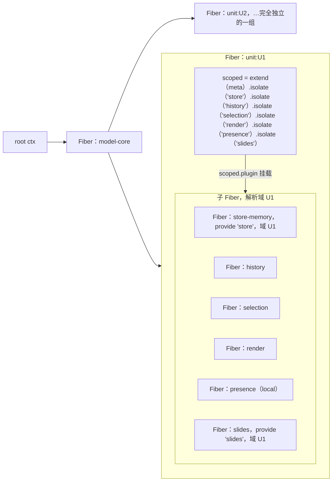
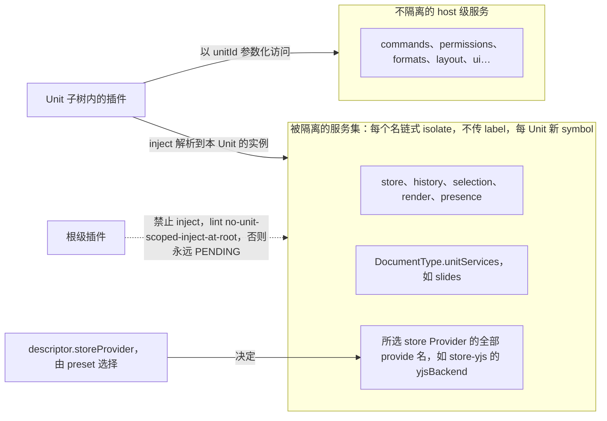

# ADR-0005 UnitScope 的实现：Unit = 插件 Fiber + `ctx.isolate()` 服务集

> 状态：草稿 | 负责：架构-结构 | 更新：2026-09-14；2026-09-25（补图）；2026-09-25（矛盾收口，rulings §4.18） | 依赖：charter v0.1；裁决 `docs/00-charter/rulings-2026-09-14.md` §4.18 GV-15

## 状态

提议。

## 背景

同页多文档必须互不污染（Univer A10：全局可变注册表导致多实例互相污染；K2：per-unit 子注入器是对的）。cordis 提供 `ctx.isolate(name, label?)` 为单个服务名建立独立解析域，但 isolate 本身不是生命周期单元（派生 ctx 继承父 Fiber）。

## 决策

1. **一个 Unit 就是一个 Fiber**：`units.open()` 等价于 `ctx.plugin(unitPlugin, { descriptor })`；关闭 = `fiber.dispose()`。这让 Unit 拥有 effect 清理栈、状态机与诊断树。
2. **在该 Fiber 的 `apply` 内建隔离域**：`createIsolatedScope(ctx, { services, meta })`（kernel 提供、文档无关）对每个服务名链式 `isolate()`（不传 label → 每 Unit 新 symbol，永不合并），并 `extend({ [UnitScope.unit]: unit })`。
3. **被隔离的服务集** = `['store','history','selection','render','presence']` ∪ `DocumentType.unitServices`（如 `slides`）∪ 所选 store Provider 的全部 `provide` 名（如 store-yjs 的 `yjsBackend`，供 collab-yjs 注入；B 线 06 §2.3）。其它服务（`commands`、`permissions`、`formats`、`layout`、`ui`…）不隔离，以 `unitId` 参数化。
4. **子插件挂在隔离 ctx 上**：`scoped.plugin(storeProvider)`、`scoped.plugin(...documentType.unitPlugins)`；它们是 unit Fiber 的子 Fiber，随 Unit 一起销毁；`inject: ['store']` 在子树内解析到本 Unit 的 store。
5. **根级禁止 inject 隔离服务**（lint `no-unit-scoped-inject-at-root`），否则该插件永远 PENDING。
6. **归属查询**：子树内任意代码经 `unitOf(ctx)` 读 `ctx[UnitScope.unit]`；事件载荷一律显式携带 `unitId`（不依赖 ctx 推断）。
7. **Provider 更换**：`preset` 通过 `descriptor.storeProvider` 选择 store Provider；同一 host 内不同 Unit 可用不同 Provider（协同文档用 yjs，本地草稿用 memory）。

**图 1 Unit 的 Fiber 树与隔离域**

怎么读：无标签的实线箭头是 Fiber 父子关系，标「scoped.plugin 挂载」的箭头表示子插件经隔离 ctx 挂载；`unit:U1` 方框就是一个 Unit 的生命周期边界，内部的 `scoped` 是在该 Fiber 的 `apply` 内派生的隔离 ctx，挂在它上面的子插件都是 unit Fiber 的子 Fiber、随 Unit 一起销毁。`unit:U2` 拥有另一组完全独立的 scoped 与子 Fiber，图中从略。

**图 2 被隔离的服务集与 host 级共享服务**

怎么读：「被隔离的服务集」方框是决策 3 的三部分并集，每个 Unit 各有一份；「不隔离的 host 级服务」方框是全 host 共享一份、按 `unitId` 区分的服务。虚线表示被 lint 禁止的依赖方向；同一 host 内不同 Unit 可经 `descriptor.storeProvider` 选不同 Provider（决策 7）。

## 备选方案与放弃原因

| 方案 | 放弃原因 |
|---|---|
| 每个 Unit 一个根 `Context` | 贡献表、`commands`、`permissions` 等 host 级服务需要在 Unit 间共享；多根 = 多宇宙，需要手工桥接（指南 §14「不要造第二个根」） |
| 单实例服务内部 `Map<unitId, state>`（Univer 早期做法的变体） | 服务实现者人人都要写 unitId 分派；漏写即污染（A10）；无法按 Unit 更换 Provider |
| `isolate` 但不包 Fiber（直接在 model-core 的 ctx 上派生） | 没有独立的清理栈：关闭 Unit 无法一次性释放所有效应；诊断树无边界 |
| `ctx.intercept` 传 unit 配置代替 isolate | intercept 是配置合并，不是实例隔离 |

## 后果

- 正：多 Unit 天然隔离；关闭即彻底清理（可断言 `getEffects()` 为空）；Provider 可按 Unit 选择；诊断树按 Unit 分组。
- 负：Fiber 层级多一层；跨 Unit 操作（复制粘贴）必须显式走两个 Unit 的命令；`isolate` 是解析域不是安全边界（章程 §2.3 已声明）。

## 如何被机械验证

- model-core `__tests__/unit-scope.test.ts`：打开两个 Unit → `store` 实例不同；U1 事务不触发 U2 的 `observe`；关闭 U1 后 `assertNoLiveEffects(U1.fiber)`、U2 正常；根 ctx `get('store', false)` 为 undefined。
- lint `no-unit-scoped-inject-at-root`。
- `defineLifecycleSuite` 对 `unitPlugin` 运行（重复打开/关闭 50 次无泄漏）。
- 检查 `unit-events-carry-unitId`（非独立扫描器，落为类型测试断言 `model-core/__tests__/unit-events.type-test.ts`，TD-098，对照见 09-type-discipline/08 §11.1，rulings §4.18 GV-15；原称「扫描器」）：`unit/*`、`store/*`、`history/*`、`selection/*` 事件签名首参为 `unitId`。

## 关联

章程 §4 Unit/UnitScope、§5.5；primer §3.1 `isolate`；Univer K2、A10；03 §5；README C-2/C-4。
