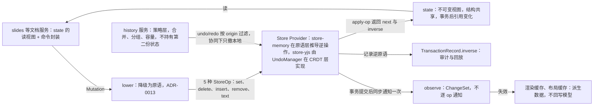

# ADR-0007 DocumentStore 契约与 Store 推导的逆操作

> 状态：草稿 | 负责：架构-结构 | 更新：2026-09-15；2026-09-25（补图）；2026-09-25（矛盾收口，rulings §4.18） | 依赖：charter v0.1；裁决 `docs/00-charter/rulings-2026-09-14.md` §4.18 GV-15

## 状态

提议。

## 背景

章程 D4：Mutation 是唯一改 Store 的途径，逆操作由 Store 推导（禁止手写）；D5：运行时模型只经 `DocumentStore` 读写，协同下 CRDT 是唯一事实源。Univer 为每个 Mutation 手写 `undoMutations`（缺陷 #3），Worker 中第二份模型靠白名单收敛（A31），编辑态跨三个模型两个异步边界（A32）。

## 决策

1. `DocumentStore<S>` 是 **Definition**（model-core），Provider 为 `store-memory` 与 `store-yjs`；契约见 04 §2.2。
2. Store 只理解 5 种 `StoreOp` 原语（`set/delete/insert/remove/text`，ADR-0013）；有身份实体的顺序用 `order: FracKey`（ADR-0032），移动 = `set`；Mutation 经 `lower()` 变为原语后应用。
3. **逆操作在原语层由 Provider 推导**（`apply-op` 返回 `{ next, inverse }`；Yjs 由 `UndoManager` 在 CRDT 层实现）；`TransactionRecord.inverse` 记录逆原语用于审计/回放。
4. `undo/redo(origin)` 按 origin 过滤（协同下只撤本地）；`history` 服务是策略层（合并、分组、容量），不持有第二份状态。
5. **没有第二份模型**：`slides` 等文档服务是 `store.state()` 的读视图 + 命令封装；渲染缓存/布局缓存是派生数据，随 `ChangeSet` 失效，不回写模型；Worker（若有）只做纯计算并接收 update（A31）。
6. `state()` 返回不可变视图（结构共享）；事务内引用不变，事务后引用变化——UI 框架可用引用相等做 memo。
7. `observe` 在事务提交后同步通知一次 `ChangeSet`（不是逐 op 通知），避免中间态被观察。
8. 契约由 `runDocumentStoreConformance` 固化；任何 Provider 必须通过。

**图 1 Store 写路径与逆操作推导**

怎么读：箭头是数据或调用的流向。整张图只有 `state` 一份模型；文档服务读它、渲染缓存和布局缓存从 `ChangeSet` 失效，都不会另存第二份状态，撤销也只经 `history` 回到同一个 Provider。

## 备选方案与放弃原因

| 方案 | 放弃原因 |
|---|---|
| 手写逆 Mutation（Univer） | 每个 Mutation 双份逻辑、易错、失败静默；与 CRDT 撤销语义割裂 |
| 命令对象带 `undo()` 方法（经典 Command 模式） | 需要闭包捕获状态，不可序列化；协同下无意义 |
| 事件溯源：撤销 = 从快照重放到 N-1 | 大文档代价高；协同下不可行 |
| Store 直接理解 Mutation | 文档知识进入水平层（A1）；每个 Provider 为每种 Mutation 写实现 |
| 可变模型 + 脏标记（Univer） | 无法做结构共享的 memo；派生与持久混杂（A6） |

## 后果

- 正：零手写逆操作；撤销语义在两个 Provider 间一致（契约套件）；单一事实源；UI memo 友好。
- 负：不可变更新有复制成本（结构共享把它限制在路径上）；`text` 原语的逆需要旧文本（Provider 在应用前读取）；Yjs 的撤销与内存撤销在并发场景的可观察差异需要在 06 明示。

## 如何被机械验证

- `@cordexjs/model-core/testing/document-store-conformance.ts`：两个 Provider 的 `__tests__` 必须实例化（扫描器 `scan-manifest` 规则 (e) 读取 `cordex.implements` 并检查测试文件 import；原名 `provider-runs-conformance`，2026-09-25 按正式名改写，rulings §4.18 GV-15，TD-070）。
- property test（store-memory）：`apply(inverse(apply(s, op))) ≡ s`，随机 op 序列。
- lint `no-inverse-in-mutation`（Mutation 类型与 Def 禁止 `undo|inverse|revert`）。
- 类型测试断言（`*.type-test.ts`，09-type-discipline/09 §6，`test-typecheck` job，TD-098；原名 `single-model`、原称扫描器，2026-09-25 按 09-type-discipline/08 §11 对照表改写，rulings §4.18 GV-15）：`packages/**` 中除 store Provider 外禁止对 `PresentationBody`（及其它 body 类型）做可变赋值（`readonly` 深类型 + lint `prefer-readonly-parameter-types` 的选择性启用，09-02 定）。
- 类型测试：`state()` 返回类型为深只读。

## 关联

章程 D4、D5、§4 DocumentStore；Univer K1、缺陷 #3、A31/A32、A6；04 §2；05 §5；ADR-0013。
