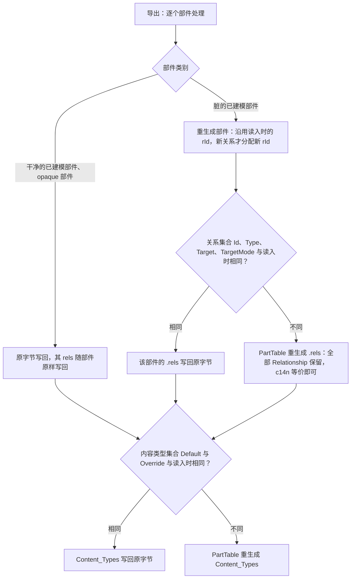
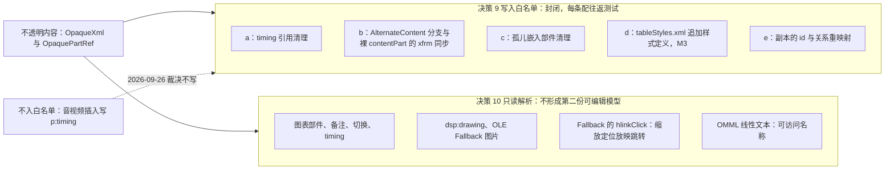

# ADR-0008 不透明保留与脏部件重生成

> 状态：草稿 | 负责：架构-结构 | 更新：2026-09-24；2026-09-25（矛盾收口，rulings §4.18）；2026-09-26（§4.21：决策 5 关系部件与内容类型改为结构不变即原字节写回；决策 9 白名单增 tableStyles.xml 追加样式定义（M3），音视频插入不写 p:timing；决策 10 只读项增 Fallback hlinkClick 与 OMML 线性文本）；2026-09-26（§4.21 整合：决策 8 按 ADR-0019 决策 8 细化；决策 9 (b) 扩到裸 p:contentPart、新增 (e) 副本的 id 与关系重映射；决策 10 注明 SmartArt 转换为形状是一次性物化、M4+ 公式 Fallback 另议；验证补 content-types-writeback 与 content-part 测试）；2026-09-26（§4.21 Remap：原 30/08 引用按 60-backend/README §6.1 改指新位置，30/08 已删除） | 依赖：charter v0.1；裁决 `docs/00-charter/rulings-2026-09-14.md` §4.12 U-02、§4.15 Q7、§4.18 GV-14/GV-15、§4.21（X:q-content-types、q-media-insert、q-table-depth）；[ADR-0019](./0019-xml-lexer-and-fidelity-tree.md)、[ADR-0018](./0018-editor-element-model-and-insert-commands.md)

## 状态

提议。2026-09-24 按 rulings §4.15 Q7 的机械修正改写决策 5、9、10，按 §4.12 U-02 结案决策 7（均不改变本 ADR 的总体方向）。2026-09-26 按 rulings §4.21 再改决策 5（X:q-content-types：关系部件与内容类型结构不变即原字节写回）、扩决策 9（tableStyles.xml 追加样式定义；音视频插入不写 p:timing）与决策 10（两项只读解析），总体方向不变。

## 背景

R6/D7：直接读取 pptx 并在线协同编辑，未建模部分不透明保留，导出为合法 pptx 且未修改部分**零丢失**（M1 验收：部件级 diff 零差异）。OOXML 极大（动画、SmartArt、OLE、VBA、自定义 XML、厂商扩展），任何「先建模再导出」的方案在 M1–M3 都会丢内容。现有 TS 库：pptx-viewer 声称保留但以模型为中心；`@hokkyss/pptx` 强调 AST 往返但范围有限；pptx-renderer 只读。

## 决策

三层捕获 + 脏部件重生成（算法见 04 §5）：

1. **部件级**：每个 Part 读入即 `sha256 → BlobRef`（原字节保留于 `BlobStore`）；未建模部件成为 `opaqueParts[partName] = OpaquePartRef`，导出 verbatim。
2. **节点级 / 元素级**（PRD CS-06、OF-18「元素级保留」）：已建模部件解析时，未知子元素捕获为 `OpaqueXml { xml, anchor{ after, ordinal }, namespaces }` 挂到最近已建模实体的 `extensions`；导出重生成该部件时按 XSD 子元素顺序表（`schema-order`）插回。**被触碰的元素也遵守同一规则**：编辑一个形状只改它的建模字段，它的 `extLst`/未知属性/未知子元素随 `extensions` 原样回写；同部件内未被触碰的兄弟元素、`p:timing`/`p:transition` 等不透明子树规范化后逐字节一致。
3. **属性级**：未知属性同样进入 `extensions`（属性变体）。
4. **脏追踪**：`DirtyTracker` 维护 `Path 前缀 → Part` 映射；每个事务的 `ChangeSet.touched` 标脏部件；导出时**干净部件 verbatim、脏部件重生成**。
5. **关系部件与内容类型：结构不变即原字节写回**（2026-09-26 改写，rulings §4.21 X:q-content-types；原「永不 verbatim 的部件：`[Content_Types].xml`、已建模部件的 `.rels`——始终由 `PartTable` 生成」作废——它与 04 §5.4、70/03 的「零编辑字节相同」口径相反，按原口径执行时序列化器必须逐字节复现原文）：
   - `[Content_Types].xml`：导出时由 `PartTable` 算出本次的内容类型集合（`Default` 的扩展名 → 类型、`Override` 的部件名 → 类型，按集合比较、与顺序无关）；与读入时相同就写回原字节，不同才重生成。
   - 已建模部件的 `.rels`：对每个部件算出本次的关系集合（`Id`、`Type`、`Target`、`TargetMode` 四元组）；与读入时相同就写回原字节——**即使该部件本身因编辑而重生成**（例如只改了文字的页）；不同才由 `PartTable` 重生成。重生成已建模部件时沿用读入时的 `rId`，只有新关系才分配新 `rId`，「集合不变」的判定才成立。opaque 部件的 rels 随部件 verbatim（不变）。
   - 重生成时序列化器只需保证良构与 c14n 等价，不要求逐字节复现原文；逐字节一致只靠原字节写回（保真门禁口径见 [ADR-0019](./0019-xml-lexer-and-fidelity-tree.md)）。新部件（插入的媒体、M3 的图表部件与内嵌工作簿、新建的 `tableStyles.xml`）登记进这两类集合，因而触发重生成。30/02、04 §5.3、40-modules/04 中「始终重生成、永不 verbatim」的同类措辞随之改写（由各文件负责人回写）。
   - **Relationship 全部保留、仅 http(s) 可激活**（2026-09-24，Q7 机械修正，M1 必修）：重生成 `.rels` 时，读入的每条 Relationship（含 `TargetMode="External"` 的 `mailto:`、`file://`、`tel:` 等任意协议目标）必须原样带回；「只允许 http(s)」是**激活**规则（渲染层是否可点击/加载、客户端外链资源加载），不是 Relationship 不变量——否则零编辑往返就会丢失 `mailto:` 超链接，违反 D7 与 OF-18（40-modules/04:119、架构 04 §6、08 §9.2 的同类措辞随之改写）。
6. **二进制不进 JSON/Y.Doc**：媒体、opaque 部件字节、嵌入字体全部为 `BlobRef`（内容寻址、不可变、协同无冲突）。
7. **Strict 一致性**（README A-3 与 PRD PD-03 合并；**已由 rulings §4.12 U-02 裁决为 C 案，M1 生效**）：导入归一化已建模部件并记录 `conformance`；零编辑往返三案皆字节相同。有编辑时：**C 保持原一致性类**（脏部件经 Transitional→Strict 反向映射表写回 Strict，干净部件 verbatim），**M1 即做完整写回 + 字节级验证**；**B 整包转 Transitional** 仅作**异常兜底**（C 产物未过 Strict XSD 或反向表缺项时，诊断 `STRICT_FALLBACK_TRANSITIONAL`，并计入保真指标，不作为常规路径）；**A 混合**（脏部件 Transitional、干净 verbatim）因 PowerPoint 修复风险放弃。
8. **失败模式**：无法解析的已建模部件（畸形 XML）→ 整个部件降级为 opaque（可渲染性下降但不丢失），并发 `error` 级诊断；zip 超限 → 拒绝打开（安全）。2026-09-26 按 [ADR-0019](./0019-xml-lexer-and-fidelity-tree.md) 决策 8 细化（rulings §4.21 X:q-xml-lexer）：必需部件（`[Content_Types].xml`、`_rels/.rels`、`ppt/presentation.xml` 及其 `.rels`）畸形归并为 `format.pptx.invalid_package{part}` 拒绝导入；其余已建模部件畸形才降级为 opaque，诊断码 `format.malformed_xml`。
9. **对不透明内容的修改 = 白名单**（2026-09-24，Q7 机械修正；原「timing 引用清理是唯一允许的修改」改为封闭白名单，白名单外的任何修改均禁止，每条配往返测试；2026-09-26 增 (d)、(e)，并把 (b) 扩到裸 `p:contentPart`，共五项）：
   - **(a) timing 引用清理**（PRD OF-12）：删除被 `p:timing` 引用的形状时，导出前 `export/timing-refs.ts` 从该不透明子树移除对应 `spid` 引用（或整段失效的 `p:par`）。
   - **(b) AlternateContent 分支 `xfrm` 同步**：包在 `mc:AlternateContent` 里的对象（公式、墨迹、3D、缩放定位、chartex 等）在 `UnknownShape` 上建模一个 `transform` 字段；导出时把该变换回写到 `mc:Choice` 与 `mc:Fallback` 各分支的 `xfrm`（删除 M1 P0、移动/缩放 M2 P1；对象内部不可编辑）。OLE 的 VML 锚点同步需在语料上验证后再纳入。2026-09-26 扩展（rulings §4.21 d-76，M2 P1）：不在 `mc:AlternateContent` 内的**裸 `p:contentPart`**（墨迹等内容部件）同样映射为 `UnknownShape`，移动或缩放时只改它自身的 `p:xfrm`，引用的 `ppt/ink/*.xml` 等部件 verbatim；扩充前（M1）只能整体删除。
   - **(c) 孤儿嵌入部件清理**：删除引用嵌入部件（OLE `embeddings/*`、Fallback 图片等）的最后一个元素后，导出时移除不再被任何 Relationship 引用的嵌入部件及其 Content Types 条目，避免包内孤儿。
   - **(d) `tableStyles.xml` 追加样式定义**（2026-09-26，rulings §4.21 q-table-depth，M3）：表格套用内置样式、而文档的 `ppt/tableStyles.xml` 里没有该 `styleId` 的 `a:tblStyle` 定义时，导出前向 `a:tblStyleLst` 末尾**追加**这一条定义（内置样式数据的来源与许可见 [ADR-0018](./0018-editor-element-model-and-insert-commands.md) 与 50/24）；已有条目、`def` 属性（默认样式 GUID）与其余内容一律不改；部件不存在时新建并登记关系与内容类型（决策 5）。只追加、不修改、不删除——删除表格后不回收已追加的定义。追加后的部件与原部件经 c14n 比较只多出新增的 `a:tblStyle`；部件在 M1 起的只读解析（04 §4.1，PRD OF-08 表格 M1 gated）不受影响。
   - **(e) 副本的 id 与关系重映射**（2026-09-26，rulings §4.21；50/25 §2.3、§12 待决 1–3）：复制或跨页粘贴 AlternateContent 系对象（公式、墨迹、3D、缩放定位等）时，改写副本分支内的 `cNvPr@id` 与 `r:id` / `r:embed` / `r:link`，使其在目标页唯一、关系指向复制后的部件；SmartArt 的 `dgm` 四部件（data、layout、quickStyle、colors）与 `dsp` 部件按部件整体复制。本项登记并配往返测试前，50/25 的默认口径是：同页复制可用，跨页与跨文档粘贴拒绝并提示。落点见 40-modules/04 的 `export/shape-tree.ts` 与 `OoxmlIdMap`。
   - **不入白名单：音视频插入不写 `p:timing`**（2026-09-26，rulings §4.21 q-media-insert）：插入视频或音频（P2）只写 `p:pic`、`a:videoFile` / `a:audioFile`、`p14:media`、海报 `p:blipFill` 与 `hlinkClick`，既不创建也不修改 `p:timing`；导出后在 PowerPoint 放映中需点击媒体控件播放，不随单击自动播放。原评估项「视频 `p:timing` 写入」因此不加入白名单；删除被 `p:timing` 引用的媒体仍按 (a) 清理引用。
10. **只读解析不透明部件是允许的**：渲染器可以读取不透明部件/子树的 XML 做只读呈现，但不得据此产生第二份可编辑模型；不透明保留只约束**写回**。允许清单：`Chart.partRef`（M1 图表，按 D16）、notes 部件（备注文本）、**`p:transition`**（切换页签的只读展示，rulings §4.10 Q15）、**`p:timing`**（放映「主序列可见性终态」，M2 P1）、**`dsp:drawing`**（SmartArt M1 只读渲染，解析器在 ooxml-core，含 `dsp:txXfrm`）、**OLE `mc:Fallback` 中的 `p:pic`**（由 `ole.ts` 提取为 `Ole.preview`；EMF/WMF 预览 M2 P1 惰性栅格化）。chartex（`cx:`）不选其 Fallback 文本，渲染为占位并诊断 `chartex-unsupported`。2026-09-26（rulings §4.21）增加两项：**`mc:AlternateContent` 的 `mc:Fallback` 中的 `a:hlinkClick`**——缩放定位（`sldZm` / `sectionZm`，渲染取 Fallback 的 `p:pic`）在放映中被点击时，只读取 Fallback 图片上 `a:hlinkClick@action="ppaction://hlinksldjump"` 及其关系目标并换算为目标页做放映跳转，不建模、不写回，编辑态不可点击；**OMML 线性文本**——公式（`a14:m` / `m:oMathPara`）只读提取线性文本，作为可访问树的 `name` 与缺 `descr` 时的替代文本候选，不形成可编辑模型（公式编辑为 M4+ 路线，ADR-0021 2026-09-26 修订第 4 条），导出字节不变。SmartArt「转换为形状」（M4+，rulings §4.21 q-smartart）是一次性物化：读 `dsp:drawing` 生成普通组合、原 SmartArt 对象在同一事务中删除，因而不构成第二份可编辑模型。M4+ 公式编辑导出时须重生成 Fallback 位图，这超出本白名单，立项时另议写入白名单（q-equation）。

**图 1 关系部件与内容类型的写回判定（决策 5，2026-09-26）**

怎么读：自上而下每个部件走一遍；只有「集合真的变了」才重生成关系部件与内容类型，所以零编辑、以及只改文字不增删关系的编辑都得到原字节；重生成时只要求 c14n 等价，逐字节一致从不依赖序列化器。
依据：rulings §4.21 X:q-content-types；04 §5.4 零编辑口径；ADR-0019 保真口径。

**图 2 对不透明内容的写入白名单与只读解析（决策 9、10，2026-09-26）**

怎么读：左边的不透明内容只有两条出路——封闭的五项写入白名单，或只读解析；右下的只读项都不产生可编辑模型；虚线标出本轮明确排除在写入白名单之外的项。d、e、b 的裸 contentPart 扩展、r3、r4 与排除项为 2026-09-26 新增。
依据：rulings §4.21 q-table-depth、q-media-insert；R elementDesign 横切「不透明保留钩子」。

## 备选方案与放弃原因

| 方案 | 放弃原因 |
|---|---|
| 全量建模后导出（Univer 式「模型即文件」） | OOXML 覆盖不可能在 M1–M3 完成；任何缺口都是丢失 |
| 只做部件级 verbatim，不做节点级 | 改一个形状就得重生成整页 XML，页内所有未建模元素（extLst、a14/p14 扩展、动画引用）随之丢失 |
| 保留原 XML DOM 作为事实源，模型只是视图（DOM-first） | 协同与撤销必须在结构化模型上做；DOM 无法进 CRDT；双事实源（D5 违反） |
| 原字节进 Y.Doc | 撑爆协同文档；每次同步传输二进制 |
| 差分补丁（对原 XML 打 patch） | 补丁定位脆弱；与模型语义脱节 |

## 后果

- 正：M1 即可承诺「未修改零丢失」；建模范围可以渐进扩大（把某类 OpaqueXml 升级为建模字段时只需迁移）；导出成本与修改范围成正比。
- 负：模型里有 `extensions` 噪音；重生成部件的保真依赖 `schema-order` 表与编解码往返测试；同一部件内「已建模 + 不透明」混合的顺序恢复需要锚点算法（已定义）；Strict 混合包需向用户说明。

## 如何被机械验证

- 口径 = 04 §5.4（与 PRD CS-01/§4.1 合并）。`ooxml-pptx/testing/roundtrip.ts` 实现：零编辑 → 部件集合与每部件 SHA-256 相同（含 `[Content_Types].xml` 与 `.rels`；zip 元数据不计）；编辑后 → 未触碰部件字节相同 + 脏部件良构且通过 ECMA-376 XSD（`tooling/xsd/`，Transitional 与 Strict 两套）+ 规范化 diff 仅在被编辑子树 + 被编辑元素 `extensions` 全保留 + `cNvPr@id` 唯一且引用一致 + 派生部件白名单 + 删页无孤儿（test job 的 `fidelity-roundtrip` 步骤：M1 零编辑、M2 编辑后；保真失败仍阻断合并，在 test job 日志中查看——2026-09-25，rulings §4.18 GV-14，13 个 job 名封闭集合不变，原「CI job `fidelity-roundtrip`」作废）。
- 元素级保留测试：对 `fixtures/pptx/features/preserve-*`（含 `extLst`/未知属性/`p:timing`）编辑同页另一元素 → 目标元素与不透明子树 c14n 逐字节一致；编辑带 `extLst` 的元素本身 → 其 `extLst` 仍在且顺序合法。
- `timing-refs.test.ts`：删除被动画引用的形状 → 导出无悬空 `spid`，XSD 通过。
- （2026-09-24）白名单 (b)(c)：`alternate-content-xfrm.test.ts`（移动/缩放 AlternateContent 对象 → Choice 与 Fallback 分支 `xfrm` 一致、其余字节不变）；`orphan-embeddings.test.ts`（删除最后一个 OLE 引用 → 嵌入部件与 Content Types 条目被移除，其余部件字节不变）；扫描器断言对不透明子树的写操作只出现在白名单模块（2026-09-26 起为 (a)–(e) 五处）。
- （2026-09-26）决策 5：只改文字、不增删关系的编辑 → 该页 `.rels` 与 `[Content_Types].xml` 字节相同；插入图片等新增关系或新扩展名 → 对应 `.rels` 与 `[Content_Types].xml` 重生成，且与原文件的 c14n 差异只在新增条目、全部原 Relationship 保留（单元测试 `content-types-writeback.test.ts`，40-modules/04 §9；往返用例 `rels-verbatim-when-unchanged` 见 70-testing/03）。
- （2026-09-26）白名单 (d)：`table-styles-append.test.ts`（套用文档中没有的内置样式 → `tableStyles.xml` 只多一条 `a:tblStyle`、`def` 不变；部件不存在时新建并登记关系与内容类型）。音视频插入：`media-insert-no-timing.test.ts`（插入视频或音频后导出，`p:timing` 字节不变，原本没有就不新增）。
- （2026-09-26）白名单 (b) 扩展：`content-part.test.ts`（裸 `p:contentPart` 映射为 `UnknownShape`；删除整体移除；移动只改 `p:xfrm`，ink 部件 verbatim；40-modules/04 §9）。白名单 (e)：副本重映射的往返测试随登记一并落地（复制后的 `cNvPr@id` 唯一、关系指向复制后的部件）。
- （2026-09-26）决策 10 新增只读项：`zoom-fallback-hlink.test.ts`（放映中点击缩放定位的 Fallback 图片跳到目标页，导出字节不变）；`omml-linear-text.test.ts`（公式的可访问名称取线性文本，模型与导出无变化）。
- （2026-09-24）外部关系：含 `mailto:`/`file://` 超链接的 fixture 零编辑往返 `.rels` 字节相同、编辑后仍保留全部 Relationship；渲染层对非 http(s) 目标不激活。
- （2026-09-24）Strict：Strict fixture 编辑后导出仍为 Strict 且过 Strict XSD（M1）；触发 `STRICT_FALLBACK_TRANSITIONAL` 的用例单列并计入保真指标。
- `dirty-tracker.test.ts` + 随机单形状修改测试：脏部件集合 == 预期；其它部件字节相等。
- codec 往返测试：已建模部件 `parse → generate → c14n` 与原 c14n 相等；差异计数进保真指标。
- `schema-order` 生成器单测覆盖已建模复杂类型。
- 安全：`zip-limits.test.ts`（超限拒绝）、外部关系**激活**协议白名单测试（保留全部、只激活 http(s)）。
- 类型测试断言（`*.type-test.ts`，09-type-discipline/09 §6，`test-typecheck` job，TD-098；原名 `no-bytes-in-snapshot`、原称扫描器，2026-09-25 按 09-type-discipline/08 §11 对照表改写，rulings §4.18 GV-15）：`Snapshot` 类型与 Y 映射中不得出现 `Uint8Array`/`ArrayBuffer`（只允许 `BlobRef`）。

## 关联

章程 R6、D7、§4 不透明保留/Part；`00-charter/rulings-2026-09-14.md` §4.10 Q15、§4.12 U-02、§4.15 Q7、§4.21（X:q-content-types、q-media-insert、q-table-depth）；ADR-0018、ADR-0019、ADR-0021（2026-09-26 修订第 4 条）；50/23 §7（音视频插入）；01 §4.4；04 §4/§5/§6；60-backend/06 §6.3；40-modules/03/04/07；README A-3、A-12、C-7；参照 pptx-viewer（Strict 归一化）、pptx-renderer（ZipLimits、SafeXmlNode）、@hokkyss/pptx（AST 往返）。
