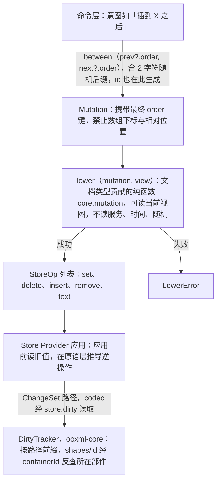
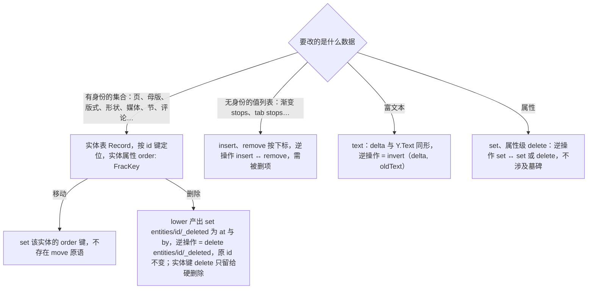

# ADR-0013 Mutation 降级与 `StoreOp` 原语集（5 种；有序实体用 fractional index）

> 状态：草稿 | 负责：架构-结构 | 更新：2026-09-24；2026-09-24 复核修正（rulings §4.17；复核报告 M3：契约用例名以 40-modules/02 §2.5 为准）；2026-09-25（补图）；2026-09-25（矛盾收口，rulings §4.18）；2026-09-26（§4.21 整合：决策与图中无身份值列表的示例去掉 columnWidths（表格已按 ADR-0018 归一化）） | 依赖：charter v0.1；裁决 `docs/00-charter/rulings-2026-09-14.md` §4.15 Q3、§4.17、§4.18

## 状态

提议（与运行时线 ADR-0020/0032 对齐：有序实体集合 = 实体表 + `order: FracKey`，Mutation 载荷禁止数组下标）。

## 背景

D4 要求 Mutation 是唯一改 Store 的途径且逆操作由 Store 推导；文档类型盲要求 Store 不认识任何文档类型的 Mutation。两者相加意味着必须存在一个**文档类型无关的中间层**：Store 只理解少量结构原语，文档类型贡献的 Mutation 降级为原语。同时 ADR-0032 决定顺序不以数组下标表达（并发移动安全）。

## 决策

1. **五种原语**（`model-core/store/ops.ts`）：
   ```
   set(path, value) · delete(path) · insert(path, index, items) · remove(path, index, count) · text(path, delta)
   ```
   - `insert/remove` **只用于无身份的值列表**（渐变 stops、tab stops、`paragraphs[]` 若不走 Y.Text；2026-09-26 起表格已按 ADR-0018 归一化为按 id 的 `columns`/`rows`/`cells` 记录表，原示例 `columnWidths: Emu[]` 删去）；
   - **有身份的集合**（页、母版、版式、形状、媒体、节、评论…）= 实体表 `Record<id, entity>` + 实体属性 `order: FracKey`；「移动」= `set([...,'order'], key)`；**不存在 `move` 原语**（ADR-0032）。
   - `text` 的 delta 与 Y.Text 同形（insert/retain/delete + attributes）。
2. **Mutation 载荷禁止数组下标与相对位置**：意图「插到 X 之后」在**命令层**转为具体键：`const order = between(prev?.order, next?.order)`（`@cordexjs/shared/order`，含 2 字符随机后缀）→ Mutation 携带最终 `order`。这样 `lower()` 保持**纯且确定**（同一 Mutation 任何时候降级结果相同），随机性与 id 生成一样只发生在命令层。
3. **`lower(mutation, view): Result<StoreOp[], LowerError>`** 是文档类型贡献的纯函数（`core.mutation`）：可读当前视图以校验存在性与构造路径；不得读服务、时间、随机。
4. **逆操作在原语层**：`set`↔`set/delete`、`insert`↔`remove`（需被删项）、`text`↔`invert(delta, oldText)`；Provider 在应用前读旧值。
5. **路径**：`Path = (string | number | { id })[]`；`{id}` 选择器只用于无身份值列表中按 `id` 字段查找的特例（原则上不需要）；实体表按键定位。
6. **DirtyTracker** 按路径前缀工作；实体表使脏映射直接（`['shapes', id]` → 所在部件经 `containerId` 反查）。
7. **Snapshot 中 `order` 键原样保留**（不转数组），使 `toSnapshotBody()` ≡ `state()` 的契约成立、memory 与 yjs 一致、导入不必重新生成键；人类可读的数组视图由调试工具即时计算（对 ADR-0032 第 6 条的建议，见 README §7）。

**图 1 从命令意图到 StoreOp 的降级链**



怎么读：自上而下是一次编辑的降级顺序。随机性（`order` 键、id）只出现在最上方的命令层，因此 `lower` 对同一 Mutation 与同一视图永远产出同一组原语；Store 只认下方的 5 种原语，不认识任何文档类型的 Mutation。最后一条箭头是数据流而非调用：DirtyTracker 在 ooxml-core，由 codec 读取 Store 的 `ChangeSet` 路径，Store 不依赖它。

依据：本文决策 2–4、6；DirtyTracker 所在包见章程 §5.2 ooxml-core 行，`dirty()` 见 30-architecture/04 §2.2。

**图 2 原语的适用对象与逆操作**



怎么读：菱形按数据种类分叉，叶子写出应使用的原语与它的逆操作。实体删除一支按下方「修订 2026-09-24」落为软删除墓碑：`lower()` 直接产出 `set(<实体路径>/_deleted, {at, by})`，Store 不识别「实体删除」（TTL 默认 24 h 后由服务端单写者硬删除，ADR-0025 决策 9）；非身份数组的 `remove` 与属性级 `delete` 不走墓碑（2026-09-25 修订叶子文字，rulings §4.18 CO-05；原叶子「delete entities/id，Provider 解释为写 _deleted 墓碑」作废）。

## 备选方案与放弃原因

| 方案 | 放弃原因 |
|---|---|
| Store 直接理解 Mutation | 文档知识进水平层（A1）；每个 Provider × 每种 Mutation 实现 |
| 只有 JSON Patch（RFC 6902） | 无富文本 delta；`move` 在 CRDT 下不安全；`test` 语义与事务不合 |
| 保留 `move` 原语、由 Provider 定义并发语义 | memory 与 yjs 语义分叉；ADR-0032 已用 `order` 键消除 move 的必要性 |
| 有序集合用数组 + 下标 | 并发插入/移动冲突（06 I4）；实体身份随删除+插入丢失 |
| `lower` 内生成 `order` 键 | 破坏 lower 的纯度（随机后缀）；改为命令层生成 |

## 后果

- 正：Store 契约永远不变（12 的盲性论证核心）；memory/yjs 语义一致；Mutation 可回放；顺序并发安全。
- 负：命令作者需要用 `between` 计算键（提供 `slides.order.after(x)` 助手）；渲染层需要按 `(order, id)` 维护排序缓存；无身份值列表仍有下标（可接受：它们不参与并发移动语义，且事务内解析）。

## 如何被机械验证

- 类型测试：`Mutation` schema 无 `index`/`toIndex` 字段（lint `cordex/no-index-in-mutation`，09-type-discipline/02 §4.17、TD-065，06 I4；2026-09-25 按正式名改写，rulings §4.18 GV-15，原称「扫描器」）；`StoreOp` 联合恰 5 成员。
- property test：`apply(inverse(apply(s, op))) ≡ s`；随机 Mutation 序列后 `bodySchema` 通过。
- `lower` 确定性测试：同一 Mutation 对同一视图两次降级结果深等。
- `runDocumentStoreConformance`：并发 `order` 写入在 memory 与 yjs 收敛一致（协同分节由 06 补全）。
- `@cordexjs/shared/order` 单测（ADR-0032 列出）。

## 关联

章程 D4、R5；Univer A1/A2、缺陷 #3；ADR-0007、ADR-0020、ADR-0032；04 §2.3、§3.1；05 §4；06 I4。

## 修订 2026-09-24：实体删除改为软删除墓碑（rulings §4.15 Q3）

- **原语集不变**：`StoreOp` 仍为 5 种（`set/delete/insert/remove/text`），不新增 op。
- **身份实体的删除语义**：Mutation「删除实体」降级后，store 层落为 **`_deleted` 标记 + TTL 硬删除 + 读路径过滤 + 不变量**：`lower()` 产出 `set(<实体路径>/_deleted, {at, by})`，逆操作由 Store 推导为 `delete(<实体路径>/_deleted)`（清除墓碑，原 id 不变）；**实体键的 `delete` 只由服务端 TTL 硬删除（origin `system('maintenance')`）、文档擦除和经审计的「彻底删除元素」产生**；读视图、渲染、导出、不变量检查一律过滤墓碑。TTL（默认 24 h）到期后由服务端单写者硬删除（ADR-0025 决策 9）；文档擦除（「永久删除文档」）与「彻底删除元素」（只对墓碑态、限 owner，rulings §4.18 CO-07）不等 TTL。（2026-09-25 修订，rulings §4.18 CO-05：本 ADR 为提议态，第 91 行已把 delete 语义交给架构 04，04 §3.1a 定为 `set(_deleted)`，且「Store 不认识任何文档类型的 Mutation」排除了由 Provider 识别实体删除的读法；原：「`lower()` 产出的仍是 `delete(entities/<id>)`，由 Store Provider 解释为写墓碑」，作废。）非身份数组的 `remove` 与属性级 `delete(path)` 不受影响。
- **同步**：model-slide 的命令守卫需把墓碑实体视为「不存在」（不可选中、不可再编辑，只能恢复）；架构 04 的 delete 语义由对应文档回写。完整撤销契约见 ADR-0020「协同撤销语义」。
- **机械验证**：`runDocumentStoreConformance` 增加 `soft-delete-tombstone`、`read-path-filters-tombstone`（memory 与 yjs 同结果；用例名以 40-modules/02 §2.5 为准，2026-09-24 复核修正，原 `soft-delete-restore-same-id`/`tombstone-filtered-on-read` 作废）；`soft-delete-tombstone` 补断言「用户删除的降级结果中没有实体键的 `delete`」（2026-09-25，rulings §4.18 CO-05）；40-modules/02 的机械检查「store-memory/store-yjs 源码中对实体路径的 `delete` 只允许出现在 `origin.system.reason==='maintenance'` 分支」与本条一致。
