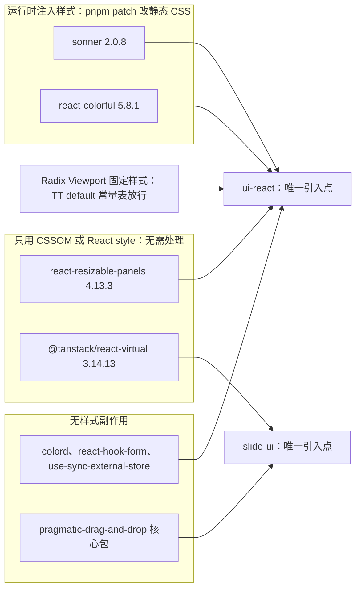

# ADR-0017 UI 组件库选型：shadcn/ui 复制模式（Radix + Tailwind 4 + Lucide + Geist）

> 状态：已接受 | 负责：架构-结构 | 更新：2026-09-24；2026-09-24 复核修正（rulings §4.17；复核报告 M17：depcruise 规则名统一）；2026-09-25（矛盾收口，rulings §4.18：措辞对齐，语义不变）；2026-09-26（§4.20）（FE-18+TX-06：严格 CSP / Trusted Types 段定下 Radix 常量样式经 `default` 策略精确比对放行、sonner 静态 CSS + pnpm patch、react-resizable-panels 无需处理）；2026-09-26（§4.21：单点表补登 react-colorful、colord、@tanstack/react-virtual、pragmatic-drag-and-drop、react-hook-form、use-sync-external-store 与 ui-core 的 htmlparser2；react-colorful 以 pnpm patch 改静态 CSS；`cn` 维持 clsx + tailwind-merge 并以 codemod 收口；react-resizable-panels 升 4.13.3）；2026-10-04（design-language-v3 第 0 批：复验修正——新增「修订 2026-10-04」：材质层、悬浮玻璃卡组合层与「同屏 backdrop-filter ≤ 4」门禁已被 rulings §4.25 DS-1、DS-2 取代，决策 4 宿主按 v3 改列，`/styleguide` 状态基准按 DS-7 改为接替路由；2026-09-16 修订节加取代注记）；2026-10-07（design-language-v3 第 1 批：文末增「修订 2026-10-07」，依据 rulings §4.25 DS-17、DS-21、DS-23、TB-1、TB-29——复制件与 `radix-rhea` 风格的去留改为由前端线随实现定，决策 4 的壳层宿主按第 1 批补列评审条、抽屉、仅查看外框、底部面板与画布原语，`ToolbarHost` 作废；决策不变）；2026-10-08（design-language-v3 第 1 批收口：文末增「修订 2026-10-08」，依据 rulings §4.25 TB-3、TB-50——a11y 与 csp-strict 门禁的对象定为产品 `/styleguide`，内容为 ui-react 子路径 `./styleguide` 的组件全状态页、apps/web 只在测试环境挂出；「后果」与「如何被机械验证」两处「接替路由随迁移定稿」改写；决策不变）；2026-10-22（design-language-v3 第 3 批：文末增「修订 2026-10-22」，依据 rulings §4.25 DS-76——两档密度删去，决策 5 里 `theme` 服务写的根元素属性只剩主题（`data-cordex-density` 与 `setDensity` 作废）；决策不变）；同日再补：决策 5 正文的「theme/density」与「密度仍为 `data-cordex-density`」两处加指向修订段的注记，原文保留（rulings §4.25 DS-76）；2026-10-23（design-language-v3 第 3 批评审修改：文末增「修订 2026-10-23」，依据 rulings §4.25 DS-143、TB-182——决策 2「Lucide 图标」之外，文件类型图标取 Tabler Icons 原件复制进 ui-react，不新增依赖、不进单点表，按 ADR-0049 登记内置源码；决策不变） | 依赖：charter v0.1（D10 修订见 charter v0.2；裁决 `docs/00-charter/rulings-2026-09-14.md` §4.7、§4.11 C-21/C-22、§4.15 Q2/Q9、§4.18 GV-14/GV-15）

## 状态

已接受（用户指令，2026-09-15；总编排裁决 §4.7；章程 D10 与 §5.3 规则 4 已修订）。2026-09-24 用户裁决章程 §10 Q2 = **React 19**（rulings §4.15），本 ADR 的前提由「D10 已定」升级为「Q2 已裁」；同日按 C-21/C-22、`40-modules/14` §5.3 与 Q9 回写决策 1–5，见文末「修订 2026-09-24」。

## 背景

设计线先后产出手工样式套件 `20-design/kit/` 与规范 09 v1，用户评审认为「缺少一套完整且可遵循的设计规范，稿件不精致」，并明确要求「组件应直接复用成熟组件，如 shadcn」。手工套件已删除；设计 playground `docs/20-design/playground/`（Vite 8 + React 19 + TS strict，`components.json` style `radix-nova`，已复制 45 个 shadcn 组件）成为设计稿的唯一基准，也是 `@cordexjs/ui-react` 的种子。章程 D10 已定 React 19，`ui-core` 无 React；K7 要求 `@cordexjs/design` 对 SDK 零依赖并以 CSS 变量为单向契约。

## 决策

1. **复制模式，不是 npm 组件库依赖**：用 shadcn CLI（4.21，`radix-nova` 预设）把组件源码复制进 `@cordexjs/ui-react/src/components/ui/`，`components.json` 入库；复制件是**我们的代码**，但结构不手改——升级与修补走 `pnpm dlx shadcn@4.21.0 diff` → 重新 `add`/合并（03 CI 有 diff 报告；2026-09-24 起不再写 `npx`——Q9 `devEngines onFail:error` 下仓库根目录 `npx` 会失败，且 CLI 版本须显式钉住）。
2. **分工**：Radix（`radix-ui` 单包）提供语义、键盘行为与可访问性；Tailwind 4 工具类提供样式（`@tailwindcss/vite` 用于 playground/浏览器测试，`@tailwindcss/cli` 用于库构建产出 `lib/styles.css`）；Lucide 图标；Geist 字体（`@fontsource-variable/geist`）；`cn()` = clsx + tailwind-merge（`clsx`、`tailwind-merge`、`class-variance-authority` 在 catalog **精确锁版本**，并登记进章程 §5.3 规则 4 单点引入表）。
3. **`@cordexjs/design` 只交付主题变量 CSS**：`theme.css`（shadcn 变量 `--background/--primary/--ring/--radius/--sidebar-*…` + Cordex 扩展变量，**一律裸名**——`--glass-*`/`--layer-*`/`--duration-*`/`--ease-*`/`--control-h-*`/`--text-2xs` 等：画布、参考线、选区、协作者色、层级、动效、密度；**`--cordex-*` 前缀作废**，C-22）与 `tailwind-theme.css`（Tailwind 4 `@theme inline` 注册片段）。它不含组件、图标、运行时 JS；组件依赖全部落在 `ui-react`（与 `*-ui`）。**主题变量是 `design` 与 `ui-react` 之间的唯一契约**（K7 零依赖原则不变，方向仍是 ui-react → design）。
4. **ui-react 提供槽位宿主与原语；具体内容由 `*-ui` 贡献**（14 §5.3 M-10/G-8）：`ui-react/src/components/editor/` 只放壳层槽位宿主（Ribbon、ThumbnailRail 的 `rail` slot、SlideCanvas、Inspector、StatusBar、NotesBar、DesignBar、CommandPalette、Dialogs/Notifications、presence 的宿主外壳），只组合 `ui/*`，不重写原子组件；领域内容（如 `MasterThumbnails` 母版缩略图窗格）归 `slide-ui`（14 O-7，rulings §4.15 Q2 再次确认）；`*-ui` 垂直束包通过子路径 `@cordexjs/ui-react/ui` 使用原子组件（R8 禁深引用，因此显式导出该子路径）。
5. **`ui-core` 仍无 React、无 Radix/Tailwind**：它只定义贡献点、输入管线与 `UiRenderer` Definition；主题切换由 `theme` 服务把 theme/density 写为根元素属性（ui-react 的 `ThemeBridge` 读取；不使用 next-themes；2026-10-22 起只写主题、不再写密度，见文末「修订 2026-10-22」）。**三种主题选择器长期等价**，写成明文契约（C-21）：`.dark`（shadcn 生态默认）、`[data-cordex-theme="dark"]`（SDK 自有命名空间）、宿主 `[data-theme="dark"]`（嵌入场景），另以 `prefers-color-scheme` 兜底；`ui-core` 同时写 `.dark` 与 `data-cordex-theme`；密度仍为 `data-cordex-density`（2026-10-22 随 rulings §4.25 DS-76 删去，同上）。
6. **单一副本**：M2 启动时 playground 的 `src/components/ui/*`、`lib/utils.ts`、`hooks/use-mobile.ts`、`index.css` 迁入 `ui-react`，随后 playground 改为依赖 workspace 的 `@cordexjs/ui-react`；全仓只允许一份复制件（检查 `single-shadcn-copy` 校验，见「如何被机械验证」）。
7. **画布隔离**：Tailwind preflight 只在 `ui-react/styles/index.css` 引入一次；`render-dom` 的内容层用自身 `layers.css` 显式设定 svg/img/video 的 display/尺寸，不依赖也不受 preflight 影响；`*-ui` 的样式入口只引 `tailwindcss/theme` + `tailwindcss/utilities`（无 preflight），避免重复重置。

## 备选方案与放弃原因

| 方案 | 放弃原因 |
|---|---|
| 自建组件套件（`20-design/kit/`，已尝试） | 精致度与可访问性成本高、无成熟社区基准；用户评审否决并已删除 |
| MUI / Ant Design / Chakra / Mantine（npm 依赖型组件库） | 主题系统与我们的 CSS 变量契约冲突（CSS-in-JS 或专有 token）；体积大（EM-07 编辑器 ≤ 900 KB 预算）；样式覆盖靠层叠而非源码可控；升级破坏面不可控 |
| Radix Themes | 预设视觉过强、token 体系封闭，与 `@cordexjs/design` 双 token 源 |
| Headless UI / React Aria + 自写样式 | 仍需自写全部视觉；shadcn 正是「Radix 语义 + 已写好的 Tailwind 视觉」的复制起点 |
| 把 shadcn 复制件放进 `@cordexjs/design` | 违反 K7（design 将依赖 React/Radix/Tailwind）；design 应保持零依赖、可被非 React 绑定复用 |

## 后果

- 正：设计稿即真实组件页面（产品 `/styleguide` 组件全状态页，内容为 ui-react 子路径 `./styleguide` 的 `StyleguidePage`，样张为 playground 的 `_kit` 场景，apps/web 只在测试环境挂出，rulings §4.25 TB-3、TB-50，见文末「修订 2026-10-08」；playground 旧版 `/styleguide` 样张随 DS-7 在 v3 全量迁移后删除，原「接替路由随迁移定稿」作废）；可访问性与键盘行为由 Radix 提供并经 axe 校验；组件代码在仓内可审、可定制；主题一处定义（CSS 变量）对 ui-react、`*-ui`、apps 同时生效；`*-ui` 与第三方插件 UI 复用同一原子集。
- 负：复制件的升级是**我们的责任**（`pnpm dlx shadcn@4.21.0 diff` 有噪音，需人工合并；CI 只报告不阻断，稳定后升为阻断）；Tailwind 类名内联于组件源码（视觉定制只允许通过 CSS 变量与 `cn()` 追加类，不改复制件结构）；新增第三方依赖集中在 ui-react（体积经 EM-07 门禁）；preflight 与画布内容层需隔离测试；`radix-ui` 单包处于快速迭代期，锁版本由 catalog 管理。

## 如何被机械验证

- depcruise `third-party-single-entry`（R5 扩展，章程 §5.3 规则 4）：`react`、`radix-ui`、`class-variance-authority`、`clsx`、`tailwind-merge`、`lucide-react`、`tailwindcss`（含 `@tailwindcss/*`）、`tw-animate-css`、`cmdk`、`sonner`、`react-resizable-panels`、`@fontsource-variable/geist`，以及 2026-09-26 补登的 `react-colorful`、`colord`、`react-hook-form`、`@hookform/resolvers`、`use-sync-external-store`、`@tanstack/react-virtual`、`@atlaskit/pragmatic-drag-and-drop` 仅允许出现在 `@cordexjs/ui-react` 与 `*-ui`（`cordex.layer == 'V-ui'`）；`htmlparser2` 仅允许出现在 `@cordexjs/ui-core` 的 `infrastructure/clipboard`（见文末「修订 2026-09-26（§4.21）」）；**例外：`apps/web` 放行 `react`、`react-dom`、`react-router`、`tailwindcss`、`@tailwindcss/*`**（rulings §4.15 Q2），`react-router` 仅限 `apps/web`；`ui-core` 出现任一即失败（R14 `ui-core-no-framework` 扩展）；`vaul` 与 `next-themes` 全仓不得出现（2026-09-24）。
- depcruise R17 `shadcn-ui-dir-private`：`@cordexjs/ui-react/ui` 子路径与 `ui-react/src/components/ui/**` 只允许被 `ui-react` 自身、`*-ui` 包与 `apps/*` import；水平层/模型/渲染包 import 即失败。
- depcruise R18 `design-css-only`：`@cordexjs/design` 的 `dependencies` 为空，`src/**` 无 React/Radix/Tailwind import；`exports` 只含类型入口与 `.css`。
- 检查 `shadcn-components-sync`（测试断言 `packages/ui-react/src/__tests__/shadcn-copy.test.ts`，test job，TD-091；非独立扫描器，见 09-type-discipline/08 §11）：`components.json` 存在且 `style == 'radix-rhea'`（2026-09-16 起；原 `radix-nova`）；`src/components/ui/*.tsx` 文件集合与 `ui/index.ts` 桶文件导出一致；scanners job 的 `shadcn-diff` 步骤运行 `pnpm dlx shadcn@4.21.0 diff` 并产出报告（M2 稳定后升为阻断）。
- 检查 `single-shadcn-copy`（测试断言 `packages/ui-react/src/__tests__/shadcn-copy.test.ts`，test job，TD-091；非独立扫描器，见 09-type-discipline/08 §11）：全仓 `components/ui/button.tsx` 等复制件路径只存在于 `packages/ui-react`（playground 迁移后）。
- 检查 `theme-vars-contract`（测试断言 `packages/design/src/__tests__/theme-vars-contract.test.ts`，TD-092；非独立扫描器，见 09-type-discipline/08 §11）：`ui-react`/`*-ui`/`apps` 中出现的每个 Cordex 扩展变量（裸名）与 `@theme inline` 注册名必须在 `@cordexjs/design/theme.css` 中声明，**`--cordex-*` 前缀出现即失败**（C-22）；`theme.css` 必须同时含 `.dark`、`[data-cordex-theme="dark"]`、`[data-theme="dark"]` 三选择器与 `prefers-color-scheme` 兜底（C-21）；`design/__tests__` 对 light/dark/high-contrast 全部前景/背景配对做 WCAG AA 对比度校验。
- Playwright + axe：产品 `/styleguide`（ui-react `StyleguidePage`，测试环境才注册，2026-10-08 修订，TB-3、TB-50）的全部组件状态零 a11y 违规，csp-strict 在同一份生产包与生产 CSP 下覆盖它（spec 在 `apps/web/e2e/`，70-testing/06 §3.1、§7.2）；视觉 oracle 在「带 ui-react 样式」与「无 UI 样式」两种环境下画布渲染像素一致（preflight 隔离回归）。
- CI 体积门禁（EM-07）：编辑器组合 ≤ 900 KB gzip（不含 React 本体）。

## 关联

章程 D10（修订）、§5.3 规则 4、K7；rulings 2026-09-14 §4.7、§4.3（`data-cordex-density`）；PRD EM-06/EM-07、PS-02（`ui.theme`）；设计 04（token 映射）、09 v2.0（shadcn 映射版）、playground；02 §4.17/§4.19/§7；03 §3.6（`ui.*` 贡献点）；ADR-0006（贡献点）、ADR-0010（preset 体积）。

## 修订 2026-09-16：风格 Rhea + 材质层（用户裁决路线 B）

> 本节的材质层、悬浮玻璃卡组合层、暗色主色 `#6B93FF` 与「同屏 `backdrop-filter` ≤ 4」等门禁已被 rulings §4.25 DS-1、DS-2 取代，见文末「修订 2026-10-04」；`radix-rhea` 风格的去留由前端线随实现定（第 1 批样张没有改变这一点，见文末「修订 2026-10-07」）。

- **风格**：`components.json` 的 `style` 由 `radix-nova` 改为 `radix-rhea`（shadcn 2026-05，紧凑版 Luma，macOS Tahoe 几何：胶囊控件、无边框填充输入、大圆角面板、柔和高度）。切换方式：改 `style` 后 `pnpm dlx shadcn@4.21.0 add -o -y <全部组件>` 重生成；复制件本身保持不改。
- **材质层与覆盖策略**：玻璃材质、悬浮层次、字体栈等在 `@cordexjs/design` 的 `theme.css`（token + `@utility glass/glass-strong` + 退化）与 `ui-react/styles/index.css` 的 `[data-slot=…]` 规则中表达；**优先用 data-slot 规则而非编辑 `src/components/ui/*`**，使 `shadcn add -o` 升级不会覆盖定制。确需改复制件时文件头标 `// Cordex override`，检查 `shadcn-overrides`（测试断言 `packages/ui-react/src/__tests__/shadcn-copy.test.ts`，test job，TD-091；非独立扫描器，见 09-type-discipline/08 §11）列出清单并在 `shadcn diff` 报告中单列。
- **组合层**：`EditorShell`/`AppBar`/`Ribbon`/`ThumbnailRail`/`Inspector`/`StatusBar`/`NotesBar`/`SlideCanvas` 改为悬浮玻璃卡布局（`p-2 gap-2`、`glass-strong rounded-2xl`、状态胶囊、画布 `zoom="fit"` 默认）。
- **主色**：亮 `#3A5CE6` / 暗 `#6B93FF`（去紫，见设计 04 §9）。
- **新增机械验证**：`theme-vars-contract` 覆盖 `--glass-*`；`design/__tests__` 对玻璃面板（strong 档）上的前景/背景配对做对比度校验；Playwright 在 `prefers-reduced-transparency: reduce` 下截图断言面板为不透明 `--card`；性能门禁：同屏 `backdrop-filter` 元素 ≤ 4（`/styleguide` 与 `/editor` 路由计数断言）。
- 关联：rulings §4.8；设计 09 v3.0、10（审计）、11（提案）。
- **2026-09-18 术语修订**：编辑器组合 `MasterTree` → `MasterThumbnails`（母版缩略图窗格：与 PowerPoint 一致仍是缩略图而非文字树，每个母版一张大缩略图、其版式为缩进的小缩略图，在 `ThumbnailRail` 内切换显示；playground `ThumbnailRail.tsx` 同名组件）；组件基座口径（`radix-rhea`，原 `radix-nova`）已在结构线 README / 02 同步（rulings §4.10）。

## 修订 2026-09-24：Q2 裁决 React 19 与机械回写（rulings §4.15 Q2/Q9，§4.11 C-21/C-22）

- **Q2 结案**：UI 框架 = **React 19**（收口 D10）。依据：rulings §4.8 选定的 `radix-rhea` 风格只有 shadcn/ui 的 React 版提供（shadcn-vue 2.8.x / Reka UI 不支持 Rhea）；画布由框架无关的 `render-dom` 渲染，查看器与服务端 `/render` 都不加载 React，换框架没有收益。catalog 锁 `react` 19.3.x；SDK UI 对集成方宿主的 peer 为 **`react ^19.0`**（lint 禁止 `ui-react`/`*-ui` 使用 19.1 之后新增的 API，CI 覆盖 19.0.x 与最新版；React 18 宿主走形态 B/E）；`apps/web` 自身可用 19.3 能力。
- **「可换」改写为可验证范围**：`ui-core` 与 `ui.*` 条目 schema 不依赖框架；`*-ui/src/{domain,application}/**` 禁止 import `react`、`react-dom`、`radix-ui`、`@cordexjs/ui-react`（新增 depcruise 路径规则）；换框架需重写 `ui-react`、各 `*-ui` 的 `ui/` 层与第三方 custom 组件（ui-vue 需同时提供对应的 `*-ui`）。
- **形态 B（框架无关嵌入）= 宿主自绘 UI**：`FRAMEWORK_FREE_EXCLUDES` 加入 `slide-ui`（此前只排除 `ui-react`，slide-ui 仍会带入 React/Radix）；`examples/embed-vanilla` 实现最小 `UiRenderer('vanilla')` 并跑 `runUiRendererConformance`。
- **第三方插件 UI** = 声明式条目为主；高级形态允许 React 组件（`ComponentRef`），必须经 `ContributionRenderer` 的 ErrorBoundary 并通过 `axeCheck` 夹具；随 M4 Stable 冻结 `ui.*` schema。
- **复制件清单调整**：`drawer.tsx` 与 `vaul`（上游 README 声明已停止维护，playground 无引用）**不迁移**；`sonner.tsx` 标注 `// Cordex override`，改读 `ThemeBridge`、去掉 `next-themes`（后者只被 sonner 使用），并改为静态引入其 `styles.css`。
- **严格 CSP / Trusted Types**（EM-14，M2 P0）：M2 贯通 CSP nonce（Radix 组件传 nonce；Radix select/scroll-area 以 `dangerouslySetInnerHTML` 注入常量 `<style>`，sonner 运行时追加 `<style>`，改动过的复制件标 `// Cordex override`）；Trusted Types M2 **report-only** → M3 **强制**；Playwright 门禁：CSP/TT 违规数为 0。第三方运行时样式的处理（2026-09-26 修订，rulings §4.20 FE-18+TX-06，现在就定、不等 M2 报告；细则以 50-frontend/14 §3、§4 为准）：① Radix——另建名为 `default` 的 Trusted Types 策略，`createHTML` 只对登记的两段固定样式文本（ScrollArea 1.2.18、Select 2.3.7 的 Viewport 常量）**精确比对**放行，其余一律返回 `null`，常量表放 ui-react `src/infrastructure/csp/trusted-style-constants.ts`，CSP `trusted-types` 取值相应加 `default`（记为 TT-CSP-REPORT 修订）；② sonner——静态引入 `sonner/dist/styles.css`，并以 pnpm patch 删去 import 时的 `__insertCSS`（`pnpm-workspace.yaml` 登记 `patchedDependencies`），不再有运行时 `<style>` 注入，也不保留「注入被拦只产生报告、外观不变」的退路；③ react-resizable-panels 4.x 用 `adoptedStyleSheets`，无需处理。csp-strict e2e 断言 TT 与 `style-src` 违规都为 0、Toast 与 ScrollArea 计算样式与基线一致，并有 `default` 策略拒绝未登记文本的负向用例。原「default policy 按哈希只放行已知常量 CSS」作废（改为精确比对）。
- **命令写法**（Q9）：本 ADR 中所有 `npx shadcn …` 已改为 `pnpm dlx shadcn@4.21.0 …`。
- **决策 2–5 回写**：见正文决策 2（cn 精确锁版本）、3（`--cordex-*` 作废，C-22）、4（槽位宿主，14 §5.3 M-10/G-8、O-7）、5（三选择器等价，C-21）；§5.3 规则 4 为 `apps/web` 放行 `react`/`react-dom`/`react-router`/`tailwindcss`/`@tailwindcss/*`。
- **新增机械验证**：depcruise `cordex-ui-bundle-core-framework-free`（上述 `*-ui` 路径规则；全仓统一名，登记于 40-modules/01 depcruise 规则表，对应 TD-082；原名 `ui-domain-framework-free` 作废，2026-09-24 复核修正）；检查 `shadcn-overrides` 清单含 `sonner.tsx`；全仓无 `vaul`/`next-themes`；lint `react-19-0-api-floor`；Playwright CSP/TT 违规计数门禁（M2 report-only 计数、M3 强制）。
- 关联：rulings §4.15 Q2/Q9、§4.11 C-21/C-22；`40-modules/14` §4.1 O-7、§5.3；40-modules/10 §3/§6、11（FRAMEWORK_FREE_EXCLUDES、CSP）；PRD 05-embedding 形态 A/B、EM-14/EM-15、04-plugin-sdk。

## 变更记录 2026-09-25（rulings §4.18 GV-14 / GV-15：措辞对齐，语义不变）

- **CI job 名**（GV-14）：「如何被机械验证」中的「CI job `shadcn-diff`」改为「scanners job 的 `shadcn-diff` 步骤」，对齐 09-type-discipline/07 §3 的 13 个 job 名封闭集合；报告 → M2 稳定后阻断的节奏不变。
- **扫描器名**（GV-15）：`shadcn-components-sync`、`single-shadcn-copy`、`theme-vars-contract`、`shadcn-overrides` 原写作「扫描器」，但不在 09-type-discipline/06 的十四个扫描器之列；本 ADR 改称「检查」，按 09-type-discipline/08 §11 对照表落为测试断言：`shadcn-components-sync`、`single-shadcn-copy`、`shadcn-overrides` 为 `packages/ui-react/src/__tests__/shadcn-copy.test.ts`（test job，TD-091），`theme-vars-contract` 为 `packages/design/src/__tests__/theme-vars-contract.test.ts`（TD-092）。检查内容、适用范围与失败条件均不变。

## 修订 2026-09-26（§4.21）：UI 复用件单点补登

依据：rulings §4.21（R-d-11…R-d-20，用户诉求「尽可能复用成熟组件」）；[ADR-0049](./0049-dependency-admission-and-license-tiers.md)（准入四同步与许可分级）；清单与版本以 [50-frontend/17](../../50-frontend/17-reuse-and-dependency-catalog.md) 为准。

**单点表补登**（本 ADR「如何被机械验证」第一条的 depcruise 名单已同步）：

| 复用件 | 版本（锁） | 单点位置 | 用途 | 样式与 CSP |
|---|---|---|---|---|
| react-colorful | 5.8.1 | ui-react `ui/shell/ColorPickerPopover.tsx`、`GradientEditor.tsx` | 色盘与透明度条 | 挂载时以 `innerHTML` 注入 `<style>`，属 TrustedHTML sink：以 **pnpm patch** 删注入，样式文本抽到 ui-react 静态样式 `src/styles/vendor/react-colorful.css`，与 sonner 并列登记在 `patchedDependencies`（50-frontend/09 §5a.3） |
| colord | 2.10.0 | ui-react（颜色输入） | Hex / RGB / HSL 文本解析与格式化；OOXML 颜色变换仍在 model-slide | 无 |
| react-hook-form + @hookform/resolvers | 7.88.0 / 5.9.1 | ui-react 表单钩子 `ui/form/use-schema-form.ts` | `standardSchemaResolver` 直接复用 protocol 的 zod schema | 无 |
| use-sync-external-store | 1.7.0 | ui-react `hooks/*` | `with-selector` 选择器订阅 | 无 |
| @tanstack/react-virtual | 3.14.13 | slide-ui 缩略图栏与选择窗格 | 虚拟列表 | 只写 React `style`（CSSOM） |
| @atlaskit/pragmatic-drag-and-drop | 4.0.0 | slide-ui `infrastructure/dnd` | 拖拽重排与外部文件拖入，转成 ui-core 拖放意图 | 无运行时样式注入 |
| htmlparser2 | 12.0.0 | ui-core `infrastructure/clipboard`（惰性） | 剪贴板 HTML 转纯文本，不经 DOM | 无；ui-core 仍不得 import 任何 UI 框架（R14） |
| react-resizable-panels | 4.13.3（由 4.12.4 升级） | ui-react `EditorShell` | 三栏分栏 | 仍只用 `adoptedStyleSheets` 与 `insertRule`；升级同 PR 更新 50-frontend/14 §3 注入点表 |

**`cn()` 口径不变，补 codemod**：决策 2 的 `cn()` = clsx + tailwind-merge 维持；shadcn 官方 `cn` 包（0.4.0，新代码线 2026-09-01 起 22 天 14 版）暂不采用，到 1.0 再评估（R-d-12）。shadcn CLI 生成的复制件会写 `import { cn } from "cn"`（playground 现有 43 处），每次 `pnpm dlx shadcn@4.21.0 add` 之后由生成脚本跑 codemod 改写为 ui-react 内部的 `lib/utils`；这是升级流程的固定步骤，不算手改复制件，不标 `// Cordex override`。检查 `shadcn-components-sync`（`shadcn-copy.test.ts`，TD-091）增加断言：复制件不出现 `from "cn"`，ui-react 不依赖 `cn` 包。

**图 1 UI 复用件的单点与样式处理**

怎么读：按「会不会在运行时写样式」把 UI 复用件分成三类——会注入 `<style>` 的两项统一用 pnpm patch 改成静态 CSS，只写 CSSOM 的不需要处理，其余没有样式副作用；Radix 的两段固定样式是唯一保留的运行时写入，由 Trusted Types `default` 策略精确放行（修订 2026-09-24 第 ③ 条）。所有箭头都指向 ui-react 或 slide-ui，其它包 import 即被 depcruise 拦下。
依据：50-frontend/14 §3–§4；50-frontend/09 §5a；R-d-11、R-d-13、R-d-16、R-d-17、R-d-18、R-d-19。

- **新增机械验证**：depcruise `third-party-single-entry` 名单扩展（上表）；`shadcn-copy.test.ts` 的 `from "cn"` 负向断言；`patchedDependencies` 含 react-colorful 且 `react-colorful.css` 与 patch 前的内嵌样式文本一致（ui-react `vendor-styles.test.ts`）；csp-strict 覆盖颜色选择器、渐变编辑器、缩略图栏拖拽与表单对话框（50-frontend/14 §13 V2）。
- **关联**：rulings §4.21；ADR-0049；50-frontend/09 §5a、50-frontend/14 §3、50-frontend/17 §3、§8、§9；40-modules/10（新文件登记待回写）。

## 修订 2026-10-04：设计语言 v3（rulings §4.25 DS-1、DS-2、DS-7，变更 `design-language-v3` 第 0 批）

- **材质层作废**（DS-2）：2026-09-16 修订引入的玻璃材质（`--glass-*` 三档、`@utility glass` / `glass-strong` / `glass-float`、浮层 `data-slot` 自动玻璃化及其退化块）、悬浮玻璃卡组合层（`p-2 gap-2`、`glass-strong rounded-2xl`、状态胶囊）与暗色主色 `#6B93FF` 全部被取代：v3 为中性平面，面板实色贴边、1px 分隔，只有浮层（底部工具条、网格浮动胶囊、菜单与弹层）带阴影，强调色为品牌蓝（亮 `#3A5CE6` / 暗 `#5B7CFF`）。对应的机械验证改为：编译 CSS 不含 `backdrop-filter`、渐变背景与 `--glass-*`（50-frontend/09 §12 V4）、编辑器与首页各状态下同屏 `backdrop-filter` 为 0（V12；原「同屏 ≤ 4」门禁作废）；`prefers-reduced-transparency` 截图断言与玻璃面板对比度配对删除，对比度改按设计 04 §2.6 的 v3 配对校验。token 的事实基线由 playground `src/index.css` 改为 `src/v3/v3.css` 与 `src/v3/ui.tsx`，旧 `index.css` 不迁移（DS-7）。
- **决策 4 的壳层宿主按 v3 改列**（DS-1）：原列举的 Ribbon、StatusBar、DesignBar、悬浮 Inspector 等宿主作废，现为 `CreationToolbar`（底部创建工具条）、`LeftRail`、`Inspector`（检查器）、`FloatingCapsules`（网格视图胶囊）、`SyncStatus`（同步状态行）、`MainMenu` / `DocMenu` 与横幅通道等（40-modules/10 §4.3）；「ui-react 提供槽位宿主与原语、具体内容由 `*-ui` 贡献」的原则不变。
- **决策 6 与「后果」的状态基准**（DS-7）：`/styleguide` 属旧版 playground，随 v3 全量迁移后删除；视觉与 a11y 基准改为 v3 样张路由与接替的组件状态基准路由（随迁移定稿，70-testing/06 §7.2），接替路由定稿前门禁对象仍是旧版 `/styleguide`（2026-10-07 起由 TB-3、2026-10-08 起由 TB-50 取代：门禁对象是产品 `/styleguide`，见文末「修订 2026-10-08」）。「全仓只有一份复制件」与 M2 一次性迁入的做法不变，迁入种子改为 `src/v3/`（40-modules/10 §3a）。
- **复制件与风格的去留**：shadcn 复制件是否继续作种子、`radix-rhea` 风格是否更换，随 design-language-v3 第 1 批由前端线定（50-frontend/09 §5，设计 09 S-01）；在此之前本 ADR 决策 1–3、5、7 不变。（2026-10-07 改为由前端线随实现定，见下节。）
- 关联：rulings §4.25；设计 04 v1.0、09 v4.0；50-frontend/09 §2、§4、§11、§12；50-frontend/13 §10；40-modules/10 §1.1、§3a、§4.1、§4.3。

## 修订 2026-10-07：设计语言 v3 第 1 批（rulings §4.25 DS-17、DS-21、DS-23、TB-1、TB-29）

- **复制件与风格的去留**：上一节写「随 design-language-v3 第 1 批由前端线定」；第 1 批拍板的样张里 kit 件仍是 Radix 原语上的薄封装（`src/v3/kit/`），没有改变这一点，改为由前端线随实现定（设计 09 S-01、50-frontend/09 §5）；在此之前本 ADR 决策 1–3、5、7 不变。
- **决策 4 的壳层宿主按第 1 批补列**：增评审条 / 浏览条 `ReviewToolbar`、紧凑形态的抽屉 `ShellDrawer`、仅查看形态的 `NarrowShell` 与底部面板 `BottomSheet`、画布原语 `canvas-primitives`；对象上下文工具条的宿主 `ToolbarHost` 随 TB-29 作废（40-modules/10 §4.3）。「ui-react 提供槽位宿主与原语、具体内容由 `*-ui` 贡献」的原则不变。
- 关联：设计 04 §4.1a、§5；40-modules/10 §3a、§4.3、§12「2026-10-07 回写」。

## 修订 2026-10-08：产品 `/styleguide` 的提供方式（rulings §4.25 TB-3、TB-50）

- **门禁对象**：a11y 与 csp-strict 门禁的对象是产品的 `/styleguide`（组件全状态页），内容按 v3 kit 逐个组件列全部状态，样张为 playground 的 `_kit` 场景；「后果」与「如何被机械验证」原写的「组件状态基准路由 / 接替路由随迁移定稿」作废。
- **提供方式**：页面组件 `StyleguidePage` 在 ui-react（`src/ui/styleguide/StyleguidePage.tsx`），经独立子路径 `./styleguide` 导出（40-modules/10 §4.3、§6）；不放进 `./testing`——该子路径只给测试代码（09-type-discipline/04 §3），而路由在 apps/web 的生产包里。apps/web 只在 `RuntimeConfig.env === 'test'`（web 容器 `CORDEX_WEB_ENV=test`）时注册 `/styleguide` 并惰性加载它（50-frontend/02 §2、§3，40-modules/11 §4.4），所以 csp-strict 在同一份生产包与生产 CSP 下覆盖这页。
- 决策 1–7 不变；复制件与 `radix-rhea` 风格的去留仍由前端线随实现定（上一节）。
- 关联：70-testing/06 §3.1、§7.2、§10.1；50-frontend/09 §11、§12 V14；40-modules/11 §9（`a11y/styleguide.a11y.spec.ts` 由 ui-react 包内 e2e 迁来）。

## 修订 2026-10-22：只留单档密度（rulings §4.25 DS-76，变更 `design-language-v3` 第 3 批）

- **决策 5 的根元素属性**：v3 只有单档控件尺寸（设计 04 §2.13），两档密度随之删去——`theme` 服务只把主题写为根元素属性（`.dark` 与 `data-cordex-theme`），原 `data-cordex-density`、`ThemeState.density`、`ThemeService.setDensity`、上下文键 `density` 与 `ui.theme` 的 `density?` 作废；要更大的界面用浏览器缩放（PRD NF-05）。上文「关联」里的 rulings §4.3（`data-cordex-density`）只作历史出处。
- 决策 1–7 不变；三种主题选择器长期等价的约定不变。
- 关联：30/03 §3.6；40-modules/10 §1.2、§2.5、§4.1、§4.2、§6；50-frontend/09 §3–§4。

## 修订 2026-10-23：文件类型图标的例外（rulings §4.25 DS-143、TB-182，变更 `design-language-v3` 第 3 批评审修改）

- **决策 2 的图标**：界面图标仍只用 Lucide（`lucide-react`，经 ui-react `icon-registry` 按名引入）；唯一的例外是文件类型图标——导出对话框的格式行、导入对话框的上传行与「导出本地副本」的 .pptx 一行要带扩展名字样的文件图标，Lucide 没有，取 Tabler Icons 3.49.0（MIT）outline 的 `file-type-ppt`、`file-type-png`、`file-type-svg`、`file-type-pdf` 与通用 `file` 原件（设计 04 §2.14）。
- **引入方式**：把这五个字形的路径复制进 ui-react `src/infrastructure/file-type-icons.tsx`（40-modules/10 §4.3、§5.3），不新增 `@tabler/icons` 依赖，单点表与 `third-party-single-entry` 的名单不变；该文件按 ADR-0049 的「内置源码」登记（文件头 `SPDX-License-Identifier: MIT`、上游地址与提交号，`license-allowlist.json#vendored`），来源、版本与许可证另登记在 50-frontend/17。
- 决策 1–7 不变。
- 关联：设计 04 §2.14；40-modules/10 §3a、§4.3、§5.3、§6；ADR-0049。
