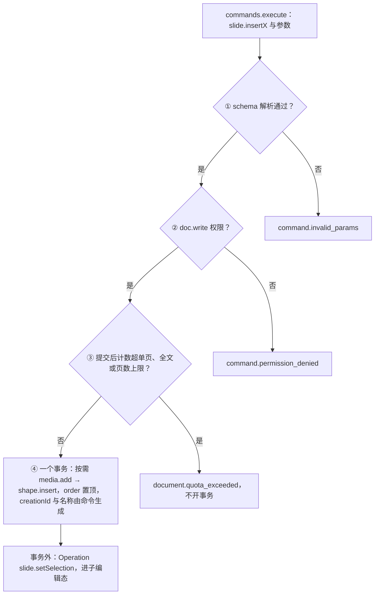
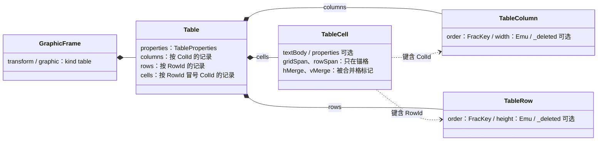
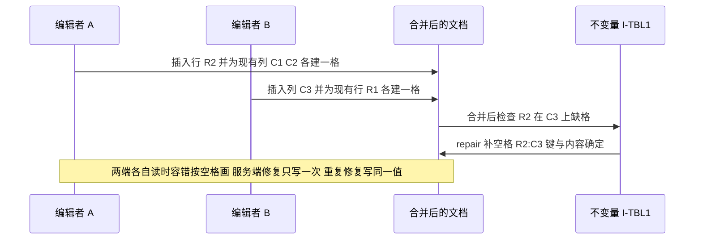

# ADR-0018 可追加元素的模型补全与插入命令族（含表格归一化）

> 状态：草稿 | 负责：架构-结构（主笔 M-03；会签 M-04、M-07、M-10） | 更新：2026-09-26（§4.21：新建。插入命令通用流程与守卫、新增命令与 Mutation、`ShapeKindDef.capabilities` 扩展、`objectDefaults` 只读建模、表格归一化与 I-TBL1/I-TBL2、装饰性标记、连接符跟随与空组规则）；2026-09-26（§4.21 整合：决策 5 定 BlipFill.effects 只读建模与外链来源二选一；决策 6 I-TBL2 并发插入改扩张修复、登记内置表格样式数据来源口径；决策 10 补 fillPlaceholder 并发与 I-PH1、页脚族确定性 id、setSlideProperties 与 setBodyProperties）；2026-09-30（§4.22 设计待决收口：决策 6 注明 `splitCell` 只拆合并格、按行列数拆分推迟；决策 10 注明插入页签也填入空内容占位符、`obj` 占位符放图片的方式推迟）；2026-09-30（§4.22 复核修正：决策 10 的 Q1 落点补「已选中的空占位符优先」） | 依赖：charter v0.2 D4、D7、D16；裁决 `docs/00-charter/rulings-2026-09-14.md` §4.15 Q3/Q5/Q7、§4.17 D2、§4.21（q-table-depth、q-chart-route、q-media-insert、q-smartart、q-equation、q-extra-inserts、q-frackey、X:q-content-types）；证据 `docs/00-charter/_evidence/reuse-arch-elements-plan-2026-09-26.json`（elementDesign、R-d-61…R-d-78）

## 状态

提议。rulings §4.21 已裁定的部分（表格 M2 插入与单元格文字、M3 结构与样式、M3 前归一化；图表插入定 M3；音视频插入 P2 不写 `p:timing`；图标与符号 M3 P2；SmartArt 与公式的远期路线）是本 ADR 的起草基线，不再议；其余条目随 M2 前评审转「已接受」。

| 项 | 口径 |
|---|---|
| 主笔 | M-03（`model-slide`：模型字段、Mutation、命令、不变量） |
| 会签 | M-04（`ooxml-pptx`：新字段的导入导出、表格重建、`encode` 的派生连接符输入）、M-07（`slide-render`：渲染器登记表）、M-10（`slide-ui`：插入工具态、检查器、`reroute` 计算） |
| 前端落点 | [50/19](../../50-frontend/19-insertable-elements-overview.md) 总览与六篇元素族文档 |

## 背景

- 用户本轮要求把「编辑器能追加什么、每样东西有什么用、每样东西怎么设计」写清（rulings §4.21 用户诉求 3）。盘点结果：35 类元素里约一半只有一行命令或完全没有设计；30/04 模型缺若干字段（`Pic.media` 未进 40/03、`BlipFill.alpha` 与 SVG 双引用未显式建模、裸 `p:contentPart` 未映射、`decorative` 缺失、`Theme.objectDefaults` 落在不透明 `extensions`）；插入命令只有 `slide.insertShape{containerId, kind, box}`，缺预设名、文本框换行方式、线条两点等参数。
- **表格模型**：现为 `{ columnWidths: Emu[]; rows: TableRow[] }` 数组形态。协同下 A 插一行、B 同时插一列，合并后新行缺少新列的单元格；数组下标还违背 ADR-0013 与 ADR-0032「有身份集合一律实体表 + `order: FracKey`」。尚无代码，现在改形态零迁移成本（q-table-depth）。
- **默认样式**：PowerPoint 新建形状取主题 `objectDefaults`（`spDef`/`lnDef`/`txDef`），没有才用内建 `p:style`。只从内建值取会与 PowerPoint 新建效果不一致；把解析值写成显式 `spPr` 又违背「只写显式覆盖」（PRD 02 第 3 节、OF-04）。
- **连接符**：移动目标形状时连接符要跟随。纯派生（只在渲染时算）会让导出的 `xfrm` 陈旧；在编码器里重算又违背 30/04 §5.3 的导出确定性与秩规则（V-codec 秩 35 不得 import engine-layout 秩 50）。
- **规模与安全**：所有新增元素的路径都必须经同一个命令守卫（rulings §4.15 Q5、§4.17 D2），外部内容与链接的约束已有（PRD ED-17、ED-19），但未汇成插入命令的统一流程。

## 决策

### 1. 插入命令族与通用流程

所有插入都是 Command，统一六步（50/19 §2）：选工具（ui 本地状态）→ 画布意图 → 算 box（EMU）→ 执行插入命令 → Operation `slide.setSelection` 选中并进子编辑态 → 播报。命令内的顺序固定为：

1. schema 解析（参数按元素类型分命令，不设万能 `slide.insert`）；
2. `doc.write` 权限（命令级，AND 语义，30/05 §2）；
3. **规模守卫**：按「提交后计数」判定单页 1,000、全文 20,000（墓碑计入）、200 页，超限返回 `document.quota_exceeded{dimension, limit, actual}`，**不开事务**；
4. 一个事务：按需 `slide.media.add`（字节已在 BlobStore，模型只登记 `BlobRef`）→ `slide.shape.insert`（`order = between(同级最后一个, undefined)`、`parentId = null`、`ooxml.creationId` 由命令生成 GUID、`nonVisual.name` 按「类型 + 序号」本地化生成）。

**一次插入 = 一个撤销步**；例外只有三种合并：空文本框退出即删与插入合并；动作按钮 `insertShape{ …, action }` 先写默认动作，「操作设置」确认后的 `setAction` 与之经 `history.beginGroup` 合为一步；空内容占位符填入（删空占位 + 插新元素）同事务。选中是事务外的 Operation，不入历史。媒体上传不阻塞插入（先插入、后台 presign → PUT → commit），上传失败不回滚插入。外部粘贴不经 DOM、上限 25 MB；超链接只写 `http`/`https`/`mailto`/`tel`。

**图 1 插入命令的守卫顺序**



怎么读：三道守卫都在事务之前，失败出口都不产生撤销记录；随机值（`order` 后缀、`creationId`、字段 id）只在命令里生成并放进 Mutation 载荷，`lower()` 保持纯函数。

### 2. 新增命令与 Mutation

新增 9 个 Mutation：`slide.shape.setNonVisual`、`slide.pic.setBlipFill`、`slide.cxnSp.setConnections`、`slide.shape.patchKindData`、`slide.slide.setProperties`（以上 M2），`slide.table.setTableProperties`、`slide.table.setSizes`、`slide.chart.setData`、`slide.chart.setOptions`（以上 M3）。新增 33 个命令与 1 个 Operation（`slide.chart.openDataEditor`，M3），扩展 `insertShape`（`preset`、`textBox`、`from`/`to`、`action`）、`insertPicture`、`insertTable`、`setSlideBackground`、`moveShapes`/`resizeShapes`/`rotateShapes` 的参数。需要重编码字节的命令（压缩、图标、重新着色）只收已算好的 `BlobRef`，不在事务里做异步处理。载荷与 `lower()` 要点在 [30/05](../05-command-and-history.md) §14，命令 id 与文件落点在 [40/03](../../40-modules/03-slide-domain-model.md) §2.6，前端汇总在 50/19 §5。type 一律三段式 `<docType>.<entity>.<verb>`，载荷无数组下标，逆操作由 Store 推导。

### 3. `ShapeKindDef.capabilities` 扩展

```ts
interface ShapeCapabilities {
  text: boolean; resize: boolean; rotate: boolean; group: boolean; connect: boolean   // 既有
  adjust: boolean            // 新增：显示调整手柄（预设几何含 gd 时为真）
  crop: boolean              // 新增：可进裁剪模式（位图 pic；EMF/WMF、SVG 为假）
  lockAspectDefault: boolean // 新增：缩放默认锁比例（pic、图标、音视频）
  editPoints: boolean        // 新增：保留位；顶点编辑是非目标，内建一律为假
  fillable: boolean          // 新增：检查器显示「填充」分区
}
interface ShapeKindDef<T extends Shape = Shape> {
  kind: T['kind'] | `graphicFrame:${string}`
  schema: StandardSchemaV1<unknown, T>
  createDefault(box: Rect, opts?: { preset?: string; theme?: Theme }): T   // 新增 opts：预设名与主题（取 objectDefaults）
  capabilities: ShapeCapabilities | ((shape: T) => ShapeCapabilities)     // 可按实体求值
  describe(shape: T): string
}
```

覆盖层与检查器只看 `capabilities` 决定手柄与分区，不按 `kind` 写分支；第三方元素因此不改交互层。

### 4. `Theme.objectDefaults` 只读建模与默认样式

- `Theme.objectDefaults?: { spDef?: ObjectDefault; lnDef?: ObjectDefault; txDef?: ObjectDefault }`，`ObjectDefault = { properties?: ShapeProperties; bodyProperties?: BodyProperties; listStyle?: ListStyle; style?: ShapeStyle; extensions }`。M2 导入即建模，供新元素取默认；**没有写它的 Mutation**（「设为默认形状」是 PRD ED-06 P2）；主题部件脏时随模型重生成，往返 c14n 等价。
- 新元素只写 `p:style` 引用（取值链：`objectDefaults` → PowerPoint 内建值），颜色优先 `schemeClr`；快速样式改写 `ShapeStyle` 引用，不烤解析值。换主题后新元素自动跟随。

### 5. 模型字段补全

字段定义以 [30/04](../04-document-model.md) §3.7 为唯一源，本条只列决策：

| 字段 | OOXML | 决策 |
|---|---|---|
| `Sp.isTextBox` | `p:cNvSpPr@txBox` | 已在 30/04，40/03 `sp.ts` 补列；文本框插入写 `true` |
| `Pic.media?: PicMedia` | `a:videoFile`/`a:audioFile@r:link`、`p14:media@r:embed` | `{ kind: 'video' \| 'audio'; mediaId?; external? }`；两条关系指向同一部件时共用一个 `MediaId`；外链只保留目标不加载字节；播放属性（`p:timing`）不建模 |
| `BlipFill.alpha?` | `a:alphaModFix@amt` | 显式建模（`Percent100k`），透明度命令写它 |
| `BlipFill.svgMediaId?` | `a:blip/a:extLst` 里的 `asvg:svgBlip@r:embed` | 显式建模；`mediaId` 指 PNG 回退，二者各一个 `MediaRef` |
| `BlipFill.effects?`（2026-09-26 整合，50/23 §13 Q-3） | `a:blip` 下的 `a:lum`、`a:grayscl`、`a:duotone`、`a:biLevel` | **只读建模**：导入解析为有序效果列表供 M1 渲染（导出随 `a:blip` 重生成，c14n 等价），编辑命令为 P2；其余 `a:blip` 效果子元素仍进 `extensions`。不留在 `extensions` 由渲染器另解析，以免扩大 ADR-0008 决策 10 的只读清单 |
| `BlipFill` 的来源（2026-09-26 整合，50/23 §13 Q-4） | `a:blip@r:embed` / `a:blip@r:link`（`TargetMode="External"`） | 二选一：内嵌时 `mediaId`（SVG 图片另有 `svgMediaId`），外链时 `external: { target }`；外链关系原样保留（ADR-0008 决策 5），只在 `externalResources` 允许时加载 http(s) 目标，不产生 `MediaRef`；「替换为本地图片」即改写为内嵌来源（`slide.pic.setBlipFill`） |
| `NonVisualProps.decorative?` | `cNvPr` 扩展列表里的 `adec:decorative@val` | 见决策 7 |
| `Theme.objectDefaults?` | `a:objectDefaults` | 见决策 4 |
| 裸 `p:contentPart` | `p:contentPart@r:id` + `p:xfrm` | 映射为 `UnknownShape`（`transform` 取 `p:xfrm`，`renderHint: 'placeholder'`），与 `mc:AlternateContent` 内的墨迹同一处理（R-d-76） |
| `UnknownShape.source?` | `mc:Choice@Requires` 与节点名 | 只读标签 `'math' \| 'model3d' \| 'ink' \| 'zoom' \| 'chartex' \| 'contentPart' \| 'other'`，导入时填写，只用于检查器类型名、提示文案与可访问名称，不参与导出（50/25 提出） |
| `Hyperlink.target` | `a:hlinkClick@r:id` / `@action` | 判别联合 `{ kind: 'url'; href }`、`{ kind: 'slide'; slideId }`（`ppaction://hlinksldjump`）、`{ kind: 'show'; jump }`（`ppaction://hlinkshowjump?jump=…`；`jump` 取 `first`/`last`/`next`/`previous`/`lastViewed`/`end`，依次对应 `firstslide`/`lastslide`/`nextslide`/`previousslide`/`lastslideviewed`/`endshow`）；不支持的 `ppaction` 原样留在 `extensions` |
| `Slide.showMasterShapes?` | `p:sld@showMasterSp` | 页级「隐藏背景图形」，经 `slide.slide.setProperties` 写（50/21 提出） |
| `Presentation.firstSlideNum?` | `p:presentation@firstSlideNum` | 只读建模（缺省 1），供页码字段求值（50/20 提出） |
| `Chart.data?`（M3） | `c:chartSpace` 的系列与缓存 | 30/04 §3.9；M1–M2 仍只有 `partRef` + 只读 `ChartReadModel`（D16）；渲染与编辑路线见 ADR-0036 |

### 6. 表格归一化

**模型**（30/04 §3.8）：

```ts
interface Table {
  properties: TableProperties                        // tblPr：styleId?、firstRow、lastRow、firstCol、lastCol、bandRow、bandCol、fill?、extensions
  columns: Record<ColId, { order: FracKey; width: Emu; _deleted?: Tombstone; extensions }>
  rows:    Record<RowId, { order: FracKey; height: Emu; _deleted?: Tombstone; extensions }>
  cells:   Record<CellKey, TableCell>                // CellKey = `${RowId}:${ColId}`
  extensions: OpaqueSlot
}
interface TableCell {
  textBody: TextBody; properties?: TableCellProperties   // tcPr：边距、锚点、竖排、填充、六向边框
  gridSpan?: number; rowSpan?: number                     // 只在锚格上（合并区左上角）
  hMerge?: boolean; vMerge?: boolean                      // 被合并格的标记
  extensions: OpaqueSlot
}
```

- **寻址**：行、列、格都按 id 寻址，顺序由 `order: FracKey` 承载（键格式随 q-frackey 改写的 ADR-0032）；Mutation 载荷无下标。选区锚点 `tableCell` 与文本目标 `TextTarget.cell` 改为 `{ rowId, colId }`（30/04 §3.6）。
- **删除**：删行、删列写 `_deleted` 墓碑（与 30/04 §3.1a 同口径），该行或列上的格随之不可见（包含关系）；撤销以原 id 复活；硬删由墓碑清扫一并处理。
- **合并**：锚格记 `gridSpan`/`rowSpan`，被覆盖格记 `hMerge`/`vMerge`；拆分清除这些标记。`splitCell` 只拆回合并前的格，普通格上禁用并给原因（设计 03-30 §5.3）；普通格按行列数拆分推迟（DF-04，触发条件：M3 之后出现明确用户需求时再议，届时扩 `slide.table.splitCell{rows?, cols?}` 与对应 Mutation，I-TBL2 的修复面随之变大，见 rulings §4.22）。
- **不变量**：**I-TBL1** 每个存活行在每个存活列上都有格（缺格由 `repair` 补空格，键确定、内容确定，两端独立修复也收敛）；**I-TBL2** 跨度合法（锚格跨度不越过存活行列的末尾、被覆盖格的标记与锚格一致、合并区不重叠；越界的跨度收缩；并发插入的行列落在他人合并区内部时，从锚格起按当前顺序扩张跨度到原被覆盖的最后一行或列、新格补写被合并标记，与本机在合并区内插入时的行为一致（2026-09-26 整合，50/24 §2.14 第 7 条）；扩张后仍重叠或无锚格可归属的孤立标记才清除）。两者都是 30/04 §12.3 同类的纯函数 `check`/`repair`，服务端软门禁以 `system('repair')` 执行，客户端读时容错（缺格按空格画）。
- **导出**：按 `(order, id)` 排序存活的行与列，重建 `a:tblGrid/a:gridCol@w`、`a:tr@h`、`a:tc` 及其 `gridSpan`/`rowSpan`/`hMerge`/`vMerge` 属性；导入反之（为每个 `a:tr`、`a:gridCol` 生成 id 与等距键）。
- **内置表格样式数据**（2026-09-26 整合，40-modules/04 Q-10；rulings §4.21 推迟项、ADR-0049 T-05）：74 种内置样式的数据自备（按 ECMA-376 与 PowerPoint 对照整理），不复制 LibreOffice 的 MPL-2.0 样式数据（B 档只允许不修改的依赖，不允许复制源码或数据文件）；数据形状与 ooxml-core 的 `TableStyleEntry`（即 `TableStyleReadModel` 中的单个样式）一致，供 slide-render 渲染与 `ooxml-pptx` `export/table-styles.ts` 在 M3 按 ADR-0008 决策 9 (d) 追加定义；来源与许可在 M3 表格样式开工前定稿并登记进 `license-allowlist.json#dataFiles`。
- **里程碑**：M2 可插入表格并编辑单元格文字；行列插删、合并拆分、样式与尺寸 M3。归一化形态最迟在 M3 结构编辑开工前落地；因尚无代码，建议 M1 导入即产出该形态，免去一次 schema 迁移（ADR-0009）。

**图 2 表格归一化模型**



怎么读：三张记录表按 id 并列，没有「行里套格」的数组；格的键由行 id 与列 id 拼成，所以插行与插列互不改写对方的键，行列顺序只在 `order` 上。

**图 3 并发插行插列后的收敛**



怎么读：数组形态下这一场景会让 R2 少一格且列宽数组错位；归一化后 A、B 各写各的键，唯一的缺口是交叉格 `R2:C3`，它的键与默认内容都是确定的，所以无论哪端先补都收敛到同一状态。

### 7. 装饰性标记

`NonVisualProps.decorative?: boolean` 显式建模（原落在 `extensions` 的 OpaqueXml 里，可访问树读取要解析 XML）。为真时该元素不进画布可访问树、不提示缺替代文本；`description` 保留不删（与 PowerPoint 一致）。写入走 `slide.setAltText` → `slide.shape.setNonVisual`。导出写回 `cNvPr` 扩展列表中的 `adec:decorative`（命名空间 `http://schemas.microsoft.com/office/drawing/2017/decorative`），扩展列表里其它未知项照旧原样写回。

### 8. 连接符跟随：命令内联写回，显示与导出按派生几何

- 连接点几何（`connectorPoints`）与肘形、曲线的重算（`connector-routing`）是 engine-layout 的纯函数（40/06）；`model-slide`（秩 15）与 `ooxml-pptx` 编码器（秩 35）都不 import 它。
- **命令内联写回**：交互层（slide-ui，可用 `layout` 服务）在移动、缩放、旋转、连接端点时，用上述纯函数算出受影响连接符的新几何，作为 `reroute?: ConnectorPatch[]` 参数随 `slide.moveShapes`/`resizeShapes`/`rotateShapes`/`connectEnds` 传入；命令在**同一事务**内写回 `xfrm`（M3 起连同 `adj`）。与 `slide.applyAutofit`「计算在渲染侧、命令只写值」同一模式。
- **显示按派生几何**：已连接的端点，渲染器以派生结果为准，存储值只在未连接时使用（并发下 A、B 分别移动两个目标，同键 LWW 后存储值可能陈旧，画面仍正确）。
- **导出按派生几何**：`encode()` 增加显式输入 `connectorGeometry?: ReadonlyMap<ShapeId, ConnectorPatch>`，由导出调用方（浏览器导出、server-headless 导出）用同一纯函数对全部已连接连接符计算后传入；编码器不读 layout、不读时钟，同一 Snapshot 得到同一字节（30/04 §5.3 确定性）。未提供时按存储值写出并诊断。
- 目标是墓碑时保留引用、画成自由端点；目标被硬删后导出去掉失效的 `stCxn`/`endCxn` 并发诊断 `connector-target-missing`（50/22 提出；2026-09-26 登记为 `format.pptx.connector_target_missing`，见 30/10 §1.1a）。

### 9. 组合：取消组合的变换折算与空组

- `slide.ungroup` 把子元素的变换折算回容器坐标：子世界矩阵 = 组矩阵（含 `chOff/chExt` 映射、旋转、翻转）× 子局部矩阵，再分解为 `off/ext/rot/flipH/flipV` 写回；组有旋转且子元素非等比缩放时会出现 OOXML 表达不了的斜切，按 PowerPoint 的近似规则（保留包围盒与旋转、丢弃斜切，需语料核对）并诊断。折算是 `model-slide` 内的纯函数，与渲染侧 engine-layout 的矩阵由共用测试向量对齐。
- **I-GRP1 空组视为删除**：组没有存活子元素时，读路径视其为已删除；命令删除组内最后一个子元素时同一事务给组写墓碑；协同并发下（A 删最后一个子元素、B 同时删另一个）由 `repair` 以 `system('repair')` 写墓碑，只写一次。
- 占位符入组：同一事务 `materialize` 后去掉 `PlaceholderRef`，并 toast（PRD ED-08）。

### 10. 内容占位符的填入与删除恢复

- `slide.fillPlaceholder{ shapeId, content }`：一个事务内给空占位 `Sp` 写墓碑、按需 `media.add`、插入带**同一** `PlaceholderRef`（同 `type`、`index`）与同一 `order` 的 `Pic` 或 `GraphicFrame`；图片按占位符框裁剪到填满（算 `srcRect`）。`obj` 占位符放图片是裁剪填满还是等比放入推迟（DF-09，触发条件：M2 P1 图片填入开工前，维护机实测 `p:pic` 的 `xfrm` 与 `srcRect`；结论为等比时改本条，`pic` 占位符两种结论都裁剪，见 rulings §4.22）。调用方除占位符图标条外，还有插入页签与命令面板：插入表格、图表、图片时页上有空内容占位符，就填入阅读序第一个（已选中的空占位符优先，rulings §4.22 Q1）。
- 删除带内容族 `PlaceholderRef` 的图片、表格、图表、媒体时，`slide.deleteShapes` 同一事务补回一个空占位 `Sp`（新 id、同 `PlaceholderRef` 与 `order`），与 PowerPoint 一致；撤销一步回到删除前。
- 占位符族划分与匹配以 PRD ML-02、ML-03 为准（30/04 §12.2 改写后的 `placeholderFamily`、`canChangePlaceholderType` 与 `compatiblePlaceholderTypes`）。
- **并发填入**（2026-09-26 整合，50/21 §3）：`fillPlaceholder` 的前置检查——目标空占位 `Sp` 已是墓碑（他人已填入）时改为普通插入并 toast；两人同时填入同一占位符时两者都保留，由软不变量 **I-PH1**（同页同 `(type, idx)` 的存活内容族占位符至多一个；修复保留 `(order, id)` 最小者，其余 `materialize` 为普通元素）经服务端软门禁修复一次（ADR-0034）。
- **页脚族占位符的确定性 id**（2026-09-26 整合，50/21 §4）：「页眉和页脚…」对话框写入页脚族占位符（`dt`、`ftr`、`sldNum`）时，新建实体的 id 为 `deriveNodeId('hf', slideId, type)`——由三元组经 SHA-256 截取生成的 UUID v8，仍是合法 `NodeId`、全局唯一、由稳定输入确定（ADR-0014「派生 id」）；规则：页上已有同类存活占位符时复用它；确定性 id 的实体是墓碑时复活而不新建。这样两人并发「全部应用」时新建收敛为同一实体（对已存在页脚的并发改写仍可能拼接文字，见 30/06 §8）。
- **页级属性与文本框属性命令**（2026-09-26 整合，50/20、50/21）：`slide.setSlideProperties{slideIds, showMasterShapes}` 经 Mutation `slide.slide.setProperties` 写「隐藏背景图形」；`slide.setBodyProperties{shapeIds, patch}` 是文本框锚点、内边距、自动换行、自动调整模式与分栏的薄命令，复用 `textBody.setBodyProperties`（登记见 40/03 §2.6）。

## 备选方案与放弃原因

| 备选 | 放弃原因 |
|---|---|
| 表格保留行数组，只加 I-TBL1/I-TBL2 修复 | 并发插行插列必出缺格、列宽数组错位，靠修复兜底会频繁触发 `collab/repair`；数组下标违背 ADR-0013、ADR-0032 |
| 表格用嵌套 `Y.Array` | 同上，且行列移动要删了再插，丢失单元格内的并发文字编辑 |
| 表格插入与结构编辑都放 M3（q-table-depth 选项 2） | M2 用户不能新建表格，与设计 03-04、playground 不一致 |
| M2 就做结构编辑（q-table-depth 选项 3） | M2 前要完成单元格选区状态机与全部结构命令，工作量明显增加 |
| `objectDefaults` 继续留在 `extensions` | 新元素默认样式与 PowerPoint 新建效果不一致，解析要读不透明 XML |
| 新元素写解析后的显式 `spPr` | 换主题不跟随，违背「只写显式覆盖」 |
| 一个万能 `slide.insert{ kind, … }` 命令 | 参数 schema 只能写成宽松联合，无法按类型精确校验；Ribbon 绑定、能力位与审计粒度都变粗 |
| 手柄按 `kind` 在交互层写分支 | 第三方元素要改交互层，违背「新元素内核零改动」（30/04 §3.3） |
| `decorative` 留在 `extensions` | 可访问树与缺替代文本提示都要解析 OpaqueXml |
| 连接符只在渲染时派生、从不写回 | 导出的 `xfrm` 陈旧，不重算的读取方（旧版 PowerPoint、其它工具）位置错误 |
| 编码器在导出时读 engine-layout 重算连接符 | 违背秩规则（V-codec 不得 import engine-layout）与编码器不读度量服务的确定性前提 |

## 后果

- 正：35 类元素都有了统一的插入流程、默认值来源与命令落点；表格并发从根上无缺格；新元素随主题；第三方元素只贡献 `capabilities` 即获得正确手柄与检查器分区；导出的连接符几何确定且正确。
- 负：`model-slide` 新增 8 个 Mutation、31 个命令与若干不变量，40/03 文件数上升；表格导入导出要做一次「数组 ↔ 记录」转换；`encode()` 多一个显式输入，导出调用方要先跑一遍连接符派生；`reroute` 依赖调用方传入，脚本与插件直接调用变换命令而不传时，存储几何可能陈旧（显示与导出不受影响）。

## 如何被机械验证

| 规则 | 机制 |
|---|---|
| 插入超限不开事务 | `command-harness` 边界用例（单页 999/1,000/1,001、全文 19,999/20,000/20,001 含墓碑），断言无事务、撤销栈不变 |
| 一次插入一个撤销步与三种合并 | 命令层集成测试：`insertShape`→`undo` 深等于插入前；空文本框退出后撤销栈深度不变；`fillPlaceholder` 与带 `setAction` 的动作按钮插入各一步 |
| 新元素只写引用 | 导出断言新元素 `spPr` 无填充与线条的解析值；`applyTheme` 后渲染快照随主题变化 |
| I-TBL1、I-TBL2 | property：随机并发插删行列、合并拆分后 `repair` 一次即净、再次无变化；store-memory 与 store-yjs 两端收敛到同一状态 |
| 表格往返 | 表格语料 `parse → 归一化 → 重建 a:tbl → c14n` 与原文等价；合并格与标志往返 |
| 装饰性、`svgBlip`、`alphaModFix`、`Pic.media` 往返 | codec 往返 c14n 等价（30/04 §5.4） |
| 连接符导出确定性 | 同一 Snapshot 在浏览器与 Node 各导出一次，SHA-256 相同；并发移动两个目标后导出的连接符与派生几何一致 |
| I-GRP1 | property：随机删除组内元素后不存在无存活子元素的存活组 |
| `capabilities` 驱动手柄 | 覆盖层测试：只改 `capabilities` 不改 `kind`，手柄集合随之变化 |

## 关联

- 章程：D4（命令三分法）、D7（不透明保留）、D16（图表 M1–M2 只读）；rulings §4.15 Q3（墓碑）、Q5（规模上限）、§4.17 D2（`document.quota_exceeded`）、§4.21。
- 架构：[30/04](../04-document-model.md) §3.3、§3.7–§3.9、§12；[30/05](../05-command-and-history.md) §8、§14；[30/06](../06-collaboration.md) §1.5。
- ADR：[0007](0007-document-store-and-derived-undo.md)（逆操作推导）、[0008](0008-opaque-preservation.md)（不透明保留与白名单）、[0013](0013-mutation-lowering-and-store-ops.md)（五种 StoreOp）、[0014](0014-stable-ids.md)（稳定 id）、[0032](0032-ordered-collections-fractional-index.md)（FracKey）、[0036](0036-chart-rendering-and-editing.md)（图表路线）。
- 模块与前端：[40/03](../../40-modules/03-slide-domain-model.md) §2.6；[50/19](../../50-frontend/19-insertable-elements-overview.md)。
