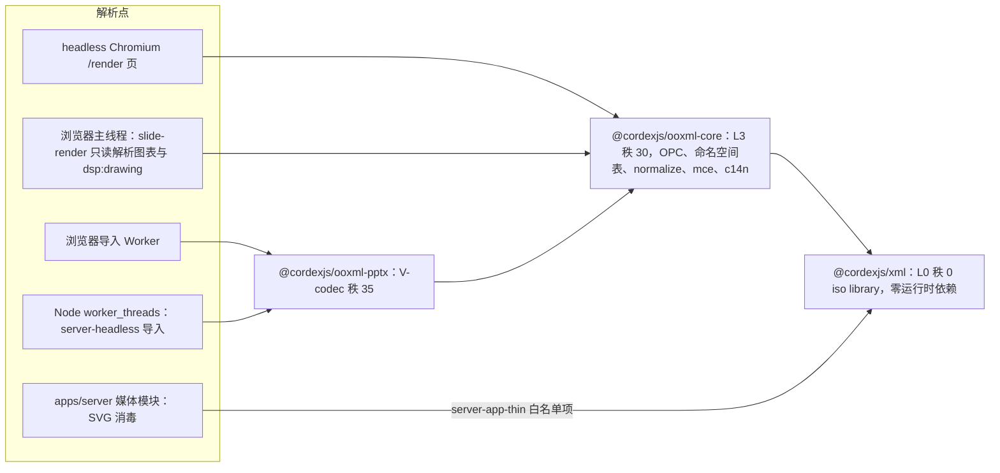
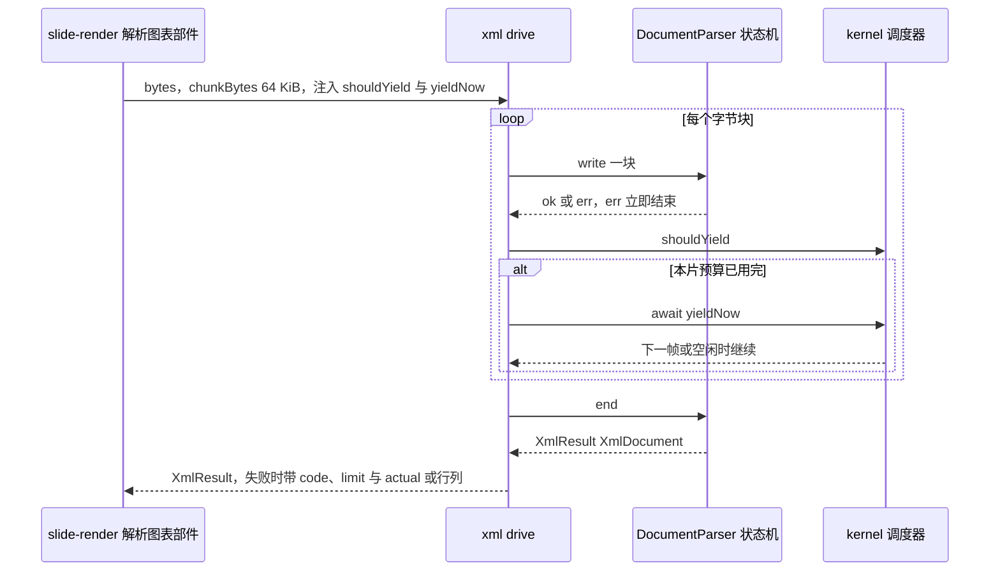
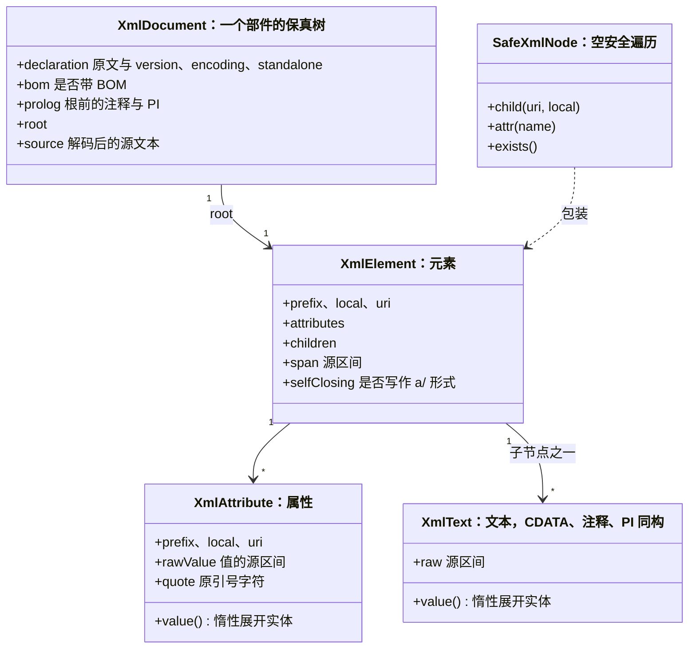
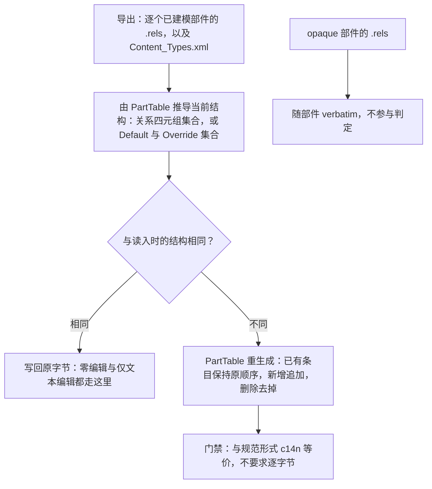
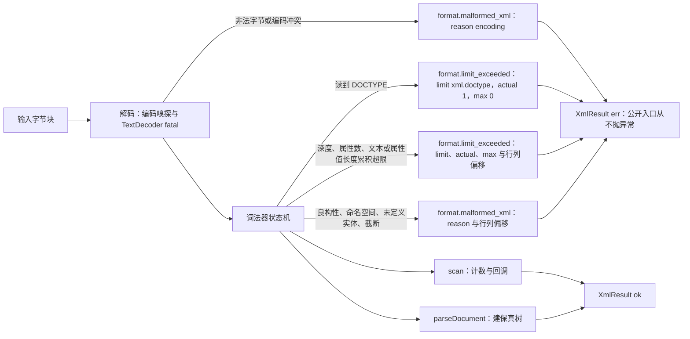
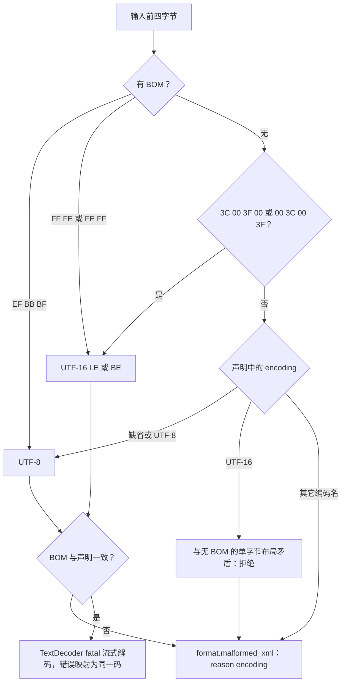
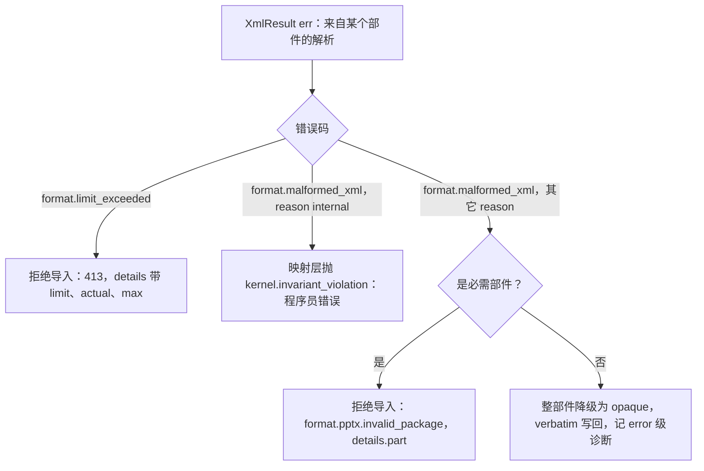
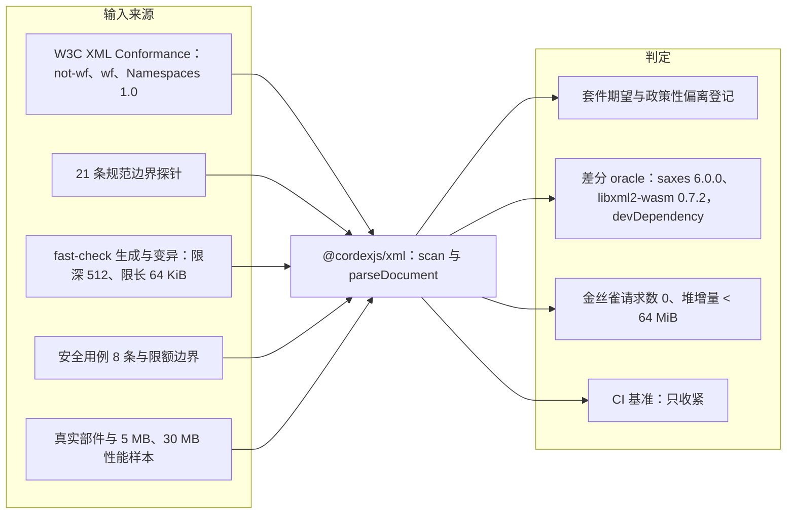

> 状态：已接受 | 负责：架构-结构（会签：架构-类型治理） | 更新：2026-09-26（§4.21：新建，A-2 定案——自研词法与保真树、独立包 `@cordexjs/xml`、`XmlLimits` 唯一表、关系部件与内容类型零编辑原样写回） | 依赖：charter v0.2 §5.1–§5.3、§6.1 D7/D13；裁决 `docs/00-charter/rulings-2026-09-14.md` §4.21（X:q-xml-lexer、X:q-xml-package、X:q-content-types）；[ADR-0008](./0008-opaque-preservation.md) 决策 2/5/8；[ADR-0043](./0043-result-vs-exceptions.md)；[30/04](../04-document-model.md) §5.3–§5.5；[40/04](../../40-modules/04-ooxml-format-and-pptx-codec.md) §4.3；证据 [`xml-parser-research-2026-09-26.json`](../../00-charter/_evidence/xml-parser-research-2026-09-26.json)（下称「证据 X」）

# ADR-0019 XML 词法与保真树：自研独立包 `@cordexjs/xml`（A-2 定案），`XmlLimits` 为 XML 限额唯一来源

## 状态

**已接受**（2026-09-26，用户裁决 rulings §4.21 的三题：X:q-xml-lexer「自研词法与保真树」、X:q-xml-package「抽出独立 iso 包 `@cordexjs/xml`」、X:q-content-types「结构不变就原样写回」，三题均取推荐项）。本文取代 30-architecture/README 待决项 A-2 的默认方案（「自研最小保真 DOM，备选 `@xmldom/xmldom` / `fast-xml-parser`」），候选集合改为「自研 / `@rgrove/parse-xml` 5 / saxes（已归档）」。

本文是以下四件事的**唯一口径**，其它文档一律引用本文，不再各自重述：

| 事项 | 本文位置 |
|---|---|
| XML 解析器、保真树、序列化器的归属与接口 | 决策 1–3 |
| 保真门禁与期望项的划分 | 决策 4 |
| `[Content_Types].xml` 与 `.rels` 的写回口径 | 决策 5 |
| XML 限额（深度、属性数、文本长度、属性值长度、DOCTYPE）的键、默认值与错误码 | 决策 6「`XmlLimits` 唯一表」 |

## 背景

- **仓库现状**：M0 阶段只有 `docs/`，没有任何 XML 解析代码或依赖。「现在用的」只是文档默认值：40/04 已按自研拆好 `xml/parser.ts`、`node.ts`、`serializer.ts` 等文件，但 A-2 的决策人没有签字，章程与 40/04 却已按定案来写。
- **前期推荐失效**：前端、后端两份复用调研都推荐以 saxes 6 做词法层。核实结果：saxes 仓库已归档，最后发版 6.0.0 于 2021-11-07T19:06Z（2022-05-17 只是 registry 的 `time.modified`），其依赖 xmlchars 仓库同样已归档，不满足「12 个月内有发布」的维护要求。
- **专项实测**：21 个候选加一个 392 行的自研原型，在 9 个真实部件、14 个刁钻用例、8 个安全用例、16 个畸形用例和 5 MB / 30 MB 两档性能样本上实跑，另做 3000 例差分模糊与 276 种分块组合的流式等价（证据 X `benchmark`、`verification`）。复核结论：
  - **保真度拉不开差距**。`@rgrove/parse-xml` 5 打开偏移、补约 30 行命名空间层和 1 行 DOCTYPE 守卫后，探针 15/16、畸形 16/16、安全 8/8、差分 3000/3000，与自研原型持平。原型「零编辑 23/23 逐字节」是用源区间切片构造出来的，任何带偏移的库都能做到，不能当选型依据。
  - **差距在现成库补不上的地方**：不建树的计数扫描（首批回传前对全部页计数）、词法层限额且错误带 `{limit, actual}`、流式与按 50 ms 分片、深嵌套不栈溢出。parse-xml 只能建整树，没有限额，约 1 万层嵌套即 `RangeError`；要补一个计数扫描器，就等于写了一个词法器。
  - **体积持平**：gzip 4,458 B（原型）对 4,358 B（parse-xml），查看器基线只剩约 5 KB 余量。
- **解析点不止一处**：同一份 iso 源码要跑在浏览器导入 Worker、浏览器主线程（`slide-render` 只读解析图表与 `dsp:drawing`）、Node `worker_threads`（`server-headless`）与 headless Chromium 的 `/render` 页；服务端 SVG 消毒还需要一个严格 XML 解析点，而 `server-app-thin` 规则禁止 `apps/server` 的 `modules/**` import `ooxml-*`。解析器放在 `ooxml-core` 里就只能再写第二个。
- **口径矛盾**（证据 X `requirements.contradictions`）：保真要求写成「逐字节」与「脏部件 c14n 等价」两种；XML 限额分散在 PRD OF-24、50/14、60/06、60/17、70/10，项目与数值互不一致；DOCTYPE「拒绝」与「按禁用处理」两说；`format.malformed_xml` 已在 40/04 定义但 30/10 错误码目录没有登记；`[Content_Types].xml` 与 `.rels`「始终重生成」和「零编辑原样写回」两种口径并存。

**图 1 解析点与包归属**



怎么读：箭头是 import 方向。五个解析点最终都落到同一个 `@cordexjs/xml`；`ooxml-pptx` 与 `slide-render` 只经 `ooxml-core` 取得 XML 能力（`ooxml-core` 在公共面 re-export 节点类型与解析、序列化包装，见决策 1），因此它们的依赖上限不变；只有 `ooxml-core` 与 `apps/server` 媒体模块直接依赖 `@cordexjs/xml`。

依据：证据 X `requirements.currentState`、`recommendation.why`；rulings §4.21 X:q-xml-package。

## 决策

### 1. 自研，并抽出独立 iso 包 `@cordexjs/xml`

- 词法器、保真树、序列化器、`XmlLimits`、编码嗅探，以及 W3C 合规套件与差分测试，全部自研并放进新包 `@cordexjs/xml`：**L0 · 秩 0 · iso · library**，`package.json` 的 `dependencies` 为空（不依赖任何包，`@cordexjs/shared` 也不依赖）。`Result` 形态在包内本地声明为结构等价的判别联合 `{ ok: true; value } | { ok: false; error }`，与 `@cordexjs/shared` 的 `Result` 结构兼容，调用方无需转换。
- `ooxml-core` 运行时**不引任何 XML 第三方依赖**；其依赖上限由「shared、model-core」改为「shared、xml、model-core」。`ooxml-core` 保留 OOXML 专属层：OPC、`namespaces`（Strict↔Transitional 48 对与 OOXML 常用前缀表）、`normalize`、`mce`、`c14n`（测试用），以及把 `XmlError` 映射为 `FormatError` 的一层。
- `ooxml-core` 在公共面 re-export `@cordexjs/xml` 的节点类型（`XmlDocument`、`XmlElement`、`QName`、`SafeXmlNode`）与带 OOXML 默认值的包装（`parseXmlPart`、`serializeXmlPart`、`scanXmlPart`：注入 `XmlLimits`、OOXML 前缀表与 `mc:Ignorable` 前缀集合，补 `partName` 并映射错误）；这三个包装都在 `ooxml-core/infrastructure/xml/xml-part.ts`，它是 `ooxml-core` 内唯一 import `@cordexjs/xml` 的文件。`ooxml-pptx`、`slide-render`、未来的 `ooxml-docx` / `ooxml-xlsx` 只经 `ooxml-core` 取得 XML 能力，依赖上限不变。
- `apps/server` 的媒体模块（SVG 消毒）可以直接依赖 `@cordexjs/xml`；`server-app-thin` 规则的白名单加这一项（只此一项，`ooxml-*` 仍禁止）。
- **格式盲**：`@cordexjs/xml` 源码不出现任何 OOXML 命名空间 URI、`slide` / `doc` / `sheet` 字面量；OOXML 相关的前缀表、`mc:Ignorable` 前缀集合都由调用方以参数注入。

| 能力 | `@cordexjs/xml` | `@cordexjs/ooxml-core` |
|---|---|---|
| 字节解码、编码嗅探、UTF-8 输出 | ✓ `decode.ts`、`encode.ts` | — |
| 词法器、`scan`（不建树计数） | ✓ `lexer.ts`、`scanner.ts` | `scanXmlPart` 包装；`ooxml-pptx` 经它读页数、做首批前的元素计数 |
| 保真树、`SafeXmlNode`、`parseDocument` | ✓ `tree.ts`、`node.ts`、`safe-node.ts`、`parser.ts` | re-export 类型 |
| 序列化（整树、片段、上下文重解析） | ✓ `serializer.ts`、`fragment.ts` | 注入 OOXML 前缀表 |
| `XmlLimits` 与错误 | ✓ `limits.ts`、`errors.ts` | `XmlError` → `FormatError` 映射 |
| Strict↔Transitional、`mc:AlternateContent`、c14n | — | ✓ `namespaces.ts`、`normalize.ts`、`mce.ts`、`c14n.ts` |
| 合规套件、差分 oracle、边界探针 | ✓ `__tests__/` 与 devDependency | — |

文件级目录与职责见 [40/04](../../40-modules/04-ooxml-format-and-pptx-codec.md) §4.3、§5.3。

### 2. 两个入口：`scan`（不建树）与 `parseDocument`（整树），都支持 `write` / `end` 与按时间片让出

- **一个词法器，两种消费方**。词法器是可中断、可续跑的状态机，按字节块推进，产出 token（开始标签、属性、文本、CDATA、注释、PI、结束标签、声明）。`scan` 只维护命名空间作用域栈与计数器，不物化节点，用于首批回传前对全部页做元素计数、读 `p:sldIdLst` 等只需少量信息的场合，可由回调返回 `'stop'` 提前结束；`parseDocument` 在同一 token 流上建保真树。两者的限额判定、错误码与合规行为完全一致（同一个词法器），不存在「两套解析器判定不一致」的问题。
- **流式**：两者都有 `write(chunk: Uint8Array)` / `end()` 形态的增量接口，任意分块结果与一次性输入相同（含切断多字节序列与代理对的分块）。超长 token 用分段缓冲（片段数组，结束时一次拼接），避免原型在小分块下的二次方开销（2 MB 属性值按 64 字符分块 2,383 ms）。
- **按时间片让出**：`@cordexjs/xml` 不读时钟、不调定时器。包内提供 `drive(sink, bytes, { chunkBytes, shouldYield, yieldNow })`：按 `chunkBytes`（默认 64 KiB）切块写入，每块之后问调用方注入的 `shouldYield()`，为真则 `await yieldNow()`。主线程的调用方（`slide-render` 解析图表部件）注入 kernel 调度器的让出函数，使单个大部件的解析也不产生 > 50 ms 长任务；Worker 与 Node 注入 `() => false`，一次跑完。
- **不递归**：词法器、建树、序列化、c14n 全部用显式栈遍历，嵌套深度只受 `XmlLimits.maxDepth` 约束，不会因调用栈耗尽抛 `RangeError`。

公共面草案（≤ 40 行，名称以 40/04 §5.3 为准）：

```ts
export type XmlResult<T> = { readonly ok: true; readonly value: T } | { readonly ok: false; readonly error: XmlError }
export interface XmlSink<T> {                       // scan 与 parseDocument 共用的增量形态
  write(chunk: Uint8Array): XmlResult<void>
  end(): XmlResult<T>
}
export interface ScanElement {                      // 只读视图，回调返回后失效
  readonly uri: string; readonly local: string; readonly prefix: string; readonly depth: number
  attr(uri: string, local: string): string | undefined   // 惰性解码
}
export declare function createScanner(opts: {
  limits?: Partial<XmlLimits>
  onStartElement?: (el: ScanElement) => 'continue' | 'stop'
}): XmlSink<ScanSummary>                            // ScanSummary：{ elements, maxDepthSeen, stopped }
export declare function createDocumentParser(opts?: {
  limits?: Partial<XmlLimits>
}): XmlSink<XmlDocument>
export declare function parseDocument(bytes: Uint8Array, opts?: { limits?: Partial<XmlLimits> }): XmlResult<XmlDocument>
export declare function drive<T>(sink: XmlSink<T>, bytes: Uint8Array, opts: {
  chunkBytes?: number
  shouldYield: () => boolean
  yieldNow: () => Promise<void>
}): Promise<XmlResult<T>>
export declare function serializeDocument(doc: XmlDocument, opts?: SerializeOptions): Uint8Array   // 恒为 UTF-8
export declare function serializeFragment(el: XmlElement, opts?: FragmentOptions): string
export declare function parseFragment(text: string, inScope: NamespaceContext, opts?: { limits?: Partial<XmlLimits> }): XmlResult<readonly XmlNode[]>
```

**图 2 一次分片解析的时序（主线程调用方）**



怎么读：纵线是参与方，自上而下是时间顺序。解析器只按块推进、从不自己计时；让不让出由调用方注入的 `shouldYield` 决定，所以同一份代码在 Worker 与 Node 里注入「永不让出」即可一次跑完。任何一块返回错误都立即短路，不再写入后续块。

依据：证据 X R-19、R-20、R-22 与 `verification.corrections`；rulings §4.21 X:q-xml-lexer。

### 3. 保真树与序列化

- **节点与源区间**：保真树是紧凑存储的节点表。每个元素记录前缀、本地名、命名空间 URI、属性（名、值的源区间、引号字符）、子节点与自身在解码源文本中的起止偏移；文本与属性值**惰性解码**，只在读取时展开实体与字符引用。节点类型：`XmlElement`、`XmlText`、`XmlCData`、`XmlComment`、`XmlPI`，文档级另有 `declaration`（原文与解析出的 `version` / `encoding` / `standalone`）和 BOM 标记。原型 30 MB 输入的峰值增量 +645 MB 偏高，完整版以紧凑存储为目标，CI 基准记录峰值并按 ratchet 只收紧（阈值由 M1 spike 定）。
- **`SafeXmlNode`**：空安全遍历，`child(ns, local).attr(name)` 链式调用，缺失时返回空节点而不是 `undefined`，供解析器逐节点隔离错误。
- **两类序列化**：
  - **局部修改后回写**（不透明白名单的修改、`tableStyles.xml` 追加等）：未被修改的子树按源区间原样输出；被修改的元素只重写其开始标签或受影响的子节点，未变的属性保留原引号与实体原文。
  - **整树生成**（脏部件由模型重生成）：按插入顺序输出属性；新元素所需的命名空间优先复用作用域内已有前缀，否则取调用方注入的首选前缀表（`ooxml-core` 注入 OOXML 常用前缀），仍无则确定性地生成 `ns0`、`ns1`…；新声明写在需要它的元素自身上，不上提到祖先，以免改动干净的祖先。
- **转义规则（确定性）**：文本转义 `&`、`<`、`>`，并把 `\r` 写成 `&#13;`；属性值一律用双引号（原属性保留原引号），转义 `&`、`<`、`"`，并把 `\t`、`\n`、`\r` 写成 `&#9;`、`&#10;`、`&#13;`，保证经属性值规范化后仍能往返。
- **片段**：`serializeFragment` 输出子树时补齐子树用到的全部前缀声明，外加调用方指定的前缀（`ooxml-core` 传入 `mc:Ignorable` 与 `mc:Choice@Requires` 引用的前缀），产出「含前缀声明」的字符串，即 `OpaqueXml.xml`；`parseFragment` 在给定命名空间上下文中重解析并插回。
- **确定性**：序列化是纯函数，不读时钟、随机源与区域设置；同一棵树在浏览器与 Node 输出的字节相同（SV-02 的前提之一）。输出恒为 UTF-8；新建部件的声明取 `<?xml version="1.0" encoding="UTF-8" standalone="yes"?>`，声明后的换行写法以语料中 PowerPoint 的实际输出为准（M1 spike 核对后固定）；重生成的已有部件沿用源声明，源为 UTF-16 时声明中的 `encoding` 改写为 `UTF-8`。

**图 3 保真树的节点模型**



怎么读：实线是持有关系，虚线是包装关系。属性与文本只保存源区间，`value()` 读时才展开实体；`quote`、`rawValue`、`selfClosing` 就是「引号风格、实体原文、`<a/>` 写法」这些期望项的载体。`XmlCData`、`XmlComment`、`XmlPI` 与 `XmlText` 同构，图中省略。

### 4. 保真口径：门禁只看脏部件 c14n 等价，逐字节一致只靠 verbatim

零编辑时的逐字节一致由**部件原字节原样写回**（[ADR-0008](./0008-opaque-preservation.md) 决策 1、4）保证，不经过解析器；解析器与序列化器只对脏部件负责。据此把保真要求分成两档：

| 档 | 要求 | 是否门禁 |
|---|---|---|
| 硬性 | 脏部件经 C14N、属性排序、忽略无意义空白规范化后，差异只落在被编辑子树（[30/04](../04-document-model.md) §5.4） | 是 |
| 硬性 | `parse(serialize(parse(x)))` 与 `parse(x)` c14n 等价；已建模部件 `parse → generate → c14n` 与原文相等（差异计入保真指标） | 是（后者 M1 报告、不阻断） |
| 硬性 | 命名空间感知；前缀原样保留不改名；命名空间声明不删，包括看似未被使用、实为 `mc:Ignorable` / `mc:Choice@Requires` 按前缀字符串引用的声明 | 是 |
| 硬性 | 不按 schema 丢任何节点（`@cordexjs/xml` 本就不认识 schema）；全部文本节点保留，不 trim、不合并 | 是 |
| 硬性 | 序列化确定性：同一输入两端字节相同，不受 TZ / LANG 影响 | 是 |
| 期望 | 实体原文（`&#38;` 与 `&amp;` 的区别）、属性引号风格、`<a/>` 与 `<a></a>` 写法、属性顺序、注释与 PI、CDATA 保留为独立节点、声明原文 | 否：未修改的节点按源区间原样输出即自然满足；c14n 判定会抹平这些差异，不设门禁 |

依据：证据 X R-01、R-02、R-04、R-06、R-09、R-11–R-14、R-34；rulings §4.21 X:q-xml-lexer（前期证据里「保真要求逐字节回写」的理由不成立，改为「流式计数、词法层限额、分片」）。

### 5. `[Content_Types].xml` 与 `.rels`：结构不变就原样写回

修订 [ADR-0008](./0008-opaque-preservation.md) 决策 5「永不 verbatim」的口径（该 ADR 的正文由其负责人按本条改写）：

- **判定**：导出时对每个已建模部件的 `.rels` 与 `[Content_Types].xml` 比较「结构」。`.rels` 的结构是关系四元组 `(Id, Type, Target, TargetMode)` 的集合，`Target` 按原字符串比较；`[Content_Types].xml` 的结构是 `Default`（扩展名不分大小写 → 内容类型）与 `Override`（部件名不分大小写 → 内容类型）两个集合。
- **结构不变**：写回读入时的原字节，与该部件所属的 XML 部件是否变脏无关——文本编辑后未列入 `dirtyParts` 的页 `.rels` 因此字节相同。
- **结构变了**：由 `PartTable` 重生成。已有条目保持原相对顺序，新增条目追加在后，删除的条目去掉；重生成结果只要求与「按新结构生成的规范形式」c14n 等价，**序列化器不必逐字节复现原文**。
- **不受影响的规则**：Relationship 全部原样保留、仅 `http(s)` 可激活（ADR-0008 决策 5 后半）；opaque 部件的 `.rels` 随部件 verbatim。

**图 4 关系部件与内容类型的写回判定**



怎么读：菱形是唯一的判定点；左支保证零编辑往返时这两类部件字节相同（30/04 §5.4 零编辑行），右支只在关系或内容类型真的变化时发生，因此序列化器的门禁停留在 c14n 等价。opaque 部件的 `.rels` 不经过这条流程。

依据：证据 X R-03 与矛盾 1；rulings §4.21 X:q-content-types。需同步改写的位置：ADR-0008 决策 5、30/02「`[Content_Types]`/`.rels` 始终由表生成」一行、[30/04](../04-document-model.md) §5.3 伪代码与判定图的 rels 一行，与 30/04 §5.4、[70/03](../../70-testing/03-fidelity-roundtrip-and-corpus.md) 统一；40/04 已随本 ADR 改写。

### 6. 安全与限额：DOCTYPE 一律拒绝，限额在词法层计数，`XmlLimits` 唯一表

- **DOCTYPE 一律拒绝**：词法器读到 `<!DOCTYPE` 即返回错误，不读内部子集、不做任何实体声明处理，也就不存在外部实体、参数实体、实体展开与「禁用开关」；该行为不可配置。错误码沿用 60/06 现行的 `format.limit_exceeded` 口径，视为「上限为 0 的限额」：`details.limit = 'xml.doctype'`、`actual = 1`、`max = 0`。
- **只认 5 个预定义实体与字符引用**：`&lt;` `&gt;` `&amp;` `&apos;` `&quot;`，以及任意位数（含前导零）的 `&#N;` / `&#xH;`，引用值必须是合法的 XML 1.0 字符；其它实体引用一律 `format.malformed_xml{reason:'undefined_entity'}`，不做静默替换。包内没有任何解析外部资源的接口，解析期间不产生任何网络或文件访问。
- **在词法层计数**：四项结构限额都在词法器里、在**累积时**判定（缓冲长度一超过上限立即报错，不等遇到 `<` 或 token 结束），流式输入同样生效。恰在上限的样本必须通过。
- **可调范围**：部署配置可收紧，放宽不超过默认值的 2 倍（OF-24 口径）；`resolveXmlLimits(partial)` 校验并返回 `XmlResult<XmlLimits>`，越界时服务端拒绝启动、客户端回落默认值并诊断。这道校验在组合根读配置时执行；包内入口按调用方传入的 `XmlLimits` 工作，生产调用方只传经过 `resolveXmlLimits` 的值，测试可以直接传更大的值（如 `deep-nesting.test.ts`）。
- **适用阶段**：导入期解析的部件超限 → 整个导入被拒绝；渲染期只读解析的部件（图表、`dsp:drawing`、`tableStyles.xml`）超限 → 只把该元素降级为占位并诊断，不影响文档打开。

**`XmlLimits` 唯一表**（其它文档——PRD OF-24、50/14、60/06、60/17、70/10——一律引用本表，不再重述数值）：

| `XmlLimits` 字段 | 错误 `details.limit` | 默认 | 计量 | 判定时机 | 可配置 | 部署配置键 |
|---|---|---|---|---|---|---|
| `maxDepth` | `xml.maxDepth` | 256 | 元素嵌套层数，根元素为 1 | 压入开始标签时 | 收紧；放宽 ≤ 2× | `limits.xml.maxDepth` |
| `maxAttributesPerElement` | `xml.maxAttributesPerElement` | 1,024 | 单个开始标签内的属性个数，`xmlns` 声明计入 | 读到每个属性名时 | 同上 | `limits.xml.maxAttributesPerElement` |
| `maxTextLength` | `xml.maxTextLength` | 16,777,216 | 单个文本节点、CDATA、注释或 PI 在源文中的 UTF-16 码元数（实体展开前）；名称与引用的缓冲也受此上限约束 | 缓冲累积时 | 同上 | `limits.xml.maxTextLength`（原 `limits.xml.maxTextNodeBytes`，§4.21 更名） |
| `maxAttributeValueLength` | `xml.maxAttributeValueLength` | 16,777,216 | 单个属性值在源文中的 UTF-16 码元数（实体展开前） | 缓冲累积时 | 同上 | `limits.xml.maxAttributeValueLength`（新增，§4.21） |
| —（恒定） | `xml.doctype` | 0 | DOCTYPE 声明个数 | 读到 `<!DOCTYPE` 时 | 不可配置 | — |

计量说明：

- **按码元而非字节**：词法器工作在解码后的字符串上，按码元计数零额外开销；同一段文本的 UTF-16 码元数不超过其 UTF-8 字节数，内存上界仍由 `ZipLimits` 的单部件解压上限（64 MiB）兜住。数值沿用原「文本节点 16 MiB」的量级，因此改名不改默认值。
- **属性值上限取与文本同档**：M5 的 docx 会遇到 VML `o:gfxdata` 这类 base64 大属性值，`ooxml-core` 要求文档类型盲，默认值不按 pptx 收窄；M1 spike 用语料统计属性值长度分布后只收紧、不放宽。
- **不在本表的限额**：zip 条目数与解压量、媒体总量、嵌入字体大小、图表点数、位图像素属 `ZipLimits` 与图表解析，仍在 `ooxml-core`（[40/04](../../40-modules/04-ooxml-format-and-pptx-codec.md) §2.2）；错误同为 `format.limit_exceeded`，`details.limit` 取 `zip.<键>` 等各自前缀。

**图 5 词法层限额与错误分流**



怎么读：左边是唯一的数据通路，四条出错分支都在词法层或解码层产生，汇成同一个 `XmlResult` 错误态；`scan` 与 `parseDocument` 共用同一个词法器，所以两者对同一输入的拒绝与否、错误码与位置完全一致。

依据：证据 X R-10、R-17、R-18、R-26 与矛盾 3、4；60/06 §6 输入限额表；rulings §4.21 X:q-xml-lexer 与本轮关键口径「XML 限额单一来源」。

### 7. 编码：输入为字节，嗅探 UTF-8 / UTF-16，输出恒为 UTF-8

- 入口只收 `Uint8Array`。先看 BOM：`EF BB BF` → UTF-8，`FF FE` → UTF-16LE，`FE FF` → UTF-16BE。无 BOM 时看前四字节：`3C 00 3F 00` → UTF-16LE，`00 3C 00 3F` → UTF-16BE；否则按 ASCII 兼容读取声明里的 `encoding` 伪属性，缺省为 UTF-8。
- 只接受 UTF-8 与 UTF-16（名称不分大小写）；其它编码名、BOM 与声明矛盾（如 UTF-8 BOM 配 `encoding="UTF-16"`）返回 `format.malformed_xml{reason:'encoding'}`。
- 解码用 `TextDecoder(label, { fatal: true })` 的流式模式（`decode(chunk, { stream: true })`），分块切断多字节序列不影响结果；解码器抛出的 `TypeError` 在包内捕获并映射为 `format.malformed_xml{reason:'encoding', offset}`，不外抛。未配对的代理项与非法 XML 字符同样拒绝。
- iso 包的 tsconfig 不含 `dom` lib，而 TS 5.9.3 只在 `lib.dom` 与 `lib.webworker` 里声明 `TextDecoder` / `TextEncoder`；`@cordexjs/xml` 在包内本地声明这两个类型的最小接口（`src/text-codec.d.ts`），不引入 `dom` lib，也不依赖 `@types/node`。
- 输出：`serializeDocument` 恒输出 UTF-8；源为 UTF-8 且带 BOM 时保留 BOM（期望项），源为 UTF-16 的脏部件改写为 UTF-8 并同步声明。

**图 6 编码嗅探**



怎么读：自上而下依次看 BOM、无 BOM 的 UTF-16 字节布局与声明；任何一步矛盾都落到同一个错误码，只有两种编码进入解码。解码阶段的非法字节序列也映射为该码，不以异常形式离开包。

依据：证据 X R-15、R-16 与复核「编码嗅探与 fatal UTF-8 错误码仍是未验证项」。

### 8. 错误：全部走 `Result`，两个码覆盖全部 XML 失败

`@cordexjs/xml` 的公开入口从不抛异常，失败只以 `XmlResult` 返回（[ADR-0043](./0043-result-vs-exceptions.md) 决策 1：`FormatCodec` 解析属预期失败）。两个码的字符串值与 `ooxml-core` 在 `errors.ts` 里经声明合并登记的码相同（`@cordexjs/xml` 不依赖 kernel，只用同值的字面量类型），`ooxml-core` 的映射层补上 `partName` 后原码透传为 `FormatError`：

| 码 | `details` | `reason` 取值 |
|---|---|---|
| `format.malformed_xml` | `{ reason; line; column; offset; partName? }` | `syntax`（标签不匹配、重复属性、属性值未加引号、两个根、根外文本或引用、声明体非法、非法字符、文本中出现 `]]>`）；`namespace`（未声明前缀、`xml` / `xmlns` 保留前缀误绑、展开名重复、`xmlns:p=""`）；`undefined_entity`；`invalid_char_ref`；`encoding`（见决策 7）；`truncated`（输入结束时仍有未闭合结构）；`internal`（见下） |
| `format.limit_exceeded` | `{ limit; actual; max; line; column; offset; partName? }` | —（`limit` 取决策 6 表中的键；`actual` 为判定时已计到的值） |

- **不变量失败**：包内的程序员错误（状态机进入未定义分支）也不抛出，而是返回 `reason:'internal'`；`ooxml-core` 映射层把它升级为 `kernel.invariant_violation` 抛出（ADR-0043 决策 2 的 `CordexError` 在 kernel 定义，`@cordexjs/xml` 无法直接构造）。模糊测试把出现 `internal` 视为缺陷。
- **导入路径的去向**（[ADR-0008](./0008-opaque-preservation.md) 决策 8 的细化，由 `ooxml-pptx` 执行）：必需部件（`[Content_Types].xml`、`_rels/.rels`、`ppt/presentation.xml` 及其 `.rels`）畸形 → 导入失败，返回 `format.pptx.invalid_package{part}`（PRD OF-02「损坏」口径）；其它已建模部件畸形 → 整部件降级为 opaque，并记一条 `error` 级诊断 `format.malformed_xml`；任何导入期解析的部件超限 → 拒绝导入，返回 `format.limit_exceeded`。
- **登记**：`format.malformed_xml` 与 `format.limit_exceeded` 的 HTTP 映射、`details` 形态登记在 [30/10](../10-observability-and-errors.md) §1.4。

**图 7 导入路径上 XML 错误的去向**



怎么读：先按码分流，限额错误在任何部件上都拒绝导入；畸形 XML 再按部件是否必需分为「拒绝」与「降级」两支，后者保证不丢数据。渲染期只读解析的错误不走本图，按决策 6 只降级该元素。

### 9. 验证：W3C 合规子集、差分 oracle、边界探针与安全用例

原型在差分模糊里「3000/3000 一致」，但复核另写的 21 条规范边界探针中偏离 10 条（根外引用被接受、声明体不校验、`xml` / `xmlns` 保留前缀绑定不检查、前导零很长的字符引用被误拒、U+0300 被当作名字首字符），限额错误也不带 `{limit, actual}`。差分模糊不足以证明合规，完整版必须接入以下验证，全部放在 `@cordexjs/xml` 的 `__tests__/`：

| 类别 | 内容 | 通过标准 |
|---|---|---|
| W3C XML Conformance 子集 | XML 1.0 的 not-wf 与 wf 用例、Namespaces 1.0 用例；XML 1.1 用例排除；带 DOCTYPE 的用例按本文决策 6 期望「拒绝且 `limit = 'xml.doctype'`」，与套件原期望不同的逐条登记为「政策性偏离」 | 非政策性偏离为 0；套件文件按版本与 sha256 固定，许可按 [ADR-0049](./0049-dependency-admission-and-license-tiers.md) 的数据文件类核对后登记 |
| 规范边界探针 | 复核的 21 条探针入库为夹具，其中原型偏离的 10 条是完整版的必修验收 | 21/21 与规范一致 |
| 差分模糊 | fast-check 生成加变异；变异词表补齐声明体、保留前缀、根外引用三类（原词表只有 22 个片段）；与 saxes 6.0.0、libxml2-wasm 0.7.2 比较「接受或拒绝」与规范化输出 | 除已登记的政策性偏离（DOCTYPE、libxml2-wasm 在属性里展开内部实体）外一致；单样本 ≤ 2 s |
| 流式等价 | 同一输入的全部分块组合（含切断多字节序列与代理对）与一次性输入结果相同 | 全部一致 |
| 安全 | 70/10 的 XML 加固用例：无实体 DOCTYPE、内部实体、billion laughs、二次膨胀、`SYSTEM file:///`、外部 http 实体、参数实体、外部 DTD；恰在上限与上限加一 | 8/8 拒绝；金丝雀请求数 0；解析堆增量 < 64 MiB；恰在上限通过、加一拒绝且 `details` 正确 |
| 性能与内存 | 5 MB 与 30 MB 样本的仅词法、`scan`、`parseDocument` 三档耗时与峰值内存进 CI 基准 | 只收紧的 ratchet；主线程分片下无 > 50 ms 长任务 |
| 同构 | 无 `dom` lib 的 tsconfig 编译；`node --import` 冒烟；Chrome、Firefox、Safari 的 module Worker 与 Node `worker_threads` 实跑 | 全部通过（复核时只测过 Chrome Worker） |

- **差分 oracle 只作 devDependency**：saxes 6.0.0（ISC）与 libxml2-wasm 0.7.2（MIT）只出现在 `@cordexjs/xml` 的 `devDependencies`，不进任何运行时产物。saxes 没有深度上限、深嵌套耗时呈二次方（20k 层 1.1 s），libxml2-wasm 体积 446 KB；差分输入因此**限深 ≤ 512 层、限长 ≤ 64 KiB**（高于 `maxDepth` 默认值，以覆盖越界判定；M1 可调）。saxes 与其依赖 xmlchars 都已归档，只要差分结果稳定就不必升级。

**图 8 验证体系**



怎么读：左边五类输入都喂给同一个被测包，右边四类判定各管一面——合规看套件期望，行为一致性看两个差分 oracle，安全看金丝雀与堆增量，性能看只收紧的基准。两个 oracle 只在测试里出现。

依据：证据 X `verification.corrections`、`benchmark.notes`、R-17、R-21、R-23。

### 10. 工作量与退路

- **工作量**：完整版约 20 人日（约 4 人周，±30%），1 名熟悉 XML 规范的工程师。拆分：词法器完整化 3（精确 NameChar 区间、行列、编码嗅探与 UTF-16、错误码、限额 `details`）；紧凑保真树、`SafeXmlNode` 与惰性解码 4；脏净混写的序列化器 3（前缀分配、转义、确定性、`<a/>` 写法）；W3C 合规子集接入与分诊 4；安全测试与差分模糊 3；性能与内存调优、CI 基准 2；评审与文档 1。392 行原型是起点，不是交付物。
- **不在 20 人日内、但任何方案都要做的**：片段序列化补齐祖先前缀声明并在上下文中重解析（决策 3）、Strict↔Transitional 48 对 URI 的重映射与反写、c14n 等规范化器、`XmlError` 到 `FormatError` 的映射层。
- **退路**：M1 spike 结束时，若自研版仍未通过决策 9 的 W3C 子集或性能门禁，决策人（架构-结构 + 类型治理）可启用退路——建树改用 `@rgrove/parse-xml` 5（ISC，零依赖，2026-08-30 发布），在其上补约 30 行命名空间层、1 行 DOCTYPE 守卫与约 15 行开始标签重扫；`scan` 与限额仍用自研词法器（parse-xml 没有限额、约 1 万层嵌套 `RangeError`，必须先用 `scan` 限深再建树）。代价：两套解析器的判定要靠差分测试保持一致，体积与维护面增加，并新增一个单一维护者的运行时依赖（须按 ADR-0049 准入并登记第三方单点）。启用退路须另写修订并经用户确认。

## 备选方案与放弃原因

| 方案 | 放弃原因 |
|---|---|
| parse-xml 5 加补丁层（命名空间层、DOCTYPE 守卫、`Result` 包装） | 不能流式或分片、没有限额、约 1 万层嵌套栈溢出；首批前的全量计数仍要另写扫描器；单一维护者。保留为退路（决策 10） |
| 自研扫描加借用建树（扫描、限额、拒 DOCTYPE 自研，整树交给 parse-xml） | 两套解析器的判定必须保持一致，差分测试与体积都翻倍，省下的只有建树约 4 人日 |
| saxes 做词法层（前期两份调研的方案） | 边界用例 21/21 全对，但本身与依赖 xmlchars 都已归档，2021-11 后无发版；会丢实体原文与引号风格。降级为 devDependency 差分 oracle |
| `@xmldom/xmldom`、`fast-xml-parser`（原 A-2 备选） | xmldom 30 MB 1,918 ms、+1,757 MB，探针 7/16，不保真；fast-xml-parser 是数据型对象树，PI 数据会丢，默认展开 DOCTYPE 内部实体 |
| 浏览器 `DOMParser` / `XMLSerializer` | Worker 与 Node 里都不存在；`XMLSerializer` 在 22 个部件上逐字节一致 0/22；两端行为差异污染保真结果 |
| 放在 `ooxml-core/xml/` 内、不抽包 | `apps/server` 的 SVG 消毒被 `server-app-thin` 禁止 import `ooxml-*`，只能再写第二个解析器；抽包后 SVG 消毒共用同一词法层 |

**21 个候选的实测结论表**（证据 X `benchmark.candidates` 与 `recommendation.table`；畸形 = 16 个畸形用例中被拒绝的个数；30 MB = 30 MB 样本解析耗时中位数；gzip 为最小化后体积）：

| 候选 | 版本 · 许可 | 最后发布 | 畸形拒绝 | 30 MB（ms） | 流式 | gzip | 结论 |
|---|---|---|---|---|---|---|---|
| 自研原型（392 行，参照） | — · 自研 | — | 16/16，带行列与偏移 | 417（仅词法 213） | ✓ | 4,458 B | **采用方向**；完整版补合规、限额 `details`、紧凑存储 |
| `@rgrove/parse-xml` | 5.0.0 · ISC | 2026-08-30 | 13/16（补命名空间层后 16/16） | 516 | ✗ | 4,358 B | **退路** |
| saxes | 6.0.0 · ISC | 2021-11-07（已归档） | 16/16 | 317（只 SAX） | ✓ | 8,189 B | **devDependency 差分 oracle** |
| libxml2-wasm | 0.7.2 · MIT | 2026-09-07 | 16/16 | 305 裸解析，含遍历 1,021 | ✗ | 446,225 B | **devDependency 差分 oracle**，不进运行时 |
| sax | 1.6.1 · BlueOak-1.0.0 | 2026-07-24 | 8/16 | 952 | ✓ | 8,107 B | 仅参考：校验弱且慢 |
| saxen | 11.2.0 · MIT | 2026-09-21 | 3/16 | 207 | ✗ | 3,050 B | 仅参考：小而快，几乎不校验 |
| easysax | 0.5.1 · MIT（package.json 缺 license 字段） | 2026-09-22 | 2/16 | 108 | ✓ | 3,139 B | 仅参考：可借鉴惰性属性设计 |
| fast-xml-parser | 5.11.1 · MIT | 2026-08-27 | 6/16 | 1,121 | ✗ | 21,101 B | 否：数据型树不保真，默认展开实体（`processEntities:false` 可关） |
| txml | 6.0.3 · MIT | 2026-08-30 | 1/16 | 346 | ✗ | 2,039 B | 否：CDATA 变文本、PI 拆成属性，Worker 里加载失败 |
| htmlparser2 | 12.0.0 · MIT | 2026-03-20 | 0/16 | 275 | ✓ | 22,022 B | 否：XML 模式完全不校验 |
| `@xmldom/xmldom` | 0.9.12 · MIT | 2026-08-21 | 11/16 | 1,918 | ✗ | 30,817 B | 否：慢、内存高、不保真 |
| ltx | 3.1.2 · MIT | 2025-01-11 | 5/16 | 370 | ✓ | 2,460 B | 否：丢注释、PI 与声明，需 polyfill |
| xml-js | 1.6.11 · MIT | 2019-02-13 | 5/16 | 1,113 | ✗ | 11,730 B | 否：停更，不保真 |
| `@xml-tools/parser` | 1.0.11 · Apache-2.0 | 2021-06-03 | 8/16 | 2,164 | ✗ | 41,709 B | 否：停更，字符引用切错，峰值 +3,834 MB |
| slimdom + slimdom-sax-parser | 4.3.5 / 1.5.3 · MIT | 2024-04-01 / 2022-06-03 | 16/16 | 2,148 | ✗ | 19,991 B | 否：底层是已归档的 saxes，停更，慢 |
| sax-wasm | 3.1.4 · MIT | 2026-02-12 | 0/16 | 346 | ✓ | 18,432 B | 否：`\r\n` 丢成 `\r`，空白文本会丢 |
| `@nodable/sax` | 1.2.1 · MIT | 2026-07-17 | 5/16 | 446 | ✓ | 35,625 B | 否：遇 PI 报错，需 polyfill |
| expat-wasm | 4.0.5 · MIT | 2026-03-23 | 16/16 | 798 | ✓ | 72,338 B | 否：默认展开内部实体，需 polyfill |
| tag-soup | 3.2.0 · MIT | 2026-04-20 | 3/16 | 392 | ✗ | 7,887 B | 否：严格模式拒单引号属性，违反规范 |
| `@lezer/xml` | 1.0.6 · MIT | 2024-12-27（已归档） | 4/16 | 1,967 | ✗ | 20,427 B | 否：适合源码高亮，不适合当解析器 |
| xml-parser-xo | 4.1.6 · MIT | 2026-05-21 | 5/16 | 5 MB 即 16,711，30 MB 未跑 | ✗ | 1,532 B | 否：慢到不可用 |
| 浏览器 DOMParser（对照） | Chrome 154 | — | 16/16 | 322（主线程） | ✗ | — | 否：Worker 与 Node 不存在 |

补充事实：21 个库在安全用例里都没有读取 `/etc/passwd`，金丝雀请求合计 0；但纯 JS 严格解析器（saxes、sax、parse-xml、xmldom）默认都**接受** DOCTYPE，要满足「拒绝」必须自己守卫。复核指出原始对比口径不对等（parse-xml 适配器被限定不用偏移），上表 parse-xml 行已按同口径重跑后的结论改写。

依据：证据 X `benchmark`、`verification.fairnessIssues`、`verification.corrections`、`recommendation.options`。

## 后果

**正面**

- 一个词法器同时满足不建树计数、词法层限额、流式分片与整树保真，首批回传前的全量计数与主线程图表解析都有了可中断的实现路径。
- `ooxml-core` 运行时零 XML 第三方依赖，免去单一维护者风险与许可扫描；体积与 parse-xml 持平（原型 gzip 4,458 B）。
- XML 限额、DOCTYPE 处理与错误码各只有一处定义，PRD、前端、后端、测试四处改为引用，数值不会再漂移。
- 服务端 SVG 消毒与导入解析共用同一词法层，`server-app-thin` 只需放行一个 L0 包。
- `[Content_Types].xml` 与 `.rels` 结构不变即原样写回，零编辑与仅文本编辑的往返天然字节相同，序列化器的门禁停在 c14n 等价。

**负面**

- 约 20 人日（±30%）的自研量，外加片段序列化、URI 反写、规范化器等无论如何都要做的工作；合规靠 W3C 子集与差分模糊自证，原型已知 10 条规范偏离必须先修。
- 保真树的内存占用要靠紧凑存储压下来，原型 30 MB 峰值 +645 MB 偏高。
- 新增一个 L0 包：章程秩表、包清单、`server-app-thin` 白名单、depcruise 规则都要登记。
- 差分 oracle 依赖两个外部实现（其中 saxes 已归档），oracle 本身出错时需人工分诊。

## 如何被机械验证

- **零依赖**：`@cordexjs/xml` 的 `package.json#dependencies` 为空，depcruise 断言其 `src/**` 不 import 任何包；`devDependencies` 中的 saxes 与 libxml2-wasm 只允许出现在 `__tests__/**`（depcruise 规则，名称由 40/01 登记）。
- **格式盲**：`packages/xml/src/**` 禁止出现 OOXML 命名空间 URI 字面量与 `slide` / `doc` / `sheet` 字面量（lint `cordex/no-doc-type-literals` 覆盖该路径，另加一条 `no-restricted-syntax` 匹配 `schemas.openxmlformats.org` 与 `schemas.microsoft.com`）。
- **不抛异常**：`packages/xml/src/**` 禁止 `throw` 语句（`no-restricted-syntax`）；模糊测试断言只出现 `format.malformed_xml` 与 `format.limit_exceeded` 两个码且 `reason` 不为 `internal`。
- **不递归**：10 万层嵌套输入在默认限额下返回 `xml.maxDepth` 错误而不是 `RangeError`；测试直接传入放大的限额后，词法、建树、序列化、c14n 仍不抛 `RangeError`（`deep-nesting.test.ts`）。
- **同构**：`iso-smoke`（`node --import`）与无 `dom` lib 的 tsconfig 编译；四个运行位置的冒烟见决策 9。
- **限额**：每个 `XmlLimits` 键恰在上限通过、加一拒绝，`details.limit`、`actual`、`max` 正确；流式输入下文本限额在累积时生效（`xml-hardening.test.ts`）。
- **写回口径**：零编辑往返 `[Content_Types].xml` 与全部 `.rels` 字节相同；只改文本时页 `.rels` 字节相同；新增图片后 `.rels` 与 `[Content_Types].xml` 重生成且与规范形式 c14n 等价（`ooxml-core` 的 `content-types-writeback.test.ts` 与 70/03 往返语料）。
- **合规与差分**：`w3c-conformance.test.ts`、`boundary-probes.test.ts`、`differential.property.test.ts`、`streaming-equivalence.property.test.ts`，均在 `test` job 运行（CI job 名维持 13 个封闭集合）。
- **单一来源**：`docs/_tools/terms.json` 登记废止键名 `limits.xml.maxTextNodeBytes`，由 `check-terms` 报残留；PRD OF-24、50/14、60/06、60/17、70/10 是否仍重述 XML 限额数值由文档评审核对（暂无自动扫描），这些位置只保留指向本文决策 6 的链接。

## 关联

- 章程 §5.1–§5.3（秩表、包清单与依赖规则，需登记 `@cordexjs/xml`）、D7（未修改零丢失）、D13（许可）；rulings §4.21（X:q-xml-lexer、X:q-xml-package、X:q-content-types）。
- [ADR-0008](./0008-opaque-preservation.md)（决策 5 按本文决策 5 修订；决策 8 按本文决策 8 细化）；[ADR-0043](./0043-result-vs-exceptions.md)；[ADR-0049](./0049-dependency-admission-and-license-tiers.md)（devDependency 与退路依赖的准入、W3C 套件文件的许可登记）。
- [30/04](../04-document-model.md) §5.3–§5.5；[30/10](../10-observability-and-errors.md) §1.4（错误码登记）。
- [40/04](../../40-modules/04-ooxml-format-and-pptx-codec.md)（`@cordexjs/xml` 的目录树与文件职责、`ooxml-core` 的 xml 层迁出）。
- [60/06](../../60-backend/06-modules-jobs-import-export-thumbnails.md) §6、[60/17](../../60-backend/17-deployment-and-config.md) §5.8（`limits.xml.*` 键）、[50/14](../../50-frontend/14-client-security.md) §7、PRD [01-open-and-fidelity](../../10-prd/03-features/01-open-and-fidelity.md) OF-24：改为引用本文决策 6。
- [70/03](../../70-testing/03-fidelity-roundtrip-and-corpus.md)（往返判定与关系部件写回）、[70/10](../../70-testing/10-security-testing.md)（XML 加固用例）。
- 证据 [`xml-parser-research-2026-09-26.json`](../../00-charter/_evidence/xml-parser-research-2026-09-26.json)：`requirements`（35 条需求与 12 条矛盾）、`benchmark`（21 个候选与原型实测）、`verification`（复核与更正）、`recommendation`。
