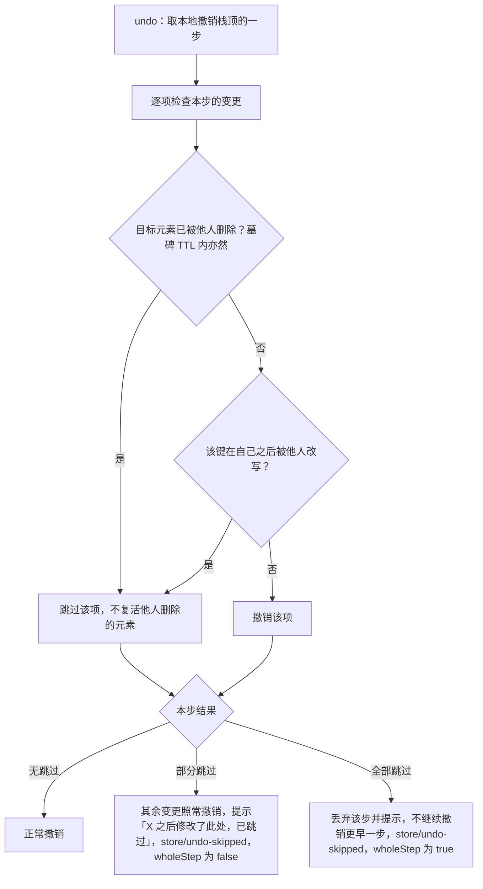
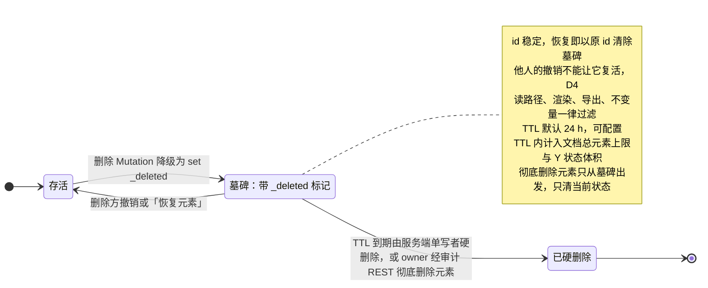

> 状态：已接受 | 负责：架构-运行时 | 更新：2026-09-24；2026-09-24 复核修正（rulings §4.17 D4/D5；复核报告 M3：契约用例名以 40-modules/02 §2.5 为准）；2026-09-25（补图）；2026-09-25（矛盾收口，rulings §4.18）；2026-09-25（§4.19：Yjs 14 升级 spike 时点随协同后端提前到 M2 开工前）；2026-09-26（§4.20）（TX-13：决策 1 精确锁版本的机械执行点 TD-079；TX-01+BE-10：U-07 链接 ADR-0038） | 依赖：charter v0.1；裁决 `docs/00-charter/rulings-2026-09-14.md` §4.15 Q3、§4.17、§4.18

# ADR-0020 CRDT 选型：Yjs（Loro 为已评估替代）

## 状态

**已接受**（2026-09-24，用户裁决 `00-charter/rulings-2026-09-14.md` §4.15 Q3；证据 `00-charter/_evidence/q1-q10-decision-pack.json` `results[10].decisions[2]`）。原状态「提议（默认值，用户可否决；章程 §6.2 / §10 Q3）」。本次接受同时新增「协同撤销语义」一节（见文末），并把 Loro 重评估条件改为可机械检验的阈值。2026-09-25 按 rulings §4.18 修订「协同撤销语义」第 3 条与图 2：删除 Mutation 降级为 `set _deleted`（CO-05），元素级「彻底删除元素」只从墓碑态出发（CO-07），均以「原：…作废」就地保留演进。

## 背景

- 章程 D5：协同模式下 CRDT 文档是唯一事实源；D4：Mutation 是唯一修改途径，逆操作由 Store 推导。
- 必须回答三件事：形状/页顺序的并发移动语义；富文本（Paragraph/Run）映射；WASM 体积与加载。
- 候选：**Yjs**（JS 实现，YATA；`yjs` 13.6.32 周下载约 612 万、`y-protocols` 1.0.7，均 MIT——2026-09 npm 实测；配套 y-protocols/y-websocket/y-indexeddb/y-prosemirror/Hocuspocus 成熟）与 **Loro**（Rust/WASM；Fugue 富文本、原生 movable tree/list、性能领先；生态年轻，JS 绑定与 provider 生态少）。
- 参考：`ChristopherVR/pptx-viewer` 已用 Yjs 做 pptx 协同雏形；Univer 协同为闭源 OT（A13），无可借鉴实现。

## 决策

1. 采用 **Yjs 13.6.x**（`yjs` + `y-protocols`），**lockfile 锁精确版本、不跟 dist-tag**（`@y/y` 14 的 `latest` 标签指向旧 rc.7，`lib0` 的 `latest` 仍为 0.2.x——实测陷阱），仅由 `@cordexjs/store-yjs` / `@cordexjs/collab-yjs` / `@cordexjs/server-collab` 引入（章程 §5.3 规则 4）。机械执行（2026-09-26，rulings §4.20 TX-13）：TD-079 `lockfile-guard` 断言 `pnpm-workspace.yaml#catalog` 中 `yjs`、`y-protocols` 为精确版本（不带 `^` 或 `~`）且 `yjs` 在 13.6.x 内。
2. **移动语义**：不用 `Y.Array` 的删除+插入，不等待未发布的 y-move；实体放 `Y.Map<id, Y.Map>`，顺序用实体属性上的 **fractional index**（ADR-0032）。并发移动 = 单键 LWW，无重复无丢失；跨父移动（进出组）= `parentId` LWW + 环修复规则（06 §8 #5）。
3. **富文本**：`Y.XmlFragment`（`
` 元素 + 带属性 `Y.XmlText`，embed 表示 br/fld/opaque），理由见 06 §1.4。
4. **Loro 作为已评估替代**：保持 `DocumentStore` 原语集（06 §1.2）与 CRDT 无关；如未来切换，新增 `@cordexjs/store-loro`/`@cordexjs/collab-loro` Provider，Definition 与 Consumer 不变（章程 §5.4「可替换为 store-loro」）。**重评估触发阈值**（满足任一即重评，均可机械检验）：① Loro 协同增量 wasm ≤ 200 KB gzip；② `loro-protocol` ≥ 1.0；③ store-loro 原型通过 `runDocumentStoreConformance`；④ Q5 规模上调（含文档总元素上限上调超过 20,000，rulings §4.15 Q5）。
5. **Yjs 14 升级 spike**：`@y/y` 14 GA 后、协同后端开工前（M2，rulings §4.19 D-M2-CONTENT 把协同后端从 M3 提前；原「M3 开工前」）做一次升级 spike（API 改名如 `ignoreRemoteMapChanges`→`ignoreRemoteAttributeChanges`、`lib0` v1、协议兼容）；章程 §5.3 规则 4 与 depcruise（server-app-thin 等）**预留** `@y/y`、`@y/protocols`、`lib0` v1，与 `yjs`/`y-protocols` 同受三包白名单约束。
6. **撤销语义写进中性契约**：不跟随任一 CRDT 库的默认行为，写入 `DocumentStore` 契约（字段名与 CRDT 无关），store-memory 与 store-yjs 同语义——详见文末「协同撤销语义」。

## 备选方案与放弃原因

| 方案 | 放弃原因 |
|---|---|
| Loro | 生态与生产验证不足（provider、IndexedDB 持久化、社区工具少）；wasm 约 1.07 MB gzip（2026-09 esbuild 实测）需异步加载并影响首屏；Rust 侧 bug 无法在 TS 内修复；团队技能。其 movable tree 对我们有吸引力，但 fractional index 已能满足 Q5 规模下的语义需求 |
| Automerge | 性能与体积历史上弱于 Yjs（wasm 约 1.14 MB gzip，实测）；富文本与 XML 结构支持晚于 Yjs；provider 生态更小 |
| 自研 OT（Univer 路线） | 需要服务端 transform 与全序，离线/多实例复杂；Univer 该部分闭源（A13）；违背「开放 Provider」原则 |
| Yjs + y-move | 未发布/不稳定 |

## 后果

正面：生产验证充分；y-protocols 让服务端逻辑简单（无 transform）；UndoManager 按 origin 满足 D4；RelativePosition 直接服务光标/评论锚点；y-prosemirror 等可复用。

负面 / 代价：
- Yjs 删除留下结构元数据（GC 后仍占空间）：需要 `cordex_ydoc_structs` 监控与 epoch 机制（06 §9.4）。
- 移动语义靠 fractional index 而非原生 move：需要键长治理（ADR-0032）与环修复。
- 富文本分段/合段是「删+插」：并发格式化落在被移动文本上会丢失（06 §8 #8）。
- `Y.snapshot` 需 `gc:false`，我们放弃它改用服务端完整状态快照（ADR-0025）。
- 切换到 Loro 的成本估计：store-yjs（~3–4k 行）与 collab-yjs（~2k 行）重写 + server-collab 持久化编码切换 + 全部 conformance/fuzz 复跑；Definition/Consumer/UI 不变。**触发重评估条件**：见决策 4 的四项阈值（2026-09-24 起取代原「Loro 发布 1.x 稳定 JS API 且有生产级 provider；或规模超过 Q5（≥ 1000 页、≥ 100 并发）」的定性表述；≥ 100 并发仍属④「Q5 规模上调」）。
- 软删除墓碑（见「协同撤销语义」）在 TTL 内仍占 Y 状态并计入 Q5 文档总元素上限（20,000，软警告 15,000）。

## 补充（v0.2）：有序实体的移动语义（`StoreOp` 无 `move`）、富文本映射结论、WASM 体积、CO-08 收敛表

> 回答架构 README A-1 / 04 §10「移动语义进 ADR-0020」与 PRD CO-08 的依赖。总编排最终裁决：`StoreOp` 为 5 原语 `set/delete/insert/remove/text`，**无 `move`**。

### A. 有序列表的并发移动（`StoreOp` 5 原语 `set/delete/insert/remove/text`，04 §2.3；移动 = `set` order 键）

| 列表 | Snapshot 形态（04，A-9） | store-memory | store-yjs（本 ADR） |
|---|---|---|---|
| 页序（`slides` 实体表） | 每 slide 实体保留 `order: FracKey`（ADR-0013 第 7 条，不转数组） | 同一键模型：按 `(order, id)` 排序的读视图；移动 = `set` order 键 | 键写入 Y.Map 单键 LWW（`set(slides/<id>/order, key)`，键由命令层算出）：一份实体、一个位置、全序 `(order, id)` |
| `grpSp.childIds` / spTree z 序 | `ShapeId[]` | 同上 | 子形状 `parentId` + `z: FracKey`；跨组移动 = `parentId` 写 + 新 `z`；父子环由修复规则消除 |
| `tbl.rows` / `row.cells` | 实体数组 | 同上 | `order` 键；并发插行/插列都保留 |
| `txBody.paragraphs` | 段落数组 | 同上 | `Y.XmlFragment` 子元素；段落移动 = `remove` + `insert`（唯一的删除+插入式移动，06 §18.1） |
| 原子数组（色标、路径命令、`gridCol`） | 值数组 | 整体替换 | 整体 `set`（LWW） |

**弃用 `move` 原语的原因**（总编排裁决）：有身份实体的顺序已由 `order: FracKey` 承载，移动只是 `set` 一个字段；原子数组的移动极少见且 `Y.Array` 无原生 move，`remove` + `insert` 即可，其并发重复的已知风险由幂等规则与 rekey 兜底。

并发结果矩阵（写进 `runDocumentStoreConformance` 协同分节；memory 与 yjs 在「双客户端同步」模式下结果必须相同）：
- 同一实体两处并发移动（`set` order）→ LWW（Yjs 时钟 + clientID），两端一致，无重复。
- 并发 `insert` 同一间隙 → 两者都在，顺序由 `(order, id)` 决定，两端一致。
- 移动（`set` order）与并发 `delete` 同一实体 → 删除胜。
- 移动（`set` order）与并发修改同一实体其他属性 → 都保留。
- 段落移动（`remove` + `insert`）与并发段落移动 → 可能两份同 `id` 段落 → 修复规则保留位置靠前者（确定性）。
- 键由命令层经 `@cordexjs/shared/order` 计算，Mutation 携带最终键，`lower()` 与 Store 都不解析下标，CRDT 不携带下标（06 I4；ADR-0032 第 7 条）。
- 协同分节新增两条用例：「并发同位插入按 `(order, id)` 全序一致」「rekey 后顺序不变」。

### B. 富文本映射结论

`TextBody` = `Y.XmlFragment`；每 `a:p` = `Y.XmlElement('p')`（段属性为元素属性）；段内 runs 折叠为一个 `Y.XmlText`，`rPr` 为属性区间，`a:br`/`a:fld`/未建模内容为 embed。04 的 `text` op（`TextDelta`，与 Y.Text delta 同形）作用于**段落级** `Y.XmlText`，memory/yjs 两端 delta 语义一致（契约套件断言）。放弃 `Y.Array<Y.Map>`（run 数组）：并发编辑同一 run 内字符无法合并，分裂 run 需删除+插入两个实体；放弃 `Y.Text + '\n' 携带段属性`：段属性寄生在换行字符上，分/合段时漂移。

### C. WASM 体积

Yjs：纯 JS，`yjs + y-protocols` 经 esbuild minify 后 ≈ 30 KB gzip（2026-09 实测；v0.1 估算 60–80 KB 作废），在 PRD NF-01 1.5「协同增量 ≤ 200 KB」内。Loro：wasm ≈ 1.07 MB gzip；Automerge：wasm ≈ 1.14 MB gzip（实测），需异步加载且须在首屏前完成初始化 → 超出协同增量预算，是放弃的量化理由之一，也是决策 4 阈值①的来源。

### D. PRD CO-08 逐行收敛结果

| CO-08 场景 | 原语层机制 | 收敛结果 | 提示来源（`collab/soft-conflict{type}`） |
|---|---|---|---|
| 同一文本框不同位置 | 段落 `Y.XmlText` YATA | 两处都保留 | – |
| 同一文本框同一位置 | YATA 以 clientID 定序 | 两段相邻、顺序确定、两端一致 | presence `caret`/`editing`（预防性「X 也在编辑」）；`text-same-pos` |
| A/B 同时移动同一形状 | `xfrm.off.*` 键级 LWW | 后写者胜 | 本地 60 s 内写过该键且被远端覆盖 → `prop-lww` + 「恢复我的值」（新事务，可审计、可再撤销；2026-09-24 起取代「撤销」按钮） |
| A 删元素，B 编辑其文本 | 软删除：删除 = 写 `_deleted` 墓碑，B 的编辑落在同一实体其他键 | 元素隐藏（删除胜），B 的编辑保留在墓碑内 | B 端 `removed ∩ 近期本地事务` → `delete-vs-edit` + 「恢复元素（含我的编辑）」= 清除墓碑的新事务，**原 id 不变**（2026-09-24 起取代「新 id 事务」） |
| A 删页，B 在页内新增 | delete-wins | 删除胜 | 同上，粒度为页 |
| 两人同时重排页 | 每页 `order` 键 LWW | 无重复无丢页；顺序确定 | 缩略图栏动画；`reorder` |
| A 组合，B 编辑子元素 | 组合 = 新 grpSp 实体 + 子 `parentId` 写；B 改子元素其他键 | 两者都保留 | – |
| A 取消组合，B 移动组合 | 取消 = 删 grpSp + 子 `parentId=null` + 组变换烤进子 `xfrm`；B 写已删 grpSp 的 `xfrm` 落空 | 取消组合胜；子元素保持视觉位置 | – |
| 同页版式并发更换 | `layoutId` LWW | 后写者胜 | `prop-lww` |
| A 解决线程，B 回复 | 评论为 ResourceHook 实体（ADR-0031 v0.2）：`resolved` 键与新回复实体独立 | 回复保留且线程已解决 | 面板「已解决线程有新回复」 |
| 同时插入图片 | 媒体内容寻址（sha256）；部件名在导出时由 MediaId 生成 | 不会同名 | – |

## 补充（2026-09-24，rulings §4.15 Q3）：协同撤销语义（DocumentStore 中性契约）

> 背景：实测 yjs 13.6.32 的 UndoManager 默认不覆盖他人对同一键的后写，但一整步被跳过时会**连带撤销更早一步**（撤销栈 2 → 0，`undo-cascade.mjs`）；「以新 id 恢复」与删除方撤销并发会产生重复元素，「以原 id 复活」是整实体 LWW、按 clientID 丢编辑，只有软删除零丢失零重复（`resurrect-flip.mjs`、`softdelete-y.mjs`）。此前 06 §8 #10、PRD 07:465（覆盖他人）、05-command-and-history §13.4（双方均可撤销自己的部分）、设计 05 §6（撤销永远安全）四方矛盾，以本节为准。

1. **同一键被他人后写 → 跳过并提示**：撤销时若自己改过的某键已被他人随后改写，跳过该键，本步其余变更照常撤销，提示「X 之后修改了此处，已跳过」。契约字段为中性名 `undo.remoteConflict: 'skip'`（不把 Yjs 的 `ignoreRemoteMapChanges` 之类开关名写进契约——该名在 v14 已改）。CO-08 `prop-lww` 提示条上的动作改为显式命令「恢复我的值」：一个新事务，可审计、可再撤销。
2. **整步被跳过 → 停下，不连撤**：一步内全部变更都被跳过（目标已被他人删除，或全部键被覆盖）时，丢弃该步并提示，**不继续撤销更早一步**。由 store-yjs 包装 UndoManager 实现，发出 `store/undo-skipped` 事件（载荷 `{ skipped: UndoSkip[]; wholeStep: boolean }`，以 40-modules/02 §2.4 为准）；store-memory 同语义。**埋点单独统计**（2026-09-24 复核修正，rulings §4.17 D5）：`store/undo-skipped` 单列跳过次数与整步跳过次数，**不计入软冲突率**。
   - **目标被他人删除（墓碑 TTL 内亦然）→ 跳过并提示，不看 TTL**（2026-09-24 复核修正，rulings §4.17 D4）：撤销**永不复活他人删除的元素**；该元素的恢复只能由删除方撤销自己的删除，或由任一有权限者执行显式命令「恢复元素」（新事务）完成。
3. **删除改为软删除墓碑 + TTL 硬删除**：删除 Mutation 降级为 `set _deleted`——文档类型的 `lower()` 产出 `set(<实体路径>/_deleted, {at, by})`，逆操作由 Store 推导为 `delete(<实体路径>/_deleted)`；**实体键的 `delete` 只由服务端 TTL 硬删除（origin `system('maintenance')`）、文档擦除与经审计的「彻底删除元素」产生**（`StoreOp` 仍为 5 原语，不新增 op；ADR-0013 的 delete 语义随之改为「`_deleted` 标记 + TTL 硬删除 + 读路径过滤 + 不变量」）。（2026-09-25 修订，rulings §4.18 CO-05：以架构 04 §3.1a、40-modules/02 §2.1 与 40-modules/03 为准；原：「`delete` 在 store 层落为 `_deleted` 标记」，可读作 `lower()` 仍产出实体键 `delete`、由 Provider 解释为墓碑，作废。）读路径、渲染、导出、不变量一律过滤墓碑；**id 稳定**，恢复 = 清除墓碑（仅限删除方撤销自己的删除或显式「恢复元素」命令，见第 2 条 D4 子项）。服务端单写者在 **TTL（默认 24 h，可配置）** 到期后硬删除（server-collab 墓碑硬删除作业）。
   - 墓碑在 TTL 内计入 Q5 文档总元素上限与 Y 状态体积；TTL 内被删内容仍会同步给后加入者（含查看者），相关访问写审计。
   - **文档擦除（S-2 purge，文档级操作改称「永久删除文档」）与「彻底删除元素」不等 TTL**，直接硬删除。「彻底删除元素」（2026-09-25 修订，rulings §4.18 CO-07）只对**已是墓碑**的元素开放、只能由 owner 经审计 REST（`POST /documents/:id/elements/purge{ids}`）发起，由 M-09 单写者复用墓碑硬删除事务立即执行，写审计 `document.element_purged`；它只清当前文档状态，历史快照与 update 表仍按保留期存在（界面明示「历史版本仍含该内容，要连历史清除请永久删除文档」）；删除方此后撤销该步按整步跳过（`wholeStep:true`，与 TTL 到期同一路径）。（原：「文档擦除（S-2 purge）与『立即彻底删除』不等 TTL」，同一术语混指文档级与元素级，且元素级可从存活态直接硬删，作废。）
   - 设计 02/05「不复用原 id」与 PRD CO-08 的恢复措辞随之改写（由对应文档回写）。
4. U-07 version-restore-undo 以本节为基线，**不采用** Loro 式 `revertTo`（它绕过 D4 的 Mutation 唯一入口）。2026-09-26 立项为 [ADR-0038](./0038-version-restore-undo.md)（提议，rulings §4.20 TX-01+BE-10）。
5. S-3 溢写期的两级 ack 与 CRDT 选型无关，单列为 S-3a，见 ADR-0025。

**图 1 撤销一步时的跳过判定**

怎么读：上半部是对每一项变更的判定，下半部是整步的结局。三种结局在 store-memory 与 store-yjs 上必须相同；`store/undo-skipped` 单独统计跳过次数与整步跳过次数，不计入软冲突率（D5）。被跳过的键如要找回，走「恢复我的值」或「恢复元素」这类新事务，不是撤销的延续。

依据：本节第 1–2 条；`wholeStep` 取值见 40-modules/02 §2.5 用例 `remote-conflict-skip`、`undo-skip-no-cascade`。

**图 2 实体的软删除墓碑生命周期**

怎么读：方框是一个有身份实体在 store 层的状态，箭头上写触发条件。只有「墓碑 → 存活」这一条能恢复实体，且只允许删除方撤销或显式「恢复元素」；进入「已硬删除」后不可恢复。进入「已硬删除」只能从墓碑出发，触发有两种：TTL 到期，或 owner 对墓碑态元素的「彻底删除元素」。S-2 文档擦除是整文档清除、不是单个实体的状态迁移，图中不画（2026-09-25 修订，rulings §4.18 CO-05/CO-07；原图有「存活 → 已硬删除：S-2 擦除或『立即彻底删除』」一条边，边标签「delete 落为 _deleted」，作废）。

契约用例（`runDocumentStoreConformance` 协同分节，memory 与 yjs 必须同结果；**用例名以 40-modules/02 §2.5 为唯一事实源**，此处照抄，2026-09-24 复核修正）：`remote-conflict-skip`、`undo-skip-no-cascade`、`soft-delete-tombstone`（软删除后 id 稳定、删除方撤销即以原 id 恢复）、`delete-vs-edit-undo`（删除方撤销与他人「恢复元素」并发 → 仍只有一份、编辑不丢；他人撤销时目标已被删除 → 整步跳过、不复活，D4）、`read-path-filters-tombstone`。（原：`soft-delete-restore-same-id`、`delete-vs-edit-no-dup`、`tombstone-filtered-on-read`，作废。）

## 如何被机械验证

- `dependency-cruiser`：`yjs`/`y-protocols`/`lib0` 只允许出现在三包（09-03）。
- api-extractor：`@cordexjs/store-yjs` 与 `@cordexjs/collab-yjs` 公共 API 不含 `Y.*` 类型（Consumer 与 CRDT 解耦的证据）。
- `runDocumentStoreConformance` 对 store-memory 与 store-yjs 都通过（Provider 可替换的证据）。
- collab-sim fuzz（11 §8）：随机移动/进出组/分段在乱序网络下收敛、无环、无重复。
- 版本锁（2026-09-24）：`pnpm-lock.yaml` 中 `yjs` 为精确 13.6.x 版本，`package.json`/catalog 不得使用 dist-tag 或 `@y/y` 的 rc 标签（lockfile-guard 附加断言）。
- 撤销语义（2026-09-24）：上节契约用例对 store-memory 与 store-yjs 都通过；fuzz 增加「删除 vs 编辑 × 删除方撤销」随机场景，断言零重复、零丢失；墓碑硬删除作业的集成测试断言 TTL 到期后 Y 状态中无残留实体、purge 路径不等 TTL。
- （2026-09-25，rulings §4.18）`soft-delete-tombstone` 用例补断言「用户删除的降级结果中没有实体键的 `delete`」（CO-05）；「彻底删除元素」只接受墓碑态、限 owner，执行后删除方撤销该步得 `wholeStep:true`（CO-07，归入 40-modules/02 §2.5 用例 `undo-skip-no-cascade` 的「目标实体已被硬删除」分支）。

## 关联

章程 D4/D5、§5.4、§10 Q3；`00-charter/rulings-2026-09-14.md` §4.15 Q3/Q5/S-3a、§4.18 CO-05/CO-07；Univer K1、A13、A31；ADR-0013、0032、0025、0024、0033；架构 05 §6/§13.4、06 §8；PRD CO-07/08/09。
