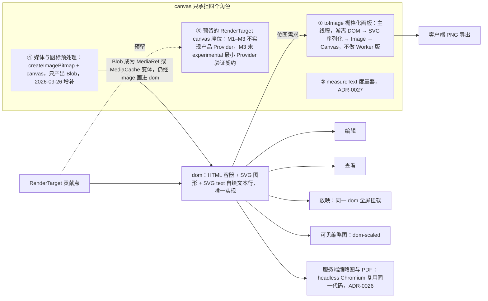
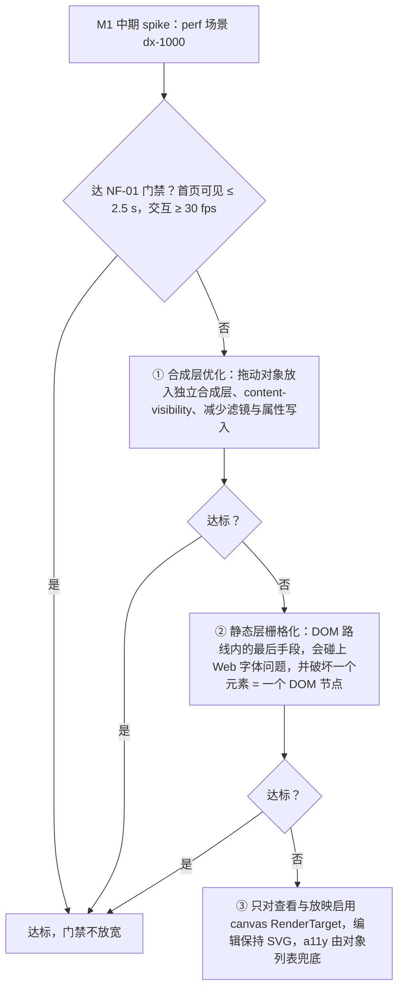
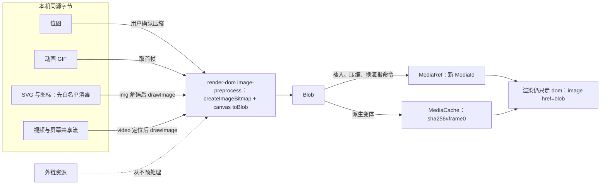

> 状态：已接受 | 负责：架构-运行时 | 更新：2026-09-24；2026-09-25（补图）；2026-09-25（矛盾收口，rulings §4.18）；2026-09-26（§4.21：canvas 补第 ④ 角色「媒体与图标预处理」，仍禁 foreignObject，公式 M4+ 走 MathJax SVG）；2026-09-26（§4.21 整合：第 ④ 角色覆盖「来自 URL」图片的 CORS 转码路径（50/14 §5）） | 依赖：charter v0.1；裁决 `docs/00-charter/rulings-2026-09-14.md` §4.15 Q4、§4.18 CO-01、§4.21（q-extra-inserts、q-equation；R-d-23）

# ADR-0021 渲染介质：DOM/SVG 单实现，Canvas 仅作栅格化/度量/预留 RenderTarget

## 状态

**已接受**（2026-09-24，用户裁决 `00-charter/rulings-2026-09-14.md` §4.15 Q4：DOM/SVG 单实现）。原状态「提议（默认值；章程 §2.3、§6.2、§10 Q4）」。标题由「DOM/SVG 优先，Canvas 为可选 RenderTarget」收紧为单实现；决策 2 与后果中「canvas 作缩略图/放映应急路径」的表述被下方「2026-09-24 修订」取代。2026-09-26 按 rulings §4.21 增补 canvas 第 ④ 角色「媒体与图标预处理」并写明公式 M4+ 的渲染路线（见下方「2026-09-26 修订」），单实现口径不变。

## 背景

- 需要：高保真、任意缩放清晰、IME/a11y、插件易于贡献新元素渲染、可测试（DOM 可断言）、服务端可复用同一代码生成缩略图。
- 先例：Google Slides（DOM/SVG）、pptx-viewer（CSS/DOM）、pptx-renderer（HTML/SVG，以 PowerPoint 为 oracle）；Univer 是 Canvas 引擎且引擎内混入产品组件（A1/A5）。
- 规模：Q5 ≤ 200 页；单页元素通常 ≤ 100，极端 ≤ 1,000；文档总元素天花板 20,000（rulings §4.15 Q5）。虚拟化后单页编辑挂载 ≤ 3 页、连续滚动 ≤ 6 页、缩略图 ≤ 12 个，风险来自单页 1,000 元素（DX-1000）而非页数。

## 决策

1. 主画布：**SVG 图形 + 自绘文本行（SVG `<text>`）**，容器为 HTML；坐标单位 px@96dpi（EMU/9525），缩放用容器 `transform`。
2. `RenderTarget` 是贡献点；`dom`（HTML+SVG）为**唯一实现**：编辑、查看、放映、服务端缩略图与 PDF 共用同一套 SVG 渲染。canvas 只承担四个角色：① `toImage` 的栅格化画板；② `measureText` 度量器（ADR-0027）；③ 预留的 `RenderTarget('canvas')` 座位（M1–M3 不实现产品 Provider）；④ 媒体与图标预处理（只处理媒体字节、只产出 Blob，2026-09-26 增补，见下方修订；原「三个角色」口径作废）。~~缩略图/放映可走 canvas~~（2026-09-24 删去）。
3. 文本编辑宿主与文本排版策略分别由 ADR-0028、ADR-0027 决定（均与介质选择耦合：自绘文本行需要自有断行）。
4. 虚拟化：只挂载可见页（± 1）；缩略图独立 Provider（07 §8）：可见缩略图 `dom-scaled`；位图走**主线程** `toImage`（游离 DOM → SVG 序列化 → Image → Canvas），**不做 Worker 版本**（SVG 无法在 Worker 中解码）。显式推翻 14 §5.4 对 offscreen-canvas Provider 的采纳（M-07/G-2）。

**图 1 dom 唯一实现与 canvas 的三个角色**

怎么读：实线是当前实际走的渲染路径，全部落在同一个 `dom` 实现上；虚线是只留座位、不交付产品 Provider 的 canvas RenderTarget。canvas RenderTarget 不出现在任何编辑、查看、放映或缩略图的主路径上（2026-09-24 删去「缩略图/放映可走 canvas」）；canvas 在主路径上只以 `toImage` 栅格化画板和 `measureText` 度量器的身份出现；④ 预处理在渲染管线之外，它的产物是媒体字节，最终仍以 `<image>` 由 `dom` 画出（2026-09-26 增补）。

## 备选方案与放弃原因

| 方案 | 放弃原因 |
|---|---|
| Canvas 优先（Univer/Figma 路线） | 需要自研文本光栅化、命中测试、a11y 树、IME 宿主、高 DPI 与缩放重绘管理；插件贡献门槛高（需了解绘制 API 而非产出节点）；测试只能像素比较；章程 §2.3 明确非目标 |
| HTML/CSS 文本（浏览器排版）+ SVG 图形 | 浏览器排版与 PowerPoint 语义（autofit/anchor/多栏/禁则）不一致；行模型不可读取导致命中/光标/缩略图不一致（详见 ADR-0027） |
| WebGL/WebGPU | 过度设计；文本与 a11y 问题同 Canvas 且更甚 |
| `foreignObject` 承载 HTML 文本 | Safari 稳定性问题；与 SVG 滤镜/裁切交互差；截图路径（headless）中 foreignObject 有已知渲染差异；（2026-09-26 重申）公式渲染同样不走 foreignObject，temml、KaTeX 因此否决，见下方修订第 4 条 |

## 后果

正面：清晰缩放；DOM 可检查可测试；插件写 SVG 节点即可；服务端 headless Chromium 复用同一代码（ADR-0026）；a11y 有挂点。

负面 / 代价：
- 极端页面（≥ 1,000 元素）SVG 性能下降：缓解为虚拟化 + 帧时间切片（07 §2.2），不达标时按下方「DX-1000 回退规则」处理；预算口径统一见下方修订（原「首帧 ≤ 200 ms」改为引擎内部分解目标，对外门禁以 DX-1000 为准）。
- SVG 滤镜（阴影/发光/3D）保真有限：M1–M3 按章程 Q7 「保留不编辑」，用近似或位图回退。
- 文本需自有断行（ADR-0027）。

## 补充（v0.2）：PRD NF-01 与 02 契约的对齐

- 契约签名以 02 §4.14–4.16 为准（`Scene/SceneNode/SceneProvider/RenderTarget/ElementRenderer`），本 ADR 只决定介质；术语对照见 07 §14.1。
- 极端页面门禁（PRD）：DX-1000（1 页 1,000 形状）首页可见 ≤ 2.5 s、交互 ≥ 30 fps；DX-DEEP（组合嵌套 8 层）无额外预算但走同一虚拟化/时间切片路径；SVG 路线在 RM-A 上满足这些值是本 ADR 的量化前提，perf 场景 `dx-1000` 持续验证；不满足时按下方「DX-1000 回退规则」处理（2026-09-24 起取代「应急路径是 canvas RenderTarget」）。
- 体积门禁（PRD 1.5）：查看器 preset ≤ 350 KB gzip；SVG 路线无第三方绘制库，`render-dom + slide-render` 目标 ≤ 120 KB；图表渲染拆为 `@cordexjs/slide-render-chart`（S6 已批准）惰性加载 ≤ 400 KB。
- 客户端 PNG 导出走 `RenderTarget.toImage`（SVG 序列化 → Image → Canvas），预算单页 ≤ 300 ms @1920；需内联媒体为 data URI。

## 修订（2026-09-24，rulings §4.15 Q4）：单实现口径、回退规则、canvas 契约验证、安全基线

1. **首帧预算统一**：对外门禁只有 DX-1000「首页可见 ≤ 2.5 s、交互 ≥ 30 fps」（PRD NF-01）；原「1,000 元素页首帧 ≤ 200 ms」降为引擎内部的分解目标（场景构建 + 首次挂载），不作独立门禁，避免两套口径。
2. **DX-1000 回退规则**（M1 中期 spike 不达标时，按序执行）：① 先做合成层优化——拖动对象放入独立合成层、`content-visibility`、减少滤镜与属性写入；② 仍不达标，再考虑静态层栅格化（这是 SVG/DOM 路线内的最后手段：会碰上 Web 字体问题，并破坏「一个元素 = 一个 DOM 节点」）；（2026-09-25 修订，rulings §4.18 CO-01：顺序按「按序执行」与图 2 定为 ① → ② → ③，② 是 DOM 路线内的最后手段、排在 canvas 之前；原：「② 静态层栅格化放到最后才考虑」，字面可读成排在 ③ 之后，作废；07 §1 把静态层栅格缓存并进 ① 的写法同时作废）③ 仍不达标时，**只对查看与放映**启用 canvas RenderTarget，编辑保持 SVG，a11y 由对象列表兜底。门禁不放宽（Q5 两层口径：性能包络只收紧）。
3. **放映与缩略图口径**：放映 = 同一 `dom` RenderTarget 全屏挂载；可见缩略图 = `dom-scaled`；位图（封面、批量 PNG）= 主线程 `toImage`。`toImage` 用不到页面 Web 字体（SVG 作为图像加载不读 FontFace，CJK 尤甚，二手资料待实测）列为 **M2 位图 spike**；结论出来前，位图封面与批量 PNG 从 M3 起走 `server-png`（ADR-0026），M2 列表封面取包内 `docProps/thumbnail.jpeg`。07 §14.6「导出在 Worker」作废，改为主线程分片或 server-png。
4. **M3 末最小 canvas Provider 验证**：在 experimental 包里实现最小 canvas Provider（fixture 元素 + rect/path/text），跑 `runRenderTargetConformance`，检验 `render.overlay` 的 `mount(ctx, target)`、宿主 `mount(container)`/`createSurface(host)`、`TextInputHost` 等处的 DOM 偏置；通过后 `render.target` 才能在 M4 转 Stable。与 Q2 的 `UiRenderer('vanilla')` 同一规则（契约须有第二实现验证）。
5. **客户端安全基线**（DOM 路线最大的代价是不可信 pptx 内容进入活动 DOM）：文档内 SVG（`asvg:svgBlip`）**只以图像上下文渲染**（`<image>`/``，不执行脚本、不加载外链），禁止内联 SVG 标记；`render-dom` 与 `slide-render` 禁止用 `innerHTML`/`insertAdjacentHTML`/`DOMParser` 注入文档内容；超链接协议白名单在渲染层再校验一次。EM-14 客户端 SVG 处理归属渲染层（M-07），与 Q2 的 CSP nonce / Trusted Types、Q7 的 `externalResources` 合成一份客户端安全基线。
6. **IME 与介质无关**：IME 由 ADR-0028 隐藏 textarea 承担，设计 07 §4 把 IME 对齐归功于 DOM 文本节点的说法需更正（由设计线回写）。

**图 2 DX-1000 回退规则**

怎么读：自上而下按序执行，每一步后都用同一门禁复测，达标即停；② 是 SVG/DOM 路线内的最后手段，排在 ③ canvas 之前（2026-09-25 修订节点措辞，rulings §4.18 CO-01；原节点「放到最后才考虑」作废）；任何分支都不放宽门禁，③ 也不改变编辑态的 SVG 实现。

## 修订（2026-09-26，rulings §4.21）：canvas 第 ④ 角色「媒体与图标预处理」与公式渲染路线

1. **第 ④ 角色**（q-extra-inserts 推荐项、R-d-23）：决策 2 原有三个角色之外，canvas 另可用于**只处理媒体字节**的预处理——
   - 图片压缩：大于 4096 px 的位图经用户确认后缩到 ≤ 2048 px 重编码（PRD ED-07 P1）；
   - GIF 首帧：编辑态、缩略图与 `/render` 显示静止首帧，放映才播放动画（PRD OF §2.5）；
   - SVG 与图标的 PNG 回退：插入 SVG（P1）与图标（M3 P2）时生成 `a:blip` 所需的 PNG（`asvg:svgBlip` 的兼容回退）；
   - 海报帧与截图取帧：插入视频的海报（P2）、「取当前帧」（P2）、屏幕截图（M4+ P2）。
   - 来自 URL 的图片转码（PRD ED-07「插入 › 图片 › 来自 URL」，取数路径以 [50/14](../../50-frontend/14-client-security.md) §5 为准）：只接受 `https:`，`` 加载、受 `img-src` 约束；加载成功后经 `createImageBitmap` + canvas 转码为本机字节，再走本地文件插入路径。对方不给 CORS 时提示「先保存到本地再插入」，不回退为外链引用；`externalResources = never` 时入口置灰；SVG 与 GIF 经此路径转码后丢失矢量与动画（界面提示）。

   实现只用浏览器原生能力：`createImageBitmap`（`resizeQuality: 'high'`）+ canvas `toBlob`；SVG 经 `` 解码后 `drawImage`，视频经 `<video>` 定位到目标帧后 `drawImage`。单点落在 render-dom `infrastructure/media/image-preprocess.ts`（运行时细则见 [50/05](../../50-frontend/05-rendering-and-thumbnails.md) §8.3，元素用法见 [50/23](../../50-frontend/23-elements-media.md)）。不引 pica（默认起 `blob:` Worker，违反 CSP）与 sharp（原生依赖，已否）。
2. **第 ④ 角色的边界**：产物只是 `Blob`——交给插入、压缩、换海报等命令成为新的 `MediaRef`，或作为 MediaCache 的派生变体（如 `sha256#frame0`）；从不绘制幻灯片内容，不进入 Scene，也不是 `RenderTarget`，所以「DOM/SVG 单实现」不变：编辑、查看、放映、缩略图与 `/render` 仍只有 SVG 一条渲染路径，预处理的产物最终也以 `<image href="blob:…">` 画出。只处理本机字节，以及用户经「来自 URL」主动插入、且对方以 CORS 放行的 `https:` 图片（`crossorigin="anonymous"` 加载不会污染 canvas，未放行则不转码、改为提示保存到本地）；文档里已有的外链资源（`r:link`）从不预处理（跨源会污染 canvas，也会发网络请求）；单次输出 ≤ 16,777,216 像素（PRD OF-24 位图预览上限）。SVG 要先经白名单消毒再栅格化，消毒去掉 `foreignObject` 后 canvas 不会被污染。标题里的「栅格化」自本修订起同时涵盖页面栅格化（①）与媒体预处理（④），标题不改，以免 ADR 索引与引用失配。
3. **仍然禁止**：`foreignObject` 承载 HTML（备选方案表的放弃理由不变）；Worker / OffscreenCanvas 版的 `toImage`（决策 4）；产品级 canvas `RenderTarget`（DX-1000 回退第 ③ 步之外）；用 canvas 绘制任何幻灯片内容。
4. **公式渲染路线**（M4+，q-equation 推荐项）：公式（OMML）M1–M3 显示 `mc:Fallback` 图片；M4+ 基于 `@cordexjs/xml` 的保真树自研 OMML ↔ MathML 转换，渲染用 MathJax 4 输出 **SVG**，惰性加载，并以图像上下文 `<image href="blob:…">` 画进元素节点（与修订 5 的文档内 SVG 规则同口径），不内联 SVG 标记、不走 `foreignObject`。temml、KaTeX 需要 `foreignObject` 承载 HTML，据本 ADR 否决；MathJax 字体数据（派生自 GUST 许可字体）的许可待核，按 [ADR-0049](./0049-dependency-admission-and-license-tiers.md) 登记。

**图 3 canvas 第 ④ 角色：媒体与图标预处理**

怎么读：左侧四类本机字节进入同一个预处理单点，产出的只是 `Blob`；右侧两条去路都回到 DOM/SVG 渲染，canvas 不出现在任何渲染路径上；虚线表示外链资源被明确排除在外。

## 如何被机械验证

- 视觉 oracle（11 §7）门禁类别通过。
- 性能基准（11 §9）：`drag-fps`、`zoom-fps`、`open-200p` 达预算。
- `render.target` 贡献点存在且 `runRenderTargetConformance` 对 `dom` 通过；M1 验收「render-dom 可被 no-op Provider 替换后仍启动」由 e2e 断言。
- lint：engine-render/render-dom/slide-render 内禁止 `ctx.waterfall`（A30）。
- （2026-09-24）perf 场景 `dx-1000` 达 NF-01 门禁；M3 末 experimental canvas Provider 通过 `runRenderTargetConformance`（`render.target` 转 Stable 的前置条件）。
- （2026-09-24）09-type-discipline/08 矩阵新增 TD + 40-modules/01 扫描器：`render-dom`/`slide-render` 内禁止 `innerHTML`/`insertAdjacentHTML`/`DOMParser` 注入文档内容；`asvg:svgBlip` 只能经 `<image>` 渲染。
- （2026-09-24）仓库内不存在 offscreen-canvas / Worker 版 `toImage` Provider（depcruise 或扫描器断言）。
- （2026-09-26）扫描器：`getContext`、`OffscreenCanvas`、`drawImage`、`createImageBitmap` 只允许出现在 `to-image.ts`、`canvas-measurer.ts`、`media/image-preprocess.ts` 与 canvas 契约测试四处；`image-preprocess.ts` 的导出函数只返回 `Blob` 或尺寸数值，不接收 Scene 或 DOM 节点（类型测试）；render-dom、slide-render 内不出现 `foreignObject`（含 M4+ 公式渲染器）。

## 关联

章程 §2.3、§6.2、Q4、Q8；`00-charter/rulings-2026-09-14.md` §4.15 Q4/Q5/Q7、§4.21（q-extra-inserts、q-equation）；Univer A1/A4/A5/A28/A30；ADR-0026/0027/0028、ADR-0049；架构 07（§8/§14.6）、14 §5.4（offscreen-canvas 采纳被推翻）；50/05 §1、§8.3；50/23；PRD NF-01、EM-14、ED-07、OF §2.5。
