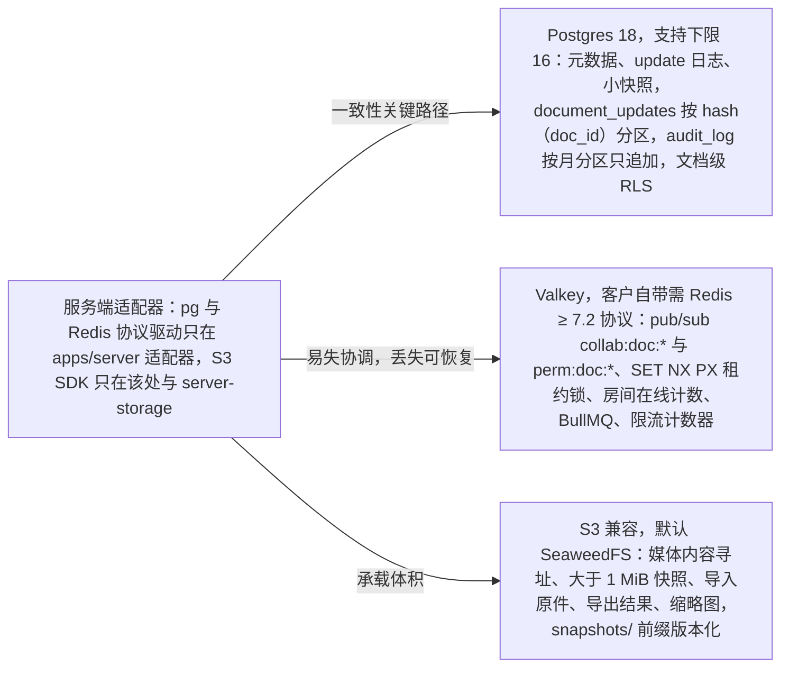
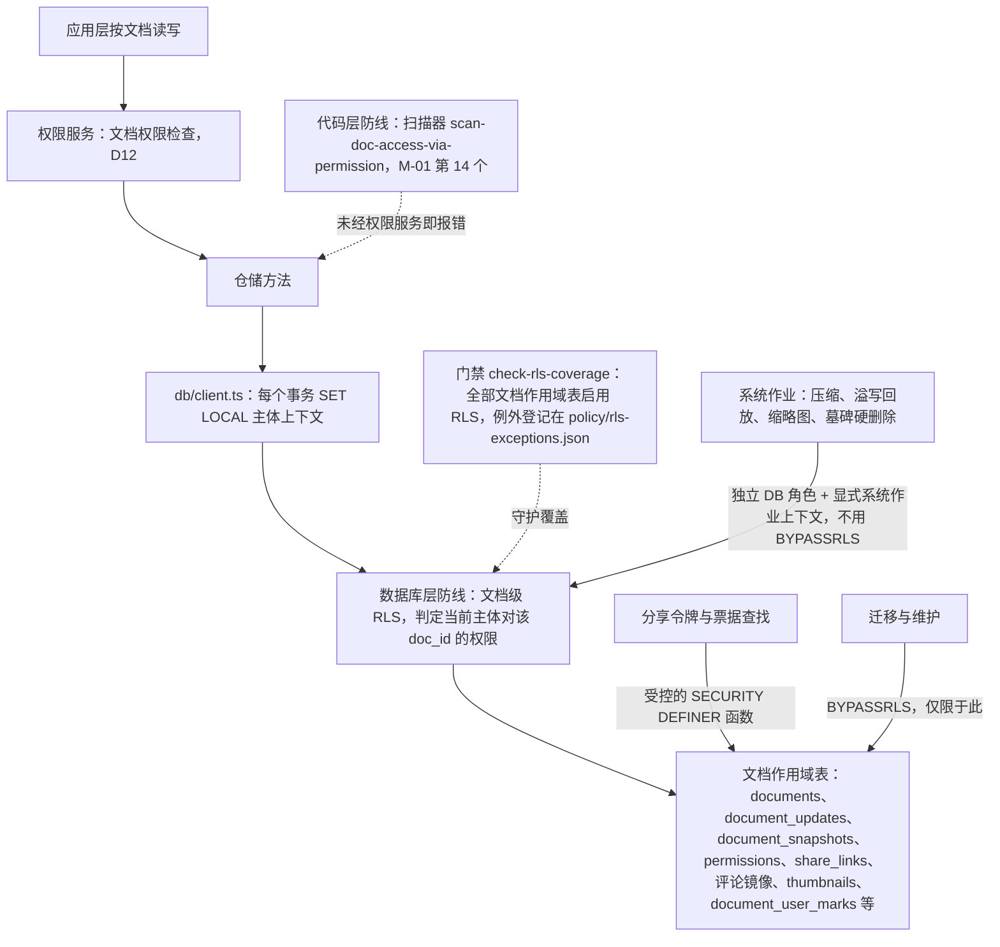

> 状态：已接受 | 负责：架构-运行时 | 更新：2026-09-24；2026-09-24 复核修正（rulings §4.17 D3；复核报告 M11：门禁名 `check-rls-coverage`）；2026-09-25（补图）；2026-09-25（矛盾收口，rulings §4.18） | 依赖：charter v0.1；裁决 `docs/00-charter/rulings-2026-09-14.md` §4.15 T-0/Q6/Q10、§4.17、§4.18

# ADR-0022 服务端存储栈：Postgres 18 + Redis 协议（默认 Valkey）+ S3 兼容对象存储（默认 SeaweedFS）

## 状态

**已接受**（2026-09-24，用户裁决 `00-charter/rulings-2026-09-14.md` §4.15 Q10；同时按 T-0 单组织去租户、Q6 文档级 RLS 修订）。原状态「提议（默认值；章程 §6.2 ADR-0022、§10 Q10）」。组件版本与许可门禁见 ADR-0037。

## 背景

需要存放：元数据（用户/文档/权限/评论/审计；**单组织部署，无租户实体**——T-0）、CRDT update 追加日志与快照、媒体二进制、缩略图、导入导出文件；需要跨实例扇出与租约锁；部署形态为集成方自托管 docker-compose（M1–M5，不自营 SaaS），Helm 为 M4 P1（Q10、ADR-0037）。

## 决策

| 关注点 | 选择 | 用法 |
|---|---|---|
| 元数据 + update 日志 + 小快照 | **Postgres 18**（compose 默认；支持下限 16——uuid v7 在应用层生成，不依赖 PG 18 原生 `uuidv7()`） | 关系表（08 §5）；`document_updates` 按 `hash(doc_id)` 分区；`audit_log` 按月分区、只追加；**文档级 RLS**（见下方修订） |
| 扇出 / 通知 / 锁 / 队列 | **Valkey**（compose 默认，钉到次版本，BSD-3；客户自带时声明兼容 **Redis ≥ 7.2 协议**） | pub/sub（`collab:doc:*`、`perm:doc:*`）、`SET NX PX` 租约锁（fencing token）、房间在线计数、BullMQ、限流计数器 |
| 二进制 | **S3 兼容**（compose 默认 **SeaweedFS**，Apache-2.0；生产推荐客户自有 S3） | 媒体内容寻址、> 1 MiB 快照、导入原件、导出结果、缩略图（08 §6）；保留 `snapshots/` 前缀的版本化（满足 SV-09 备份） |
| ORM | Drizzle（草案，待决 B1） | SQL 可见、无运行时代码生成 |

快照与 update 的追加/压缩细则见 ADR-0025；多实例一致性见 ADR-0035；备份/回放见下「后果」。

**图 1 存储栈三件套与数据落点**

怎么读：箭头从应用指向三类存储，箭头上写各自承担的角色。只有 Postgres 在一致性关键路径上；Valkey 丢失只影响扇出与协调、可恢复；对象存储只放体积大的二进制。表结构与对象存储键中都不出现 `tenant_id`（T-0）。驱动的放行范围见下方「如何被机械验证」最后一条与章程 §5.3 规则 4。

## 备选方案与放弃原因

| 方案 | 放弃原因 |
|---|---|
| MongoDB / DynamoDB 存 update | 无需文档型灵活 schema；关系与事务（seq 分配与 head_seq 同事务）在 PG 更直接；团队与运维栈统一 |
| Kafka 作为 update 日志 | 增加一套基础设施；我们需要按 doc 随机读（bootstrap）而非流消费；Q5 规模 PG 足够 |
| y-leveldb / y-redis / Hocuspocus 内置存储 | 与 Nest 壳、元数据、审计与权限分离；y-redis 的架构（Redis 为主存）与我们「PG 为持久层」冲突 |
| 只存最新状态（无 update 日志） | 丢失崩溃窗口内的持久化粒度与审计回放能力；ack 语义无法精确 |
| 媒体入 PG（bytea） | 体积（Q5 单文件 200 MB）与备份成本；CDN/预签名不可用 |

## 后果

正面：单一关系库承载一致性关键路径；对象存储承载体积；Redis 协议层（Valkey）只做易失协调（丢失可恢复）；三者默认实现均为宽松许可，满足 D13 镜像口径（ADR-0037）。

负面 / 代价：
- 三套基础设施（compose 中一并提供）；Valkey 故障时跨实例扇出延迟（ADR-0035）。
- **备份/回放**：PG 逐日基础备份 + WAL 归档（PITR）；对象存储版本化仅 `snapshots/`（S-2 擦除收尾 `finalize-purge` 须用 `ListObjectVersions` 加按 `versionId` 删除清掉该文档前缀下的全部对象版本，版本化不得留下历史残余，rulings §4.18 BE-15）；「按时间点恢复某文档」= 取 ≤ T 的最新快照 + `document_updates`（保留 7 天）重放，超出 7 天只能回到自动/命名快照粒度（P2 待决）。
- `document_updates` 写放大：批量 INSERT（100 ms/50 条）；bytea EXTERNAL 存储。
- 容量估算（Q5）：活跃文档每日 update ≈ 20 编辑者 × 2 h × 10 update/s × 100 B ≈ 150 MB/天/热文档（压缩后 ≈ 30 MB）；7 天保留 + 压缩后快照 ≈ 每热文档 < 300 MB；配额与裁剪任务保证上限。

## 补充（v0.2）：PRD NF-10 容量目标与 EM-04 的承接

- M3 容量目标（NF-10）：全系统并发编辑者 5,000、活跃文档 2,000、文档总量 100 万；网关无状态 + Redis 扇出横向扩展（ADR-0035）；`document_updates` 按 `hash(doc_id)` 16 分区、`audit_log` 按月分区支撑 100 万文档；单文档 update 日志**压缩后 ≤ 10 × 快照大小**（ADR-0025 补充）。
- 每实例导入/导出并发默认 4（作业 worker 水平扩展）；配额与噪声邻居限流（SV-08）改为**部署级配置 + 按用户/按文档令牌桶**（T-0 去租户，原 `TenantsModule.quotas` 作废）；规模数字部署配置完全可调（Q5）。
- EM-04：`blobStore` Provider 可替换（S3 兼容——默认 SeaweedFS / 本地 / 集成方自定义），切换只改配置；元数据默认 Postgres；集成方「只用协同网关、自管元数据」为 P2（待决 B8，需要公开表结构与迁移脚本）。

## 修订（2026-09-24，rulings §4.15 T-0 / Q6 / Q10）：默认组件替换、去租户、文档级 RLS

**1. 默认组件与替换理由**（均为 2026-09 实测，证据 `00-charter/_evidence/q1-q10-decision-pack.json` `results[10].decisions[10]`）

| 关注点 | v0.1 | 现默认 | 理由 |
|---|---|---|---|
| 关系库 | Postgres 16 | **Postgres 18**（下限 16） | 18.x 支持到 2030-11；uuid v7 在应用层生成，下限不必抬高 |
| Redis 协议 | Redis 7 | **Valkey**（钉次版本，如 9.x；BSD-3） | 未钉版本的 `redis:7` 会落到 7.4.x（RSAL/SSPL），8.x 含 AGPL，均不过 D13 镜像白名单；Valkey 是唯一长期宽松许可演进线，BullMQ 官方兼容；客户自带实现只要求 Redis ≥ 7.2 协议 |
| 对象存储 | MinIO | **SeaweedFS**（Apache-2.0） | MinIO 上游仓库已归档、不再维护；Docker Hub 镜像已下架；CVE-2025-62506 无可拉取的修复镜像；自行构建须承担 AGPL 分发义务。SeaweedFS 支持预签名、分片上传、版本化、Object Lock、生命周期（不含 Transition） |

替换后须重跑 `runBlobStoreConformance`，覆盖 S-2 purge（含按版本删除，rulings §4.18 BE-15）、S-3 二级溢写、导入原件与缩略图，以及「按 `storage.s3.publicEndpoint` 生成的预签名 URL 经保持 Host 头的反向代理后仍可用」（rulings §4.18 BE-01，ADR-0037 决策 3）；testcontainers 改用 Valkey 与 SeaweedFS。备选中 versitygw（POSIX 后端，适合单机）与 RustFS（2026-09-16 刚 GA、alpha 期有 CVSS 9.8 漏洞）不作默认，RustFS 留待 M4 再评估。

**2. 单组织去租户（T-0）**：一次部署 = 一个组织；表结构、仓储签名、对象存储键、配额中**不出现 `tenant_id`**，不做按租户分桶；原 S-3「按租户分桶」与 §4.13 `GroupRepository.findById` 补 `tenantId` 作废。将来若做 SaaS 另立项、以迁移加回。

**3. 数据访问兜底 = 文档权限检查（D12）+ 文档级 Postgres RLS**（Q6）：
- **两道机械防线**（2026-09-24 复核修正，rulings §4.17 D3）：代码层 = M-01 第 14 个扫描器 `scan-doc-access-via-permission`（按文档读写的仓储方法必须经权限服务调用）；数据库层 = 文档级 RLS（覆盖由治理检查脚本 `check-rls-coverage` 守护）。二者互为兜底，任何一道都不替代另一道。
- 文档作用域表（`documents`、`document_updates`、`document_snapshots`、`permissions`、`share_links`、评论镜像、`thumbnails`、`document_user_marks`（最近/固定记账，只返回本人行，rulings §4.18 BE-31）等）启用 RLS，policy 以「当前主体对该 `doc_id` 的权限」判定；`db/client.ts` 每个事务 `SET LOCAL` 主体上下文（具体 GUC 名与 policy 由 40-modules/08 定稿）。
- **S-3 溢写数据不在 PG 中**（存于 Valkey 键与对象存储 `spill/` 前缀下），不受 RLS 约束，只有 collab 角色的系统上下文可读写；回放写回 `document_updates` 时仍经 RLS 的系统作业角色（2026-09-25 修订，rulings §4.18 BE-20；原：文档作用域表清单含「S-3 溢写行」，系证据包多租户方案遗留，PG 中并无此表，作废）。
- 服务端系统作业（压缩、溢写回放、缩略图、墓碑硬删除）使用独立 DB 角色与显式的系统作业上下文，而非 `BYPASSRLS`；`BYPASSRLS` 只给迁移与维护；分享令牌/票据查找走受控的 `SECURITY DEFINER` 函数（分享令牌与链接 id 的解析由 `PermissionsModule` 导出的 `ResolveShareLinkUseCase` 统一调用该函数，`ShareLinkGuard` 与 `RoleResolverService` 共用，rulings §4.18 BE-02，ADR-0029）。
- 热路径（`loadSince`、批量 INSERT）的 policy 代价需在 M1 基准中实测；RLS 是纵深防御，不替代 D12 的应用层检查。

**图 2 文档数据访问的两道防线**

怎么读：实线是一次访问实际经过的路径，虚线是守护该路径的机械检查。代码层与数据库层两道防线互为兜底、任何一道都不替代另一道；只有迁移与维护绕过 RLS，系统作业仍受 RLS 约束。S-3 溢写数据存于 Valkey 与对象存储、不在 PG 中，因此不在文档作用域表之列（2026-09-25 修订，rulings §4.18 BE-20；原图该节点含「S-3 溢写行」，作废）。GUC 名与 policy 细节由 40-modules/08 定稿，图中不画。

## 如何被机械验证

- `runUpdateStoreConformance`、`runSnapshotStoreConformance`、`runSpillStoreConformance`、`runCollabServerConformance`、`runFanoutBusConformance`、`runLeaseLockConformance` 对 PG/Valkey 实现通过（testcontainers）；`runBlobStoreConformance` 对 SeaweedFS 通过（2026-09-25 变更：措辞对齐章程 :646 的 `run<Definition>Conformance` 命名，每个 Definition 一套，语义不变，rulings §4.18 GV-20；原：合并套件名 `runServerCollabAdaptersConformance`，作废）。
- （2026-09-24）门禁 `check-rls-coverage`（`tooling/scripts/check-rls-coverage.ts`，40-modules/01；原名 `rls-policy-coverage` 作废，2026-09-24 复核修正）：全部文档作用域表必须启用 RLS，例外表在 `policy/rls-exceptions.json` 显式登记；故障注入 e2e（应用层漏写权限条件时 RLS 仍拒绝跨文档读取）为 M3 出口。
- （2026-09-24）扫描器：迁移脚本与仓储签名中不出现 `tenant_id`/`tenantId`（T-0）。
- （2026-09-24 复核修正，rulings §4.17 D3）扫描器 `scan-doc-access-via-permission`（M-01 第 14 个扫描器，09-type-discipline/06 §18 正式名，2026-09-25 按 rulings §4.18 GV-15 改写，原写 `doc-access-via-permission`；TD 行见 09-type-discipline/08）：按文档读写的仓储方法未经权限服务调用即报错——代码层防线，与上条 RLS 门禁构成两道防线。
- 集成测试：`kill -TERM` 后重启，重放 snapshot+updates 与崩溃前所有已 ack 的状态相同（06 I10）。
- 迁移脚本在 CI 对空库与上一版本库都可执行（向前兼容一版）。
- 扫描器：`server-*` 包禁止 import `pg`/`ioredis`/`@aws-sdk`（除 server-storage 的 S3 Provider）；驱动只在 `apps/server` 适配器（09-03）。

## 关联

章程 D8、D12、D13、Q5、Q6、Q10；`00-charter/rulings-2026-09-14.md` §4.15 T-0/Q6/Q10、§4.18 BE-01/BE-02/BE-15/BE-20/BE-31/GV-15/GV-20；ADR-0025/0029/0031/0035/0037；架构 08；40-modules/08/09/12。
