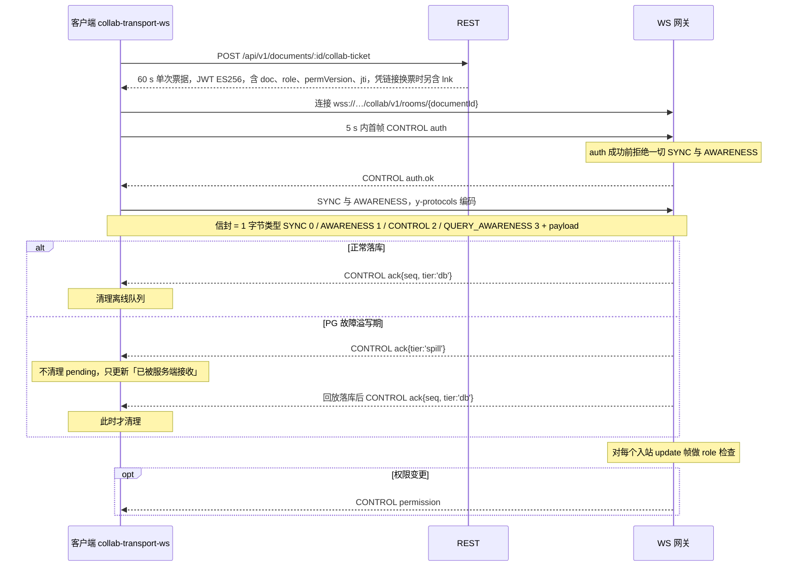
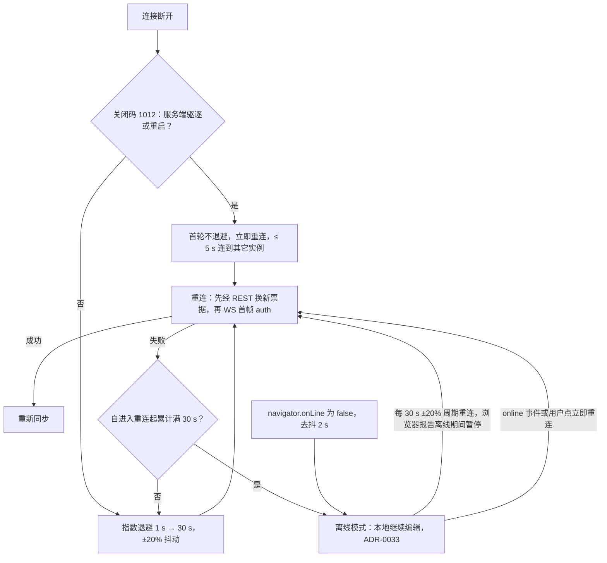

> 状态：草稿 | 负责：架构-运行时 | 更新：2026-09-24；2026-09-25（补图）；2026-09-25（矛盾收口，rulings §4.18）；2026-09-25（§4.19：CONTROL 成员补全与判别键 `type`（决策 3）、关闭码 1011 / 4427 / 4428、令牌刷新按 INC-27、协同后端随 M2 交付，见文末修订）；2026-09-25（§4.19） | 依赖：charter v0.1；裁决 `docs/00-charter/rulings-2026-09-14.md` §4.15 T-0/Q6/Q9/S-3a、§4.18

# ADR-0023 协同传输与协议：WebSocket + y-protocols 负载 + 自定义 CONTROL 控制面

## 状态

提议（默认值；章程 §6.2 ADR-0023）。2026-09-25 按 rulings §4.18 修订决策 4、5、7、8 与图 2（离线判据改为 30 s 计时、补离线出口、Room 七态照抄 06 §5.2、ack 逐帧对应规则引用 40-modules/02、刷新失败按原因分流），原文要点以「原：…」保留。

## 背景

必须回答：房间生命周期、断线重连、权限变更即时生效、鉴权握手在 `@cordexjs/protocol` 中的定义方式。约束：protocol 是 L0 且不得 import y-protocols；传输可替换（章程 §5.4「webrtc 传输」）。

## 决策

1. **传输**：WebSocket（`wss://…/collab/v1/rooms/{documentId}`），客户端 Provider `@cordexjs/collab-transport-ws` 使用全局 `WebSocket`（iso：Node 内建；基线 Node 26，rulings §4.15 Q9），服务端 Nest `ws` 适配器。
2. **负载**：sync 与 awareness 复用 y-protocols 编码（不自造 CRDT 同步）；由 collab-yjs/server-collab 编解码。
3. **信封与控制面**（`@cordexjs/protocol/collab`）：1 字节类型（`SYNC 0 / AWARENESS 1 / CONTROL 2 / QUERY_AWARENESS 3`，与 y-websocket 编号兼容）+ payload；CONTROL 为 UTF-8 JSON，zod 判别联合（判别键统一 `type`，含 `ack`；成员 `auth`/`auth.ok`/`auth.denied`/`auth.refresh`/`permission`/`ack`/`error`/`repair`/`ping`/`pong`/`room`/`event`，2026-09-25 补 `auth.refresh`，决策 INC-02~05），定义见 06 §6.3；联合在 protocol `ws/frames.ts`、握手在 `ws/handshake.ts`，不建 `collab/control.ts`（决策 INC-01）。
4. **鉴权握手**：REST `POST /documents/:id/collab-ticket`（相对 `apiBase` = `/api/v1`，rulings §4.18 BE-11）领取 60 s 单次票据（JWT ES256，含 doc/role/permVersion/jti，凭分享链接换票时另含可选 `lnk`，ADR-0029 决策 1）；WS 连接后 5 s 内首帧 `auth`，成功前拒绝一切 SYNC/AWARENESS（ADR-0029）。
5. **重连**：指数退避 1 s→30 s（±20% 抖动）；1012（服务端驱逐/重启）首轮不退避。**离线判据按时间**（2026-09-25 修订，rulings §4.18 UX-03）：自进入重连起**累计 30 s** 仍未连上即进入离线模式（本地继续编辑，ADR-0033；配置 `offlineAfterMs: 30000`），`navigator.onLine=false` 时立即进入（去抖 2 s）；令牌刷新的网络失败共用同一计时，不另设计时器（ADR-0029 补充 v0.2）。**离线出口**（2026-09-25 修订，rulings §4.18 CO-03，与 06 §5.1 一致）：进入离线后不停止重试，每 30 s（±20% 抖动）自动重连一次，`navigator.onLine=false` 期间暂停；收到 `online` 事件或用户点「立即重连」（`reconnectNow`）时立即进入 connecting。（原：「6 次失败或 `offline` 事件进入离线模式」，且未写离线后如何回到在线，作废——6 次退避叠加连接超时实际落在约 25 s 到 1 min，与 PRD/设计/ADR-0029 的「30 s」不一致，也无法按时长断言。）
6. **权限变更**：服务端推 `CONTROL.permission`（06 §10），并对每个入站 update 帧做 role 检查。
7. **ack**（2026-09-24 两级化，S-3a）：服务端落库后回 `ack{seq, tier:'db'}`，客户端据此清理离线队列；PG 故障溢写期先回 `ack{tier:'spill'}`（不清理 pending，只更新「已被服务端接收」状态），回放落库后再回 `tier:'db'`（ADR-0025 决策 8）。**逐帧对应规则以 40-modules/02 `ws/frames.ts`（ack 帧唯一事实源）为准**（2026-09-25，rulings §4.18 CO-09/CO-10）：同一连接内服务端对每个入站 update 帧按到达顺序恰好回一帧 `tier:'db'`；客户端按连接维护在途 FIFO（元素为 `localSeq`），每收到一帧 `tier:'db'` 弹出队首并 `ackUpTo(该 localSeq)`，`seq` 只更新 `meta.lastAckSeq`；`tier:'spill'` 不参与 FIFO 对应，只更新会话统计（降级标志、已接收计数）；断线即清空 FIFO，未确认的 pending 留待重连发送。**重连 `SyncStep2` 视同一个入站 update 帧**：服务端恰好回一帧 `db` ack（空 diff 也回、`seq` 取当前 head），客户端以发送时 pending 的最大 `localSeq` 作为一个 FIFO 条目，被覆盖的 pending 不再逐帧重发；step2 超过单帧 1 MiB 时先按 `localSeq` 用 `mergeUpdates` 切成不超限的块、逐块以普通 update 帧发送（每块一个 FIFO 条目），再发只含剩余差量的 step2，仍超限则上报遥测并提示导出、不无限重试；溢写回放补发 ack 时原会话已断开即丢弃，由重连兜底。
8. **房间生命周期**：照抄 06 §5.2 的**七态**状态机（2026-09-25 修订，rulings §4.18 CO-13）：`loading → active | failed`；`active ⇄ draining`（空置宽限 **60 s**）；`draining → persisting`（宽限到期）；`active → evicting`（停机或内存压力，客户端收 1012）→ `persisting`；`persisting → closed`。内存压力时先按 LRU 提前结束空置的 draining 房间（`draining → persisting → closed`，无在线客户端、无需 1012），仍超预算才对 active 房间走 `active → evicting`，不存在 `draining → evicting` 边（rulings §4.18 CO-14）；关闭或 SIGTERM 时若 PG 不可达，先把内存档强制写入一级溢写再进入 `closed`，不在 `persisting` 久等（rulings §4.18 CO-16，ADR-0035 决策 9）。（原：「loading/active/draining/persisting/closed，draining 宽限 30 s」，缺 `evicting`、`failed`，宽限期与补充（v0.2）的 60 s 不一致，作废。）

**图 1 票据握手、同步与两级 ack**

怎么读：纵线是参与方，自上而下是时间顺序；实线箭头是请求或上行帧，虚线箭头是响应或下行帧。`alt` 两支是 ack 的两种到达方式，只有 `tier:'db'` 能让客户端清理本地待确认更新。

**图 2 断线后的重连决策**

怎么读：菱形是分支条件，方框是客户端动作。进入离线模式有两条路：自进入重连起累计 30 s 仍未连上，或浏览器报告离线；令牌刷新的网络失败共用同一计时。离线不是终态：周期重连、`online` 事件与「立即重连」三条出口都回到重连（2026-09-25 修订，rulings §4.18 UX-03/CO-03；原图以「累计失败 6 次」为判据，并注明「离线后的恢复路径不在本 ADR 范围内，图中不画」，作废）。鉴权失败（401）不走本图，直接进入「登录已过期」（ADR-0029 补充 v0.2）。

## 备选方案与放弃原因

| 方案 | 放弃原因 |
|---|---|
| 完全采用 y-websocket 协议（无控制面） | 缺鉴权/权限/ack/错误/房间控制；y-websocket 服务端不适合内嵌 Nest 与我们的门禁 |
| Hocuspocus | 优秀，但其扩展模型与我们的 cordis 宿主/Unit 概念重叠；权限与 PG 持久化需大量定制；引入框架级依赖不利「每层可插拔」。我们复用其思路（onAuthenticate/onLoadDocument）而非代码 |
| WebRTC（y-webrtc） | P2P 不满足服务端权限边界（D12）、持久化与审计；保留为可选 `collabTransport` Provider（无服务器演示场景） |
| SSE + HTTP POST | 双通道复杂、代理兼容差、awareness 高频下开销大 |
| 自定义二进制控制面（protobuf） | JSON + zod 足够（控制帧低频）；A3 反对闭合枚举式协议；调试友好 |
| 长时 access token 直接放 WS URL | 泄漏面大（日志/代理）；改为短票据 |

## 后果

正面：与 y-websocket 客户端互操作可用于测试；控制面可演进（`protocolVersion` 协商）；传输可替换。

负面 / 代价：
- 自维护控制面 schema 与关闭码表；需要互操作测试保证与 y-protocols 版本同步。
- 每连接一次 REST 换票据（60 s TTL）：重连风暴时增加 REST 压力 → 票据签发端点有独立限流与缓存（权限解析 5 s 缓存）。
- 应用层 ping（浏览器无 WS ping API）：每 15 s 一帧，可忽略。

## 补充（v0.2）：PRD CO-05 / CO-12 / SV-05 / EM-03 的承接

- **权限变更传播**：门禁 **≤ 2 s**（PRD CO-05/SV-05）；内部目标 ≤ 1 s p95；机制不变（`perm:doc:{id}` 频道 → `CONTROL.permission` → `permissions.applyRemoteDecisions` → 命令管线即时生效 → `permission/changed` 事件）。
- **容量策略**：`maxEditors: 20` + `maxViewers: 50`；编辑者满 → 以 `role: viewer, reason: 'capacity'` 只读加入；查看者也满 → `auth.denied{ collab.room_full }`（4503）。房间空置销毁延迟 **60 s**（取代 30 s）。
- **速率**：每连接 ≤ 200 帧/s（突发 500，令牌桶）；单帧 ≤ 1 MiB；awareness 节流 ≥ 50 ms；未知 CONTROL 类型丢弃并计数（不关闭）。
- **协议版本协商**：`auth.protocolVersion` 与服务端支持窗口 `[min, max]` 比对；不兼容 → `auth.denied{ collab.protocol_mismatch }` + 关闭码 **4427**（与 schema 版本的 4426 区分）。
- **凭据两种形态（EM-03）**：(a) 一方票据（60 s、`jti` 单次，REST 换取）——M1–M3 唯一形态；(b) 集成方签名 JWT（≤ 1 h，JWKS 验签，claims `sub/doc/caps[]/exp`；2026-09-24 删 `tenant`——T-0；**降为 M4**——rulings §4.15 Q6，见 ADR-0029 修订）直接放入 `auth` 帧，无需先换票据；权限来源可为 claims 或集成方回调（缓存 ≤ 60 s，撤销经推送 ≤ 2 s）。（2026-09-25 修订，决策 INC-27）浏览器登录会话每次被动续期成功后，客户端换新 collab ticket 并以 CONTROL 消息 `auth.refresh{ ticket }` 发送（不断连）；一方票据只重新绑定会话、重算角色，不延长寿命（寿命 = 票据 `sid` 指向的登录会话），M4 集成方 JWT 复用同一帧并以新 `exp` 续期（原：「到期前 60 s 由 `getToken()` 刷新并以 `auth.refresh{ token }` 续期」，作废）；刷新失败按原因分流（2026-09-25 修订，rulings §4.18 UX-02）：网络错误 → `reconnecting`，与重连共用 30 s 离线计时（决策 5）；401 → 直接进入「登录已过期」（新窗口重新登录，同一用户才重放队列，见 ADR-0029 补充 v0.2）。（原：「刷新失败 → `reconnecting`，30 s 后 → `offline`」，不分原因，作废。）
- **停机与传播**：1012 → 客户端 ≤ 5 s 重连到其它实例；跨实例 ≤ 50 ms；房间内广播 p95 ≤ 100 ms。
- **事件名**：`collab/state-changed`、`collab/auth-failed`、`collab/reconnect{reason}`（PRD EM-05）取代本 ADR 草稿名；定稿表见 10 §11。

## 修订 2026-09-25（rulings §4.19）

1. **CONTROL 成员与字段**（决策 INC-02~07、INC-09）：以 06 §6.3 为唯一定义——`auth` 增可选 `epoch`（客户端本地纪元，取自 `GET snapshots/latest` 响应头 `X-Cordex-Epoch`，无本地状态时省略）与 `maxSchemaVersion`；`auth.ok.limits = {maxUpdateBytes, msgRateHz, msgBurst}`（废 `updateRateHz`），可选 `reason: 'capacity' | 'over_ceiling'`；`auth.denied.code` 增 `collab.protocol_mismatch`、`collab.epoch_changed`、`collab.doc_purging`；`room` 增可选 `persist: 'ok' | 'degraded'` 与 `locked: {reason, until}`；`event` 登记 `comments.changed{threadIds[]}` 与 `version.restored{snapshotId, name?, by}`。服务端按「协议版本 → 票据 → 纪元 → schema」顺序判定。
2. **关闭码**（决策 INC-06）：补 1011（服务端内部错误，退避重连并上报）、4427（协议不兼容，提示刷新）、4428（纪元已变更：丢弃本地 Y 状态重新 bootstrap，pending 移入 `rejected` 并可导出）；`collab.doc_purging` 归 4404；全表见 06 §6.5。
3. **令牌刷新**（决策 INC-27）：见补充（v0.2）「凭据两种形态」末句，已就地改写。
4. **里程碑**（rulings §4.19 D-M2-CONTENT，PRD 05 §0.3）：本 ADR 的传输、握手、ack 与房间生命周期随协同后端在 **M2** 交付（单实例，基础重连：退避、先鉴权再同步、补发未获 db 确认的更改）；`tier:'spill'` 两级 ack 的降级路径随单实例 Postgres 故障溢写同在 M2（PRD 05 §0.3「Postgres 故障」行）；决策 5 的离线判据与离线出口、多实例 1012 跨实例重连属 M3。

## 如何被机械验证

- `runCollabTransportConformance`（传输侧）与 `runOfflineStoreConformance`（离线队列侧）覆盖（2026-09-25 按章程 `run<Definition>Conformance` 命名对齐，rulings §4.18 GV-20；原名 `runCollabConformance` 作废，语义不变）：握手超时、票据过期、降权拒写、重连退避序列（用 FixedClock 断言时刻）、1012 立即重连、ack 清理（2026-09-24：`tier:'spill'` 不清理、`tier:'db'` 才清理）。
- （2026-09-25，rulings §4.18）FixedClock 断言：重连 29.9 s 未离线、30 s 离线（UX-03）；服务端恢复后 offline 会话 ≤ 36 s 自动回连、`navigator.onLine=false` 期间不发起连接（CO-03）；在途 FIFO 对应与连续 spill 不影响对应（CO-09）；重连 step2 后 pending 一次清空且不重复落库、离线累计 5 MiB 更改重连后全部同步且无 4413 断连（CO-10）；刷新遇 401 直接「登录已过期」不经 offline（UX-02）。
- 互操作测试：用 `y-websocket` 官方客户端连接我们的网关（仅 SYNC/AWARENESS 路径）能同步（CI job）。
- zod schema 快照测试：CONTROL 消息 JSON schema 导出后入库，变更需显式更新（API 变更可见）。
- 扫描器：protocol 包无 `y-protocols`/`yjs` import（09-03）。

## 关联

章程 D12、§5.4；`00-charter/rulings-2026-09-14.md` §4.15 T-0/Q6/Q9/S-3a、§4.18 UX-02/UX-03/CO-03/CO-09/CO-10/CO-13/CO-14/CO-16/GV-20；ADR-0025/0029/0033/0034/0035；架构 06 §5–6、08 §1；60-backend/16。
