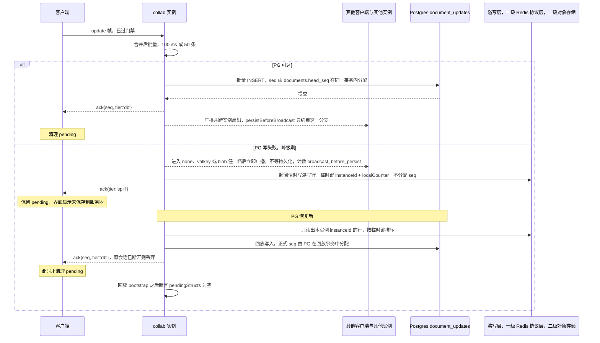
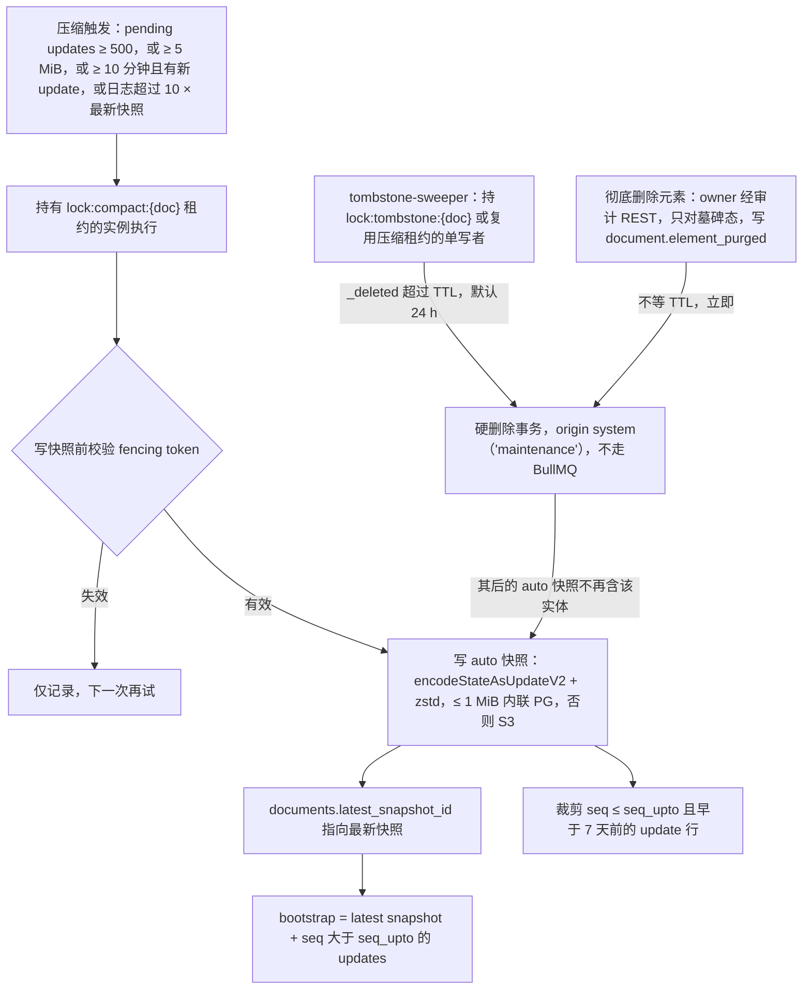

> 状态：草稿 | 负责：架构-运行时 | 更新：2026-09-24；2026-09-24 复核修正（rulings §4.17；复核报告 H1/H2：墓碑硬删除 origin 与执行者）；2026-09-25（补图）；2026-09-25（矛盾收口，rulings §4.18） | 依赖：charter v0.1；裁决 `docs/00-charter/rulings-2026-09-14.md` §4.13 S-3、§4.15 Q3/S-3a、§4.18

# ADR-0025 Update 持久化与快照压缩策略

## 状态

提议。2026-09-24 按 rulings §4.15 S-3a（PG 故障溢写期两级 ack）与 Q3（软删除墓碑 + TTL 硬删除）修订决策 1 并新增决策 8–9，见文末「修订 2026-09-24」。2026-09-25 按 rulings §4.18 再修订：降级期照常广播（CO-08，决策 1/8 与图 1）、溢写回放按实例归属与认领（CO-16）、「彻底删除元素」复用墓碑硬删除事务（CO-07，决策 9 与图 2）、ack 对应规则引用 40-modules/02（CO-09/CO-10），见文末「修订 2026-09-25」。

## 背景

CRDT update 是小而多的二进制增量；需要：崩溃不丢已 ack 的更新、快速 bootstrap（06 §9.1 预算 ≤ 500 ms @ 8 MB）、版本历史（命名快照/恢复）、审计回放、存储上限治理。Yjs 的 `Y.snapshot` 需 `gc:false`（体积持续增长），不采用。

## 决策

1. **追加日志**：`document_updates(doc_id, seq, update bytea, …)`；服务端把收到的每个（合并后的）update 帧批量写入（100 ms 或 50 条），提交后回 `ack{seq, tier:'db'}`；默认 `persistBeforeBroadcast=true`，**只约束 PG 可用时**「先落库、后广播」的顺序。PG 写失败即进入**降级期**：update 通过门禁（ADR-0034）、进入 none（内存退避重试）/ valkey / blob 任一档后，**立即在本实例广播并跨实例扇出，不等持久化**（2026-09-25 修订，rulings §4.18 CO-08，用户选「降级期照常广播」；原：只写「PG 不可达时的溢写期例外见决策 8」，未说是否广播，作废）。持久性由发起方 pending 兜底（S-3a：收到 `tier:'db'` 才清），其他收到广播的客户端重连时经 step2 回填，风险窗口与 `persistBeforeBroadcast=false` 相同；NF-03「已 ack(db) 零丢失」不受影响；UI 显示「未保存到服务器」，指标 `cordex_collab_broadcast_before_persist_total` 计数。两级 ack 见决策 8。
2. **快照**：`document_snapshots` 存整份 `encodeStateAsUpdateV2(doc)`（zstd），`kind ∈ import|auto|named|migration|restore|epoch`；≤ 1 MiB 内联 PG，否则 S3。`documents.latest_snapshot_id` 指向最新 `auto/import/migration/restore/epoch`。
3. **压缩（compaction）触发**：自上次快照起 pending updates ≥ 500 **或** ≥ 5 MiB **或** ≥ 10 分钟且有新 update；由持有 `lock:compact:{doc}` 租约的实例执行：写新 `auto` 快照 → 裁剪 `seq ≤ seq_upto` 且 `created_at < now()-7d` 的 update 行。
4. **bootstrap**：latest snapshot + `updates where seq > seq_upto`；客户端也可直接 `GET /snapshots/latest` 做 HTTP 预加载（06 §9.1）。
5. **命名快照**：用户显式「保存版本」→ `kind named`（永久保留，P2 待决）；自动快照保留 30 天后按天稀疏化（每天保留最后一个）。
6. **恢复（restore）**：不回滚日志；把目标快照加载到临时 Unit，与当前状态做**模型级 diff**（A 线 `diffSnapshots`）生成一次事务（origin `restore`）写回当前文档并落 `kind restore` 快照——CRDT 连续性保持，在线客户端无需重连。
7. **GC**：所有对端 `gc:true`；版本历史完全由服务端快照承担。
8. **两级 ack（S-3a）**：PG 故障期按 S-3 溢写（第一阈值 Redis 协议层 / 第二阈值对象存储）成功后回 `ack{tier:'spill'}`，客户端**保留 pending**；恢复后回放落库、由 PG 分配正式 `seq`，再回 `ack{seq, tier:'db'}`，客户端此时才清理 pending。降级期的广播不等溢写或落库（决策 1，rulings §4.18 CO-08）。详见文末修订。
9. **墓碑硬删除作业（Q3）**：由持有 `lock:tombstone:{doc}`（或复用压缩租约）的单写者，对 `_deleted` 超过 TTL（默认 24 h，可配置）的实体做硬删除事务（origin `system('maintenance')`，取值以 40-modules/02 的 Origin 枚举为准，不另立 `tombstone-gc`；执行者为 M-09 的 `tombstone-sweeper` + 租约锁，不走 BullMQ——2026-09-24 复核修正，对齐复核报告 H1/H2），随后的 `auto` 快照不再含该实体；S-2 文档擦除（含「永久删除文档」）与元素级「彻底删除元素」不等 TTL。「彻底删除元素」（2026-09-25，rulings §4.18 CO-07）只对墓碑态元素开放、只能由 owner 经 `POST /documents/:id/elements/purge{ids}` 发起，交 M-09 单写者**复用本作业的硬删除事务**立即执行（房间未加载时先加载），写审计 `document.element_purged`；只清当前文档状态，历史快照与 update 表按保留期存在，引用的图片原件按 30 天无引用 GC；删除方此后撤销该步按整步跳过（`wholeStep:true`）。（原：「S-2 文档擦除与『立即彻底删除』不等 TTL」，未区分文档级与元素级，作废。）

**图 1 update 写入与两级 ack**

怎么读：纵线是参与方，自上而下是时间顺序。两条分支的区别在于 seq 何时分配、广播是否等持久化：正常时在落库事务内分配 seq，落库后再广播；降级期不分配 seq、等回放事务再分配，广播则在进入任一降级档后立即进行（2026-09-25 修订，rulings §4.18 CO-08；原图溢写分支只回 spill ack、没有广播，作废），所以多实例同时溢写也不会出现 seq 冲突、协作者也彼此可见。溢写数据即使丢失，客户端仍保留 pending，重连 step2 时凭 update 幂等性补齐。心跳过期实例遗留的溢写行不由存活实例按本图回放，见修订 2026-09-25 第 2 条。

依据：本文决策 1、8 与文末「修订 2026-09-24」第 1–4 条、「修订 2026-09-25」第 1–2 条。

**图 2 压缩、bootstrap 与墓碑硬删除**

怎么读：上半是压缩的触发与执行，中间两条是写快照之后的两步：更新最新快照指针、裁剪旧 update 行；下方 `bootstrap` 读取最新快照与其后未被裁剪的 update。右侧是墓碑硬删除事务的两个入口：TTL 到期的单写者作业，以及 owner 对墓碑态元素发起的「彻底删除元素」（复用同一事务、不等 TTL，只清当前状态，历史快照与 update 表按保留期存在）。S-2 文档擦除（含「永久删除文档」）是整文档清除，不经此路径、不等 TTL（2026-09-25 修订，rulings §4.18 CO-07；原：「S-2 文档擦除与『立即彻底删除』不经此路径」，未区分两级，作废）。

依据：本文决策 2–4、9 与补充（v0.2）第 2 条。

## 备选方案与放弃原因

| 方案 | 放弃原因 |
|---|---|
| 仅存最新状态（每次 update 后覆写一行） | 高频写放大且无法实现精确 ack/回放；崩溃窗口内更新语义模糊 |
| 每 update 一行永久保留（无压缩） | bootstrap 线性变慢；存储无上限 |
| Yjs `Y.snapshot` + `gc:false` 做版本历史 | 文档体积无界增长；所有客户端都需 `gc:false`；恢复语义（`createDocFromSnapshot`）产出新 doc 断开连续性 |
| 恢复 = 回滚日志到 seq | 会丢弃其后所有人的工作且与离线客户端分叉；CRDT 不支持「撤销他人的历史」 |
| 用对象存储存所有 update（每帧一个对象） | 小对象海量、按 doc 顺序读慢 |

## 后果

正面：at-least-once 持久化可观察（ack）；bootstrap 有界；版本历史与 CRDT 内部机制解耦；存储可裁剪。

负面 / 代价：
- 「按时间点恢复」在 7 天外只能到快照粒度（P2）。
- 恢复需要模型级 diff（A 线契约），复杂度在 model-slide；M3 可先实现「整体替换式 diff」（删除全部实体再插入）——正确但撤销栈与他人光标体验差，M4 精化。
- 压缩期间的租约丢失（fencing）需处理：写快照前校验 token；失败仅记录，下一次再试。
- 快照 zstd：Node 内置 `zlib.zstdCompress`（Node 26 基线已具备，rulings §4.15 Q9）或 `@bokuweb/zstd-wasm`；浏览器解压走 `DecompressionStream('zstd')` 可用性检测，回退 gzip（在 `Content-Encoding` 协商中处理）。

## 补充（v0.2）：PRD NF-01 1.7 / NF-10 的预算承接

- 压缩 10,000 update ≤ 2 s（RM-S）：`encodeStateAsUpdateV2` + zstd 对 ≤ 16 MB 状态在 2 vCPU 上约 300–800 ms，余量用于写库；超时则下次再试并告警。
- 单文档 update 日志**压缩后 ≤ 10 × 最新快照大小**（NF-10）：压缩器在 `maxPendingBytes` 之外增加此比值触发条件；裁剪保留 7 天窗口内的行（P2 待决可调）。
- 持久化滞后（update 接收 → 落盘 ack）p99 ≤ 1 s：flush 100 ms / 50 条 → 正常 p95 ≈ 150 ms；PG 抖动时批量退避上限 800 ms，超过则 ack 延迟但不丢（客户端 pending 计数可见）。
- 导入基线包（SV-01）：`kind import` 快照记录 `baseline_key`（原 pptx 对象键），供导出复用不透明部件（08 §16.2）。

## 修订 2026-09-24：两级 ack（S-3a）与墓碑硬删除（Q3）

**背景**：08 §5 规定 `seq` 由 `documents.head_seq` 在同一事务内分配、提交后才 ack；而 40-modules/09 §2.6 写「PG 不可达时仍 `ack{seq}`」并调用 `writeTier2(seqRange)`——PG 不可用时无法分配 `seq`，且按 ADR-0035 各实例各自持久化，临时 `seq` 会冲突。S-3「溢写而非拒写、恢复后按 seq 顺序回放」据此细化（rulings §4.15 S-3a）：

1. 溢写行使用临时键 `(instanceId, localCounter)`，**不分配 `seq`**；回放按该键排序写入 `document_updates`，正式 `seq` 由 PG 在回放事务中分配。
2. 溢写成功 → `ack{tier:'spill'}`：告知客户端「已被服务端接收」，客户端 pending **不清理**；落库后 → `ack{seq, tier:'db'}`：客户端清理 pending（40-modules/05 LocalBatcher 按两级 ack 清理 OfflineStore）。`@cordexjs/protocol` 的 `collab/control` ack 增加 `tier` 字段（40-modules/02）。
3. 即使 Valkey 或对象存储上的溢写数据丢失，客户端也会在重连 step2 时凭 update 幂等性自动补齐——NF-03「已 ack 零丢失」以 `tier:'db'` 为准依然成立；多实例临时 seq 冲突与 `seqRange` 契约矛盾一并消除。
4. 回放 bootstrap 之后断言 `pendingStructs` 为空（缺依赖的 update 不得静默滞留）。

**墓碑**（ADR-0020「协同撤销语义」第 3 条）：墓碑在 TTL 内随快照与 update 正常持久化，计入文档总元素上限与快照体积；硬删除作业见决策 9。

## 修订 2026-09-25：降级期广播、溢写回放归属、ack 对应、彻底删除元素（rulings §4.18）

1. **降级期照常广播（CO-08）**：见决策 1。`persistBeforeBroadcast` 只约束 PG 可用时的顺序；PG 写失败后 update 进入 none / valkey / blob 任一档即在本实例广播并跨实例扇出。架构 06 §6.4、40-modules/09 §2.6 与其图 2-3/2-6、40-modules/19 图 6-4 同步补广播步骤。
2. **溢写回放按实例归属（CO-16）**：修订 2026-09-24 第 1 条的回放**只读本实例 `instanceId` 的溢写行**（`readAllOrdered(docId, instanceId)`），两个同时在线的实例各回放各自的行、不重复落库（对齐 ADR-0035 决策 3）；心跳已过期（ADR-0035 决策 5，TTL 60 s）实例留下的行，由下一次加载该文档的 Room 在 bootstrap 之后持 `lock:spill:{doc}` 租约认领回放（与墓碑「未打开的文档加载时顺带执行」同一模式）；关闭或 SIGTERM 时若 PG 不可达，先把内存档强制写入一级溢写再进入 `closed`，不在 `persisting` 久等（ADR-0035 决策 9）。（原：回放读出该文档全部实例的溢写行，作废。）
3. **ack 对应（CO-09/CO-10）**：修订 2026-09-24 第 2 条的「落库后回 `tier:'db'`」按 40-modules/02 `ws/frames.ts`（ack 帧唯一事实源）逐帧对应：客户端按连接维护在途 FIFO，`tier:'db'` 弹出队首并 `ackUpTo(该 localSeq)`，`tier:'spill'` 不参与对应；重连 `SyncStep2` 视同一个 update 帧（空 diff 也回 db ack）；溢写回放补发 ack 时原会话已断开即丢弃，由重连兜底。完整规则见 ADR-0023 决策 7。
4. **彻底删除元素（CO-07）**：见决策 9 与图 2；文档级操作改称「永久删除文档」，走 S-2 擦除，不经本 ADR 的硬删除事务。

## 如何被机械验证

- 单测（server-collab）：触发条件三选一均触发压缩；租约丢失不写；裁剪只删符合条件的行。
- 集成：写 1,000 updates → 压缩 → bootstrap 状态与全量重放相等（`encodeStateAsUpdateV2` 相等）。
- 崩溃测试：在 `ack` 前 kill 进程，重启后客户端重发的 update 被幂等应用，状态一致；`ack` 后 kill，重启后状态包含该 update。
- 恢复测试：restore 后在线客户端不断连且状态 = 目标快照；随后编辑可继续同步。
- （2026-09-24）S-3a：PG 故障注入 → 客户端先收到 `ack{tier:'spill'}` 且 pending 未清理 → 恢复回放后收到 `ack{seq,tier:'db'}` 且 pending 清理；两实例同时溢写回放后 `seq` 连续无冲突；删除溢写数据后客户端重连 step2 补齐；spill-and-replay 测试断言回放后 `pendingStructs` 为空（08 §12 集成测试断言同步改写）。
- （2026-09-24）墓碑：TTL 到期后硬删除作业执行一次（租约）且快照中无残留；purge 不等 TTL。
- （2026-09-25，rulings §4.18 CO-08）集成测试：PG 断开时两客户端仍互见编辑（广播不等持久化）、`cordex_collab_broadcast_before_persist_total` 递增；PG 恢复后 `seq` 连续、不丢 update。
- （2026-09-25，rulings §4.18 CO-16）`spill-and-replay.test`：两实例同时在线各自只回放本实例的行、无重复行；实例下线（心跳过期）后，其遗留行由新实例在加载该文档时持 `lock:spill:{doc}` 认领回放；SIGTERM 且 PG 不可达时内存档先写一级溢写再关闭。
- （2026-09-25，rulings §4.18 CO-07）彻底删除元素：非 owner 或非墓碑态请求被拒；执行后当前 Y 状态无该实体、审计有 `document.element_purged`；删除方随后撤销该步返回 `wholeStep:true`。
- 指标：`cordex_snapshot_compactions_total`、`cordex_collab_persist_latency_ms` 有仪表盘引用（10）。

## 关联

章程 D5/D6/Q5；`00-charter/rulings-2026-09-14.md` §4.13 S-3、§4.15 Q3/S-3a、§4.18 CO-07/CO-08/CO-09/CO-10/CO-16；ADR-0020/0022/0034/0035；架构 06 §6.4、08 §5/§12；40-modules/02/05/09；PRD NF-03、SV-05。
