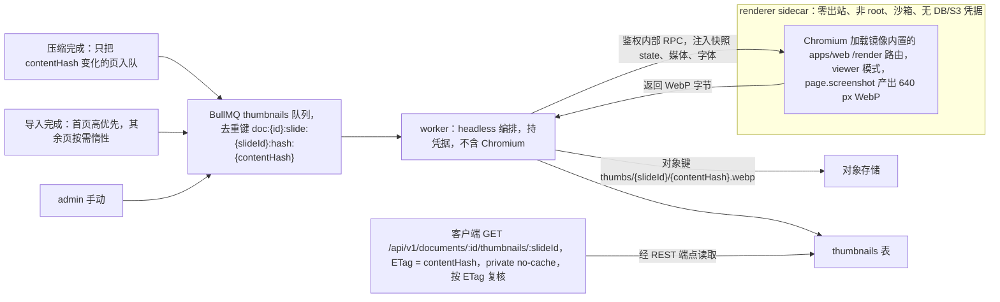
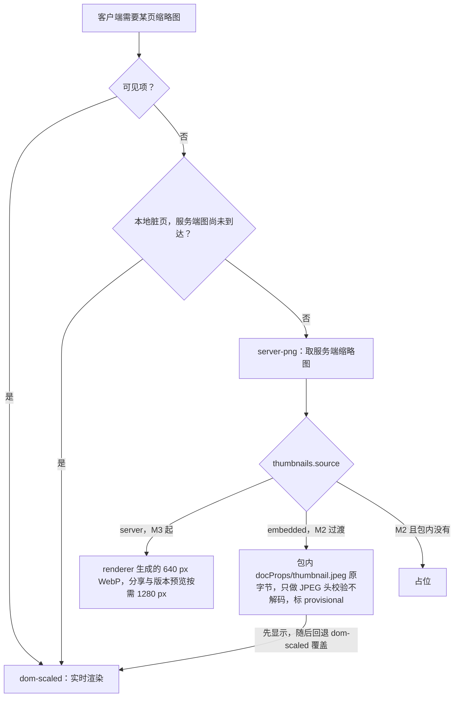

> 状态：已接受 | 负责：架构-运行时 | 更新：2026-09-24；2026-09-24（rulings §4.16 Q19：renderer 字体包口径）；2026-09-24 复核修正（rulings §4.17；复核报告 L11、L13）；2026-09-25（补图）；2026-09-25（矛盾收口，rulings §4.18）；2026-09-25（§4.19：决策 3 客户端读取改为 `ETag = contentHash` + `private, no-cache`，见文末修订；M2 过渡封面随 M2 服务端导入产出）；2026-09-25（§4.19） | 依赖：charter v0.1；裁决 `docs/00-charter/rulings-2026-09-14.md` §4.15 Q8/Q10、§4.16 Q19、§4.18

# ADR-0026 服务端 headless 渲染与缩略图

## 状态

**已接受**（2026-09-24，用户裁决 `00-charter/rulings-2026-09-14.md` §4.15 Q8，部署位置随 Q10 与 ADR-0037 统一）。原状态「提议（章程 §10 Q8：M3 起服务端 headless Chromium；M1/M2 客户端生成）」。决策 1–7 已按裁决整体改写，原文要点在各条末以「原：」注明；决策 7 与 v0.2 补充的预算矛盾（≤ 60 s vs D200 ≤ 90 s）就此消除。2026-09-25 按 rulings §4.18 修订：决策 1 的 RenderStateToken 网络拉取定为「已取消」（BE-04），决策 6 补 `/render` ready 判据与超时分计（FE-09），分层规则补 server-headless 文档类型盲（FE-01），均以「原：…作废」就地保留演进。

## 背景

需要：文档列表封面、缩略图侧栏的非可见项、分享预览、视觉回归的服务端路径；要求与客户端像素一致（同一文档在不同端不应看起来不同）。此前三处文档对 Chromium 位置说法不一（PRD SV-09 sidecar、08 §2 worker 变体、本 ADR 进程内），规格三套（SV-04 400 px WebP、本 ADR PNG 2560×1440、OF-15 1280 px PNG），失效粒度也冲突（SV-04 按页 contentHash，本 ADR/08 §7/40-modules/12 按快照 seq 全量失效——活跃 D200 每次压缩重渲 200 页约 80 s）。本次一并统一。

## 决策

1. **服务端渲染 = 同一份客户端渲染代码在 headless Chromium 中运行**，交付时点 **M3 前半段**。Chromium 运行在**独立零出站 renderer sidecar**：同镜像 `CORDEX_ROLE=renderer` 变体或自建最小 `chromium-headless-shell` 镜像（ADR-0037）；只接受 worker 的入站请求，走**鉴权内部 RPC**（契约放 `@cordexjs/protocol`），**不暴露**无鉴权的 Playwright run-server WS，**不持有** DB/S3 凭据。渲染页为 `apps/web` 的 `/render` 路由（viewer 模式 preset，无 UI/协同），其静态包**内置在镜像中**；快照 state、媒体、字体全部**经 RPC 注入**，不走网络。**RenderStateToken 网络拉取已取消**（2026-09-25 修订，rulings §4.18 BE-04，用户选「彻底取消拉取」）：`local`（EM-10 b，worker 进程内 Playwright）与 `remote`（sidecar）两种模式都由编排方（`page.evaluate` / sidecar RPC）调用 `window.__cordex.inject` 注入，`/render` 页只有这一条路径、**零外呼**；`IssueRenderStateTokenUseCase`、`RenderStateTokenStore`、`render-state.controller` 与 `GET /internal/render/:token/state` 一并删除，Thumbnails 对 Internal 模块的依赖随之消失；`RenderPageQuery.token` 改为 `renderId`，只用于日志关联；页面状态 `fetchingState` 改为 `awaitingInject`，注入等待超时为页面常量（默认 60 s，与决策 6 的每页 10 s 渲染超时分开计，rulings §4.18 FE-09）；`RenderStateResponse` 保留为注入载荷类型。（原：「原 `/internal/render/:token/state` 的 RenderStateToken 网络拉取降为兜底或取消（由 40-modules/09 定）」，40-modules/09 曾定为「local 模式兜底」，作废。）自带 Nest 的集成方（EM-10 b）保留本地 launch 模式。（原：`playwright-core` 进程内 1 browser、N 页面池，经一次性 token 拉 state。）
2. **失效与触发 = 按页内容哈希**（PRD SV-04 原文，属冲突修正）。`contentHash` 输入 = 页子树 + 版式/母版/主题依赖闭包 + 媒体 BlobRef + slideSize + 页序号 + 内嵌字体集合 + `layoutAlgoVersion` + `fontProfile`；外链资源一律占位、不计入。触发：压缩完成后**只把哈希变化的页**入队；导入完成后**首页高优先**生成，其余页按需惰性生成；admin 手动。BullMQ `thumbnails` 队列去重键 `doc:{id}:slide:{slideId}:hash:{contentHash}`（以架构 08 §7 与 40-modules/12 为准，2026-09-24 复核修正；原写 `…:{contentHash}` 缺 `hash:` 段）。（原：去重键 `doc:{id}:seq:{seq}`，更高 seq 作废旧任务。）
3. **规格**：只存一档——卡片 **640 px WebP**，在沙箱内由 `page.screenshot({ type: 'webp' })` 直接产出；分享预览与版本预览**按需**生成 1280 px。对象键 `thumbs/{slideId}/{contentHash}.webp` → `thumbnails` 表；客户端 `GET /documents/:id/thumbnails/:slideId?size=640|1280`（路径相对 `apiBase` = `/api/v1`，rulings §4.18 BE-11；封面 `slideId` 用保留 id `__cover`，决策 SG-10；`ETag = contentHash`、`Cache-Control: private, no-cache`，每次以 `If-None-Match` 复核——同一 URL 的内容随哈希变化，不能标 immutable，见文末「修订 2026-09-25」）。（原：PNG @2×、1280×720 逻辑尺寸、键含 seq；2026-09-25 前写「ETag = contentHash、immutable」，作废。）
4. **来源与客户端 Provider 策略**：`thumbnails.source ∈ { embedded, server, client }`，其中 `client` **仅为保留位**（M1–M3 不写入：客户端不再上传缩略图，见下方「客户端路径」；保留枚举值以免将来恢复客户端上报时改表约束，2026-09-24 复核修正）。**M2 过渡封面**取导入包内 `docProps/thumbnail.jpeg`（`source=embedded`，标 provisional）：服务端**只做 JPEG 头校验不解码**（SOI/SOF 中尺寸不超过 OF-24 像素上限、体积 ≤ 1 MB），原字节带 `image/jpeg`、`nosniff` 与 CSP sandbox 头下发；包内没有则显示占位；S-2 purge 覆盖此来源。客户端：可见项 `dom-scaled`（实时），其余 `server-png`（Provider 名沿用历史命名，实际取回的是服务端 640 px WebP，2026-09-24 复核修正）；`server-png` 识别 provisional，其后回退到 `dom-scaled`；本地脏页在服务端图到达前用 `dom-scaled` 兜底（07 §8）。（原：无 embedded 来源。）
5. **一致性键**：`layoutAlgoVersion`（engine-layout 断行算法版本）+ `fontProfile` 并入决策 2 的 `contentHash`；任一变化即该页重新生成。
6. **安全**（作为 NF-04 / SV-12 M3 出口的自动化安全测试）：非 root 运行，`chromiumSandbox: true` 并加载 seccomp（playwright-core 默认 false，官方镜像以 root 运行、沙箱关闭，仅供测试开发）；**零出站**；不挂任何凭据；每个任务新建 `BrowserContext`，定期回收浏览器进程；使用 `--shm-size`，**不用** `--ipc=host`；**自建镜像**，每周跟随 Chrome 稳定版重建，与 worker 锁步发布（官方镜像存在已知 CVE 窗口）；每页渲染超时 10 s（由编排方在注入之后计时，与 `/render` 页自身的注入等待超时分开计；页面 ready 判据 = 所请求页全部 `render/page-mounted` ∧ 这些页的字体请求全部结算（`fonts-ready` 或 `font-fallback`，无字体需加载视为已结算）∧ 此后出现一次待绘脏区为空的 `render/frame`，`/render` 装配 viewer 时关闭惰性加载——2026-09-25，rulings §4.18 FE-09，判据正文以 40-modules/11 与架构 07 为准）；崩溃自愈重建 browser。（原：仅「禁外网（仅允许 apps/server 内部地址）」。）
7. **预算（统一口径）**：≤ 400 ms/页 p95；导入后**首页 ≤ 10 s**；**D200 全量 ≤ 90 s**；renderer 容器内存 request 2 GiB（实测后写入 ADR-0037 主机规格）。（原：单 job ≤ 200 页 ≤ 60 s——与 v0.2 补充矛盾，作废。）
8. **导出侧**：`docProps/thumbnail.jpeg` 定义为 `encode()` 的**显式输入**（`thumbnailJpeg?: BlobRef`）；缺省时保留原部件字节，零编辑往返不新增该部件；SV-02 的确定性口径随之修订（40-modules/04）。
9. **不用 sharp**：sharp 本体 Apache-2.0，但平台依赖 `@img/sharp-libvips` 为 LGPL-3.0-or-later，违反 D13；且会在持有凭据的 worker 中解码不可信图片。服务端对图片只做头校验，栅格化只在 renderer 沙箱内发生。

**图 1 M3 服务端缩略图链路**

怎么读：从左到右依次是触发、排队、编排、沙箱渲染、落存储、客户端读取。renderer 方框内没有任何凭据、也不发起出站，只接受 worker 的鉴权 RPC 并返回字节；写对象存储与写表都由 worker 完成。

依据：本文决策 1–3、6；返回字节与落存储由 worker 侧 `remote-renderer.client.ts` 承担，见 60-backend/06 §10 与 40-modules/09 §2.5。

**图 2 缩略图来源与客户端取图**

怎么读：上半是客户端 Provider 的选择，下半是服务端 `thumbnails.source` 的取值。`source=client` 只是保留位，M1–M3 不写入，因此图中没有这一支；`server-png` 是沿用的历史名，实际取回的是 WebP。

依据：本文决策 3–4；provisional 的「先显示后回退」见 40-modules/07 §2.6。

## 备选方案与放弃原因

| 方案 | 放弃原因 |
|---|---|
| Node 内 canvas 渲染（node-canvas/skia-canvas）第二套渲染器 | 第二份渲染实现 = 双倍保真工作与不一致来源（违背 D5 精神的「单一实现」） |
| SVG → resvg/sharp 栅格化 | 需要把文本预先转为字形路径或依赖 resvg 的字体回退，与浏览器排版不一致；滤镜支持差；sharp 的 libvips 为 LGPL（见决策 9） |
| LibreOffice 转换 | 保真与我们渲染器不同；重依赖；无法体现编辑器实际外观 |
| 仅客户端生成并上传缩略图 | 依赖某个客户端在线；恶意客户端可上传任意图片；导入后无人打开则无封面；受 `toImage` Web 字体问题影响（ADR-0021）。**2026-09-24 起也不作为「可选优化」保留**（PRD SV-04 相应删除） |
| Playwright 官方镜像 / 与 worker 同容器 | 官方镜像仅供测试开发、默认 root、沙箱关闭、压缩后约 956 MB、有 CVE 窗口；run-server 无鉴权；与持有凭据的 worker 同容器会扩大攻击面（40-modules/15 此前未登记） |
| M2 客户端上传首页封面 / M2 一律占位 | 前者多一个上传面且受 Web 字体问题影响；后者与 U-04「最近」M2 服务端同步冲突。采用包内 `thumbnail.jpeg` 过渡（决策 4），代价：M2 编辑后封面过时（同设备本地 dom-scaled 缓存覆盖），展示的是上传者控制的图片 |
| 在 `server-headless` 内自带 Vite 渲染页构建 | node 包内含 dom 构建目标，破坏同构分类；改为复用 apps/web 路由或独立 app（R4） |

## 后果

正面：像素一致；视觉 oracle 可同时校验两端；无第二套渲染器。

负面 / 代价：需要独立 renderer 镜像（含 Chromium 与字体包；应用镜像不含 Chromium；字体包 = 内置 Noto（含 CJK）+ Liberation + Carlito/Caladea（均开源，不内置商业字体），**部署方可挂载自有授权字体目录**（只读卷，配置 `fonts.extraDirs`，rulings §4.16 Q19）），每周重建并与 worker 锁步发布；渲染吞吐受浏览器限制（并发 2 页/进程）；注入式 RPC 需要把 state、媒体、字体打包传输；`apps/web` 需提供 `/render` 路由与 `window.__cordex.inject`（注入）/ `window.__cordex.ready`（就绪信号）协议（apps 组装职责可接受；2026-09-25 起 local 与 remote 两种模式都只走注入，rulings §4.18 BE-04）。

## 补充（v0.2）：PDF 导出（PD-16 / SV-02）、预算与分层规则

- **PDF**（2026-09-24：交付时点为 **M3 后半段**，与缩略图共用 renderer sidecar 与 `/render?mode=print`，走独立的 `render-export` 队列；优先级 首页缩略图 > PDF > 批量缩略图；PRD 05 M3 验收第 6 条把两者分列）：同一 Chromium 池与渲染页，`/render?mode=print` → `page.pdf({ width: slideW, height: slideH, printBackground: true, preferCSSPageSize: true })`，全部/选定页；页面尺寸 = 幻灯片尺寸；字体由 Chromium 以子集嵌入；D50 ≤ 10 s（p95）；与 PowerPoint 导出 PDF 逐页栅格化后 SSIM ≥ 0.85（11 §17）。自研矢量 PDF 为后续（PD-16：headless Chromium 池为 M3 引擎）。
- **缩略图预算**（NF-01 1.7）：D200 全量 ≤ 90 s；导入完成后首页缩略图 ≤ 10 s（导入 processor 完成即入队「首页优先」任务，不等全量）。此口径已并入决策 7，为唯一预算；「首页 ≤ 10 s」限定 M3 起，M2 为「导入完成即有过渡封面」。
- **分层规则**（章程 v0.2 层号编码）：`server-headless`（LS）可依赖 `engine-layout`/`engine-render` 的 iso 契约，不得 import `render-dom`；（2026-09-25，rulings §4.18 FE-01）`server-headless` 文档类型盲，不 import `model-slide`/`ooxml-pptx`——导入导出经 `formats`/`documentTypes` 服务按 `documentType` 取 codec，iso 插件集由 `apps/server` 的 `preset-server.ts`（组合根）选定、经 `createHeadlessHost({ plugins })` 交给它挂载；绘制发生在 Chromium 内加载的 `apps/web` `/render` 页面。`package.json#cordex = { layer: 'LS', iso: 'node' }`。
- **客户端路径**：`RenderTarget.toImage`（02 §4.15 `export/to-image.ts`，主线程，ADR-0021）承担客户端 PNG 导出；M2 列表封面来自包内 `thumbnail.jpeg`（决策 4），不再由客户端上传；服务端缩略图（640 px WebP；分享/版本预览按需 1280 px）由本 ADR 路径生成（2026-09-24 复核修正：原「服务端 PNG」），二者像素差 ≤ 0.5%（同字体 profile）。
- **渲染页归属**：默认 `apps/web` 的 `/render` 路由（无章程改动，R4 待决保留 `apps/render-page` 备选）。

## 如何被机械验证

- 视觉 oracle：服务端渲染图与客户端 Playwright 截图像素差 ≤ 0.5%（同字体 profile）。
- 单测：按页 `contentHash` 去重；只改一页时压缩后仅该页入队；超时/崩溃自愈。
- 集成：导入 → 首页 ≤ 10 s → 压缩 → 缩略图存在且 `layoutAlgoVersion` 匹配；改算法版本或字体 profile 后触发重生成；D200 全量 ≤ 90 s（perf）。
- M2：导入含 `docProps/thumbnail.jpeg` 的包 → `source=embedded` 封面可取，响应头含 `nosniff` 与 CSP sandbox；超尺寸/超体积/非 JPEG 头被拒；`encode()` 零编辑往返该部件字节不变。
- 安全测试（M3 出口，NF-04/SV-12）：renderer 以非 root 运行且沙箱开启；任何出站连接失败（含外网图片、DNS）；容器内无 DB/S3 凭据；未鉴权 RPC 被拒；未使用 `--ipc=host`。
- 依赖扫描：服务端依赖树中无 `sharp`/`@img/sharp-libvips`。
- （2026-09-25，rulings §4.18 BE-04）`/render` 零外呼 e2e：`local` 与 `remote` 两种模式各跑一次，断言 `/render` 页发出的网络请求数为 0（静态包与字体均内置，state 经 `window.__cordex.inject` 注入）；代码库中不存在 `/internal/render/:token/state` 路由与 `RenderStateTokenStore`。
- （2026-09-25，rulings §4.18 FE-09）`render-page.spec.ts` 断言决策 6 的 ready 判据：字体到达引起的重排帧绘制完成后才 ready；注入等待超时（页面常量）与每页 10 s 渲染超时分别触发、分别计数。

## 修订 2026-09-25（rulings §4.19；后端事实源 60-backend/15 §3.10）

1. **决策 3 客户端读取的缓存头**：缩略图端点按 `slideId`（与 `size`）寻址，URL 不含内容哈希，页内容变化后同一 URL 返回新图；因此响应为 `ETag = contentHash` + `Cache-Control: private, no-cache`，浏览器每次以 `If-None-Match` 复核、未变返回 304。原「immutable」会让浏览器在页被编辑后继续显示旧图，作废。前端不另设缓存层（决策 APP-DATA）；`__cover` 的包内过渡封面同样适用。
2. **M2 过渡封面的来源**：协同后端提前到 M2 后（rulings §4.19 D-M2-CONTENT），M2 的新建、导入都经服务端导入作业，决策 4 的包内 `docProps/thumbnail.jpeg` 就在 M2 导入处理器中取出；「首页 ≤ 10 s」的 renderer 缩略图仍为 M3 前半段、PDF 为 M3 后半段（PRD 05 §0.3）。

## 关联

章程 D13、Q7/Q8/Q10；`00-charter/rulings-2026-09-14.md` §4.15 Q4/Q8/Q10、§4.18 BE-04/FE-01/FE-09/BE-11；ADR-0021/0027/0037；架构 07 §8/§10、08 §2/§3.3/§7/§9；40-modules/04/07/09/11/12；PRD SV-02/04/09/12、OF-15/24、NF-04。
