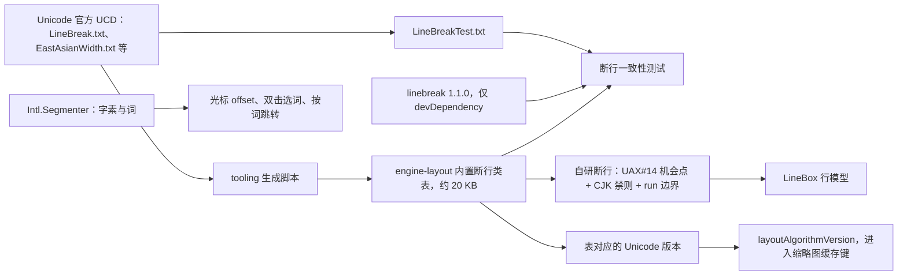

> 状态：草稿 | 负责：架构-运行时 | 更新：2026-09-24；2026-09-25（矛盾收口，rulings §4.18）；2026-09-26（§4.21：决策 4 断行来源改为 UCD 生成表，harfbuzzjs 体积更正为 shaping wasm 434 KB 并注 CSP 例外）；2026-09-26（§4.21 整合：决策 4 写明生成脚本 gen-linebreak-table.ts 与生成物 linebreak-trie.ts、UCD 数据归 ADR-0049 A 档；CSP 例外改链 50/14 §2.7）；2026-09-26（§4.21 Remap：原 30/07 迁出节的引用改指 50/01 §4a、50/19、50-frontend/04、50-frontend/13 等新位置） | 依赖：charter v0.1；裁决 `docs/00-charter/rulings-2026-09-14.md` §4.15 Q4/Q7、§4.18 CO-19/GV-20、§4.21；[ADR-0049 依赖准入与许可分级](0049-dependency-admission-and-license-tiers.md)

# ADR-0027 文本度量与断行策略

## 状态

提议。2026-09-24 按 rulings §4.15 Q7 写入竖排/RTL 分阶段口径与受限字体规则（Q4 将竖排/RTL 移入 Q7），见文末「修订 2026-09-24」；本 ADR 维持 canvas `measureText` + 自研断行的总方向（canvas 的「度量器」角色见 ADR-0021）。

## 背景

PowerPoint 文本语义（`normAutofit fontScale/lnSpcReduction`、`spAutoFit`、`anchor`、多栏、`wrap=none`、缩进/悬挂/项目符号、`spcPct` 行距、CJK 禁则、竖排）要求确定的行几何用于命中、光标、选区矩形、缩略图一致；服务端（headless）与客户端要一致；engine-layout 为 iso 包，度量器必须可插拔（章程 §5.2）。

## 决策

1. **自己断行（layout-then-paint）**：`engine-layout.layoutTextBody()` 产出 `LineBox[]`（行 y、run x 推进、字形高度）；渲染只绘制已定位的行（`<text>/<tspan x>`）。
2. **度量器 Definition `TextMeasurer`**（贡献点 `layout.measurer`），Provider：
   - `canvas`（render-dom）：`OffscreenCanvas.getContext('2d').measureText`（含 `fontBoundingBoxAscent/Descent`），字体回退由浏览器实际执行；**客户端与 headless Chromium 都用它**，故两端一致。
   - `node-font`（server-headless，可选，M4+）：以 opentype/fontkit 解析字体文件的 advance/OS2 度量（fontkit 只是实现说明，不是 Provider id），用于无浏览器路径（PDF 导出、校验）；标注「近似一致」。
   - `fixed`（testing）：固定宽度度量，使布局测试确定。
   （2026-09-25 修订，rulings §4.18 CO-19：正文直接使用架构 07 §14.1 定稿名；原：Definition `Measurer`、两个 Provider `canvas`/`fontkit`，作废。）
3. 一致性保障：受控字体集（回退表 07 §5.3，客户端与服务端同一 JSON；度量兼容替身 Carlito/Caladea/Liberation）+ 字体就绪后再度量（`document.fonts.load`）+ `layoutAlgorithmVersion` 进入缩略图缓存键。
4. 断行（2026-09-26 改写，rulings §4.21；原「`Intl.Segmenter` 可用时用之，否则内置表」作废——`Intl.Segmenter` 只有 grapheme / word / sentence 三种粒度，没有 line 粒度，从来不能给出 UAX#14 断行机会）：
   - **机会点来源**：engine-layout 内置的 UAX#14 断行类表是唯一运行时来源。该表由 tooling 从**最新 Unicode 字符数据库（UCD）**的 `LineBreak.txt`、`EastAsianWidth.txt` 等数据文件生成紧凑 trie（约 20 KB，生成物为 engine-layout 的 `src/domain/text/linebreak-trie.ts`），生成脚本是 `tooling/scripts/gen-linebreak-table.ts`（登记见 40-modules/01 §5.7，`--check` 跑 `LineBreakTest.txt` 一致性）；表所对应的 Unicode 版本写进 `layoutAlgorithmVersion`（决策 3），升级 Unicode 即升算法版本、缩略图缓存随之失效。UCD 数据文件的许可为 Unicode License v3（SPDX `Unicode-3.0`，宽松类），按 ADR-0049 的许可分级归入 A 档，作为数据文件登记在 `license-allowlist.json#dataFiles`。
   - **对照而非依赖**：`linebreak`（MIT，1.1.0，npm 最近发布 2022-06，数据停在 Unicode 13）只作 devDependency，与 UCD 自带的 `LineBreakTest.txt` 一起做差分对照；它不进运行时，也不再被视为「内置表」的来源。
   - **`Intl.Segmenter` 的位置**：只用于字素切分（光标 offset，30/04 §3.6）与词切分（双击选词、按词跳转，50-frontend/06 §6），缺失时字素退化为按码点、词退化为按空白与标点，都不影响断行。
   - 其余不变：CJK 行首行尾禁则、run 边界重置字距；autofit 迭代 ≤ 6 次（二分 fontScale）。
5. 度量缓存：按 `(fontKey, word)` LRU 50k 条，淘汰有测试（A29）。

## 备选方案与放弃原因

| 方案 | 放弃原因 |
|---|---|
| 浏览器 CSS 排版（HTML 文本） | 行模型不可读（只能 Range 反推）；autofit 仍要自测量；两端一致性不可控；与 SVG 图形层混排复杂（ADR-0021） |
| 全部用 fontkit/opentype.js 在两端度量 | 浏览器端需下载字体文件（无法用系统字体）、无 shaping（连字/复杂文种）；体积与性能差 |
| HarfBuzz（harfbuzzjs WASM）两端 shaping | 最精确，但体积大（2026-09-26 实测更正：harfbuzzjs 1.6.2 的 shaping 用 `harfbuzz.wasm` 434 KB 未压缩，`harfbuzz-subset.wasm` 651 KB 另计且运行时不需要；原写「~1 MB」作废）、字体文件需可得、CSP 需 `wasm-unsafe-eval`、复杂度高；作为 M4/M5 对复杂文种（阿拉伯/天城文）与 RTL 编辑的升级路径保留（见文末修订第 4 条与「修订 2026-09-26」） |
| 服务端不做度量（缩略图用客户端上传） | 见 ADR-0026 |
| `linebreak` 包作运行时断行来源（2026-09-26 评估） | 数据停在 Unicode 13、四年未发版，作唯一来源会让新字符（新 emoji、新 CJK 扩展区）断行退化；改为 tooling 从最新 UCD 生成表，`linebreak` 只作测试对照（决策 4） |
| `Intl.Segmenter` 作断行来源（原决策 4 写法） | 没有 line 粒度，无法给出 UAX#14 断行机会；只保留其字素与词粒度用途（决策 4） |

## 后果

正面：几何确定、可测试（FixedWidthMeasurer 使布局测试确定性）、两端一致、与 PowerPoint 语义贴近。

负面 / 代价：
- 自研排版复杂度：M1 覆盖西文/CJK 水平文本 + 基本项目符号 + autofit；竖排/RTL 按文末「分阶段」口径兑现，复杂文种 shaping 延后（M4/M5）。
- 与 PowerPoint 的差异来源仍存在（字体替身度量差异、kerning）：视觉 oracle 文本类别阈值放宽至 SSIM ≥ 0.93/0.90。
- 断行表（约 20 KB）是运行时必带的数据，不是「`Intl.Segmenter` 缺失时的回退」（2026-09-26 更正）；它随 Unicode 版本由 tooling 重新生成，升级时需重跑断行黄金用例与视觉 oracle 文本类别。

## 补充（v0.2）：Node 端度量与服务端 PDF/缩略图的关系、命名对齐、OF-05 指标

- **命名**：度量器 Definition 为 `TextMeasurer`，贡献点 `layout.measurer`（02 §4.13）；Provider id：`canvas`（render-dom）、`node-font`（server-headless，opentype/fontkit 解析字体文件）、`fixed`（testing）。（2026-09-25 起前文已直接改用 `TextMeasurer`/`node-font`，原「本 ADR 前文的 `Measurer`/`fontkit` 读作 `TextMeasurer`/`node-font`」一句作废。）
- **服务端缩略图与 PDF 不使用 Node 度量**：二者在 headless Chromium 中运行同一渲染代码，度量器是 `canvas`，与客户端逐像素一致（ADR-0026）。
- **导出从不重新排版**：`ooxml-pptx.encode` 是 Snapshot（+ 基线包）的纯函数，不读取 `layout` 服务（L3 也不允许 import L5）。排版结果中需要落盘的量（`a:normAutofit@fontScale/@lnSpcReduction`、`spAutoFit` 增高后的 `xfrm.ext`）由**编辑端**在布局时作为 Mutation 写回模型；因此服务端导出与客户端导出字节级一致（SV-02）不依赖任何度量器。
- **`node-font` 的用途**：`server-headless.tasks.validate/diagnostics` 中的溢出/换行诊断报告、未来无浏览器的 PDF 路径；标注「近似一致」（advance 误差 ≤ 1%，无 shaping）。它是可选 Provider：缺失时 `layout` 服务 `PENDING`，不影响导入/导出/迁移任务。
- **OF-05 门禁指标**：语料库文本框「行数一致率 ≥ 95%」「行首字符一致率 ≥ 90%」（参照字体可用）作为视觉 oracle 文本类别的结构断言（从 DOM 行模型读取，11 §17）；`render/font-fallback` 事件携带缺失字体名（不含文本）；`Intl.Segmenter` 不可用时不崩溃（2026-09-26 改写：断行不依赖它，缺失时只影响字素与词切分的精度，见决策 4；原「退化为按字符断行」作废）。
- **回退链顺序**（OF-05）：文档内嵌字体 → 集成方提供字体（`fontFaces`）→ 同度量替代表（07 §5.3）→ 系统默认。内嵌字体的许可位（OS/2 `fsType`）规则见文末修订第 5 条。

## 修订 2026-09-24：竖排 / RTL 分阶段兑现与受限字体（rulings §4.15 Q7「分阶段」）

> PRD OF 要求竖排 V(P0)@M1、bidi V(P1)@M1，本 ADR 原写「竖排/复杂文种延后」，二者冲突；用户裁决「分阶段兑现」，维持本 ADR 的 canvas `measureText` + 自研断行，不在 M1 引入自研 UAX#9 bidi 或 harfbuzzjs（WASM 体积 2026-09-26 更正为 shaping 434 KB，原写「约 1 MB」作废，见「修订 2026-09-26」）。

1. **竖排查看（M1）**：`vert` / `vert270` 以**文本框整体旋转**实现（行模型仍按水平排版，渲染时对文本框施加 90°/270° 变换）；`eaVert`（东亚竖排，字符直立）以近似实现并记 `render/fidelity` 诊断。
2. **RTL 查看（M1，V P1）**：RTL 段落改为「**每行一个 `<text>` 块、run 不设 `x`**」，把行内 bidi 重排交给浏览器（SVG `<text>` 的 `direction`/`unicode-bidi`）；行的 y、行高与断行点仍由本 ADR 的自研断行给出。此写法仅用于含 RTL 字符的段落，LTR 段落保持决策 1 的 `<tspan x>` 逐 run 定位；07 §3.2 的 tspan 写法随之修改。
3. **竖排编辑**：按 01 矩阵的 **E~（P2）**，不在 M2 承诺可编辑（02-editing:63「M2 可编辑」需更正）。
4. **RTL 编辑与 HarfBuzz shaping**：放到 **M4/M5**；届时 harfbuzzjs 作为 `TextMeasurer` 的升级 Provider（备选方案表中的 HarfBuzz 行即其路径），UAX#9 与逻辑↔视觉映射用 bidi-js（2026-09-26 补，见「修订 2026-09-26」）。
5. **受限字体**（OF-17，M2 生效，服务端渲染与 PDF 同样适用）：`fsType` 为「受限」的内嵌字体**仅用于只读渲染**（查看、放映、缩略图、PDF）；**编辑态**中用到它的文本改用回退链下一级字体，文档仍可编辑（不因一个字体把协同者锁成只读）。代价：编辑态与查看态字形可能不一致——编辑态度量以回退字体为准，`fontProfile` 区分「只读 / 编辑」两种字体集，缩略图缓存键（ADR-0026 `contentHash`）使用只读字体集。

## 修订 2026-09-26：断行来源与 shaping 体积更正（rulings §4.21）

> 来源：复用调研的逐项核实（`linebreak`、harfbuzzjs 均经 `npm view` 与 dist 实测）。用户要求「能复用成熟组件就尽量复用」；本修订的结论是：断行**数据**复用 Unicode 官方的 UCD（而不是停更的 npm 包），断行**算法**（禁则、run 边界、autofit）维持自研，理由见决策 1 与备选方案表。

1. **决策 4 改写**：见正文决策 4。要点是三条——运行时唯一来源是 tooling 从最新 UCD 生成的表；`linebreak` 1.1.0 降为测试对照；`Intl.Segmenter` 只负责字素与词。相关旧写法（40-modules/06 `line-breaker.ts` 两行、50-frontend/05 §6、30-architecture/07 §5 的「`Intl.Segmenter` 可用性检测 + 内置回退表」）随本修订改写，由各自属主回写。
2. **为什么不直接用 `linebreak`**：它是 UAX#14 的完整 JS 实现（MIT），但数据停在 Unicode 13，npm 最近一次发布是 2022-06；运行时依赖它意味着新增字符的断行类别永远落后，而我们又必须在其上叠加 PowerPoint 的 CJK 禁则与 run 边界规则。自己从 UCD 生成数据表的成本是一个 tooling 脚本加一组对照测试，数据可随 Unicode 发布更新。
3. **harfbuzzjs 体积**：以 1.6.2（MIT，2026-09-21 发布）实测为准——shaping 需要的 `harfbuzz.wasm` 434 KB（未压缩），`harfbuzz-subset.wasm` 651 KB 只在做字体子集时需要、不进浏览器运行时（字体子集在 tooling 做）；胶水代码含 Node 分支，接入时按浏览器入口裁剪。它随 M4/M5 的 RTL 编辑惰性加载，不计入编辑器 900 KB 首包预算，chunk 与预算登记见 50-frontend/13。
4. **CSP 例外**：WebAssembly 编译需要 `script-src 'wasm-unsafe-eval'`，与 50-frontend/14 现行「无 unsafe-eval」口径冲突；M4+ 引入 harfbuzzjs 时只加 `wasm-unsafe-eval` 这一项例外（它不放行 JS `eval`），例外的登记与 csp-strict 用例见 [50-frontend/14](../../50-frontend/14-client-security.md) §2.7。
5. **bidi-js**：UAX#9 与逻辑↔视觉映射用 bidi-js 1.1.0（MIT，npm 包解压约 171 KB，数据同样停在 Unicode 13）；与断行表同理，M4 立项时评估改由 UCD 生成 bidi 类表、只复用其算法部分。

**图 A 断行数据的来源与校验**

怎么读：左上是唯一的数据来源，经 tooling 生成运行时表；`linebreak` 与 `LineBreakTest.txt` 只汇入测试，不进运行时；`Intl.Segmenter` 与断行无关，只服务光标与选词；表的 Unicode 版本进入算法版本号，升级即让缩略图缓存失效。
依据：本 ADR 决策 3、决策 4；rulings §4.21。

## 如何被机械验证

- （2026-09-26）断行表：生成的表通过 UCD `LineBreakTest.txt` 全部用例（CJK 禁则等有意裁剪的规则列入豁免清单并逐条注明）；与 `linebreak` 的差分只允许出现在 Unicode 13 之后新增或改类的码位上；`layoutAlgorithmVersion` 含表的 Unicode 版本；运行时 bundle 中不出现 `linebreak` 模块（依赖图断言）。
- `runTextMeasurerConformance` 对 `canvas` 与 `node-font` 通过（2026-09-25 按章程 `run<Definition>Conformance` 命名改写，rulings §4.18 GV-20/CO-19；原 `runMeasurerConformance`、`fontkit` 作废）；两者对同一字体的 advance 误差 ≤ 1%（近似一致声明的量化）。
- 断行黄金用例（`engine-layout/__tests__`）：给定 FixedWidthMeasurer 的确定输出；CJK 禁则用例。
- 视觉 oracle 文本类别 gated。
- 缩略图一致性：服务端渲染图 vs 客户端截图像素差 ≤ 0.5%（ADR-0026）。
- （2026-09-24）竖排/RTL：`vert`/`vert270` fixture 查看视觉 oracle gated（M1）；RTL fixture 的行数与行首字符一致率纳入 OF-05 结构断言（M1 P1）；RTL 段落 DOM 中每行一个 `<text>` 且 run 无 `x` 属性。
- （2026-09-24）受限字体：含受限 `fsType` 字体的 fixture 在编辑态不加载该字体（FontFace 列表断言）、查看态加载；文档保持可编辑。

## 关联

章程 §5.2 engine-layout；`00-charter/rulings-2026-09-14.md` §4.15 Q4/Q7、§4.21；Univer A4；ADR-0021/0026/0028/0049；50/01 §4a.2、架构 07 §5；PRD OF-05/OF-17、02-editing；50-frontend/06 §7、50-frontend/13、50-frontend/14。
