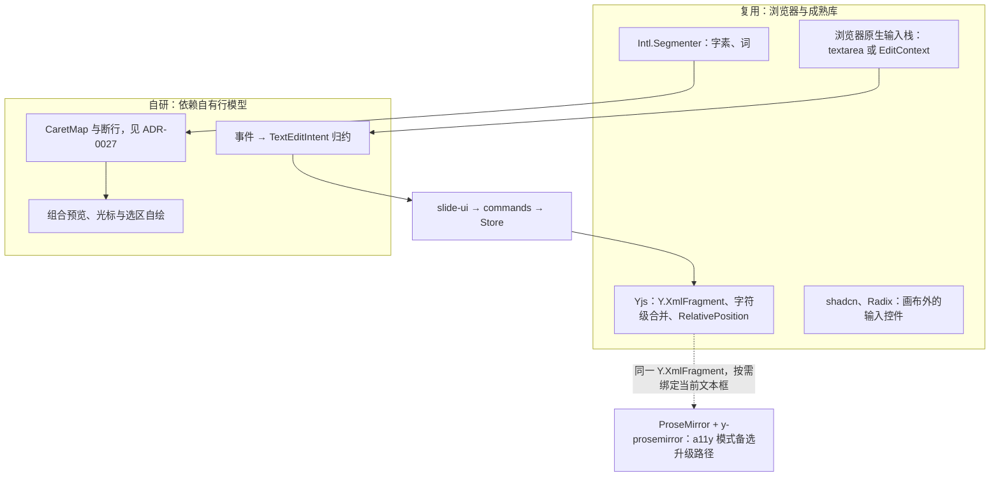

> 状态：草稿 | 负责：架构-运行时 | 更新：2026-09-24；2026-09-25（§4.19：IME e2e 落点按 T-NAMING 改到 `apps/web/e2e/`）；2026-09-26（§4.21：EditContext 作同接口第三实现进 R-M2-1 spike；ProseMirror 表述改为 a11y 模式备选升级路径；补成熟编辑器复用评估） | 依赖：charter v0.1；`40-modules/14` §5.3（M-06/G-5 + Q-3）；裁决 `docs/00-charter/rulings-2026-09-14.md` §4.15 Q4/Q7、§4.21；50-frontend/06 §3、§11

# ADR-0028 文本编辑宿主：单一隐藏 textarea + 自绘光标/选区

## 状态

提议。2026-09-24 按 `40-modules/14` §5.3（M-06/G-5 + M-06/Q-3，总编排采纳）把 `TextInputHost` 的形态回写为**包内可插拔点**（rulings §4.15 Q4 列为机械回写），并写入竖排/RTL 编辑的时点（Q7），见 v0.2 补充第一条与文末修订。

## 背景

文本编辑必须：与 ADR-0027 的自有断行像素一致；直接写入 Store 的富文本类型（Univer A32：无第二份编辑缓冲）；支持 IME（中日韩输入法组合态）、移动端虚拟键盘、基本 a11y；协同下光标随 RelativePosition 稳定。

## 决策

1. 每个 Unit 的 Surface 只有 **一个隐藏 `<textarea>`**（`render-dom/text-host`），聚焦即进入文本编辑；光标、选区高亮、组合中文本全部**自绘**在 overlay 层。
2. 事件 → Mutation：`beforeinput`（`insertText`/`deleteContent*`/`insertParagraph`/`insertFromPaste`）与非字符 `keydown`（导航/快捷键）转为命令；`compositionstart/update/end` 维持瞬态组合串，`compositionend` 才提交一次 `text.insert` 事务。
3. IME 候选窗定位：把 textarea 移到光标的像素位置（1×1、透明），组合期间跟随。
4. a11y 镜像：textarea 的值 = 当前段落纯文本，选区同步；`aria-activedescendant` 指向当前形状；只读态暴露 `role=document` 的语义文本树。
5. 文本几何来自 `CaretMap`（engine-layout）；远端光标同路径渲染。

## 备选方案与放弃原因

| 方案 | 放弃原因 |
|---|---|
| 每个文本框 `contenteditable`（HTML 文本） | 浏览器自行排版与我们的行模型冲突；DOM 变更反推为 Y 操作极易出错（ProseMirror 用数万行解决此问题）；`foreignObject` 内 contenteditable 在 Safari 不稳定；协同光标映射困难 |
| 引入 ProseMirror（y-prosemirror）承载每个文本框 | 成熟的协同富文本编辑，但仍是 HTML 排版（与自绘 SVG 文本不一致）、每文本框一个编辑器实例的内存/初始化成本、与 PowerPoint 段落/run 模型的 schema 映射额外一层；**不作主路径，保留为 a11y 模式的备选升级路径**（2026-09-26 措辞更正：不是「已否决」）：若 a11y 要求超出段落镜像方案，可在「a11y 模式」下只用 PM 承载当前正在编辑的那一个文本框，经 y-prosemirror 绑定同一个 `Y.XmlFragment`（30-architecture/06 §1.4 选 `Y.XmlFragment` 时已为此留口），退出编辑即卸载；其它成熟编辑器的逐项评估见「修订 2026-09-26」 |
| 单一 `contenteditable` 镜像（Google Docs 早期）而非 textarea | 语音输入/拼写检查行为更接近原生，但 contenteditable 的 `beforeinput` 覆盖差异更大，textarea 更可控；两者可切换，实现细节不影响契约 |
| 原生 SVG `<text>` 直接可编辑 | 浏览器不支持 |

## 后果

正面：编辑态与只读态一致；输入事件直接写 Store（A32）；协同映射简单；跨浏览器行为可控；移动端可用。

负面 / 代价：
- a11y 为「段落级朗读」而非原生富文本编辑体验（R2 待决级别）。
- 拼写检查/自动更正需自行接入或关闭（textarea `spellcheck` 只作用于镜像段落，可利用之显示下划线）。
- 组合态下的远端并发插入：组合完成后按 RelativePosition 锚点插入，位置正确但用户可能看到组合串短暂位移；可接受。
- 需要完整的键盘导航实现（方向键跨行/跨段落/跨形状、Home/End、Shift 选区、Ctrl 词跳）——在 slide-ui/ui-core 的输入管线中实现（05/ui），这里只提供 `CaretMap` 与选区 API。

## 补充（v0.2）：IME 宿主 spike 计划（PRD R-M2-1，M2 首要风险）

- **可替换性**（2026-09-24 改写，14 §5.3）：`TextInputHost` 是 `render-dom` **包内可插拔点**（包内接口 + 构造期选择实现），**不是**贡献点——原「贡献点 `render.textInputHost`，key = id」作废。两个实现：`hidden-textarea`（本 ADR 默认）与 `contenteditable-mirror`（02 §4.15 `ime-host.ts` 的形态，备选），spike 结束前两者并存，由 `render-dom` 的 Config 选择（2026-09-26 增第三个实现 `edit-context`，见文末「修订 2026-09-26」）。**升级为贡献点的条件**：仅当 R-M2-1 spike 否定 `hidden-textarea` 方案（即需要按 UA 或由第三方提供不同宿主）时，才升级为 `render.textInputHost` 贡献点并另行评审；40-modules/06 §13 Q-2/Q-3 据此结案。
- **时间盒**：M2 第 1 月，2 名工程师，2 周。
- **范围**：Chrome/Edge/Firefox/Safari（macOS）+ iOS Safari + Android Chrome；输入法：中文拼音（Windows 微软拼音、macOS 简体拼音、搜狗）、日文（Windows IME、macOS 日本語）、韩文；场景：段中输入、行尾换行处输入、跨 run 边界输入、选区替换、候选窗定位跟随缩放/滚动、组合中远端并发插入、撤销粒度。
- **退出标准**：(1) 全部场景无丢字/重复字；(2) 候选窗与光标像素偏差 ≤ 4 px；(3) IME 组合更新 p95 ≤ 80 ms（NF-01 1.2）；(4) `compositionend` 恰一次事务；(5) VoiceOver/NVDA 可朗读当前段落并跟随光标；(6) 双 Provider 在 spike 场景矩阵上的通过率对比表。
- **决策规则**：`hidden-textarea` 通过全部退出标准 → 定稿并把 `contenteditable-mirror` 降为兼容备选；若 Safari/iOS 上仅 contenteditable 通过 → 按 UA 在包内选择实现（同一包内接口），不改对外契约；此时是否升级为贡献点按上一条的条件评审。
- **产出**：`apps/web/e2e/ime/*.spec.ts`（2026-09-25 按决策 T-NAMING，原 `test/e2e/specs/ime/` 废止）（Playwright 合成组合事件 + 真机手测清单）、spike 报告回写本 ADR 状态。

## 修订 2026-09-24：竖排 / RTL 编辑时点、IME 与渲染介质（rulings §4.15 Q4/Q7）

- **竖排编辑**：E~（P2），不在 M2 承诺（与 ADR-0027 修订第 3 条一致）；M1 竖排仅查看（文本框旋转）。
- **RTL 编辑**：M4/M5，随 HarfBuzz shaping 一并评估；M1–M3 RTL 段落以浏览器 bidi 重排渲染（ADR-0027 修订第 2 条），其编辑行为的用户可见口径由 PRD 02-editing 定稿（待产品线回写），本 ADR 不承诺 RTL 光标/选区的正确性。
- **IME 与渲染介质无关**：IME 对齐由本 ADR 的隐藏 textarea + 自绘光标承担，与 DOM/SVG 还是 canvas 无关（ADR-0021 修订第 6 条）；M3 末最小 canvas Provider 验证（ADR-0021）须覆盖 `TextInputHost` 与 overlay 挂载处的 DOM 偏置。
- **机械验证补充**：扫描器断言 `render.textInputHost` 贡献点不存在（除非上述升级条件经评审成立）。

## 修订 2026-09-26：EditContext 第三实现与成熟编辑器复用评估（rulings §4.21）

> 背景：用户要求前后端「能复用成熟组件就尽量复用」，凡维持自研须写明为什么没有合适的成熟库。本修订做两件事：把浏览器新提供的 EditContext API 作为同接口的第三实现并入 R-M2-1 spike；对 ProseMirror 等成熟富文本编辑器逐项评估并写明不作主路径的理由。

### 1. `edit-context`：同接口第三实现（Chromium 渐进）

- **是什么**：W3C EditContext API 让作者把一个 `EditContext` 对象挂到任意元素上（`element.editContext = ctx`），浏览器把文本输入、IME 组合、分句格式与候选窗几何请求以事件（`textupdate`、`textformatupdate`、`characterboundsupdate`、`compositionstart/end`）交给作者，作者用 `updateText`、`updateSelection`、`updateControlBounds`、`updateSelectionBounds`、`updateCharacterBounds` 回填状态；它不渲染任何可编辑 DOM，正好对应本 ADR「自绘光标与选区、输入直写 Store」的模型。
- **可用性**：Chrome / Edge 121+ 已发布，Firefox、Safari 未发布（2026-09-26 核实），因此只能作渐进增强，**永远不是唯一实现**。
- **落点**：render-dom `infrastructure/text-host/` 内第三个实现，Provider id `edit-context`，与 `hidden-textarea`、`contenteditable-mirror` 共用 `TextInputHostHandle` 与 `TextEditIntent`；仍是包内可插拔点，不升级贡献点（决策与升级条件不变）。
- **相对 textarea 的收益**：候选窗按 `CaretMap` 的逐字符矩形定位（不再移动隐藏元素）；拿得到输入法分句的下划线样式；没有 textarea 值与 Store 之间的额外同步陷阱（`updateText` 只镜像当前段落）。
- **风险与必测**：EditContext 不替作者向辅助技术暴露文本，决策 4 的段落镜像能否成立要实测；删除类按键的到达方式、Android Chrome 可用性以实测为准；这些列入 R-M2-1 场景（50-frontend/06 §11.2）。
- **决策规则（补充 v0.2 的规则）**：只有 `hidden-textarea` 已通过全部退出标准、且 `edit-context` 在 Chromium 行全部通过并在候选窗偏差或丢字率上明显更优时，才在包内按能力检测选用 `edit-context`（有 EditContext 则用之，否则 `hidden-textarea`）；否则 `edit-context` 保留为关闭的候选。事件映射见 50-frontend/06 §3.1。

### 2. 为什么不用 ProseMirror / Tiptap / Lexical / Slate / Quill

版本与许可为 2026-09-26 `npm view` 实测。

| 库 | 版本 / 许可 | 它能给什么 | 为什么不作主路径 |
|---|---|---|---|
| ProseMirror（`prosemirror-view`） | 1.42.6 / MIT | 成熟的 schema 化富文本、事务与 DOM 变更反推、协同绑定 y-prosemirror（1.3.7 / MIT） | 以 contenteditable + 浏览器 HTML 排版为核心，行几何由浏览器决定，与 ADR-0027 的自有行模型形成双排版（autofit 阶梯、`spcPct` 行距、CJK 禁则、run 边界字距都无法用 CSS 精确表达，编辑态与只读态、服务端缩略图会不一致）；保留为 a11y 模式备选升级路径（见备选方案表） |
| Tiptap（`@tiptap/core`） | 3.31.3 / MIT | ProseMirror 之上的扩展化封装与现成扩展 | 继承 ProseMirror 的全部排版问题，再多一层抽象；其价值在「快速拼出网页富文本框」，而我们的文本框是 SVG 画布上的 PowerPoint 文本 |
| Lexical | 0.51.0 / MIT | 轻量编辑器状态树、插件体系 | 同样依赖 contenteditable 与浏览器排版；自有状态树是 Store 之外的第二份编辑缓冲（违背 A32），与 Yjs 的绑定需再做一层映射 |
| Slate | 0.126.2 / MIT | 高度可定制的 React 编辑器框架 | 同上；且仍处 0.x、API 频繁变化，React 渲染每个文本框的成本在单页 1,000 元素的规模上不可接受 |
| Quill | 2.0.3 / BSD-3-Clause | Delta 模型、开箱即用的编辑器 | Delta 把段落属性寄生在换行符上，与 30-architecture/06 §1.4 选择的「段落有元素身份」的 `Y.XmlFragment` 结构相悖；同样依赖 contenteditable 排版 |

**共同的硬伤**（与本 ADR 背景的四条要求逐一对应）：

1. **像素一致**：这些库都让浏览器排版 HTML，而画布上的文本由 engine-layout 断行、以 SVG `<tspan x>` 绘制；把 HTML 编辑器叠在 SVG 上逐像素对位，要同时处理缩放、旋转、翻转、竖排、autofit 缩小，任何一项偏差都会让光标与字形错位。contenteditable 不能直接放进 SVG，`foreignObject` 路线已由 ADR-0021 否决（Safari 不稳定）。
2. **单一事实源**：它们各自持有编辑器状态（EditorState、EditorState 树、Delta），即使经绑定写回 Yjs，也在 Store 之外多了一份需要双向同步的缓冲（Univer A32）。
3. **规模**：每个文本框一个编辑器实例；按需只挂当前文本框可以缓解，但那样它就只剩「输入宿主」的角色——这正是本 ADR 用一个隐藏 textarea（或 EditContext）承担的职责，而浏览器原生输入栈才是 IME 质量的真正来源。
4. **模型映射**：PowerPoint 的 `a:p`/`a:r`、字段 `a:fld`、`a:br`、不透明嵌入要一一映射成各库的 schema / node 类型，再映射回 OOXML，多一层有损转换。

**实际复用了什么**：浏览器原生输入栈（textarea 或 EditContext 的 IME 通道）；`Intl.Segmenter` 的字素与词粒度；Yjs 的 `Y.XmlFragment`、字符级合并与 `RelativePosition`（协同文本合并、光标稳定、评论锚点全部来自 Yjs，不是自研）；非画布输入（检查器、对话框、评论框）用 shadcn / Radix 的原生输入控件。**维持自研的只有**：事件到意图的归约、组合预览与光标选区的自绘、`CaretMap` 几何——它们依赖自有行模型，没有可替代的成熟库。

**图 B 文本编辑栈：复用与自研的分界**

怎么读：上方子图是复用的部分，下方子图是必须自研的部分；实线是一次键入的数据流（原生输入 → 意图 → 命令 → Yjs），虚线是保留的升级口——若 a11y 要求超出段落镜像，ProseMirror 可以直接绑定同一个 `Y.XmlFragment`，不改数据结构。
依据：本 ADR 决策 1–5、备选方案表；30-architecture/06 §1.4；rulings §4.21。

## 如何被机械验证

- （2026-09-26）三个实现（`hidden-textarea`、`contenteditable-mirror`、`edit-context`）对同一合成事件序列产出相同的 `TextEditIntent` 序列；`edit-context` 在不支持 EditContext 的环境中跳过并记录，不算失败（50-frontend/06 §13）。
- vitest browser mode：合成 `compositionstart/update/end` 序列 → 恰一次事务，中间无 Store 写入；`beforeinput insertText` 每字一次事务且被 captureTimeout 合并为一个撤销步。
- e2e（Playwright）：中文输入法模拟（`page.keyboard.insertText` + 组合事件）、移动端视口聚焦弹出键盘（Chromium 模拟）。
- 一致性：编辑中截图与失焦后截图像素相同（除光标/选区层）。
- a11y 自动化（axe）：可聚焦、有名称、只读语义树存在。

## 关联

Univer A32；`00-charter/rulings-2026-09-14.md` §4.15 Q4/Q7、§4.21；`40-modules/14` §5.3、`40-modules/06` §13 Q-2/Q-3；ADR-0021/0027/0024；架构 07 §6、05（命令管线）、06 §1.4；设计 20-design/07；50-frontend/06 §3.1、§11。
