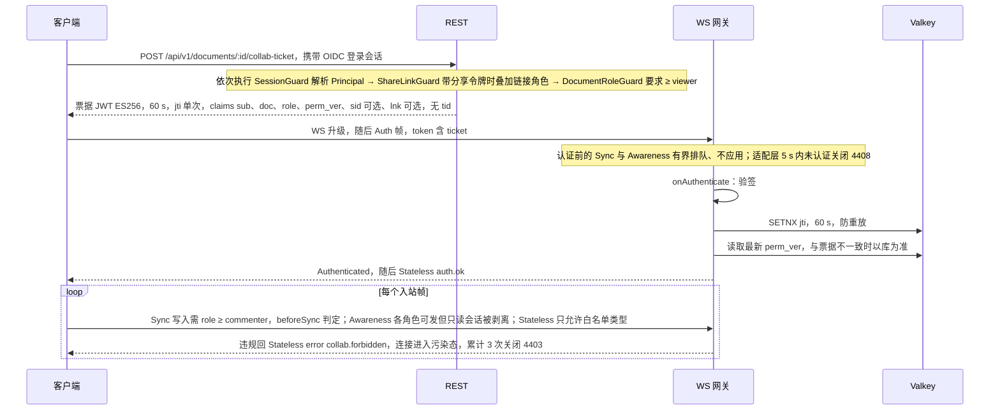
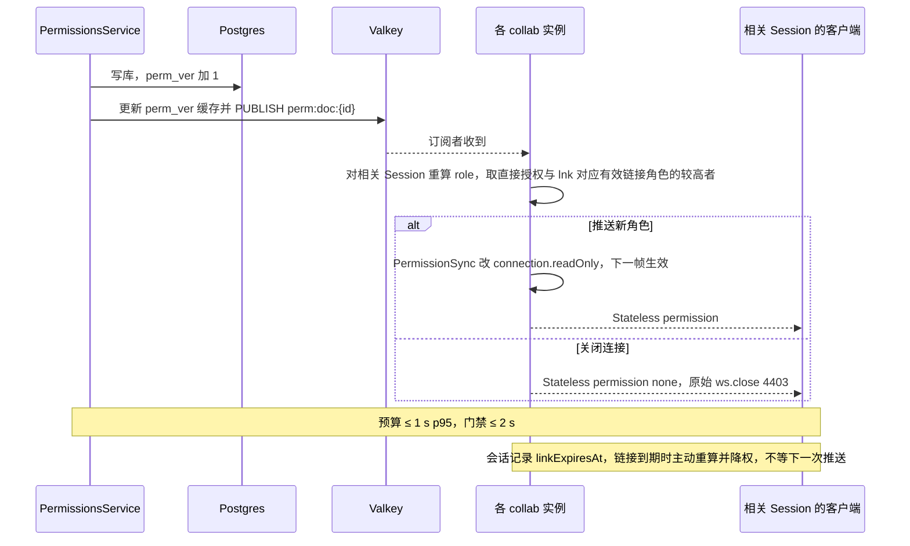

> 状态：已接受 | 负责：架构-运行时 | 更新：2026-09-24；2026-09-24 复核修正（rulings §4.17 D1/D3；复核报告 M11：门禁名 `check-rls-coverage`）；2026-09-25（补图）；2026-09-25（矛盾收口，rulings §4.18）；2026-09-25（§4.19：决策 3 SYNC 写入门槛改 ≥ commenter、令牌刷新按 INC-27 只重新绑定，见文末「修订（2026-09-25，rulings §4.19）」）；2026-09-25（§4.19）；2026-09-25（§4.19 N1：决策 5 锁定窗口收窄为导入与迁移，见文末「修订（2026-09-25，rulings §4.19 N1）」）；2026-09-26（§4.21：协同改用 Hocuspocus——决策 2 票据放 Auth 帧、认证前有界排队 + 适配层 5 s 期限；决策 3 L2 映射 `connection.readOnly` 加连接污染规则；决策 4 落在 PermissionSync 扩展；`auth.refresh` = `sendToken` → `onTokenSync`；图 1、图 2 改帧名，见文末「修订（2026-09-26，rulings §4.21）」）；2026-09-26（§4.21 Remap：原 30/08 引用按 60-backend/README §6.1 改指新位置，30/08 已删除） | 依赖：charter v0.1；裁决 `docs/00-charter/rulings-2026-09-14.md` §4.13 S-1、§4.15 T-0/Q6、§4.17、§4.18、§4.19 N1、§4.21；ADR-0039

# ADR-0029 协同网关鉴权与授权：短票据握手 + 每帧角色检查 + 权限版本传播

## 状态

**已接受**（2026-09-24，用户裁决 `00-charter/rulings-2026-09-14.md` §4.15 T-0 与 Q6）。原状态「提议（章程 D12、Q6）」。接受时的修订见文末「2026-09-24 修订」：单组织完全去租户；服务端只认 OIDC（外置 IdP，compose 可选 Casdoor），集成方签名 JWT 与 API Key 降为 M4；`auth.selfSignup` 部署级开关默认关；数据访问兜底加文档级 Postgres RLS；组管理推迟。凡正文与该节冲突处以该节为准，下文已就地标注。2026-09-25 按 rulings §4.18 再次修订（分享链接解析归属与 WS 重算、守卫顺序、刷新失败分流、IdP 对外入口），见文末「修订（2026-09-25）」索引，正文已就地改写。

## 背景

D12：fail-closed，检查点在命令管线与服务端网关两处。WS 无法像 REST 那样每请求校验 cookie/头；权限可能在会话中途变化；票据泄漏面要小；多实例下权限变更要即时。

## 决策

1. **票据**：`POST /documents/:id/collab-ticket`（路径相对 `apiBase` = `/api/v1`，rulings §4.18 BE-11）由 REST 会话鉴权后签发 JWT（ES256，60 s，`jti` 单次），claims：`sub, doc, role, perm_ver, sid?, lnk?`（2026-09-24 删去 `tid`——T-0 去租户）。`sid` 为**登录会话 id**（与 `Principal`/`Session` 的 `sessionId` 同义，按 JWT/OIDC 惯例）；`lnk` 为可选的**分享链接 id**——换票请求携带有效分享令牌时写入，供 WS 侧重算链接角色（见下方「2026-09-25 修订」；2026-09-25 修订，rulings §4.18 BE-02；原：claims 只有 `sub, doc, role, perm_ver, sid?` 且 `sid` 未定义含义，作废）。网关验签 + `jti` 防重放（Redis SETNX 60 s）+ `perm_ver` 对比 Redis 最新值（不一致以库为准）。
2. **握手**（2026-09-26 修订，rulings §4.21，ADR-0039 决策 3）：票据放在 Hocuspocus **Auth 帧的 token**（JSON：`ticket`、`protocolVersion`、`clientId`、`capabilities`、`appVersion`、`epoch?`、`maxSchemaVersion`、`traceparent?`，适配层限 ≤ 8 KiB）；鉴权在 `onAuthenticate` 执行，失败回 `PermissionDenied(reason)` 后以原始 `ws.close(映射码)` 关闭。认证前到达的 Sync / Awareness 帧由 Hocuspocus **有界排队、不应用**（默认上限 5 MiB / 1000 条，超限 4205；认证后、加载期间的帧仍进同一队列，因此不收紧），认证通过并加载完成后回放；严格的认证前限额与 **5 s 认证期限在网关适配层**、只计到 `Authenticated` 发出为止，超时 4408。已认证后再到的 Auth 帧即续票（`onTokenSync`，见补充 v0.2「令牌刷新」）。（原：「连接后首帧必须为 `CONTROL.auth`（5 s 超时 → 4408）；成功前任何 SYNC/AWARENESS 帧 → 4401」——官方 provider 发完 Auth 立即发 step1 与 awareness，取票期间的编辑还会先于 Auth 上线（vA-A1），按原文会误杀，作废。）
3. **每帧检查**：`SYNC update/step2` 帧要求 `session.role ≥ commenter`，commenter 的写入范围由服务端软门禁路径级规则限定在 `resources['comments.threads']`、作者只能改自己的实体（ADR-0034）；`AWARENESS` 允许 `viewer+`；CONTROL 只允许白名单类型。违规 → `error{collab.forbidden}`，累计 3 次 → 4403；在途帧不计数——服务端发出降权 `CONTROL.permission` 或 `CONTROL.room{locked}` 之前已到达、以及发出后 2 s 内到达的写入帧都视为在途，只回 `error{collab.forbidden}`；此后到达的越权写入才计数（60-backend/16 §4）。（2026-09-25 修订，rulings §4.19，见文末同名修订节；原：「`SYNC update/step2` 帧要求 `session.role ≥ editor`」，作废——评论的事实源在 CRDT，按原写法协同模式下 commenter 无法评论。）**挂点与拒绝语义**（2026-09-26 修订，rulings §4.21，ADR-0039 决策 4、6）：可写性映射到 Hocuspocus 的 `connection.readOnly`（加入时经 `connectionConfig.readOnly` 设定，运行中直接改字段、下一帧生效）；L2 在 `beforeSync` 判定并发 Stateless `error{collab.forbidden}`（计数规则不变）。被拒帧之后同一客户端的更新可能因缺前驱不可见，因此采用**连接污染规则**：一条连接一旦丢弃过写入帧，之后的写入帧一律不落库、不回 ack，直到重连，其间不允许把 `readOnly` 恢复为 `false`；权限升级或解锁时若该连接丢过帧，先发 `permission` 再以 1012（reason `contaminated`）关闭，客户端按被拒回滚重建。只读连接仍能发 awareness，由 `beforeHandleAwareness` 剥离（ADR-0024）。（原：「违规 → `error{collab.forbidden}`」后连接照常收写，作废——vB 实测会产生「已 ack 但不可见」的数据。）
4. **权限变更即时生效**：PermissionsService 写库后 `perm_ver++` 并 `PUBLISH perm:doc:{id}`；各实例对相关 Session 重算 role → `CONTROL.permission` 或关闭 4403；预算 ≤ 1 s p95。**落点**（2026-09-26，rulings §4.21，ADR-0039）：server-collab 的 `PermissionSync` 扩展订阅（经 `AuthorizationSource.onPermissionChanged`），对本实例该文档的连接逐个重算，改 `connection.readOnly` 并发 Stateless `permission`；`none` 发 `revoked` 后 `ws.close(4403)`，awareness 移除由 Hocuspocus 原生广播；Valkey 恢复后对本实例全部会话全量重算。Hocuspocus 没有跨实例控制面、也没有权限通知消息，extension-redis 不承载这条链路。
5. **文档锁定**（`documents.status='locked'`）：网关拒写（同降权），用于**覆盖导入与迁移**窗口；版本恢复不加锁，覆盖导入以换纪元收尾（在线会话 4428 后重新 bootstrap）而不是解锁（2026-09-25 修订（rulings §4.19 N1），见文末同名修订节；原：「用于导入/恢复/迁移窗口」，作废——恢复是持有 Room 的 collab 进程内单事务，加锁只会让协作者的并发编辑被 L2 拒绝并触发「导出后重载」，且覆盖导入若经恢复用例实现会与锁自冲突）。**擦除中**（`documents.status='purging'`，S-2 文档擦除或「永久删除文档」）：网关**拒绝加入**，已打开的 Room 经 `forceEpoch` 踢出会话并关闭后才清 `document_updates`/快照，防止清理后在线 Room 把新 update 写回（2026-09-25，rulings §4.18 BE-15）。
6. **观看链接（share link）**：REST 换票据时把 link 角色折叠进 `role`，并在票据中带上 `lnk`（链接 id）；WS 不直接接受 link token，会话内的链接角色按 `lnk` 重算与到期降权（2026-09-25 修订，rulings §4.18 BE-02，见文末同名修订节）。**匿名访问路径与登录前置条件的完整定义见下方"2026-09-21 修订"一节**（rulings §4.13 S-1）。
7. **API Key**：**降为 M4**（rulings §4.15 Q6），M1–M3 服务端不接受 API Key；M4 引入时仍不允许直接走 WS，须先经 REST 换票据（原 B7 待决随之结案）。

**图 1 票据签发、握手与每帧检查（M1–M3）**

怎么读：纵线是参与方，自上而下是时间顺序（2026-09-26 按 ADR-0039 改帧名：Auth 帧、`Authenticated`、Stateless；原图「首帧 CONTROL.auth」「auth 成功前收到 SYNC 或 AWARENESS 关闭 4401」作废）。三个守卫的先后是固定的：链接角色必须在 `DocumentRoleGuard` 判定前进入 `Principal`，否则只凭链接、没有直接授权的用户会先被 403（2026-09-25 修订，rulings §4.18 BE-05；原 Note「SessionGuard 解析 Principal，DocumentRoleGuard 要求 ≥ viewer，可选叠加 ShareLinkGuard」未定先后，作废）。WS 网关不接受分享链接令牌，链接角色在 REST 换票据时就已折叠进 `role`，票据另带 `lnk` 供会话内重算；M1–M3 票据只由 OIDC 会话换取，集成方签名 JWT 与 API Key 降为 M4。

**图 2 权限变更的即时传播**

怎么读：自上而下是一次权限写入扩散到所有实例的顺序（2026-09-26：各实例上由 server-collab 的 `PermissionSync` 扩展执行，权限帧走 Stateless，ADR-0039）。网关不必每帧查库，而是靠这条推送链更新会话内缓存的 `role`；`perm_ver` 在 PG 与 Redis 协议层双写，以 PG 为准。链接撤销同样经 `perm_ver` 加 1 与 `perm:doc:{id}` 推送生效；重算时取「直接授权」与「票据 `lnk` 对应链接此刻的有效角色」两者的较高者，所以他人改动权限不会把只凭链接加入的会话误降为 none（2026-09-25 修订，rulings §4.18 BE-02；原：重算只看票据主体的直接授权，作废）。

依据：本文决策 4、「后果」与补充（v0.2）；门禁 ≤ 2 s 见 ADR-0023 补充（v0.2）。

## 备选方案与放弃原因

| 方案 | 放弃原因 |
|---|---|
| WS 升级请求带会话 cookie | 跨站嵌入（SDK 场景）下 cookie 不可用；无法携带 doc 级权限快照；升级请求的头在部分代理/日志中可见 |
| 长时 access token 放 URL query | 泄漏面（日志、Referer、代理）；无法单次使用 |
| 每个 update 帧查库校验权限 | 延迟与库压力；改为会话内缓存 role + 版本号推送 |
| 仅客户端检查权限 | 不是安全边界 |
| `Sec-WebSocket-Protocol` 传 token | 非标准用法、代理兼容差、长度限制 |

## 后果

正面：泄漏面小；权限变更秒级生效；网关无需查库即可校验；多实例一致。

负面 / 代价：重连必须先换票据（一次 REST）；票据签发端点需独立限流；`perm_ver` 需在 Redis 与 PG 双写（PG 为准，Redis 缓存；缓存缺失时回源）。

## 补充（v0.2）：PRD EM-03 / CO-05 的承接

- **凭据两种形态**：(a) 一方票据（60 s、`jti` 单次），用于 `apps/web` 与 OIDC 登录用户——**M1–M3 唯一形态**；(b) **集成方签名 JWT**（≤ 1 h，JWKS 验签；claims 草案 `sub`、`doc`、`caps[]`（能力位）、`exp`；2026-09-24 删去 `tenant`）直接放入 `CONTROL.auth`，无需先换票据——**2026-09-24 起降为 M4**，届时按 `sub` JIT 建影子用户（`documents.owner_id`、`comments.author_id` 需外键），ticket-verifier 增加该分支（14 §5.10 G-19）。
- **权限来源可替换**（随 (b) 降为 M4；M1–M3 权限来源只有服务端 `permissions` 表）：默认读 JWT claims（`caps[]` → Role/能力位）；可配置为回调集成方权限服务（缓存 ≤ 60 s）；撤销通过 `perm:doc:{id}` 推送 ≤ 2 s 生效（不等缓存过期）。
- **令牌刷新**（2026-09-25 修订，决策 INC-27，见文末「修订（2026-09-25，rulings §4.19）」）：浏览器登录会话每次被动续期成功之后，客户端换新 collab ticket 并以 `CONTROL.auth.refresh{ ticket }` 发送（不断连）；**2026-09-26 起该帧改为客户端 `provider.sendToken()`（token 函数现换票）发出的 Auth 帧、服务端 `onTokenSync` 处理**（rulings §4.21，ADR-0039 决策 3）：`onTokenSync` 不被 Hocuspocus await，网关适配层在转发该 Auth 帧后**暂停后续帧**、等钩子完成再放行，否则紧跟其后的 update 会按旧角色处理（vC）；重算的角色直接写 `connection.readOnly`（`onTokenSync` 的返回值不会更新 `connection.context`，会话态放 context 里的可变对象直接改）；失败由钩子以原始 `ws.close(4401)` 关闭（原生行为只是文档级关闭、客户端见 1000）；服务端验签 + `jti` 单次 + `sub` / `doc` / `sid` 与当前会话一致后**只重新绑定**会话并重算 role，**不延长**会话寿命——M1–M3 一方票据的 WS 会话寿命 = 票据 `sid` 指向的登录会话，登录会话被吊销时以 4401 关闭；M4 集成方签名 JWT 复用同一帧，届时才以新 JWT 的 `exp` 续期。（原：「`getToken()` 在到期前 60 s 刷新并以 `auth.refresh{ token }` 续期，服务端更新 session 的过期时间」，作废。）刷新失败**按原因分流**（2026-09-25 修订，rulings §4.18 UX-02/UX-03）：**网络错误** → `reconnecting`，与重连共用同一个 30 s 离线计时（自进入重连起累计 30 s 仍未连上 → `offline`，ADR-0023 决策 5），不另设计时器；**鉴权失败（401，`server.auth.expired`）** → 直接进入「登录已过期」，不经过「重连中 → 离线」。「登录已过期」时由横幅在**弹窗或新标签**完成 OIDC（服务端照常设 httpOnly cookie，回调页经 BroadcastChannel 通知原页，原页重获焦点时也探测 `/auth/me`；弹窗被拦截退化为新标签链接），原页不跳转、待同步队列保留；登录回来的用户 id 与原会话一致时取新票据，按 06 §5.1 已有的 `denied → connecting` 边重连 → 同步中 → 已恢复；**不一致时不重放队列**，按只读处理并提供导出本地副本（防止以他人身份提交更改）；该横幅处理前不可关闭。（原：「刷新失败 → `reconnecting` → 30 s → `offline`」，不分原因，作废。）
- **单人模式**：无服务端时集成方直接传入能力位，客户端命令管线 fail-closed（CO-05）。
- **错误码映射**：PRD `auth/invalid-token`、`auth/expired`、`auth/forbidden` → `server.auth.invalid_token`、`server.auth.expired`、`server.auth.forbidden`（HTTP 401/401/403；WS 4401/4401/4403），均触发 `collab/auth-failed` 事件且不泄露内部细节（10 §11.2）。
- **构造消息绕过客户端**（CO-05）：服务端拒绝该 update 并在累计 3 次后断开（4403），审计 `collab.update_rejected`。

## 补充（2026-09-21 修订）：分享链接不引入匿名 Principal，链接角色叠加在已登录 Principal 上；个人账号自助注册路径与外部访问审计

服务端拆分评审（`40-modules/15-server-architecture-review.md` §3.2）指出：决策 6"REST 换票据时把 link 角色折叠进 role"一句，隐含前提是访客已持有一个可供"折叠"的 `Principal`，但完全匿名（无 OIDC 账号）的访客如何先获得这个 `Principal`，本 ADR 此前从未定义——这是一处真实的鉴权路径缺口，而非文字疏漏。用户已就此裁决（`00-charter/rulings-2026-09-14.md` §4.13 S-1），修订如下：

- **不支持真正匿名访问**：分享链接的 `role` 只叠加在**已登录**的 `Principal` 上（M1–M3 仅 `kind:'user'`；`'apiKey'` 随 API Key 降 M4）——同一部署内任意已登录账号凭有效链接令牌即可访问文档并获得链接角色（2026-09-24 删去「包括其它租户的用户」——T-0）。服务端**不产出** `Principal.kind='shareLink'`；`@cordexjs/protocol` 与 `40-modules/08` 的 `Principal` 类型不再声明该字面量（40-modules/08 §1.2 同步）。
- **鉴权路径**：REST 侧新增 `ShareLinkGuard`（`share-links/interface/guards/share-link-access.guard.ts`）——在 `SessionGuard`/`ApiKeyGuard` 已解析出 `Principal` 之后运行，解析请求中的分享令牌（Header 或 Query）→ 校验未撤销（`revokedAt` 为空）且未过期（`expiresAt` 未到）→ 把令牌对应的 `role` 叠加进当前 `Principal.scopes`，不落库、不产生新 `Principal`。未登录访客访问带分享令牌的资源时，`SessionGuard`/`ApiKeyGuard` 按原有 fail-closed 语义返回 401，由前端跳转登录（不是本 ADR 新增行为，只是明确"分享链接不豁免登录检查"这一前提）。
  - **守卫顺序**（2026-09-25 修订，rulings §4.18 BE-05/BE-06）：固定为 rate-limit →`SessionGuard`（由 `AppModule` 以 `APP_GUARD` 全局注册、默认拒绝，只有 `@Public()` 白名单放行，非 HTTP 上下文直接放行、WS 靠首帧票据）→ `ShareLinkGuard`（请求带分享令牌时生效；可注册为紧随 `SessionGuard` 的第二个 `APP_GUARD`，无令牌直通）→ `DocumentRoleGuard`（控制器级）。类名统一为 `ShareLinkGuard`（文件名沿用 `share-link-access.guard.ts`；原 40-modules 写法 `ShareLinkAccessGuard` 作废）。
  - **令牌解析归权限模块**（2026-09-25 修订，rulings §4.18 BE-02，用户选「解析归权限模块」）：`ResolveShareLinkUseCase`（token → `{docId, role, linkId, expiresAt}` 与 linkId → 当前有效角色两条路径，**只读**，经受控的 `SECURITY DEFINER` 函数查 `share_links`，ADR-0022 修订 §3）归 `PermissionsModule` 并导出；`ShareLinksModule` 只管链接的创建、撤销、列表与 `ShareLinkGuard`，依赖方向为 ShareLinks → Permissions 单向、无环。`ShareLinkGuard` 与 `RoleResolverService` 都调用同一个用例解析令牌，两处结果必然一致；`Principal.scopes` 的链接条目形状为 `{docId, role, linkId, expiresAt}`，`RoleResolverService` 与 `DocumentRoleGuard` 取「直接授权」与 scopes 中本文档链接角色的较高者（5 s 缓存只缓存直接授权部分）。（原：未规定解析用例归属，40-modules/08 曾写 ShareLinks 导出解析用例供 RoleResolver 消费、同时 import Permissions，成环，作废。）
- **无账号访客的路径**（2026-09-24 改写，原「服务端 `register-personal-account.usecase.ts` 创建 `tenantId=null` 的个人 User」作废——服务端不持有密码、无租户）：由部署级开关 **`auth.selfSignup`（默认关）** 决定。关闭时由管理员在 IdP 中建号（**服务端不设「待接受邀请」表、无邀请兑现流程**；分享邀请只对已存在账号生效，被邀请者尚无账号时提示「联系管理员开通账号」——2026-09-24 复核修正，rulings §4.17 D1）；开启时访客在 **IdP**（compose 可选 Casdoor 或任意 OIDC IdP）自助注册，服务端在**首次 OIDC 登录时 JIT 建号**。登录成功后即为已登录 `Principal`，随后按上一条路径兑现分享链接。
- **WS 侧**：决策 2/6 原有"WS 不直接接受 link token"维持不变——协同 ticket 签发（`POST /documents/:id/collab-ticket`）同样按 `SessionGuard → ShareLinkGuard（可选）→ DocumentRoleGuard（≥ viewer）` 的顺序执行；票据签发时 claims 里的 `role` 已经是叠加后的最终角色。**但会话中途的重算需要知道链接来源**（2026-09-25 修订，rulings §4.18 BE-02；原：「WS 网关侧无需感知令牌来源」作废——按原写法，只凭链接加入的会话在文档发生任何一次权限变更后会被误降为 none 并踢出，链接到期也不会触发重算）：
  - 票据带可选 claim `lnk`（链接 id），会话记录 `linkId` 与 `linkExpiresAt`；
  - collab 侧 `AuthzSource`（M-09）收到 `perm:doc:{id}` 重算时取 **max(直接授权, `lnk` 对应链接此刻的有效角色)**，链接角色经 `PermissionsModule` 导出的 `ResolveShareLinkUseCase`（linkId 路径）查询，collab 角色因此装配 `PermissionsModule`（另按装配矩阵装 `ShareLinksModule`，ADR-0037 决策 1），`CollabModule` 经 import `PermissionsModule` 取得该用例；
  - 链接被撤销：撤销写库后 `perm_ver++` 并推送 `perm:doc:{id}`，会话 ≤ 1 s 降权；链接到期：会话按 `linkExpiresAt` 设定时器**主动**重算降权，不等推送。
- **外部访问审计**：`ShareLinkGuard` 每次成功叠加角色（即每次真实的外部访问）写一条审计 `share-link.accessed`（`{docId,linkId,principalId,role}`，仅审计，不采样），由 `40-modules/12` 审计模块消费；对照决策 6 表格上方"如何被机械验证"的既有断言口径，本条新增审计断言（见下）。
- **PRD 承接**：`10-prd/03-features/03-collaboration.md` CO-15 原"免登录"表述改为"登录后凭链接即得角色"（由对应回写员同步，不在本 ADR 重复措辞）。

落地文件清单：`40-modules/08-server-identity-documents-and-storage.md` §1.2/§2.4/§2.6/§3/§4.1/§4.6/§5.1/§5.6/§6/§12 G-19/§13 Q-8。

## 修订（2026-09-24，rulings §4.15 T-0 / Q6）：单组织去租户、外置 IdP、文档级 RLS

> 方向性裁决：多租户/SaaS 设计属过度复杂化，本项目只做**单组织「用户登录 + 协同」**。证据包 `00-charter/_evidence/q1-q10-decision-pack.json` 的 Q6 推荐（三种凭据模式、Keycloak、tenant_memberships、租户级 RLS、另立 ADR-0036）与本节冲突处**以本节为准**；不另开 ADR-0036，身份与去租户口径记录在本节。

1. **单组织、完全去租户（T-0）**：一次部署 = 一个组织；数据模型、API、票据 claims、权限中**无 tenant**（本 ADR 已删 `tid`/`tenant` claim）。U-10「租户不开放自助创建」、S-1 的跨租户措辞、S-3 按租户分桶、§4.13 `GroupRepository.findById` 补 `tenantId` 均以本节为准而失效。将来若做 SaaS 另立项、以迁移加回。
2. **外置 IdP，服务端只认 OIDC（M1–M3）**：服务端是 OIDC RP，**不持有用户密码**；compose 提供**可选** `idp` profile，内置 **Casdoor**（Apache-2.0，Go 实现、轻量；原生支持企业微信/钉钉/飞书，国内 IM 经 Casdoor 代理，服务端不写私有 OAuth 适配器），可换成任意 OIDC IdP。用户以 `(issuer, subject)` 唯一识别，具体表结构由 40-modules/08 定稿（不含租户与成员关系表）。**issuer 用浏览器可达的对外 URL**：内置 Casdoor 经反向代理子域 `idp.<域名>` 暴露（Casdoor 仍只在 backend 网络、不开宿主端口，ADR-0037 决策 3）；应用侧的 OIDC 发现与 JWKS 请求经反代在内网的网络别名访问同一 URL，仍满足「唯一常规出站」；`redirectUri` 为 `/api/v1/auth/oidc/callback`（2026-09-25 修订，rulings §4.18 BE-01/BE-11；原：未规定 issuer 取内网还是对外地址，按原拓扑浏览器无法到达 Casdoor 登录页，作废）。
3. **集成方签名 JWT 与 API Key 降为 M4**：届时按 `sub` JIT 建影子用户；M1–M3 票据只由 OIDC 会话换取。
4. **注册策略 = 部署级开关 `auth.selfSignup`，默认关**：关闭时由管理员在 IdP 建号（邀请仅对已存在账号生效，无待接受邀请表，rulings §4.17 D1）；开启时在 IdP 自助注册、首次登录 JIT 建号。分享链接**始终要求登录**（延续 S-1 不匿名）。`apps/web` 的 `auth.mode:'none'` 只限 dev 构建，服务端在 production 下拒绝无鉴权启动。
5. **数据访问兜底 = 文档权限检查（D12）+ 文档级 Postgres RLS**：RLS 以「当前主体对该 `doc_id` 的权限」为判定（设计见 ADR-0022 修订 §3）；它是纵深防御，不替代本 ADR 决策 1–4 的网关检查与 REST Guard。机械上为**两道防线**（2026-09-24 复核修正，rulings §4.17 D3）：代码层扫描器 `scan-doc-access-via-permission`（M-01 第 14 个扫描器：按文档读写的仓储方法必须经权限服务）+ 数据库层文档级 RLS（治理检查脚本 `check-rls-coverage`）。
6. **CI 分层认证**：PR 门禁 = Casdoor 容器 + `oidc-provider` mock（可离线稳定运行）；nightly / 发布前认证 Keycloak、Entra ID、飞书等外部 IdP。
7. **组管理（U-11）推迟**：M3 只按人分享；权限主体仅 `user`（与分享链接叠加），不出现 `group`。

## 修订（2026-09-25，rulings §4.18）：分享链接解析归属与 WS 重算、守卫顺序、刷新失败分流、IdP 对外入口

> 用户裁决 `00-charter/rulings-2026-09-14.md` §4.18（文档矛盾收口）。各条已就地改写正文，并以「原：…作废」保留演进；本节只做索引。

1. **BE-02 分享链接角色（用户选「解析归权限模块」）**：`ResolveShareLinkUseCase` 归 `PermissionsModule` 并导出，`ShareLinksModule` 只管创建、撤销、列表与守卫，依赖单向无环；票据新增可选 claim `lnk`，`sid` 定义为登录会话 id；WS 重算取 max(直接授权, 有效链接角色)，会话记录 `linkExpiresAt` 到期主动降权——见决策 1、决策 6、图 2 与 2026-09-21 修订节的「鉴权路径」「WS 侧」两条。
2. **BE-05 / BE-06 守卫顺序**：rate-limit → `SessionGuard`（全局 `APP_GUARD`，`@Public()` 白名单）→ `ShareLinkGuard`（可选，带令牌时生效）→ `DocumentRoleGuard`——见图 1 与「鉴权路径」。
3. **UX-02 / UX-03 刷新失败分流**：网络错误走重连并共用 30 s 离线计时；401 直接「登录已过期」，新窗口重新登录、同一用户才重放——见补充（v0.2）「令牌刷新」。
4. **BE-01 / BE-11 IdP 对外入口**：issuer 用对外 URL（`idp.<域名>` 反代子域），`redirectUri` 为 `/api/v1/auth/oidc/callback`——见 2026-09-24 修订第 2 条。
5. **GV-15**：扫描器按正式名 `scan-doc-access-via-permission` 书写。

## 修订（2026-09-25，rulings §4.19）：SYNC 写入门槛与令牌刷新

> 依据：rulings §4.19 D-COMMENTS-PKG（评论事实源为 ResourceHook `comments.threads`，经 `comments.*` 命令写 CRDT）+ PRD PD-04（用户裁决）+ ADR-0034 补充 v0.2（路径级规则）；设计线遗留口径 INC-27（rulings §4.19 登记，needsUser=false）。决策 3 与「令牌刷新」已就地改写，本节只做索引。

1. **决策 3 写入门槛**：`SYNC update/step2` 的角色门槛由 ≥ editor 改为 **≥ commenter**。commenter 的写入范围由服务端软门禁路径级规则限定在 `resources['comments.threads']`，作者只能改自己的实体，越界写入以补偿事务还原并计数、达阈值 4409（ADR-0034 修订 2026-09-25）；viewer 的任何写入仍在 L2 拒绝（`error{collab.forbidden}`，3 次 4403；降权或锁定时已在途的帧不计入这 3 次）。服务端细则见 60-backend/16 §4、60-backend/02 §9。
2. **令牌刷新（INC-27）**：一方票据的 `auth.refresh{ticket}` 只重新绑定会话、重算角色，不延长寿命（寿命由 `sid` 指向的登录会话承担，吊销即 4401）；触发点是浏览器会话每次被动续期成功之后，不再按「到期前 60 s」计时；M4 集成方 JWT 才以新 `exp` 续期。帧定义见 06 §6.3。（2026-09-26 补：`auth.refresh` = `provider.sendToken()` → `onTokenSync`，适配层暂停后续帧直到钩子完成，rulings §4.21。）
3. **分享令牌传递**（决策 INC-25 的对齐）：API 只接受请求头 `X-Cordex-Share-Token`，不接受 query；上文 2026-09-21 修订节「Header 或 Query」按此收窄。
4. **文档锁定的会话信号**：决策 5 的锁定窗口经 `CONTROL.room{ locked:{reason, until} }` 通知在线会话（解锁推送不带 `locked` 的 `room`），不借 `permission{reason:'changed'}`——角色并未改变（06 §6.3）。

## 修订（2026-09-25，rulings §4.19 N1）：锁定窗口收窄为导入与迁移

> 依据：rulings §4.19 表末行 N1-IMPORT-OVERWRITE-RESTORE-LOCK（用户裁决「恢复不锁、覆盖导入换纪元」）。决策 5 已就地改写，本节记录要点。

1. **锁定窗口**：`documents.status='locked'` 只用于覆盖既有文档的导入与 schema 迁移，锁原因（`room.locked.reason`、审计 `document.locked.reason`）取值为 `import`、`migration`（原：含 `restore`，作废）。
2. **版本恢复不加锁**：恢复是持有 Room 的 collab 进程内的单个事务（`origin=system('restore')`），不调用锁定用例、不推 `room{locked}`，在线会话不断连，协作者的并发编辑与恢复事务按 CRDT 合并；文档因覆盖导入或迁移处于 `locked` 时，恢复请求与其他写路由一样得 409 `server.documents.locked`（60-backend/05 §10）。
3. **覆盖导入 = 换纪元**：导入期间文档 `locked`，会话按决策 5 转只读；worker 上的导入处理器写 `epoch + 1` 的 `import` 快照、在同一事务推进 `documents.epoch` 并解锁，随后经既有控制频道 `room:{docId}:ctl` 发 `epoch`，在线会话以 4428 断开后重新 bootstrap，未获 db 确认的本地更改移入 `rejected` 并可导出（决策 INC-06 的 4428 流程）；不新增 worker → collab 的触发通道，旧纪元副本漏收通知时由取号的纪元栅栏兜底（60-backend/06 §6.5、60-backend/05 §9.2）。
4. **与 `permVersion` 的关系不变**：锁定与解锁经 `perm:doc:{id}` 的 `lockChanged` 通知、不递增 `perm_ver`；纪元递增与 `perm_ver` 仍互不联动（决策 4、rulings §4.11 C-17）。

## 修订（2026-09-26，rulings §4.21）：协同服务端改用 Hocuspocus 4

> 依据：rulings §4.21 q-ws-gateway（用户裁决，知情的非推荐项）与 H:Q1–Q6；ADR-0039。决策 2–4、补充 v0.2「令牌刷新」、§4.19 修订第 2 条与图 1、图 2 已就地改写，本节只做索引。

1. **决策 2 握手**：票据放 Auth 帧 token（JSON）；认证前帧有界排队、不应用；5 s 认证期限与严格限额在网关适配层；删「首帧必须 auth」「认证前 SYNC 即 4401」「认证后再收 auth 即 4400」；鉴权判定只放 `onAuthenticate`、不放 `onConnect`。
2. **决策 3 每帧检查**：L2 映射 `connection.readOnly`、在 `beforeSync` 判定并发 Stateless `error`；新增连接污染规则（丢过写入帧的连接之后不落库、不回 ack，直到重连）。
3. **决策 4 权限推送**：落在 `PermissionSync` 扩展；Valkey 恢复后全量重算。
4. **令牌刷新**：`auth.refresh` = `provider.sendToken()` → `onTokenSync`；适配层暂停后续帧；失败 `ws.close(4401)`。
5. **链接到期定时器**：挂在连接的 `context`（会话记录 `linkId`、`linkExpiresAt`），`onDisconnect` 时清理（60-backend/02 §9.6）。
6. **不用 extension-throttle**：IP 桶在升级处理先扣、`onAuthenticate` 验签通过即退还（rulings §4.20 BE-01+TX-03 不变）。

## 如何被机械验证

- （2026-09-26，rulings §4.21）Hocuspocus 挂点：provider 在取票期间先于 Auth 上线的 update 不被应用、认证后回放；认证后加载 1.5 s 期间持续编辑不触发 4205；`auth.refresh` 之后紧跟的 update 按新角色处理（适配层暂停生效）；viewer 被拒一帧后，同一连接此后的写入帧都不落库、不回 ack，重连后状态与服务端一致；鉴权失败时客户端收到的是原始关闭码（4401、4403、4428），不是 1000。
- conformance/e2e：过期票据 4401；重放票据 4401；viewer 发 update → error 且连接保持；3 次后 4403；commenter 写 `resources['comments.threads']` 自己的实体 → 落库并广播，写其他路径或他人实体 → 补偿事务还原（2026-09-25，§4.19）；`auth.refresh` 成功后会话到期时间不变、`sid` 被吊销 → 4401（INC-27）；降权 → ≤ 1 s 收到 permission 帧且后续 update 被拒；锁定文档拒写且在线会话收到 `room.locked`（2026-09-25 修订（rulings §4.19 N1）：`reason` 只取 `import` / `migration`；恢复进行中任何会话都收不到 `room.locked` 且写入照常获 db ack；覆盖导入成功后锁定中的会话以 4428 关闭、重连后纪元加一）。
- 单测：`jti` 单次；`perm_ver` 不一致时以库为准（模拟旧票据）。
- 安全扫描：WS URL/日志中不出现票据以外的凭据（日志脱敏测试）。
- 审计：`permission.*`、`collab.join/leave/forbidden` 事件存在于 `audit_log`（集成测试断言）。
- 分享链接（新增，2026-09-21，rulings §4.13 S-1）：未登录 + 携带分享令牌访问 → 401（不产出匿名 Principal）；已登录 + 有效令牌 → 能力位含链接角色且 `audit_log` 新增一条 `share-link.accessed`；已登录 + 过期/撤销令牌 → 令牌部分静默忽略，仅保留原有能力位（不报错、不降权）；首次 OIDC 登录 → JIT 建号且登录态成立（2026-09-24 改写，原「个人账号自助注册 → `tenantId` 为 `null`」作废）。

- （2026-09-24）T-0：票据 claims、仓储签名、迁移脚本中不出现 `tid`/`tenant`/`tenantId`（扫描器）。
- （2026-09-24）Q6：M1–M3 服务端拒绝集成方 JWT 与 API Key 凭据（4401/401）；`auth.selfSignup` 缺省为 `false`；production 构建下 `auth.mode:'none'` 启动失败；PR CI 跑 Casdoor 容器 + `oidc-provider` mock 的 OIDC 登录 e2e。
- （2026-09-24）文档级 RLS：`check-rls-coverage` 门禁（40-modules/01 治理检查脚本；原名 `rls-policy-coverage` 作废，2026-09-24 复核修正）+ 故障注入 e2e（绕过应用层权限检查时跨文档读取仍被拒），M3 出口。
- （2026-09-24 复核修正，rulings §4.17 D3）代码层：扫描器 `scan-doc-access-via-permission` 对 `apps/server` 仓储方法生效，与上条 RLS 门禁构成两道防线（2026-09-25 按 09-type-discipline/06 §18 的正式名书写，rulings §4.18 GV-15；原写 `doc-access-via-permission`）。
- （2026-09-25，rulings §4.18 BE-02/BE-05）分享链接的 REST 与 WS 路径：只有链接、没有直接授权的用户访问 `GET /api/v1/documents/:id` 与 `collab-ticket` 均返回 200，且票据含 `lnk`；只凭链接加入的会话在**他人**权限变更（`perm:doc` 推送）后不被踢出、角色不变；链接撤销后 ≤ 1 s 降权；链接到期后按 `linkExpiresAt` 主动降权（FixedClock 断言）；`ShareLinkGuard` 与 `RoleResolverService` 对同一令牌解析出相同角色（同一 `ResolveShareLinkUseCase`）；depcruise `no-circular` 覆盖 Permissions ↔ ShareLinks。
- （2026-09-25，rulings §4.18 UX-02）令牌刷新：网络错误 → `reconnecting` 且 30 s 后才 `offline`；401 → 直接「登录已过期」、不经 `offline`；新窗口登录回来的用户 id 不同 → 不重放 pending、会话只读、可导出本地副本。
- （2026-09-25，rulings §4.18 BE-06）遍历路由表：除 `@Public()` 白名单（`/auth/oidc/login`、`/auth/oidc/callback`、`/auth/config`、`/auth/.well-known/jwks.json`、`/healthz`、`/readyz`）外，无会话请求一律 401（e2e）。
- （2026-09-24 复核修正，rulings §4.17 D1）邀请：对未注册邮箱发起分享邀请 → 返回「账号不存在，请联系管理员」且不落任何待接受记录；服务端无 `pending_invitations` 表与邀请兑现端点。

## 关联

章程 D12、Q6；`00-charter/rulings-2026-09-14.md` §4.15 T-0/Q6、§4.18 BE-01/BE-02/BE-05/BE-06/BE-11/UX-02/GV-15、§4.19 N1（锁定窗口收窄；机制见 60-backend/04 §2、05 §9.2 / §10、06 §6.5）；ADR-0022（RLS 设计、`SECURITY DEFINER` 查找函数）/0037（Casdoor profile、反代子域、角色装配）；ADR-0023/0035/0039（Hocuspocus 挂点，rulings §4.21）；架构 06 §10；60-backend/01 §3；60-backend/02（鉴权链；分享链接需登录 + 外部访问审计见其 §7.5，2026-09-21 补充）；`00-charter/rulings-2026-09-14.md` §4.13 S-1；`40-modules/15-server-architecture-review.md` §3.2；`40-modules/08-server-identity-documents-and-storage.md`。
