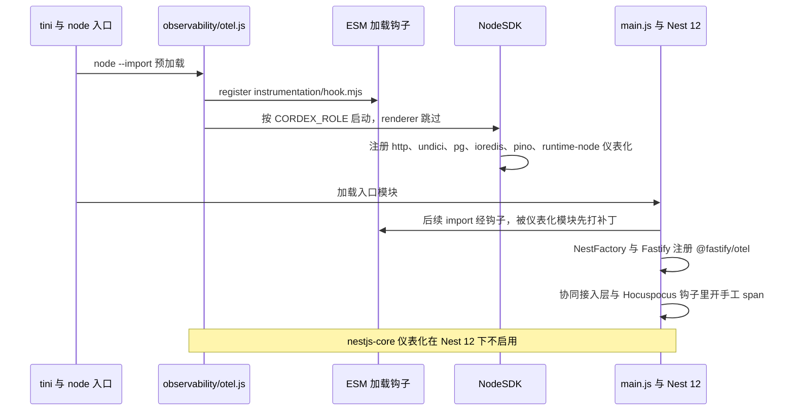

> 状态：草稿 | 负责：架构-运行时 | 更新：2026-09-24；2026-09-25（矛盾收口，rulings §4.18）；2026-09-25（§4.19 登记的 INC-33：决策 6 产品事件采样按 PRD 06）；2026-09-26（§4.21：Nest 12 下 OTel 改用 `node --import` 预加载，自动仪表化改为按需清单，Fastify 用 `@fastify/otel`，nestjs-core 仪表化暂不可用，`/metrics` 定为 exporter-prometheus） | 依赖：charter v0.1；裁决 `docs/00-charter/rulings-2026-09-14.md` §4.15 Q10、§4.18 BE-30/BE-14、§4.21 q-nest-major

# ADR-0030 观测性技术栈：OpenTelemetry 全链路 + pino + Prometheus（Sentry 为可选 Provider）

## 状态

提议（章程 D11）。

## 背景

D11 要求 `errors`/`telemetry`/`logger` 为 L0 服务且 M1 接入；§5.4 要求控制台默认实现可替换为 Sentry/OTel 且移除后降级 no-op。需要浏览器与 Node 两端、跨 WS/HTTP/队列的追踪传播、Univer A24 的反制（每个指标有消费者）。

## 决策

1. **协议与 SDK**：OpenTelemetry（traces/metrics/logs）为唯一遥测契约；Node 用 `@opentelemetry/sdk-node` + 按需仪表化（2026-09-26 修订，见下方「修订」；原：「自动仪表化（http/pg/ioredis/ws）」），浏览器用 `@opentelemetry/sdk-trace-web` + OTLP/HTTP 导出（经 `POST /api/v1/telemetry/otlp` 代理，避免暴露 collector）。浏览器错误上报 `POST /api/v1/telemetry/errors` 与 OTLP 代理由 M-12 新增的 `client-telemetry` 控制器承接、装在 **api 角色**（ADR-0037 决策 1）：**要求登录**（登录前页面出的错只留在浏览器控制台），按用户令牌桶限流，请求体上限 errors ≤ 64 KiB、otlp ≤ 512 KiB，OTLP 代理**只转发 traces**（2026-09-25，rulings §4.18 BE-30；原：只给出端点路径，未定承接模块、鉴权与限额）。
2. **日志**：kernel `logger` 适配 cordis logger；Node sink = pino JSON → stdout → OTel Collector（filelog/OTLP）→ OTel logs 后端（Loki 仅在显式开启的 AGPL 可选 profile 中提供）；浏览器 sink = 控制台（dev）/环形缓冲随错误上报（prod）。
3. **指标**：Prometheus 暴露（`/metrics`，内部端口，由 `@opentelemetry/exporter-prometheus` 输出，2026-09-26 定稿、不用 `prom-client`）+ OTel metrics 导出二选一按部署配置；命名见 10 §3.3。renderer 角色例外：它只挂零出站的 `render` 网络，Prometheus 抓不到，因此**不装 `MetricsModule`、关闭 OTLP 导出、日志只写 stdout**，渲染耗时/超时/崩溃指标由 worker 侧 `remote-renderer.client` 按 RPC 结果记录（2026-09-25，rulings §4.18 BE-14，ADR-0037 决策 1）。
4. **错误**：kernel `errors` 的 Reporter Provider 默认 = 日志 + `cordex_errors_total`；可选 Sentry Provider（`apps/*` 装配层选择，SDK 包不依赖 Sentry）。
5. **登记制**：span/metric/event/错误码名称通过声明合并登记，扫描器校验每个名称在登记表中且有 `consumer`（仪表盘/告警/测试）字段（A24 反制）。
6. **采样**：traces 头采样 10%（错误路径 100% 尾采样在 collector）；WS update 帧不建 span（1% 抽样）；产品事件的采样以 PRD 06 为权威（决策 MECH-INC 之 INC-33）：高频事件（`render/frame` 派生的 `perf/frame`、`collab/latency` 等）默认采样 1%，部分事件按 PRD 06 §3.2 事件表的采样率（如 `render/page-rendered`、`selection/changed` 10%、`perf/input-latency` 5%），错误与生命周期事件不采样；全部可配置，一律去标识。（2026-09-25 修订：本 ADR 未接受，不高于 PRD 口径；原：「产品事件不采样但去标识」，作废。）
7. **compose 观测组件**（2026-09-24，rulings §4.15 Q10，D13 镜像口径见 ADR-0037）：默认 profile = **OTel Collector + Jaeger + Prometheus**（均 Apache-2.0），默认告警规则随 compose 提供（SV-10）；**Grafana / Loki（及 Tempo）为 AGPL-3.0，只作为需显式开启的可选 profile**，附许可提示；仪表盘 JSON 仍入库。（原：otel-collector + Jaeger/Tempo + Prometheus/Grafana。）

## 修订（2026-09-26，rulings §4.21 q-nest-major）：Nest 12 下的启动方式与按需仪表化

用户裁决 M1 直接上 Nest 12（非推荐项，原推荐 M1 锁 11.2.x）。Nest 12 是纯 ESM，`apps/server` 构建随之改为 ESM（09-type-discipline/01 §6），对本 ADR 的影响如下；依赖版本与许可以 [60-backend/19](../../60-backend/19-reuse-and-dependency-catalog.md) §10 为准，装配细节见 60-backend/18 §1。

1. **启动方式**：ESM 的静态 import 在入口模块求值前就全部解析完，「`main.ts` 第一行 import otel」不能保证仪表化先于被仪表化的模块加载。改为容器入口 `node --import ./dist/observability/otel.js dist/main.js`：`otel.ts` 先用 `node:module` 的 `register()` 注册 `@opentelemetry/instrumentation/hook.mjs`（ESM 加载钩子），再启动 `NodeSDK`；`main.ts` 不再 import otel。renderer 角色也走同一入口，但 `otel.ts` 按 `CORDEX_ROLE` 不启动 SDK（决策 3 的 renderer 例外不变）。
2. **按需仪表化**（取代决策 1 原文的「自动仪表化 http/pg/ioredis/ws」，不装 `auto-instrumentations-node` 全家桶）：`@opentelemetry/instrumentation-http`、`-undici`、`-pg`、`-ioredis`、`-pino`、`-runtime-node`；Fastify 路由 span 用 `@fastify/otel` 0.21（`instrumentation-fastify` 已弃用，由它接替）；BullMQ 用 `bullmq-otel` 传播 trace；**ws 与 Hocuspocus 钩子用手工 span**（挂点见 60-backend/18 §3，Hocuspocus 的 extension-logger 不用）。
3. **Nest 层 span 暂缺**：`@opentelemetry/instrumentation-nestjs-core` 0.68.0 的 supportedVersions 为 `>=4.0.0 <12`，Nest 12 下不生效，暂不启用；控制器与守卫级的耗时由 `@fastify/otel` 的路由 span 加少量手工 span 补齐。上游支持 12 后在同一 PR 启用并删掉重复的手工 span。
4. **版本并存**：`sdk-node` 与各仪表化同批锁 0.222.x；`@fastify/otel` 0.21 依赖 `@opentelemetry/instrumentation` `^0.221.0`，两版并存、**不做 overrides**（强压 `^0.x` 范围可能破坏 API）；它带进的 `minimatch`（BlueOak-1.0.0）按 ADR-0049 视同放行、SBOM 登记。
5. **`/metrics`**：`@opentelemetry/exporter-prometheus` 以 `preventServerStart: true` 创建，处理函数挂到内部端口 9464 的独立 Fastify 实例；`prom-client`（已 deprecated）不用。指标名单位后缀的转换须与 30/10 §3.3 和 60-backend/18 §4.1 的统一名一致。
6. **日志**：`pino` 10 + `nestjs-pino` 5.2（peer 已覆盖 Nest 12），`instrumentation-pino` 把 `trace_id` / `span_id` 注入日志行；关掉 Fastify 自带的请求日志。错误平台仍只留 Reporter 接缝，`@sentry/node` 只作可选 Provider。

**图 1 Nest 12 下的 OTel 启动顺序**

怎么读：纵线是参与方，自上而下是时间。关键是前三步都发生在入口模块加载之前，所以 `pg`、`ioredis`、`undici` 等被 import 时已经经过加载钩子；Fastify 的 span 由插件在应用创建时挂上，ws 与 Hocuspocus 没有可用的自动仪表化，只能在钩子里手工开 span。

依据：rulings §4.21 q-nest-major 与关键口径「Nest 12」；证据 `reuse-arch-elements-plan-2026-09-26.json` backendReuse 核实（`@nestjs/core` 12.1.0、instrumentation-nestjs-core 0.68、`@fastify/otel` 0.21.0）；R-d-47、R-d-48。

## 备选方案与放弃原因

| 方案 | 放弃原因 |
|---|---|
| 仅 Sentry（错误+性能） | 供应商锁定；指标/日志覆盖弱；SDK 包不应依赖供应商 |
| 供应商 APM（Datadog/New Relic）SDK 直连 | 锁定；OTel 已被这些供应商接收，走 OTel 保持中立 |
| 自定义 telemetry 格式 | 重复造轮子；A24 教训是「声明了没接」而非格式问题 |
| console.log | 无结构、无关联、被 lint 禁止 |
| `auto-instrumentations-node` 全家桶（2026-09-26） | 启动慢、装了用不到的仪表化，且 0.80 已不含 fastify；改为按需清单 |
| `prom-client` 暴露 `/metrics`（2026-09-26） | 已 deprecated（改名 `@prometheus-io/client`）；与 OTel metrics 两套登记面；改用 exporter-prometheus |
| 为 Nest 12 锁回 Nest 11.2.x 以保留 nestjs-core 仪表化（2026-09-26） | 用户裁决 M1 直接上 Nest 12（rulings §4.21 q-nest-major）；Nest 层 span 暂由 `@fastify/otel` 与手工 span 补齐 |

## 后果

正面：两端一套契约；传播标准（`traceparent`）；后端可换；登记制让「无人消费的指标」不可能进入代码。

负面 / 代价：浏览器 OTel SDK 体积（~40–60 KB gzip）→ 仅在 `apps/web` 装配，SDK 包只依赖 kernel 的 no-op 契约；collector 是新增运维组件（compose 已含）；日志与 trace 的关联依赖 ALS 上下文正确传播（WS/队列边界需手工传递 `traceparent`，有测试）。

## 如何被机械验证

- 扫描器 `scan-observability-identifiers`（span/metric 名，09-type-discipline/06 §13）与 `scan-telemetry-events`（产品事件名，06 §10）：`telemetry.span/counter/histogram/event` 的名称 ∈ 登记表且有 consumer（2026-09-25 补写执行点正式名，rulings §4.18 GV-15）；`console.*`/裸 `Error` lint。
- （2026-09-25，rulings §4.18 BE-30）`client-telemetry` 控制器：未登录请求 401；超过 64 KiB 的 errors 与 512 KiB 的 otlp 请求体被拒（413）；超出令牌桶返回 429；OTLP 代理丢弃 metrics/logs 信号、只转发 traces；该控制器只在 api（及 all）角色装配。
- 单测：移除 Provider 后 `telemetry`/`errors`/`logger` 调用不抛且为 no-op；脱敏规则测试（内容字段被拒）。
- 集成：一次「导入 → 房间加入 → 编辑 → 缩略图」的 trace 在 Jaeger 中为单一 trace（e2e 断言 traceId 贯穿 WS auth 帧与 job 数据）。
- 仪表盘即代码：Grafana 面板 JSON 入库并引用登记表中的指标名（CI 校验引用有效）。
- （2026-09-26，rulings §4.21）ESM 启动冒烟：`node --import` 预加载后，api、collab、worker 各角色启动并产出 HTTP 与 pg span，renderer 不启动 SDK、无 OTLP 出站；依赖树里不出现 `prom-client` 与 `@opentelemetry/instrumentation-fastify`；Nest 仍为 12 时不加载 `instrumentation-nestjs-core`（60-backend/19 §18 RC-06）。

## 关联

章程 D8、D11、§5.4；Univer A24/A25；架构 10；60-backend/18（metrics/health 模块）；60-backend/19 §10（观测依赖清单）；40-modules/12（`client-telemetry` 控制器，BE-30；`observability/otel.ts`）；09-type-discipline/01 §6（ESM 构建）；ADR-0037 决策 1（renderer 不装 Metrics，BE-14）；ADR-0039（Hocuspocus 钩子上的手工 span）。
