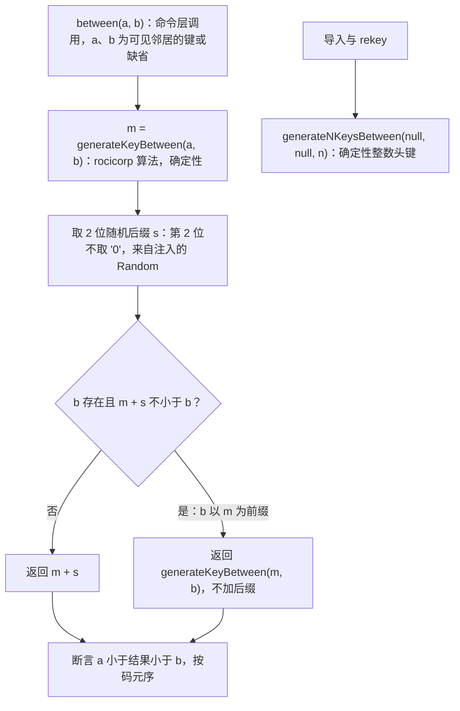

> 状态：草稿 | 负责：架构-运行时 | 更新：2026-09-24；2026-09-25（矛盾收口，rulings §4.18）；2026-09-26（§4.21：决策 2 键格式改为内置 rocicorp fractional-indexing 算法——整数头 + 随机后缀、后缀末位避开 '0'，CC0 按内置源码登记）；2026-09-26（§4.21 整合：修订注明内置源码的 SPDX 头与 vendored 登记；注明 FracKey 也用于表格行列与图表类别系列） | 依赖：charter v0.1；裁决 `docs/00-charter/rulings-2026-09-14.md` §4.15 Q3、§4.18 CO-05、§4.21 q-frackey / q-license-tiers；[ADR-0049](./0049-dependency-admission-and-license-tiers.md)

# ADR-0032 有序集合的并发语义：实体表 + fractional index（不用数组）

## 状态

提议（ADR-0020 的子决策；同时约束 store-memory 与 store-yjs，因其是 `DocumentStore` 原语 `Ordered` 的语义）。

## 背景

幻灯片顺序、形状 z-order、组合内顺序、节顺序都需要并发安全的「移动」。候选：Yjs `Y.Array`（无原生 move：移动 = 删除 + 插入，并发移动同一元素 → 重复或丢失）；未发布的 y-move；Loro movable list；fractional index（Figma 等采用）。

## 决策

1. 所有有序实体集合 = `EntityTable`（`Y.Map<id, Record>`）+ 每个实体的 `order: FracKey`（字串）。**排序键 `(order, id)`** 提供全序与确定性平局处理。
2. `FracKey` 生成（`@cordexjs/shared/order`，纯函数、iso；2026-09-26 按 rulings §4.21 q-frackey 改写，原「base-62 最短中点键 + 2 字符随机后缀、首个键 `'V'`」作废，细则见文末「修订 2026-09-26」）：**内置 rocicorp fractional-indexing 的算法源码**（CC0-1.0，文件头注明出处与版本，按 ADR-0049「CC0 限数据与内置源码」登记，不作 npm 依赖）。键 = **整数头** + 小数部分：整数头首字符 `a`–`z` 表示非负整数（`a` 后跟 1 位、`b` 后跟 2 位……）、`A`–`Z` 表示负整数，数字用 base-62 字母表 `0-9A-Za-z`，按码元序比较；小数部分不得以 `'0'` 结尾。`between(a, b)` 先用 rocicorp `generateKeyBetween` 求确定的中间键 m，再**追加 2 字符随机后缀**（第 2 位不取 `'0'`）；若上界 b 以 m 为前缀而使 m + 后缀 ≥ b，改取 `generateKeyBetween(m, b)`（不加后缀）。空集合的首个键为 `'a0'` 加后缀；在末尾追加只递增整数头、丢弃小数部分，所以连续追加时键长不增长。导入与 rekey 用 `generateNKeysBetween` 的确定性键（不加后缀）。随机后缀只降低并发同位插入撞键的概率；撞键不影响正确性，只影响直觉顺序。
3. **移动 = 单键写入**（`set(entities/<id>/order, key)`；`StoreOp` 无 `move` 原语），并发移动同一实体 → LWW，一份实体、一个位置。**并发插入同一间隙** → 两个实体都存在，按 `(order, id)` 排序，各端一致。
4. **键长治理**：键长 > 64 字符时（长期在同一间隙反复插入的病态情况），由服务端在房间 `draining`/无编辑者时执行「重排键（rekey）」事务（origin `maintenance`）为该集合重新分配等距键（2026-09-26 起用 `generateNKeysBetween(null, null, n)` 的整数头键）；客户端不主动 rekey（避免与并发移动竞争）。整数头格式下末尾追加与开头插入都不增长键长，rekey 只剩「同一间隙反复插入」一种触发来源。
5. 跨父移动（进出组）：`parentId` 单键 LWW + `order` 在新父下重新生成；父子环由修复规则处理（06 §8 #5）。
6. Snapshot 中的顺序**保留 `order: FracKey` 键**（总编排裁决，采 A 线 ADR-0013 第 7 条），不转数组：`load`/`toSnapshotBody` 原样搬运键，无「生成等距键 / 排序还原」步骤；只有导出到 OOXML 时由编解码器按 `(order, id)` 排序产生 `sldIdLst`/`spTree` 的顺序。
7. Mutation 载荷禁止数组下标（06 I4）：键由**命令层**经 `@cordexjs/shared/order` 计算（`between(prev.order, next.order)`），Mutation 携带**最终键**，`lower()` 保持纯函数——插入 → `set(entities/<id>, record{ order })`、移动 → `set(entities/<id>/order, key)`、删除 → `set(entities/<id>/_deleted, {at, by})`（软删除墓碑，见文末两节修订；2026-09-25 按 rulings §4.18 CO-05 改写，原「删除 → `delete(entities/<id>)`」作废）；Store 不解析下标。`StoreOp` 定为 5 原语（`set/delete/insert/remove/text`，总编排裁决）：**弃用 `move`** 的原因是有身份实体的顺序已由键承载，原子数组极少移动且 `Y.Array` 无原生 move——`remove` + `insert` 即可，其并发重复的已知风险由幂等规则与 rekey 兜底；索引式 `insert/remove` 只用于非身份数组。

## 备选方案与放弃原因

| 方案 | 放弃原因 |
|---|---|
| `Y.Array` 删除+插入 | 并发移动同一元素产生两份或零份；删除+插入使实体失去身份（引用/评论锚点断裂） |
| y-move / Yjs 原生 move | 未发布 |
| Loro movable list | 需切换 CRDT（ADR-0020） |
| 链表 CRDT（自研 prev 指针） | 环/断链修复复杂度高于 fractional index 的键长问题 |
| 服务端全序（顺序由服务端仲裁） | 离线不可用；违背 CRDT 单一事实源 |
| 维持自研 base-62 中点键（首键 `'V'`，2026-09-26 前的决策 2） | 连续在末尾追加时键逐次变长，要靠决策 4 的 rekey 兜底；rocicorp 算法是 Excalidraw 等在用的成熟实现，整数头让追加不增长（q-frackey 选项 2） |
| 以 npm 依赖引入 `fractional-indexing` 4.0.0 | CC0 在 ADR-0049 中只放行数据文件与内置源码，作依赖须单独例外；约 2 KB 的算法内置后升级也只是改一个文件（q-frackey 选项 3） |

## 后果

正面：移动是最小写入；实体身份稳定；实现简单且 store-memory 可同构实现；确定性排序便于 fuzz 断言。

负面 / 代价：键长可能增长（rekey 治理）；并发同位插入的相对顺序由 id 决定（非用户直觉，但一致）；需要为 `order` 建排序缓存（渲染层每页维护已排序数组，observe 到 `order` 变化时增量插入）。

## 补充（v0.2）：与 04 `StoreOp` 与 Snapshot 形态的对齐

- Snapshot 与两种 Store **都保留 `order: FracKey` 键**（ADR-0013 第 7 条）：页序/形状序/表格行列/段落都是实体表 + 键；store-memory 与 store-yjs 只是键的容器不同，读视图都按 `(order, id)` 排序。二者对 `runDocumentStoreConformance` 的所有用例（含协同分节）结果相同。
- 键由命令层经 `@cordexjs/shared/order` 计算，Mutation 携带最终键，`lower()` 纯函数（06 §18.1）；`TransactionRecord.ops` 因 `set` 自带键而天然可回放，无需锚点字段。
- 协同分节新增两条用例：「并发同位插入按 `(order, id)` 全序一致」「rekey 后顺序不变」。
- 哪些数组是「有序实体列表」由 `bodySchema` 注解（`ordered-entities`）决定，其余数组按原子值整体 LWW——对 A 线的 schema 要求。
- 例外：`paragraphs` 在 `Y.XmlFragment` 中无键序，段落移动 = `remove` + `insert`（06 §18.1），由修复规则处理并发重复。

## 如何被机械验证

- `@cordexjs/shared/order` 单测：`between` 的字典序性质（a < k < b，按码元序）、随机后缀分布与末位非 `'0'`、上界以中间键为前缀时的回退分支；100 万次随机插入键长统计（p99 ≤ 32）；连续末尾追加 10,000 次键长 ≤ 6（2026-09-26 新增）；内置源码与 rocicorp 上游测试向量逐条一致（`generateKeyBetween`、`generateNKeysBetween` 的已知输入输出）；文件头出处声明存在（许可扫描按 ADR-0049 核对）。
- `runDocumentStoreConformance`：并发移动/插入用例对 memory 与 yjs 一致。
- collab-sim：随机移动/插入 fuzz 下所有端顺序一致；病态同位插入 10k 次后 rekey 结果顺序不变。
- 类型测试：Mutation schema 无 `index` 字段。

## 关联

ADR-0020；ADR-0049（许可分级，CC0 内置源码）；章程 D4/D6/D13；Univer A2（寻址不绑定产品）；架构 06 §1、§8。

## 修订 2026-09-24：有序集合中的软删除墓碑（rulings §4.15 Q3）

- 决策 7 中的删除由 `lower()` 直接产出 `set(entities/<id>/_deleted, {at, by})`，逆操作由 Store 推导为 `delete(entities/<id>/_deleted)`；实体键的 `delete` 只由服务端 TTL 硬删除、文档擦除与经审计的「彻底删除元素」产生（2026-09-25 修订，rulings §4.18 CO-05，ADR-0013 修订、ADR-0020「协同撤销语义」；原：「删除 → `delete(entities/<id>)` 在 Store 层落为 `_deleted` 墓碑」，作废）：墓碑实体**保留其 `order` 键**，有序读视图按 `(order, id)` 排序时过滤墓碑；恢复 = 清除墓碑，实体回到原位置，无需重新计算键。
- 在墓碑相邻处插入时，命令层以**可见邻居**计算 `between(prev.order, next.order)`；因墓碑保留原键，新键可能与墓碑键相邻，这不影响全序与收敛。rekey 作业跳过墓碑还是一并重排由 40-modules/02 定（建议一并重排，保证恢复后顺序稳定）。
- 墓碑计入文档总元素上限（Q5）与 `order` 键长治理统计；TTL 硬删除后其键随实体消失。
- 机械验证：协同分节新增「删除 → 并发在同一间隙插入 → 恢复」用例，断言两端顺序一致且无重复。

## 修订 2026-09-26：键格式改为内置 rocicorp fractional-indexing 算法（rulings §4.21 q-frackey）

- **裁决**：用户选推荐项「内置 rocicorp 算法源码（CC0，注明出处），改写决策 2 的键格式」。尚无代码，换键格式零迁移成本；决策 1、3、5、6、7 与墓碑修订不变。
- **来源与登记**：算法取自 `rocicorp/fractional-indexing` 4.0.0（CC0-1.0，2026-06-25 发布，`npm view` 核对），内置在 `@cordexjs/shared` 的 `order.ts`，文件头写 `SPDX-License-Identifier: CC0-1.0`、上游地址（`https://github.com/rocicorp/fractional-indexing`）、版本与提交号；按 ADR-0049 决策 1、2「CC0 只用于数据文件与内置源码」登记进 `license-allowlist.json#vendored`（文件路径以 40-modules/02 登记为准），并记入前端复用清单（50-frontend/17）。不引 npm 包，`@cordexjs/shared` 仍零运行时依赖。
- **键格式**：整数头（`a`–`z` 非负、`A`–`Z` 负，头字符决定整数位数）+ 小数部分，base-62 字母表 `0-9A-Za-z`，按 JavaScript 字符串码元序比较（不得用 `localeCompare`）；小数部分不以 `'0'` 结尾，最小整数键（`'A'` 后跟 26 个 `'0'`）不可用。
- **`between(a?, b?, random?)`**：① `m = generateKeyBetween(a ?? null, b ?? null)`（确定性）；② 取 2 位随机后缀 s（取自注入的 `Random`，缺省 `SystemRandom`；第 1 位 62 选 1，第 2 位在去掉 `'0'` 的 61 个字符中选）；③ 若 `b` 存在且 `m + s ≥ b`（只在 b 以 m 为前缀时出现），返回 `generateKeyBetween(m, b)`，否则返回 `m + s`；④ 断言 `a < 结果 < b`。随机性只在命令层产生，`lower()` 与 Store 不生成键（决策 7 不变）。
- **适用范围**：FracKey 除页序、形状序、段落外，也用于 ADR-0018 归一化表格的行与列（`TableColumn.order`、`TableRow.order`）和 M3 图表数据的类别与系列（`ChartData.categories` / `series` 的 `order`，30/04 §3.8、§3.9）；删除一律写墓碑、保留键。
- **确定性键**：导入（页序、形状序、表格行列、图表类别与系列）与 rekey 用 `generateNKeysBetween(null, null, n)`，不加后缀，保证同一文件两端导入得到相同的键。
- **效果**：末尾追加与开头插入只改整数头，键长保持在 2–6 个字符（10,000 次追加后仍 ≤ 6）；随机位置插入的键长分布与原算法同量级（p99 ≤ 32 的断言不变）；决策 4 的 rekey 只剩「同一间隙反复插入」一种触发来源。
- **影响面（由各负责组回写）**：40-modules/02 的 `between` 签名行与 `order.ts` 文件行、30/02 的 `order.ts` 注释、40-modules/03 §2.2 的 `FracKey` 值对象行（「base62 字符串 + 随机后缀」改为本修订的键格式）。

**图 1 `between` 的键生成**

怎么读：上半部是命令层每次插入时的键生成——先求确定的中间键，再加随机后缀降低撞键概率，只有上界恰好以中间键为前缀时才退回不加后缀的确定键；右下的导入与 rekey 是另一条确定性路径，不加后缀。
依据：rulings §4.21 q-frackey；本 ADR 决策 2、4、7。
