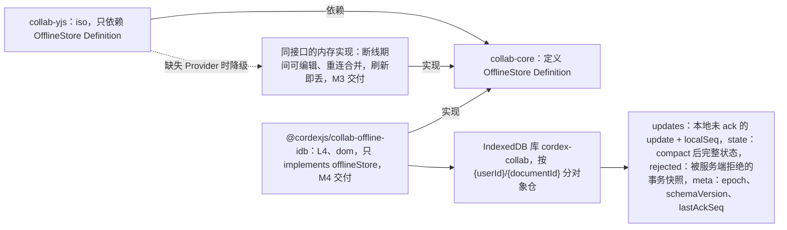
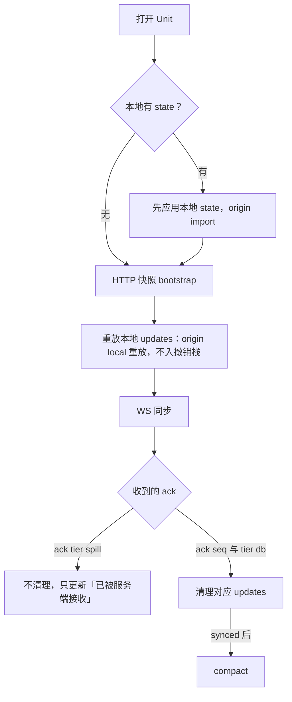
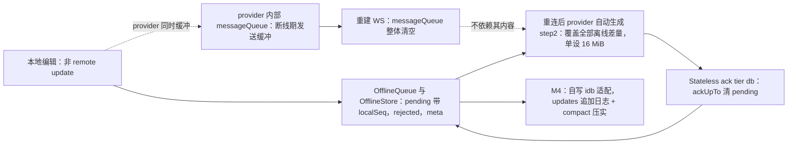

> 状态：草稿 | 负责：架构-运行时 | 更新：2026-09-24；2026-09-25（补图）；2026-09-25（矛盾收口，rulings §4.18）；2026-09-25（§4.19：内存队列随协同后端提前到 M2 的基础重连，离线体验仍 M3，见文末修订）；2026-09-26（§4.21：OfflineStore 与 provider 内部队列无关；IDB 实现定为自写 idb 适配，y-indexeddb 不采用；重连 step2 不再切块，见文末修订） | 依赖：charter v0.1；裁决 `docs/00-charter/rulings-2026-09-14.md` §4.15 T-0/Q3/S-3a、§4.18；PRD 05 §M3/§M4；[ADR-0039](0039-collab-server-hocuspocus.md)（客户端改用 `@hocuspocus/provider`）；rulings §4.21（H:q-hp-provider、H:q-hp-step2-cap）与证据 `00-charter/_evidence/hocuspocus-adoption-2026-09-26.json`（CL-08、SY-05）、`reuse-arch-elements-plan-2026-09-26.json`（默认 d-26）

# ADR-0033 离线队列与本地持久化：IndexedDB Provider（独立 dom 包），collab-yjs 保持 iso

## 状态

提议（章程 M3 验收含「离线重连」；S1 已由总编排批准，`@cordexjs/collab-offline-idb`（L4，dom）进入章程 v0.2 包清单）。**2026-09-24 时点修订**：与 PRD 05 对齐——M3 只交付内存队列（断线期间可编辑、重连合并，刷新即丢），IndexedDB 跨刷新持久化（本 ADR 决策 2–5）移到 **M4**，见文末。

## 背景

M3 要求断线期间可继续编辑并在重连后合并；刷新页面不应丢失未同步更改（**2026-09-24 起为 M4 目标**，PRD 05「跨刷新离线持久化（`collab-offline-idb`）M4」，M3 明确不做）；`collab-yjs` 是 iso 包不能直接依赖 IndexedDB；数据敏感性（文档内容落在本地）。

## 决策

1. `collab-core` 定义 `OfflineStore`（签名级草案见 06 §18.6：`open/clearAll/estimate` + 文档句柄的 `loadState/loadPending/appendPending/ackUpTo/compact/moveToRejected/listRejected/clearRejected/close`）；`collab-yjs` 只依赖该 Definition，缺失 Provider 时降级为同接口的内存实现（刷新即丢，但断线期间仍可编辑）。**（2026-09-26 补充）** `OfflineStore` 与 `@hocuspocus/provider` 内部的 `messageQueue` 无关：provider 断线期间的待发帧在重建 WS 时被整体清空，补齐靠重连后的 step1 / step2；OfflineStore 的 pending 是「哪些本地更改尚未获 `tier:'db'` 确认」的唯一来源，provider 的队列既不读取也不依赖。
2. 新增 dom 包 **`@cordexjs/collab-offline-idb`**（L4，Provider）：IndexedDB 实现（**2026-09-26 定为自写薄适配**：基于 `idb` 8（ISC）做 update 追加日志 + `compact` 压实；`y-indexeddb` 不采用，理由见文末修订），库名 `cordex-collab`，按 `{userId}/{documentId}` 分对象仓（2026-09-24：原 `{tenant}/…` 随 T-0 去租户改为按用户）：`updates`（本地未 ack 的 update + localSeq）、`state`（compact 后完整状态）、`rejected`（被服务端拒绝的事务快照）、`meta{epoch, schemaVersion, lastAckSeq}`。
3. 恢复流程：打开 Unit → 若本地有 `state` 先应用（origin `import`）→ HTTP 快照 bootstrap → 重放 `updates`（origin local 重放，不入撤销栈）→ WS 同步 → 收到 `ack{seq, tier:'db'}` 后清理（`tier:'spill'` 不清理，ADR-0025 S-3a）→ synced 后 `compact`。**（2026-09-26 补充）** 「WS 同步」由 `@hocuspocus/provider` 执行：重放完成后才装配 provider，provider 对服务端 step1 自动生成的 step2 覆盖全部重放内容；ack 经 Stateless 载荷到达，清理只看 `tier:'db'`，不看 provider 的 `unsyncedChanges` / `synced`（二者只表示服务端已应用到内存）。
4. 上限：50 MiB/文档；超限停止写入并提示；配额 API（`navigator.storage.estimate`）低于阈值时提示。
5. 安全：登出/切换账号清空该用户全部本地库；不做客户端加密（P4）；`epoch`/`schemaVersion` 不匹配的本地数据 → 移入 `rejected` 供导出后清理。
6. 「未同步更改」UI：来自 `Session.stats.pendingLocalUpdates` 与 `rejected` 计数（设计 20-design/05）。

**图 1 OfflineStore 的包结构与交付时点**

怎么读：实线「依赖 / 实现」指向 Definition，两种实现可互换，collab-yjs 本身不引用 IndexedDB、保持 iso。M3 只有内存实现，M4 才加上 IDB Provider；IDB 包不提供 `BlobStore`（修订 2026-09-18）。

**图 2 打开 Unit 时的本地恢复流程**

怎么读：自上而下是决策 3 的顺序；只有 `tier:'db'` 的 ack 才让本地 pending 被清理，无论内存实现还是 IDB 实现都一样。跨刷新恢复（先应用本地 `state`）是 M4 能力，M3 内存实现在刷新后没有本地数据可恢复。

## 备选方案与放弃原因

| 方案 | 放弃原因 |
|---|---|
| 不做本地持久化（仅内存队列） | 刷新/崩溃丢失离线编辑，不满足 M3「离线重连」的用户期望 |
| Service Worker + Cache API | 面向资源缓存而非结构化增量；复杂 |
| localStorage | 容量（~5 MB）与同步 API 阻塞主线程 |
| 把 IDB 实现放进 collab-yjs 并动态 `import()` | 包仍需 dom 类型与运行时检测，破坏 iso 分类与 `node --import` 冒烟 |
| 官方离线方案 `y-indexeddb`（与 provider 共用同一 Y.Doc，2026-09-26 复评） | 它持久化的是整份 Y.Doc 的更新流，没有 `localSeq`、`rejected` 分仓与 `meta{epoch, schemaVersion, lastAckSeq}`，回答不了「哪些更改尚未获 db 确认」，也无法按纪元整体移入 `rejected`；9.0.12 已停更；因此不采用，只用 `idb` 做薄适配（证据 R 默认 d-26、reuse 矩阵离线持久化行） |
| 依赖 provider 的 `messageQueue` 作离线队列 | 重建 WS 时被清空、无持久化、不区分 db 与 spill 确认（证据 CL-08） |
| 放进 preset-slide-collab | preset 应只做组装（章程 R2） |

## 后果

正面：离线体验完整；iso 边界清晰；Provider 可替换（Capacitor/Electron 可用文件系统实现）。

负面 / 代价：新增一个包（已批准，章程 v0.2）；本地数据治理（清理策略、配额）；`rejected` 的导出格式需定义（JSON：`TransactionRecord` 摘要列表 + 未 ack 的 update 字节 base64，见 06 §18.4）。

## 如何被机械验证

- conformance（`runOfflineStoreConformance` 与 `runCollabTransportConformance` 的离线场景；2026-09-25 按章程 `run<Definition>Conformance` 命名改写，rulings §4.18 GV-20，原 `runCollabConformance` 作废）：断线 → 编辑 → 刷新（重新创建宿主并复用同一 IDB fake）→ 重连 → 合并且 `updates` 被 `ack` 清理。
- e2e：Playwright `context.setOffline(true)` 编辑 → reload → 上线 → 另一浏览器看到更改；降权后 `rejected` 可导出。
- 扫描器：`collab-yjs` 无 `indexedDB` 引用；`collab-offline-idb` 为 dom 类。

## 关联

章程 M3、R2、S1（建议）；ADR-0023/0029；架构 06 §12。

## 修订 2026-09-18（14 §1 C-30）

删除「后果」段中「该包同时提供浏览器侧 `BlobStore` 的 IndexedDB Provider（本地媒体缓存，04 §10）」一句：`OfflineStore` 与 `BlobStore` 是两个独立 Definition，混在同一 Provider 包会让「移除协同后本地媒体缓存也没了」；且浏览器侧本就无持久 `BlobStore`——媒体经 CRDT 只存 `BlobRef`，字节始终由服务端持有（`00-module-map.md` §5.1）。`collab-offline-idb` 只 `implements:['offlineStore']`，与章程 §5.2、`40-modules/05` 口径一致。

## 修订 2026-09-24（与 PRD 05 时点对齐；rulings §4.15 T-0/Q3/S-3a）

- **时点冲突与处置**：本 ADR 背景原写「M3 刷新页面不应丢失未同步更改」，与 `10-prd/05-milestones-and-scope.md` 的 M3「明确不做：跨刷新离线持久化（`collab-offline-idb`，M4）」及 M4「CO-06 跨刷新持久化（P1，P2 可滑）」冲突（决策包 `otherOpenItems[17]`）。**以 PRD 05 为准**：
  - **M3**：`collab-yjs` 使用决策 1 中「同接口的内存实现」——断线期间可继续编辑、重连后合并；刷新/崩溃丢失未 ack 的本地更改（离线且有 pending 时对刷新/关闭是否提醒，由设计 05 离线态定）。M3 验收的「离线重连」按此口径。
  - **M4**：交付 `@cordexjs/collab-offline-idb`（决策 2–5）与跨刷新恢复（决策 3）。包仍保留在章程 v0.2 包清单，只是交付时点后移；`OfflineStore` Definition 与契约套件 M3 即定稿，使 M4 只新增 Provider。
- **两级 ack**（S-3a）：无论内存还是 IDB 实现，pending 只在 `ack{seq, tier:'db'}` 后清理；`ack{tier:'spill'}` 仅更新「已被服务端接收」状态。
- **去租户**（T-0）：本地库按 `{userId}/{documentId}` 分仓；登出/切换账号清空该用户全部本地库（决策 5 不变）。
- **软删除墓碑**（Q3）：离线期间产生的删除同样是 `_deleted` 标记，重连后与他人编辑合并不产生重复元素（ADR-0020）。
- **机械验证调整**：M3 的 conformance 离线场景改为「断线 → 编辑 → 重连 → 合并」（不含刷新）；「刷新后恢复」的 conformance 与 e2e 用例标注 M4 启用。

## 修订 2026-09-25（rulings §4.18 CO-09 / CO-10 / UX-02 / GV-20）

- **ack 对应**（CO-09）：决策 3 的「收到 `ack{seq, tier:'db'}` 后清理」按 40-modules/02 `ws/frames.ts`（ack 帧唯一事实源）逐帧对应——客户端按连接维护在途 FIFO（元素为 `localSeq`），每收到一帧 `tier:'db'` 弹出队首并调用 `OfflineStore.ackUpTo(该 localSeq)`，服务端 `seq` 只写入 `meta.lastAckSeq`；`tier:'spill'` 不参与对应。
- **重连 step2**（CO-10）：图 2 的「WS 同步」把离线期间的更改合成一个 `SyncStep2`，它视同一个 update 帧、对应一个 FIFO 条目（发送时 pending 的最大 `localSeq`），收到 db ack 即一次清理被覆盖的 pending、不再逐帧重发；超过单帧 1 MiB 时先用 `mergeUpdates` 按 `localSeq` 切块、逐块以普通 update 帧发送，仍超限则上报遥测并提示导出（规则全文见 ADR-0023 决策 7）。决策 4 的 50 MiB 本地上限因此不会让重连卡在 1 MiB 硬门禁上。
- **重新登录与队列**（UX-02）：「登录已过期」在新窗口完成重新登录时原页不刷新，M3 内存队列保留；回来的用户 id 与原会话不同时不重放队列、会话只读，队列只可导出（与决策 5「切换账号清空本地库」同一原则：本地未同步更改不得以他人身份提交）。
- **契约套件名**（GV-20）：见「如何被机械验证」。

## 修订 2026-09-25（rulings §4.19 D-M2-CONTENT；PRD 05 §0.3）

- **内存实现提前到 M2**：协同后端随 M2 交付后，单人编辑也经网关持久化，决策 1 的「同接口的内存实现」随之在 M2 交付——它承担 M2 的**基础重连**：指数退避自动重连、先鉴权再同步、补发未获 db 确认的更改，有未确认更改时离开保护（`beforeunload`）。上文 2026-09-24 修订中的「M3：内存实现」按此前移。
- **M3 仍是离线体验**（CO-06）：30 s 离线判据与离线横幅、offline 后周期重连、离线积累更改的分块同步、长时间离线提示；M3 验收的「离线重连」指这一层。
- **M4 不变**：`@cordexjs/collab-offline-idb` 与跨刷新恢复；`OfflineStore` Definition 与契约套件在 M2 即定稿（随 collab-core 交付），M4 只新增 Provider。
- **多标签页**（决策 OFFLINE-TABS，M4 启用前定稿）：`navigator.locks` 独占锁 `cordex-offline:{userId}:{documentId}`，持锁标签页使用 OfflineStore，其余标签页用内存队列并提示；不支持 Web Locks 时经 BroadcastChannel 协商。

## 修订 2026-09-26（rulings §4.21：协同改用 Hocuspocus 4；离线存储定为自写 idb 适配）

- **与 provider 的关系**（决策 1、3，证据 CL-08）：客户端同步层改用官方 `@hocuspocus/provider` 4.7.0（[ADR-0039](0039-collab-server-hocuspocus.md)，行为细节见 [50/07](../../50-frontend/07-collaboration-client.md) §5–§7）。provider 自带的 `messageQueue` 只是断线期间的发送缓冲，重建 WS 时被清空，也没有本地持久化；本 ADR 的 `OfflineStore`（内存实现与 M4 的 IDB 实现）与它**无关**，pending、`rejected` 与 `meta` 仍只由 `OfflineStore` 持有，离线期间积累的更改在重连时经 provider 的 step2 一次送达。
- **IDB 实现定为自写 idb 适配**（决策 2，R 默认 d-26，用户「成熟组件尽量复用」偏好下的复评结论）：用 `idb` 8.0.3（ISC，约 1.2 KB gzip）做 IndexedDB 的 Promise 薄封装，`updates` 仓为 update 追加日志（键含 `localSeq`），`compact` 把已确认部分压实进 `state`；`y-indexeddb` 不采用——它与 provider 共用同一 Y.Doc 做整份持久化，模型与本 ADR 的「pending / rejected / meta 分仓 + 只按 db 确认清理」不适配，且已停更。`idb` 只允许出现在 `collab-offline-idb`（章程 §5.3 规则 4 由总编排登记，原登记的 y-indexeddb 撤下）。
- **重连 step2 不再切块**（改写 2026-09-25 修订第 2 条的「先用 `mergeUpdates` 按 `localSeq` 切块」，rulings §4.21 H:q-hp-step2-cap）：step2 由 provider 在收到服务端 step1 时自动生成，无法事先切块；改为 update 帧仍 ≤ 1 MiB、step2 单设上限 16 MiB（等于服务端 ws `maxPayload`），超限时服务端以 4413 关闭、客户端导出后重载（`payload-too-large`）。离线累计 5 MiB 的验收场景仍一帧送达、无 4413；决策 4 的 50 MiB 本地上限在 M4 启用 IDB 后，按实测再评估 step2 上限。
- **机械验证调整**：conformance 离线场景的「重连 → 合并」改在进程内 Hocuspocus 脚本服务端 + 内存 WebSocketLike 上执行，provider 内部计时用 fake timers（[70/05](../../70-testing/05-collab-simulation-and-property-tests.md) §9）；新增「step2 超 16 MiB → 4413 → 导出后重载、不重连」用例；扫描器改为「`collab-yjs` 无 `indexedDB` 引用；`idb` 只出现在 `collab-offline-idb`」。

**图 3 OfflineStore 与 provider 内部队列（2026-09-26）**

怎么读：实线是本 ADR 依赖的数据路径——pending 只在 `OfflineStore` 里，清理只由 `tier:'db'` 触发；虚线是 provider 自己的发送缓冲，它在重建 WS 时被清空，所以不承担任何离线语义，离线差量靠 step2 基于状态向量重新计算。

