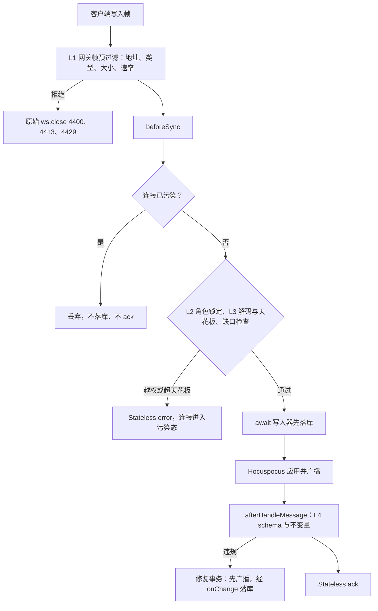

> 状态：草稿 | 负责：架构-运行时 | 更新：2026-09-24；2026-09-24 复核修正（rulings §4.17 D2；复核报告 L6）；2026-09-25（矛盾收口，rulings §4.18）；2026-09-25（§4.19：commenter 路径前缀改 `resources['comments.threads']`，见文末修订）；2026-09-26（§4.20）（FE-03：修复规则表「`layoutId` 不存在」按 04 §12.3 I-ML2；FE-04：墓碑期 `layoutId` 读时容错，见「修订 2026-09-26」）；2026-09-26（§4.21：决策 1–2 挂点改为 Hocuspocus——L1 适配层预过滤、L2/L3 在 `beforeSync`（`Y.decodeUpdate`，V1）、L4 在 `afterHandleMessage`；拒绝改连接污染规则，见「修订 2026-09-26（rulings §4.21）」）；2026-09-26（§4.21 Remap：原 30/08 引用按 60-backend/README §6.1 改指新位置，30/08 已删除） | 依赖：charter v0.1；裁决 `docs/00-charter/rulings-2026-09-14.md` §4.1 P8、§4.15 Q3/Q5/S-3a、§4.17、§4.18、§4.21；ADR-0039

# ADR-0034 服务端对 update 的校验：硬门禁拒绝 + 软门禁补偿修复（不回滚、不分叉）

## 状态

提议。2026-09-24 按 rulings §4.15 补充软删除墓碑的不变量与修复规则、S-3a 溢写期的门禁时序、Q5 的房间内存口径，见文末「修订 2026-09-24」。软门禁的执行口径（不变量 repair、schema report-only）已由 rulings §4.1 P8 裁决采纳本 ADR。2026-09-25 按 rulings §4.18 修正 `_deleted` 合法形状（CO-06）、硬删旁路的例外（CO-07）、降级期广播时序（CO-08）与 P8 结案状态（CO-20）。

## 背景

CRDT update 是不透明二进制；服务端无法在应用前知道其语义。数据层不能信任任意客户端（schema/不变量是渲染与导出的前提），但 CRDT 又要求所有端收敛：单点「拒绝并回滚」会造成分叉。

## 决策

1. **硬门禁（应用前，O(1)/O(帧)）**：帧头/zod/大小/速率（L1）、角色与锁定（L2）、`Y.decodeUpdate` 可解析与结构数上限（L3；2026-09-26 由 `decodeUpdateV2` 改为 V1——Hocuspocus 协议只有 Yjs V1 编码，日志也存 V1 字节）。失败 → 不广播不落库，返回错误或关闭（06 §11）。**挂点**（2026-09-26，rulings §4.21，ADR-0039 决策 4、6）：L1 在网关适配层的帧预过滤（进 Hocuspocus 之前：帧地址、单帧大小、令牌桶、客户端 BroadcastStateless 拒绝）；L2/L3 在 Hocuspocus 的 `beforeSync`（被 await、早于应用与广播，同时 await 写入器先落库）。Hocuspocus 没有「拒绝单帧但不断连」的原语，L2 越权与 L3 超天花板这两类**非致命拒绝**改用**连接污染规则**：发 Stateless `error` 后，该连接之后的写入帧一律不落库、不回 ack，直到重连（被拒帧之后同一客户端的更新可能因缺前驱挂在 `pendingStructs`，落库并 ack 就成了「已 ack 但不可见」，vB）；落库前另用 `Y.parseUpdateMeta` 加删除集缺口检查兜底。未通过 L1–L3 的帧不应用、不扇出（I8）不变。
2. **软门禁（应用后）**（2026-09-26 挂点：Hocuspocus 的 `afterHandleMessage`——被 await、在应用之后、同一连接串行；不挂 `onChange`，它不被 await、抛错杀进程，exp3。服务端 Unit 经 store-yjs「接管外部 Y.Doc」绑定 Hocuspocus Document，Hocuspocus 应用 update 的 origin 由 store-yjs 识别为 remote）：在服务端 Unit 上 `applyUpdate` → `ChangeSet.paths` → `documentType.validateChangeSet(paths)`（zod schema，A 线 04）+ 不变量检查（无父子环、`parentId` 存在、`layoutId` 存在、`order` 合法、`schemaVersion`/`epoch` 未改、id 与键一致）。违规 → **RepairPlanner** 生成补偿 Mutation 事务（origin `repair`），本地应用并广播（2026-09-26：修复有 p95 ≤ 5 ms 预算，仍先在 Room 上执行并广播、由 `onChange` 送写入器，rulings §4.21 H:Q4）；同时向来源 session 发 `CONTROL.repair{reason, paths}`，计数；同一 session 10 分钟 ≥ 5 次 → 4409 隔离。
3. 修复规则是**确定性纯函数**（输入：当前状态 + 违规路径 → 输出：Mutation 列表），客户端 observe 时对「环/孤儿」两类也执行同一规则（结果一致，因为规则与输入相同）；其他规则只在服务端执行。
4. 硬门禁失败与软门禁修复都进入 `audit_log`（`collab.update_rejected` / `collab.repaired`）与指标。
5. 校验成本预算：软门禁 ≤ 5 ms p95/update（只校验变更路径，不全量）。

## 修复规则表（初版）

| 违规 | 修复 |
|---|---|
| 父子环 | 环上 id 字典序最大者 `parentId=null` |
| `parentId` 指向不存在的形状 | `parentId=null` |
| `layoutId` 不存在 | 按架构 04 §12.3 I-ML2 回退链重指：原母版下同 `type` 的首个版式 → 该母版首个版式 → 首个母版的首个版式（单一纯函数 `defaultLayoutOf`，model-slide 导出，服务端只调用；2026-09-26 修订，rulings §4.20 FE-03；原「置为该 master 的第一个 layout；若无 master → 文档首个 layout」作废） |
| `order` 非法字串 | 重新生成为集合末尾键 |
| `meta.schemaVersion`/`epoch` 被改 | 写回服务端已知值 |
| 实体 `id` 键与内部 `id` 不一致 | 内部 `id` 写回键值 |
| schema 类型错误（如 `xfrm.off.x` 非数字） | 恢复为该键上一个合法值（服务端 Unit 保存的前值）或删除该键（可选属性） |

## 备选方案与放弃原因

| 方案 | 放弃原因 |
|---|---|
| 拒绝并断开（不广播） | 客户端本地已应用，且可能已通过其他路径（离线合并后的 step2）传播 → 分叉 |
| 完全信任客户端 | 渲染/导出代码会因非法数据崩溃或产出坏文件 |
| OT 风格服务端变换/重写 update | 需要解析并改写 Yjs 结构，脆弱且与 CRDT 语义冲突 |
| 只在客户端校验 | 恶意/有 bug 的客户端绕过 |
| 全量校验每次 update | O(文档) 成本；改为按变更路径 |

## 后果

正面：全网收敛且数据合法；恶意/故障客户端可被隔离；修复可审计。

负面 / 代价：被修复的用户会看到自己的操作被「纠正」（低频；UI 提示）；服务端需要持有模型（Unit）→ 内存成本（按文档实测权重准入，D200 ≈ 85 MB/房间，见 ADR-0035 修订；原「06 §14 预算 40 MB/房间」作废）；修复规则需与 A 线 schema 同步演进（放在 model-slide，服务端只调用）。

## 补充（v0.2）：与 PRD CO-12 的分歧、可配置模式、路径级权限规则

- **分歧**：PRD CO-12 写「服务端对每条 update 做权限校验，不做内容语义校验；恶意 update 导致的模型异常由客户端『解码失败即忽略并上报』处理」。本 ADR 的反对理由：(1) CRDT update 一旦被服务端应用并扇出，非法结构就永久存在于所有副本中，客户端「忽略」无法把它从他人的文档里移除；(2) 服务端自身（导出、缩略图、迁移作业）也消费该模型，会因非法数据失败；(3) 评论的作者级规则（ADR-0031 v0.2）与 commenter 的路径限制只能在服务端执行。因此**保留软门禁**，但降低推行成本：
- **配置 `softGate.mode`**：`repair`（默认，随协同后端自 M2 生效）——执行不变量与权限路径修复；`report-only`——只校验并计数/告警不修复；`off`。`softGate.schemaMode` 单独控制 zod 类型校验（默认 `report-only`，避免 schema 演进期误修复）。**已裁决：rulings §4.1 P8**（采纳本 ADR：softGate `repair`（不变量）+ `report-only`（schema）；2026-09-25 按 rulings §4.18 CO-20 改写，原「待总编排裁决（06 P8）」作废）。
- **新增修复规则（路径级权限）**：

| 违规 | 修复 |
|---|---|
| `commenter` 的 update 触及 `resources['comments.threads']` 以外路径 | 用 Y 事件携带的旧值还原（`Y.Map` 事件 `changes.keys[k].oldValue`；`Y.Text` 反向 delta）；计数 |
| 回复/线程实体的 `authorId ≠ session.userId`（创建或修改他人评论） | 还原/删除该实体（owner 除外）；计数 |
| 触及 `meta.*`（`schemaVersion`/`epoch`）或 `resources.<其他插件命名空间>` 而无相应能力位（`caps[]`） | 还原旧值；计数 |

- 修复事务 origin = `system('repair')`（06 §18.2 对 A 线的 `Origin` 增补）；`CONTROL.repair` 与审计不变。

## 修订 2026-09-24：墓碑不变量、溢写期门禁时序（rulings §4.15 Q3 / S-3a）

**1. 软删除墓碑（Q3，ADR-0020「协同撤销语义」）带来的不变量与修复规则**

| 违规 | 修复 |
|---|---|
| `_deleted` 不符合 Tombstone 形状 `{at: EpochMs, by: ClientId}`（缺字段或类型不对，如 `true`、字符串、缺 `by`） | 恢复为该键上一个合法值；计数（2026-09-25 修订，rulings §4.18 CO-06：Tombstone 类型以架构 04 §3.1a 与 40-modules/02 §2.1 为唯一定义，TTL 判定依赖 `_deleted.at`；不加「`at` 在未来即非法」——客户端时钟偏差会误伤正常墓碑；原：「`_deleted` 值类型非法（非 `true`/缺省）」，照此实现会把全部正常墓碑判非法、等于撤销所有删除，作废） |
| `commenter`/`viewer` 的 update 写 `_deleted`（含清除墓碑） | 还原旧值（路径级权限规则，同 v0.2 补充表）；计数 |
| 客户端直接硬删实体（绕过墓碑路径的 Y.Map 键删除） | Y 状态中实体内容已不可靠还原：**不修复**，按 `report-only` 计数告警并审计 `collab.hard_delete_bypass`；正常客户端由 store-yjs 契约保证不产生此类 update，只有服务端单写者可硬删：墓碑 TTL 硬删除作业（origin `system('maintenance')`，ADR-0025 决策 9）、复用同一事务的「彻底删除元素」（owner 经 `POST /documents/:id/elements/purge{ids}` 对墓碑态元素发起、写审计 `document.element_purged`——**经此 REST 的硬删不算旁路**，rulings §4.18 CO-07）与 S-2 文档擦除 |
| `parentId` / `layoutId` 指向**墓碑**实体 | **不视为违规**、不修复：读路径按祖先墓碑过滤（恢复父即恢复子）；`layoutId` 指向墓碑版式时读路径以 `defaultLayoutOf` 取替代版式渲染、不改写引用（墓碑期读时容错，架构 04 §12.3、05 §13.4，2026-09-26 rulings §4.20 FE-04）；只有在目标被**硬删除**后才按原「指向不存在」规则修复（硬删除作业在同一事务内先做此修复，修复只写一次） |

不变量检查与 `validateChangeSet` 对墓碑实体仍执行 schema 校验（墓碑可被恢复，恢复后必须合法）。墓碑计入文档总元素上限（20,000）；超上限的新增实体按 Q5「超天花板拒绝」口径在硬门禁 L3 拒绝，错误码 `document.quota_exceeded{dimension, limit, actual}`（与客户端命令守卫同一错误码；只拒绝该 update、不关连接；2026-09-24 复核修正，rulings §4.17 D2；原「超包络拒绝」「`quota_exceeded`」）。

**2. S-3a 溢写期的门禁时序**：硬门禁与软门禁都在服务端 Unit 上**先于** `ack{tier:'spill'}` 执行（PG 故障不影响房间内存中的 Unit）；通过门禁的 update（及软门禁产生的修复事务）进入 none / valkey / blob 任一降级档后**立即在本实例广播并跨实例扇出，不等持久化**（2026-09-25 修订，rulings §4.18 CO-08，ADR-0025 决策 1；原文未提广播）；软门禁产生的修复事务与普通 update 一样进入溢写、按 `(instanceId, localCounter)` 顺序回放并由 PG 分配 `seq`。回放阶段不重跑软门禁（已在溢写前执行），只断言回放后 `pendingStructs` 为空。

## 修订 2026-09-25：评论路径前缀（rulings §4.19 D-COMMENTS-PKG；决策 INC-39）

- 路径级规则中 commenter 的放行前缀统一为 `resources['comments.threads']`（ResourceHook 命名空间 `comments.threads`，由 iso 包 `@cordexjs/comments` 注册；其 `data` 内含 threads 与 replies 两张实体表，04 §2.7），与 ADR-0031 修订、60-backend/16 §4 与 60-backend/07 逐字一致；原 `resources.comments.*` 写法作废。
- 网关 L2 的 SYNC 写入门槛相应为 ≥ commenter（ADR-0029 决策 3 修订 2026-09-25）：commenter 的帧先过 L2，再由本 ADR 的路径级规则把写入范围限定在上述前缀、作者只能改自己的实体；viewer 的写入仍在 L2 拒绝。软门禁随协同后端自 M2 生效（rulings §4.19 D-M2-CONTENT），commenter 角色本身随按人分享在 M3 出现。

## 修订 2026-09-26：默认版式选取统一与墓碑期引用（rulings §4.20 FE-03 / FE-04）

- **FE-03**：初版修复规则表「`layoutId` 不存在」行改为按架构 04 §12.3 I-ML2 的三级回退链，由 model-slide 导出的单一纯函数 `defaultLayoutOf(body, { masterId, type?, exclude? })` 实现（跳过墓碑与 `exclude`）；服务端 RepairPlanner、客户端读路径、删除版式/母版的 `reassignTo` 默认值共用同一导出，不各写一份。原「该 master 的第一个 layout / 文档首个 layout」作废。
- **FE-04**：墓碑修订表「`layoutId` 指向墓碑」行补明读路径行为——墓碑 TTL 内不改写引用，读路径用 `defaultLayoutOf` 取替代版式并发 `collab/soft-conflict{type:'delete-vs-reference'}`；硬删作业同一事务按 I-ML2 修复（`collab/repair{rule:'dangling-layout'}`，只写一次）。
- 验证（test/collab-sim）：「A 删 L、B 同时对 P 应用 L」两端收敛；TTL 内 `P.layoutId` 仍为 L 且渲染用替代版式；A 撤销后 P 显示 L；硬删后 `P.layoutId` 等于 `defaultLayoutOf` 结果且修复只写一次。

## 修订 2026-09-26（rulings §4.21）：门禁挂点改为 Hocuspocus

> 依据：rulings §4.21 q-ws-gateway 与 H:Q4；ADR-0039 决策 4–6；证据 ver（vB、vD 推翻「临时 readOnly 软拒」）。决策 1–2 已就地改写，本节只做索引。

1. **挂点**：L1 → 网关适配层帧预过滤；L2、L3 → `beforeSync`；L4 → `afterHandleMessage`。

**图 1 门禁在 Hocuspocus 上的挂点**

怎么读：自上而下是一个写入帧的处理顺序。L1–L3 都在应用之前（I8：未通过的帧不应用、不扇出），落库也在应用之前（先落库后广播）；L4 在应用之后，只追加修复不回滚（I7）。「连接已污染」是 2026-09-26 新增的判定，取代临时 readOnly 软拒。

依据：本节第 1–5 条；ADR-0039 决策 4–6；60-backend/16 §4。
2. **L3 解码**：`Y.decodeUpdateV2` 改为 `Y.decodeUpdate`（V1）。
3. **非致命拒绝**：改为连接污染规则 + `parseUpdateMeta` 与删除集缺口检查兜底；「临时置 readOnly、`afterHandleMessage` 恢复」的软拒不采用（vB）。
4. **不变**：未通过 L1–L3 的帧不应用、不扇出（I8）；修订 2026-09-24 第 2 条「溢写期门禁时序」（硬门禁与软门禁先于 `ack{tier:'spill'}`、修复事务随溢写回放）不变。
5. **修复事务顺序**：先在 Room 上执行并广播，经 `onChange` 送写入器（H:Q4）；`afterHandleMessage` 自身异常被 Hocuspocus 吞掉、不关连接，L4 失败只计数告警，不影响已落库的原 update。

## 如何被机械验证

- （2026-09-26，rulings §4.21）挂点：L2 拒绝一帧后同一连接的后续写入帧不落库、不回 ack（vB 回归）；只含删除的缺口帧被缺口检查拦下；L1 超 1 MiB 的帧不进 Hocuspocus；L4 修复事务广播后经 `onChange` 落库、`user_id` 为 NULL。
- 单测（server-collab gate）：每条硬门禁有拒绝用例且无广播；每条修复规则有输入/输出黄金用例；隔离阈值。
- collab-sim 变体：注入 5% 非法 update，所有端最终一致且合法。
- 性能：软门禁 p95 ≤ 5 ms（bench）。
- 审计：修复/拒绝事件出现在 `audit_log`（集成）。
- （2026-09-24）墓碑规则黄金用例：非法 `_deleted`（2026-09-25 按 Tombstone 形状重出，rulings §4.18 CO-06：`{at, by}` 合法；`true`、缺 `at` 或 `by`、字符串、`at` 非数字均非法并恢复前值；`at` 晚于服务端时间仍合法）、commenter 写 `_deleted`、指向墓碑的 `parentId` 不触发修复、硬删除后才修复；硬删旁路计数与 `collab.hard_delete_bypass` 审计（经「彻底删除元素」REST 的硬删不计入旁路，CO-07）；PG 故障注入下修复事务随溢写回放、`seq` 连续。

## 关联

章程 D12、D7（不透明保留不受修复影响：Opaque 只校验为字串）；`00-charter/rulings-2026-09-14.md` §4.1 P8、§4.15 Q3/Q5/S-3a、§4.18 CO-06/CO-07/CO-08/CO-20、§4.20 FE-03/FE-04、§4.21；ADR-0020/0025/0032/0035/0039；架构 04 §12.3；架构 06 §11/§14；60-backend/05 §2；60-backend/16 §4。
