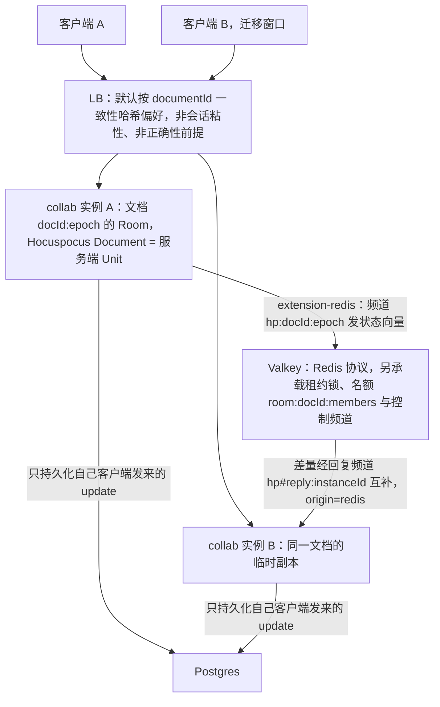
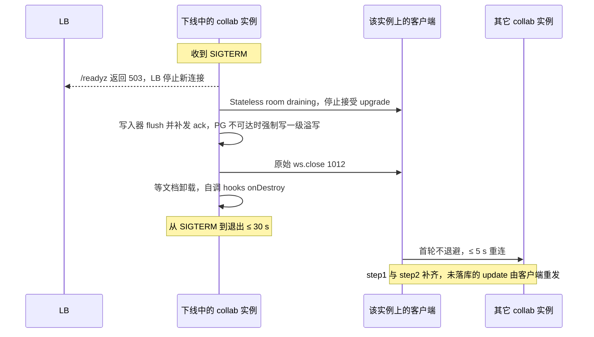

> 状态：已接受 | 负责：架构-运行时 | 更新：2026-09-24；2026-09-24 复核修正（rulings §4.17 D2；复核报告 M21、L6、L20）；2026-09-25（补图）；2026-09-25（矛盾收口，rulings §4.18）；2026-09-25（§4.19：名额字段落点改指 60-backend/05；多实例扇出仍为 M3，M2 协同后端为单实例，rulings §4.19 D-M2-CONTENT）；2026-09-26（§4.21：决策 2 扇出改用 extension-redis + 文档哈希（H:Q2）、决策 3 注明 origin=redis 不落库、决策 7 亲和由可选改为默认、决策 8 extension-redis 故障加固、决策 9 自写停机顺序，见文末修订）；2026-09-26（§4.21 Remap：原 30/08 引用按 60-backend/README §6.1 改指新位置，30/08 已删除）；2026-09-26（§4.21 复核：标题改为默认文档哈希偏好亲和；许可例外出处改指 ADR-0049 EX-01/EX-02） | 依赖：charter v0.1；裁决 `docs/00-charter/rulings-2026-09-14.md` §4.15 Q5/Q10、§4.17、§4.18、§4.21；ADR-0039

# ADR-0035 协同网关横向扩展：多副本房间 + Redis 协议扇出（默认 Valkey），默认文档哈希偏好亲和（非会话粘性，非正确性前提）

## 状态

**已接受**（2026-09-24，用户裁决 `00-charter/rulings-2026-09-14.md` §4.15 Q10：自托管 compose、同镜像按 `CORDEX_ROLE` 拆 collab 实例，Helm 为 M4 P1；Q5：房间**按文档实测权重准入**、多副本内存相乘）。原状态「提议（章程 Q10：单体起步，K8s 后续）」。v0.2 补充中的固定 MB/房间准入被下方「2026-09-24 修订」取代。Redis 协议实现默认 Valkey（ADR-0022），下文「Redis」均指 Redis 协议兼容实现。2026-09-25 按 rulings §4.18 修订决策 9（PG 不可达时的下线收尾与遗留溢写回放，CO-16）与修订第 2 条（「实例内存预算」定义，BE-29；内存压力下先回收空置房间，CO-14），以「原：…作废」就地保留演进。

## 背景

多实例下同一文档的客户端可能连到不同实例；需要：正确性不依赖路由；滚动发布不整房间断连；单写者任务（压缩/迁移）不重复；在线人数权威值。

## 决策

1. 任一实例都可服务任一文档：每个实例为其有客户端的文档维护一份 Room（Y.Doc 副本，= 服务端 Unit）。
2. **扇出**（2026-09-26 修订，rulings §4.21 H:Q2「Redis 扩展 + 文档哈希」，ADR-0039 决策 7）：M3 装 `@hocuspocus/extension-redis`（M2 单实例不装）。每个持有该文档的实例订阅频道 `hp:{docId}:{epoch}`（文档名即 `{docId}:{epoch}`），另有本实例回复频道 `hp#reply:{instanceId}`；本地发生变更时不发布 update 本身，而是在同一个事件循环内合并后发布一次状态向量，对端把差量回到请求方的回复频道并反向请求（3 跳，回包含全量删除集，O(文档)），可自愈，Valkey 8.1 实测跨实例 2.6–7.1 ms（vE）；awareness 与服务端 `document.broadcastStateless` 发出的 Stateless 事件（`CONTROL.event`）也经它转发。键前缀与模板登记在 60-backend/14 §3.1。由于每次变更每个对端都付 O(文档) 成本，**必须配合决策 7 的文档哈希**使常态只有一个实例持有文档。（原：「实例把通过门禁的 SYNC/AWARENESS/CONTROL 帧 `PUBLISH collab:doc:{id}`（含 `instanceId`），其他实例订阅并应用/转发；自身发布的消息按 `instanceId` 忽略。CRDT 幂等保证重复无害」，自研 `RedisFanoutBus` 的帧扇出作废；`FanoutBus` 只保留控制频道 `room:{docId}:ctl`。）
3. **持久化**：每个实例只持久化**自己客户端**发来的 update（避免重复行）；跨实例收到的 update 只应用不落库。（2026-09-26 注明机制：extension-redis 送来的更新 `origin=redis`，不经 `beforeSync`（Redis.ts:743-756 调 MessageReceiver 时不传 connection），也跳过存储钩子（types.ts:40-50），因此天然不落库；`onChange` 仍会以 origin `redis` 触发，写入器按来源过滤。）
4. **单写者任务**：压缩、迁移、rekey、epoch 通过 Redis 租约锁（`SET NX PX` + fencing token）选举执行者。快照 REST 与管理动作（compact/migrate/epoch）只在 collab（及 `all`）角色装配（ADR-0037 决策 1）：快照恢复在接到请求的实例上打开 Room 执行，多副本经扇出收敛；`forceEpoch` 递增 epoch 后经 Valkey 通知其他持有该 Room 的 collab 实例一并踢出会话（2026-09-25，rulings §4.18 BE-03）。
5. **在线人数**：`HSET room:{id}:clients {instanceId} n`（TTL 60 s 心跳），`CONTROL.room{clients}` 取聚合值。
6. **权限传播**：`perm:doc:{id}` 频道（ADR-0029）。
7. **偏好亲和（2026-09-26 由可选改为默认，rulings §4.21 H:Q2）**：反代按路径里的 `documentId` 做一致性哈希偏好某实例（**不是会话粘性**：不看 cookie、不绑定连接，扩缩容时部分文档迁移），同一文档的连接常态落在同一实例，extension-redis 只在迁移窗口与故障时兜底；它仍**不是正确性前提**，实例失联时客户端重连到任何实例。rulings §4.15 Q10 的「无粘性」据此改写为「按文档哈希偏好亲和、非会话粘性」，反代配置见 60-backend/17 §3。（原：「LB 可按 `documentId` 一致性哈希偏好某实例以减少副本数」，作为可选项。）
8. **Redis 故障**：实例内部一致；跨实例延迟直至恢复；`/readyz` 返回 503 让 LB 停止新连接（旧连接保留）；恢复后客户端重连触发 step1/step2 补齐（extension-redis 在 Valkey 恢复后任意一次变更即自动补齐，vE）。**extension-redis 加固**（2026-09-26，K16-A，ADR-0039 决策 9）：保留 ioredis 离线队列（`enableOfflineQueue:false` 会让构造时的 reply 订阅被拒且结果被缓存，此后所有文档加载失败）并限 `maxRetriesPerRequest`；继承其 `Redis` 类覆写 `beforeBroadcastStateless` 与 `onStoreDocument` 加 catch（Valkey 宕机期间 `broadcastStateless` 默认会让进程退出；redlock 连不上被误报为锁冲突）；进程级 `unhandledRejection` 兜底。控制面（`perm:doc`、`room:{docId}:ctl`）的订阅在 Valkey 恢复后对本实例全部会话做一次全量重算。
9. **滚动发布**：SIGTERM → `/readyz` 503 → 向客户端发 1012 → flush/persist → 退出（≤ 30 s）；客户端 1012 首轮不退避。**停机顺序自写**（2026-09-26，d-21，ADR-0039）：Hocuspocus 类没有 `destroy()`、嵌入模式下 `onDestroy` 不触发，`hp.closeConnections()` 发的是文档级 CLOSE（客户端只见 1000），都不能代替 1012；`drainAll` 的顺序为 `/readyz` 503 → 停止接受 upgrade → 各连接 Stateless `room{draining}` → 写入器 flush 并补发 ack（或写一级溢写）→ 原始 `ws.close(1012)` → 等文档卸载 → 自调 `hooks('onDestroy')`，让 extension-redis 断开订阅。**PG 不可达时**（2026-09-25 修订，rulings §4.18 CO-16）：flush 阶段先把内存档强制写入一级溢写再退出，不在 `persisting` 久等（30 s 预算等不起）；存活实例只回放**自己 `instanceId`** 的溢写行（`readAllOrdered(docId, instanceId)`，与决策 3「只持久化自己客户端的 update」一致、避免两实例重复回放）；心跳已过期（决策 5，TTL 60 s）实例遗留的溢写行，由下一次加载该文档的 Room 在 bootstrap 之后持 `lock:spill:{doc}` 租约认领回放。在线客户端不受影响：收到 1012 后带着未得 db ack 的 pending 重连到其他实例，step2 自然补齐；溢写兜底的只是已离开客户端的更改。（原：只写「flush/persist → 退出」，未覆盖 PG 不可达，40-modules/09 曾写「PG 恢复前 Room 停留 persisting」并按 docId 读出全部实例的溢写行，作废。）

**图 1 多副本房间与 Redis 协议扇出**

怎么读：箭头是帧与数据的流向；图中只画了 A → B 一个方向的扇出，B → A 对称（2026-09-26 改为 extension-redis 与文档哈希：常态下同一文档只在一个实例上，图中的双副本只出现在扩缩容或故障迁移窗口；原图「PUBLISH collab:doc:{id}」与「在线人数 HSET room:{id}:clients」作废）。Valkey 同时是两个实例共用的协调点：压缩、迁移、rekey、epoch 靠租约选出单写者，在线人数取各实例上报的聚合值。跨实例收到的 update 只应用不落库，所以 PG 中不会出现重复行。

**图 2 滚动发布时一个实例的下线顺序**

怎么读：纵线是参与方，自上而下是时间顺序。客户端被 1012 断开后立刻重连到其它实例（文档哈希把它导向新的归属实例），正确性由 CRDT 幂等与 ack 机制保证，不依赖原实例。2026-09-26 按决策 9 补齐自写停机顺序：先 flush 再发 1012，1012 必须由原始 `ws.close` 发出。

依据：本文决策 8–9、「后果」与补充（v0.2）滚动发布一条。

## 备选方案与放弃原因

| 方案 | 放弃原因 |
|---|---|
| 严格房间亲和（粘性路由，单副本） | 实例故障/发布导致整房间断连并等待新实例 bootstrap；LB 需要理解 URL；仍需 fallback 逻辑 |
| y-redis 架构（Redis 为主存 + worker 持久化） | 与 PG 为持久层的决策冲突（ADR-0022）；引入另一套房间模型 |
| 独立协调服务（如 NATS/JetStream） | 增加基础设施；Q5 规模 Redis pub/sub 足够 |
| 单实例 | 不满足可用性与发布需求（compose 阶段可单实例运行，本方案兼容） |

## 后果

正面：无会话粘性（2026-09-26 起默认按文档哈希偏好亲和，扩缩容与故障时任一实例都能接手）、发布无感（客户端秒级重连）、正确性由 CRDT 保证、跨实例同步复用 extension-redis。（原：「无粘性……实现简单」。）

负面 / 代价：extension-redis 每次变更让每个对端付 O(文档) 差量计算，无亲和时 D200 多人风险大，因此文档哈希是默认配置（决策 7）；它带入 ioredis 5.6.x 与 package.json 标 UNLICENSED 的 redlock，需登记例外（ADR-0049 EX-01、EX-02，60-backend/19 §14）；热门文档多副本内存（= 副本数 × 该文档实测权重；D200 ≈ 85 MB/副本，见下方修订；原「≤ 副本数 × 40 MB」作废）；Redis 是扇出关键路径（但不是持久化关键路径）；每实例都做软门禁（重复 CPU，但每帧 ≤ 5 ms）；持久化「只写自己客户端的 update」要求实例崩溃时其未落库的 update 由持有者客户端重发（ack 机制保证）。

## 补充（v0.2）：PRD SV-05 / NF-01 1.7 / NF-10 的量化承接

- 单实例（RM-S 2 vCPU / 4 GB）：≥ 2,000 并发 WS、活跃房间**按文档实测权重准入**（各档 D50 / D200 / 20K 的房间数 M1 实测后回填；原「≥ 200 活跃房间」作废，2026-09-24 复核修正）、CPU < 70%、房间内广播 p95 ≤ 100 ms、跨实例传播 ≤ 50 ms（同机房 Redis）。
- **内存准入**（2026-09-24 起被下方修订取代，保留以示演进）：200 房间在 4 GB 内的前提是 D50 级文档（≈ 12 MB/房间 = Y.Doc + 模型读视图 + 会话）；D200 级 ≈ 40 MB/房间。RoomManager 以 RSS 预算准入：RSS > 75% 时对新房间返回 4503（客户端退避后重连到其它实例，LB 分散），并优先驱逐空置房间；**与 PRD「≥ 200」的差异在此注明**（PRD 值按 D50 级成立）。
- 全系统（NF-10）：5,000 并发编辑者、2,000 活跃文档 → 约 10–12 个 collab 实例（含热文档多副本冗余），Redis pub/sub 吞吐 ≈ 5,000 × 10 帧/s × 副本数 ≤ 20 万消息/s，单 Redis 可承载；超出时按 `hash(doc_id)` 分片频道前缀（`collab:{shard}:doc:{id}`；2026-09-24 删去「按租户」——T-0）。（2026-09-26 注：扇出改用 extension-redis 后频道为 `hp:{docId}:{epoch}`，文档哈希使常态只有一个实例订阅某文档频道，消息量远低于上式；需要分片时经 extension-redis 的 `nodes`（Cluster）或注入客户端实现，M1–M3 不启用。）
- 滚动发布：SIGTERM → `/readyz` 503 → 1012 → flush → 退出 ≤ 30 s；客户端 ≤ 5 s 重连（SV-05）。

## 修订（2026-09-24，rulings §4.15 Q5 / Q10）：按文档实测权重准入、多副本相乘、名额按用户计

1. **实测内存**（合成模型，yjs 13.6.32 / Node 24）：约 **13.8 KB 堆/元素**——D200（≈ 6,000 元素）≈ **85 MB**，D50 ≈ **17.8 MB**，天花板 20,000 元素 ≈ 276 MB。v0.2 的 40 / 12 MB/房间估算偏低，作废。
2. **按文档实测权重准入**：RoomManager 为每个房间计算权重 = 该文档实测值（Y 结构数或堆估算，含软删除墓碑——ADR-0020），准入条件为「本实例已有房间权重之和 + 新房间权重 ≤ 实例内存预算」，其中**实例内存预算 = 容器内存上限（cgroup 限额，Node `process.constrainedMemory()`；无限额时取物理内存）× `room.memoryAdmissionPct`（默认 75，部署可调）**（2026-09-25 修订，rulings §4.18 BE-29：作废的只是旧的「按 RSS > 75% 判定」这种方式，75% 作为权重预算比例保留；`room.weightBudgetBytes` 若保留只作可选的绝对覆盖值）；**同一文档在 N 个实例上各有一份副本，集群总占用 = 权重 × N**，偏好亲和（决策 7）是降低 N 的手段。超预算返回 4503（客户端退避后重连其他实例）。内存压力或准入不足时**先按 LRU 提前结束空置（draining）房间**（`draining → persisting → closed`，无在线客户端、无需 1012），仍超预算才对 active 房间走 `active → evicting`（发 1012）；不存在 `draining → evicting` 边（2026-09-25 修订，rulings §4.18 CO-14，与架构 06 §5.2/§14 一致；原：「仍优先驱逐空置房间」，与 evicting 只用于有在线客户端的房间相混，作废）。
3. **规模口径两层**（Q5）：性能保证包络（D200、DX-1000、20 编辑者 + 50 查看者、200 MB）内门禁只收紧；系统天花板 = 200 页 / 单页 1,000 / 文档总元素 20,000（软警告 15,000，墓碑计入）。**超天花板的导入直接拒绝**（`format.quota_exceeded{dimension, limit, actual}`；编辑期超上限为 `document.quota_exceeded`，rulings §4.17 D2；2026-09-24 复核修正：原「超包络」混用了两层口径——包络是性能保证，天花板才是拒绝线）。规模数字为**部署配置、完全可调**；调到包络外时启动告警、`/readyz` 标注，性能承诺不再成立。
4. **房间名额按用户计**：同一用户多标签页/多设备只占 1 个名额；commenter 计入查看者名额；owner 不占编辑者名额、满员时不被降级（`config.room` 增 `countBy:'user'` 等字段，由 60-backend/05 §4 与 40-modules/09 落地）。满员房间（20 + 50）需要服务端 awareness 合并 tick、查看者只上报 view（ADR-0024 / 06 §7 承接）。
5. **单实例口径**：RM-S 2 vCPU / 4 GB 作为 **collab 单实例**口径；NF-01 §1.7「≥ 200 房间」改为按文档规模分档（D50 / D200 / 20K）重算，M1 实测后填入；compose 全家桶的主机规格另见 ADR-0037。
6. **部署拓扑**（Q10）：collab 实例 = 同一镜像 `CORDEX_ROLE=collab`（或 `all` 单进程）；compose 阶段可单实例运行；K8s/Helm 为 M4 P1（ADR-0037）。

## 修订（2026-09-26，rulings §4.21）：extension-redis、文档哈希与自写停机

> 依据：rulings §4.21 q-ws-gateway 与 H:Q2「Redis 扩展 + 文档哈希」；ADR-0039 决策 7、9；证据 K6-B、K16-A、d-21、d-22。决策 2、3、7、8、9 与图 1、图 2 已就地改写，本节只做索引。

1. **决策 2 扇出**：M3 装 extension-redis（加固子类，在 apps/server 组装、注入 server-collab），跨实例同步 update、awareness 与服务端 Stateless 事件；自研帧扇出作废，`FanoutBus` 只保留控制频道。
2. **决策 3**：跨实例更新 `origin=redis`，不经 `beforeSync`、不触发存储钩子，天然只应用不落库。
3. **决策 7**：文档哈希偏好亲和由可选改为默认（非会话粘性、非正确性前提）；rulings §4.15 Q10 与 60-backend/01、60-backend/17 的「无粘性」同步改写。
4. **决策 8**：extension-redis 故障加固（保留离线队列并限重试、覆写两个钩子加 catch、进程级兜底）。
5. **决策 9**：自写 `drainAll` 顺序；1012 由原始 `ws.close` 发出。
6. **文档名 `{docId}:{epoch}`**：换纪元后新纪元是新文档，extension-redis 频道随之隔离，旧纪元房间自然排空（K8-B）；决策 4 的 `epoch` 单写者租约与取号栅栏不变。

## 如何被机械验证

- （2026-09-26，rulings §4.21）`createServerCluster(n)` = n 个 Hocuspocus 实例 + extension-redis（Valkey 容器）或内存 pub/sub 替身：A 实例客户端编辑 → B 实例客户端收敛（断言状态向量一致，取代「按 instanceId 去重扇出」）；Valkey 宕机 30 s 期间两实例进程都不退出、各自内部一致，恢复后一次变更即补齐；跨实例更新不产生 `document_updates` 行；反代按 `documentId` 哈希时同一文档的新连接落在同一实例（部署 e2e）；SIGTERM 时客户端收到的是 1012 而不是 1000。
- server-integration：`createServerCluster(2)`（内存总线）与 testcontainers Valkey（Redis 协议兼容，ADR-0022；2026-09-24 复核修正）两种模式：A 实例客户端编辑 → B 实例客户端 ≤ 100 ms 看到；B 崩溃 → 其客户端重连 A 后状态一致；两实例同时触发压缩只执行一次（锁）。
- 混沌：Redis 断开 30 s → 恢复后两端一致；`/readyz` 期间为 503。
- 发布演练脚本：滚动重启期间 e2e 双浏览器编辑不丢（`ack` 全部到达）。
- 指标：`cordex_collab_rooms_active{instance}` 与 `room:{id}:clients` 聚合一致（监控校验）。
- （2026-09-24）准入：单测覆盖「权重之和超预算 → `auth.denied{collab.room_full}` / 关闭码 4503」「墓碑计入权重」；perf 场景 DX-20K 与满员房间（20 + 50）扇出压测（11-testing §9、`test/perf/budgets.json`）；同用户双标签页只占 1 名额的集成测试。
- （2026-09-24）导入超天花板（> 200 页 / 单页 > 1,000 / 总元素 > 20,000）返回 `format.quota_exceeded`（2026-09-24 复核修正：原「超包络」「`quota_exceeded`」）。
- （2026-09-25，rulings §4.18 CO-16）`spill-and-replay.test`：两实例同时在线各自只回放本实例的行、无重复行；实例下线后由新实例加载时认领回放；SIGTERM 且 PG 不可达时 ≤ 30 s 内完成「写一级溢写 → 退出」。
- （2026-09-25，rulings §4.18 BE-29/CO-14）准入单测：预算 = 容器内存上限 × `memoryAdmissionPct`（注入假的 `constrainedMemory()`）；内存压力下先结束空置 draining 房间、不向任何客户端发 1012，仍超预算才驱逐 active 房间。

## 关联

章程 Q5/Q10、D8；`00-charter/rulings-2026-09-14.md` §4.15 Q5/Q10、§4.18 BE-03/BE-29/CO-14/CO-16、§4.21；ADR-0020/0022/0023/0024/0025/0029/0037/0039；架构 06 §5.2；60-backend/05 §4、§5、60-backend/16 §11、60-backend/17。
