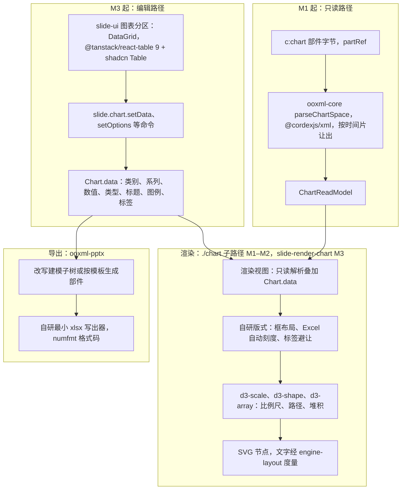
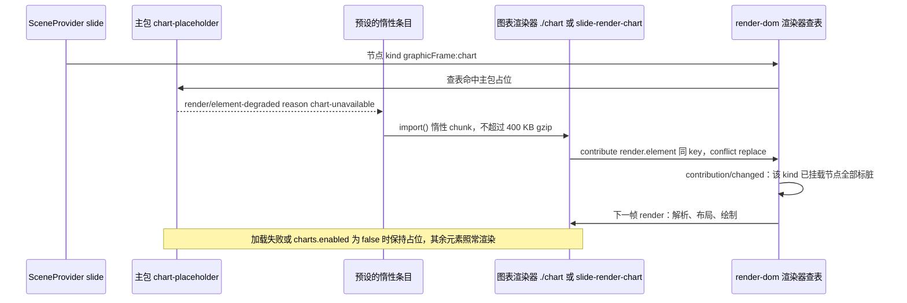

> 状态：已接受 | 负责：架构-运行时（主笔 M-07；会签 M-03、M-04、M-10） | 更新：2026-09-26（§4.21：新建。图表渲染与编辑路线：d3-scale / d3-shape / d3-array 做底层、按 OOXML 语义自研布局；M1 只读解析渲染；M3 `Chart.data` 与五类编辑、数据网格、最小 xlsx 写出器与 numfmt；惰性子路径与同 key 覆盖；SSIM 口径与图表语料）；2026-09-26（§4.21 整合：决策 5 链 30/06 §1.3.3 的 Yjs 编码；决策 6 写明 slide-render-chart 不直接 import react 与 react-table；决策 7 图表部件写出统一为 export/chart.ts 并链 40/04 §5.2）；2026-10-07（design-language-v3 第 1 批：文末增「修订 2026-10-07」——决策 6 所说的「抽屉」即数据面板，按 rulings §4.25 DS-22、DS-26、TB-11、TB-12 写明位置与入口；决策不变）；2026-10-15（design-language-v3 第 2 批：文末增「修订 2026-10-15」——数据面板宽 max(400, 检查器当前宽度)、开着时检查器分隔条不可拖、关闭后回到原宽，按 rulings §4.25 TB-60；决策不变） | 依赖：charter v0.2 D13、D16；裁决 `docs/00-charter/rulings-2026-09-14.md` §4.12 U-06、§4.15 Q7、§4.18 FE-08 / GV-24、§4.21（q-chart-route、q-license-tiers、X:q-content-types，R-d-34、R-d-35、R-d-74）；PRD `10-prd/03-features/01-open-and-fidelity.md` OF-09 / §2.6、`02-editing.md` ED-15、PD-06；[ADR-0008](./0008-opaque-preservation.md) 决策 2 / 9 / 10；[ADR-0018](./0018-editor-element-model-and-insert-commands.md)；[ADR-0019](./0019-xml-lexer-and-fidelity-tree.md)；[ADR-0021](./0021-rendering-medium.md)；[ADR-0027](./0027-text-measurement-strategy.md)；[ADR-0032](./0032-ordered-collections-fractional-index.md)；[ADR-0049](./0049-dependency-admission-and-license-tiers.md)；证据 `docs/00-charter/_evidence/reuse-arch-elements-plan-2026-09-26.json`（questions q-chart-route、frontendReuse.matrix「图表」类、elementDesign 图表三项）

# ADR-0036 图表渲染与编辑路线：d3-scale / d3-shape / d3-array 做底层，按 OOXML 语义自研布局

## 状态

**已接受**（2026-09-26，用户裁决 rulings §4.21 q-chart-route，取推荐项）。取代 30/02、40/07 §10 中「图表绘制：自研还是图表库，待定」的口径；选项 2（ECharts 6）与选项 3（M1 先 ECharts、M3 换自研）否决，理由见「备选方案与放弃原因」。

| 项 | 口径 |
|---|---|
| 主笔 | M-07（`slide-render` 的 `./chart` 子路径、M3 的 `slide-render-chart`） |
| 会签 | M-03（`Chart.data` 与图表命令，30/04 §3.9、30/05 §14）、M-04（`chartml.parseChartSpace`、`export/chart.ts`、`export/chart-workbook.ts`）、M-10（数据面板与 `DataGrid`） |
| 前端落点 | [50-frontend/24](../../50-frontend/24-elements-tables-and-charts.md) §3、§4 |
| 模块落点 | [40-modules/07](../../40-modules/07-slide-rendering.md) §2.7、§4、§5 |
| 视觉门禁 | [70-testing/04](../../70-testing/04-visual-oracle.md) §8.1 |

## 背景

- **D16 与 OF-09**：M1–M2 `c:chart` 部件不透明保留，渲染器只读解析部件与缓存数据来查看，不以包内位图代替；矩阵 §2.6 的类型全部可渲染，数值与类别 100% 来自缓存；单图表页 SSIM ≥ 0.80 且数据墨迹 IoU ≥ 0.85（M1 gated，70/04 `chart` 类别）。M3 起建模与编辑，可编辑类型为 bar / line / pie / area / scatter 五类（rulings §4.12 U-06，ED-15）；chartex 只保留与占位（rulings §4.15 Q7）。
- **位置与体积**：M1–M2 图表代码在 `slide-render` 的惰性子路径 `./chart`，M3 拆为 `slide-render-chart`，两者都以 `render.element('dom:graphicFrame:chart')` 同 key 覆盖主包占位（rulings §4.18 FE-08、GV-24）；图表 chunk ≤ 400 KB gzip、按需加载（50-frontend/13 §6）。
- **决定成败的是版式语义**：PowerPoint 的图表外观由 OOXML 语义决定——`c:manualLayout` 的绘图区位置、Excel 自动刻度、`gapWidth` / `overlap` 的柱宽、堆积与百分比堆积、饼图起始角与标签避让、图例与标题排布。SSIM 的差距主要来自这些版式，而不是画线画面本身；通用图表库都自带一套布局模型，与 OOXML 对不上。
- **路线此前未定**：30/02 与 40/07 §10 只约束了许可（D13）与引入位置（`slide-render-chart/infrastructure/renderers/**`）；数据网格组件（react-datasheet-grid 在 React 19 严格 peer 下装不上）与内嵌工作簿写出方式也未定（R-d-34、R-d-35）。

## 决策

1. **底层只用 d3 的数学与路径**：d3-scale 4.0.2、d3-shape 3.2.0、d3-array 3.2.4（均 ISC；传递依赖 d3-path 3.1.0、d3-format、d3-interpolate、d3-color、d3-time、d3-time-format、internmap 均 ISC；2026-09-26 `npm view` 核对），按 ADR-0049 属宽松类；约 30 KB。只用比例尺（linear、log、band、time）、形状生成器（line、area、arc、pie、stack 及其 offset）与数组运算（extent、sum、group）；不用 d3-selection、d3-transition、d3-axis 等操作 DOM 的模块——节点由我们自己的绘制代码产出（ADR-0021 DOM/SVG 单实现）。精确锁版本，新依赖四处同步（章程 §5.3 单点表、license-allowlist、catalog、50-frontend/13 体积预算，R-d-10）。
2. **版式按 OOXML 语义自研**，全部是纯函数：
   - **框布局**：有 `c:manualLayout` 时按 `layoutTarget`（inner / outer）、`xMode` / `yMode`（edge / factor）与 `x / y / w / h` 求绘图区；否则从图表区扣除标题、图例与坐标轴标签的实测尺寸。
   - **刻度**：值轴未给 `c:min` / `c:max` / `c:majorUnit` 时按 Excel 自动刻度规则求（零基判定、顶部留白、主刻度取 1 / 2 / 5 × 10ⁿ 候选并受绘图区高度约束）；规则的期望值以维护机 COM 导出的 `MinimumScale` / `MaximumScale` / `MajorUnit` 为准，不以文字描述为准；对数轴、日期轴、百分比堆积各有分支。
   - **几何**：簇状柱宽 = 类别带宽 ÷（k − (k − 1) × overlap% + gapWidth%）；堆积与百分比堆积用 d3-shape `stack`（负值分两侧累加）；饼图自 12 点方向顺时针、起始角取 `c:firstSliceAng`；平滑线插值参数以语料校准；3D 类型退为 2D（V~）。
   - **标签**：刻度标签旋转或跳过（`c:tickLblSkip` 优先）、数据标签按 `c:dLblPos` 放置、饼图 `bestFit` 放不下时外移并加引导线且按左右两半纵向避让；图例排布；数值按 numfmt 3.2.6（MIT）以 `formatCode` 与文档语言格式化。
   - **文字**：标题、标签、图例文字用 engine-layout 的 `TextMeasurer` 度量，与正文同一套字体回退（ADR-0027）；绘制为 SVG `<text>`。
3. **解析**：`ooxml-core` 的 `chartml.parseChartSpace` 建在 `@cordexjs/xml` 的 `parseDocument` 之上（ADR-0019），在主线程按时间片让出（每片 ≤ 50 ms）；输出 `ChartReadModel`（字段见下表），存于该元素的 `ElementHandle`，随元素卸载释放，不新增 LRU。
4. **包位与惰性**：M1–M2 在 `@cordexjs/slide-render/chart`（`src/chart.ts` + `infrastructure/chart/**`），M3 迁入 `@cordexjs/slide-render-chart`；两者都同 key 覆盖主包的 `chart-placeholder.renderer`，占位发 `render/element-degraded{reason:'chart-unavailable'}` 触发加载，`/render` 页关闭惰性。d3-* 与 numfmt 的单点引入目录为 `slide-render/src/infrastructure/chart/**`（M1–M2）与 `slide-render-chart/src/infrastructure/**`（M3），主包静态图不可达；numfmt 另允许出现在 slide-ui 的图表数据分区（数据网格的显示与输入解析，见决策 6）。
5. **M3 模型**：可编辑图表增加 `Chart.data`（字段唯一源 30/04 §3.9，决策 ADR-0018）。**可编辑判定**：`c:plotArea` 恰有一个图表组、类型属五类（3D 变体与环形不算）、无次坐标轴、每个系列缓存完整。**物化**：M3 起导入时对可编辑图表从缓存确定性生成 `Chart.data`（`CatId` / `SerId` 由 `c:pt@idx`、`c:ser/c:idx` 派生，FracKey 用确定性键），M3 之前的快照由服务端单写者在 schemaVersion 迁移中物化（ADR-0009）；不在首次编辑时惰性物化，避免两个协作者各建一份。**渲染视图** = 只读解析结果叠加 `Chart.data`：数据、类型、标题、图例、数据标签以 `data` 为准，未建模的外观（系列 `c:spPr`、坐标轴格式、`c:txPr`、趋势线）取自部件；新插入的图表没有部件，外观取主题默认。`partRef` 始终只读，不构成第二份可编辑模型（ADR-0008 决策 10）。Yjs 编码见 [30/06](../06-collaboration.md) §1.3.3：`graphic.chart.partRef`（M1 起）+ `data`（M3 起），类别与系列是按 `CatId` / `SerId` 的记录表（`order` 为 FracKey），删除写 `_deleted` 墓碑，与 30/04 §3.9 同一组字段名。
6. **编辑范围与数据网格**：五类之间切换类型与子类型、改数值 / 类别名 / 系列名、增删类别与系列、标题、图例、数据标签（ED-15）；轴范围、数字格式、趋势线与误差线编辑为 P2。数据网格用 @tanstack/react-table 9.2.4（MIT，peer react ≥ 18，headless）+ shadcn Table，由 ui-react 封装为通用 `DataGrid`（@tanstack/react-table 单点引入 ui-react），slide-ui 的图表分区与抽屉使用；按章程 §5.3 规则 4，react 与 @tanstack/react-table 只在 ui-react 与 `*-ui`，`slide-render-chart`（V-render）只提供数据模型与命令，不直接 import react 或 @tanstack/react-table；选区复用表格的 `table-selection` 状态机；一次格提交、一次 TSV 粘贴各一条命令（`slide.chart.setData`，30/05 §14）；数据改动到重绘 ≤ 100 ms。
7. **导出**：零编辑时图表部件、`chartN.xml.rels`、内嵌 xlsx 原字节写回；导入的图表被编辑时在该部件的保真树上改写建模子树（系列的 `c:tx` / `c:cat` / `c:val` 及缓存与 `c:f`、图表组元素与 variant、`c:title`、`c:legend`、`c:dLbls`），未建模子树原样保留（ADR-0008 决策 2），数据变了才重生成工作簿；新插入的图表按模板生成部件、rels 与 xlsx（图表部件写出在 `ooxml-pptx` `export/chart.ts`，落点见 [40-modules/04](../../40-modules/04-ooxml-format-and-pptx-codec.md) §5.2）；`[Content_Types].xml` 与 `.rels` 仅在集合变化时重生成（X:q-content-types）。内嵌工作簿用**自研最小 SpreadsheetML 写出器**（`ooxml-pptx` `export/chart-workbook.ts`：`ooxml-core` OPC + `@cordexjs/xml` 序列化 + fflate，约 5 KB，R-d-35）：`Sheet1` 的 A 列为类别、第 1 行为系列名，`styles.xml` 写数字格式，`c:f` 改写为规范区域。
8. **SSIM 口径与语料**：沿用 OF-09 与 70/04 的三层判定（`chart` 类别 SSIM ≥ 0.80、数据墨迹 IoU ≥ 0.85，M1 gated）；因为版式自研，另加两项结构断言：值轴刻度（最小值、最大值、主刻度）与维护机 COM 导出一致、绘图区包围盒 IoU（先报告，校准后只收紧）。图表语料按「类型 × 版式特性」矩阵组织（70/04 §8.1）；M3 另有编辑往返用例：编辑数据与换类型后导出，维护机 PowerPoint 打开无修复、「编辑数据」能打开内嵌工作簿。

**`ChartReadModel` 字段**（`ooxml-core` `chartml.parseChartSpace` 的输出，M1 起；类型由 `ooxml-core` 定义并导出，40-modules/04 登记）：

| 部分 | 字段 |
|---|---|
| 部件 | `date1904`、`roundedCorners`、`lang`、部件级 `spPr` / `txPr`、`externalData?{rId, autoUpdate}`、`chartStyle` / `colors` 部件引用、`cacheHash`（部件 sha256） |
| 标题 | `title?{rich 或 自动, overlay, layout?, spPr}`、`autoTitleDeleted` |
| 绘图区 | `layout?{layoutTarget, xMode, yMode, x, y, w, h}`、`groups[]`、`axes[]`、`spPr` |
| 图表组 | `kind`（bar / bar3D / line / line3D / pie / pie3D / doughnut / ofPie / area / area3D / scatter / bubble / radar / stock / surface / surface3D）、`barDir`、`grouping`、`varyColors`、`gapWidth`、`overlap`、`firstSliceAng`、`holeSize`、`scatterStyle`、`dLbls?`、`axIds`、`series[]` |
| 系列 | `idx`、`order`、`tx?{ref, cache}`、`spPr`、`marker?`、`dPt[]`、`dLbls?`、`cat?{ref, formatCode?, points}`、`val` / `xVal` / `yVal` / `bubbleSize`（`{ref, formatCode, ptCount, points}`）、`smooth?`、`explosion?`、`invertIfNegative?`、`trendlines[]` 与 `errBars[]`（只显示） |
| 坐标轴 | `id`、`kind`（cat / val / date / ser）、`axPos`、`delete`、`scaling{orientation, min?, max?, logBase?}`、`majorUnit?`、`minorUnit?`、`numFmt{formatCode, sourceLinked}`、主次网格线、`tickLblPos`、`majorTickMark`、`crossAx`、`crosses` / `crossesAt`、`crossBetween`、`tickLblSkip?`、`txPr`、`spPr`、`title?` |
| 图例与其它 | `legend?{legendPos, layout?, overlay, deletedEntries, txPr, spPr}`、`plotVisOnly`、`dispBlanksAs` |

**图 1 图表的解析、布局与编辑分层**

怎么读：左上是 M1 就有的只读路径，右上是 M3 才加的编辑路径，两条都汇入同一个渲染视图，所以只读与可编辑图表共用一套版式与绘制代码；d3 只处在「比例尺与路径」这一层，上面的版式决策全部自研；导出只从 `Chart.data` 出发改写或生成部件，未被编辑的图表不经过这条路。
依据：本 ADR 决策 1–7；rulings §4.21 q-chart-route。

**图 2 图表渲染器的惰性加载与同 key 覆盖**

怎么读：主包只注册占位，第一次遇到图表时由占位发出的降级事件触发惰性加载；图表渲染器以同一个 key 注册，贡献点的 `replace` 语义让它顶替占位，查表重建后该类节点全部重绘。`/render` 页关闭惰性，图表渲染器随首帧加载。
依据：rulings §4.18 FE-08、GV-24；40-modules/07 §3；50-frontend/05 §9。

## 备选方案与放弃原因

| 方案 | 放弃原因 |
|---|---|
| ECharts 6.1.0（Apache-2.0）按需引入、SVG 渲染（q-chart-route 选项 2） | 五类约 400–500 KB，逼近图表 chunk 预算；grid / legend / axis 的布局模型与 OOXML `manualLayout`、Excel 自动刻度对不上，对照项目自评也只能近似，SSIM 靠不住；zrender 自带场景图、命中与脏区，与我们的渲染管线重复；运行时样式注入要过 CSP 与 Trusted Types 实测 |
| M1 先用 ECharts 近似，M3 编辑时换自研（选项 3） | 写两套渲染器；M3 切换时全部图表基线整体变动，第三层回归判定失效 |
| Vega-Lite 6.4 | 体积大、带表达式解释器（CSP）；声明式规格与 OOXML 结构差距大 |
| Chart.js | 只画 canvas，违背 ADR-0021 的 DOM/SVG 单实现 |
| visx | 绑定 React；渲染器是无状态 DOM 查表项，不是 React 组件 |
| Observable Plot | 依赖完整 d3、自带布局规则，同样不按 OOXML 排版 |
| 包内缓存位图或预览图代替解析 | D16 明确排除（「不以包内位图代替」）；多数文件也没有可用位图 |
| react-datasheet-grid 4.11.6（数据网格） | 依赖 react-resize-detector 7，其 peer 只到 React 18，`strictPeerDependencies` 下装不上（R-d-34） |
| SheetJS（npm 0.18.5）/ exceljs / write-excel-file（工作簿） | SheetJS 的 npm 版停更且有已知漏洞；exceljs 停更且依赖 Node；write-excel-file 可用但与已有的 OPC 与 XML 序列化重复；自研写出器只需约 5 KB |
| hyperformula（公式计算） | GPL，按 ADR-0049 禁用；图表数据网格也不需要公式 |
| ssf 0.11（数字格式） | 停更；numfmt 3.2.6 无依赖、2026-04 仍在发布 |

## 后果

- **正**：底层库约 30 KB、ISC，图表 chunk 余量大；版式完全按 PowerPoint 语义实现，保真可以逐项校准；只读与可编辑共用一套渲染代码，M3 不换基线；数据按 id 归一化，协同下不同格并发都能合并；工作簿写出复用已有的 OPC 与 XML 序列化。
- **负**：自研量大（刻度、堆积、标签避让、图例排布），保真靠语料迭代，M1 的 `chart` 类别门禁对进度是风险；3D、曲面、组合等只读类型只能近似；编辑后原工作簿中数据区之外的内容不保留（PD-06 默认策略）。
- **缓解**：结构 oracle 给出刻度与绘图区的精确期望，把像素差异拆成可定位的项；语料矩阵按特性分行，未达标的行单独报告；版式函数是纯函数，M5 sheet 需要图表时可抽为 iso 包（届时另立 ADR）。

## 如何被机械验证

- `e2e/oracle-gated`：`chart` 类别三层判定（SSIM ≥ 0.80、数据墨迹 IoU ≥ 0.85，M1 gated）；值轴刻度一致率与绘图区 IoU 作为结构断言（先报告），语料矩阵见 70-testing/04 §8.1。
- `test/unit`：版式纯函数用例（自动刻度期望值取维护机 COM 导出、柱宽公式、堆积与百分比、饼图起始角与标签避让）；`chart-data-roundtrip.test.ts`：编辑写回缓存与 `c:f` 一致、内嵌 xlsx 由自有读取器读回同一份数据、零编辑部件字节相同；degrade 用例：渲染器缺席时占位 + `chart-unavailable`、chartex 占位 + `chartex-unsupported`。
- `test/unit`（preset `lazy.test.ts`）：无图表文档不加载图表 chunk；`scanners/scan-bundle-budget`：图表 chunk ≤ 400 KB gzip。
- depcruise `cordex-third-party-single-entry`：d3-* 与 numfmt 只出现在决策 4 的目录，@tanstack/react-table 只出现在 ui-react；许可扫描按 ADR-0049 分级通过。
- `perf/perf-client`：数据格提交到重绘 ≤ 100 ms（典型图表）。
- `test/collab-sim`：随机并发改格、增删类别系列、切换类型后两端 `Chart.data` 一致。
- 维护机（半机械，M3）：编辑数据与换类型后导出，PowerPoint 打开无修复、「编辑数据」可打开内嵌工作簿，结果写进 `test/evidence/`。

## 关联

- 章程 D13（许可，改为「许可分级，见 ADR-0049」）、D16（图表 M1–M2 只读）；rulings §4.12 U-06、§4.15 Q7、§4.18 FE-08 / GV-24、§4.21。
- ADR：[0008](./0008-opaque-preservation.md)（不透明保留与只读解析）、[0018](./0018-editor-element-model-and-insert-commands.md)（`Chart.data` 与图表命令）、[0019](./0019-xml-lexer-and-fidelity-tree.md)（解析器）、[0021](./0021-rendering-medium.md)（DOM/SVG）、[0027](./0027-text-measurement-strategy.md)（文字度量）、[0032](./0032-ordered-collections-fractional-index.md)（FracKey）、[0049](./0049-dependency-admission-and-license-tiers.md)（许可分级）。
- 文档：[30/04](../04-document-model.md) §3.9；[30/05](../05-command-and-history.md) §14；[40/07](../../40-modules/07-slide-rendering.md) §2.7；[50/24](../../50-frontend/24-elements-tables-and-charts.md) §3；[70/04](../../70-testing/04-visual-oracle.md) §8.1。

## 修订 2026-10-07：数据面板的位置与入口（rulings §4.25 DS-22、DS-26、TB-11、TB-12）

- 决策 6 所说「slide-ui 的图表分区与抽屉」中的「抽屉」即数据面板 `ChartDataDrawer`（文件名沿用）：宽屏为检查器栏由 280 加宽到 400、整栏换成完整数据网格，画布相应收窄、图表始终可见，标题行有「收起到检查器」与「关闭」；紧凑窗口（640–1024）为画布底部 Sheet（rulings §4.22 D-17）。
- 入口只有检查器「数据」分区的「展开」，原迷你工具条「编辑数据」随 DS-22 作废；插入图表后只展开「数据」分区、不进数据面板（TB-12）；「更改类型」是检查器「类型」字段的下拉，与工具条「图表」共用 `ChartTypeMenu`，会移除导入内容时只在菜单底部确认（TB-11）。
- 本 ADR 的决策（d3 底层、按 OOXML 语义自研版式、数据网格用 @tanstack/react-table、一次提交一条命令、导出与工作簿写出）不变。
- 关联：设计 03-31；50-frontend/24 §3；40-modules/10 §2.6、§4.4（`ChartSection`、`ChartDataDrawer`）。

## 修订 2026-10-15：数据面板的宽度（rulings §4.25 DS-38、TB-60）

- 上节「检查器栏由 280 加宽到 400」按 TB-60 读作：数据面板宽 max(400, 检查器当前宽度)——检查器为缺省 280 时即加宽到 400，用户已把检查器拖到 400 以上时沿用当前宽度；数据面板开着时检查器左缘的分隔条不可拖，关闭后回到检查器原宽。同属「编辑与整页类」整栏面板的还有插件整页面板（DS-38）；版本历史、保真报告这类列表与报告沿用检查器宽度、不加宽。
- 本 ADR 的决策不变。
- 关联：50-frontend/10 §2.1、§5；40-modules/10 §4.4（`ChartDataDrawer`）。
