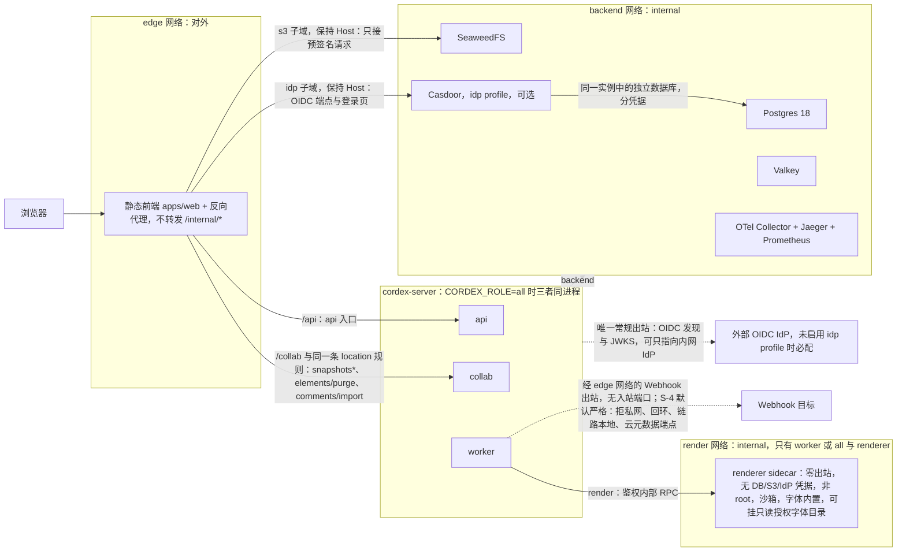

> 状态：已接受 | 负责：架构-运行时 | 更新：2026-09-24；2026-09-24（rulings §4.16 Q19：renderer 字体包与自有授权字体目录挂载）；2026-09-24 复核修正（rulings §4.17；复核报告 M13：本 ADR 为 renderer 配置键事实源）；2026-09-25（补图）；2026-09-25（矛盾收口，rulings §4.18）；2026-09-25（§4.19：决策 3 反代 collab 路由清单、worker 接入 edge 供 Webhook 出站、`audit-rotate` 以 ops-cron 运行；M2 部署口径，见文末修订）；2026-09-26（§4.20）（BE-11+TX-12：关联中已删的「架构 08 §2」改指 08 §0/§10 与 60-backend/17；决策 5 主机规格数值按推迟项 BE-07+TX-05 待 M3 出口前实测回填，本轮不改）；2026-09-26（§4.21 Remap：原 30/08 引用按 60-backend/README §6.1 改指新位置，30/08 已删除） | 依赖：charter v0.2；裁决 `docs/00-charter/rulings-2026-09-14.md` §4.15 T-0/Q6/Q8/Q9/Q10、§4.16 Q19

# ADR-0037 部署拓扑与交付件：同镜像按角色运行 + 自托管 compose 洁净栈

## 状态

**已接受**（2026-09-24，用户裁决 `00-charter/rulings-2026-09-14.md` §4.15 Q10「新增 ADR-0037 部署拓扑」；证据 `00-charter/_evidence/q1-q10-decision-pack.json` `results[10].decisions[10]`，与本 ADR 冲突处以 §4.15 为准——证据包推荐的「服务端保持多租户」「Keycloak 按 1.25 GB 计」「Node 24 基础镜像」均已被 §4.15 的 T-0、Q6、Q9 取代）。

本 ADR 是部署拓扑的单一事实源：ADR-0022（存储组件）、ADR-0026（renderer sidecar）、ADR-0029（IdP）、ADR-0030（观测组件）、ADR-0035（collab 横向扩展）只各自决定本领域的选择，组件如何打包、按什么角色运行、放进哪个 compose profile、以什么门禁交付，统一在这里。

## 背景

- **交付形态**：M1–M5 只做集成方/自有部署的 docker-compose，**不自营 SaaS**；一次部署 = 一个组织（T-0，单组织完全去租户）。PRD SV-09 要求「docker-compose 一条命令启动」，US-O-01「一条命令把整套服务在测试环境跑起来」。
- **此前口径分裂**：Chromium 的位置有三种说法（PRD SV-09 sidecar、原架构 08 篇 §2 worker 变体、ADR-0026 进程内）；原架构 08 篇 §10.1 的 compose 清单仍是 `postgres:16 · redis:7 · minio`；D13 的机械执行点 TD-050 只扫 npm 依赖，镜像不在任何门禁里；PRD 全文没有离线安装包或 arm64 的需求。
- **许可现实**（2026-09 实测）：MinIO 上游归档、Docker Hub 镜像下架、自行构建有 AGPL 分发义务；`redis:7` 未钉版本会落到 7.4.x（RSAL/SSPL），8.x 含 AGPL；Grafana/Tempo/Loki 为 AGPL-3.0，Jaeger/Prometheus/OTel Collector/Alertmanager 为 Apache-2.0；任何 Linux 基础镜像都带 GPL/LGPL 系统包，不能对整镜像逐包套用 D13。
- **renderer 安全现实**：Playwright 官方镜像仅供测试开发、默认 root 且沙箱关闭、压缩后约 956 MB、run-server 无鉴权，且存在已知 CVE 窗口（ADR-0026）。

## 决策

1. **同一应用镜像按角色运行**：一个 `cordex-server` 镜像，由环境变量 **`CORDEX_ROLE`** 选择装配（`apps/server/src/config/roles.ts` → `AppModule.forRole`）：

   | `CORDEX_ROLE` | 装配内容 | 典型部署 |
   |---|---|---|
   | `all`（compose 默认） | api + collab + worker 全部模块，单进程 | 单机 compose |
   | `api` | 全部 REST（鉴权、文档、权限、分享、媒体、导入导出入口、浏览器遥测 `client-telemetry`）与作业生产者；**不含**快照 REST 与管理动作（见 collab 行） | 拆分部署 |
   | `collab` | WS 网关 + 房间（ADR-0023/0035）+ **快照 REST**（`SnapshotsModule`）与**管理动作**（`AdminController`：compact/migrate/epoch）+ 评论观察器（`CommentMirrorObserver`）+ Webhook 生产者 + `PermissionsModule`（导出 `ResolveShareLinkUseCase`，WS 会话重算链接角色所需）与 `ShareLinksModule` | 拆分部署，可多副本 |
   | `worker` | 全部 BullMQ 处理器与定时作业（对账、`SealJob`、maintenance、`document-purge` 及 M-09 的 purge 参与者——只依赖 `PgUpdateStore`/`PgSnapshotStore`，不激活 `collabServer`）+ headless 编排（向 renderer 发 RPC，不含 Chromium） | 拆分部署 |
   | `renderer` | 只装 M-09 renderer 入口：接收 worker 的鉴权内部 RPC、驱动本容器内 Chromium；+ **精简健康探针**（`HealthModule.forRole('renderer')`：只有 `/healthz` 与 Chromium 池就绪，仅容器内，不含凭据）；**不装任何含凭据的模块**，不装 `MetricsModule`（渲染耗时/超时/崩溃指标由 worker 侧 `remote-renderer.client` 记录），OTLP 导出关闭、日志只写 stdout | 独立 sidecar（见决策 3） |

   逐模块、逐部件（rest / producer / processor / observer / cron）的装配矩阵以 **40-modules/12 §7.1**（`config/roles.ts` 的归属文档）为唯一事实源，上表只是按角色的摘要；global 模块与 Health/Metrics/Internal 诊断（`DiagnosticsController`）在 api、collab、worker 三角色都装（2026-09-25 修订，rulings §4.18 BE-03/BE-13/BE-14/BE-15/BE-30：api 与 collab 行拆清快照 REST、管理动作与链接角色重算的归属，worker 行补定时作业与 purge 参与者，renderer 行补精简探针；原：api 行「REST（鉴权、文档、权限、分享、媒体、导入导出入口）」、collab 行「WS 网关 + 房间」、worker 行「BullMQ 处理器 + headless 编排」、renderer 行只写「只装 M-09 renderer 入口」，作废）。

   启动时执行 rulings §4.13 的「角色一致性启动断言」（角色与所需配置/依赖匹配，缺失即拒绝启动），并逐项核对上述装配矩阵；其中包括「`role=api` 不得装配 `SnapshotsModule` 与 `AdminController`」「`role=renderer` 时进程内不存在 DB/Valkey/S3 客户端实例」（rulings §4.18 BE-03/BE-14）。应用镜像基础为 **Node 26**（`node:26-slim` + 字体包，rulings §4.15 Q9），**不含 Chromium**。

2. **compose 组件与许可**（D13 对镜像按**主组件许可白名单**解释，原文不改）：

   | 组件 | 默认镜像 | 主组件许可 | 所在 profile |
   |---|---|---|---|
   | 应用（`CORDEX_ROLE=all`，可拆 api/collab/worker） | `cordex-server`（自建） | 本项目 | 默认 |
   | 静态前端 `apps/web` | 自建（静态文件 + 反向代理） | 本项目 + 代理组件许可须在白名单内 | 默认 |
   | 关系库 | Postgres **18**（支持下限 16） | PostgreSQL License | 默认 |
   | Redis 协议 | **Valkey**（钉次版本） | BSD-3-Clause | 默认 |
   | 对象存储 | **SeaweedFS** | Apache-2.0 | 默认 |
   | renderer | `cordex-server` 的 `renderer` 变体，或自建最小 `chromium-headless-shell` 镜像 | 本项目 + Chromium（BSD 系） | 默认（M3 起；M2 无） |
   | 观测 | OTel Collector + Jaeger + Prometheus（默认告警规则随 compose 提供，SV-10） | Apache-2.0 | 默认 |
   | IdP | **Casdoor** | Apache-2.0 | `idp`（可选） |
   | 仪表盘 / 日志 | Grafana + Loki（+ Tempo） | **AGPL-3.0** | `observability-agpl`（显式开启，附许可提示） |
   | dev OIDC mock | `oidc-provider` mock | MIT | `dev`（仅开发/CI） |

   - **白名单**：MIT / Apache-2.0 / BSD / ISC / PostgreSQL 等宽松许可；判定对象是镜像的**主组件**，基础镜像的系统包不进许可白名单（另做 SBOM + CVE 扫描）。
   - **AGPL / SSPL / RSAL 组件只能作为需显式开启的可选 profile**，默认 `docker compose up` 不拉取、不启动；启用时打印许可提示。
   - 生产推荐客户自有 S3 与托管 Postgres；Valkey 以外的实现只要求 Redis ≥ 7.2 协议兼容（ADR-0022）。

3. **网络拓扑与出站策略**：
   - **三个 compose 网络**：`edge`（对外，只有静态前端/反向代理与 api、collab 入口）、`backend`（应用 ↔ Postgres / Valkey / SeaweedFS / Casdoor / 观测组件，`internal: true`；反向代理也接入本网络，但只用于下一条的两个子域转发）、`render`（**只有** worker（或 `all`）与 renderer，`internal: true`）。
   - **反代路由**（2026-09-25 修订，rulings §4.18 BE-11/BE-03；collab 路由清单另见文末「修订 2026-09-25（§4.19）」第 1 条）：按路径前缀分流——`/api` → api 角色（REST 统一挂 `/api/v1` 全局前缀，Nest `setGlobalPrefix`，排除 `/healthz`、`/readyz`；`/metrics` 走独立内部端口）；其中 `/api/v1/documents/:id/snapshots*` 与 `/api/v1/documents/:id/elements/purge` → **collab 角色**（快照 REST 只在 collab 装配，决策 1；「彻底删除元素」REST 由 M-09 `element-purge.controller.ts` 承载，rulings §4.18 CO-07，与 40-modules/12 §7.1、60-backend/17 §3.1 一致）；`/collab` → collab 角色（WS 维持 `/collab/v1/rooms/:id`）；其余 → 静态文件（`apps/web`，SPA path 路由）。`all` 模式三者同进程，行为不变，拆分部署只多上述快照与彻底删除元素两条路由。（原：只写「edge 有 api、collab 入口」，未定前缀与快照归属，作废。）
   - **对外入口：IdP 与对象存储子域**（2026-09-25 修订，rulings §4.18 BE-01：OIDC 授权码流程要求浏览器直达 IdP 登录页，预签名直传/直读要求浏览器直达 S3 端点，原拓扑两者都在 `internal` 的 backend 网络而没有对外路径）：反向代理按子域把 `idp.<域名>` 转发到 Casdoor（OIDC 端点与登录页）、把 `s3.<域名>` 转发到 SeaweedFS S3 网关（只接预签名请求），**保持 Host 头不变**（S3 SigV4 把 Host 算进签名）；Casdoor 与 SeaweedFS 仍只在 backend 网络、**不开宿主端口**。配套：TLS 证书多 `idp.*`、`s3.*` 两个域名；SeaweedFS 桶配 CORS（AllowedOrigins = 应用源，允许 PUT/GET，ExposeHeaders 含 `ETag`，供分片上传收尾）；预签名一律按新配置 `storage.s3.publicEndpoint`（`https://s3.<域名>`）生成，服务端自身读写走内网 endpoint；`apps/web` 的 CSP（`connect-src`、`img-src`）与「网络请求只含同源」e2e 断言加入存储源；Casdoor 管理后台建议在反代上按来源 IP 限制访问。使用客户自有 S3 或外部 IdP 时，`publicEndpoint` 与 issuer 直接填对方的对外地址，本条两条子域规则可省略。
   - **renderer 零出站**（ADR-0026 决策 1/6，Q8 口径严于 Q10 复核）：renderer 只挂 `render` 网络，**只接受 worker 的鉴权内部 RPC 入站**，不暴露无鉴权的 Playwright run-server WS；快照 state、`/render` 静态包（内置在镜像中）、字体都经注入/内置提供，不走网络（字体包 = 内置 Noto（含 CJK）+ Liberation + Carlito/Caladea（均开源，不内置商业字体），**部署方可挂载自有授权字体目录**（只读卷，配置 `fonts.extraDirs`，rulings §4.16 Q19）；挂载目录属本地卷，不破坏零出站）；**不持有** DB/S3/IdP 凭据；非 root、`chromiumSandbox: true` + seccomp、`--shm-size` 而非 `--ipc=host`。自带 Nest 的集成方（EM-10 b）保留本地 launch 模式。
   - **renderer 配置键（本 ADR 为事实源，2026-09-24 复核修正 M13）**：`headless.mode: 'local' | 'remote'`——`remote`（compose 默认）经鉴权内部 RPC 调用独立 renderer sidecar，此时必填 `headless.endpoint`（renderer 的内部 RPC 地址，只在 `render` 网络内可达）；`local`（EM-10 b）在 worker 进程内启动 Chromium，无需 `headless.endpoint`。其余文档（架构 07/08、40-modules/09/12）一律照抄此两键，不另起 `renderer.*` 等别名。配套命名：sidecar RPC 契约文件 `render/sidecar.ts`（`@cordexjs/protocol`），worker 侧客户端 `remote-renderer.client.ts`（40-modules/09）。
   - **`/internal/*` 只在内网可达**：反向代理不转发 `/internal/*`；应用在非内网来源上直接 404。
   - **服务端出站**：服务端**永不加载**文档外链资源（rulings §4.15 Q7；外链自动加载只发生在客户端，受部署配置 `externalResources` 约束）；Webhook 出站按 S-4 默认严格（拒绝私网/回环/链路本地/云元数据端点，防 DNS 重绑定），部署级配置可放宽为显式白名单。OIDC 发现与 JWKS 拉取是应用唯一需要的常规出站，可配置为只指向内网 IdP；使用内置 Casdoor 时，应用侧的发现与 JWKS 请求经反向代理在 backend 网络上的网络别名（即 `idp.<域名>`）访问，不出宿主，仍满足「唯一常规出站」（2026-09-25 修订，rulings §4.18 BE-01）。

4. **IdP**（rulings §4.15 Q6）：服务端只认 OIDC、不持有密码；`idp` profile 内置 **Casdoor**（Apache-2.0，Go 实现、资源占用轻；原生支持企业微信/钉钉/飞书，国内 IM 经 Casdoor 代理），可替换为任意外部 OIDC IdP——未启用 `idp` profile 时必须配置外部 issuer，否则 production 下拒绝启动。**issuer 一律写浏览器可达的对外 URL**（内置 Casdoor 时为 `https://idp.<域名>`，经决策 3 的反代子域暴露；2026-09-25 修订，rulings §4.18 BE-01；原：未规定 issuer 取内网还是对外地址，作废）；OIDC `redirectUri` 为 `/api/v1/auth/oidc/callback`（rulings §4.18 BE-11，Casdoor 应用配置同步）。Casdoor 的存储使用同一 Postgres 实例中的独立数据库（与 `cordex` 业务库分库、分凭据）。`auth.selfSignup` 默认关。

5. **最低主机规格**（compose 全家桶，**与 RM-S 分开写**）：RM-S 2 vCPU / 4 GB 仅是 **collab 单实例**口径（ADR-0035）；compose 全家桶的最低规格 = 下列各项之和 + 余量，**M3 前实测后填入本表**：

   | 项 | 口径 | 来源 |
   |---|---|---|
   | 应用（`all`） | 以 collab 负载为主：按文档实测权重准入，D200 ≈ 85 MB/房间，D50 ≈ 17.8 MB/房间 | ADR-0035 修订 |
   | renderer | 内存 request 2 GiB；并发 2 页/进程 | ADR-0026 决策 7 |
   | Postgres 18 / Valkey / SeaweedFS | 实测（testcontainers + compose 基准） | 本 ADR |
   | 观测默认组件 | 实测（Jaeger all-in-one 存储上限需配置） | ADR-0030 |
   | Casdoor（`idp` profile） | 轻量，实测填入；**不再按 Keycloak 的 1.25 GB 规划** | rulings §4.15 Q6 |

   规格表以「core（默认）」与「core + idp」两档给出；`observability-agpl` profile 不计入最低规格。

6. **M3 出口（交付门禁）**：
   - `ops:compose`：一条命令启动默认 profile，健康探针全部就绪；
   - `ops:airgap`：**断网（egress-deny）compose e2e**——宿主机禁止出站后，导入 → 协同编辑 → 缩略图 → 导出全链路通过（验证零外呼与镜像自包含）；
   - **digest 钉死**：compose 与发布清单中所有镜像以 `@sha256:` digest 引用，不使用可变 tag；
   - **SBOM**：每个自建镜像随发布提供 SBOM（SPDX 或 CycloneDX），入库；另跑 CVE 扫描；
   - `ops:image-licenses`：**镜像许可门禁**——默认 profile 的每个镜像主组件许可 ∈ 白名单，AGPL/SSPL/RSAL 只允许出现在显式 profile；
   - renderer 版本锁：renderer 镜像与 worker 镜像同版本发布（`/render` 静态包版本与应用一致）。

7. **M4 P1 交付件**（不进 M3 出口）：
   - **离线安装包**：镜像 tar + 字体包 + SBOM + 校验和，可在无 registry 的内网导入；
   - **多架构镜像**：amd64 / arm64，含跨架构像素一致性验证（服务端缩略图与客户端对比 ≤ 0.5%）；
   - **Helm chart**：按角色拆 Deployment（api / collab / worker / renderer），附 kind 冒烟测试；collab 的 PDB、优雅停机与长连接超时沿用 60-backend/17 §8 与 ADR-0035。

**图 1 compose 三网络拓扑与出站策略**

怎么读：标「网络」的分组是 compose 网络，`cordex-server` 分组是同一镜像的三个角色而非网络；实线是网络内的访问方向，虚线是应用对外的出站。反向代理按路径把 `/api` 转给 api、把 `/collab`、快照路由与彻底删除元素路由转给 collab，另按子域把浏览器的 OIDC 登录与预签名直传/直读转给 Casdoor 与 SeaweedFS——两者仍只在 backend 网络、不开宿主端口，浏览器只经反代到达。renderer 只挂 `render` 网络、只接受 worker 的入站；服务端永不加载文档外链资源，因此图中没有这类出站。Grafana/Loki 所在的 `observability-agpl` profile 与 `dev` profile 不在默认栈，图中不画。

依据：本文决策 1–4（2026-09-25 修订：rulings §4.18 BE-01 的两条子域、BE-03 与 BE-11 的路径分流、CO-07 的彻底删除元素路由）。

**决策 3 修订（2026-09-25，rulings §4.19 登记的设计线收口）**

1. **collab 路由清单**：反代转给 collab 角色的 REST 路由为 `/api/v1/documents/:id/snapshots*`、`/api/v1/documents/:id/elements/purge`、`/api/v1/documents/:id/comments/import`（P1），三者写成**同一条 location 规则**（按 `documents/[^/]+/(snapshots|elements/purge|comments/import)` 匹配），加上 `/collab`；新增只挂 collab 的 REST 须加入这条规则并同步 60-backend/01 §7 的反代分流表。依据：rulings §4.18 BE-03（快照与管理动作只挂 collab）、CO-07（彻底删除元素由 M-09 承载）、决策 SG-03（评论导入经 Room 写 CRDT，唯一写入口在 collab）。
2. **worker 接入 edge 网络**：`backend` 与 `render` 都是 `internal: true`、无出站，而决策 3「服务端出站」要求 Webhook 投递（rulings §4.12 U-14，M3）能到达外部目标，故 worker（及 `all`）额外接入 `edge` 网络，**只用于出站、不发布任何入站端口**；出站仍受 S-4 严格策略约束（拒私网、回环、链路本地、云元数据端点，防 DNS 重绑定）。api、collab 不需要此出站。
3. **`audit-rotate` 以 ops-cron 运行**：审计分区轮换（按整月 DETACH + DROP PARTITION、预建未来 3 个月分区，决策 C-20）需要 DDL 权限，只能由 `cordex_migrator` 凭据执行，因此不走 BullMQ Job Scheduler，而以 compose 的 `ops-cron` 服务（Helm 为 `CronJob`）调用 `cordex-ops audit-rotate`；它是「周期作业统一走 Job Scheduler、只由 worker 注册」（rulings §4.18 BE-19）之外的**第二个例外**（第一个是墓碑清扫的 LeaseLock），应用角色与 `cordex_system` 均不持有该凭据。
4. **M2 部署口径**（rulings §4.19 D-M2-CONTENT，PRD 05 §0.3）：协同后端随 M2 交付，M2 以单实例 `CORDEX_ROLE=all` 运行（开发与内部环境；对象存储可用本地 Provider），collab 角色的装配内容（网关、Room、快照 REST）自 M2 起存在；按角色拆分部署、renderer 与本 ADR 决策 6 的洁净栈出口仍为 M3。

## 备选方案与放弃原因

| 方案 | 放弃原因 |
|---|---|
| 每个角色一个镜像 | 版本漂移与发布矩阵成倍增加；角色差异只在装配，不在代码 |
| Chromium 放进应用/worker 镜像（进程内池） | 应用镜像膨胀约 300 MB+；Chromium 与持有 DB/S3 凭据的进程同容器，攻击面过大（ADR-0026） |
| 直接用 Playwright 官方镜像做 renderer | 仅供测试开发、root 运行、沙箱关闭、有 CVE 窗口、run-server 无鉴权 |
| MinIO / Redis 7.4+ / Grafana 进默认栈 | 许可或维护状态不满足 D13 镜像口径（见背景）；Grafana/Loki 保留为显式 AGPL profile |
| Keycloak 作为内置 IdP | 功能最全，但 Java、约 1.25 GB 内存、社区版只支持最新次版本、注册验证码只有 reCAPTCHA（国内/断网不可用）；用户裁决选 Casdoor（Keycloak 列入 nightly 外部 IdP 认证） |
| M3 就交付离线包 + arm64 | PRD 无此需求，扩大 M3 范围且 arm64 带来跨架构像素一致性风险；放 M4 P1 |
| 自营 SaaS / 多租户部署 | 与 T-0、Q10 裁决冲突；将来另立项 |
| 对整镜像逐包套 D13 白名单 | 任何 Linux 基础镜像都含 GPL/LGPL 系统包，不可执行；改为主组件白名单 + SBOM + CVE 扫描 |

## 后果

正面：一个镜像、一套装配表覆盖单机到拆分部署；renderer 隔离把「解析不可信文档 + 运行浏览器」与凭据彻底分开；默认栈全部宽松许可，集成方可直接再分发；断网 e2e 与 digest/SBOM/许可门禁让「私有化可交付」成为可机械检验的出口，而非文档承诺。

负面 / 代价：
- renderer 镜像需要每周随 Chrome 稳定版重建并与 worker 锁步发布，发布流水线多一条；注入式 RPC 需要传输 state、媒体与字体。
- 观测默认只有 Jaeger + Prometheus，没有开箱仪表盘；需要 Grafana 的集成方显式开启 AGPL profile 或接自有平台。
- Casdoor 生态与 Back-Channel Logout 等企业特性弱于 Keycloak；需要这些特性的集成方接自有 IdP。
- 浏览器要直达 IdP 与对象存储（决策 3「对外入口」）：默认栈多 `idp.*`、`s3.*` 两个域名的 DNS 与 TLS 证书，SeaweedFS 桶须配 CORS，应用 CSP 多一个存储源（rulings §4.18 BE-01）。
- 主机规格在 M3 实测前只有口径没有数字（本 ADR 决策 5 的表待填）。
- 60-backend/17 §2、§8（原架构 08 篇 §10.1/§10.2）、PRD SV-09/SV-10、40-modules/01/09/12 需要按本 ADR 同步（见「关联」）。

## 如何被机械验证

- 启动断言：`CORDEX_ROLE ∉ {all, api, collab, worker, renderer}` → 拒绝启动；`renderer` 角色下检测到 DB/S3/IdP 凭据环境变量 → 拒绝启动；production 下既无 `idp` profile 又未配置外部 OIDC issuer → 拒绝启动；（2026-09-25，rulings §4.18）装配结果与 40-modules/12 §7.1 矩阵逐项一致（BE-13）；`role=api` 时未装配 `SnapshotsModule` 与 `AdminController`（BE-03）；`role=renderer` 时进程内无 DB/Valkey/S3 客户端实例、无 `MetricsModule`（BE-14）。
- 40-modules/01 新增门禁：`image-license-allowlist`（默认 profile 镜像主组件许可 ∈ 白名单）、`image-digest-pin`（compose 与发布清单无可变 tag）、`renderer-version-lock`（renderer 与 worker 镜像版本一致）；断网 compose e2e 作为 **e2e job 的 main 全量段步骤**运行（2026-09-25 修订，rulings §4.18 GV-14：不新增 job 名，13 个 job 名封闭集合不变，先例 40-modules/01 §5.9；原：「CI job `compose-airgap-e2e`（并入现有 job 名封闭集合，或登记为新名）」作废）。
- 安全测试（M3 出口，NF-04 / SV-12，与 ADR-0026 共用）：renderer 容器内任何出站连接失败；`/internal/*` 经反向代理访问返回 404；renderer 以非 root 运行且沙箱开启。运行时机（2026-09-25，rulings §4.18 GV-16）：renderer 零出站测试进每个 PR 的 e2e 冒烟子集、自 M3 起阻断；非 root、无凭据、沙箱开启改由 scanners job 的 `check-image-policy` 静态检查；断网 compose e2e 仍在 main 全量段。
- （2026-09-25，rulings §4.18 BE-01）`runBlobStoreConformance` 增一条：按 `storage.s3.publicEndpoint` 生成的预签名 URL 经保持 Host 头的反向代理后仍可用（PUT 与 GET，含分片上传收尾读 `ETag`）；compose e2e 断言浏览器 OIDC 登录经 `idp` 子域完成、Casdoor 与 SeaweedFS 宿主端口未开放。
- SBOM 存在且与镜像 digest 对应；CVE 扫描报告随发布归档。
- M4：离线包在无 registry 环境导入并通过 `ops:compose`；arm64 与 amd64 服务端缩略图像素差 ≤ 0.5%；Helm chart 在 kind 上冒烟通过。

## 关联

章程 D8、D9、D13（镜像口径）、§2.3（单组织、不自营 SaaS）、§5.4 服务端行；`00-charter/rulings-2026-09-14.md` §4.13 S-2/S-4、§4.15 T-0/Q6/Q7/Q8/Q9/Q10；ADR-0022（存储组件）、0026（renderer sidecar）、0029（IdP 与鉴权）、0030（观测组件）、0035（collab 横向扩展与内存口径）；60-backend/01 §0；60-backend/17（Dockerfile、compose、K8s；原架构 08 篇 §0/§2/§10 已按 rulings §4.20 BE-11+TX-12、§4.21 删除或撤销）、11-testing；40-modules/01（门禁）、09（headless local/remote 模式、renderer RPC 契约进 `@cordexjs/protocol`）、12（`roles.ts` 五值；§7.1 模块 × 角色 × 部件装配矩阵）；`00-charter/rulings-2026-09-14.md` §4.18 BE-01/BE-03/BE-11/BE-13/BE-14/BE-15/GV-14/GV-16（2026-09-25 修订）；PRD 04-nfr（RM-S、NF-04）、06 SV-04/SV-09/SV-10/SV-12、05 里程碑 M3 验收与 M4 范围。
