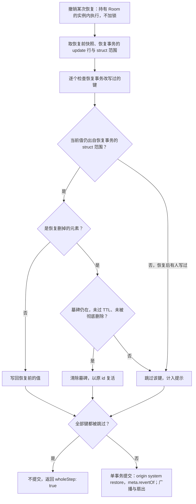

# ADR-0038 版本恢复可撤销（version-restore-undo）：Room 内单事务，按恢复事务的 struct 范围判定他人后写

> 状态：草稿 | 负责：架构-运行时（主笔 M-02；会签 M-05、M-09） | 更新：2026-09-26（§4.20）（TX-01+BE-10：立项并建骨架，登记于 adr/README）；2026-10-15（rulings §4.25 DS-40、DS-57：恢复前的 `auto` 快照改为每次必写并标 `pre_restore`，版本列表标「恢复前」单列，是界面上的找回点而不是撤销方案；背景与数据来源两处随之改写，见文末修订） | 依赖：charter v0.2；裁决 `docs/00-charter/rulings-2026-09-14.md` §4.12 U-07/U-09、§4.15 Q3、§4.17 D4/D5、§4.19 N1/C-06/D-M2-CONTENT、§4.20 TX-01+BE-10

## 状态

提议（骨架）。2026-09-26 按 rulings §4.20 TX-01+BE-10 立项：下文「决策」是已定的起草基线，「待定」两项在本 ADR 定稿时由用户交互拍板，「拟登记」各项在定稿后才写入各设计线。

| 项 | 口径 |
|---|---|
| 主笔 | M-02（model-core：命令管线、`core.restoreVersion` 与撤销命令、中性撤销语义） |
| 会签 | M-05（协同客户端：远端变更呈现、跳过提示）、M-09（server-collab 与 SnapshotsModule：Room 内执行、快照元数据、保留期） |
| 场景 | 70-testing/05 出 `rs/restore-revert-*` 三类场景（见「如何被机械验证」） |
| 起草 | M2 期间 |
| 定稿 | **M2 出口评审前**（即 U-07 所说的「M3 前」）；未定稿则 M3 的版本恢复（PRD CO-07）不开工 |
| 验收检查名 | PRD 05 的 M3 验收 `history:restore-revert`，登记在 70-testing/13 §3.4 |

## 背景

- **需求与已否决方案**：PRD CO-07 要求「恢复本身可撤销」。rulings §4.12 U-07 否决了两个简单方案——「恢复前落快照、再恢复回去变相撤销」与「恢复事务进本地撤销栈」——要求在多人协同场景下专项设计：他人已在恢复后的内容上继续编辑时如何回退、是否需要受保护的恢复事务与二次确认、与 CRDT 合并和快照链的关系。
- **恢复本身的现行口径**：恢复是持有 Room 的 collab 进程内的一个事务 `core.restoreVersion`（origin `system('restore')`），不加锁、在线会话不断连，其他副本经扇出收敛（rulings §4.19 N1；60-backend/05 §10；ADR-0025 决策 6：恢复是一次新事务、不回滚日志）。`system(...)` origin 的事务不进任何客户端的撤销栈（架构 05 §6）。
- **不能靠 CRDT 库的撤销**：服务端 Room 会在空置后关闭、下次再打开，Yjs `UndoManager` 的栈不持久；Loro 式 `revertTo` 绕过 D4 的 Mutation 唯一入口（ADR-0020 决策 4）。
- **已有的可追溯链**：每次恢复都留下恢复前的 `auto` 快照（2026-10-15 起每次必写并标 `pre_restore`，rulings §4.25 DS-57）、恢复事务的 update 行和 `kind='restore'` 快照（`restored_from` 指向目标）；60-backend/05 §11 已预留 `RestoreResult.preRestoreSnapshotId`（2026-10-15 起必有）与恢复事务落库的 `seqRange`，不需要新表。
- **保留期约束**：update 行只保留 7 天，`auto` 快照 30 天后按天稀疏（rulings §4.19 C-06）。撤销所需的数据会过期，所以可撤销期不能无上限（见「待定」P2）。
- **协同撤销的中性契约**（架构 05 §6；rulings §4.15 Q3、§4.17 D4/D5）：同一键被他人后写 → 跳过并提示；整步都被跳过 → 停下；删除是墓碑，撤销以原 id 复活，且永不复活他人删除的元素。本 ADR 让「撤销恢复」服从同一契约。

## 决策（起草基线，rulings §4.20 TX-01+BE-10 已定）

1. **执行位置与事务**：撤销恢复在持有 Room 的实例内以**单个事务**执行，**不加锁**、在线会话不断连（与恢复本身同一口径，N1）；其他副本经扇出收敛。
2. **走命令管线，不用 `revertTo`**：撤销是一条经 `commands.execute` 执行的命令（D4），在 Room 的服务端 Unit 上生成事务；origin 沿用 `system('restore')`，事务 `meta` 带 `revertOf`（被撤销的 `restore` 快照 id），**不新增 Origin 字面量**；不使用 Loro 式 `revertTo`，也不使用 Yjs `UndoManager`。
3. **范围与「他人后写」判据**：只处理恢复事务改写过的键。对每个键，看**当前值是否仍出自恢复事务的 struct 范围**（当前值对应的 Yjs 条目 id `(clientID, clock)` 落在恢复事务写入的区间内）：是，则写回恢复前的值；否，说明恢复之后有人写过该键，**跳过并计入提示**。**不比较值是否相等**：他人把值改回与恢复写入相同的值时，按值比较会误撤他人的写入。这与架构 05 §6 第 1 条的中性口径一致。
4. **整步跳过即停**：全部键都被跳过时不提交事务，返回 `wholeStep: true`（同 05 §6 第 2 条）。
5. **被删元素以原 id 复活**：恢复事务删掉的有身份实体（删除 = 写 `_deleted` 墓碑，架构 04 §3.1a）以**原 id** 复活，即清除墓碑；墓碑 TTL 已过或已被「彻底删除元素」硬删的跳过并计入提示。
6. **数据来源**：恢复前的 `auto` 快照、恢复事务的 update 行（`preRestoreSnapshotId`、`seqRange`），另在 `restore` 快照的元数据里记下恢复事务的 struct 范围；**不新增表**。

**撤销恢复的逐键判定**

怎么读：每个键先看「当前值是否仍由恢复事务写入」，这是判断他人后写的唯一依据；只有未被他人改过的键才回退，被恢复删掉的元素在墓碑仍在时以原 id 复活；所有键都被跳过时整步不提交，否则作为一个事务提交并经扇出送达所有副本。

依据：本节决策 1–6；架构 05 §6；60-backend/05 §10–§11；rulings §4.20 TX-01+BE-10。

**起草时由主笔一并细化**（不改变上面的基线）：恢复事务**新增**的实体与键在撤销时如何表达（按「写回恢复前的值」即删除或清键，仍受决策 3 的他人后写判据约束）；`core.restoreVersion` 的参数形状（`targetBody` 或 `{ versionId }`，40-modules/02 Q-3 随本 ADR 结案）；struct 范围在 `restore` 快照元数据中的编码形状。

## 待定（本 ADR 定稿时交互拍板）

对应 rulings §4.20 推迟项「TX-01+BE-10·内容」。

| # | 议题 | 建议 | 备选 |
|---|---|---|---|
| P1 | 谁能撤销恢复 | 任一持有 `history.restore` 能力位者（按 U-09 当前即 owner），而不只是执行这次恢复的人 | 只允许执行恢复的人 |
| P2 | 可撤销时效 | 只能撤销「最近一次恢复」，且它之后没有新的恢复，并且仍在 update 行保留期（7 天）内 | 把恢复前快照与恢复事务的 update 行标为受保护，直到可撤销期结束 |

## 拟登记（定稿后写入各设计线，提议期不生效）

- **REST**：`POST /documents/:id/snapshots/:restoreSnapshotId/revert`（能力位 `history.restore`），响应带跳过的键数与 `wholeStep`；登记到 60-backend/15 §3.8，服务端用例回填 60-backend/05 §11。
- **审计与事件**：审计 `snapshot.restore_reverted`（60-backend/07）；控制帧 `CONTROL.event{name:'version.restore-reverted'}`，定稿时登记到架构 06 §6.3 的 `event` 名单（新增 `name` 须在该表登记）。
- **界面**：版本面板加「撤销此次恢复」入口，二次确认，并提示跳过的键数（50-frontend/08 §10）。
- **测试**：70-testing/05 落 `rs/restore-revert-*`；70-testing/13 §3.4 登记 `history:restore-revert`。
- **结案**：40-modules/02 Q-3、40-modules/09 Q-9 随本 ADR 结案。

## 备选方案与放弃原因

| 方案 | 放弃原因 |
|---|---|
| 恢复前落快照，用「再恢复到恢复前快照」变相撤销 | U-07 否决：这是一次整体回滚，会覆盖他人在恢复之后的编辑，违背「不覆盖他人」的中性撤销语义 |
| 恢复事务进执行者的本地撤销栈 | U-07 否决：恢复在服务端以 `system('restore')` 执行，不是任何客户端的本地事务；执行者关闭页面即失效，其他有权限的人也看不到 |
| 在 Room 内用 Loro 式 `revertTo` 或 Yjs `UndoManager` | 前者绕过 D4 的命令管线（ADR-0020 决策 4）；后者的栈随 Room 关闭丢失 |
| 以「当前值是否等于恢复写入的值」判断他人后写 | 他人把值改回相同值时会被误撤（TX-01 复核） |
| 撤销期间锁定文档 | 与 N1「恢复不锁」同理：单事务已足以保证原子，加锁只会打断协作者 |

## 后果

- 正：撤销恢复与本地协同撤销用同一套语义（跳过并提示、整步跳过即停、原 id 复活），不覆盖他人；不新增表、不新增 Origin；单事务加扇出保证多副本一致。
- 负：`restore` 快照元数据要多记恢复事务的 struct 范围，并随保留期管理；可撤销期受 update 行保留期限制（P2）；恢复后协作者改动较多时，用户只能得到部分撤销（以跳过键数提示缓解）。

## 修订 2026-10-15（rulings §4.25 DS-40、DS-57）：「恢复前」版本与本 ADR 的边界

- 第 2 批定稿后，恢复用例每次恢复之前都先写一个 `kind='auto'`、`pre_restore = true` 的快照（60-backend/05 §10 第 2 步、11 §2），版本列表最前依次是「恢复自『X』」与标「恢复前」的这一版，后者单列、不并进相邻的自动版本组（设计 03-07）。恢复的二次确认因此用锚在按钮下的非模态确认卡（rulings §4.25 DS-40：恢复前的内容能从版本历史找回，不靠本会话的撤销）。
- 这与 U-07 不冲突：「恢复前」版本是用户在版本历史里看得见、可以预览或再恢复的找回点；把它当作「撤销恢复」仍是 U-07 否决的整体回滚，会覆盖他人在恢复之后的编辑。本 ADR 的决策 1–6 与待定 P1、P2 不变，「撤销此次恢复」的界面入口待本 ADR 定稿后再出样张（设计 03-07 已注明）。
- 决策 6 的数据来源随之确定：`preRestoreSnapshotId` 恒有，不必再处理「恢复前没有新 update、未落恢复前快照」的分支。

## 如何被机械验证（定稿后生效）

- [70-testing/05](../../70-testing/05-collab-simulation-and-property-tests.md) §7.2 `rs/restore-revert-*` 三类场景（占位已登记，ADR 定稿后入库）：① 他人在恢复后改过的键被跳过，含「他人写回与恢复相同的值」仍被跳过；② 全部键都被跳过时不提交、返回 `wholeStep: true`；③ 恢复删掉的元素在墓碑 TTL 已过后被跳过，TTL 内以原 id 复活。
- M-02 command-harness：撤销事务 origin 为 `system('restore')` 且 `meta.revertOf` 指向被撤销的 `restore` 快照；实现不调用 `revertTo`。
- 服务端集成：撤销期间不推 `room{locked}`、协作者编辑不中断；多副本收敛到同一状态。
- PRD 05 的 M3 验收检查名 `history:restore-revert`（70-testing/13 §3.4）。
- 追溯：定稿后才启用 `@adr 0038/<决策号>` 标签，并在 [70-testing/07](../../70-testing/07-backend-integration-and-api-e2e.md) §9 补撤销恢复的路由、能力位与审计集成用例（拟登记的 revert 路由、`snapshot.restore_reverted` 审计与 `CONTROL.event{version.restore-reverted}` 在定稿前不写进 60-backend/15、60-backend/07 与架构 06）。

## 关联

章程 D4、D12；`00-charter/rulings-2026-09-14.md` §4.12 U-07/U-09、§4.15 Q3、§4.17 D4/D5、§4.19 N1/C-06、§4.20 TX-01+BE-10；ADR-0007（Store 推导的逆操作）、0020（决策 4：不采用 `revertTo`）、0025（决策 6：恢复是新事务）；架构 04 §3.1a、05 §6、06 §6.3/§8；40-modules/02 Q-3、40-modules/09 Q-9；50-frontend/08 §10；60-backend/05 §10–§11、60-backend/15 §3.8；70-testing/05、70-testing/13 §3.4；PRD CO-07。
