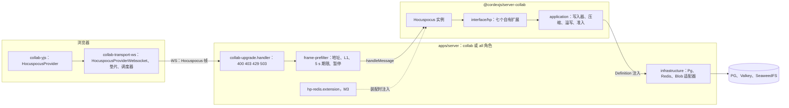
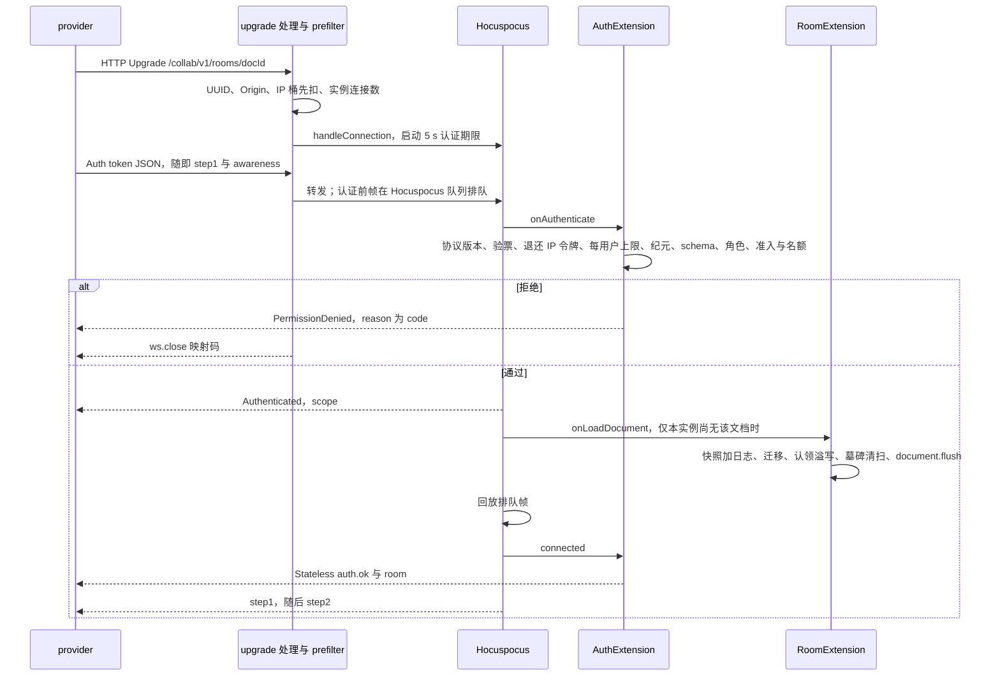
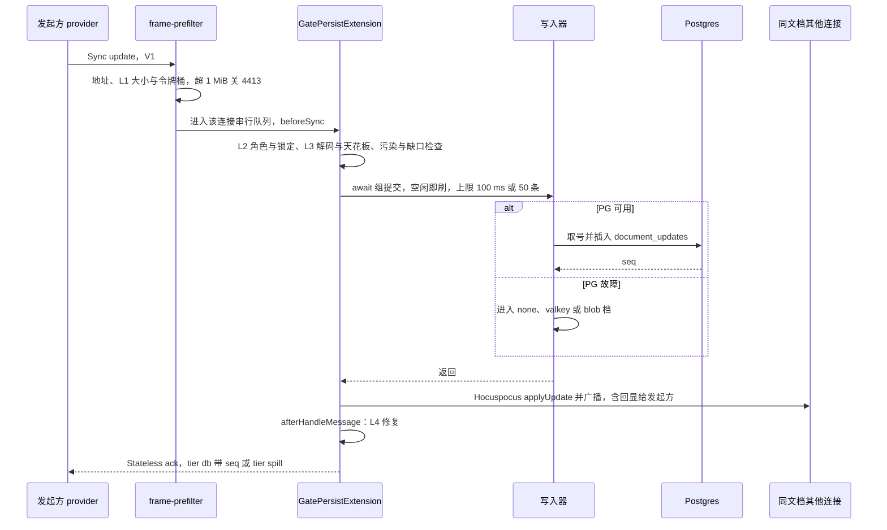
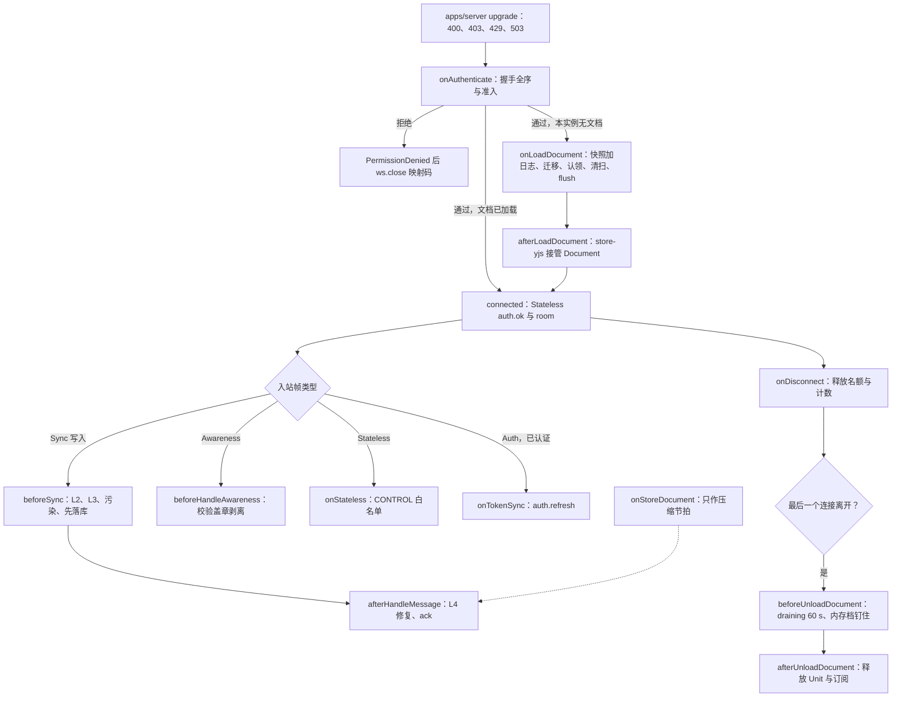
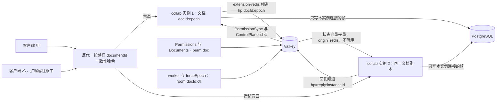
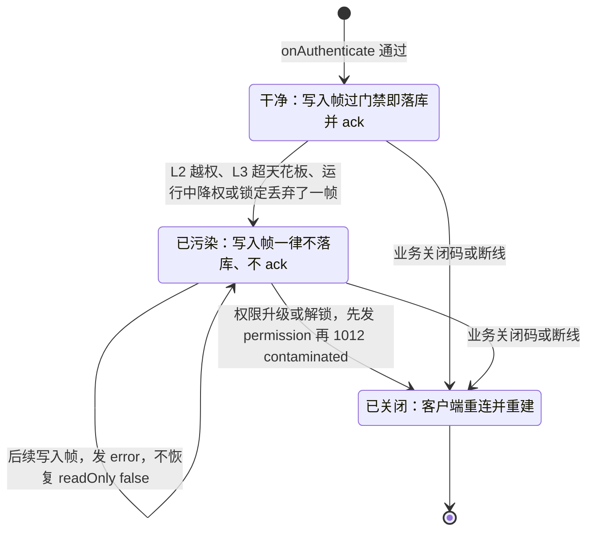

> 状态：已接受 | 负责：架构-运行时 | 更新：2026-09-26（§4.21：新建，协同服务端采用 Hocuspocus 4，部分取代 ADR-0023、吸收 WS 接入）；2026-09-26（§4.21 复核：状态由「提议」改为「已接受」，决策本体均为用户裁决；ioredis 顶层 import 行号统一为 Redis.ts:31-37） | 依赖：charter v0.2 §5.2、§5.3 规则 4；裁决 `docs/00-charter/rulings-2026-09-14.md` §4.21（q-ws-gateway、H:Q1–Q6）、§4.15 S-3a/Q5/Q10、§4.18 CO-09/CO-10/CO-13、§4.20 BE-01+TX-03；证据 `docs/00-charter/_evidence/hocuspocus-adoption-2026-09-26.json`（summary、defaults d-01…d-32、adr 草稿、map K1–K12、ver 修正与 K13–K18）；ADR-0023/0024/0025/0029/0033/0034/0035

# ADR-0039 协同服务端采用 Hocuspocus 4：嵌入 Nest 的 upgrade，自有门禁、持久化与控制面挂在钩子上（部分取代 ADR-0023）

## 状态

**已接受**（2026-09-26，用户裁决 rulings §4.21 q-ws-gateway（非推荐项）与 H:q-hp-* 六题；原状态「提议」）。裁决经过：rulings §4.21 q-ws-gateway 于 2026-09-26 交互选择「改用 Hocuspocus 4 作 Room 框架」，是知情的非推荐项；原推荐为自挂 upgrade + ws noServer、Room 维持 ADR-0023 自研）。随后的六个取舍题（H:Q1–Q6）全部按推荐裁决，本 ADR 按裁决结果写定；未列为拍板题的细节按证据 defaults d-01…d-32 落地。

本 ADR 与 [ADR-0023](./0023-transport-and-protocol.md) 的关系：

| ADR-0023 条目 | 本 ADR 的处理 |
|---|---|
| 决策 1 传输：服务端 Nest `ws` 适配器、客户端自研 `collab-transport-ws` | **取代**：服务端用 Hocuspocus 类嵌入 Nest（Fastify）HTTP server 的 upgrade（决策 1）；客户端用官方 `@hocuspocus/provider`（决策 8） |
| 决策 2 负载：sync 与 awareness 复用 y-protocols | **保留**（Hocuspocus 线上就是 y-protocols，只有 Yjs V1 编码） |
| 决策 3 1 字节信封与 CONTROL 专用帧 | **取代**：改用 Hocuspocus 帧，CONTROL 的 zod 判别联合改作 Stateless 载荷（决策 3） |
| 决策 4 握手：REST 换票、60 s 单次票据 | 票据与换票**保留**；「首帧必须 auth、认证前 SYNC 即 4401」的严格度**取代**为 Hocuspocus 有界排队 + 适配层 5 s 期限（决策 3） |
| 决策 5 重连与离线判据 | **保留**：重连由自有调度器驱动 provider（决策 8） |
| 决策 6 权限变更即时生效 | **保留**语义，落点改为 `PermissionSync` 扩展（决策 4） |
| 决策 7 两级 ack 与在途 FIFO | 两级 ack 语义**保留**（H:Q1）；ack 经 Stateless 下发；重连 step2「先按 1 MiB 切块」**取代**为 step2 单设 16 MiB 上限（H:Q6，决策 5） |
| 决策 8 Room 七态 | **保留**：七态作为派生状态映射到 Hocuspocus 生命周期（决策 4 的表 39-2） |

与相邻 ADR 的关系：ADR-0024（awareness 中继改由 Hocuspocus Document 承担）、ADR-0025（落库挂 `beforeSync`、服务端事务顺序按 H:Q4）、ADR-0029（Auth 帧与有界排队、连接污染规则、PermissionSync）、ADR-0034（门禁挂点）、ADR-0035（extension-redis + 文档哈希）同日修订，各自保留「原：…」。原复用计划曾拟把本编号用于「服务端访问层与 WS 接入收口」，按证据 d-31 改为：WS 接入并入本 ADR，DB 访问层与 Fastify 写进 ADR-0022 修订，Nest 12 写进章程 D8 与 ADR-0030 修订。

## 背景

- **裁决来源**：复用计划的 q-ws-gateway 指出，网关路径 `/collab/v1/rooms/:documentId` 带参数，Nest `WsAdapter` 只做精确路径匹配、升级前也没有钩子，原设计「注册 `WsAdapter(ws)`」路由不到；三个选项里用户选了「改用 Hocuspocus 4 作 Room 框架」。用户偏好：成熟组件尽量复用；安全、审计、权限宁可提前；协同语义不接受简单方案；不过度设计（单组织，只要登录 + 协同）。
- **核实基线**：`@hocuspocus/server` 与 `@hocuspocus/provider` 的 npm latest 都是 4.7.0（2026-09-09 发布），MIT，Tiptap GmbH 维护。源码取 tag v4.7.0（commit 6ddc757），实验 exp1–exp8 与核实脚本 vA–vG 在 Node 24.21、yjs 13.6.33、ws 8.21.3、Fastify 5、Valkey 8.1.10 上重跑；官方文档与源码有四处矛盾（store 失败「会重试」、beforeSync「非 async」、onConnect 抛错「终止连接」、onAuthenticate 用 `data.connection.readOnly`），一律以源码为准。
- **安全通告**：2026-09-21 公布的 GHSA-xwhh-v746-pj9m（认证前消息队列无上限导致 DoS，影响 ≤ 4.2.0，4.3.0 加 `maxUnauthenticatedQueue*`）与 GHSA-8v8m-xjrm-95h6（客户端发 BroadcastStateless 绕过 readOnly，影响 < 4.1.1）在 4.7.0 均已修复。
- **Hocuspocus 做不到、必须自己补的**（证据 hp.limits）：`SyncStatus` 只表示「已应用到内存」，没有 seq，不是落库确认；原生持久化是 `onStoreDocument` 整文档 debounce，存储失败不重试，之后一次无修改的断开就卸载丢数据（exp2）；不被 await 的钩子抛错会让进程退出（exp3）；钩子抛错只关文档级连接，客户端恒见 1000 + reason；provider 不看关闭码；没有「拒绝单帧但不断连」原语；没有消息速率与单帧门禁；没有跨实例的踢人、权限、纪元控制面；嵌入模式下 `onUpgrade`、`onRequest`、`onListen`、`onDestroy` 不触发，Hocuspocus 类也没有 `destroy()`。

## 决策

1. **接入（嵌入）**：`@hocuspocus/server` 4.7.0 的 `Hocuspocus` 类由 `@cordexjs/server-collab` 持有，只在 `CORDEX_ROLE=collab` 或 `all` 装配。apps/server 在 Nest（Fastify 5）底层 HTTP server（`app.getHttpServer()`）的 `upgrade` 事件上自挂接入，必须在 `listen` 之前挂好：升级前按 `:documentId` 为 UUID（400）→ Origin 白名单（403）→ IP 令牌桶先扣（429）→ 实例连接数（503）检查，任一不过即以 HTTP 响应拒绝；通过后 `new WebSocketServer({ noServer: true, maxPayload: step2MaxBytes })` 的 `handleUpgrade` 把 socket 交给 `collabServer.handleConnection(ws, request, conn)`（内部即 `hp.handleConnection`，由调用方自己转发 `message` 与 `close`，RELEASE_NOTES_V4.md:362-389，exp1 实测 HTTP 与 WS 共用一个端口）。**不用** `Server` 类（它自建 `http.Server`，无法与 Nest 共端口；`stopOnSignals` 虽可关，理由不在此）与 Nest `WsAdapter`，apps/server 不再依赖 `@nestjs/platform-ws`。检查顺序与数值以 [60/16](../../60-backend/16-ws-protocol-server-view.md) §1、§13 为准。
2. **连接：一个 WS 只承载一个文档**。Hocuspocus 协议本身支持多路复用，但本项目在适配层（`frame-prefilter`）校验每帧地址等于 URL 所指文档（文档名 `{docId}:{epoch}`，决策 7），不符按 4400 关闭。业务关闭一律调原始 `ws.close(码)`，客户端才能拿到原码（exp1 的 4401、exp7 的 4428 实测）；钩子抛错产生的文档级 CLOSE 只带 reason、客户端恒见 1000，不作为业务关闭手段。`@cordexjs/protocol` 的 `collab/close-codes.ts` 仍是关闭码唯一源，新增 **4205**（Hocuspocus 认证前队列或待认证文档数超限）、**4408** 扩为「超时」通用码（认证超时与空闲超时）；全表见 [30/06 §6.5](../06-collaboration.md)。客户端在 provider 构造配置的 `onClose` 里按码决定是否重连（K5-A；文档级关闭的方案 K5-B 已被 vG 否定：文档级关闭后 provider 不再认证，后续编辑进认证前队列，最终整条 socket 被 4205 关闭）。
3. **协议**：线上改用 Hocuspocus 帧——varString 地址（文档名）+ varUint 类型 + 载荷，类型 `Sync 0 / Awareness 1 / Auth 2 / QueryAwareness 3 / SyncReply 4 / Stateless 5 / BroadcastStateless 6 / CLOSE 7 / SyncStatus 8 / Ping 9 / Pong 10`（packages/server/src/types.ts:61-74）；Sync 与 Awareness 即 y-protocols，只有 Yjs V1 update 编码。原 CONTROL 的 zod 判别联合（判别键 `type`）保留，改作 **Stateless 载荷**（UTF-8 JSON 字符串）；原 `auth` 帧的字段改放 **Auth 帧的 token**（JSON 字符串：`ticket`、`protocolVersion`、`clientId`、`capabilities`、`appVersion`、`epoch?`、`maxSchemaVersion`、`traceparent?`），`auth.denied` 改为 `PermissionDenied(reason)`（reason 为 `{code}` JSON）后由钩子 `ws.close(映射码)`，`auth.refresh` 改为客户端 `provider.sendToken()` → 服务端 `onTokenSync`，`ping`/`pong` 删除（RTT 诊断可发可选的 Stateless `ping`）。客户端发来的 `BroadcastStateless(6)` 在适配层按 4400 拒绝（Hocuspocus 自己会抛错做文档级关闭，MessageReceiver.ts:134-138）。**握手严格度**：删「首帧必须 auth」「认证前 SYNC 即 4401」「认证后再收 auth 即 4400」——官方 provider 发完 Auth 立即发 step1 与 awareness，取票期间的编辑甚至会先于 Auth 上线（vA-A1）；Hocuspocus 的认证前队列保留默认宽上限（5 MiB / 1000 条），因为认证成功后、文档加载期间的帧仍进同一个队列，收紧会把加载中仍在编辑的用户按 4205 踢掉（vA-A2，K15-A）；严格的认证前限额与 5 s 认证期限放在适配层、只计到 `Authenticated` 发出为止，Auth 帧 ≤ 8 KiB。帧、Stateless 成员与关闭码的定义见 [30/06 §6](../06-collaboration.md)。
4. **钩子：房间、门禁、持久化、控制面做成 server-collab 内的 Hocuspocus 扩展**，IO 仍经 server-collab 既有的 Definition 注入（包内不依赖 `pg`、`ioredis`、`@aws-sdk`）。挂点见表 39-1，扩展清单见表 39-3；Room 七态映射见表 39-2。要点：
   - `onAuthenticate` 做握手全序（协议版本 → 票据 → 每用户单实例连接上限 → 纪元 → schema → 角色 → 实例权重准入 → 名额），设 `connectionConfig.readOnly`；判定都放这里，**不放 `onConnect`**（它先于 `onAuthenticate` 触发）。成功后 Hocuspocus 回 `Authenticated(scope)`，`scope` 只作初值参考，权限以 Stateless `permission` 为准。
   - `connected` 用 `connection.sendStateless` 发 `auth.ok` 与首帧 `room`（此时文档已加载，`head_seq` 可知；实测 `auth.ok` 先于 step1/step2 到达，但顺序不保证，客户端以 `Authenticated` 进入 syncing）；`connected` 整体 try/catch（它抛错时客户端收到 authenticationFailed，服务端连接却仍存活，vC）。
   - `beforeSync`（会被 await、早于应用）做 L2/L3 与连接污染判定，并 **await 写入器取得 seq 或进入溢写档后才返回**，Hocuspocus 随后 `applyUpdate` 并广播（exp7：落库 300 ms，他人 304 ms 后才看到）；`afterHandleMessage`（被 await、在应用之后，同一连接串行）做 L4 修复并发 Stateless `ack{tier, seq}`。
   - `beforeHandleAwareness` 只就地删改、从不抛错（抛错会关闭文档连接，exp5）：zod 校验、单状态 ≤ 2 KiB、clientID 与会话声明的 `clientId` 不符即删、盖 `user.id` 章、只读会话剥离光标与选区字段；全量推送与断开移除用原生。满员合并（H:Q5）：房间在线 ≥ 20 时包装 `Connection.send`，**只对 awareness 帧**按连接 100 ms 合并下发，文档更新不受影响（按文档调 `flushDelay` 会把文档更新 p50 从 1.5 ms 拖到约 103 ms，vF）。
   - `onLoadDocument` 完成快照 + 日志加载、迁移（持 `lock:migrate`）、认领已下线实例的遗留溢写、墓碑清扫，末尾 `document.flush()`（不 flush 首个连接会多收一份整文档 update，exp8）；加载失败在 catch 里撤销名额。`afterLoadDocument` 让服务端 Unit 的 store-yjs 接管 Hocuspocus Document（store-yjs 增「接管外部 Y.Doc」选项；`gc:true` 与 Hocuspocus 默认一致，ADR-0025 决策 7）。
   - `beforeUnloadDocument` 抛错即取消卸载：实现 `draining` 的 60 s 宽限与「有内存档时钉住文档」，到期或回放完成后主动 `hp.unloadDocument`。
5. **持久化与确认（H:Q1、Q4、Q6）**：`document_updates` 逐帧日志 + 压缩快照不变，两级 ack 语义不变（S-3a、CO-09 与 RPO ≤ 1 s 原样保留）。
   - 写入器挂 `beforeSync`，组提交改为「**空闲即刷、上限 100 ms 或 50 条**」：每连接串行 await，固定窗口会把单连接限到约 10 帧/s。
   - 不用 `onStoreDocument` 持久化，它只作压缩检查节拍、永不抛错；不用 extension-database / s3 / sqlite（都是整文档覆盖写）。
   - **服务端事务顺序（H:Q4）**：版本恢复、彻底删除元素、墓碑 TTL 清扫这类低频事务，先在复制文档（临时 Unit，由当前 Room 状态复制）上执行 → 经写入器落库 → 再把同一 update 应用到 Room 并广播（O(文档)，但低频，审计与 `user_id` 归属准确）；迁移在加载期本就先落库；软门禁修复要 p95 ≤ 5 ms，仍先在 Room 上执行并广播、由 `onChange` 把非连接来源的 update 送写入器（崩溃窗口只影响修复事务的归属）。
   - **重连 step2（H:Q6）**：step2 由 provider 收到服务端 step1 时自动生成，无法先切块；改为 update 帧仍 ≤ 1 MiB、step2 单设上限 16 MiB（= ws `maxPayload`），超限 4413，客户端导出后重载。ADR-0023 验收的「离线累计 5 MiB 更改重连后全部同步且无 4413」仍成立；M4 IndexedDB 上线后再评估。step2 仍恰回一帧 db ack，空差量不落库、`seq` 取当前 head（`Y.snapshotContainsUpdate` 判空）。
6. **拒绝：连接污染规则**（d-09，K4-A 与 K14-A+C）。核实推翻了「`beforeSync` 临时置 readOnly、`afterHandleMessage` 恢复」的软拒：被拒帧之后同一客户端的帧因缺前驱挂在 `pendingStructs`，却照样过 `beforeSync`、被落库并拿到 ack，成为「已 ack 但不可见」且永久残留在快照里的数据（vB）。改为：一条连接一旦有写入帧被丢弃（L2 越权、L3 超天花板、运行中降权或锁定），**之后的全部写入帧一律不落库、不回 ack，直到重连**；其间不允许把 `readOnly` 恢复为 `false`；权限升级或解锁时若该连接丢过帧，先发 `permission` 再以 1012（reason `contaminated`）关闭，客户端按被拒回滚重建（30/06 §18.4）。落库前另用 `Y.parseUpdateMeta` 加删除集缺口检查兜底（只含删除的帧查不出结构缺口，vD）。L1–L3 未通过的帧不应用、不扇出（I8）不变。
7. **多实例（H:Q2）**：M2 单实例不装；M3 装 `@hocuspocus/extension-redis`（继承其 `Redis` 类加固，决策 9），反代按路径里的 `documentId` 做一致性哈希（偏好亲和，**不是会话粘性**），同一文档的连接常态落在同一实例，extension-redis 只兜底（ADR-0035 决策 7 由可选改为默认；rulings §4.15 Q10 的「无粘性」改写为「按文档哈希偏好亲和、非会话粘性」）。跨实例来的更新 `origin=redis`，不经 `beforeSync`、不触发存储钩子（types.ts:40-50，Redis.ts:743-779），只有本实例连接的帧落库（ADR-0035 决策 3 不变）。权限、锁定、`close`、`epoch` 走自有 Valkey 频道（`perm:doc:{docId}`、`room:{docId}:ctl`），extension-redis 不承载控制面。**Hocuspocus 文档名为 `{docId}:{epoch}`**（URL 仍是 `docId`，token 带 `epoch`）：换纪元后新纪元天然是新文档，旧的自然排空，extension-redis 频道随之隔离，压缩与清扫按 `(docId, epoch)` 键（K8-B）。
8. **客户端（H:Q3）**：用官方 `@hocuspocus/provider` 4.7.0——`HocuspocusProviderWebsocket` 归 `collab-transport-ws`（`autoConnect:false`、`maxAttempts:1`、`WebSocketPolyfill` 计量垫片、构造配置里的 `onClose` 关闭码策略），`HocuspocusProvider` 归 `collab-yjs`（`document` 为 store-yjs 的 Y.Doc，`token` 为 async 函数每次现换票，`flushDelay:50`，`onStateless` 分发 CONTROL）。重连、离线判据与 1012 策略由注入 Clock 的自有调度器驱动；两级 ack 的在途 FIFO、`PermissionGate`、被拒回滚、`OfflineStore` 保留，FIFO 靠 `outgoingMessage` 事件与垫片按内容映射 `localSeq`（约 600 行胶水）；不用 `unsyncedChanges` 或 `synced` 判断是否已保存。客户端细节的唯一源是 [50/07](../../50-frontend/07-collaboration-client.md)。
9. **健壮性**：所有钩子自包 try/catch，未预期异常记 traceId 后 `ws.close(1011)`；不被 await 的 `onChange`、`onStateless`、`onAwarenessUpdate`、`beforeBroadcastStateless`、`onDisconnect`、`onConfigure` 必须吞错；apps/server 装进程级 `unhandledRejection` 兜底（只记录与计数，不退出）。extension-redis 加固：保留 ioredis 离线队列（设 `enableOfflineQueue:false` 会让所有文档加载永久失败，vE）并限 `maxRetriesPerRequest`；继承 `Redis` 类覆写 `beforeBroadcastStateless` 与 `onStoreDocument` 加 catch（Valkey 宕机时 `broadcastStateless` 默认杀进程，redlock 连不上被误报为锁冲突，vE）。版本精确钉 4.7.0，升级须过协同契约套件（`runCollabServerConformance`、`runCollabTransportConformance`）。

**表 39-1 钩子挂点**

| 钩子（源码） | 被 await / 能否拒绝 | 挂载的自有逻辑（扩展） | 失败处理 |
|---|---|---|---|
| `onConnect`（ClientConnection.ts:506-515） | 是 / 能 | 不挂判定（先于 `onAuthenticate`） | — |
| `onAuthenticate`（ClientConnection.ts:517-540） | 是 / 能：回 `PermissionDenied(reason)` | 握手全序、验票、每用户上限、纪元与 schema、角色、权重准入与名额、设 `readOnly`（auth） | 抛 `{reason:{code}}`，随后 `ws.close(映射码)` |
| `onCreateDocument`（Hocuspocus.ts:385-399） | 是 / 能 | 不挂（`gc:true` 用默认） | — |
| `onLoadDocument`（Hocuspocus.ts:418-434） | 是 / 能 | 快照 + 日志、迁移、遗留溢写认领、墓碑清扫、`document.flush()`（room） | 抛错 → 加入者收 `PermissionDenied`，适配层 4503，撤销名额 |
| `afterLoadDocument`（Hocuspocus.ts:436-446） | 是 / 能 | store-yjs 接管 Document、登记 Room（room）；M3 extension-redis 在此订阅频道 | 同上 |
| `connected`（ClientConnection.ts:423-438） | 是 / 不该抛 | Stateless `auth.ok` 与 `room`、审计 `collab.join`、登记连接（auth） | 整体 try/catch，失败 `ws.close(1011)` |
| `beforeHandleMessage`（Connection.ts:270-275） | 是 / 能 | 不挂（L1 在适配层） | — |
| `beforeSync`（MessageReceiver.ts:189-194） | 是 / 能 | L2、L3、污染判定、缺口检查、await 写入器取号或溢写（gate-persist） | 取号 0 行先 `ws.close(4404/4428)` 再抛；其余拒绝见决策 6 |
| `afterHandleMessage`（Connection.ts:274-285） | 是 / 不能（异常被吞） | L4 修复、Stateless `ack`、`repair`（gate-persist） | 自包；只读丢弃的帧也会触发，按门禁标记决定是否 ack |
| `beforeHandleAwareness`（MessageReceiver.ts:72-109） | 是 / 能 | 校验、盖章、剥离，只就地删改（awareness） | 从不抛错 |
| `onStateless`（ClientConnection.ts:300-312） | 否 / 无 | CONTROL 白名单与 zod、可选 `ping`（control） | zod 失败 `ws.close(4400)`；必须吞错 |
| `onTokenSync`（ClientConnection.ts:386-409） | 否 / 能 | `auth.refresh`：验签、`jti`、`sub`/`doc`/`sid` 一致、重算角色直接写 `connection.readOnly`（auth） | 失败由钩子 `ws.close(4401)`；适配层暂停后续帧直到完成 |
| `onChange`（Hocuspocus.ts:277-309） | 否 / 无 | 非连接来源的修复 update 送写入器（gate-persist） | 必须吞错（抛错杀进程，exp3） |
| `onStoreDocument`（Hocuspocus.ts:507-548） | 是 / — | 压缩检查节拍（room） | 永不抛错 |
| `beforeUnloadDocument`（Hocuspocus.ts:611-623） | 是 / 能 | `draining` 宽限、内存档钉住（room） | 抛错即取消卸载 |
| `onDisconnect`（ClientConnection.ts:276-298） | 否 / 观察者 | 释放名额与计数、清会话定时器、审计 `collab.leave`（auth） | 必须吞错 |
| `onUpgrade` / `onRequest` / `onListen` / `onDestroy` | 嵌入模式不触发 | 升级检查在 apps/server 的 upgrade 处理；停机时自调 `hooks('onDestroy')` | — |

怎么读：左列是 Hocuspocus 4.7.0 的钩子与源码位置，第二列决定它能否当门禁用（只有被 await 且能抛错的钩子才能挡住应用与广播），第三列括号里是承载该逻辑的扩展（表 39-3）。门禁与落库只挂在 `beforeSync`、确认只挂在 `afterHandleMessage`，这是「先落库后广播、逐帧 ack」在 Hocuspocus 上成立的前提。

依据：证据 hp.hooks、map mapping TX/SY/PS/AW、ver checks；exp1、exp3、exp5、exp7、exp8、vB、vC。

**表 39-2 Room 七态到 Hocuspocus 生命周期的映射**（K12-A；七态本身照抄 [30/06 §5.2](../06-collaboration.md)，状态保留为派生状态，进指标）

| Room 状态 | Hocuspocus 侧的实现 |
|---|---|
| `loading` | `onLoadDocument` 执行中（并发加载同一文档共享同一个 Promise，Hocuspocus.ts:341-345） |
| `active` | 文档在 `hp.documents` 中且有连接；持久化子状态 `persist`、`spillTier`、`replaying` 都不离开 `active`（CO-15） |
| `draining` | 最后一个连接离开后 `beforeUnloadDocument` 抛错取消卸载，60 s 宽限到期或按 LRU 提前结束时主动 `hp.unloadDocument` |
| `evicting` | 停机或内存压力：向该文档连接 `ws.close(1012)`（`hp.closeConnections()` 发的是文档级 CLOSE、客户端只见 1000，不能代替 1012） |
| `persisting` | 写入器 flush 与压缩判定；PG 不可达时把内存档强制写入一级溢写 |
| `closed` | `afterUnloadDocument` 之后释放 Unit、订阅与名额 |
| `failed` | `onLoadDocument` 抛错：共享同一加载 Promise 的加入者在已收到 `Authenticated` 之后各自再收 `PermissionDenied`，适配层补 4503（PS-04 修正：`closeConnections` 在这里实际什么也不关） |

**表 39-3 扩展清单**（文件落点见 [40-modules/09](../../40-modules/09-server-collab-gateway-and-headless-host.md) §4.4；apps/server 侧见 §4.1）

| 扩展 | 位置 | 钩子 | 职责 |
|---|---|---|---|
| `AuthExtension` | server-collab `interface/hp/auth.extension.ts` | `onAuthenticate`、`connected`、`onTokenSync`、`onDisconnect` | 握手全序与准入、`auth.ok` 与 `room`、续票、释放名额 |
| `GatePersistExtension` | server-collab `interface/hp/gate-persist.extension.ts` | `beforeSync`、`afterHandleMessage`、`onChange` | L2/L3、连接污染、先落库、L4 修复、逐帧 ack |
| `RoomExtension` | server-collab `interface/hp/room.extension.ts` | `onLoadDocument`、`afterLoadDocument`、`onStoreDocument`、`beforeUnloadDocument`、`afterUnloadDocument` | 加载、Unit 接管、压缩节拍、draining 与钉住 |
| `AwarenessExtension` | server-collab `interface/hp/awareness.extension.ts` + `awareness-coalescer.ts` | `beforeHandleAwareness`；包装 `Connection.send` | 校验盖章剥离；满员 100 ms 合并 |
| `ControlExtension` | server-collab `interface/hp/control.extension.ts` | `onStateless` | CONTROL 白名单、可选 `ping` |
| `PermissionSync` | server-collab `interface/hp/permission-sync.extension.ts` | 自有订阅（`AuthorizationSource.onPermissionChanged`） | 逐会话重算角色、改 `readOnly`、Stateless `permission`；`none` → 4403；Valkey 恢复后全量重算 |
| `ControlPlane` | server-collab `interface/hp/control-plane.extension.ts` | 自有订阅（`FanoutBus.subscribeControl`） | `room:{docId}:ctl` 的 `close`（4404）与 `epoch`（4428） |
| `HardenedRedis`（M3） | apps/server `collab/infrastructure/hp-redis.extension.ts` | 继承 extension-redis | 跨实例 update、awareness、Stateless 事件；加 catch 与离线队列上限 |

**图 39-1 组件与依赖边界**

怎么读：实线是一个入站帧的路径与调用方向，虚线是装配关系。`@hocuspocus/server` 只出现在 server-collab，`@hocuspocus/provider` 只出现在两个客户端包，extension-redis 与 ioredis 只在 apps/server 组装（d-25，章程 §5.3 规则 4 放行范围）；server-collab 仍不依赖 `pg`、`ioredis`、`@aws-sdk`。

依据：决策 1、4、8；证据 architectureSketch、d-25。

**图 39-2 接入与握手时序**

怎么读：纵线是参与方，自上而下是时间。provider 不等认证结果就发 step1 与 awareness，这些帧由 Hocuspocus 排队、认证通过并加载完成后回放；5 s 期限由适配层计到 `Authenticated` 为止。`auth.ok` 与 step1/step2 的相对顺序不保证（实测前者先到），客户端以 `Authenticated` 进入 syncing。拒绝时先回 `PermissionDenied` 再由钩子关闭原始 WS，客户端因此能看到 4401、4403、4428 等原码。

依据：决策 1–4；证据 d-04、d-06、TX-01…TX-07 与 ver 修正（TX-02、TX-05、TX-07）；exp7、vA。

**图 39-3 一次写入的路径（写一次、先落库后广播）**

怎么读：`beforeSync` 被 await 且早于应用，所以写入器返回之前这条 update 不会被任何人看到；同一连接的下一帧在 `afterHandleMessage` 完成前不会开始处理，ack 因此天然逐帧、按到达序。PG 故障时写入器进入任一降级档即返回，广播照常（CO-08）。Hocuspocus 会把 update 回显给发起方（K18-A 接受，下行预算注明）。

依据：决策 5；证据 SY-03、SY-06、PS-01、K1-A、K18；exp1、exp7。

**图 39-4 钩子挂点：一个文档连接的生命周期**

怎么读：自上而下是一个连接从升级到断开、一个文档从加载到卸载的顺序；菱形是分支。门禁只出现在 `beforeSync` 与 `beforeHandleAwareness` 两处入站路径上，控制面帧走 `onStateless`，续票走 `onTokenSync`。虚线表示 `onStoreDocument` 与帧处理并行、只按 debounce 节拍触发压缩检查，不参与持久化。

依据：表 39-1、表 39-2。

**图 39-5 多实例：文档哈希偏好亲和 + extension-redis 兜底 + 自有控制面**

怎么读：实线是连接与消息的流向。常态下同一文档只在一个实例上（O(文档) 的跨实例差量成本基本消失），扩缩容或实例故障时短暂出现两个副本，由 extension-redis 经状态向量互补；权限、锁定、关闭、换纪元只走自有频道，不经 extension-redis。extension-redis 的键前缀独立登记（[60/14](../../60-backend/14-valkey-object-storage-and-retention.md) §3.1）。

依据：决策 7；ADR-0035 修订 2026-09-26；证据 K6-B、scaling、exp4、vE。

**图 39-6 连接污染规则（写入帧的服务端处理状态）**

怎么读：方框是一条连接在服务端的写入处理状态，箭头上是触发条件。进入「已污染」后没有回到「干净」的边：同一客户端之后的更新可能因缺前驱而不可见，落库并 ack 就会造成「已 ack 但不可见」；只有断开重连、客户端按被拒回滚重建后才重新开始。

依据：决策 6；证据 d-09、vB、vD、K14。

### Hocuspocus 配置

server-collab 构造 `Hocuspocus` 时设定下列值（配置键名与默认值的唯一源是 60-backend/17 的 `collab.hocuspocus.*`，本表只列取值与理由）：

| 配置 | 取值 | 理由 |
|---|---|---|
| `timeout` | 45000 | 只作兜底；它的检查间隔等于自身，实际判死 45–90 s（vC）。空闲判死由适配层逐帧计时：每 5 s 查一次、45 s 无入站帧即 `ws.close(4408)` |
| `maxUnauthenticatedQueueSize` / `maxUnauthenticatedQueueMessages` | 默认 5 MiB / 1000 | 覆盖认证后、加载期间的帧（K15-A）；严格限额在适配层 |
| `maxPendingDocuments` | 1 | 与「一 WS 一文档」一致 |
| `flushDelay`（服务端） | 0 | 文档更新不额外延迟；满员 awareness 合并另由包装 `Connection.send` 实现 |
| `debounce` / `maxDebounce` | 默认 2000 / 10000 | 只驱动 `onStoreDocument` 的压缩检查节拍（另有 10 min 定时兜底） |
| `unloadImmediately` | 默认 true | 卸载时机由 `beforeUnloadDocument` 抛错控制 |
| `yDocOptions` | 默认 `{gc:true}` | 与 ADR-0025 决策 7 一致，不在 `onCreateDocument` 改 gc |
| ws `maxPayload` | 16 MiB | = step2 上限（H:Q6）；普通 update 的 1 MiB 上限在适配层 L1 |

### 不用的部件

| 部件 | 不用的原因 |
|---|---|
| `Server` 类、`WsAdapter`、`@nestjs/platform-ws` | 自建 `http.Server` 无法与 Nest 共端口；`WsAdapter` 只做精确路径匹配、升级前无钩子 |
| `onStoreDocument` 整文档持久化、extension-database / s3 / sqlite | 整文档覆盖写，RPO 从 ≤ 1 s 变为 ≤ 10 s；存储失败不重试、之后一次空断开即丢（exp2）；失去逐帧归属、`onPersisted` 与取号栅栏（K2-A） |
| extension-throttle | 进程内计数、在 `onConnect` 时计、不能退还；IP 桶按「先扣后退」自写（d-16） |
| extension-logger、extension-webhook、transformer、cli | 日志与观测走 pino 与 OTel（span 挂在钩子上）；webhook 与 transformer 绑定 Tiptap，与 pptx 模型无关 |
| `SyncStatus` 与 provider 的 `unsyncedChanges` / `synced` | 只表示「已应用到内存」，缺依赖被挂起的更新同样回 1（exp6），不能作落库判据 |
| 多路复用与 `sessionAwareness` | 一 WS 一文档（决策 2） |
| `hp.closeConnections()` 作停机关闭 | 发的是文档级 CLOSE，客户端只见 1000；停机用自写 `drainAll` 与 1012 |
| 客户端发 `BroadcastStateless` | 适配层按 4400 拒绝；跨实例事件只由服务端 `document.broadcastStateless` 发出 |

### 故障模式与加固

| 故障模式（出处） | 不加固的后果 | 加固 |
|---|---|---|
| `onChange`、`onStateless`、`onAwarenessUpdate`、`beforeBroadcastStateless`、`onDisconnect`、`onConfigure` 抛错（exp3、vC） | 未处理 rejection，Node 默认退出进程 | 全部自包 try/catch；进程级 `unhandledRejection` 兜底 |
| `connected` 抛错（vC） | 客户端收到 authenticationFailed，服务端连接仍存活并继续应用更新 | 整体 try/catch，失败 `ws.close(1011)` |
| `onStoreDocument` 失败（exp2） | 不重试，之后一次空断开即卸载丢数据 | 不用它持久化；落库在 `beforeSync`，内存档存在时钉住文档 |
| 软拒后的因果缺口（vB、vD） | 「已 ack 但不可见」且永久留在快照 | 连接污染规则 + `parseUpdateMeta` 与删除集缺口检查 |
| `onTokenSync` 不被 await（vC tokensync） | 紧跟 Auth 帧的 update 按旧角色被应用 | 适配层转发 Auth 帧后暂停后续帧，钩子完成再放行（K17-A） |
| 认证前队列与加载窗口共用（vA-A2） | 加载 1.5 s 时第 17 帧即触发 4205，整条 socket 被关 | 队列保持默认宽上限，严格限额在适配层 |
| `timeout` 检查间隔（vC） | 45 s 配置实际 45–90 s 才判死 | 适配层每 5 s 逐帧计时 |
| `onLoadDocument` 末尾不 flush（exp8） | 首个连接多收一份整文档 update | 末尾 `document.flush()` |
| 只读连接仍能发 awareness（源码无检查） | 查看者伪造光标、选区 | `beforeHandleAwareness` 剥离与盖章 |
| provider 不看关闭码（HocuspocusProviderWebsocket.ts:566-592） | 4401、4403 后仍自动重连并重新鉴权 | `autoConnect:false`、`maxAttempts:1`，构造配置 `onClose` 里先 `disconnect()`（exp7：事后 `.on('close')` 拦不住） |
| extension-redis：Valkey 宕机时 `broadcastStateless`（vE） | `MaxRetriesPerRequestError` 成为未处理 rejection，杀进程 | 继承覆写 `beforeBroadcastStateless` 加 catch，限 `maxRetriesPerRequest` |
| extension-redis：`enableOfflineQueue:false`（vE） | 构造时的 reply 订阅被拒且结果被缓存，此后所有文档加载失败 | 保留离线队列 |
| extension-redis：redlock 连不上（vE） | 被误报为「另一实例在存储」 | 覆写 `onStoreDocument` 加 catch；压缩另有自有 `LeaseLock` |
| 更新回显给发送者（vF，Document.ts:357-364） | 大帧下行字节翻倍 | 接受（K18-A），在 PRD 04 下行预算注明 |
| 按文档 `flushDelay` 合并 awareness（vF） | 文档更新 p50 从 1.5 ms 升到约 103 ms | 包装 `Connection.send`，只合并 awareness 帧（H:Q5） |

### 版本、许可与依赖边界

版本以 `npm view` 于 2026-09-26 核实；许可按章程 D13 与 ADR-0049 的分级口径。

| 包 | 版本 | 许可 | 允许出现的位置（d-25） | 说明 |
|---|---|---|---|---|
| `@hocuspocus/server` | 精确 4.7.0 | MIT | 只在 `@cordexjs/server-collab` | 传递依赖 `crossws` ^0.4.4、`async-mutex` ^0.5.0、`kleur` ^4.1.5、`lib0` ^0.2.117，均 MIT |
| `@hocuspocus/common` | 精确 4.7.0 | MIT | 随 server 与 provider | 关闭码常量我们不直接用，仍以 `close-codes.ts` 为唯一源 |
| `@hocuspocus/provider` | 精确 4.7.0 | MIT | 只在 `collab-yjs`（`HocuspocusProvider`）与 `collab-transport-ws`（`HocuspocusProviderWebsocket`、垫片、调度器） | 传递依赖 `@lifeomic/attempt` 3.1.0（MIT）；gzip 约 10 KB，远低于 PRD 04 §1.5 的协同增量 ≤ 200 KB |
| `@hocuspocus/extension-redis` | 精确 4.7.0（M3） | MIT | 只在 apps/server 组装（`collab/infrastructure/hp-redis.extension.ts`） | 硬依赖 `ioredis` ~5.6.1 与 `@sesamecare-oss/redlock` ^1.4.0 |
| `ioredis`（extension-redis 的传递依赖） | ~5.6.1 | MIT | 同上，不被我们的代码 import | extension-redis 支持以 `createClient` 注入客户端（Redis.ts:204-216），装配时注入 apps/server 的 ioredis 6.0.x 实例，**运行期连接全部走 6.0.x**；但它在模块顶层 `import RedisClient from "ioredis"`（Redis.ts:31-37，31–36 为 type-only 导入，37 为运行时 import）、package.json 硬依赖 ~5.6.1，锁文件里 5.6.x 仍会安装并被加载。因此允许两版并存，在单版本规则与 60/19 登记例外，不用 overrides 强改（~5.6.1 到 6 跨主版本） |
| `@sesamecare-oss/redlock` | 1.4.0 | package.json 写 `UNLICENSED`，LICENSE.md 为 MIT（Copyright 2015 Mike Marcacci） | 同上 | 许可扫描会报红，按 ADR-0049 例外登记并附证据；peer `ioredis >=5`，用注入的 6.0.x 客户端 |
| `yjs` / `y-protocols` / `lib0` | 精确 13.6.33 / 1.0.7 / 0.2.118 | MIT | 既有单点引入规则不变 | Hocuspocus 两端 peer 为 `yjs ^13.6.8`、`y-protocols ^1.0.6`；根 `overrides` 锁 yjs，CI 检查依赖树只有一份 yjs（两份会破坏 `instanceof`） |

升级规则：`@hocuspocus/*` 四个包同版本一起升，升级 PR 必须跑完协同契约套件（服务端 `runCollabServerConformance`、客户端 `runCollabTransportConformance` 中的 provider 事件时序用例）与 vB 回归；provider 的监听器注册顺序、`Connection.send` 等内部时序由契约测试钉住。

## 里程碑

- **M2**（单实例 `all`，rulings §4.19 D-M2-CONTENT）：Hocuspocus 嵌入与自挂 upgrade、七个自有扩展、写入器与三档溢写、两级 ack、连接污染规则、`drainAll`、客户端 provider 与自有调度器、关闭码 4205。
- **M3**：extension-redis（加固子类）、跨实例 `PermissionSync` 与 `ControlPlane` 的多实例场景、反代文档哈希分流、跨实例溢写认领。

## 后果

正面：
- 少写 WS 会话管理、y-protocols 同步分发、awareness 中继、房间文档表与并发加载去重、每连接串行队列、认证前排队、续票通道、跨实例状态同步与客户端 socket、握手、合并发送（证据 map.dropped 所列 14 项）；协议与 Tiptap 生态互通，provider v3 与 v4 可互连。
- 自有的持久化语义（逐帧日志、两级 ack、溢写、seq 栅栏、`onPersisted`）完整保留，只是挂点换成钩子。

负面 / 代价：
- 依赖第三方内部时序（provider 监听器注册顺序、`Connection.send`、`afterHandleMessage` 的 finally 语义），必须精确钉版本、用契约测试钉住；provider 与 Hocuspocus 的内部计时要用 fake timers，TD-110（计时器经注入 Clock）只约束自有代码。
- 线上格式与 y-websocket 不再兼容，y-websocket 互操作测试删除；应用层 ping 删除，服务端空闲判死改为适配层逐帧计时。
- PG 提交时延直接限制单连接帧率，并阻塞同一连接的 awareness（每连接串行）。
- 被拒写入后客户端必须重建（连接污染规则），不再有「拒一帧、连接照常」的非致命语义。
- extension-redis 带入 ioredis 5.6.x 与 UNLICENSED 元数据的 redlock，需登记两条例外。

## 备选方案与放弃原因

| 方案 | 放弃原因 |
|---|---|
| 维持 ADR-0023 自研，只把接入改为自挂 upgrade + ws noServer（原推荐） | 用户裁决改用 Hocuspocus（rulings §4.21 q-ws-gateway，知情选择） |
| Hocuspocus `Server` 类独立端口 | 自建 `http.Server`，无法与 Nest 共端口，反代与 TLS 需另开入口 |
| 继承 Nest `WsAdapter` 覆写 upgrade 监听 | 依赖 Nest 内部方法，主版本升级易碎；且 Room 与门禁仍要自研 |
| y-websocket 服务端 | 无鉴权、无控制面、无持久化确认 |
| 原生整文档快照持久化（H:Q1 选项 C） | RPO 变 ≤ 10 s，存储失败会丢（exp2），失去逐帧归属与取号栅栏 |
| 逐帧落库 + 原生 `SyncStatus` 计数（H:Q1 选项 B） | 删 seq 与 spill/db 区分，「未保存 N 项」变近似，NF-03 与 CO-09 要改写 |
| 自写扇出扩展、无亲和（H:Q2 选项 B、C） | 无亲和时每次变更 3 跳状态向量往返、回包含全量删除集，D200 多人时 CPU 与 A→B p95 ≤ 400 ms 风险大；自写约 400 行且丢包自愈也要自己做 |
| 自写兼容 provider（H:Q3 选项 B） | 少复用一个成熟组件；协议升级要自己跟 |
| 全部先广播后落库、或全部先落库（H:Q4 其他选项） | 前者 `user_id` 与 `document.edited` 审计归属会错；后者修复 O(文档)，D200 上达不到 p95 ≤ 5 ms |
| 自写 step2 切块（H:Q6 选项 B） | 改 provider 内部消息处理约 150 行，升级易碎，只为罕见场景 |

## 如何被机械验证

- `runCollabServerConformance` 直接跑 Hocuspocus 实例：`createServerCluster(n)` = n 个 Hocuspocus 实例 + extension-redis（Valkey 容器）或内存 pub/sub 替身，网络换内存 `WebSocketLike`；「去重扇出」断言改为「状态向量收敛」；新增「钩子异常不杀进程」「Valkey 宕机不杀进程」两条（套件与用例 id 以 70-testing/02 为准）。
- vB 回归：L2 拒绝一帧后，同一客户端后续的写入帧不落库、不回 ack，重连重建后状态与服务端一致，快照中无 `pendingStructs`。
- 握手：provider 取票 300 ms 时先于 Auth 上线的 update 不被应用、认证后回放；加载 1.5 s 期间持续编辑不触发 4205；5 s 未认证 → 4408；`auth.refresh` 之后紧跟的 update 按新角色处理。
- 先落库后广播：`beforeSync` 注入 300 ms 延迟时，他人在落库完成后才看到更新；每个写入帧恰一帧 db ack 且顺序等于到达顺序；step2 空差量回 db ack 且 `seq = head`；step2 超 16 MiB → 4413。
- 关闭码：适配层 `ws.close` 发出的 4401、4403、4404、4428、4429、4503 在 provider 侧收到原码；客户端发 BroadcastStateless → 4400。
- provider v3 与 v4 互连、y-protocols 编码一致（取代原 y-websocket 互操作用例）。
- 依赖扫描：`@hocuspocus/server` 只出现在 server-collab，`@hocuspocus/provider` 只出现在 collab-yjs 与 collab-transport-ws，extension-redis 与 ioredis 只在 apps/server（d-25）；锁文件中 yjs 只有一份。

## 关联

章程 D5、D8、D12、D13、§5.2、§5.3 规则 4；`00-charter/rulings-2026-09-14.md` §4.21（q-ws-gateway、H:Q1–Q6）、§4.15 S-3a/Q5/Q10、§4.18 CO-08/CO-09/CO-10/CO-13/CO-16、§4.19 D-M2-CONTENT、§4.20 BE-01+TX-03；ADR-0023（部分被本 ADR 取代）、ADR-0024、ADR-0025、ADR-0029、ADR-0033、ADR-0034、ADR-0035、ADR-0049；[30/06](../06-collaboration.md) §5–§7、§11；[60/16](../../60-backend/16-ws-protocol-server-view.md)、[60/05](../../60-backend/05-modules-collab-and-snapshots.md)、[60/02](../../60-backend/02-auth-chain.md) §9；[40-modules/09](../../40-modules/09-server-collab-gateway-and-headless-host.md)；[50/07](../../50-frontend/07-collaboration-client.md)。
