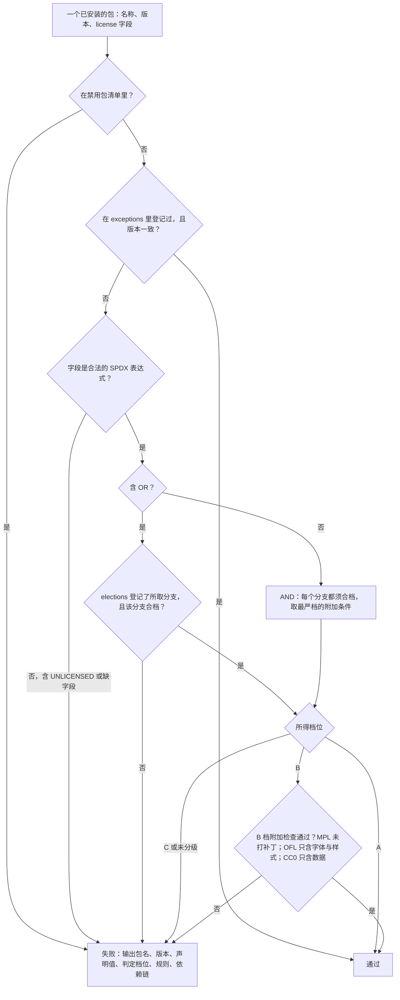
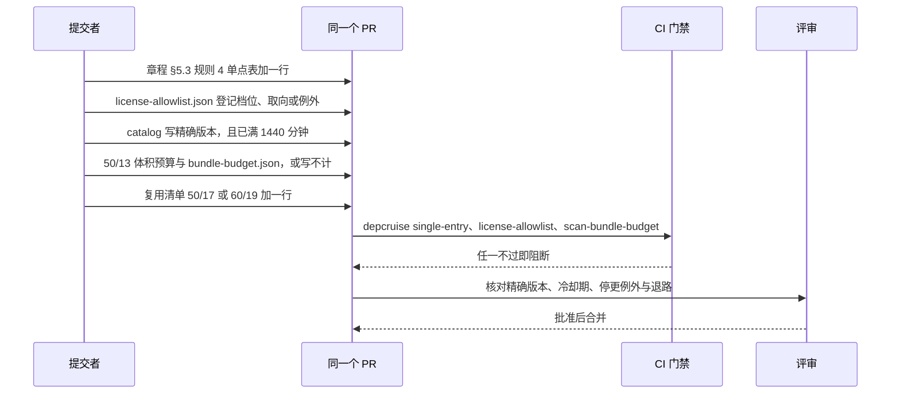
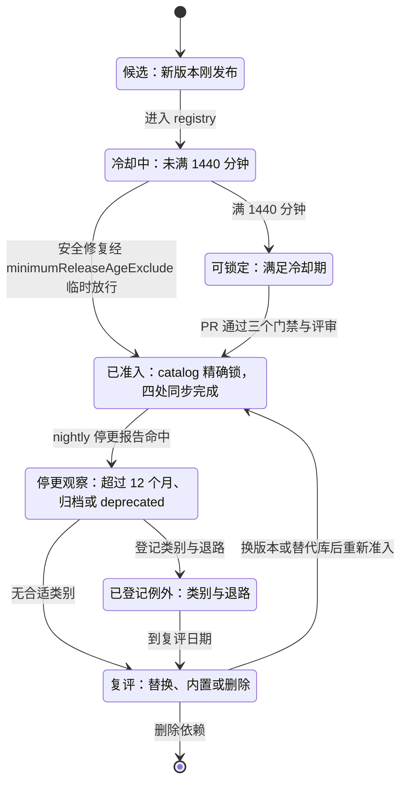

> 状态：已接受 | 负责：架构-类型治理 | 更新：2026-09-26（§4.21：新建。许可分级附表、TD-050 扫描口径、准入四同步、停更判定与冷却期、例外与双许可取向登记；redlock 元数据例外与 ioredis 双版本例外）；2026-09-26（§4.21 整合：A 档实例补 UCD 数据文件用途与 libxml2-wasm；mtx-decompressor 加载方式；维护边缘预登记 quick-lru；新增例外 EX-03（OTel instrumentation 双版本）；登记 @rgrove/parse-xml 退路准入口径与 M4+ 候选依赖（MathJax、perfect-freehand））；2026-09-26（§4.21 复核：EX-02 的 ioredis import 行号统一为 Redis.ts:31-37）；2026-10-23（design-language-v3 第 3 批评审修改：决策 7 示例的 `vendored` 补 ui-react 的文件类型图标件——Tabler Icons 3.49.0（MIT）原件复制进 `packages/ui-react/src/infrastructure/file-type-icons.tsx`，rulings §4.25 TB-182，40-modules/10 §5.3；路径来源的说明补 40-modules/10） | 依赖：[章程](../../00-charter/charter.md) D13、§5.3 规则 4；[rulings](../../00-charter/rulings-2026-09-14.md) §4.15 Q10、§4.16 Q12 / Q19、§4.21 q-license-tiers；[ADR-0004](./0004-monorepo-and-build-toolchain.md)（catalog、`minimumReleaseAge`）；[ADR-0017](./0017-ui-component-library-shadcn-copy-model.md)；[ADR-0026](./0026-headless-rendering-and-thumbnails.md)（禁用 sharp）；[ADR-0039](./0039-collab-server-hocuspocus.md)；[09-type-discipline/08](../09-type-discipline/08-policy-enforcement-matrix.md) TD-006、TD-050、TD-079；[40-modules/01](../../40-modules/01-tooling-and-governance.md) §5.7、§5.8；[50-frontend/17](../../50-frontend/17-reuse-and-dependency-catalog.md)；[60-backend/19](../../60-backend/19-reuse-and-dependency-catalog.md)；证据 `00-charter/_evidence/reuse-arch-elements-plan-2026-09-26.json`（q-license-tiers、R-d-10、revisionLog）、`hocuspocus-adoption-2026-09-26.json`（d-23、d-24、extraFindings）

# ADR-0049：依赖准入与许可分级

## 状态

已接受（2026-09-26 用户裁决 q-license-tiers，选推荐项「分级附表：宽松类视同放行，OFL 限字体、CC0 限数据与内置源码、MPL-2.0 限未修改依赖」；rulings §4.21）。

本 ADR 改写章程 D13 的执行口径（D13 原文由总编排回写），并取代 TD-050 原来「只认 MIT / Apache-2.0 / BSD / ISC」的扫描规则。容器镜像仍按主组件许可解释（rulings §4.15 Q10，TD-084 `check-image-policy`），不在本 ADR 的附表内。

## 背景

章程 D13 原文只列 MIT / Apache-2.0 / BSD / ISC 兼容，禁 AGPL；TD-050 的原规格是「扫描全部 `node_modules` 依赖的 `package.json#license`，命中允许清单以外或缺字段即失败」。用户在 2026-09-26 要求「前端、后端能复用的成熟组件尽可能复用」，复用计划核实时发现原口径连已定依赖都过不了：

1. **宽松许可的写法比清单多**：tslib 是 0BSD（Nest、BullMQ、Radix 的传递依赖都带它），minimatch、isexe、lru-cache 是 BlueOak-1.0.0，@csstools/* 是 MIT-0，argparse 2.0.1 是 Python-2.0（新版改写为 PSF-2.0），pako 1.x 是 `(MIT AND Zlib)`。它们在条款上与 MIT 等价，但字符串不在清单里。
2. **文件级弱 copyleft 的 MPL-2.0 已经在依赖树里**：a11y 门禁用的 axe-core、读取 PowerPoint 内嵌字体（`.fntdata` 是 EOT 容器加 MicroType Express 压缩）所需的 mtx-decompressor、Vite 8 与 Tailwind 4 构建链自带的 lightningcss。
3. **字体与数据有各自的许可**：UI 字体包 @fontsource-variable/geist 是 OFL-1.1；分数索引改为内置 rocicorp fractional-indexing 算法源码（q-frackey），它是 CC0-1.0。
4. **元数据与许可文件不符**：Hocuspocus 的 extension-redis 传递带入 @sesamecare-oss/redlock 1.4.0，其 `package.json:8` 写 `UNLICENSED`，`LICENSE.md:1-3` 却是 MIT（Copyright 2015 Mike Marcacci，H-d-23）。

本轮对设计 playground 已安装的依赖树（Vite 8 + Tailwind 4 + shadcn CLI + React 19，共 429 个包）做了一次许可普查，结果如下；按原口径，M0 空骨架上 `scanners/license-allowlist` 就会报红：

| 许可 | 包数 | 例子 | 按本 ADR |
|---|---|---|---|
| MIT | 380 | — | A 档 |
| ISC | 21 | lucide-react、semver、picocolors | A 档 |
| BSD-3-Clause / BSD-2-Clause | 7 / 5 | source-map-js、diff / dotenv、esprima | A 档 |
| Apache-2.0 | 6 | class-variance-authority、typescript | A 档 |
| MPL-2.0 | 4 | lightningcss 1.32 与 1.33 及其 darwin-arm64 平台包 | B 档（未修改依赖） |
| BlueOak-1.0.0 | 2 | minimatch、isexe | A 档 |
| 0BSD / Python-2.0 | 1 / 1 | tslib / argparse | A 档 |
| OFL-1.1 | 1 | @fontsource-variable/geist | B 档（字体资产） |
| CC-BY-4.0 | 1 | caniuse-lite（shadcn CLI → browserslist） | 未分级，见决策 6 T-01 |

不裁定的后果是连 Nest、BullMQ 都过不了门禁；而逐包登记例外又会让每次升级都报红。用户据此选择分级附表。

## 决策

### 1. 许可分级附表

| 档 | 许可（SPDX） | 适用范围 | 附加条件 | 当前实例 |
|---|---|---|---|---|
| A 视同放行 | MIT、Apache-2.0、BSD-2-Clause、BSD-3-Clause、ISC、0BSD、BlueOak-1.0.0、MIT-0、Zlib、Python-2.0、PSF-2.0、Unicode-3.0 | 任何依赖（运行时、开发期、传递）与数据文件 | 保留版权与许可声明；Apache-2.0 包自带 NOTICE 的，内容并入发布物 `NOTICE`（rulings §4.16 Q12） | 绝大多数依赖；tslib、minimatch、argparse、pako 1.x；Unicode 字符数据库（UCD）数据文件（Unicode-3.0，`LineBreak.txt` 用于生成断行表并跑 `LineBreakTest.txt` 一致性测试，`UnicodeData.txt` 用于抽取符号表字符名称，均登记在 `dataFiles`）；libxml2-wasm 0.7.2（MIT，devDependency，XML 差分 oracle） |
| B 限定用途 · 字体 | OFL-1.1 | 只用于字体资产：npm 字体包、服务端字体包与 fontProfile 子集 | 不得作为代码依赖；子集化产物遵守 OFL 的保留字体名条款；Liberation 必须用 2.x（1.x 是 GPLv2 加字体例外，属 C 档） | @fontsource-variable/geist 5.3.0；Noto、Liberation 2.x、Carlito、Caladea（按版本登记，rulings §4.16 Q19） |
| B 限定用途 · 数据与内置源码 | CC0-1.0 | 只用于数据文件与内置源码 | 内置源码文件头写 `SPDX-License-Identifier: CC0-1.0`、上游地址与提交号，并登记在 `vendored`；npm 上的 CC0 包只允许纯数据包（入口只指向 `.json`），代码包不得以依赖形式引入（CC0 不含专利授权条款） | rocicorp fractional-indexing 算法（`@cordexjs/shared` 的 `order` 子路径，ADR-0032）；spdx-license-ids 一类数据包 |
| B 限定用途 · 未修改依赖 | MPL-2.0 | 只允许不修改的依赖 | 不得出现在 `pnpm-workspace.yaml#patchedDependencies`；不得把其源码文件复制进本仓（MPL 是文件级 copyleft）；发布物保留其许可文本与源码获取方式 | axe-core 4.13.0（devDependency）；mtx-decompressor 1.6.0（运行时，未修改；npm 实测无依赖、无 `node:*` import，只由 ooxml-core 的 `fonts/embedded-font.ts` 在遇到 MTX 压缩的 `.fntdata` 时惰性加载）；lightningcss（构建链） |
| C 禁止 | LGPL-*、GPL-*、AGPL-*、SSPL-1.0、BUSL-1.1、Unlicense，以及更强的 copyleft | — | 双许可里的这些分支不可选；另有禁用包清单：sharp、@img/sharp-libvips（ADR-0026） | libavoid-js、mathml2omml（LGPL）；@y/redis（`AGPL-3.0 OR PROPRIETARY`，没有可选分支） |
| 未分级 | 以上都没列出的许可（如 EPL、CDDL、CC-BY-*），以及 `UNLICENSED`、`SEE LICENSE IN …`、缺失或非 SPDX 的字段 | — | 一律失败；只能按决策 5 登记例外（附证据），或经裁决新增档位后放行 | elkjs（EPL）；caniuse-lite、spdx-exceptions（决策 6 T-01）；@sesamecare-oss/redlock（例外 EX-01） |

- PSF-2.0 与 Unicode-3.0 按「宽松类」归入 A 档：前者是 argparse 新版对 Python-2.0 的改写，后者是 UCD 数据文件的许可（断行表由 tooling 从 UCD 生成，R-d-27），都在裁决原文「等」的范围内。此后再往 A 档加许可须修订本表。
- 服务端与浏览器用同一张表；前端依赖的逐项档位见 [50-frontend/17](../../50-frontend/17-reuse-and-dependency-catalog.md)，后端见 [60-backend/19](../../60-backend/19-reuse-and-dependency-catalog.md)。

**图 49-1 一个包的许可判定**



怎么读：先查禁用清单与已登记的例外，再解析 SPDX 表达式；`OR` 必须登记取向才算数，`AND` 取各分支里最严的一档；落到 B 档的还要过用途检查。任何一步不过都在同一份违规列表里给出依赖链，方便看出是谁把它带进来的。
依据：本 ADR 决策 1、2、5；TD-050。

### 2. TD-050 扫描口径

**范围**（执行点是 `scanners` job 的 `scanners/license-allowlist` 步骤，入口 `tooling/scripts/license-allowlist.ts`，登记见 40-modules/01 §5.7）：

| 对象 | 输入 | 规则 |
|---|---|---|
| npm 依赖 | `pnpm licenses list --json --long`（pnpm 11 内置），覆盖 dependencies、devDependencies、optionalDependencies 与全部传递依赖，含 playground 与 `tooling/eslint-config` | 按图 49-1 逐包判定；平台二进制子包（如 `lightningcss-darwin-arm64`）同样判定 |
| 字体资产 | fontProfile 清单与服务端字体包清单中每个文件的 `license` 字段（清单格式见 50-frontend/05 §7.1 与 60-backend/17） | 只接受 OFL-1.1 与 A 档；Liberation 版本须为 2.x |
| 数据文件 | `license-allowlist.json#dataFiles` 登记的路径 glob、许可与来源（UCD 数据、ECMA-376 附件、XML 合规测试子集等） | 每条 glob 至少命中一个文件，许可合档；新增入库的第三方数据文件必须先登记 |
| 内置源码 | 源文件头的 `SPDX-License-Identifier`；`license-allowlist.json#vendored` | 标识符不是 `Apache-2.0` 的源文件必须出现在 `vendored` 且合档；`vendored` 每项的文件头须有上游地址与提交号 |

**判定细则**：

- SPDX 表达式解析自写，只需支持 `AND`、`OR`、`WITH` 与括号；不引 spdx-* 系列包，它们的数据依赖本身是 CC0-1.0（spdx-license-ids）与 CC-BY-3.0（spdx-exceptions）。
- `OR`：取最宽松的合档分支（A 优先于 B），所取分支必须登记在 `elections`；未登记即失败，报告里给出应取的分支。
- `AND`：每个分支都须合档，附加条件取最严一档。
- `WITH`：按主许可判定，例外名一并登记；例如 `GPL-2.0-or-later WITH Font-exception-2.0`（Liberation 1.x）仍属 C 档。
- B 档附加检查：MPL-2.0 的包名不得出现在 `patchedDependencies`；OFL-1.1 的包内只许有字体文件、CSS、JSON 与说明文件；CC0-1.0 的 npm 包 `main` / `exports` 只许指向 `.json`。
- 输出 JSON 违规列表 `{name, version, declared, tier, rule, path}`（`path` 是从 workspace 包到该包的依赖链）与人类可读报告；退出码约定同扫描器（40-modules/01 §5.7）。

### 3. 准入四同步

新增直接依赖、升级主版本、或某个传递依赖首次落到 B 档与未分级时，同一 PR 必须同步四处（R-d-10）：

| # | 位置 | 内容 | 机械执行点 |
|---|---|---|---|
| ① | 章程 §5.3 规则 4 单点表 | 有单点约束的库写明唯一允许 import 的包与目录 | depcruise `cordex-third-party-single-entry` 与 ESLint `restricted-imports.ts` 都由它生成（TD-006） |
| ② | `tooling/policy/license-allowlist.json` | B 档包名与用途、双许可取向、例外、内置源码、数据文件 | `scanners/license-allowlist`（TD-050） |
| ③ | `pnpm-workspace.yaml#catalog` | 精确版本，不带 `^` 或 `~`；版本须已满冷却期（决策 4） | 评审核对；`lockfile-guard` (e) 只钉 typescript、yjs、y-protocols（TD-079，本 ADR 不扩大其范围） |
| ④ | 体积预算 | 浏览器可达的依赖进 50-frontend/13 §6 的 chunk 地图与对应 `bundle-budget.json`；服务端与构建期依赖此项写「不计」 | `scanners/scan-bundle-budget`（TD-075）；惰性模块出现在基线 chunk 即失败（50-frontend/13 §7 规则 3） |

同时在复用清单登记一行：前端写 [50-frontend/17](../../50-frontend/17-reuse-and-dependency-catalog.md)，后端写 [60-backend/19](../../60-backend/19-reuse-and-dependency-catalog.md)；清单行写包装位置、替代与否决理由、CSP/TT 影响。PR 模板把四处列为勾选项。

**图 49-2 一次依赖准入的 PR**



怎么读：五项改动放在同一个 PR 里，三个机械门禁各管一处，剩下的精确版本、冷却期与停更例外由评审核对；缺任何一项都不能合并，这样章程、白名单、catalog、体积预算与复用清单不会各自漂移。
依据：R-d-10；TD-006、TD-050、TD-075。

### 4. 停更判定与冷却期

**停更**：满足任一条即判定为停更——npm 上最新版本发布距今超过 12 个月；上游仓库已归档；npm 标记 deprecated。新准入的依赖若已停更，必须登记下列例外类别之一并写明退路，否则不准入：

| 类别 | 条件 | 退路 | 当前登记 |
|---|---|---|---|
| 算法稳定 | 功能完备的纯算法库，体积小，无已知漏洞 | 按其许可内置源码（vendoring） | d3-scale 4.0.2（2021-09）、d3-shape 3.2.0 与 d3-path 3.1.0（2022-12）、d3-array 3.2.4（2023-05）、simplify-js 1.2.4 与 fit-curve 0.2.0（2022）、rbush 4.0.1（2024-08，有条件引入） |
| 只作对照 | 只作 devDependency 的差分 oracle 或一致性对照，不进任何产物 | 换同类对照或删除 | saxes 6.0.0（仓库已归档，XML 差分 oracle）、linebreak 1.1.0（LineBreakTest 对照） |
| 维护边缘 | 仍被广泛使用，接口面很薄 | 自写替代，或换 A 档同类库 | comlink 4.4.2（2024-11）、idb 8.0.3（2025-05）；quick-lru 7.3.0（2025-10-10 发布，2026-10-10 越过 12 个月阈值，预先登记，退路为 lru-cache 11.5（BlueOak-1.0.0，A 档），见 60-backend/19 §14） |
| 传递依赖 | 由已准入的上游带入，本仓不直接 import | 随上游升级 | @lifeomic/attempt 3.1.0（2024-03，@hocuspocus/provider 带入）、@sesamecare-oss/redlock 1.4.0（2025-01，extension-redis 带入） |

- XML 解析器的退路 @rgrove/parse-xml 5.0.0（ISC，A 档）不在本轮准入范围：只有 ADR-0019 决策 10 启用退路时，才按决策 3 走四同步准入；saxes 与 libxml2-wasm 只在 `packages/xml/src/__tests__/**` 以 devDependency 出现，差分输入限深、限长（ADR-0019 决策 9）。
- 已准入的依赖不因越过 12 个月被自动踢出：nightly 的 `scanners/license-allowlist` 附带一份停更报告（只报告、不阻断），新越过阈值的依赖自动建复评 issue（例如 utif2 须在 M3 前复评）。
- 登记位置是 `license-allowlist.json#staleExceptions`（包名、类别、退路、复评日期）。

**冷却期**：`pnpm-workspace.yaml` 维持 `minimumReleaseAge: 1440`（分钟）与 `blockExoticSubdeps: true`（已由 TD-079 钉住）。catalog 精确锁的版本在 PR 时必须已发布满 1440 分钟：

- 实例一：react-hook-form 7.89.0 发布于 2026-09-26T00:59Z，当日锁 7.88.0；
- 实例二：emf-converter 4.0.0 发布于 2026-09-25T19:18Z，满冷却期后再精确锁（R-d-24）。
- 安全修复需要立即升级时，经 pnpm 11 的 `minimumReleaseAgeExclude` 按包名临时放行，同一 PR 登记 issue 与到期日（不超过 30 天，与 `tooling/policy/vuln-allow.json` 同一口径），到期删除。

**图 49-3 一个依赖版本的生命周期**



怎么读：一个版本先要过冷却期才能锁定，唯一的捷径是带到期日的安全放行；准入之后由 nightly 报告盯住维护状态，停更不会立刻踢出依赖，而是要么登记类别与退路，要么进入复评。
依据：本 ADR 决策 4；ADR-0004；TD-079。

### 5. 例外与双许可取向

**例外**只登记在 `license-allowlist.json#exceptions`，每条写 id、包名、精确版本、声明值、实际许可、证据（文件与行号）、引入路径、作用范围、评审日期；版本一变即失效，须重新核实。

| id | 包 | 类型 | 内容 | 证据 | 作用范围 |
|---|---|---|---|---|---|
| EX-01 | @sesamecare-oss/redlock 1.4.0 | 许可元数据 | `package.json:8` 写 `UNLICENSED`，`LICENSE.md:1-3` 是 MIT（Copyright 2015 Mike Marcacci）；按 MIT 放行 | H `meta.extraFindings`、H-d-23；npm 包文件 | apps/server，经 @hocuspocus/extension-redis 4.7.0 传递带入（M3 装配） |
| EX-02 | ioredis | 单版本（非许可） | extension-redis 4.7.0 的 `dependencies` 写 `ioredis ~5.6.1`，模块顶层 `import RedisClient from "ioredis"`（`packages/extension-redis/src/Redis.ts:31-37`，31–36 为 type-only 导入，37 为运行时 import，按 4.7.0 源码核实），同时支持经 `createClient` 或 `redis` 选项注入外部实例（`Redis.ts:57`、`:61`、`:204-215`）。因此运行时实例统一为 apps/server 声明的 6.0.x（R-d-40，经 `createClient` 注入），安装树里仍并存 5.6.x，只作 extension-redis 的模块依赖；不用 pnpm overrides 把 `~5.6.1` 强压到 6（越出其声明范围，可能破坏 API） | Hocuspocus v4.7.0 源码（commit 6ddc757） | apps/server；注入点的类型适配由 60-backend/19 在 M3 集成时核实 |
| EX-03 | @opentelemetry/instrumentation | 单版本（非许可） | `@fastify/otel` 0.21.0 依赖 `@opentelemetry/instrumentation` `^0.221.0`，服务端 OTel 其余各包同批锁在 0.222.x，安装树里 0.221.x 与 0.222.x 并存；不用 overrides 强压（`^0.x` 的范围跨次版本即可能破坏 API），`@fastify/otel` 跟进 0.222 后收敛并删除本条 | `@fastify/otel` 0.21.0 的 `package.json`（npm view，2026-09-26） | apps/server（api、collab、worker 的 OTel 预加载） |

- EX-02、EX-03 不属于许可问题，登记在同一文件是为了让 SBOM 与评审能看到「为什么有两个版本」；本 ADR 不新增多版本扫描，`syncpack` 只查直接依赖，不受影响。

**双许可取向**（`elections`）：SPDX `OR` 表达式取最宽松的合档分支，登记 `{name, version, expression, elected, reason}`；发布物 `NOTICE` 按所取分支写。`package.json` 只写了限制性的一支、实际是双许可的（TD-050 原来的豁免情形），同样走 `elections`，附上游 LICENSE 证据。当前依赖树里没有需要登记的项；已见过的实例：

| 包 | 表达式 | 取向 | 说明 |
|---|---|---|---|
| jszip | `(MIT OR GPL-3.0-or-later)` | MIT | 只出现在仓库外的 pptx-viewer-core 对照环境 |
| dompurify | `(MPL-2.0 OR Apache-2.0)` | Apache-2.0 | 后端 SVG 消毒改用它的方案已否（60-backend/19），未引入 |
| @y/redis | `AGPL-3.0 OR PROPRIETARY` | 无合档分支 | 禁止 |

### 6. 待裁与待核

| id | 项 | 状态 | 默认倾向 | 去向 |
|---|---|---|---|---|
| T-01 | CC-BY 数据包：caniuse-lite（CC-BY-4.0，browserslist 的数据，playground 经 shadcn CLI 带入）、spdx-exceptions 2.5.0（CC-BY-3.0） | 待裁：不在 23 题范围内，本轮普查新发现 | 按「数据文件」并入 B 档：只允许纯数据包，署名写进 `NOTICE` | 总编排 → rulings；M0 骨架落地前须定，否则许可步骤在 playground 依赖树上报红 |
| T-02 | MathJax 字体数据 `@mathjax/mathjax-newcm-font`（派生自 New Computer Modern，GUST 字体许可） | 待核 | M4+ 引入前核实；不合档则另选字体路径 | 公式立项（q-equation） |
| T-03 | `presetShapeDefinitions.xml`、XSD 等 ECMA-376 附件的再分发许可 | 待核 | 核实前只在 tooling 构建期读取，不随包发布原文件 | 40-modules/06、40-modules/04 |
| T-04 | W3C XML Conformance 测试套件子集（ADR-0019 的验证输入）的再分发许可 | 待核 | 核实前不入库，取用方式由 ADR-0019 定 | ADR-0019 |
| T-05 | 74 个内置表格样式的数据来源与许可 | 待核 | — | 表格元素设计、ADR-0018 |
| T-06 | 插入到用户文档的 lucide-static 图标是否要带 ISC 版权声明 | 待核 | — | 插入图标（q-extra-inserts） |

**M4+ 候选依赖（只登记、未准入）**：以下依赖在远期路线中被点名，本轮不进 catalog、不进单点表；立项时按决策 3 四同步准入，并先解决表中的待核项（版本与许可为 2026-09-26 `npm view` 结果）。

| 包 | 版本 · 许可 | 用途 | 准入前须解决 | 出处 |
|---|---|---|---|---|
| @mathjax/src | 4.1.3 · Apache-2.0 | 公式 M4+：OMML↔MathML 之后渲染为 SVG（ADR-0021 修订第 4 条） | 依赖 speech-rule-engine 5.0.0-rc.4 是预发布版；字体包 @mathjax/mathjax-newcm-font 4.1.3 的 `package.json` 标 Apache-2.0，但字形源自 New Computer Modern，上游字体许可待核（T-02） | q-equation；50-frontend/25 |
| perfect-freehand | 1.2.3 · MIT | 笔墨输入（M4+ 候选） | 墨迹插入本身是非目标（rulings §4.21 R-d-75），只有产品重新立项才评估 | 50-frontend/25 |

### 7. `license-allowlist.json` 的结构

原文件是一张扁平的许可白名单；改为下面的分级结构（字段逐项由 `tooling/policy/schema/license-allowlist.schema.json` 校验，登记见 40-modules/01 §5.8）。示例只列本轮已知的条目：

```json
{
  "version": 2,
  "tiers": {
    "permissive": ["MIT", "Apache-2.0", "BSD-2-Clause", "BSD-3-Clause", "ISC", "0BSD",
                   "BlueOak-1.0.0", "MIT-0", "Zlib", "Python-2.0", "PSF-2.0", "Unicode-3.0"],
    "restricted": {
      "OFL-1.1": { "use": ["font-asset"] },
      "CC0-1.0": { "use": ["data", "vendored-source"] },
      "MPL-2.0": { "use": ["unmodified-dependency"] }
    },
    "denied": ["LGPL-*", "GPL-*", "AGPL-*", "SSPL-1.0", "BUSL-1.1", "Unlicense"]
  },
  "restrictedPackages": [
    { "name": "@fontsource-variable/geist", "license": "OFL-1.1", "use": "font-asset", "scope": "runtime" },
    { "name": "mtx-decompressor", "license": "MPL-2.0", "use": "unmodified-dependency", "scope": "runtime" },
    { "name": "axe-core", "license": "MPL-2.0", "use": "unmodified-dependency", "scope": "dev" },
    { "name": "lightningcss*", "license": "MPL-2.0", "use": "unmodified-dependency", "scope": "dev" }
  ],
  "elections": [],
  "exceptions": [
    { "id": "EX-01", "kind": "license-metadata", "name": "@sesamecare-oss/redlock", "version": "1.4.0",
      "declared": "UNLICENSED", "actual": "MIT", "evidence": "LICENSE.md:1-3",
      "via": "@hocuspocus/extension-redis@4.7.0", "scope": "apps/server", "reviewed": "2026-09-26" },
    { "id": "EX-02", "kind": "single-version", "name": "ioredis", "versions": ["~5.6.1", "6.0.x"],
      "via": "@hocuspocus/extension-redis@4.7.0", "scope": "apps/server", "reviewed": "2026-09-26" },
    { "id": "EX-03", "kind": "single-version", "name": "@opentelemetry/instrumentation", "versions": ["^0.221.0", "0.222.x"],
      "via": "@fastify/otel@0.21.0", "scope": "apps/server", "reviewed": "2026-09-26" }
  ],
  "vendored": [
    { "path": "packages/shared/src/order/**", "license": "CC0-1.0",
      "source": "https://github.com/rocicorp/fractional-indexing", "commit": "入库时填写" },
    { "path": "packages/ui-react/src/infrastructure/file-type-icons.tsx", "license": "MIT",
      "source": "https://github.com/tabler/tabler-icons", "commit": "v3.49.0 的提交号，入库时填写" }
  ],
  "dataFiles": [],
  "staleExceptions": [
    { "name": "d3-scale", "category": "algorithm-stable", "fallback": "vendoring", "reviewBy": "M3" }
  ],
  "deniedPackages": ["sharp", "@img/sharp-libvips"]
}
```

- `vendored` 的路径以 ADR-0032 与 40-modules/02、40-modules/10（2026-10-23 起含 ui-react 的文件类型图标件，rulings §4.25 TB-182）登记的文件为准，上面的 glob 只示意位置；`dataFiles` 随 T-03、T-04 核实结果与 UCD 生成表入库时填写。
- `staleExceptions` 按决策 4 的表逐包登记，示例只列一项。

## 备选方案与放弃原因

| 方案 | 放弃原因 |
|---|---|
| 分级附表，但 MPL-2.0 只放开发期依赖 | axe-core 可用，但读取内嵌字体的 MTX 解压要依 W3C 提交稿自研（估 600–1000 行加语料测试），完成前受限内嵌字体只能回退并出诊断；Vite 8 与 Tailwind 4 构建链自带的 lightningcss 也要单独豁免 |
| 不改 D13 原文，逐包登记例外 | tslib、lru-cache、minimatch 等每个传递依赖都要按包名登记，升级时频繁报红，维护成本最高 |
| 维持 D13 原文与 TD-050 原规格 | M0 空骨架上许可步骤就会失败，Nest、BullMQ、Vite 都过不了门禁 |
| 把 MPL-2.0 放进 A 档 | MPL 是文件级 copyleft，修改其文件就要按 MPL 公开；只放行「不修改」才能不影响本仓 Apache-2.0 |
| 把 CC0-1.0 放进 A 档 | CC0 不含专利授权条款，代码包作依赖时有专利风险；只放行数据与注明出处的内置源码 |

## 后果

**正面**：已定依赖与 Vite、Tailwind、Nest、BullMQ 的传递依赖一次过门禁；axe-core 与 mtx-decompressor 可用，内嵌字体不必自研 MTX 解压；每次准入都在五个地方留下同一份记录（章程单点表、白名单、catalog、体积预算、复用清单），升级与审计能追溯；停更与冷却期有明确判据，不再靠印象。

**负面**：许可步骤要自写 SPDX 解析与 B 档用途检查；B 档的每个包都要逐个登记用途；CC-BY 数据包在裁决前会让 playground 依赖树报红；ioredis 两个版本并存会让 SBOM 多一项，需要在 M3 集成时核实注入点的类型适配。

## 如何被机械验证

| 断言 | 执行点 | 负向用例 |
|---|---|---|
| 全部已安装包、字体资产、数据文件与内置源码的许可按附表判定 | `scanners/license-allowlist`（TD-050，每 PR · main · nightly） | `tooling/scripts/__tests__/__fixtures__/license/violation`：GPL-3.0 依赖；MPL 包出现在 `patchedDependencies`；OFL 包含 JS 入口；CC0 代码包；缺 license 字段；`OR` 两支都不合档；`OR` 未登记取向；`UNLICENSED` 未登记例外；各一例。正向：已登记 EX-01 的 redlock 通过 |
| 第三方库只从单点表允许的包 import | depcruise `cordex-third-party-single-entry` + ESLint `no-restricted-imports`（TD-006） | `tooling/depcruise/__tests__/fixtures/single-entry/violation` |
| 冷却期与安全设置显式存在 | `lockfile-guard` (c)（TD-079） | 既有夹具「缺 `strictPeerDependencies`」；同一规则覆盖 `minimumReleaseAge` 与 `blockExoticSubdeps` |
| 新增浏览器依赖进入体积预算 | `scanners/scan-bundle-budget`（TD-075） | 惰性模块出现在基线 chunk 即失败（50-frontend/13 §7 规则 3） |
| 已准入依赖的停更状态 | nightly 的 `scanners/license-allowlist` 停更报告（只报告） | — |

## 关联

章程 D13、§5.3 规则 4；rulings §4.21 q-license-tiers、q-frackey、H:q-hp-fanout；ADR-0004（catalog 与 pnpm 设置）、ADR-0017（UI 依赖单点）、ADR-0026（禁用 sharp）、ADR-0032（FracKey 内置源码）、ADR-0039（Hocuspocus 与 extension-redis）；09-type-discipline/08 TD-006、TD-050、TD-075、TD-079；40-modules/01 §5.7、§5.8；50-frontend/13 §6；[50-frontend/17](../../50-frontend/17-reuse-and-dependency-catalog.md)；[60-backend/19](../../60-backend/19-reuse-and-dependency-catalog.md)；[70-testing/12](../../70-testing/12-ci-gates-mapping.md) §2。
