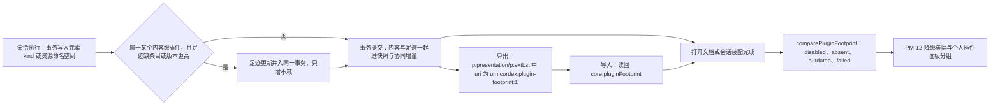

> 状态：提议 | 负责：架构-结构 | 更新：2026-10-01（§4.23 插件管理：新建。内容插件足迹记在文档资源 `core.pluginFootprint`，内核在命令管线里同事务维护、只增不减；打开时比对；导出 pptx 经 `p:presentation/p:extLst` 保留） | 依赖：[章程](../../00-charter/charter.md) §2.3；[rulings](../../00-charter/rulings-2026-09-14.md) §4.23（O-3 已确认，2026-10-01）；PRD [09-plugin-manager](../../10-prd/03-features/09-plugin-manager.md) PM-02、PM-12、PM-13；PRD [01-open-and-fidelity](../../10-prd/03-features/01-open-and-fidelity.md) OF-13；[30/03](../03-kernel-and-plugin-model.md)；[30/04](../04-document-model.md) §2.5、§2.7、§4.1；[ADR-0008](./0008-opaque-preservation.md)；[ADR-0009](./0009-snapshot-schema-version-and-migrations.md)；[ADR-0015](./0015-single-execution-entry-and-non-executable-mutations.md)；[40-modules/02](../../40-modules/02-kernel-protocol-and-document-core.md)、[04](../../40-modules/04-ooxml-format-and-pptx-codec.md)、[16](../../40-modules/16-plugin-catalog.md)

# ADR-0050：内容插件足迹

## 状态

提议（2026-10-01）。rulings §4.23 开放问题 O-3 已由用户确认按推荐推进：「文档记录内容插件足迹（插件 id、最低版本、负责的元素类型），导出 pptx 保留，形态由架构线定」。本 ADR 给出形态，进入 M2 前经评审转为「已接受」。

## 背景

- rulings §4.23 裁决 3 把插件分为内容级与界面级：内容级插件（贡献元素 kind、资源命名空间、Mutation、格式等）按部署统一启停。部署之间、或同一部署的管理员停用之后，一份文档可能用到本会话没有装配的内容级插件。
- 现有兜底只有「未知内容保留」：未注册的 `slide.shapeKind` 显示为 OF-13 占位，未注册的资源命名空间原样往返（30/04 §2.7、50-frontend/04 §1）。它能保证不丢数据，却说不出**缺的是哪个插件、要哪个版本**——PM-12 的横幅文案（「本文档用到了『二维码形状』，管理员已停用该插件」「版本过旧：需要 ≥ 1.2」）无从产生。
- 从 kind 或命名空间反推插件不可靠：第三方前缀规则（PS-02）只约束 id 形状，不给出插件 id 与最低版本；插件被停用后，本会话里也没有它的清单可查。

## 决策

### 1. 足迹是文档的一个资源命名空间

足迹存放在 Snapshot 的 `resources['core.pluginFootprint']`（30/04 §2.5、§2.7），命名空间**文档类型盲**，由内核（`model-core`）注册的 ResourceHook 持有：

```ts
// resources['core.pluginFootprint'] = { version: 1, data: PluginFootprint }
interface PluginFootprint {
  entries: Record<PluginId, {
    minVersion: string          // 写入该插件数据时，写入方会话中该插件的版本（semver，取历次写入的最大值）
    kinds: readonly string[]    // 该插件负责、且在本文档出现过的元素 kind（slide.shapeKind 等）
    namespaces: readonly string[] // 该插件负责、且在本文档出现过的资源命名空间
  }>
}
```

- 只记内容级插件；界面级插件不进足迹（它不写文档，PM-13 第 3 条）。
- 不含插件代码、配置与用户信息；插件 id 与版本来自清单（`cordex-manifest.json`，PS-01）。
- 协同模式下即 Y.Doc 顶层 `resources` 下的同名键，随快照、增量与导出一起流转（30/06 §1.3）。

### 2. 内核在命令管线里同事务维护，只增不减

- 命令管线在事务提交前扫描本事务写入的元素 kind 与资源命名空间，查「kind / 命名空间 → 负责的内容级插件」映射（装配期由贡献点注册建立）；若足迹里缺该插件、缺该 kind / 命名空间，或本会话的插件版本高于记录的 `minVersion`，就把足迹更新作为 StoreOp **并入同一事务**（ADR-0013、ADR-0015），不另起事务、不单独占撤销栈。
- **只增不减**：撤销事务时足迹更新不回退（撤销只逆转内容 StoreOp，足迹 StoreOp 在逆操作生成时被跳过）；删除最后一个该 kind 的元素也不移除条目。代价是足迹可能「偏宽」，打开时多报一个其实已不在用的插件——比漏报安全，且比对时会按实际出现的 kind 统计受影响页数（为 0 则不出横幅，见第 3 条）。
- 缺少某插件的会话**不改写**足迹中该插件的条目（PM-12「不因缺插件而改写或删除足迹里的数据」）；协同下两端并发添加同一插件条目时按 Y.Map 语义合并，`minVersion` 取较大值由写入方保证（读—比较—写在同一事务）。
- 导入 pptx 时由导入器按导入结果一次性建立足迹（第 4 条读回，或按导入产生的 kind 推出）。

### 3. 打开时比对

`comparePluginFootprint(footprint, sessionSet, catalogStates)` 是纯函数，返回 `[{pluginId, minVersion, reason, affectedSlideIds[]}]`，`reason` ∈ `disabled`（本部署已停用）、`absent`（未声明或被拒）、`outdated`（本会话版本低于 `minVersion`）、`failed`（已启用但本会话启动失败或等待依赖）。打开文档时与会话装配完成后各算一次；`affectedSlideIds` 为空的条目不触发横幅。结果驱动 PM-12 的降级横幅与个人插件面板「本文档缺少的插件」分组，并发产品事件 `plugin/missing-in-document`。

### 4. 导出 pptx 经 `p:presentation/p:extLst` 保留

- 导出时在 `ppt/presentation.xml` 的 `p:presentation/p:extLst` 写一个 `p:ext`，`uri="urn:cordex:plugin-footprint:1"`，内含足迹 JSON 的 XML 表示（`cx:pluginFootprint` 元素，每个插件一个子元素，属性 `id`、`minVersion`，子元素列出 kind 与命名空间）。
- 导入时识别该 URI，读回同一资源；其余 `extLst` 仍按 ADR-0008 原样保留。零编辑导出时若足迹与导入时相同，该 `p:ext` 字节不变（部件级 diff 零差异口径不受影响，30/04 §5.4）。
- 外部软件打开再保存可能丢弃这个扩展；此时退化为现状（只报「未知内容」），不影响数据保留。

**图 1 足迹的写入、比对与导出**



怎么读：左半是写入路径，只有写到内容级插件负责的数据时才顺带更新足迹，而且与内容同一事务；右半是读取路径，打开时比对出四种原因交给界面。导出与导入让足迹随 pptx 往返，外部软件丢掉它时只是回到「未知内容」的旧行为。
依据：本 ADR 决策 1–4；PRD 09 PM-12、PM-13；30/04 §2.7。

## 备选方案与放弃原因

| 方案 | 放弃原因 |
|---|---|
| 不记足迹，只按未知 kind / 命名空间报「未知内容」 | O-3 备选项；无法告诉用户缺的是哪个插件、哪个版本，PM-12 验收无法满足 |
| 从 kind / 命名空间前缀反推插件 id | 前缀只约束形状，一个插件可负责多个 kind，版本信息缺失；停用后本会话没有清单可查 |
| 足迹记在服务端 `documents` 表的列里 | 单机 preset 与导出 pptx 离开服务端后丢失；与「内容以协同快照为事实源」（rulings §4.19 D-M2-CONTENT）不一致 |
| 足迹单独成事务或由后台作业补写 | 与内容写入之间有窗口，协同下另一端可能先看到内容后看到足迹；增加撤销栈噪声 |
| 撤销时回退足迹 | 协同下撤销只是本地逆操作，回退足迹会删掉他人仍在使用的条目；只增不减简单且安全 |
| 导出时写自定义部件（customXml） | 需新增关系与内容类型，零编辑导出会改动 `[Content_Types].xml` 与 rels；`extLst` 是 OOXML 规定的扩展位 |

## 后果

- 正：缺插件的提示可以具体到插件与版本；降级不改写数据；足迹随文档与 pptx 走，部署之间迁移文档也能说清缺什么。
- 正：界面级插件被机械地排除在文档之外，与 PM-13「个人启停不影响协作者」一致。
- 负：每个写入内容级数据的事务多一次映射查找；首次写入时多一个 StoreOp。
- 负：足迹只增不减，可能多报已不再使用的插件（按 `affectedSlideIds` 过滤后不出横幅，但面板详情仍列出）。
- 负：需要 ooxml-pptx 识别一个自有 `p:ext` URI；外部软件丢弃时足迹丢失。

## 如何被机械验证

| 验证项 | 方法 |
|---|---|
| 写入内容级插件的元素后足迹出现对应条目，与内容同一 `TransactionRecord` | kernel 单测（`plugin-footprint.test.ts`） |
| 撤销后足迹不回退；界面级插件的命令不产生足迹 | kernel 单测；PM-13 场景见 70-testing/02 |
| `comparePluginFootprint` 四种原因与空 `affectedSlideIds` 不出横幅 | 表驱动单测 |
| 导出后再导入，足迹逐字段相同；零编辑往返 `ppt/presentation.xml` 字节不变 | ooxml-pptx 往返测试（`fidelity-roundtrip`） |
| 缺插件会话编辑同一文档后，足迹中该插件条目不变 | 协同模拟测试（70-testing/05） |

## 关联

- 章程 §2.3（同源可信）；rulings §4.23（裁决 3、O-3）；术语「内容插件足迹」登记于章程 §4。
- PRD 09 PM-02（作用域判定）、PM-12（缺插件降级与提示）、PM-13（协同一致性）；OF-13（元素级占位）。
- 30/03（`scope` 清单字段与作用域判定）；30/04 §2.7（命名空间）、§4.1（`ppt/presentation.xml` 映射）；ADR-0008（不透明保留）、ADR-0013（StoreOp）、ADR-0015（单一执行入口）。
- 落点：40-modules/02（kernel 足迹维护与比对）、40-modules/04（extLst 导入导出）、50-frontend/04（足迹读写与比对的前端用法）。
