> 状态：v0.2 | 负责：架构-模块（阶段一） | 更新：2026-09-21、2026-09-24（rulings §4.15）、2026-09-24（复核修正，rulings §4.17）、2026-09-25（补图）、2026-09-25（矛盾收口，rulings §4.18）、2026-09-25（§4.19）、2026-09-25（审稿）、2026-09-26（§4.20）；2026-09-26（§4.21 整合：M-04 承载包加 @cordexjs/xml；§6.4 冻结层补 @cordexjs/xml 的 src/**；BC-21 CollabGateway 改为 CollabUpgradeHandler 与 Hocuspocus）；2026-09-26（§4.21 Remap：原 30/08 引用按 60-backend/README §6.1 改指新位置，30/08 已删除）；2026-09-26（§4.21 复核：Webhook PL 改为 Standard Webhooks 头名；fflate 单点只在 ooxml-core）；2026-10-01（包与插件规划显化：§7 表前补「包与插件数」一段，指向 16 §2 与 `plugin-counts.json`） | 依赖：charter v0.2 §4–§5、30-architecture 01–08/12、09-type-discipline、ADR 索引
> 修订：按 `14-cross-module-review.md` §8 修订（R-01…R-24 全部落实，本次为回写员 R1 收敛）

# 00 模块切分总图（DDD 限界上下文 × cordis 插件）

## 0. 一页总览

**水平层网格图**

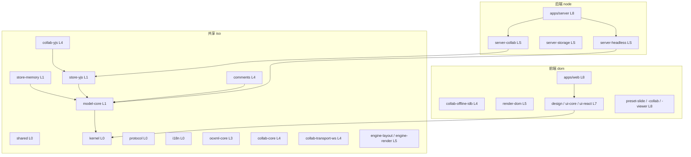

怎么读：三条水平泳道对应原网格的「共享(iso)／前端(dom)／后端(node)」三行；节点标签沿用 L0…L8/LS 层号；图中覆盖 25 个按 `cordex.layer` 计的水平层包（2026-09-25 新增 `comments` L4 iso，rulings §4.19 D-COMMENTS-PKG）＋`apps/web`/`apps/server` 两个组合根应用，同层同泳道且无代表性边的包合并为一个节点（`engine-layout / engine-render`、`design / ui-core / ui-react`、三个 preset，2026-09-25 为满足单图 25 节点上限而合并，共 22 个节点）；`L7`/`L8` 没有 iso 包；箭头只画少量代表性依赖以示意铁律 3「只向下」，并非详尽依赖表，详尽依赖见各模块文档 §4/§10。

**垂直束网格图**

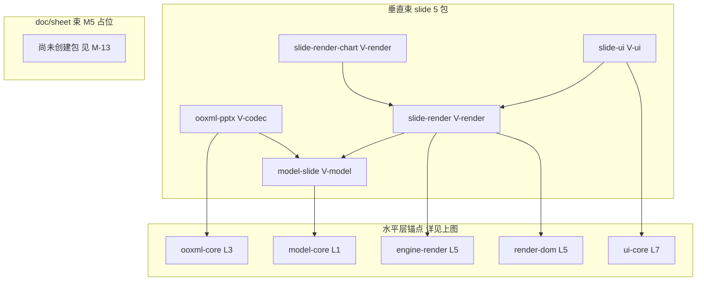

怎么读：`anchor` 子图重复引用上一张图的同名包，仅用于挂接依赖箭头，不是新包；「垂直束 slide」实际有 5 个包（原网格标 `[V]` 的 model-slide/ooxml-pptx/slide-render/slide-render-chart/slide-ui）；`future` 子图对应 doc/sheet 未来束的 M5 占位——按铁律 2（束间隔离）doc/sheet 束建成后也不会与 slide 束互相 import，故不画连线，M5 包清单见 §7 M-13。

工具链 `tooling/*`（node，不参与依赖图）贯穿全部层，只做治理、不构成运行时依赖；`[V]` 标记 = 垂直束包（`bundle=slide`）；LS 允许依赖 L5 的 iso 包，不得依赖 dom 包（同构铁律 4）。

内核（kernel）与文档内核（model-core/store-*）是唯一的横向地基；幻灯片全部能力（model-slide/ooxml-pptx/slide-render(-chart)/slide-ui）自成一束，与未来 doc/sheet 束按铁律 2 严格隔离；协同、渲染、UI 三条水平能力线对幻灯片一无所知，只经贡献点与 Store/Scene 契约接入；服务端 11 个限界上下文围绕 `server-collab`/`server-headless` 两个 cordis 宿主与内嵌于 Nest 模块目录的适配插件展开，Nest 本身只是传输壳。

---

## 1. 方法：DDD 概念与 cordis 机制的对应

| DDD 概念 | cordis / 本项目机制 | 在本项目中的具体落点（包/文件） |
|---|---|---|
| 限界上下文（Bounded Context） | 一组 cordis 插件/库包 + 其对外服务与贡献点边界 | §3 每个 BC 的「承载包」列；边界由 `package.json#cordex.layer/bundle` + depcruise 规则机械划定 |
| 聚合（Aggregate） | `UnitScope` 内某个 `DocumentType` 的 `body`（归一化实体表）+ 操作它的 `commands`/`mutations` | `PresentationBody`（`packages/model-slide/src/model/body.ts`）、`fixture` body（`model-core/testing/fixture-document-type.ts`）；聚合根 = `DocumentStore.state()` 的顶层，聚合边界由 `DocumentType.invariants` 守护 |
| 实体 / 值对象 | 归一化实体表的行（有 `id`）＝实体；`Fill`/`Color`/`Transform` 等 ＝值对象 | `model-slide/src/model/shape/*.ts`（实体）、`model-core/src/drawing/*.ts`（值对象，DrawingML 共享词汇） |
| 领域事件（Domain Event） | cordis `Events` 声明（`ctx.emit`/`ctx.on`），域名固定为 `<域>/<动作>` | 各包 `*.contribution.ts` 的 `Events` 增强；权威登记表见章程 §5.5、架构 03 §3.6、10 §11 |
| 仓储（Repository） | `DocumentStore` Definition（模型持久化）、`BlobStore` Definition（二进制持久化） | `model-core/src/store/store.ts`、`model-core/src/snapshot/blob-store.ts`；Provider＝`store-memory`/`store-yjs`、`server-storage` |
| 应用服务（Application Service） | `commands` 服务（唯一执行入口）+ 各 UnitScope 服务（`ctx.slides`/`ctx.layout`/…） | `model-core/src/command/commands.service.ts`；各垂直束的 `*.service.ts` |
| 防腐层（ACL） | `FormatCodec`（外部格式→模型）、Nest `filters`/`guards`（HTTP→内部错误模型）、`SceneProvider`（模型→渲染中性场景图） | `packages/ooxml-pptx/src/{import,export}/*`、`apps/server/src/common/filters/cordex-exception.filter.ts`、`packages/slide-render/src/scene/slide-scene-provider.ts` |
| 发布语言（Published Language） | `@cordexjs/protocol` 的 zod schema（REST DTO / WS 帧 / 错误码 / 能力位） | `packages/protocol/src/**`；协同二进制信封见 06 §6 |
| 共享内核（Shared Kernel） | `@cordexjs/shared`（品牌类型/Result/断言，零领域知识）+ `model-core/src/drawing/`（DrawingML 运行时词汇，三种文档类型共用） | `packages/shared/src/**`、`packages/model-core/src/drawing/**` |
| 开放主机服务（Open Host Service） | `ContributionPoint`（`render.*`/`ui.*`/`core.*`）——任何插件可贡献，消费方按贡献点查表 | `engine-render.contribution.ts`、`ui-core/src/ui.contribution.ts` |
| 客户方-供应方（Customer–Supplier） | 秩表「只向下」依赖：下游必须适配上游契约，上游对下游无感知 | 秩表见章程 §5.1；例：`model-slide`（客户）依赖 `model-core`（供应方） |
| 遵奉者（Conformist） | 下游对上游契约无议价权、照单全收的依赖 | `ooxml-pptx` 对 `model-core.drawing` 词汇；`comments` 只读镜像对 `resources.comments.*` 事实源 |

**DDD 分层目录命名规范**（供阶段二模块文档在 §4 目录树中**物理落地**。总编排 2026-09-18 裁定：`domain/ application/ infrastructure/ interface/|ui/ testing/` 五目录是 `packages/*/src/` 与 `apps/*/src/` 的**物理目录事实源**；`02-layering-and-packages.md` §4.x 的扁平骨架为历史草图，以各 `40-modules/<NN>` §4 为准；消解 M-06/G-2 指出的写法分裂，见 `14-cross-module-review.md` R-01）：

| DDD 目录 | 对应本仓库现有约定 | 内容 |
|---|---|---|
| `domain/` | `model/`、`mutations/`、`command/*.ts`（类型定义部分）、`contracts/`（值对象/实体类型部分） | 聚合、实体、值对象、领域事件类型、纯领域函数（无 IO） |
| `application/` | `services/*.service.ts`、`command/pipeline.ts`、`command/commands.service.ts` | 应用服务（编排领域对象、调用仓储、发布事件），即 cordis `Service` 子类与命令管线 |
| `infrastructure/` | Provider 包整体（`store-memory/`、`store-yjs/`、`render-dom/`、`collab-yjs/`、`server-storage/providers/`） | 实现 Definition 的技术细节：CRDT 映射、DOM 操作、S3 SDK 调用 |
| `interface/`（UI 类模块用 `ui/`） | `ui-react/src/components/`、`slide-ui/src/{ribbon,panels,canvas}/`、`apps/server/src/modules/*/*.controller.ts` | 对外呈现：React 组件、Nest controller、CLI |
| `testing/` | `testing/`（子路径导出）+ `__tests__/` | 契约套件、夹具、测试替身 |

**哪类包可以不设 `domain/`**：
1. **纯 Provider 包**（`store-memory`、`store-yjs`、`render-dom`、`collab-yjs`、`collab-transport-ws`、`collab-offline-idb`、`server-storage` 的 `providers/*`）——领域概念属于其 Definition 包，Provider 只有 `infrastructure/`（+ 必要的 `contracts/` 类型透传）。
2. **纯库包**（`shared`、`design`、`ooxml-core`）——无业务规则，只有工具函数/编解码算法，视全部内容为 `infrastructure/` 或直接摊平（无需分层）。
3. **纯装配包（bundle）**（`preset-slide*`，`compositionRoot:true`）——是组合根不是领域，不设 DDD 分层目录，文件布局按 11 §4（`preset.ts`、`entries.ts`、`config/options.ts`、`plugins/*.entries.ts`；rulings §4.18 FE-12）。
4. **框架绑定包**（`ui-react`）——以 `interface/`（`components/`）为主，`domain/` 极薄（只有 `ContributionEntry` 的渲染适配类型）。

---

## 2. 通用语言对照

> 不重复定义 charter §4；下表列出每个限界上下文主要使用的章程术语（章程 §4 未编号，按名词列出）与本上下文特有名词。术语缺口见 §8。

| 上下文 | 使用的 charter §4 术语（节选） | 本上下文特有名词 |
|---|---|---|
| BC-01 内核与插件运行时 | 内核、插件、纤程、服务、贡献点、清单 | Fiber 树、失败隔离、`createIsolatedScope` |
| BC-02 共享基础设施 | 品牌类型（隐含于 `Emu`/`Pt`/`UnitId` 等术语） | `Brand<T,Tag>`、`Result`、`FracKey` |
| BC-03 协议与发布语言 | — | `ErrorEnvelope`、`Capability`、`ProtocolVersion`（`PermissionAction` 已降为 `@deprecated` 别名，见 R-02/C-15） |
| BC-04 国际化 | — | `I18nKeys`、命名空间 bundle |
| BC-05 文档内核 | 文档单元、单元作用域、文档类型、模型、存储、存储原语、降级、命令、变更、操作、事务、来源、变更集、快照、快照包、Blob 引用、派生类型、资源钩子、编解码器 | `StoreOp`、`TransactionRecord`、`ChangeSet.touched`、`BodyShapeHints` |
| BC-06 幻灯片领域模型 | 文档类型（slide 实例化）、模型（`PresentationBody`） | Presentation/Master/Layout/Slide/Shape/TextBody/Theme、占位符继承、`reassignTo`、`FracKey` 排序 |
| BC-07 OOXML格式基础设施 | 部件、不透明保留 | `Part`/`PartTable`、`OpaqueXml`/`OpaquePartRef`、`DirtyTracker`、`SafeXmlNode` |
| BC-08 PPTX编解码 | 编解码器、不透明保留、脏追踪器 | `PresentationML`、Strict↔Transitional、`ChartReadModel` |
| BC-09 协同（客户端） | 在场信息/Awareness、Room、Session、Ticket、Update/StateVector、Compaction、Repair、FracKey、软冲突 | `SyncEngine`、`AwarenessState`、`OfflineStore`、`yjsBackend` |
| BC-10 布局与度量引擎 | 文本度量器 | `TextMeasurer`、`LineBox`、`CaretMap`、字体回退表 |
| BC-11 渲染管线与目标 | 场景、场景提供者、渲染目标、元素渲染器 | `DirtySet`（v0.1 旧名 `DirtyRegion` 已按架构 07 §14.1 作废）、`StyleCache`、`Viewport`、命中测试 |
| BC-12 幻灯片渲染 | 场景提供者（slide 实例化）、元素渲染器 | `SlideSceneProvider`、`LayerTemplateCache`、缩略图 Provider |
| BC-13 设计系统 | — | 设计 token、shadcn 变量、Cordex 扩展变量（`--glass-*`/`--layer-*` 等裸名，`--cordex-*` 前缀已作废，见 R-07/C-22） | 
| BC-14 UI基座 | 预设（隐含）、在场信息（覆盖层消费方） | `ui.*` 贡献点、`when` 子句、上下文键 |
| BC-15 幻灯片UI | — | Ribbon 三级结构、母版缩略图窗格、放映模式 |
| BC-16 预设装配 | 预设 | `PresetEntry`、`PresetReport`、`exclude`/`override` |
| BC-17 应用壳 | — | 开始页、文档列表、账户菜单、`EditorPage` |
| BC-18 身份与会话 | 角色、Integrator、平台管理员 | `Principal`、`User`/`UserIdentity`、外置 IdP OIDC/PKCE、首次登录 JIT（2026-09-24 删 `Tenant`，rulings §4.15 T-0） |
| BC-19 文档目录与权限 | 角色、Support Level（隐含于导出能力） | `ShareLink`、`RoleResolver`、`permVersion` |
| BC-20 对象存储与媒体 | Blob 引用 | 内容寻址、预签名 URL、SVG 消毒 |
| BC-21 协同网关与持久化 | Room、Session、Ticket、Update、Compaction、Repair | `RoomManager`、硬/软门禁、`FanoutBus`、`LeaseLock` |
| BC-22 快照与版本 | 快照、快照包、Version | 命名快照、`diffSnapshots`、恢复事务 |
| BC-23 导入导出与作业编排 | 编解码器、作业 | `job_runs`、幂等键、BullMQ 队列 |
| BC-24 缩略图 | 渲染目标（隐含） | `content_hash`、去重键 `doc:seq` |
| BC-25 评论 | Soft Conflict（隐含并发场景） | 锚点、`anchor_state`（attached/detached） |
| BC-26 审计与健康运维 | Origin（审计记录来源） | `AuditRecord`、SLO、探针 |
| BC-27 Headless渲染与批处理宿主 | 文本度量器（Node Provider） | Chromium 池、`render-page-protocol` |
| BC-28 工具链与治理 | （全部术语的机械化对象） | 秩、层带、规范行、类型逃逸、棘轮预算 |
| BC-29 doc/sheet 扩展占位 | 文档类型（doc/sheet 实例化）、夹具文档类型 | `BodyShapeHints` 参数化点、水平层冻结 |

---

## 3. 限界上下文清单

> 编号 BC-01…BC-30。字段固定：名称 / 职责一句话 / 核心聚合与实体 / 所属层或层带、秩 / 同构类 / 运行位置 / 承载包 / cordis 形态 / 提供的服务 / 消费的服务 / 提供的贡献点 / 消费的贡献点 / 发布事件 / 订阅事件 / doc-sheet 通用性 / 主要 ADR。拆分原则见 §1；相对于用户任务原文列出的 14 条覆盖项，本清单把「共享类型与协议」拆为 BC-02/03/04（shared 零领域知识、protocol 是发布语言、i18n 是独立小上下文，三者生命周期与稳定性承诺不同）、「格式编解码」拆为 BC-07/08（ooxml-core 是文档类型盲的通用 OPC/XML 基础设施，ooxml-pptx 才是对幻灯片的 ACL，二者必须分属不同上下文才能让铁律 1 可验证）、「设计系统与 UI 基座」拆为 BC-13/14（design 零依赖、ui-core/ui-react 是插件宿主与框架绑定）、「预设与应用壳」拆为 BC-16/17（preset-* 是纯装配 Bundle，apps/web 是组合根应用）；「服务端各上下文」按用户原文枚举的 11 项逐一展开为 BC-18…BC-27+BC-22（快照与版本单列）；新增 BC-28（工具链与治理）、BC-29（doc/sheet 扩展占位）以满足 §7 模块清单的落点要求；BC-30（出站集成 Webhook）为 2026-09-21 服务端拆分评审新增登记，此前寄生于 BC-25 评论、未单独编号（评审 `15-server-architecture-review.md` §3.10，用户裁决 rulings §4.13 S-5）。

### BC-01 内核与插件运行时

| 项 | 值 |
|---|---|
| 名称 | 内核与插件运行时 |
| 职责一句话 | 唯一封装 cordis 4：`createHost`、`ContributionPoint`、`Manifest`、`errors`/`telemetry`/`logger` 基础服务、`createIsolatedScope`、失败隔离 |
| 核心聚合与实体 | Fiber 树（诊断视图）、`ContributionPoint` 注册表、`ErrorTable`/遥测事件注册表（技术性登记表，非业务聚合——kernel 无业务领域） |
| 所属层/层带、秩 | L0，秩 0 |
| 同构类 | iso |
| 运行位置 | 两端 |
| 承载包 | `@cordexjs/kernel` |
| cordis 形态 | host（提供 `createHost` 工厂）+ plugin（kernel 自身是函数插件，`provide=['contributions','errors','telemetry']`） |
| 提供的服务 | `ctx.contributions`、`ctx.errors`、`ctx.telemetry`、`ctx.logger`（对 cordis 内建的结构化包装） |
| 消费的服务 | 无（L0 最底层，只用 cordis 原生 `Context`/`Service`） |
| 提供的贡献点 | `errors.sink`、`telemetry.sink` |
| 消费的贡献点 | 无（自身即贡献点机制的实现者） |
| 发布事件 | `plugin/loaded`、`plugin/failed`、`plugin/incompatible`、`error/raised`、`contribution/changed`；内部诊断事件 `kernel/manifest-mismatch` |
| 订阅事件 | 无（监听的是 Fiber 状态迁移，非 cordis `Events`） |
| doc-sheet 通用性 | generic |
| 主要 ADR | 0001、0002、0003、0006、0011 |

### BC-02 共享基础设施

| 项 | 值 |
|---|---|
| 名称 | 共享基础设施（Shared Kernel） |
| 职责一句话 | 零依赖的品牌类型、`Result`、断言、单位换算、fractional key 等纯工具，供全仓复用 |
| 核心聚合与实体 | 无聚合（纯值对象/工具函数）：`Brand<T,Tag>`、`Result<T,E>`、`FracKey`、`Path`、`Emu`/`Pt` |
| 所属层/层带、秩 | L0，秩 0 |
| 同构类 | iso |
| 运行位置 | 两端 |
| 承载包 | `@cordexjs/shared` |
| cordis 形态 | library |
| 提供的服务 | 无（非 cordis 服务，纯函数/类型导出） |
| 消费的服务 | 无 |
| 提供的贡献点 | 无 |
| 消费的贡献点 | 无 |
| 发布事件 | 无 |
| 订阅事件 | 无 |
| doc-sheet 通用性 | generic |
| 主要 ADR | 0047 |

### BC-03 协议与发布语言

| 项 | 值 |
|---|---|
| 名称 | 协议与发布语言 |
| 职责一句话 | 定义前后端共享的 REST DTO、WS 帧、错误码、权限能力位；全部 Standard Schema（zod），是浏览器 SDK 与 NestJS 服务端之间**唯一**的 Published Language |
| 核心聚合与实体 | `ErrorEnvelope`、`Principal`、`PermissionDecision`、WS 帧判别联合、`SnapshotEnvelope`、`BlobRef`（与 model-core 共用定义） |
| 所属层/层带、秩 | L0，秩 0 |
| 同构类 | iso |
| 运行位置 | 两端 |
| 承载包 | `@cordexjs/protocol` |
| cordis 形态 | library |
| 提供的服务 | 无 |
| 消费的服务 | 无 |
| 提供的贡献点 | 无 |
| 消费的贡献点 | 无 |
| 发布事件 | 无（协议是数据契约，不发 cordis 事件） |
| 订阅事件 | 无 |
| doc-sheet 通用性 | generic |
| 主要 ADR | 0023（传输信封定义部分）；类型治理 0042（禁 enum） |

### BC-04 国际化

| 项 | 值 |
|---|---|
| 名称 | 国际化 |
| 职责一句话 | 从 zh-CN 源文件反推编译期 key 类型，提供 `ctx.i18n` 服务与 `i18n.bundle` 贡献点 |
| 核心聚合与实体 | `I18nKeys`（类型级注册表）、语言包 bundle（`{namespace, locale, messages}`） |
| 所属层/层带、秩 | L0，秩 0 |
| 同构类 | iso |
| 运行位置 | 两端 |
| 承载包 | `@cordexjs/i18n` |
| cordis 形态 | plugin（`provide=['i18n']`） |
| 提供的服务 | `ctx.i18n` |
| 消费的服务 | `ctx.contributions`（BC-01） |
| 提供的贡献点 | `i18n.bundle` |
| 消费的贡献点 | `i18n.bundle`（自身定义、自身合并消费，供各垂直束/UI 包贡献语言包） |
| 发布事件 | `i18n/locale-changed` |
| 订阅事件 | 无 |
| doc-sheet 通用性 | generic |
| 主要 ADR | 无专属（依附 0002 版本 lockstep） |

### BC-05 文档内核（Unit/Store/命令/历史）

| 项 | 值 |
|---|---|
| 名称 | 文档内核 |
| 职责一句话 | `Unit`/`UnitScope` 生命周期、`DocumentType` 注册、`DocumentStore` 契约与两个 Provider、Command/Mutation/Operation 执行管线、History、Snapshot 编解码与迁移、权限 fail-closed 检查点、通用 `Selection` |
| 核心聚合与实体 | `Unit`（聚合根）、`UnitScope`、`DocumentStore` 运行时状态（按 `DocumentType<S>` 参数化）、`TransactionRecord`、`Snapshot`/`SnapshotBundle`、`Migration`、`PermissionPolicy`、`ResourceHook` |
| 所属层/层带、秩 | L1，秩 10 |
| 同构类 | iso |
| 运行位置 | 两端 |
| 承载包 | `@cordexjs/model-core`、`@cordexjs/store-memory`、`@cordexjs/store-yjs` |
| cordis 形态 | definition（model-core：`DocumentStore`/`BlobStore`/`CommandDef`/`MutationDef` 等 Definition）+ provider（store-memory、store-yjs 均 `implements: ['store']`） |
| 提供的服务 | `ctx.units`、`ctx.documentTypes`、`ctx.commands`、`ctx.formats`、`ctx.resources`、`ctx.migrations`、`ctx.permissions`；UnitScope 内：`ctx.store`、`ctx.history`、`ctx.selection` |
| 消费的服务 | `ctx.contributions`、`ctx.errors`、`ctx.telemetry`（BC-01） |
| 提供的贡献点 | `core.documentType`、`core.command`、`core.mutation`、`core.format`、`core.resource`、`core.migration`、`core.permissionPolicy` |
| 消费的贡献点 | 同上七个（自身定义，供垂直束/服务端插件贡献并由 `documentTypes`/`commands`/`formats`/`resources`/`migrations`/`permissions` 服务消费） |
| 发布事件 | `unit/opened`（首批装载后即发）、`unit/loaded`（渐进打开全部批次到齐，rulings §4.18 CO-12）、`unit/open-progress`、`unit/open-failed`、`unit/closed`、`unit/dirty-changed`、`unit/saved`、`unit/migrated`、`command/execute`（waterfall）、`command/executed`、`command/rejected`、`command/failed`、`command/audited`、`store/transaction`、`store/loaded`、`history/changed`、`selection/changed`、`permission/changed`、`permission/denied`、`export/started`、`export/completed`、`export/failed` |
| 订阅事件 | 无（自身是事件源头；内部监听 Fiber 生命周期与贡献表变化） |
| doc-sheet 通用性 | generic（水平层，文档类型盲，是 doc/sheet 复用的直接基础；12 §2/§3 逐条核对通过） |
| 主要 ADR | 0005、0007、0009、0012、0013、0014、0015 |

### BC-06 幻灯片领域模型

| 项 | 值 |
|---|---|
| 名称 | 幻灯片领域模型 |
| 职责一句话 | 幻灯片对象模型（Presentation/Master/Layout/Slide/Shape/TextBody/Theme）、幻灯片 Mutation 与 Command、样式继承纯函数、母版/版式/主题的引用完整性不变量与 `reassignTo` 语义、`slides` 只读服务 |
| 核心聚合与实体 | `PresentationBody`（聚合根，归一化实体表）、`SlideMaster`/`SlideLayout`/`Slide`/`Shape`/`Theme`（实体）、`Fill`/`Line`/`Transform`/`TextBody`（值对象，来自 BC-02 共享内核 `model-core/drawing`） |
| 所属层/层带、秩 | V-model，秩 15 |
| 同构类 | iso |
| 运行位置 | 两端 |
| 承载包 | `@cordexjs/model-slide` |
| cordis 形态 | plugin（主插件 `plugin.ts` 只读部分 + `editing.ts` 编辑子插件两段式加载，供 `preset-slide-viewer` 只加载前者） |
| 提供的服务 | `ctx.slides`（UnitScope） |
| 消费的服务 | `ctx.contributions`、`ctx.documentTypes`、`ctx.commands`（BC-05） |
| 提供的贡献点 | `slide.shapeKind`；并向 BC-05 的 `core.documentType`/`core.mutation`/`core.command`/`core.migration` 贡献条目 |
| 消费的贡献点 | `slide.shapeKind`（内建 `sp`/`pic`/`grpSp`/`cxnSp`/`graphicFrame:*`/`unknown` 亦经此点注册） |
| 发布事件 | `slide/slide-added`、`slide/slide-removed`、`slide/shape-added`、`slide/shape-removed`、`slide/shape-changed` |
| 订阅事件 | `store/transaction`（内部驱动样式缓存失效，非跨包订阅） |
| doc-sheet 通用性 | vertical（`bundle=slide`；doc/sheet 对应 BC-29 的 `model-doc`/`model-sheet`，按铁律 2 互不依赖） |
| 主要 ADR | 0013、0014、0032 |

### BC-07 OOXML 格式基础设施

| 项 | 值 |
|---|---|
| 名称 | OOXML 格式基础设施 |
| 职责一句话 | OPC 包读写、命名空间感知 XML 解析、Strict↔Transitional 归一化、DrawingML **编解码**（类型定义在 BC-02/BC-05）、不透明保留引擎与脏部件追踪、ChartML 只读解析 |
| 核心聚合与实体 | `OpcPackage`/`PartTable`（聚合根）、`XmlDocument`、`DirtyTracker`、`OpaqueXml`/`OpaquePartRef` |
| 所属层/层带、秩 | L3，秩 30 |
| 同构类 | iso |
| 运行位置 | 两端 |
| 承载包 | `@cordexjs/ooxml-core` |
| cordis 形态 | library（无 `plugin.ts`，纯库供 ooxml-pptx 调用；`slide-render` 只读解析 chartml 与 `dsp:drawing` 时也直接调用，C-28/rulings §4.15 Q7） |
| 提供的服务 | 无（非 cordis 服务） |
| 消费的服务 | 无（不依赖 cordis 运行时；类型依赖 BC-05 的 `model-core/drawing`） |
| 提供的贡献点 | 无 |
| 消费的贡献点 | 无 |
| 发布事件 | 无 |
| 订阅事件 | 无 |
| doc-sheet 通用性 | generic（水平层，未来 `ooxml-docx`/`ooxml-xlsx` 复用同一 OPC/XML/DrawingML 编解码与不透明保留引擎——是文档类型盲的关键证据） |
| 主要 ADR | 0008 |

### BC-08 PPTX 编解码（ACL）

| 项 | 值 |
|---|---|
| 名称 | PPTX 编解码 |
| 职责一句话 | PresentationML ↔ `model-slide` 的 `FormatCodec` 实现（导入/导出）、占位符与继承的部件级处理、媒体部件、Strict 写回三案；是 OOXML 外部格式与幻灯片领域模型之间的防腐层 |
| 核心聚合与实体 | `pptxCodec`（`FormatCodec` 实例）、`ImportResult`/`ExportOptions`、`OoxmlIdMap` |
| 所属层/层带、秩 | V-codec，秩 35 |
| 同构类 | iso |
| 运行位置 | 两端 |
| 承载包 | `@cordexjs/ooxml-pptx` |
| cordis 形态 | plugin（`contribute core.format(pptxCodec)`） |
| 提供的服务 | 无（能力经贡献点暴露，不 `provide` 独立服务） |
| 消费的服务 | `ctx.contributions` |
| 提供的贡献点 | `core.format`（key=`ooxml-pptx`） |
| 消费的贡献点 | 无 |
| 发布事件 | 无专属（导入/导出事件由 BC-05 `formats` 服务统一发出：`export/started` 等；渐进打开时首批装载即 `unit/opened`、全部批次到齐即 `unit/loaded`，rulings §4.18 CO-12） |
| 订阅事件 | 无 |
| doc-sheet 通用性 | vertical（`bundle=slide`；对应未来 `ooxml-docx`/`ooxml-xlsx`） |
| 主要 ADR | 0008、0009 |

### BC-09 协同（客户端）

| 项 | 值 |
|---|---|
| 名称 | 协同（客户端） |
| 职责一句话 | 会话/房间状态机、CRDT 同步引擎（复用 y-protocols）、awareness/presence、离线队列、权限检查点在客户端的落地 |
| 核心聚合与实体 | `Session`（聚合根）、`AwarenessState`、`OfflineDocStore`、`SyncEngine` |
| 所属层/层带、秩 | L4，秩 40 |
| 同构类 | iso（collab-core/collab-yjs/collab-transport-ws）+ dom（collab-offline-idb） |
| 运行位置 | 浏览器 |
| 承载包 | `@cordexjs/collab-core`、`@cordexjs/collab-yjs`、`@cordexjs/collab-transport-ws`、`@cordexjs/collab-offline-idb`（仅 `implements:['offlineStore']`，**不兼任** `BlobStore`；ADR-0033「后果」段该假设已驳回，见 R-03/C-30） |
| cordis 形态 | definition（collab-core）+ provider（collab-yjs `implements:['collab','presence']`；collab-transport-ws `implements:['collabTransport']`；collab-offline-idb `implements:['offlineStore']`） |
| 提供的服务 | `ctx.collab`、`ctx.collabTransport`；UnitScope 内：`ctx.presence`；Unit 内可选 `offlineStore` |
| 消费的服务 | `ctx.store`、`ctx.yjsBackend`（来自 BC-05 的 store-yjs）、`ctx.permissions`（BC-05）、`ctx.telemetry`（BC-01） |
| 提供的贡献点 | 无（协同能力是服务 Provider 座，不是贡献点集合） |
| 消费的贡献点 | 无 |
| 发布事件 | `collab/state-changed`、`collab/synced`、`collab/soft-conflict`、`collab/auth-failed`、`collab/reconnect`、`collab/update-rejected`、`collab/repair`、`presence/joined`、`presence/left`、`presence/changed`（2026-09-25：原新增名 `collab/backpressure` 改为客户端指标 `cordex_collab_outbound_queued`、`collab/latency` 改为遥测专用事件 `{rttMs, applyMs}`，均不进 cordis `Events`，依据 30/10 §11.1 与决策 INC-33，M-05 G-3 结案） |
| 订阅事件 | `store/transaction`（本地事务 → 编码为 update 广播） |
| doc-sheet 通用性 | generic（协同契约按 Unit 工作，不认识 slide；富文本/实体表映射对任意 `DocumentType.shape` 标注生效） |
| 主要 ADR | 0020、0023、0024、0025、0032、0033 |

### BC-10 布局与度量引擎

| 项 | 值 |
|---|---|
| 名称 | 布局与度量引擎 |
| 职责一句话 | 文本度量 Definition 与断行算法、OOXML 预设/自定义几何求值、字体回退表、单位换算 |
| 核心聚合与实体 | `TextMeasurer`（Definition）、`GeometryPath`、`LineBox`/`CaretMap` |
| 所属层/层带、秩 | L5，秩 50 |
| 同构类 | iso |
| 运行位置 | 两端 |
| 承载包 | `@cordexjs/engine-layout` |
| cordis 形态 | definition + plugin（`provide=['layout']`） |
| 提供的服务 | `ctx.layout` |
| 消费的服务 | `ctx.contributions` |
| 提供的贡献点 | `layout.measurer` |
| 消费的贡献点 | `layout.measurer`（消费已注册的 Provider：浏览器 canvas 度量 / Node 字体解析度量） |
| 发布事件 | `layout/measurer-changed` |
| 订阅事件 | 无 |
| doc-sheet 通用性 | generic（doc 的分页续排、sheet 的单元格自动行高均复用同一 `layoutTextBody` 契约；12 §2 已核对） |
| 主要 ADR | 0027 |

### BC-11 渲染管线与目标

| 项 | 值 |
|---|---|
| 名称 | 渲染管线与目标 |
| 职责一句话 | `render.target`/`render.element`/`render.scene`/`render.overlay` 贡献点机制、帧调度、脏区追踪、样式/媒体缓存、命中测试；DOM/SVG `RenderTarget` Provider、图元 API、字体加载、覆盖层、文本输入宿主 |
| 核心聚合与实体 | `Scene`/`SceneNode`（渲染中性图，非领域聚合）、`DirtySet`（旧名 `DirtyRegion` 作废，架构 07 §14.1）、`Viewport` |
| 所属层/层带、秩 | L5，秩 50 |
| 同构类 | iso（engine-render）+ dom（render-dom） |
| 运行位置 | 浏览器（render-dom）；engine-render 契约两端可用（server-headless 依赖其 iso 部分） |
| 承载包 | `@cordexjs/engine-render`、`@cordexjs/render-dom` |
| cordis 形态 | definition（engine-render，`provide=['render']`）+ provider（render-dom `implements: render.target:'dom'`） |
| 提供的服务 | `ctx.render`（UnitScope） |
| 消费的服务 | `ctx.layout`（BC-10）、`ctx.contributions` |
| 提供的贡献点 | `render.target`、`render.element`、`render.scene`、`render.overlay` |
| 消费的贡献点 | 同上四个（自身定义，由 render-dom 与各垂直束贡献并查表消费） |
| 发布事件 | `render/frame`（进程内业务事件；遥测事件为 `perf/frame`，由其抽样派生，rulings §5 的定稿指遥测名，二者并存不冲突，见 R-04/C-25）、`render/first-paint`、`render/element-failed`、`render/element-degraded`、`render/font-fallback`、`render/page-mounted`、`render/page-unmounted` |
| 订阅事件 | 无跨包订阅（`ChangeSet.paths` 由垂直束的 `SceneProvider.diff` 转换为 `DirtySet`，引擎侧只消费 `DirtySet`，不直接订阅 `store/transaction`——这正是「对幻灯片无知」的实现方式，见 §4） |
| doc-sheet 通用性 | generic（契约只认 `kind: string` + 几何盒；对幻灯片、doc、sheet 一无所知） |
| 主要 ADR | 0021、0028 |

### BC-12 幻灯片渲染

| 项 | 值 |
|---|---|
| 名称 | 幻灯片渲染 |
| 职责一句话 | `SceneProvider('slide')` 实现：母版/版式/页三层合成、按 `kind` 的元素渲染器（含图表）、缩略图 Provider、放映模式 |
| 核心聚合与实体 | `Scene`（由 `slides` 服务数据合成，非独立持久化聚合）、`LayerTemplateCache` |
| 所属层/层带、秩 | V-render，秩 55 |
| 同构类 | dom |
| 运行位置 | 浏览器（服务端经 headless Chromium 加载同一份代码间接运行，不视为「服务端独立实现」） |
| 承载包 | `@cordexjs/slide-render`、`@cordexjs/slide-render-chart`（M1–M2 图表只读渲染器是主包的惰性子路径 `@cordexjs/slide-render/chart`，主包只含占位渲染器；M3 拆为独立包，rulings §4.18 FE-08） |
| cordis 形态 | plugin（`contribute render.scene(slideSceneProvider)` + `render.element × N`） |
| 提供的服务 | `ctx.thumbnails`（UnitScope） |
| 消费的服务 | `ctx.render`、`ctx.layout`（BC-10/11）、`ctx.slides`（BC-06） |
| 提供的贡献点 | 无独立贡献点 id；向 BC-11 的 `render.scene`/`render.element`/`render.overlay`（key `master-inheritance`，母版视图继承徽标覆盖层）贡献条目（R-05/M-07/G-10） |
| 消费的贡献点 | 无 |
| 发布事件 | `slide/thumbnail-updated`、`slide/show-changed`（发布者按 §1 C-04 裁定改为 `slide-ui`；`SlideshowService` 不进 BC-12，见 R-06） |
| 订阅事件 | 无跨包订阅（内部 `classify(paths)` 响应本 Unit 的 `ChangeSet`） |
| doc-sheet 通用性 | vertical（`bundle=slide`；对应未来 `doc-render`/`sheet-render`） |
| 主要 ADR | 0021、0026（部分） |

### BC-13 设计系统

| 项 | 值 |
|---|---|
| 名称 | 设计系统 |
| 职责一句话 | 设计 token 的唯一事实源与生成的主题变量 CSS（shadcn 变量 + Cordex 扩展变量 `--glass-*`/`--layer-*`/`--duration-*`/`--ease-*`/`--control-h-*`/`--text-2xs` 等裸名；`--cordex-*` 前缀已作废，见 M-10/G-1、R-07），零 JS 运行时依赖 |
| 核心聚合与实体 | `TokenSet`（三主题：light/dark/high-contrast）、`ThemeVarName` |
| 所属层/层带、秩 | L7，秩 70 |
| 同构类 | dom |
| 运行位置 | 浏览器 |
| 承载包 | `@cordexjs/design` |
| cordis 形态 | library（零依赖，无 `plugin.ts`） |
| 提供的服务 | 无 |
| 消费的服务 | 无 |
| 提供的贡献点 | 无 |
| 消费的贡献点 | 无 |
| 发布事件 | 无 |
| 订阅事件 | 无 |
| doc-sheet 通用性 | generic |
| 主要 ADR | 0017（组件库选型的背景决策，design 本身不含组件） |

### BC-14 UI 基座

| 项 | 值 |
|---|---|
| 名称 | UI 基座 |
| 职责一句话 | 框架无关的 `ui.*` 贡献点与输入管线（ui-core）；React 19 绑定，把贡献渲染成组件，持有 shadcn/ui 复制件（ui-react） |
| 核心聚合与实体 | `ContextKeys`、`WhenClause`、`ComponentRef`（框架绑定层具体化为 `React.ComponentType`） |
| 所属层/层带、秩 | L7，秩 70 |
| 同构类 | dom |
| 运行位置 | 浏览器 |
| 承载包 | `@cordexjs/ui-core`、`@cordexjs/ui-react` |
| cordis 形态 | definition（ui-core，`provide=['ui','shortcuts','theme']`）+ provider（ui-react 实现 `UiRenderer` Definition） |
| 提供的服务 | `ctx.ui`、`ctx.shortcuts`、`ctx.theme` |
| 消费的服务 | `ctx.commands`（BC-05）、`ctx.contributions`、`ctx.i18n`（BC-04）、`ctx.units`（BC-05） |
| 提供的贡献点 | `ui.ribbon`、`ui.toolbar`、`ui.panel`、`ui.contextMenu`、`ui.shortcut`、`ui.command`、`ui.statusBar`、`ui.dialog`、`ui.notification`、`ui.theme` |
| 消费的贡献点 | 同上十个（自身定义，由 slide-ui、apps/web 壳页面贡献并按 `when` 过滤消费） |
| 发布事件 | `ui/panel-opened`、`ui/panel-closed`、`ui/context-key-changed`、`view/mode-changed`（`view.setMode` Operation 之后） |
| 订阅事件 | 无 |
| doc-sheet 通用性 | generic（`slot` 为开放字符串；`when` 子句的 `unitType` 上下文键即参数化点，12 §2 已核对） |
| 主要 ADR | 0017 |

### BC-15 幻灯片 UI

| 项 | 值 |
|---|---|
| 名称 | 幻灯片 UI |
| 职责一句话 | 幻灯片专属 UI 贡献：Ribbon 插入/格式/排列/放映/母版页签、缩略图侧栏、母版缩略图窗格、属性检查器、放映模式、画布交互（选择/文本编辑）层 |
| 核心聚合与实体 | 无独立聚合（纯 UI 贡献 + 交互适配，领域状态全部来自 BC-06/12） |
| 所属层/层带、秩 | V-ui，秩 75 |
| 同构类 | dom |
| 运行位置 | 浏览器 |
| 承载包 | `@cordexjs/slide-ui` |
| cordis 形态 | plugin |
| 提供的服务 | 无 |
| 消费的服务 | `ctx.ui`、`ctx.shortcuts`（BC-14）、`ctx.render`（BC-11）、`ctx.slides`（BC-06）、`ctx.commands`（BC-05） |
| 提供的贡献点 | 向 `ui.ribbon`/`ui.panel`/`ui.contextMenu`/`ui.shortcut`/`ui.command`/`i18n.bundle` 贡献条目 |
| 消费的贡献点 | 无 |
| 发布事件 | 无专属（画布交互产出的是 BC-05 的命令/操作调用，不新增事件域） |
| 订阅事件 | 无 |
| doc-sheet 通用性 | vertical（`bundle=slide`；对应未来 `doc-ui`/`sheet-ui`） |
| 主要 ADR | 0017、0028（文本编辑宿主的 UI 侧落地） |

### BC-16 预设装配

| 项 | 值 |
|---|---|
| 名称 | 预设装配 |
| 职责一句话 | 把水平层 + 幻灯片垂直束组合为可运行插件束，提供 `exclude`/`override` 支持「移除任一 Provider 仍可启动」的验收 |
| 核心聚合与实体 | `PresetEntry`（稳定 id 的插件条目列表）、`PresetReport`（`Promise.allSettled` 汇总） |
| 所属层/层带、秩 | L8，秩 80 |
| 同构类 | dom |
| 运行位置 | 浏览器 |
| 承载包 | `@cordexjs/preset-slide`、`@cordexjs/preset-slide-collab`、`@cordexjs/preset-slide-viewer` |
| cordis 形态 | bundle（组合根：`package.json#cordex` 写 `compositionRoot:true`，`bundle:'slide'` 选填、填了即受 R4 约束；R3 对组合根豁免，rulings §4.18 FE-01/FE-21） |
| 提供的服务 | 无（装配层不新增服务，只透传） |
| 消费的服务 | 全部水平层服务 + BC-06/08/09/11/12/14/15 的服务（按 `plugins/*.entries.ts` 清单挂载，文件布局见 11 §4） |
| 提供的贡献点 | 无（装配层不定义贡献点） |
| 消费的贡献点 | 向 `core.command`（Operation `shell.intent`）/`ui.contextMenu{slot:'appBar.more'}`/`ui.shortcut`/`i18n.bundle`/`core.permissionPolicy` 贡献极薄胶水条目（R-08/M-11/G-6） |
| 发布事件 | 无 cordis 事件（应用私有域 `app/*` 为 typed `EventTarget`，非 cordis，见 R-08） |
| 订阅事件 | 无 |
| doc-sheet 通用性 | vertical（未来每个文档类型各自的 `preset-doc`/`preset-sheet`，装配逻辑同构但插件清单不同） |
| 主要 ADR | 0010 |

### BC-17 应用壳

| 项 | 值 |
|---|---|
| 名称 | 应用壳 |
| 职责一句话 | Vite + React 应用壳：登录、开始页、文档列表、账户菜单、编辑器路由、`/render` headless 渲染页；仓库中唯一「知道插件存在」的组合根 |
| 核心聚合与实体 | 无领域聚合（纯组装）；`EditorPage`/`DocumentsPage` 为路由级容器，不持有业务状态 |
| 所属层/层带、秩 | L8，秩 80 |
| 同构类 | dom |
| 运行位置 | 浏览器 |
| 承载包 | `apps/web` |
| cordis 形态 | host（`create-editor-host.ts` 是实际调用 `createHost` 的组合根） |
| 提供的服务 | 无 |
| 消费的服务 | BC-16 预设暴露的一切（经 `createSlidePreset`/`createSlideCollabPreset`/`createSlideViewerPreset`） |
| 提供的贡献点 | 无（ESLint `no-restricted-syntax`（`apps/**` override）禁止 apps 内出现 `defineCommand`/`defineMutation`/`ctx.contribute(`；原名 `no-domain-defs-in-apps`，TD-093，rulings §4.18 GV-15） |
| 消费的贡献点 | 无（不直接消费，由 preset 内部插件消费） |
| 发布事件 | 无 |
| 订阅事件 | 无 |
| doc-sheet 通用性 | generic（路由/账户/文档列表与文档类型无关；编辑器路由按 `documentType` 选择对应 preset） |
| 主要 ADR | 0010（间接） |

### BC-18 身份与会话

| 项 | 值 |
|---|---|
| 名称 | 身份与会话（2026-09-24 由「身份与租户」改名：单组织、完全去租户，rulings §4.15 T-0；上下文总数不变，仍为 BC-01…BC-30） |
| 职责一句话 | 外置 IdP 的 OIDC 登录/回调/登出（服务端不持有密码，compose 可选内置 Casdoor）、首次登录 JIT 建用户、会话 JWT、协同 ticket 签发、部署级平台管理员、`auth.selfSignup` 开关（默认关）；集成方签名 JWT / API Key 降 M4；租户管理删除（T-0），组管理推迟（U-11，Q6） |
| 核心聚合与实体 | `Principal`、`User`、`UserIdentity`（`(issuer,subject)` 唯一）、`ApiKey`（M4）、Ticket claims（详见 40-modules/08 §2.1） |
| 所属层/层带、秩 | L8，秩 80（Nest 模块本身） |
| 同构类 | node |
| 运行位置 | 服务端 |
| 承载包 | `apps/server`（`modules/auth`、`modules/users`；2026-09-24 删 `modules/tenants`、`modules/groups`，rulings §4.15） |
| cordis 形态 | library（纯 Nest Provider，非 cordis 插件——鉴权/用户 CRUD 不涉及 Definition/Provider 模式） |
| 提供的服务 | 无 cordis 服务（REST：`/auth/*`、`/users/*`） |
| 消费的服务 | 无（内部调用 Postgres/Redis 客户端） |
| 提供的贡献点 | 无 |
| 消费的贡献点 | 无 |
| 发布事件 | 无 cordis 事件（写入 `audit_log`，由 BC-26 承载） |
| 订阅事件 | 无 |
| doc-sheet 通用性 | generic |
| 主要 ADR | 0029 |

### BC-19 文档目录与权限

| 项 | 值 |
|---|---|
| 名称 | 文档目录与权限 |
| 职责一句话 | 文档 CRUD/回收站/锁定、权限授予与撤销（M3 只按人）、`permVersion` 递增与广播、分享链接（始终要求登录）、文档级 Postgres RLS 会话上下文（M3 出口，rulings §4.15 Q6） |
| 核心聚合与实体 | `Document`（聚合根）、`Permission`、`ShareLink`、`document_perm_versions` |
| 所属层/层带、秩 | L8，秩 80 |
| 同构类 | node |
| 运行位置 | 服务端 |
| 承载包 | `apps/server`（`modules/documents`、`modules/permissions`、`modules/share-links`） |
| cordis 形态 | library |
| 提供的服务 | 无 cordis 服务 |
| 消费的服务 | BC-20（`blobStore` 预签名）；权限变更需 `PUBLISH perm:doc:{id}` 供 BC-21 协同网关订阅 |
| 提供的贡献点 | 无 |
| 消费的贡献点 | 无 |
| 发布事件 | Redis 频道 `perm:doc:{id}`（跨进程消息，非 cordis `Events`；客户端侧对应事件由 BC-05 的 `permissions` 服务在 `applyRemoteDecisions` 后唯一发出 `permission/changed`） |
| 订阅事件 | 无 |
| doc-sheet 通用性 | generic |
| 主要 ADR | 0012、0029 |

### BC-20 对象存储与媒体

| 项 | 值 |
|---|---|
| 名称 | 对象存储与媒体 |
| 职责一句话 | `BlobStore` Definition 的服务端实现（S3 协议——自托管默认 SeaweedFS，替换 MinIO，rulings §4.15 Q10——/本地）、内容寻址、预签名 URL、媒体上传提交校验、SVG 消毒 |
| 核心聚合与实体 | `BlobRef`（与 BC-05 model-core 共用定义）、`MediaBlob` |
| 所属层/层带、秩 | LS，秩 58（server-storage）；apps/server 模块本身 L8/秩 80 |
| 同构类 | node |
| 运行位置 | 服务端 |
| 承载包 | `@cordexjs/server-storage`、`apps/server`（`modules/storage`、`modules/media`） |
| cordis 形态 | provider（server-storage `implements:['blobStore']`；唯一允许 import S3 SDK 的 server 包） |
| 提供的服务 | `ctx.blobStore` |
| 消费的服务 | 无 |
| 提供的贡献点 | 无 |
| 消费的贡献点 | 无 |
| 发布事件 | 无 cordis 事件 |
| 订阅事件 | 无 |
| doc-sheet 通用性 | generic |
| 主要 ADR | 0022 |

### BC-21 协同网关与持久化

| 项 | 值 |
|---|---|
| 名称 | 协同网关与持久化 |
| 职责一句话 | Nest `CollabModule` 的 `CollabUpgradeHandler`（薄：upgrade 处理与帧预过滤；原名 `CollabGateway`，2026-09-26 rulings §4.21 q-ws-gateway）+ `server-collab`（Hocuspocus 4.7.0 实例与七个自有扩展，ADR-0039；`RoomManager` 包装之）：房间/会话状态机、CRDT 硬/软门禁、update 追加持久化与压缩、awareness 广播、跨实例 Redis 扇出（2026-09-24 rulings §4.15：S-3a PG 故障溢写期两级 ack——溢写 `ack{tier:'spill'}`、落库 `ack{seq,tier:'db'}`，seq 回放时由 PG 分配；Q3 墓碑 TTL 硬删除由服务端单写者执行；Q5 房间按文档实测权重准入、编辑者名额按用户计；跨实例扇出部署为 Valkey） |
| 核心聚合与实体 | `Room`（聚合根，= 服务端 `Unit`）、`RoomSession`、`UpdateStore`/`SnapshotStore`（仓储 Definition） |
| 所属层/层带、秩 | LS，秩 58（server-collab）；apps/server `collab` 模块本身 L8/秩 80 |
| 同构类 | node |
| 运行位置 | 服务端 |
| 承载包 | `@cordexjs/server-collab`、`apps/server`（`modules/collab`） |
| cordis 形态 | plugin（server-collab，`provide=['collabServer']`）+ provider（apps/server 的 `redis-fanout.bus.ts`/`redis-lease-lock.ts`/`pg-update-store.ts`/`pg-snapshot-store.ts`/`authz-source.ts` 以「Nest 模块目录内的 cordis 插件」形式实现 `FanoutBus`/`LeaseLock`/`UpdateStore`/`SnapshotStore`/`AuthorizationSource`，供 server-collab 消费） |
| 提供的服务 | `ctx.collabServer` |
| 消费的服务 | `ctx.units`、`ctx.store`、`ctx.yjsBackend`（经 preset-server 装配，来自 BC-05）、`ctx.telemetry`；消费 apps/server 提供的 `updateStore`/`snapshotStore`/`fanoutBus`/`leaseLock`/`authzSource`；`server-collab` 的 package.json 依赖 BC-09 `collab-core` 的 Definition 契约（awareness 模型、权限检查点、房间状态机契约），不复用 `collab-yjs`/`collab-transport-ws` 等 Provider（rulings §4.18 FE-15） |
| 提供的贡献点 | 无（`updateStore`/`snapshotStore`/`fanoutBus`/`leaseLock`/`authzSource` 是服务 Provider 座，不是贡献点） |
| 消费的贡献点 | 无 |
| 发布事件 | `collab-server/room-opened`、`collab-server/room-closed`、`collab-server/update-rejected`、`collab-server/repair` |
| 订阅事件 | Redis 频道 `perm:doc:{id}`（来自 BC-19） |
| doc-sheet 通用性 | generic（Room 即 Unit，不认识 slide） |
| 主要 ADR | 0022、0023、0025、0034、0035 |

### BC-22 快照与版本

| 项 | 值 |
|---|---|
| 名称 | 快照与版本 |
| 职责一句话 | 快照列表/`latest`（ETag/zstd）/命名快照/恢复；面向用户的版本历史 REST 面 |
| 核心聚合与实体 | `Snapshot`（REST 视图）、`Version`（命名快照） |
| 所属层/层带、秩 | L8，秩 80 |
| 同构类 | node |
| 运行位置 | 服务端 |
| 承载包 | `apps/server`（`modules/snapshots`） |
| cordis 形态 | library（Conformist：读写面依赖 BC-21 内 `snapshot.service.ts` 的存储机制与表结构，不持有独立存储实现） |
| 提供的服务 | 无 cordis 服务（REST） |
| 消费的服务 | BC-21（`SnapshotStore`/compactor）、BC-05（`migrations.run`/`runOnUnit`，经 BC-27 headless 宿主调用） |
| 提供的贡献点 | 无 |
| 消费的贡献点 | 无 |
| 发布事件 | 无 |
| 订阅事件 | 无 |
| doc-sheet 通用性 | generic |
| 主要 ADR | 0009、0025 |

### BC-23 导入导出与作业编排

| 项 | 值 |
|---|---|
| 名称 | 导入导出与作业编排 |
| 职责一句话 | 导入/导出 REST + BullMQ 处理器；调用 BC-27 headless 宿主完成实际转换；作业幂等与重试 |
| 核心聚合与实体 | `Job`（`job_runs`）、`ImportResult`/`ExportResult` |
| 所属层/层带、秩 | L8，秩 80 |
| 同构类 | node |
| 运行位置 | 服务端 |
| 承载包 | `apps/server`（`modules/import-export`、`modules/jobs`） |
| cordis 形态 | library（Nest + BullMQ，调用 BC-27 的 `tasks`；自身不是 cordis 插件） |
| 提供的服务 | 无 cordis 服务 |
| 消费的服务 | BC-27（`server-headless.tasks.import`/`export`）、BC-20（`blobStore`） |
| 提供的贡献点 | 无 |
| 消费的贡献点 | 无 |
| 发布事件 | 无 cordis 事件（BullMQ job 生命周期事件，非本表范畴） |
| 订阅事件 | 无 |
| doc-sheet 通用性 | generic（按 `documentType` 派发 `formats` codec，自身对文档类型无知） |
| 主要 ADR | 0022 |

### BC-24 缩略图

| 项 | 值 |
|---|---|
| 名称 | 缩略图 |
| 职责一句话 | 缩略图 REST + 处理器，依赖 headless Chromium 渲染，版本判定与缓存头（2026-09-24 rulings §4.15 Q8：M2 封面取包内 `docProps/thumbnail.jpeg`，只做头校验不解码、不用 sharp；M3 前半段 headless，按页内容哈希失效，D200 全量 ≤90 s；`source ∈ embedded/server/client`） |
| 核心聚合与实体 | `Thumbnail`（`doc_id + slide_id + snapshot_seq`） |
| 所属层/层带、秩 | L8，秩 80 |
| 同构类 | node |
| 运行位置 | 服务端 |
| 承载包 | `apps/server`（`modules/thumbnails`） |
| cordis 形态 | library |
| 提供的服务 | 无 cordis 服务 |
| 消费的服务 | BC-27（`server-headless.tasks.thumbnail`） |
| 提供的贡献点 | 无 |
| 消费的贡献点 | 无 |
| 发布事件 | 无 |
| 订阅事件 | 无 |
| doc-sheet 通用性 | parametrized（REST/队列骨架对文档类型无知，但渲染出的图像内容由文档类型的 `SceneProvider` 决定） |
| 主要 ADR | 0026 |

### BC-25 评论

| 项 | 值 |
|---|---|
| 名称 | 评论 |
| 职责一句话 | 评论线程 CRUD、锚点、解决、实时通知（经协同房间控制帧）；事实源是文档内的 CRDT `ResourceHook`（客户端插件 `@cordexjs/comments`），服务端数据库为其**镜像读模型** |
| 核心聚合与实体 | `threads`/`replies`（客户端 ResourceHook 实体）、`CommentThread`（服务端读模型）、`Anchor` |
| 所属层/层带、秩 | 客户端插件 L4（iso，秩同 collab 四包，章程 §5.2 `@cordexjs/comments` 行，2026-09-25 新增）；服务端镜像 L8，秩 80 |
| 同构类 | iso（`@cordexjs/comments`）+ node（`apps/server` 镜像） |
| 运行位置 | 浏览器（事实源，M3 起装入 `preset-slide-collab`）+ 服务端（镜像） |
| 承载包 | `@cordexjs/comments`（2026-09-25 新增，rulings §4.19 D-COMMENTS-PKG；横向能力、文档类型盲：threads / replies 实体、ResourceHook `comments.threads`、`comments.*` 命令、`comment/*` 事件、锚点抽象，具体锚点由文档类型以 resolver 提供——slide 的 resolver、检查器评论页签与画布评论钉由 `slide-ui` 贡献）；`apps/server`（`modules/comments`） |
| cordis 形态 | 客户端：plugin（贡献 `core.command`、`ResourceHook`、`ui.panel` 等由 `slide-ui` 补 slide 专属部分）；服务端：library（Conformist：只读镜像 `resources.comments.*`，不持有事实数据） |
| 提供的服务 | 无 cordis 服务 |
| 消费的服务 | BC-21（经 `Room.broadcastControl` 发通知）、BC-05（`resources.comments.*` 的 `ResourceHook` 事实数据，经 server-collab 观察后 upsert 镜像） |
| 提供的贡献点 | 无 |
| 消费的贡献点 | 无 |
| 发布事件 | 客户端：`comment/added`、`comment/replied`、`comment/resolved`、`comment/reopened`、`comment/deleted`、`comment/mentioned`（`@cordexjs/comments` 发布，载荷见 50/08 §8）；服务端：无 cordis 事件（`CONTROL.event{comments.changed}` 是协同信封消息，非 cordis `Events`） |
| 订阅事件 | 无 |
| doc-sheet 通用性 | generic（2026-09-25 起：`@cordexjs/comments` 与服务端镜像均文档类型盲，锚点形状由文档类型以 resolver 提供，slide 的 resolver 在 `slide-ui`；与 §6 表 R-15 改判一致） |
| 主要 ADR | 0031 |

### BC-26 审计与健康运维

| 项 | 值 |
|---|---|
| 名称 | 审计与健康运维 |
| 职责一句话 | 审计记录（append-only）、健康探针、指标端点、内部诊断/管理 API、配置 Schema 与可观测性适配（pino/OTel）；`apps/server` 应用骨架与基础设施（进程入口、根模块 `AppModule`、OTel 启动、Valkey 客户端、PG 连接池、drizzle 类型镜像与迁移 SQL 文件；2026-09-25 审稿登记，迁移内容以 60-backend/08–13 为唯一事实源） |
| 核心聚合与实体 | `AuditRecord` |
| 所属层/层带、秩 | L8，秩 80 |
| 同构类 | node |
| 运行位置 | 服务端 |
| 承载包 | `apps/server`（`modules/audit`、`modules/health`、`modules/metrics`、`modules/internal`、`common/interceptors`、`config`；2026-09-25 审稿补 `main.ts`、`app.module.ts`、`observability/`、`redis/`、`db/`，见 M-12 §4.13） |
| cordis 形态 | library（8 个 Nest 模块 + `common/`/`config/` 全部纯 Nest DI）。三个 `errors.sink`/`telemetry.sink` 的 Node 实现由 M-09 在 `cordis-host/adapters/` 提供（R-10） |
| 提供的服务 | 无新服务名；`errors.sink`/`telemetry.sink` 的 Node 实现物理归属 BC-21/27（M-09 的 `cordis-host/adapters/`），本上下文只消费其效果（结构化日志/指标出现在 `modules/health`/`modules/metrics`） |
| 消费的服务 | 无 |
| 提供的贡献点 | 无（pino/OTel/reporter 对 `errors.sink`/`telemetry.sink` 的贡献物理归属 M-09，见 R-09/R-10/C-10） |
| 消费的贡献点 | 无 |
| 发布事件 | 无新增（审计拦截器消费既有事件后写库） |
| 订阅事件 | `command/audited`、`plugin/failed`、`collab-server/repair`、`collab-server/update-rejected`、`permission/denied` |
| doc-sheet 通用性 | generic |
| 主要 ADR | 0030、0011 |

> 注：`cordis-host/`（含 `adapters/`）物理归属 **BC-21/BC-27（M-09）**；本表只引用、不新增文件（§1 C-10、M-12/G-23、R-09）。

### BC-27 Headless 渲染与批处理宿主

| 项 | 值 |
|---|---|
| 名称 | Headless 渲染与批处理宿主 |
| 职责一句话 | Node 中独立的 cordis 宿主（`createHeadlessHost`），加载与浏览器相同的 iso 插件做导入/导出/校验/迁移/diff；Node 字体度量 Provider；编排 headless Chromium 缩略图/PDF 渲染（2026-09-24 rulings §4.15 Q8/Q10：Chromium 运行在独立零出站 renderer sidecar——非 root、开沙箱、无凭据、`CORDEX_ROLE=renderer`；支持 local 与 remote renderer 两种模式；PDF 导出 M3 后半段） |
| 核心聚合与实体 | 无独立业务聚合（宿主本身）；`UnitRunner`（`withUnit` 生命周期封装） |
| 所属层/层带、秩 | LS，秩 58 |
| 同构类 | node |
| 运行位置 | 服务端 |
| 承载包 | `@cordexjs/server-headless` |
| cordis 形态 | host（`createHeadlessHost`）+ provider（`layout.measurer:'node-font'`） |
| 提供的服务 | 无新服务名（复用 BC-05/06/07/08 的服务；新增 `layout.measurer` Provider） |
| 消费的服务 | `ctx.units`、`ctx.formats`（按 `documentType` 取 codec）、`ctx.documentTypes`（diff-snapshots 等）、`ctx.migrations`（BC-05）；`ctx.layout`（BC-10）；不 import `model-slide`/`ooxml-pptx`、不消费文档类型专属服务——插件清单由 `apps/server` 的 `cordis-host/preset-server.ts` 选定后交 `createHeadlessHost({ plugins })`，`worker_threads` 按清单模块路径加载（rulings §4.18 FE-01）；`ctx.render` 与各文档类型渲染服务只在 headless Chromium 页面内由 `/render` 的 viewer 装配加载，不属本宿主 |
| 提供的贡献点 | `layout.measurer`（key=`node-font`） |
| 消费的贡献点 | 无 |
| 发布事件 | 无新增（内部 `errors` 上报走 BC-01） |
| 订阅事件 | 无 |
| doc-sheet 通用性 | generic（宿主加载哪些 iso 插件由调用方决定，自身对文档类型无知） |
| 主要 ADR | 0026、0010 |

### BC-28 工具链与治理

| 项 | 值 |
|---|---|
| 名称 | 工具链与治理 |
| 职责一句话 | tsconfig 基线、ESLint 自定义规则、depcruise 规则生成器、api-extractor 配置、manifest-gen（= `tooling/scripts/scan-manifest.ts`，从源码生成入库的 `manifest.ts`）、十四个扫描器、policy 矩阵校验器、lefthook/CI、Changesets 配置 |
| 核心聚合与实体 | 规范行（policy row，`TD-\d{3}`）、`cordex` 字段 Schema |
| 所属层/层带、秩 | 不参与运行时依赖图（无秩） |
| 同构类 | node（构建期工具，不进入产物运行时） |
| 运行位置 | 两端（以 CI/本地构建期身份对两端产物统一治理） |
| 承载包 | `tooling/*` |
| cordis 形态 | library（非 cordis 插件，是构建期工具） |
| 提供的服务 | 无 cordis 服务 |
| 消费的服务 | 读取全部包的 `package.json#cordex` 字段与源码 AST（非服务调用） |
| 提供的贡献点 | 无 |
| 消费的贡献点 | 无 |
| 发布事件 | 无 |
| 订阅事件 | 无 |
| doc-sheet 通用性 | generic（规则本身对文档类型盲；`bundle` 字段正是它治理的对象） |
| 主要 ADR | 0040–0048 全部 |

### BC-29 doc/sheet 扩展占位（文档类型盲验证）

| 项 | 值 |
|---|---|
| 名称 | doc/sheet 扩展占位 |
| 职责一句话 | M5 骨架——承载「水平层零改动」自动化验证机制（`fixture` 文档类型，现存）与 `doc`/`sheet` 两个新垂直束的最小骨架规划位（未来） |
| 核心聚合与实体 | `fixture` body（现存于 `model-core/testing`）；未来 `DocBody`/`SheetBody` |
| 所属层/层带、秩 | 对应 V-model/V-codec/V-render/V-ui（秩 15/35/55/75）；`fixture` 现阶段寄居于 BC-05（秩 10）的 `testing/` 子路径 |
| 同构类 | iso（`model-doc`/`model-sheet`）+ dom（`doc-render`/`sheet-render`/`doc-ui`/`sheet-ui`） |
| 运行位置 | 两端 |
| 承载包 | 现存：`@cordexjs/model-core`（`testing/fixture-document-type.ts`）；M5 未来包（已在章程 §5.1 网格占位，非本文新提议）：`@cordexjs/model-doc`、`@cordexjs/ooxml-docx`、`@cordexjs/doc-render`、`@cordexjs/doc-ui`、`@cordexjs/model-sheet`、`@cordexjs/ooxml-xlsx`、`@cordexjs/sheet-render`、`@cordexjs/sheet-ui` |
| cordis 形态 | plugin（`fixture` 现阶段；未来骨架同 `model-slide` 模式：主插件 + 可选 `editing` 子插件） |
| 提供的服务 | 未来：`ctx.docs`/`ctx.sheets`（类比 `ctx.slides`） |
| 消费的服务 | BC-05 全部水平层服务 |
| 提供的贡献点 | 向 `core.documentType`/`core.mutation`/`core.command`/`core.migration` 贡献 `fixture`/`doc`/`sheet` 条目 |
| 消费的贡献点 | 无 |
| 发布事件 | 无（`fixture` 不发业务事件） |
| 订阅事件 | 无 |
| doc-sheet 通用性 | vertical（它本身就是 doc/sheet 两束的规划位，不适用 generic/parametrized 二分） |
| 主要 ADR | 0016 |

### BC-30 出站集成（Webhook）

> 2026-09-21 新增登记（此前寄生于 BC-25 评论、未单独编号）。评审 `15-server-architecture-review.md` §3.10 指出 `webhooks` 长期看是独立于评论域的"事件出口/集成"限界上下文（M4 展望扩大到文档事件，PRD SV-15），用户裁决现在登记（rulings §4.13 S-5）。

| 项 | 值 |
|---|---|
| 名称 | 出站集成（Webhook） |
| 职责一句话 | Webhook 订阅管理（注册/更新/删除/查询）与事件投递（Standard Webhooks 签名 + 指数退避重试 + 死信队列）；M3 事件源为评论（`comment.created`/`comment.mentioned` 等），M4 展望扩大到文档事件 |
| 核心聚合与实体 | `WebhookSubscription`、`WebhookDelivery` |
| 所属层/层带、秩 | L8，秩 80 |
| 同构类 | node |
| 运行位置 | 服务端 |
| 承载包 | `apps/server`（`modules/webhooks`） |
| cordis 形态 | library（Nest 模块，非 cordis Fiber，与 BC-23…26 同口径） |
| 提供的服务 | 无 cordis 服务；Nest 侧导出 `DeliverWebhookEventUseCase` 供 BC-25（`comments`）注入 |
| 消费的服务 | BC-25 评论（镜像变更后触发投递，模块内 Customer–Supplier，非 cordis 服务） |
| 提供的贡献点 | 无 |
| 消费的贡献点 | 无 |
| 发布事件 | 无 cordis 事件（投递本身是出站 HTTP 请求，不经 cordis 事件） |
| 订阅事件 | 无 |
| doc-sheet 通用性 | generic（投递骨架对事件来源的文档类型无知，只搬运 payload） |
| 主要 ADR | 无专属（M3 新增能力，触发关系依附 0031 评论存储） |

---

## 4. 上下文映射（Context Map）

**前端与共享上下文映射图**

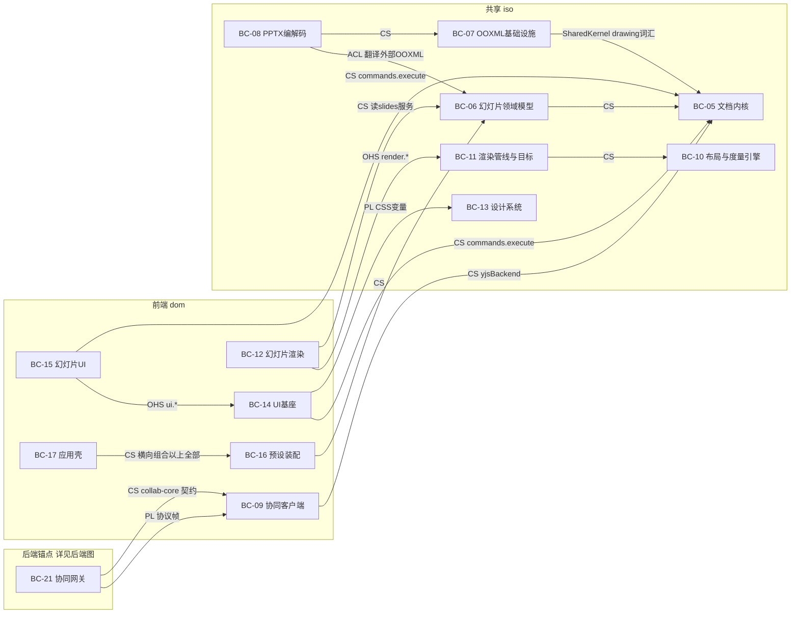

怎么读：前端 dom 与共享 iso 合并一图；`beanchor` 子图的 `bc21` 是后端图同名节点的重复引用，仅用于承接 `bc21→bc09` 的两条边——发布语言（协议帧）与 `server-collab` 对 `collab-core` Definition 契约的包依赖（不复用 Provider，rulings §4.18 FE-15）；边标签缩写同 §4.1（OHS开放主机服务、PL发布语言、ACL防腐层、CS客户供应方）；补充的 SharedKernel/yjsBackend/commands.execute/CSS变量/render.*/ui.* 等取自原 ASCII 标注的具体契约名与贡献点。

**后端上下文映射图**

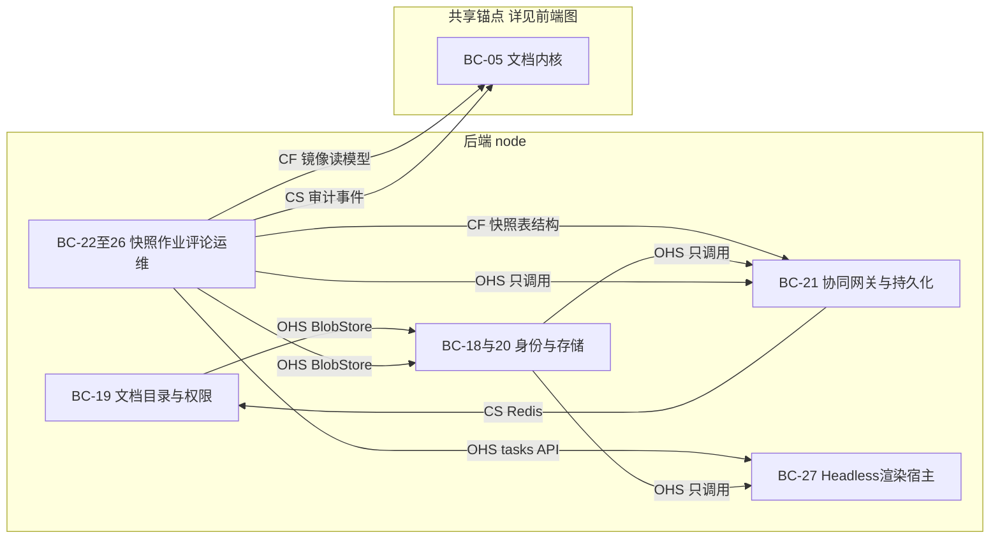

怎么读：`isoanchor` 子图的 `bc05` 是前端图同名节点的重复引用；`bcaux1`/`bcaux2` 沿用上方总图的聚合分组（`bcaux1`=BC-18与20，`bcaux2`=BC-22至26）；三条 `OHS 只调用` 边对应原 ASCII「Nest 模块整体只调用 server-collab/server-headless、不重实现业务逻辑」的汇总关系，与更具体的 CS/CF 边并存不冲突。

浏览器 SDK 范围为 BC-01…17；其中 iso 部分（BC-05/06/07/08/10/11/13 等）也被服务端 BC-27 的 headless Chromium 加载执行，是同一份客户端代码在两种进程里运行，并非另有一份实现。服务端 `apps/server` 内 BC-18…26 与 BC-30 是 Nest Module（纯 DI，非 cordis Fiber）；真正的 cordis 宿主是 BC-21 `server-collab` 与 BC-27 `server-headless`；BC-03 协议是前后端唯一跨进程契约，对应上方 `bc21 -- "PL 协议帧" --> bc09` 一边。

束间隔离（Separate Ways，铁律 2）：BC-06（bundle=slide）与 BC-29 的未来 model-doc/model-sheet（bundle=doc/sheet）互不 import，只共享 BC-02/05/07/10/11/13/14 等水平层。

**后端上下文映射细化图**

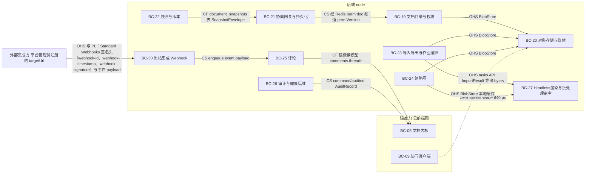

怎么读：与上两张图同向——箭头由下游指向上游，边标签为「关系类型 + 传递的契约」，逐条对应 §4.1 关系表的后端行；上方汇总图里 `bcaux1`/`bcaux2` 两个聚合节点在此拆回单个上下文，并补上汇总图未画的 BC-30。BC-18 在关系表中只以「BC-21/BC-27 → BC-18…26 只调用」一行出现，已由汇总图的 `OHS 只调用` 边表达，本图不重复。

依据：§4.1 关系表；rulings §4.13 S-4/S-5、§4.15 T-0/Q8。

**基座、协议与治理上下文映射图**

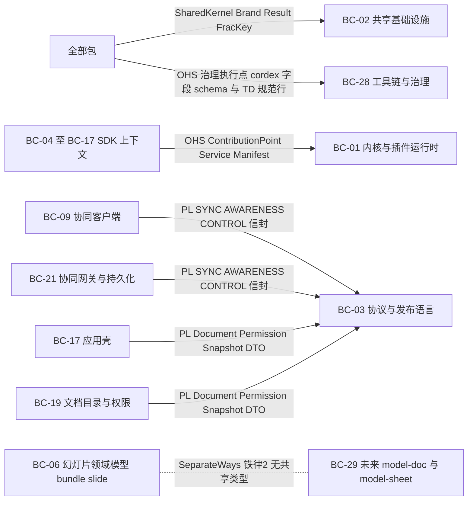

怎么读：箭头同样由下游指向上游；BC-02 与 BC-28 面向全部包，BC-01 面向 SDK 侧 BC-04…BC-17（BC-28 以治理身份间接消费）；BC-03 是前后端唯一的发布语言，分别承载协同帧（BC-09 ↔ BC-21）与 REST（BC-17 ↔ BC-19）两组跨进程契约；虚线无箭头表示 BC-06 与 BC-29 互不依赖，只共享水平层。

依据：§4.1 关系表前四行（BC-02、BC-01、BC-03 两行）与 Separate Ways、BC-28 两行；§4.2 第 1 条。

### 4.1 关系表

| 上游 | 下游 | 关系类型 | 防腐层落点（包/文件） | 传递的契约（类型或消息名） |
|---|---|---|---|---|
| BC-02 共享基础设施 | 全部包 | Shared Kernel | — | `Brand<T,Tag>`、`Result<T,E>`、`FracKey` |
| BC-01 内核 | BC-04…BC-17（间接及 BC-28 治理） | Open Host Service | `kernel/src/contribution/*.ts` | `ContributionPoint`、`Service`、`Manifest` |
| BC-03 协议 | BC-09 ↔ BC-21（前后端协同帧） | Published Language | `protocol/src/collab/{frame,control,awareness,close-codes}.ts` | SYNC/AWARENESS/CONTROL 信封 |
| BC-03 协议 | BC-17 ↔ BC-19（前后端 REST） | Published Language | `protocol/src/rest/*.ts` | Document/Permission/Snapshot DTO |
| BC-05 文档内核 | BC-06 幻灯片领域模型 | Customer–Supplier（下游 Conformist：垂直束无议价权） | `model-core/src/{unit,store,command,snapshot}/*.ts` | `DocumentType<S>`、`DocumentStore`、`CommandDef`/`MutationDef` |
| BC-05（store-yjs） | BC-09 协同（客户端） | Customer–Supplier | `store-yjs/src/services/yjs-backend.service.ts` | `YjsBackend`（`encodeStateAsUpdate`/`applyUpdate`/…） |
| BC-06 幻灯片领域模型 | BC-08 PPTX 编解码 | **Anticorruption Layer**（ooxml-pptx 是 OOXML 外部格式与领域模型之间的 ACL） | `ooxml-pptx/src/{import,export}/*.ts` | `PresentationBody` ↔ PresentationML XML |
| BC-07 OOXML 基础设施 | BC-08 PPTX 编解码 | Customer–Supplier | `ooxml-core/src/{opc,xml,drawingml}/*.ts` | `OpcPackage`、`XmlDocument`、DrawingML 编解码函数 |
| BC-02/BC-05（drawing 词汇） | BC-07 OOXML 基础设施 | Shared Kernel | `model-core/src/drawing/*.ts` | `Color`/`Fill`/`Line`/`Transform` 等值对象 |
| BC-10 布局与度量引擎 | BC-11 渲染管线与目标 | Customer–Supplier | `engine-layout/src/contracts/measurer.ts` | `TextMeasurer` Definition |
| BC-11 渲染管线与目标 | BC-12 幻灯片渲染 | Open Host Service（`render.*` 贡献点） | `engine-render/src/render.contribution.ts` | `SceneProvider`/`ElementRenderer` 契约 |
| BC-06 幻灯片领域模型 | BC-12 幻灯片渲染 | Customer–Supplier | `slide-render/src/scene/slide-scene-provider.ts` | `slides` 只读服务 API |
| BC-14 UI 基座 | BC-15 幻灯片 UI | Open Host Service（`ui.*` 贡献点） | `ui-core/src/ui.contribution.ts` | `ui.ribbon`/`ui.panel` 等 schema |
| BC-05（commands） | BC-14 UI 基座 | Customer–Supplier | `model-core/src/command/commands.service.ts` | `commands.execute()` |
| BC-13 设计系统 | BC-14/15/17 | Published Language | `design/theme.css` | shadcn 变量名、Cordex 扩展变量（`--glass-*`/`--layer-*`/`--duration-*`/`--ease-*`/`--control-h-*`/`--text-2xs` 等裸名；`--cordex-*` 前缀已作废） |
| BC-01/05/06/08/09/10/11/12/14/15（横向组合） | BC-16 预设装配 | Customer–Supplier（纯装配，不产生新语言） | `preset-slide/src/plugins/*.entries.ts`（文件布局见 11 §4） | 全部 Definition/Provider 清单 |
| BC-16 预设装配 | BC-17 应用壳 | Customer–Supplier | `apps/web/src/application/host/create-editor-host.ts` | `createSlidePreset(options)` 等工厂函数 |
| BC-09 协同（客户端） | BC-21 协同网关与持久化 | **Published Language** | `protocol/src/collab/*.ts` | SYNC/AWARENESS/CONTROL 二进制信封 |
| BC-09 协同（客户端）的 `collab-core` | BC-21 协同网关与持久化 | Customer–Supplier（只复用 Definition 契约） | `server-collab/package.json` 依赖 `@cordexjs/collab-core` | awareness 模型、权限检查点、房间状态机契约；不复用 `collab-yjs`/`collab-transport-ws` 等 Provider（rulings §4.18 FE-15） |
| BC-19 文档目录与权限 | BC-21 协同网关与持久化 | Customer–Supplier（经 Redis） | `apps/server/src/modules/documents/permissions/role-resolver.ts` | 频道 `perm:doc:{id}`、`permVersion` |
| BC-21 协同网关与持久化 | BC-22 快照与版本 | Conformist（快照 REST 依赖 server-collab 内部表结构） | `apps/server/src/modules/snapshots/*` | `document_snapshots` 表、`SnapshotEnvelope` |
| BC-27 Headless 渲染与批处理宿主 | BC-23 导入导出与作业编排 | Open Host Service（`tasks` API） | `server-headless/src/tasks/{import,export}.ts`（文档类型无关命名，经 `formats` 按 `documentType` 取 codec，rulings §4.18 FE-01） | `ImportResult`/导出 `bytes` |
| BC-27 Headless 渲染与批处理宿主 | BC-24 缩略图 | Open Host Service | `server-headless/src/thumbnails/thumbnail-renderer.ts` | 缩略图 WebP 字节（640 px，Q8） |
| BC-05（ResourceHook） | BC-25 评论 | Conformist（镜像读模型必须照单全收） | `apps/server/src/modules/comments/infrastructure/comment-mirror.observer.ts` | `resources['comments.threads']`（命名空间 `comments.*`，由 `@cordexjs/comments` 声明；2026-09-25 由 `slide-comments.threads` 改名，决策 INC-39：服务端镜像按 `comments.` 前缀识别、文档类型盲） |
| BC-05（事件） | BC-26 审计与健康运维 | Customer–Supplier | `apps/server/src/common/interceptors/audit.interceptor.ts` | `command/audited`、`AuditRecord` |
| BC-20 对象存储与媒体 | BC-19/23/24/09（本地缓存） | Open Host Service（`BlobStore`） | `server-storage/src/blob-store.ts` | `BlobRef`、`presignPut`/`presignGet` |
| BC-21（server-collab）/BC-27（server-headless） | BC-18…26（Nest Module） | Open Host Service（只调用，不重实现业务逻辑） | `apps/server/src/cordis-host/cordis-host.service.ts` | `openUnit`/`closeUnit`/`diagnostics()` |
| BC-06（bundle=slide） | BC-29（未来 bundle=doc/sheet） | **Separate Ways**（铁律 2 强制） | — | 无共享类型（除水平层 BC-02/05/07/10/11/13/14） |
| BC-28 工具链与治理 | 全部包 | Open Host Service（治理执行点，非业务契约） | `tooling/depcruise/*`、`tooling/eslint-config/*` | `cordex` 字段 schema、规范行 `TD-\d{3}` |
| BC-25 评论 | BC-30 出站集成（Webhook） | Customer–Supplier（模块内，评论事件触发投递，2026-09-21 新增，rulings §4.13 S-5） | `apps/server/src/modules/comments/application/mirror-comment-change.usecase.ts` | `DeliverWebhookEventUseCase.enqueue(event,payload)`（2026-09-24 删 `tenantId`，rulings §4.15 T-0） |
| BC-30 出站集成（Webhook） | 外部集成方（平台管理员注册的 `targetUrl`；2026-09-24 由「租户配置」改，T-0） | Open Host Service / Published Language（2026-09-21 新增，rulings §4.13 S-4/S-5） | `apps/server/src/modules/webhooks/infrastructure/{webhook-signer,webhook-delivery.processor}.ts` | Standard Webhooks 签名头（`webhook-id`、`webhook-timestamp`、`webhook-signature: v1,<base64>`，node:crypto 实现，rulings §4.21 q-webhook-sig）+ 事件 payload JSON schema（`rest/webhooks.ts`） |

### 4.2 五个必须明确的边界

1. **protocol 是前后端的 Published Language**：`@cordexjs/protocol` 是浏览器 SDK 与 NestJS 服务端之间**唯一**允许跨进程传递的契约来源；REST controller 的 `@Body()`、WS 帧编解码、错误码枚举全部只能引用 `z.infer<typeof X>`（`X` 来自 protocol），任何一方不得私自定义跨进程 DTO（08 §11、09-03 §3.3）——这条铁律同样覆盖 **Node 进程 ↔ headless Chromium 渲染页** 的契约（`RenderPageProtocol`），故 `render-page-protocol.ts` 须上移至 `protocol/src/render/page.ts`，由 M-09 与 M-11 共同 import（R-13/C-27）。
2. **codec（ooxml-pptx）是 OOXML 与领域模型之间的 ACL**：外部世界（PowerPoint 产出的 `.pptx`）的命名空间、id 分配、Strict/Transitional 差异全部在 `ooxml-pptx` 内被翻译为 `model-slide` 的归一化实体表；`model-slide` 从不出现 XML 类型，`ooxml-core`（BC-07）从不出现 `slide` 字面量——ACL 严格单向（04 §4/§5）。
3. **collab（BC-09）与 store-yjs（BC-05 内）的关系**：`store-yjs` 拥有 Y.Doc 并通过 `yjsBackend` 服务暴露**受控**的编解码面（`encodeStateAsUpdate`/`applyUpdate`/`onUpdate`），`collab-yjs` 只消费这个服务面、从不直接触碰 `Y.*` 类型（api-extractor 基线守护，06 §2.3）；因此「文档内核」与「协同」是两个不同的限界上下文，即使物理上共享同一个 Y.Doc 实例。
4. **render（BC-11/12）与 model（BC-06）的关系（对幻灯片无知如何做到）**：`engine-render`/`render-dom`（BC-11）只认识 `Scene`/`SceneNode{kind, bbox, transform, data}`，对 `slide` 一词一无所知；`slide-render`（BC-12）是唯一知道两边语言的适配层——它读 `slides` 服务（BC-06 的语言）产出 `Scene`（BC-11 的语言），`ChangeSet.touched` 到 `DirtySet` 的映射也由它完成。这使得未来 `doc-render`/`sheet-render` 可以在**不改**BC-11 一行代码的前提下接入。
5. **服务端 Nest 模块与 cordis 插件的边界**：Nest 的 `@Module`/`@Injectable`/`@Controller` 只负责 HTTP/WS 传输、DTO 校验、鉴权守卫、限流、审计拦截——这些是 BC-18/19/22/23/24/25/26 的全部内容，它们**不是** cordis Fiber，不参与 `ctx.plugin()` 树；真正的业务逻辑（Room 状态机、CRDT 校验、格式转换、渲染）活在 `server-collab`/`server-headless`（BC-21/27）两个 cordis 宿主里。唯二的例外是 charter D8/S7 明确允许的「IO 适配器以 cordis 插件形式放在 Nest 模块目录」：`apps/server/src/modules/collab/{redis-fanout.bus,redis-lease-lock,pg-update-store,pg-snapshot-store,authz-source}.ts` 是挂在 `server-collab` 契约上的 Provider，物理位置在 Nest 模块目录，逻辑上属于 BC-21，不属于「Nest 传输壳」本身。

---

## 5. 前后端切分

> 2026-09-25（rulings §4.19）：前端运行时总图与包在浏览器中的分工以 [50-frontend/01](../50-frontend/01-overview-and-runtime-map.md) 为准，服务端模块清单、进程角色与装配矩阵以 [60-backend/01](../60-backend/01-service-overview-and-roles.md) 为准；本节保留包级前后端切分。M2 起服务端文档内容以协同快照为唯一事实源（D-M2-CONTENT），浏览器端服务端文档一律经 `preset-slide-collab` 打开；评论客户端插件 `@cordexjs/comments` 只在浏览器（M3）。

**进程与契约图**

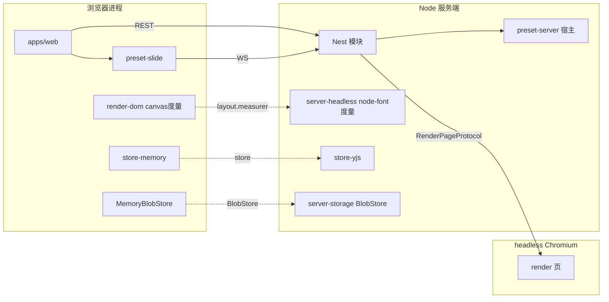

怎么读：三个进程之间的实线只经 `@cordexjs/protocol` 传递（REST／WS／RenderPageProtocol）；虚线连接同一个 Definition 在两端的不同 Provider，表示同名契约的两种实现，不是网络调用。

| 上下文 | 浏览器进程 | Node 服务端 | 两端共享（iso） |
|---|---|---|---|
| BC-01 内核与插件运行时 | 运行 | 运行 | ✓ 唯一实现，两端复用同一份 `@cordexjs/kernel` |
| BC-02 共享基础设施 | 运行 | 运行 | ✓ |
| BC-03 协议与发布语言 | 运行（生成/校验 DTO） | 运行（生成/校验 DTO） | ✓ |
| BC-04 国际化 | 运行 | 运行（服务端极少用，`server-headless` 诊断信息可选启用） | ✓ |
| BC-05 文档内核 | 运行 | 运行（`server-headless`/`server-collab` 加载同一份 `model-core`/`store-yjs` 源码） | ✓ |
| BC-06 幻灯片领域模型 | 运行 | 运行（导入/导出/校验/迁移全部经此；由 `apps/server` 的 `cordis-host/preset-server.ts` 装配进 `server-headless`/`server-collab` 宿主，二者自身不 import，rulings §4.18 FE-01） | ✓ |
| BC-07 OOXML 格式基础设施 | 运行 | 运行 | ✓ |
| BC-08 PPTX 编解码 | 运行 | 运行（同 BC-06，经 `preset-server.ts` 装配，`server-headless` 按 `documentType` 经 `formats` 取 codec） | ✓ |
| BC-09 协同（客户端） | **仅浏览器** | — | collab-core/yjs/transport-ws 为 iso 但只在浏览器场景实例化；服务端对应能力是 BC-21，`server-collab` 只依赖 `collab-core` 的 Definition 契约，不复用 `collab-yjs`/`collab-transport-ws` 等 Provider（rulings §4.18 FE-15） |
| BC-10 布局与度量引擎 | 运行 | 运行（`node-font` Provider） | ✓ Definition 层完全共享 |
| BC-11 渲染管线与目标 | 运行（render-dom 为 dom） | 间接运行（headless Chromium **是一个真实浏览器进程**，由服务端编排但仍执行 dom Provider，不是 Node 原生渲染） | engine-render 契约层 ✓；render-dom 实现体不共享（同构铁律 4：node 不得 import dom） |
| BC-12 幻灯片渲染 | 运行 | 间接运行（同上，经 headless Chromium） | 同 BC-11 |
| BC-13 设计系统 | **仅浏览器** | — | — |
| BC-14 UI 基座 | **仅浏览器** | — | — |
| BC-15 幻灯片 UI | **仅浏览器** | — | — |
| BC-16 预设装配 | **仅浏览器**（`preset-slide*`） | 服务端用等价但独立的 `preset-server` 插件束（08 §4.2），非同一包 | — |
| BC-17 应用壳 | **仅浏览器** | — | — |
| BC-18…26、BC-30（Nest 模块） | — | **仅服务端** | — |
| BC-27 Headless 渲染与批处理宿主 | — | **仅服务端**（但内部编排的 headless Chromium 是浏览器环境） | — |
| BC-28 工具链与治理 | 构建期（两端产物均受治理） | 构建期 | ✓（治理对象是两端代码） |
| BC-29 doc/sheet 扩展占位 | 未来两端共享（V-model/V-codec 为 iso） | 同左 | 部分 ✓（V-render/V-ui 为 dom，不共享） |

**上下文运行位置分布图**

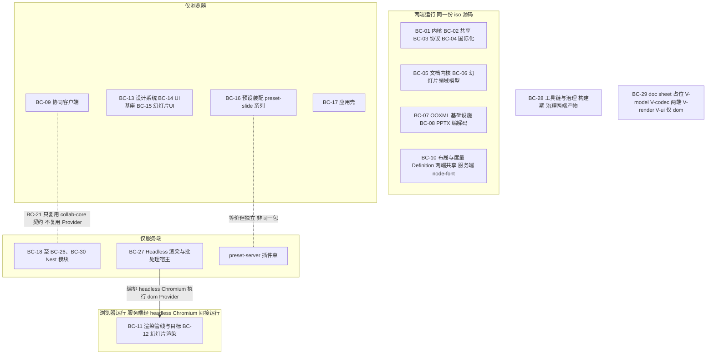

怎么读：四个分组对应上表「浏览器进程 / Node 服务端 / 两端共享」三列的组合；实线表示 BC-27 编排的 headless Chromium 是真实浏览器进程，BC-11/12 的 dom 实现体在其中运行而不被 node 包 import（同构铁律 4）；两条无箭头虚线是「服务端有对应物但不是同一份代码」的两处：预设装配（`preset-server` 与 `preset-slide*` 各自成包）与协同（BC-21 `server-collab` 依赖 BC-09 `collab-core` 的 Definition 契约，但不复用 `collab-yjs`/`collab-transport-ws` 等 Provider，rulings §4.18 FE-15）。

依据：本节上表与 §5.1；BC-30（webhooks，rulings §4.13 S-5）与 BC-18…26 同为 Nest 模块，装配角色见 `12-server-jobs-comments-and-ops.md` §7.1。

### 5.1 同一 Definition 在两端的不同 Provider

| Definition | 浏览器 Provider | 服务端 Provider | 说明 |
|---|---|---|---|
| `DocumentStore`（`store`） | `store-memory`（默认/查看器）或 `store-yjs`（协同） | `store-yjs`（`server-collab` 用，Room 即 Unit）或 `store-memory`（`server-headless` 校验/迁移任务用） | 两个 Provider 本身都是 `iso`，「哪端用哪个」取决于**用途**（是否需要 CRDT）而非运行环境本身 |
| `layout.measurer`（`TextMeasurer`） | `render-dom` 的 canvas 度量（`OffscreenCanvas.measureText`） | `server-headless` 的 `node-font`（Node 解析字体文件，标注「近似一致」）；**headless Chromium 渲染路径下仍用 canvas 度量**（因为 Chromium 本身是浏览器） | `node-font` 只用于服务端不启动 Chromium 的路径（如纯校验、`spAutoFit` 重排） |
| `BlobStore` | `MemoryBlobStore`（`model-core/testing`，仅测试/默认） | `ServerBlobStore`（`server-storage`：S3 协议〔自托管默认 SeaweedFS，§4.15 Q10〕/本地） | 浏览器侧没有持久 `BlobStore` Provider——媒体经 CRDT 只存 `BlobRef`，字节由服务端持有；`collab-offline-idb` 是 `OfflineStore` 而非 `BlobStore`，二者不可混淆 |

### 5.2 应用壳（apps/web）与 SDK 的边界

- **只能在应用壳**：登录页与 OIDC 回调、文档列表页、账户菜单、路由结构与品牌替换点、`/render` headless 渲染页的宿主 HTML；这些是「应用自身的页面」，章程 R2/rulings §4.3「设计-2」明确允许其存在。
- **必须在 SDK（`packages/*`）**：任何命令/模型/协同/渲染逻辑；Ribbon、缩略图侧栏、检查器、放映模式等编辑器内部 UI 属于 `slide-ui`（BC-15），**不得**下沉进 `apps/web`；`apps/web` 只在 `application/host/create-editor-host.ts` 一处调用 `createHost`/`createSlidePreset`，是仓库中唯一「知道插件存在」的应用代码（02 §3.1）。`apps/*` 可 import L7 呈现层组件（`@cordexjs/ui-react` 的 `UserMenu`/`Brand` 等壳组件，无 host 页面亦需），R9 `apps-only-assemble` 的判据是**不含领域定义**（禁 `defineCommand`/`defineMutation`/`ctx.contribute`），不是「只 import preset」（R-14）。

### 5.3 服务端 Nest 模块与内嵌 cordis 宿主 `preset-server` 的边界

Nest 模块（BC-18/19/20/22/23/24/25/26）只做传输、校验、鉴权、限流、审计——不得出现 `import '@cordexjs/model-*'`/`'yjs'`（depcruise `server-app-thin`，02 §3.2）；全部业务逻辑经 `preset-server`（插件清单以 60-backend/01 §9 为准，原 08 §4.2 已删：kernel 基础服务 Provider + model-core + store-yjs + model-slide + ooxml-core/pptx + engine-layout + server-collab + server-storage + server-headless）装配的 cordis 宿主完成。**进程间契约全部经 `@cordexjs/protocol`**（§4.2 第 1 条），浏览器与服务端不存在任何绕开 protocol 的私有通道。

---

## 6. 垂直束与 doc / sheet 扩展

**扩展结构图**

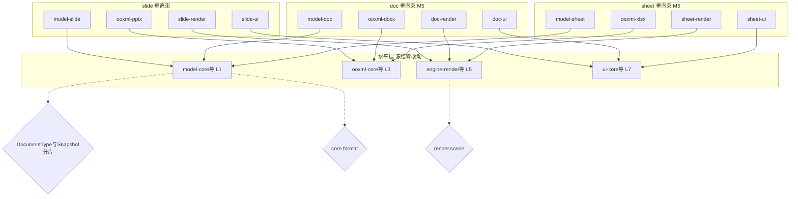

怎么读：水平层四个代表性包冻结不变，slide/doc/sheet 三列垂直束各自的四层带包箭头只单向指向水平层，不反向、也不跨列；三个菱形是 §6.3 已内建的参数化点（DocumentType 登记与 Snapshot 分片合并展示，因二者同属 model-core）。

### 6.1 每个上下文的 doc-sheet 通用性分类（汇总自 §3）

| 分类 | 上下文 |
|---|---|
| generic（水平层，doc/sheet 直接复用，理论零改动） | BC-01、BC-02、BC-03、BC-04、BC-05、BC-07、BC-09、BC-10、BC-11、BC-13、BC-14、BC-18、BC-19、BC-20、BC-21、BC-22、BC-23、BC-25、BC-26、BC-27、BC-28、BC-30（2026-09-21 新增，投递骨架对事件来源文档类型无知，rulings §4.13 S-5） |
| parametrized（骨架 generic，但输出内容随文档类型变化） | BC-24（缩略图内容） |
| vertical（bundle=slide，doc/sheet 各有平行实现） | BC-06、BC-08、BC-12、BC-15、BC-16（及其对应的 `apps/web` 编辑器路由部分） |
| 规划位（本身就是 doc/sheet 扩展的落点） | BC-29 |

> 注：BC-25（评论）由 parametrized 改判为 generic（R-15）——M-12/G-27 论证：锚点可变性由 `Anchor` 开放判别联合吸收，仓储/controller/观察者零分支；同时 §10 Q-M4 结案。

### 6.2 新增包与样板对照（12 §1/§3）

| 层带 | slide（既有） | doc（M5 新增） | sheet（M5 新增） | 样板关系 |
|---|---|---|---|---|
| V-model | `model-slide`（BC-06） | `model-doc` | `model-sheet` | 复制 `model-slide` 的目录结构（归一化实体表 + `mutations/` + `commands/` + `invariants/` + `testing/`），`body` 形状按各自领域重新设计（doc：`blocks` 有序序列；sheet：稀疏 `cells` 字符串键） |
| V-codec | `ooxml-pptx`（BC-08） | `ooxml-docx` | `ooxml-xlsx` | 复制 `import/`/`export/` 目录切分与 `conformance.ts` 策略；**必须**复用 `ooxml-core`（BC-07）的 OPC/XML/DrawingML/不透明保留引擎，不得重新实现 |
| V-render | `slide-render`（BC-12） | `doc-render` | `sheet-render` | 复制 `SceneProvider` 实现模式（`build`/`diff`/`classify`），复用 `engine-render`/`engine-layout`/`render-dom` 契约（BC-10/11） |
| V-ui | `slide-ui`（BC-15） | `doc-ui` | `sheet-ui` | 复制 `ui.*` 贡献点用法与 `styles/index.css` 约定，复用 `ui-core`/`ui-react`（BC-14） |
| L8 | `preset-slide*`（BC-16） | `preset-doc` | `preset-sheet` | 复制 11 §4 的文件布局（`preset.ts`、`entries.ts`、`config/options.ts`、`plugins/*.entries.ts`）；`package.json#cordex` 写 `compositionRoot:true` 与 `bundle:'doc'`/`'sheet'`（rulings §4.18 FE-01、FE-12） |
| **重型可选特性隔离** | `slide-render-chart`（BC-12 内） | doc 的公式渲染 | sheet 的数据透视表渲染 | 复制「M1–M2 以主包惰性子路径存在（`@cordexjs/slide-render/chart`，主包只含占位渲染器，rulings §4.18 FE-08）→ M3 拆为独立惰性插件 → `conflict:'replace'` 覆盖默认占位」的拆包套路，见 `40-modules/07` §3/§4.2/§8（R-16/M-07/G-8） |

### 6.3 已内建的四处参数化点（12 §2 标注 ⚠，扩展前必须复核）

1. `layoutTextBody` 需支持「给定高度上限，返回可放入的行数与剩余」（分页基础）——BC-10。
2. `ViewDescriptor` 保留开放扩展字段 `[k: string]: unknown`——BC-11（已满足，02 §4.14）。
3. `ui.*` 贡献点的 `slot` 为开放字符串而非枚举——BC-14（已满足）。
4. `SnapshotBundle` 保留 `body` 的 `$ref: BlobRef` 分片扩展点（应对 sheet 巨大 `cells` 表）——BC-05（已满足，12 §3.3）。

### 6.4 必须零改动的水平层文件

按 12 §4.4「冻结层」机制：`tooling/scripts/scan-horizontal-freeze.ts`（路径遵 09-06 的 `scripts/` 落点；**当前仅骨架占位**，不计入「十四个扫描器缺一不可」，纳入后为第 15 个、需追加 09-06 §19（§18 已由 rulings §4.17 D3 的 `scan-doc-access-via-permission` 占用），见 `40-modules/01` §13 Q-01、R-17）对**全部无 `cordex.bundle` 字段且非组合根的包**（即上表 generic 分类的 BC-01/02/03/04/05/07/09/10/11/13/14/20/21/27/28 对应包的全部 `src/**`，含 `server-storage`/`server-collab`/`server-headless`，以及 2026-09-26 新增的 `@cordexjs/xml` 的 `src/**`（BC-07 的格式盲 XML 层，ADR-0019），排除 `__tests__/`；`compositionRoot:true` 的 `preset-*`、`apps/web`、`apps/server`〔含 BC-18…26、30 的 Nest 模块与 `cordis-host/preset-server.ts`〕是新增文档类型的装配点，不冻结，rulings §4.18 FE-01、ADR-0016 同步）计算内容哈希并写入 `fixtures/horizontal-freeze.lock`；M5 的 `model-doc`/`model-sheet` PR 要求锁文件**无 diff**，确需改动须附 ADR 并显式更新锁文件。

### 6.5 扩展验收口径（引用 12 §4/§5）

| 层 | 检查 | 机制 |
|---|---|---|
| 静态层 | 水平层零横向依赖；水平层无文档类型字面量 | depcruise `cordex-doc-type-blind`；lint `no-doc-type-literals`（12 §4.1） |
| 夹具层 | `fixture` 文档类型（BC-29 现存部分）验证水平层可被非 slide 类型驱动 | `model-core/testing/fixture-document-type.ts`（12 §4.2） |
| 运行时层 | 同时打开 `fixture` 与 `fixture-grid`（模拟 sheet）互不干扰；移除类型后打开返回 **`format.no_document_type`**（R-18/C-16；ADR-0016 的 `format/no-document-type` 拼写一并改） 且宿主仍健康 | `preset-blind.test.ts`（12 §4.3） |
| 冻结层 | 见 §6.4 | `scanners` job 的 `scan-horizontal-freeze` 步骤（M5 起运行；12 §4.4，M5 验收；CI job 名维持 13 个封闭集合，rulings §4.18 GV-14） |
| 总验收 | `model-doc`/`model-sheet` 骨架各自通过：`DocumentType` 注册 + 3 个 Mutation + 2 个命令 + 编解码 + `SceneProvider` 渲染；depcruise 报告零横向依赖；同一 host 同时打开 slide+doc+sheet 三个 Unit 互不影响 | 12 §5 |

---

## 7. 阶段二模块清单（逐个规划的单元）

> **批次语义说明**：批次按章程 §5.1 秩表分三个粗粒度波次划分——批次 1 ≈ 秩 0–15（L0/L1/V-model，内核与文档地基）、批次 2 ≈ 秩 30–58（L3–LS，格式/协同/渲染引擎/服务端基础设施）、批次 3 ≈ 秩 70–80（L7/V-ui/L8，UI/装配/应用/服务端运维）。「批次内互不依赖可并行」是**目标**而非对每一对模块的绝对保证：跨秩差较大的同批模块（如批次 2 内 M-04 依赖 M-03、M-09 依赖 M-04/M-06）仍存在真实上游关系，具体先后以「上游模块」列为准；批次的作用是提示「至少要等哪一波全部完成才能定稿评审」，同批次内允许错峰开工。模块数量 13 个，落在 10–14 目标区间内。

**包与插件数**（2026-10-01，数字源为 [`_tools/plugin-counts.json`](../_tools/plugin-counts.json)）：本表 M-01…M-13 与后补的评论客户端（[40/20](./20-comments-client.md)）覆盖章程 §5.2 的 31 个 M1–M4 npm 包（另 2 个 M5 包）与 `apps/web`、`apps/server` 两个应用；它们承载 78 个运行时插件单元（48 个 cordis 可插拔单元 + 5 个纯库 + 25 个 Nest 模块），逐模块单元数与行号见 [16](./16-plugin-catalog.md) §2「按承载模块分布」，逐包对应见 16 §2.1。

| 模块编号 | 模块名与输出文件 | 覆盖上下文 | 覆盖的包与目录 | 上游模块 | 下游模块 | 规划 agent 必读输入 | 关键决策与约束 | 批次 | 预计文件数量级 | 文件数口径（R-23） |
|---|---|---|---|---|---|---|---|---|---|---|
| M-01 | 工具链与治理骨架 `docs/40-modules/01-tooling-and-governance.md` | BC-28 | `tooling/{tsconfig,eslint-config,depcruise,api-extractor,scripts,policy,xsd,changeset-config}/**`（manifest-gen 即 `scripts/scan-manifest.ts`，14 个扫描器与 4 个治理检查脚本均在 `scripts/`，M-01 D-1；与 README 索引一致）；根 `lefthook.yml`/`.dependency-cruiser.cjs`/`biome.json`/`.changeset/config.json` | 无（唯一无上游模块） | 全部（M-02…M-13） | charter §3、§5.3、§5.4；09-type-discipline `README.md` 全篇 + `01`…`09` 全部 9 个子文档；`adr/0040`–`0048` | 秩表 `LS=58` 与 `V-*` 层带定稿口径；`package.json#cordex` schema；八条 depcruise 规则 + 十四个扫描器缺一不可（第 14 个为 `scan-doc-access-via-permission`，rulings §4.17 D3）；ratchet 预算只减不增；CI 无 `--quiet` | 1 | 60–90 | 含测试，无机械生成复制件 |
| M-02 | 内核、协议与文档内核 `docs/40-modules/02-kernel-protocol-and-document-core.md` | BC-01、02、03、04、05 | `@cordexjs/kernel`、`@cordexjs/shared`、`@cordexjs/protocol`、`@cordexjs/i18n`、`@cordexjs/model-core`、`@cordexjs/store-memory`、`@cordexjs/store-yjs` | M-01 | M-03…M-13（几乎全部） | charter §4 全部术语、§5.2 对应包行；30-architecture `01-overview.md` 全篇；`03-kernel-and-plugin-model.md` 全篇；`04-document-model.md` §1、§2、§7–§9；`05-command-and-history.md` 全篇；`02-layering-and-packages.md` §4.1–4.7；rulings §4.1（C-4/C-7） | 唯一 import cordis 的边界（R12）；贡献项 schema 校验失败走诊断而非抛错；`Mutation` 禁止 `inverse` 字段；`StoreOp` 五种原语无 `move`；`UnitScope` 隔离服务集固定 | 1 | 200–240 | 含根模板/测试，无机械生成复制件 |
| M-03 | 幻灯片领域模型 `docs/40-modules/03-slide-domain-model.md` | BC-06 | `@cordexjs/model-slide` | M-02 | M-04、M-07、M-10、M-11、M-13（作为样板） | charter §5.2 `model-slide` 行；`04-document-model.md` §3、§4、§6、§8、§9、§12 全篇；`05-command-and-history.md` §13；`02-layering-and-packages.md` §4.8；rulings §4.10（Q11 `reassignTo` 语义） | 归一化实体表 + `FracKey` 排序（无数组下标）；`deleteLayout`/`deleteMaster` 的 `reassignTo` fail-closed 语义（Q11）；占位符「缺省即继承」；`OpaqueXml`/`extensions` 槽覆盖全部实体 | 1 | 90–110 | 含测试，无机械生成复制件；命令表因 C-03 追加 14 条目后仍在区间内 |
| M-04 | OOXML 格式与 PPTX 编解码 `docs/40-modules/04-ooxml-format-and-pptx-codec.md` | BC-07、08 | `@cordexjs/xml`（L0，generic，格式盲的 XML 词法、保真树与序列化；2026-09-26 新增，rulings §4.21 X:q-xml-package、ADR-0019）、`@cordexjs/ooxml-core`、`@cordexjs/ooxml-pptx` | M-02、M-03 | M-07（`slide-render` 只读解析 chartml 与 `dsp:drawing`，C-28/§4.15 Q7）、M-09、M-12、M-13（`ooxml-core` 运行时依赖；`ooxml-pptx` 作为样板） | `04-document-model.md` §1、§4（全部映射表）、§5、§9 注（DrawingML 归属决策）；`02-layering-and-packages.md` §4.9、§4.10；charter §6.1 D7/Q14；rulings A-3/PD-03（Q14 Strict 三案） | Strict 写回「C 为目标、B 为自动回退」；zip 写入确定性（SV-02 导出字节级一致的前提）；`ZipLimits` 安全上限；元素级保留（CS-06） | 2 | 85–100 | 含测试，无机械生成复制件（R-23：由 70–90 上修） |
| M-05 | 协同（客户端） `docs/40-modules/05-collaboration-client.md` | BC-09 | `@cordexjs/collab-core`、`@cordexjs/collab-yjs`、`@cordexjs/collab-transport-ws`、`@cordexjs/collab-offline-idb` | M-02 | M-09（`server-collab` 依赖 `collab-core` 契约）、M-11 | `06-collaboration.md` 全篇（§0–§18）；charter §4.2 术语；`adr/0020`、`0023`、`0024`、`0025`、`0032`、`0033`；`02-layering-and-packages.md` §4.11、§4.12、§4.12b | `yjsBackend` 是唯一受控访问面（禁止 `Y.*` 类型外泄）；撤销只回滚本地 `origin`；12 种软冲突场景需 fuzz 覆盖；`OfflineStore` 缺失时降级为内存队列。**M-09 的 `server-collab` 依赖本模块 `collab-core` 的 Definition 契约（awareness 模型、权限检查点、房间状态机契约），不复用 `collab-yjs`/`collab-transport-ws` 等 Provider；帧格式另经 `@cordexjs/protocol`，两端需协议帧版本一致（rulings §4.18 FE-15）** | 2 | 70–90 | 含测试，无机械生成复制件 |
| M-06 | 布局与渲染引擎 `docs/40-modules/06-layout-and-render-engine.md` | BC-10、11 | `@cordexjs/engine-layout`、`@cordexjs/engine-render`、`@cordexjs/render-dom` | M-02 | M-07、M-09、M-10、M-11、M-13（`render.*` 契约与 `engine-layout` 运行时依赖） | `07-rendering.md` 全篇（§0–§14）；`adr/0021`、`0026`、`0027`、`0028`；`02-layering-and-packages.md` §4.13、§4.14、§4.15 | `engine-render` 对 `model-*` 零依赖（R15）；`DirtySet` 必须被消费（A28 反制测试）；三处 LRU 必须有淘汰测试（A29；**模块内三处** = `StyleCache`/`MediaCache`/`measure-cache`，不含 M-07 的 `LayerTemplateCache`，系统级共四处，见 R-19/C-12）；文本编辑用隐藏 `textarea` + 自绘光标（ADR-0028） | 2 | 90–110 | 含测试（含三处 LRU 淘汰测试），无机械生成复制件 |
| M-07 | 幻灯片渲染 `docs/40-modules/07-slide-rendering.md` | BC-12 | `@cordexjs/slide-render`、`@cordexjs/slide-render-chart` | M-03、M-04（`ooxml-core` 只读解析，C-28/§4.15 Q7）、M-06 | M-10、M-11、M-13（作为样板） | `07-rendering.md` §4 全篇、§14.1（术语对齐）、§14.4（图表）；`04-document-model.md` §12.4（母版视图渲染契约）；`02-layering-and-packages.md` §4.16、§4.16b；charter D16 | M1–M2 图表只读解析、M3 拆包 `slide-render-chart`；母版视图 `ViewDescriptor{mode:'master',target}`；缩略图三种 Provider 策略取舍；**含 1 处模板 LRU（`LayerTemplateCache`），与 M-06 三处合为架构 07 §11 的系统级缓存集**（R-20/C-12） | 2 | 70–85 | 含测试（含 1 处模板 LRU 淘汰测试），无机械生成复制件（R-23：由 50–70 上修） |
| M-08 | 服务端身份、文档与对象存储 `docs/40-modules/08-server-identity-documents-and-storage.md` | BC-18、19、20 | `apps/server`（`modules/{auth,users,documents,permissions,share-links,storage,media}`；2026-09-24 删 `tenants`/`groups`，rulings §4.15 T-0 / U-11 推迟）、`@cordexjs/server-storage` | M-02 | M-09、M-12 | 60-backend/01 §3（模块清单；文件级以 M-08 §4 为准，`db/` 等公共件见 M-12 §4.13）、60-backend/02（鉴权链）、60-backend/04 §6、§7（存储与媒体上传）、60-backend/09 与 60-backend/10（`users`/`user_identities`/`documents`/`permissions`/`media_blobs` 表）、60-backend/14 §5–§6（对象存储布局）；`02-layering-and-packages.md` §4.23；PRD `06-server-and-ops.md` SV-06、SV-08 | fail-closed 双点（REST guard + WS）+ 文档级 Postgres RLS（M3 出口）；按文档读写须经权限服务（`DocAccess`，扫描器 `scan-doc-access-via-permission`，取代原「租户隔离」，§4.15 T-0 / Q6）；外置 OIDC、服务端不持有密码；预签名直传（≥10 MB 分片）；SVG 消毒 | 2 | 100–125 | 含测试，无机械生成复制件（R-23：由 80–100 上修） |
| M-09 | 服务端协同网关与 Headless 宿主 `docs/40-modules/09-server-collab-gateway-and-headless-host.md` | BC-21、22、27 | `apps/server`（`modules/{collab,snapshots}`、`cordis-host/**`（含 `adapters/`，物理归属本模块，见 R-21/C-10））、`@cordexjs/server-collab`、`@cordexjs/server-headless` | M-02、M-04、M-05（`collab-core` 契约）、M-06、M-08 | M-12 | 60-backend/01 §3、§9、§10（模块、宿主生命周期）；60-backend/05 §2、§4、§5（server-collab、容量、扇出）；60-backend/06 §7–§10（导出、server-headless、renderer）；60-backend/11（`document_updates`/`document_snapshots`）；60-backend/16 §11、§13；`06-collaboration.md` §5、§9、§11；`07-rendering.md` §10；`02-layering-and-packages.md` §4.22、§4.24；`adr/0022`、`0023`、`0025`、`0026`、`0034`、`0035` | 硬门禁/软门禁两级校验；Redis 扇出不要求房间亲和；`server-headless` 不得 `import render-dom`（同构铁律 4）；快照 `kind` 枚举固定；`server-headless` 文档类型盲，不 import `model-slide`/`ooxml-pptx`，slide 束由 `apps/server` 的 `cordis-host/preset-server.ts` 选定插件清单交 `createHeadlessHost({ plugins })` 挂载（rulings §4.18 FE-01）。**依赖 M-05 的 `collab-core` 契约（不复用其 Provider），帧格式另经 `@cordexjs/protocol`（rulings §4.18 FE-15）** | 2 | 90–110 | 含测试；102 为实测文件数，独立统计口径，与其余模块不可直接比较（§8 Q-M5 结案） |
| M-10 | UI 基座与幻灯片 UI `docs/40-modules/10-ui-shell-and-slide-ui.md` | BC-13、14、15 | `@cordexjs/design`、`@cordexjs/ui-core`、`@cordexjs/ui-react`、`@cordexjs/slide-ui` | M-02、M-03、M-06、M-07（间接 M-05） | M-11、M-13（`ui-core`/`ui-react` 运行时依赖；`slide-ui` 作为 doc-ui / sheet-ui 样板） | `02-layering-and-packages.md` §4.17–4.20；`03-kernel-and-plugin-model.md` §3.6（`when` 上下文键）；rulings §4.6–4.8（母版视图/shadcn/iOS 27 现代化裁决）；`05-command-and-history.md` §13.3（`view.setMode`）；`adr/0017` | `ui-core` 禁止 `import react/radix/tailwind`（R14）；shadcn 复制件只能被 `ui-react`/`*-ui`/`apps/*` 引用（R17）；`viewMode` 上下文键驱动 Ribbon 页签切换 | 3 | 160–180 | 含 45 个机械生成 shadcn 复制件（单列，不与其余模块同口径比较）；含测试（R-23：由 110–140 上修） |
| M-11 | 预设装配与应用壳 `docs/40-modules/11-preset-assembly-and-app-shell.md` | BC-16、17 | `@cordexjs/preset-slide`、`@cordexjs/preset-slide-collab`、`@cordexjs/preset-slide-viewer`、`apps/web` | M-02、M-03、M-05、M-06、M-07、M-10 | 无（终端模块） | `02-layering-and-packages.md` §3.1、§4.21、§4.21b；`03-kernel-and-plugin-model.md` §9（preset vs loader）；charter §5.2 `apps/web` 行；rulings §4.9/§4.10（应用栏「⋯」菜单/账户头像/开始页） | `preset-slide-viewer` 两道机械只读保证（ADR-0015）；`apps/web` 零编辑器领域逻辑（`apps-only-assemble`）；查看器体积 ≤ 350 KB gzip | 3 | 150–170 | 含 59 个测试文件（单列，不与其余模块同口径比较）；不含机械生成复制件（R-23：由 60–80 上修） |
| M-12 | 服务端作业、评论与运维 `docs/40-modules/12-server-jobs-comments-and-ops.md` | BC-23、24、25、26、30（BC-30 为 2026-09-21 新增，rulings §4.13 S-5；BC-25 自 2026-09-25 含客户端插件） | `@cordexjs/comments`（2026-09-25 新增 iso 客户端插件，rulings §4.19 D-COMMENTS-PKG；包级规划见 [`20-comments-client.md`](20-comments-client.md)（占位，正文 M3 开工前补齐，§10 Q-M8 已确认，rulings §4.20 FE-09））、`apps/server`（`modules/{import-export,jobs,thumbnails,comments,audit,health,metrics,internal,webhooks,telemetry}`、`common/*`、`config/*`、应用骨架与基础设施 `src/{main.ts,app.module.ts}` 与 `src/{observability,redis,db}/**`（含 `db/migrations/*.sql`，2026-09-25 审稿登记，M-12 §4.13）、`cordis-host/adapters/*`（引用，非新增；物理归属 M-09，见 R-22/C-10）） | M-08、M-09 | 无（终端模块） | 60-backend/01 §3（模块清单；文件级以 M-12 §4 为准）、60-backend/06 §1–§4（队列与作业）、60-backend/07 §1（评论镜像）、60-backend/12 与 60-backend/13（`job_runs`/`audit_log`/`comments`/`thumbnails` 表）；PRD `06-server-and-ops.md` SV-01、SV-02、SV-04、SV-07、SV-10、SV-15；`adr/0026`、`0030`、`0031` | 评论表是读模型、事实源在客户端 CRDT；审计表只追加（数据库角色无 UPDATE/DELETE）；BullMQ 幂等键约定；Webhook 出站默认拒绝私网/回环/链路本地/云元数据地址（rulings §4.13 S-4） | 3 | 70–90 | 含测试，无机械生成复制件 |
| M-13 | doc/sheet 扩展骨架 `docs/40-modules/13-doc-sheet-extension-skeleton.md` | BC-29 | 现存：`@cordexjs/model-core`（`testing/fixture-document-type.ts`，只读引用）；M5 新建：`@cordexjs/model-doc`、`@cordexjs/ooxml-docx`、`@cordexjs/doc-render`、`@cordexjs/doc-ui`、`@cordexjs/preset-doc`（追加建议）、`@cordexjs/model-sheet`、`@cordexjs/ooxml-xlsx`、`@cordexjs/sheet-render`、`@cordexjs/sheet-ui`、`@cordexjs/preset-sheet`（追加建议） | 运行时：M-02（`core.*` 贡献点与 `DocumentType`/Snapshot/夹具）、M-04（`ooxml-core`）、M-06（`render.*` 契约、`engine-layout`）、M-10（`ui-core`/`ui-react`，`ui.*`）；样板参照（非运行时依赖，铁律 2 禁止真实 import）：M-03、M-07、M-11、`ooxml-pptx`、`slide-ui`（rulings §4.18 FE-16） | 无（终端模块） | `12-extension-to-doc-and-sheet.md` 全篇；charter §5.1（垂直束网格）；`02-layering-and-packages.md` §4.8（`model-slide` 作为样板）；`adr/0016` | 水平层零改动（`horizontal-freeze` 无 diff）；束间隔离（不得 `import model-slide` 等）；M5 验收清单（12 §5） | 3 | 90–120 | 骨架占位估算，M5 落地前非精确值（R-23：由 40–60 上修） |

**模块依赖图**

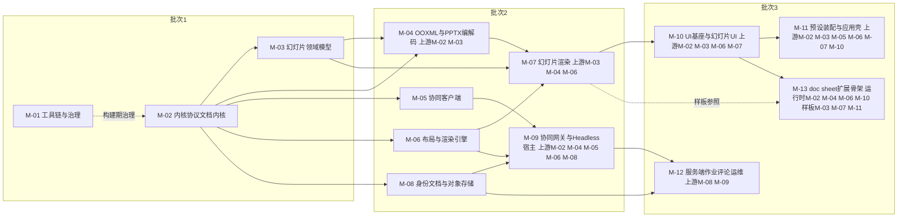

怎么读：三个批次自上而下对应章程秩表的粗粒度波次；实线是真实包依赖，虚线是 M-01 的构建期治理关系与 M-13 的样板参照关系（非 import）；节点标签写全「上游」列清单，图中箭头只画代表性的一至两条。M-13 的上游分运行时（M-02、M-04、M-06、M-10）与样板（M-03、M-07、M-11）两类，各画一条代表边（rulings §4.18 FE-16）；M-04 → M-07（`slide-render` 只读解析 `ooxml-core`）与 M-05 → M-09（`server-collab` 依赖 `collab-core` 契约）按 FE-14、FE-15 补齐。

**批次 2 模块完整上游图**

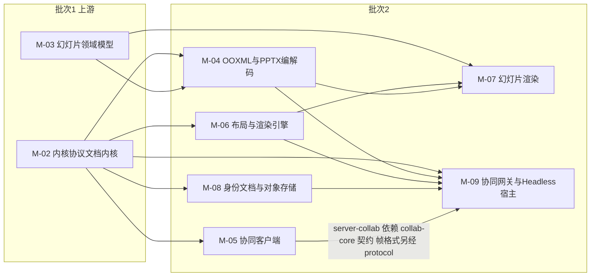

怎么读：箭头由上游指向下游，逐条对应上表批次 2 各行「上游模块」列，不再省略（上一张图省略的 M-02 → M-09、M-04 → M-09 在此补齐）。M-04 → M-07 是 `slide-render` 对 `ooxml-core` 的只读解析依赖（C-28、rulings §4.15 Q7）；M-05 → M-09 是 `server-collab` 对 `collab-core` Definition 契约的包依赖，不复用 `collab-yjs`/`collab-transport-ws` 等 Provider，帧格式仍以 `@cordexjs/protocol` 为唯一事实源（rulings §4.18 FE-14、FE-15）。批次 1 内部只有 M-01 → M-02 → M-03 一条链，已由上一张图完整表达。

依据：本节上表 M-04…M-09 行。

**批次 3 模块完整上游图**

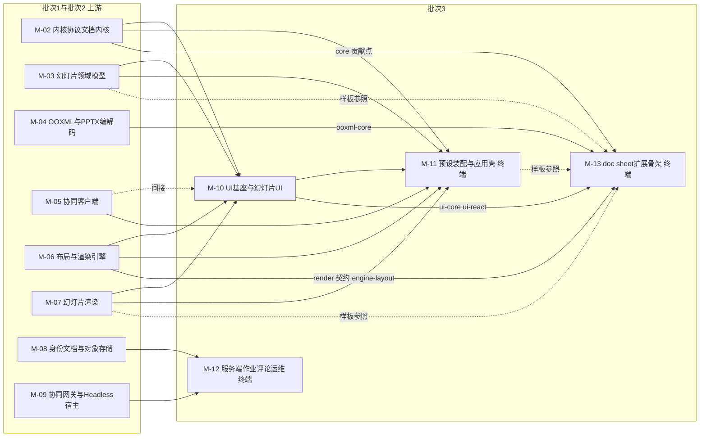

怎么读：实线为真实包依赖、逐条对应上表批次 3 各行「上游模块」列；M-10 的「间接 M-05」画虚线箭头。M-13 的上游按贡献点与水平层包的定义方分为两类：运行时依赖画实线（`core.*` 来自 M-02、`ooxml-core` 来自 M-04、`render.*` 与 `engine-layout` 来自 M-06、`ui.*` 与 `ui-core`/`ui-react` 来自 M-10），样板参照画虚线（M-03、M-07、M-11 及 `ooxml-pptx`、`slide-ui`，铁律 2 禁止真实 import；rulings §4.18 FE-16）。

依据：本节上表 M-10…M-13 行。

---

## 8. 与现有文档的差异与追加建议

| # | 涉及文档 | 差异/发现 | 追加建议（不直接生效） | 结案状态（R-24） |
|---|---|---|---|---|
| G-1 | `02-layering-and-packages.md` §4.22 vs 章程 §5.2（已按 rulings S8 采纳）与原 30/08 篇 §3.1（已撤销，现 60-backend/05 §2） | 02 §4.22 标题仍写「`@cordexjs/server-collab` — LS · node · **library**（与 Nest 解耦）」；章程 §5.2 表格已把 server-collab 描述为「cordis 插件（提供 `collabServer`）」，08 §3.1 标题也已写「node；cordis 插件，提供 `collabServer` 服务」。三份文档对同一个包的 cordis 形态标注不一致 | 建议 02 §4.22 标题回写为「`@cordexjs/server-collab` — LS · node · **library + plugin**（既是可被 Nest 解耦调用的函数库，又通过 `plugin.ts` 提供 `collabServer` 服务）」，与 08 §3.1 的 `plugin.ts`/`provide=['collabServer']` 骨架保持一致；本文档 §3 BC-21 已按「plugin + provider」表述，不受此影响 | **结案**：已由 M-09/G-18 落地（`server-collab` = library + plugin），见 §8 R-24 |
| G-2 | `02-layering-and-packages.md` §4.0.1 vs `09-type-discipline/03-boundaries.md` §2 | 02 §4.0.1 给出的 `package.json#cordex.role` 枚举是 `library\|plugin\|definition\|provider\|bundle\|app\|tooling`（7 值）；09-boundaries §2 给出的**同一字段名** `role` 枚举却是 `definition\|provider\|consumer\|n/a`（4 值）。两份文档字面上给了不同的合法取值集合，若照字面实现会冲突 | 建议二者显式声明为「同一物理字段、两级折叠」关系：包在 `package.json` 中按 02 的 7 值之一标注（面向人类与 `create-package` 脚手架）；`depcruise` 的三角色规则（09-boundaries §3.5）读取时按固定映射折叠为 4 值——`definition→definition`、`provider→provider`、`library\|plugin\|bundle\|app\|tooling→consumer`（除非该包同时是某 Definition 的 Provider，如 kernel 自身）。建议在 09-boundaries §2 补充这张折叠表，而非让读者误以为需要在 `package.json` 里同时维护两套取值 | **结案**：采纳折叠表（`definition→definition`、`provider→provider`，其余`→consumer`，除非该包同时是某 Definition 的 Provider），见 §1 C-11、§10 Q-M1、§8 R-24 |
| G-3 | 章程 §5.1 网格、`12-extension-to-doc-and-sheet.md` | 章程 §5.1 的垂直束网格只列出了 V-model/V-codec/V-render/V-ui 四个层带各自的 doc/sheet 包名（`model-doc`/`ooxml-docx`/`doc-render`/`doc-ui`；`model-sheet`/`ooxml-xlsx`/`sheet-render`/`sheet-ui`），**未列出 L8 装配层**对应的 `preset-doc`/`preset-sheet` 包名 | 追加建议：在章程 §5.1 的 L8 行或 §5.2 包清单为 doc/sheet 预留 `@cordexjs/preset-doc`、`@cordexjs/preset-sheet`（结构与 `@cordexjs/preset-slide` 对称），避免 M5 开工时才现造包名；本文档 §6.2/§7（M-13）已按此假设列出，标注「追加建议」 | **结案**：采纳 `preset-doc`/`preset-sheet` 无后缀包名，用 `package.json#cordex.stability:'experimental'` 标未完工，见 §1 C-19、§10 Q-M2、§8 R-24 |
| G-4 | `12-extension-to-doc-and-sheet.md` §1/§2 | 12 号文档的 generic/parametrized/vertical 三分类原本只讨论 `packages/*` 水平层包（L0/L1/L3/L4/L5/L7/LS）对 doc/sheet 的通用性；本文档 §3/§6.1 把该分类**外推**到了两个纯后端 Nest 模块限界上下文（BC-24 缩略图、BC-25 评论），因为它们的骨架通用、但产出内容随文档类型变化 | 建议 12 号文档未来补一小节「服务端上下文的 doc/sheet 通用性」，把这一外推正式收编；当前不影响 12 号文档已有结论，仅记录分类应用范围的扩展 | **结案**：采纳（12 号文档补服务端小节），见 §8 R-24 |
| G-5 | 章程 §4 术语表 | 本文档 §1 使用的限界上下文、聚合、领域事件、仓储、应用服务、防腐层、发布语言、共享内核、开放主机服务、客户方-供应方、遵奉者等 DDD 标准词汇，均为软件工程行业通用术语（非本项目自造），章程 §4 未收录 | 不建议强制回写章程 §4（章程术语表定位是「本项目自造或收窄语义的词」，DDD 通用词汇不属此类）；若总编排认为需要统一入口，可在本文件顶部新增「方法论术语」小节并被后续 40-modules 文档引用，无需动章程 | **结案**：驳回（DDD 通用词汇不属章程 §4 收录范围），见 §8 R-24 |

---

**2026-09-25 回写（rulings §4.19）**：§0 水平层网格图补 `comments` L4 iso 节点（27 个节点）；§3 BC-25 扩为「客户端插件 `@cordexjs/comments`（事实源）+ 服务端镜像」并改判 generic，BC-09 发布事件删 `collab/backpressure`、`collab/latency`（改指标 / 遥测专用事件，INC-33）；§4 关系表与图中 ResourceHook 命名空间 `slide-comments.threads` → `comments.threads`（INC-39）；§5 前后端切分加事实源链接 50/01、60/01；§7 M-12 行登记 `@cordexjs/comments`，包级规划去向见 §10 Q-M8。

**2026-09-25 审稿（应用骨架与数据库基础设施的文件级收口）**：原 30/08 篇 §2 的 `apps/server` 目录树删除后，`main.ts`、`app.module.ts`、`observability/`、`redis/`、`db/`（连接池、drizzle 类型镜像、`db/migrations/*.sql`）在 40-modules 无文件级归属；按 M-12 承载 `common/`、`config/`、`health/`、`metrics/`、`internal/` 的既有惯例归 M-12（§3 BC-26 行、§7 M-12 行，文件级 M-12 §4.13、§5.13），迁移 SQL 内容仍以 60-backend/08–13 为唯一事实源；§7 M-12 行补漏登的 `telemetry`；§5.3 `preset-server` 插件清单改指 60-backend/01 §9。

**2026-09-26 回写（rulings §4.20）**：§7 M-12 行的 `@cordexjs/comments` 包级规划改指新建的 [`20-comments-client.md`](20-comments-client.md)（占位，正文 M3 开工前由前端设计线补齐）；§10 Q-M8 按推荐确认（FE-09）。

## 9. 机械约束映射

> 依据来源：`02-layering-and-packages.md` §7（R1–R18）、`09-type-discipline/03-boundaries.md` §2/§3（`cordex-*` 八条规则的 dependency-cruiser 实现）、`03-kernel-and-plugin-model.md` §11、`04-document-model.md` §11、`05-command-and-history.md` §12。**范围说明**：`08-policy-enforcement-matrix.md` 的 78 行 `TD-\d{3}` 编号本文档未逐一读取（仅读取其 README 索引），故下表引用**已在 02/03/04/05/06/07/08/09-boundaries 中直接核实的规则名**（`R1`–`R18`、`cordex-*`、lint 规则名），不引用未直接核实的 `TD-\d{3}` 具体编号，避免向读者提供未经核对的编号。

| 上下文 | `package.json#cordex`（layer / iso / bundle / role） | 关键 depcruise 规则 | 关键 eslint / 扫描器规则 | 09-type-discipline 章节 |
|---|---|---|---|---|
| BC-01 内核 | L0 / iso / — / plugin | R12 `only-kernel-imports-cordis`（唯一允许 `import 'cordis'`） | `no-mixin-outside-kernel`、`no-register-methods`、`no-module-level-mutable-state`、`no-bare-throw`、`no-console` | 03-boundaries §3.3；02-lint-rules（内核专属规则集） |
| BC-02 共享基础设施 | L0 / iso / — / library | R1 无环；R11 `shared-has-no-deps`（`dependencies` 必须为空） | — | 03-boundaries §3.1 |
| BC-03 协议 | L0 / iso / — / library | R1；R5 `third-party-single-entry`（`zod` 集中于 protocol/kernel） | `no-enum-in-protocol` | 03-boundaries §3.3 |
| BC-04 国际化 | L0 / iso / — / plugin | R1、R2 | `scan-contributions` 规则 (f)：各 locale 键集合与 `I18nKeys` 声明一致（原名 `i18n-keys-sync`，TD-089；不是独立扫描器，rulings §4.18 GV-15） | 06 §3、08 §11.1（09-type-discipline 无 i18n 专项扫描器） |
| BC-05 文档内核 | L1 / iso / — / definition（model-core）+ provider（store-memory/store-yjs） | R2 `cordex-layer-downward`；R7 `cordex-role-provider-no-cross-import`（两个 store Provider 互不 import）；R3 `cordex-doc-type-blind` | `no-doc-type-literals`、`no-unit-scoped-inject-at-root`、`no-boolean-command-result`、`no-inverse-in-mutation`、`no-index-in-mutation`、`command-must-declare-capabilities`、`effect-owned-timers`、`events-must-be-declared`（08 §11 对照的正式名） | 03-boundaries §3.2、§3.5；04 §11；05 §12 |
| BC-06 幻灯片领域模型 | V-model（秩 15） / iso / slide / plugin | R2；R3（本身是垂直束，被水平层禁止反向依赖）；R4 `cordex-bundle-isolation`（不得 import `model-doc`/`model-sheet`） | `no-px-in-model`、`no-magic-emu` | 03-boundaries §3.2（秩表推导） |
| BC-07 OOXML 格式基础设施 | L3 / iso / — / library | R1、R2；被 R3 保护（不得反向 import 垂直束） | ESLint 禁时钟与随机源（TD-097，原称 `codec-no-clock`，rulings §4.18 GV-15；SV-02 前提） | 03-boundaries §3.2 |
| BC-08 PPTX 编解码 | V-codec（秩 35） / iso / slide / plugin | R2；R4；R5（`fflate` 单点只在 ooxml-core） | ESLint 禁时钟与随机源（TD-097，原称 `codec-no-clock`） | 03-boundaries §3.2 |
| BC-09 协同（客户端） | L4（秩 40，collab-offline-idb 为 dom） / iso+dom / — / definition + provider | R2；R5（`yjs`/`y-protocols` 仅 store-yjs/collab-yjs/server-collab；`y-indexeddb` 仅 collab-offline-idb；`lib0` 仅 collab-yjs/server-collab）；R16 `cordex-isomorphism-compatibility`（collab-offline-idb 为 dom，不得被 iso 包依赖） | — | 03-boundaries §3.3、§3.4 |
| BC-10 布局与度量引擎 | L5 / iso / — / definition | R2；R15 `engine-no-model`（禁止 import `model-*`） | — | 03-boundaries §3.2 |
| BC-11 渲染管线与目标 | L5（render-dom 为 dom） / iso+dom / — / definition + provider | R2；R15；R16（render-dom 为 dom，不得被 LS 的 node 包依赖——即 §4.2 第 4 条的机械体现） | — | 03-boundaries §3.2、§3.4 |
| BC-12 幻灯片渲染 | V-render（秩 55） / dom / slide / plugin | R2；R4 | — | 03-boundaries §3.2 |
| BC-13 设计系统 | L7 / dom / — / library | R18 `design-css-only`（`dependencies` 为空、`src/**` 无运行时 import） | 测试断言 `packages/design/src/__tests__/theme-vars-contract.test.ts`（原名 `theme-vars-contract`，TD-092；不是独立扫描器，rulings §4.18 GV-15） | 03-boundaries（ADR-0017 相关）；08 §11.1 |
| BC-14 UI 基座 | L7 / dom / — / definition（ui-core）+ provider（ui-react） | R14 `ui-core-no-framework`（禁止 import react/radix/tailwind/lucide-react/design 运行时 TS）；R17 `shadcn-ui-dir-private`；R5（react 等仅 ui-react 与 `*-ui`） | 测试断言 `packages/ui-react/src/__tests__/shadcn-copy.test.ts`（`test` job）+ `scanners` job 的 `shadcn-diff` 步骤（报告，M2 稳定后阻断）（原名 `single-shadcn-copy`/`shadcn-components-sync`，TD-091；rulings §4.18 GV-14/GV-15） | 03-boundaries（ADR-0017 相关）；08 §11.1 |
| BC-15 幻灯片 UI | V-ui（秩 75） / dom / slide / plugin | R2；R4；R17（原子组件只能 `import … from '@cordexjs/ui-react/ui'`） | — | 03-boundaries §3.2 |
| BC-16 预设装配 | L8 / dom / slide（`preset-slide*` 选填 `bundle:'slide'`，填了即受 R4 约束；`preset-doc`/`preset-sheet` 分别标 doc/sheet） / bundle，`compositionRoot:true` | R2（L8 可 import 任意，含 override/exclude 场景）；R3 对组合根豁免（from 侧排除 `compositionRoot:true`，rulings §4.18 FE-01）；R4（`preset-doc` 不得 import slide 束） | `preset-order-independence`（生命周期套件） | 03-kernel-and-plugin-model §11 |
| BC-17 应用壳 | L8 / dom / — / app，`compositionRoot:true` | R9 `apps-only-assemble`（组合根虽豁免 R3，仍受 R9 白名单约束，不能直接 import 束包，rulings §4.18 FE-01） | ESLint `no-restricted-syntax`（`apps/**` override）+ depcruise `cordex-apps-only-assemble`（03-boundaries §3.7）（原名 `no-domain-defs-in-apps`，TD-093；rulings §4.18 GV-15） | 02 §3；05 §12；08 §11.1 |
| BC-18…20/22…26、30 服务端 Nest 模块 | L8 / node / — / app（`apps/server` 为组合根，`compositionRoot:true`） | R9 变体 `server-app-thin`（`apps/server/src/modules/**` 不得 `import yjs`/`@cordexjs/model-*`/`@cordexjs/ooxml-*`） | protocol-only DTO（`no-restricted-imports` + 类型测试）；`scan-doc-access-via-permission`（**M-01 第 14 个扫描器**，rulings §4.17 D3；以 `docId` 为键的仓储方法首参须为 `DocAccess`/`SystemContext`，取代 `repo-requires-tenant-id`）与 `check-rls-coverage`（含 `doc_id` 的表须启用 RLS），2026-09-24 rulings §4.15 T-0 / Q6，由 M-01 落地 | 08 §11（对应表格） |
| BC-20（server-storage） | LS（秩 58） / node / — / provider | R5（S3 SDK 仅 server-storage） | — | 03-boundaries §3.3 |
| BC-21（server-collab） | LS（秩 58） / node / — / plugin | R2；R5（`pg`/`ioredis` 仅 apps/server 适配器目录与……server-collab 自身不直接 import，经 Definition 注入） | — | 03-boundaries §3.3 |
| BC-27 Headless 渲染与批处理宿主 | LS（秩 58） / node / — / plugin | R2（可依赖 L5 的 iso 包）；R3（文档类型盲：不 import `model-slide`/`ooxml-pptx`，导入导出经 `formats`/`documentTypes` 按 `documentType` 取 codec，插件清单由 `apps/server` 的 `preset-server.ts` 提供，rulings §4.18 FE-01）；R16（不得 import render-dom，dom） | — | 03-boundaries §3.2（`LS=58` 推导段落） |
| BC-28 工具链与治理 | — / node / — / tooling | 自身即规则实现者，不受其约束 | 全部 14 个扫描器（含 `scan-policy` 负向测试门槛；第 14 个 `scan-doc-access-via-permission`，rulings §4.17 D3；`scan-horizontal-freeze` 若纳入为第 15 个，rulings §4.18 GV-11） | 09-README §4、§6-scanners |
| BC-29 doc/sheet 扩展占位 | 对应 V-model/V-codec/V-render/V-ui（秩 15/35/55/75，未来） / iso+dom / doc\|sheet / plugin | R3（水平层测试只用 `fixture`：`horizontal-tests-use-fixture-only`）；R4（doc 束与 sheet 束、与 slide 束互不 import） | `scan-horizontal-freeze`（M5 验收专用；当前骨架占位、不计入 14 个，纳入后为第 15 个；M5 起作为 `scanners` job 的步骤，rulings §4.18 GV-14） | 12 §4（本文档 §6.5 已引用） |

---

## 10. 未决问题（需用户或阶段二裁定）

| # | 问题 | 推荐默认 | 影响范围 | 结案状态（R-24） |
|---|---|---|---|---|
| Q-M1 | §8 G-2 指出的 `cordex.role` 两套枚举折叠映射是否需要正式写入 `09-type-discipline/03-boundaries.md` §2 | 是，由架构-类型治理条线在下一次修订中补一张折叠表 | 09-boundaries.md §2；`tooling/depcruise/package-metadata.ts` 的实现方式 | **结案**：采纳折叠表（§1 C-11） |
| Q-M2 | §8 G-3 的 `@cordexjs/preset-doc`/`@cordexjs/preset-sheet` 包名是否采纳为章程正式包清单的一部分 | 采纳（与 `@cordexjs/preset-slide` 对称，成本极低） | 章程 §5.1/§5.2；本文档 §6.2/§7（M-13） | **结案**：采纳，无后缀包名（§1 C-19） |
| Q-M3 | M-13（doc/sheet 扩展骨架）是否应从批次 3 独立为「批次 4：M5 专属」而非与批次 3 的 UI/装配/运维模块并列 | 维持批次 3（M5 本就在 M0–M4 之后单独立项，「批次」在本文档语境下只描述阶段二**文档规划**的先后，不代表 M5 与 M2–M4 同时实现） | §7 表格的批次列；不影响实现里程碑（里程碑口径见章程 §7） | **结案**：维持批次 3 |
| Q-M4 | §6.1 把 BC-24（缩略图）、BC-25（评论）标为 `parametrized` 是否需要总编排/12 号文档作者正式确认（对应 G-4） | 待确认；当前按本文档判断执行 | 12 号文档未来修订范围 | **结案**：BC-25 改判 generic（见 §6.1、R-15），G-4 一并结案 |
| Q-M5 | M-09（服务端协同网关与 Headless 宿主）把 `server-collab` 与 `server-headless` 两个包合并进同一规划模块，若阶段二发现两者由不同 agent/团队承担导致耦合过重，是否需要拆分为两个模块（如 `09a-server-collab-gateway.md` + `09b-server-headless-host.md`） | 先合并规划，由 M-09 的规划 agent 在写作过程中判断是否需要拆分并向总编排申请 | §7 表格 M-09 行；不影响其余模块编号 | **结案**：M-09 不拆，102 文件在区间内 |
| Q-M6 | 阶段二 13 个模块的输出文件命名（`docs/40-modules/<NN>-<slug>.md`）与 §7 表格是否由总编排锁定，禁止阶段二团队自行更改编号/文件名 | 锁定 | 全部 40-modules 下游文档的引用一致性 | **结案**：已锁 |
| Q-M7（新增） | 模块文档 G/Q 编号体系分裂：`02`/`08`/`09`/`12` 组成全局连号 G-5…G-31，其余八份各自从 G-1 起；Q 编号四种写法（`Q-01`/`Q-1`/`Q1`/`Q-05-1`） | 统一为模块前缀式引用 `M-xx/G-n` 与 `M-xx/Q-n`（§1 C-29）；**不要求**回改各模块文档内部编号，只要求 §5/§6 与 `README.md` 索引、以及未来跨文档引用一律带模块前缀 | `40-modules/_template.md` §12/§13（已回写）；`40-modules/README.md` 索引；全部 40-modules 下游文档的跨文档引用写法 | **结案**：已裁定统一为 `M-xx/G-n`/`M-xx/Q-n`，`_template.md` 已回写 |
| Q-M8（新增，2026-09-25） | 新增 iso 包 `@cordexjs/comments`（rulings §4.19 D-COMMENTS-PKG）的包级规划（目录树、文件职责、契约套件、`slide-ui` 贡献的 resolver 接口）落在哪份模块文档 | 新增 `40-modules/20-comments-client.md`（M3 前完成，行为以 50/08 为准；BC-25 客户端部分），不并入 M-12（其文档只含服务端）或 M-05（其四包对评论无感知） | §7 M-12 行；M-10 `slide-ui` 的 `CommentPins`/`CommentsTab`/`slide-anchor-resolver.ts`；M-11 `collab.entries.ts` 的 `commentsEntry` | **已确认（2026-09-26，rulings §4.20 FE-09）**：按推荐新建 [`20-comments-client.md`](20-comments-client.md) 占位，§7 M-12 行改指该文件；正文（目录树、文件职责、契约套件、`comments.anchorResolver` 贡献点、`comments` UnitScope 服务、`comments.reanchor`/`comments.importThreads` 落点、slide-ui 的 resolver 接口）由前端设计线在 M3 开工前补齐 |
