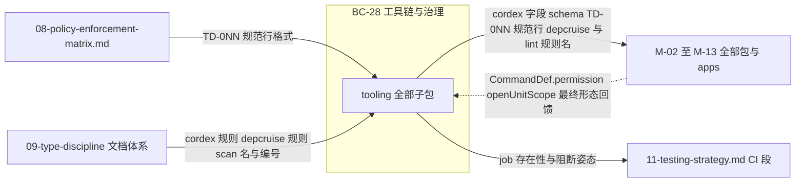
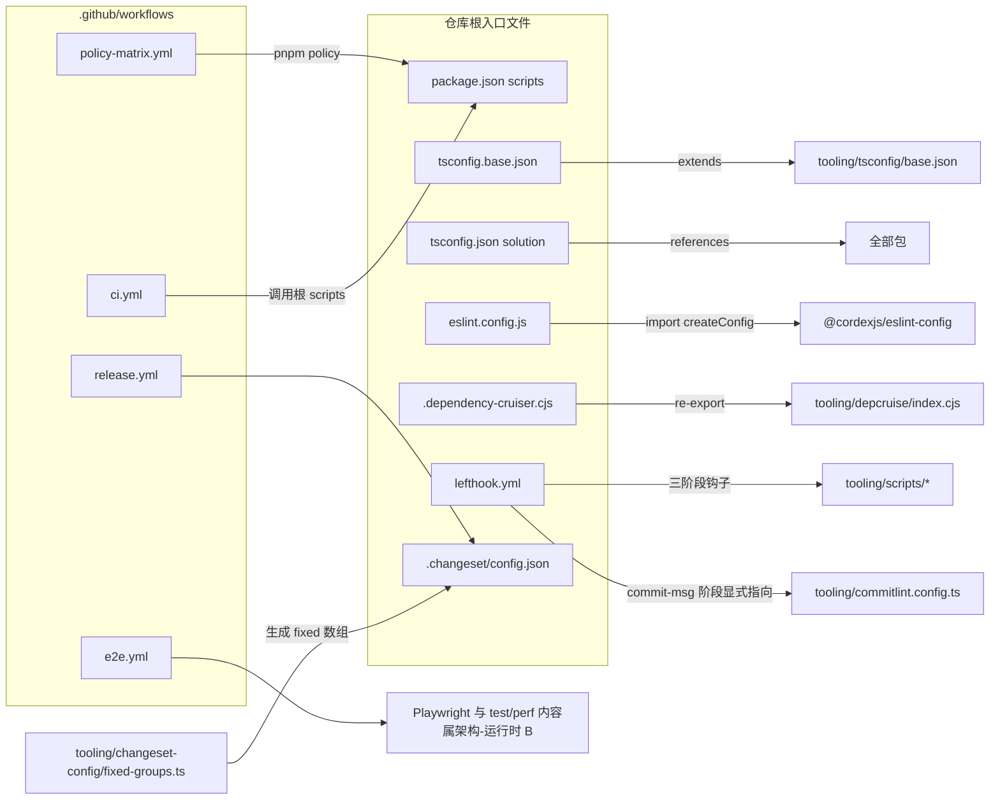
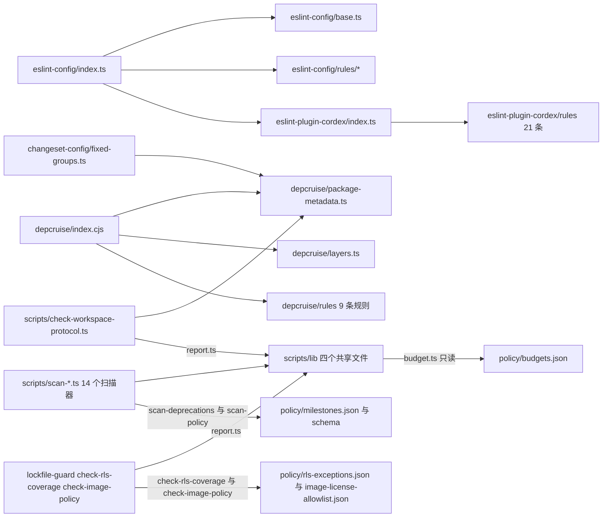
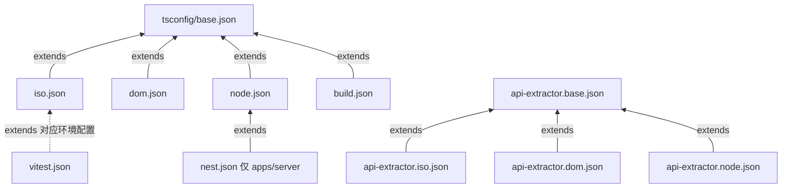
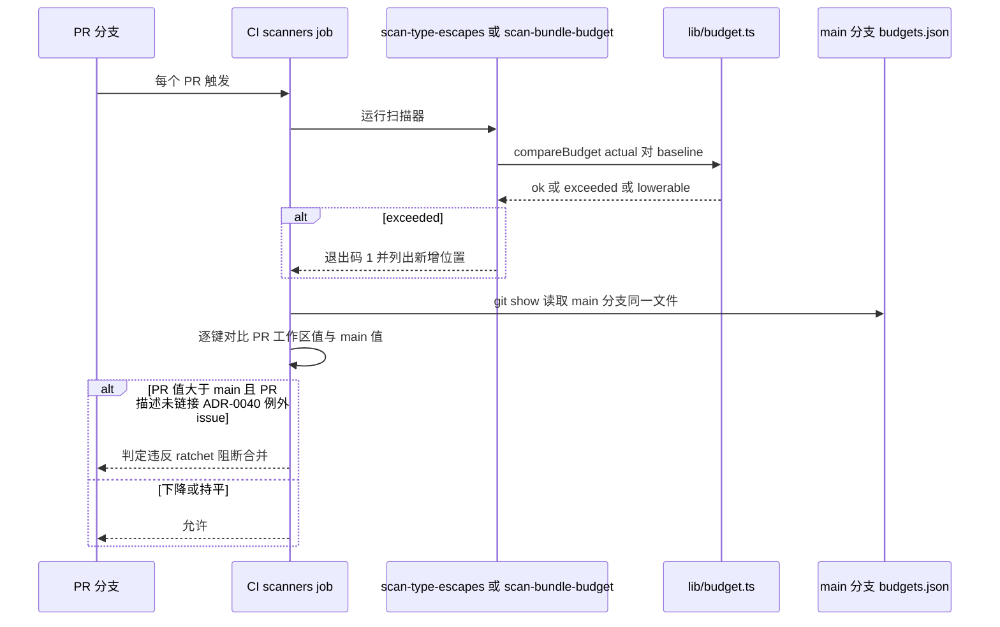
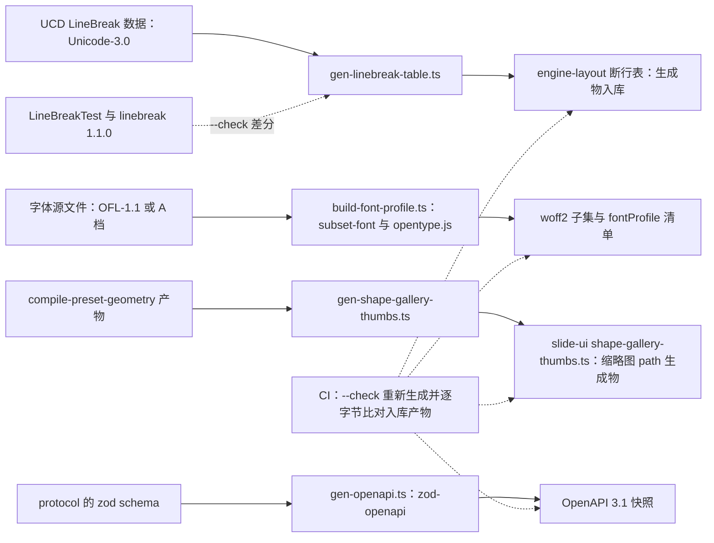
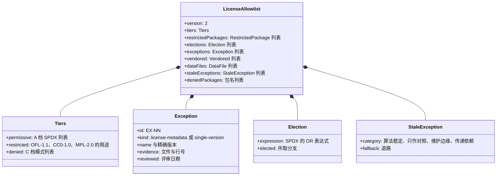
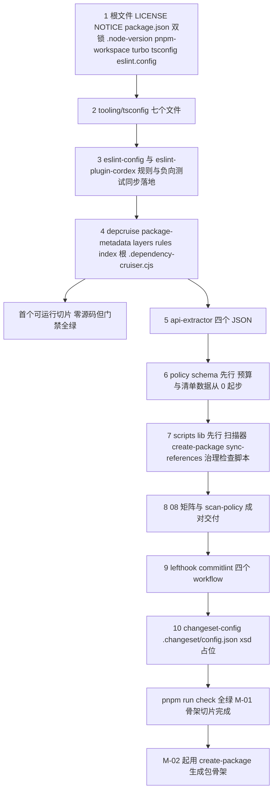

> 状态：草稿 v0.1 | 负责：架构-模块（阶段二，M-01） | 更新：2026-09-18；2026-09-24（rulings §4.15）；2026-09-24（rulings §4.16 Q12：仓库许可证 Apache-2.0——根 `LICENSE`/`NOTICE` 入 M0 骨架，`create-package` 写 `license: "Apache-2.0"`）；2026-09-24（复核修正，rulings §4.17：TD 编号以 08 矩阵为准并顺延、Q-09 结案；D3 登记第 14 个扫描器 `doc-access-via-permission`；depcruise 第 9 条规则 `cordex-ui-bundle-core-framework-free`；playground glob 改实际路径）；2026-09-25（补图）；2026-09-25（矛盾收口，rulings §4.18）；2026-09-25（§4.19）；2026-09-26（§4.20）；2026-09-26（§4.21：`license-allowlist.json` 改为 ADR-0049 分级结构并加 schema；登记许可步骤入口 `license-allowlist.ts` 与 `lib/spdx.ts`；登记 UCD 断行表、字体 profile、形状库 sprite、OpenAPI 四个生成脚本壳；`patchedDependencies` 增 react-colorful）；2026-09-26（§4.21 整合：depcruise 单点表改由章程 §5.3 登记表生成并补新项，apps/server 白名单加 @cordexjs/xml 与 ooxml-core/zip，新增补充规则 cordex-xml-boundary（rules/xml-boundary.ts）；lint 对 packages/xml/src/** 与 canvas 四处放行的 override；gen-requirements 产出 capabilities.json；形状库缩略图脚本统一为 gen-shape-gallery-thumbs.ts（原 SVG sprite 方案作废），新增 gen-symbol-table.ts；catalog 登记新增依赖精确锁）；2026-10-01（§4.23 插件管理：登记 `scripts/gen-plugin-scope.ts` 与生成物 `policy/plugin-scope.json`（40/16 作用域列导出，70/02 §10.1 数据源））；2026-10-01（插件口径仅计 cordis 插件：rulings §4.23 补充裁决 PC-1…PC-4，§4 `policy/plugin-scope.json` 注释改为 cordis 插件与贡献点的作用域清单） | 依赖：00-module-map.md §3 BC-28/§4/§5/§7/§8/§9/§10、charter v0.2 §3/§5.3/§5.4、30-architecture/02-layering-and-packages.md §2/§5/§7/§8、30-architecture/09-type-discipline/{README,01-09}、30-architecture/adr/0040-0048、[30-architecture/adr/0049](../30-architecture/adr/0049-dependency-admission-and-license-tiers.md)（依赖准入与许可分级，rulings §4.21 q-license-tiers）、30-architecture/11-testing-strategy.md CI 段

# 01 工具链与治理骨架（限界上下文 BC-28〈工具链与治理〉）

## 0. 一页总览

| 项 | 值 |
|---|---|
| 职责一句话 | 把章程 R7"强类型规约 + 机械约束"落成可执行物：tsconfig 基线、21 条自定义 lint 规则、9 条 depcruise 依赖规则、14 个自研扫描器（第 14 个 `scan-doc-access-via-permission` 为 rulings §4.17 D3 登记）、4 个治理检查脚本（lockfile/workspace 协议/RLS 覆盖/镜像策略，rulings §4.15 新增，不计入十四个扫描器）、85 行规范↔执行矩阵（TD-001…TD-085）、lefthook/CI 门禁与 Changesets 配置，使"规范"与"违反即失败"之间不存在人工判断缺口 |
| 覆盖的上下文 | BC-28（工具链与治理） |
| 承载包 / 目录 | `tooling/*`（不参与 `cordex.layer` 秩体系，无层/秩；node，构建期）；根 `lefthook.yml`/`.dependency-cruiser.cjs`/`biome.json`/`.changeset/config.json`/`turbo.json`/`pnpm-workspace.yaml`/`.node-version`/`.github/workflows/*` |
| cordis 形态 | library（构建期工具；不创建 cordis Fiber，不参与 `ctx.plugin()` 树） |
| 运行位置 | 两端（构建期身份对浏览器 SDK 与服务端产物统一治理；自身不出现在任何运行时产物里） |
| 上游（依赖） | 无（M-01 是唯一无上游模块） |
| 下游（被依赖） | 全部 M-02…M-13（每个包的 `tsconfig.json`/`eslint.config.js`/`package.json#cordex`/CI 门禁均由本模块提供的基线驱动） |
| 对外服务 | 无 `ctx.*` 服务；对外是 npm scripts（`build`/`typecheck`/`lint`/`test`/`test:typecheck`/`depcruise`/`api`/`manifest`/`scan`/`policy`/`iso-smoke`/`check`）与 CLI 子命令（`create-package` 等，见 §2.6） |
| 贡献点 | 提供：无；消费：无（`cordex.bundle` 等字段是本模块治理的**对象**，不是本模块消费的 cordis 贡献点） |
| doc / sheet 通用性 | generic（规则本身对文档类型盲；§8 说明如何参数化） |
| 批次 | 1 |

### 0.1 图示

**图 0-1 模块包关系与上下游**



怎么读：本模块（`tooling/*`）没有上游包依赖，只被两份规范文档"喂料"；它向右治理全部 M-02…M-13 包与 CI，唯一的反向虚线是 M-02 定稿 API 形态后回头收紧本模块几条启发式规则。

## 1. 限界上下文与边界

### 1.1 职责与非职责

**做什么**：
- 定义并落地 iso/dom/node/nest 四套 tsconfig 基线（含 `isolatedDeclarations`/`verbatimModuleSyntax`/`erasableSyntaxOnly`）。
- 提供 `@cordexjs/eslint-config`（typescript-eslint 预设装配 + 偏离表）与 `@cordexjs/eslint-plugin`（21 条自定义规则）。
- 实现 9 条 dependency-cruiser 依赖规则（无环、只向下、文档类型盲、束间隔离、单点引入、同构隔离、三角色、无深引用、`*-ui` 核心层框架无关——第 9 条 `cordex-ui-bundle-core-framework-free` 为 rulings §4.15 Q2 追加，TD-082）。
- 提供 iso/dom/node 三套 api-extractor 基础配置，驱动 `.api.md` 基线、release tag 分级、`store-yjs`/`collab-yjs` 的 `Y.*` 类型泄漏扫描。
- 实现 14 个自研扫描器（`scan-*`，含 rulings §4.17 D3 登记的第 14 个 `scan-doc-access-via-permission`），统一双格式输出（JSON + 人类可读）与预算/ratchet 比对。
- 维护 85 行「规范↔执行」矩阵（`08-policy-enforcement-matrix.md`，TD-001…TD-085，以矩阵实际行数为准）及其自校验器 `scan-policy`。
- 定义 lefthook 三阶段（pre-commit/commit-msg/pre-push）与 CI job 矩阵的**存在性、触发条件、阻断姿态**（内容 owner 可能是其他条线，见下）。
- 提供 Changesets 的 fixed 组生成与"是否需要 changeset"判定；`release.yml` 走 npm OIDC trusted publishing + provenance（不持有长期 `NPM_TOKEN`）。
- 锁定工具链版本（rulings §4.15 Q9）：**pnpm 11 双锁**（根 `package.json#packageManager` 精确版本 + `devEngines.packageManager`/`devEngines.runtime` 均 `onFail:"error"`；corepack 降为可选安装渠道，不作锁定依据）、**Node 26 基线**（`.node-version`、`engines.node >=26`，开发/CI/镜像同一基线）；pnpm 设置全部显式写入 `pnpm-workspace.yaml`，`.npmrc` 只允许鉴权项；仓库根命令一律 `pnpm`（`npx` → `pnpm dlx`）。
- 提供 4 个治理检查脚本（`tooling/scripts/lockfile-guard.ts`、`check-*.ts`，§5.7）：只允许根 `pnpm-lock.yaml`、内部依赖 `workspace:` 协议、文档级 RLS 覆盖、compose 镜像 digest/许可/renderer 版本锁；并在 ESLint 基线中结构性禁止以 `innerHTML`/`insertAdjacentHTML`/`DOMParser` 注入文档内容（rulings §4.15 Q4）。

**不做什么（明确指向负责模块）**：
- 不判定 `test`/`e2e`/`perf` job 的内部断言与阈值数值——只保证 job 存在、在每个 PR 触发、以 `error` 阻断；内容与阈值属架构-运行时 B（`11-testing-strategy.md`，对应 M-06/M-09/M-11 等实现模块）。
- 不定义错误码/tracing span/metric 的具体取值——只提供登记表结构与"声明↔调用"一致性扫描（`scan-observability-identifiers`）；取值属架构-运行时 B（10-observability，M-09/M-12）。
- 不设计 `Capability` 集合的具体成员与 `permissions` 服务运行时实现——只保证字段存在性、单一来源与非空校验；属架构-结构 A（M-02）。
- 不实现 `ContributionPoint`/`Manifest` 的运行时语义——只校验其类型契约与声明合并位置；属架构-结构 A（M-02 的 `@cordexjs/kernel`）。
- 不决定 `schemaVersion`/迁移注册表的运行时设计——只提供类型侧穷尽性测试组织约定；属 M-02。
- 不校验 OOXML XSD 版本内容本身——只登记 `xsd-validate` job 与 `tooling/xsd/` 目录占位；内容属架构-结构 A（M-04）。
- 不决定 Changeset 的 major/minor/patch 语义——只判定"是否需要 changeset"；语义属 ADR-0002（架构-结构 A）。

### 1.2 通用语言

不重复章程 §4；BC-28 是"全部规范的机械化对象"，本上下文自身的特有词表来自 [09-type-discipline/README.md §5](../30-architecture/09-type-discipline/README.md)：

| 术语 | 定义（节选） |
|---|---|
| 类型逃逸 | `any`/`as`（非 `as const`/`satisfies`）/`!`/`@ts-ignore`/未说明的 `@ts-expect-error` 的统称 |
| 棘轮预算 | 只能下调、不能无例外流程上调的数值上限；见 ADR-0040 |
| 秩 | 分层网格的数值偏序（L0=0…L8=80），供 depcruise「只向下」比较 |
| 层带 | 垂直束的层号编码前缀（`V-model`/`V-codec`/`V-render`/`V-ui`），与水平层 `L<n>` 并列不复用 |
| 组合根 | `compositionRoot: true` 的包（`preset-*`/`apps/web`/`apps/server`），允许依赖具体 Provider |
| 三重保障 | 同构隔离的 tsconfig lib/types + `no-restricted-globals` + `iso-smoke` 三层单包内机制，加图层规则共四层 |
| 品牌类型 | `Brand<T, TName>` 模式，阻止裸值冒充度量/标识符 |
| 派生字段标记 | `Derived<T>`，标注 Model 中不应写入 Snapshot 的计算字段 |
| 能力位 | `Capability`（原 `CapabilityBit`/`PermissionAction`，已统一，见 §12-D9、14 §1 C-15），fail-closed 权限模型的最小声明单元，唯一定义于 `@cordexjs/protocol` |
| 包级稳定级 | `package.json#cordex.stability`（`stable`/`beta`/`experimental`） |
| 编辑期代理 / 跨文件权威 | ESLint 单文件启发式给即时反馈，扫描器/depcruise 做跨文件权威裁决的双层检查模式 |
| 规范行 | 08 矩阵的一行，`TD-\d{3}` 编号 |
| 结构性禁止 | 豁免方式的一种取值：无 `cordex-allow` 逃逸通道，违反即须直接修复 |
| 语法可推导性 | `isolatedDeclarations` 判定"是否需要显式类型标注"的标准 |
| 预算复用 | ADR-0040 的 ratchet 机制不专属类型逃逸，`scan-bundle-budget` 是其在体积度量上的复用实例 |

本上下文另有一组内部实体名词（非章程术语，本模块自造）：扫描器（scan-\*）、规则（`cordex-*`/`cordex/*`）、豁免（`cordex-allow`）、CI job、策略矩阵条目（`TD-\d{3}`）——定义见 §2.1。

### 1.3 上下文映射

| 相邻上下文 | 关系类型 | 防腐层/落点（文件） | 传递的契约 |
|---|---|---|---|
| 全部 BC-01…27、29（即全部 `packages/*`/`apps/*`） | Open Host Service（治理执行点，非业务契约；每个包单向遵守，不议价） | `tooling/depcruise/*`、`tooling/eslint-config/*`、每包自身 `package.json#cordex`/`tsconfig.json extends` | `cordex` 字段 schema、规范行 `TD-\d{3}`、depcruise/lint 规则名 |
| `08-policy-enforcement-matrix.md`（文档本身） | Conformist（`scan-policy` 照单实现其 §1 定义的九列表格格式，不重新设计格式） | `tooling/scripts/scan-policy.ts` | 九列行结构、`id` 正则 `^TD-\d{3}$`、"机制同 TD-0NN"只向前引用的约束 |
| 09-type-discipline 文档体系（01–09 全篇） | Conformist（本模块是其"设计→文件级落地"阶段，不改变其定义的规则语义与编号） | 本文档 §4/§5 | 21 条 `cordex/*` 规则名、9 条 `cordex-*` depcruise 规则名、14 个 `scan-*` 名、`TD-\d{3}` 编号 |
| M-02（内核、协议与文档内核） | Customer–Supplier（反向：M-02 是本模块规则的**消费方**，但 `Capability`/`ContributionPoint`/`Manifest` 的最终 API 形状由 M-02 定稿后回头收紧本模块几条启发式规则的检测精度，见 §13 Q-05） | `tooling/eslint-config/eslint-plugin-cordex/rules/{no-unit-scoped-inject-at-root,store-transact-in-commands-only}.ts` | `CommandDef.permission`/`openUnitScope` 的最终 API 形态 |
| 架构-运行时 B（`11-testing-strategy.md`） | Shared Kernel（CI job 存在性/阻断机制由本模块拥有；job 内部断言与阈值由 B 拥有，见 1.1"不做什么"） | `.github/workflows/ci.yml`/`e2e.yml` | job 名（`test`/`test-typecheck`/`e2e`/`perf`/`coverage-patch`）作为共享词汇 |

## 2. 领域模型

> 本模块是基础设施/治理类模块，§2 标题按总编排指示改写：2.1 规则模型、2.2 配置值对象、2.3 纯函数、2.4 事件、2.5 外部契约、2.6 命令；编号保留。

### 2.1 规则模型

以下四类实体是本模块的"领域对象"，均为**编译期/构建期**存在，不进入任何运行时产物：

| 实体 | id 形状 | 严重级 | 适用层/范围 | 数量 | 权威文件 |
|---|---|---|---|---|---|
| DepcruiseRule | `cordex-*`（kebab-case） | 恒 `error` | 全仓包图（按 `from`/`to` 选择器） | 9 条规则、10 个规则 id（规则 1 拆 file/package 两个 id） | `tooling/depcruise/rules/*.ts` |
| EslintRule（自定义） | `cordex/*`（kebab-case） | 恒 `error`，`fixable` 恒 `undefined` | 按文件路径/包元数据匹配 | 21 条 | `tooling/eslint-config/eslint-plugin-cordex/rules/*.ts` |
| Scanner | `scan-*`（kebab-case，脚本文件名） | 违规=退出码 1，脚本自身故障=退出码 2 | 按包/按文件跨图扫描 | 14 个 | `tooling/scripts/scan-*.ts` |
| PolicyRow | `TD-\d{3}`，全文件唯一、单调可跳号、禁止复用废弃 id | N/A（陈述本身无严重级，由其"执行机制"列的工具决定） | 覆盖章程/primer/lessons/本方案/PRD 等来源 | 111 行（TD-001…TD-111；TD-079…082 为 rulings §4.15 追加，TD-083…085 为 2026-09-24 复核补登，TD-086…109 为 2026-09-25 补登，TD-110、TD-111 为 2026-09-26 rulings §4.20 TX-08/TX-09 追加；行数以 08 矩阵为准） | `08-policy-enforcement-matrix.md` |
| CIJob | 英文短名（`lint`/`typecheck`/…） | 全部 `error` 阻断，无 `warn` | 每个 PR，无分支例外 | 13 个（见 §5.9） | `.github/workflows/*.yml` |
| RatchetBudgetEntry | `<package>:<src\|test>:<kind>`（`<package>:bundle-size-bytes` 已移除：体积预算改在各 preset 的 `config/bundle-budget.json`，决策 T-BUNDLE，2026-09-25） | 值为非负整数上限 | 每包 | 动态（随包数增长） | `tooling/policy/budgets.json` |

不变量（跨实体）：
1. 每个 PolicyRow 的"执行机制"列引用的 DepcruiseRule/EslintRule/Scanner 必须真实存在于磁盘（`scan-policy` 规则 1，配置路径存在性检查）。
2. 每个 EslintRule/DepcruiseRule/Scanner 必须至少有一个负向测试用例（lessons A17；`scan-policy` 规则 3）。
3. RatchetBudgetEntry 的值只能下降，上升须走 ADR-0040 例外流程（issue 链接 + PR 描述）。
4. PolicyRow 引用其他行用"机制同 TD-0NN"时只能向前引用（数值更小的 id），不得成环（`scan-policy` 校验）。

### 2.2 配置值对象

- **`package.json#cordex` 字段**（八键，schema 见 `tooling/policy/schema/cordex-package-metadata.schema.json`；schema `additionalProperties:false`，拒绝 `rank` 等未知键——秩由 `layer` 查秩表得出、不写进 package.json，rulings §4.18 FE-21）：`layer`（12 取值：`L0|L1|L3|L4|L5|L7|L8|LS|V-model|V-codec|V-render|V-ui`）、`iso`（`iso|dom|node`）、`bundle`（`slide|doc|sheet`：`layer` 以 `V-` 开头时必填；`compositionRoot:true` 的 preset 选填——`preset-slide*` 标 `slide`、`preset-doc` 标 `doc`、`preset-sheet` 标 `sheet`，填了即受 `cordex-bundle-isolation`（章程 §5.3 规则 8）约束；其余包必须省略，rulings §4.18 FE-01）、`role`（`definition|provider|consumer|n/a`，与架构-结构条线 `library|plugin|definition|provider|bundle|app|tooling` 七值折叠映射：`package.json#cordex.role` 按人类可读的七值之一标注，`depcruise` 的三角色规则读取时按固定表折叠为四值——`definition→definition`、`provider→provider`、`library|plugin|bundle|app|tooling→consumer`（**例外**：若该包同时是某 Definition 的 Provider，如 kernel 自身，则折叠为 `provider`），`n/a` 用于 `tooling/*` 等不参与秩体系的包；折叠表权威见 14-cross-module-review.md §1 C-11、`00-module-map.md` §8 G-2，本文档 §12-D8）、`implements`（字符串数组：`role` 为 provider 的包必填，列出所实现的 Definition 服务名，如 store Provider 写 `['store']`；三角色规则 `cordex-role-*`（02 R7）读取它；其余包省略）、`compositionRoot`（布尔，仅 `preset-*`/`apps/web`/`apps/server` 可为 `true`，且这些包必须显式写 `true`——`cordex-doc-type-blind` 的组合根豁免与三角色豁免都读取它）、`publicEntry`（字符串数组，须与 `exports` key 集合逐一相等；跨包 import 只能走这里登记的子路径，`cordex-no-deep-import` 据此判定，rulings §4.18 FE-04）、`stability`（可选，`stable|beta|experimental`，缺省 `stable`）。`tooling/*` 自身包**不**填该字段（不参与秩体系，见 §10）。
- **ratchet 预算值对象**：`budgets.json` 的每条 entry = `{ key: string, value: number }`，`key` 形状见 2.1 RatchetBudgetEntry 行；按 `src`/`test` 分离统计。
- **策略行 schema**：`policy-row.schema.json` 描述 08 矩阵九列（`id`/`陈述`/`来源`/`执行机制`/`配置路径`/`负向测试路径`/`CI job`/`豁免方式`/`owner`）的字段类型与枚举取值（豁免方式封闭为 5 种取值，见 §5.7）。
- **其余数据值对象**：`milestones.json`（里程碑→日期/版本映射 + `status`，2026-09-25 增）、`requirements.json` / `rulings.json` / `adrs.json`（`gen-requirements.ts` 生成物，2026-09-25 起不再可选，决策 T-REQ）、`vuln-allow.json`（高危漏洞例外，2026-09-25 登记）、`event-domains.json`（第一方事件域清单）、`license-allowlist.json`（依赖准入与许可分级表，TD-050；结构见 ADR-0049 决策 7，2026-09-26 改写）。

### 2.3 纯函数

| 函数（示意签名） | 所在文件 | 用途 |
|---|---|---|
| `rank(layer: CordexLayer): number` | `tooling/depcruise/layers.ts` | 层号→秩值查表，供 `cordex-layer-downward` 比较 `rank(to) ≤ rank(from)` |
| `parsePackageMetadata(pkgJson: unknown): Result<CordexPackageMetadata, MetadataError>` | `tooling/depcruise/package-metadata.ts` | 解析并校验单个包的 `cordex` 字段，构建启动期一次性内存查找表 |
| `compareBudget(actual: number, baseline: number): 'ok' \| 'exceeded' \| 'lowerable'` | `tooling/scripts/lib/budget.ts` | 预算比对的核心判定，供全部预算类扫描器复用 |
| `formatReport<T>(rows: T[], mode: 'json' \| 'human'): string` | `tooling/scripts/lib/report.ts` | 统一的双格式输出器 |
| `computeChangedFiles(baseRef: string): string[]` | `tooling/scripts/lib/changed-files.ts` | `git diff` 范围计算，供 pre-commit 快速模式复用 |
| `isBundleIsolationViolation(from: CordexMeta, to: CordexMeta): boolean` | `tooling/depcruise/rules/doc-type-blind.ts` | 判定 `bundle` 字段不同的两个非空值是否互相 import |
| `isDocTypeBlindViolation(from: CordexMeta, to: CordexMeta): boolean` | `tooling/depcruise/rules/doc-type-blind.ts` | `from.compositionRoot!==true && from.bundle 为空 && to.layer 以 V- 开头`（规则 3，组合根豁免，to 侧判据与章程 §5.3 规则 3 一致，rulings §4.18 FE-01） |

这些函数均无副作用、无 IO（IO 由调用它们的脚本外壳负责），是十四个扫描器与 9 条 depcruise 规则共享的图分析/元数据解析内核。

### 2.4 事件

本模块没有 cordis `Events`（不创建 Fiber）。此处的"事件"是**构建期报告事件/产物**：

| 事件/产物 | 产生者 | 消费者 | 格式 |
|---|---|---|---|
| 十四份扫描器 JSON 报告 | 各 `scan-*.ts` | CI 日志、`scan-policy`（部分） | 见 06 各节"输出格式" |
| `src/manifest.ts`（每包，生成物，入库） | `scan-manifest.ts`（即 manifest-gen）从源码静态分析生成，头部标 `generated` | CI `--check` 重新生成比对，要求无 diff（rulings §4.18 GV-17） | `Manifest` 类型的 TS 常量 |
| `cordex-manifest.json`（每包，构建产物，不入库） | 构建时由 `manifest.ts` 序列化，随包发布 | 未来插件市场/CLI | zod 推导的 `Manifest` 类型 |
| `iso-smoke-manifest.json` | `scan-isomorphic.ts` | `iso-smoke` CI job | `{ package, publicEntry }[]` |
| `requirement-test-matrix.json` | `scan-requirement-tags.ts` | 需求追溯矩阵 [70/13](../70-testing/13-requirements-traceability.md)（rulings §4.20 TX-10，原引 `11-testing-strategy.md` 覆盖率矩阵改指） | `{ requirementId, testFiles }[]` |
| `.api.md` / `etc/<name>-internal.d.ts` | api-extractor | 代码评审 / CI artifact | Markdown / `.d.ts` |
| `pull_request` / `push` webhook | GitHub | `.github/workflows/*.yml` | GitHub Actions 事件 |

### 2.5 外部契约

| 第三方工具 | 接口面 | 本模块的适配文件 |
|---|---|---|
| dependency-cruiser | `.dependency-cruiser.cjs` 规则 DSL（`from`/`to`/`severity`） | `tooling/depcruise/index.cjs` |
| ESLint + typescript-eslint | flat config 数组、`RuleTester`（类型感知） | `tooling/eslint-config/index.ts`、`eslint-plugin-cordex/index.ts` |
| api-extractor | `IConfigFile`、`Extractor.invoke()` | `tooling/api-extractor/*.json` |
| lefthook | `lefthook.yml` schema（`pre-commit`/`commit-msg`/`pre-push`） | 根 `lefthook.yml` |
| Changesets | `@changesets/cli`、`.changeset/config.json` | `tooling/changeset-config/*.ts` |
| ts-morph | AST/类型信息读取 API | `tooling/scripts/lib/ts-project.ts` |
| knip / manypkg / syncpack | 各自 CLI + 配置文件 | 根/`tooling/` 下对应配置（草案路径，见 §5.9） |
| commitlint | Conventional Commits 规则集 | `tooling/commitlint.config.ts` |

### 2.6 命令

**npm scripts（根 `package.json`，细化自 02§2 的九个脚本）**：

| script | 作用 |
|---|---|
| `build` | Turborepo 触发全部包 `tsc --build`（`composite`） |
| `typecheck` | `tsc --build`（全量，`typecheck` CI job 同一命令） |
| `lint` | ESLint 全量，`--max-warnings 0` |
| `test` | Vitest 单测 + 契约测试 |
| `test:typecheck` | `vitest --typecheck`（新增，细化自 02 的 `test`，对齐 09-07 §3 的 `test-typecheck` job） |
| `depcruise` | `dependency-cruiser --config .dependency-cruiser.cjs` |
| `api` | `api-extractor run`（每包）→ `pnpm pack` → `publint` → `attw --pack` |
| `manifest` | `tsx tooling/scripts/scan-manifest.ts --check`（对应"manifest-gen"逻辑，见 §12-D1） |
| `scan` | 运行其余 12 个非 manifest/非 policy 扫描器 + §5.7 的 4 个治理检查脚本（新增，细化自 02 的笼统 `check`；检查脚本 rulings §4.15 追加，不新增 script 名） |
| `policy` | `tsx tooling/scripts/scan-policy.ts` |
| `iso-smoke` | 消费 `iso-smoke-manifest.json`，逐包 `node --import` 冒烟（新增，对齐 09-07 §3 独立 job） |
| `check` | 依次 `build && typecheck && lint && test && test:typecheck && depcruise && api && manifest && scan && policy && iso-smoke`（= 全部门禁） |

**CLI 子命令**（`tooling/scripts/*.ts`，人工触发）：`create-package`（从 §4.0 模板生成新包骨架；可发布包写 `publishConfig.access: "public"`，私有包写 `private: true`；全部包写 `license: "Apache-2.0"`（rulings §4.16 Q12）；内部依赖写 `workspace:` 协议——peer `workspace:^`、其余 `workspace:*`）、`sync-references`（`tsconfig.json#references` ↔ 依赖一致性同步）、`compile-preset-geometry`、`compile-schema-order`（后两者内容属架构-结构条线 `ooxml-core`/`engine-layout` 设计，本模块只登记脚本壳）。2026-09-26（rulings §4.21）再登记四个生成脚本壳：`gen-linebreak-table`（UCD → UAX#14 断行表，内容归 engine-layout）、`build-font-profile`（字体子集与 fontProfile 清单，内容归字体供给）、`gen-shape-gallery-thumbs`（形状库缩略图 path 数据，内容归 slide-ui 形状库；2026-09-26 整合时由原 `build-shape-sprite` 的 SVG sprite 方案改名改形，与 40/10、50-frontend/22 一致）、`gen-symbol-table`（UCD 字符名称 → 符号面板数据，内容归 slide-ui）、`gen-openapi`（protocol 的 zod schema → OpenAPI 3.1，内容归 protocol 与 60-backend/15），五者都提供 `--check` 模式：重新生成并与入库产物逐字节比对（§5.7）。十四个 `scan-*.ts` 均可独立 CLI 调用，支持 `--changed-only`（pre-commit 快速模式）。

**图 2-1 治理流水线**

```mermaid
flowchart LR
  lefthook["lefthook 三阶段 pre-commit commit-msg pre-push"]
  biome["biome 仅 formatter"]
  eslint["eslint-config 与 eslint-plugin-cordex 21 条规则"]
  depcruise["depcruise 9 条规则"]
  scanners["14 个 scan 脚本"]
  policyCheck["scan-policy 85 行矩阵校验"]
  apiExtractor["api-extractor 生成 api.md"]
  ciJob["CI job 矩阵"]
  lefthook -- "pre-commit 触发" --> biome
  biome -- "格式化后" --> eslint
  eslint -- "lint 通过后" --> depcruise
  depcruise -- "9 条规则通过后" --> scanners
  scanners -- "14 份 JSON 报告" --> policyCheck
  policyCheck -- "TD-0NN 自校验通过" --> apiExtractor
  apiExtractor -- "api.md 基线" --> ciJob
```



怎么读：这条链就是 `check` 脚本本身的执行顺序——从本地 lefthook 钩子到 CI job 矩阵，任一环节失败即阻断，中间无人工判断缺口。

## 3. cordis 插件定义

| 项 | 值 |
|---|---|
| 插件名 / `name` | N/A |
| `inject`（必需 / 可选） | N/A |
| `provide` | N/A |
| 贡献点：提供 | 无 |
| 贡献点：消费 | 无 |
| 事件：发布 / 订阅 | 无（cordis `Events`）；构建期报告事件见 §2.4 |
| 配置 schema | 无插件 `Config`；本模块自身的"配置"是 §2.2 的值对象（`cordex` 字段 schema、`budgets.json` 等），经文件读取而非 `ctx.plugin(plugin, config)` 装配期校验 |
| 生命周期 | 无 Fiber 生命周期；本模块的等价物是 CI job 的"存在性 + 每 PR 触发 + 不可跳过"三条治理姿态（09-07 §3），与 `ready`/`dispose`/`PENDING` 无对应关系 |
| Manifest 片段 | 无——`tooling/*` 自身不产出 `manifest.ts`/`cordex-manifest.json`（`scan-manifest.ts` 的**输入**是其余各包的源码，**输出**其 `manifest.ts`，`tooling` 自身不是被治理对象；rulings §4.18 GV-17） |

**为什么是 N/A**：BC-28 明确"不参与运行时依赖图（无秩）"（module-map §3 BC-28 行），cordis 形态登记为 `library`——它是构建期以 CLI 子进程、Node 脚本、GitHub Actions job 形式运行的工具集合，从未调用 `createHost()`/`ctx.plugin()`，因此模板 §3 的全部字段均不适用。这与 `@cordexjs/design`（BC-13，同样是零依赖 `library`）在"无插件形态"这一点上同构，但 `@cordexjs/design` 至少是运行时产物（CSS 文件被 `import`），本模块连运行时产物都不是。

## 4. 目录树（完整到文件）

> 本树采用 09-type-discipline 各子文档给出的**实际文件路径**（因 08 矩阵逾 20 行"配置路径"列已固化这些路径并被 `scan-policy` 机器校验），而非 02§5 草图里 `manifest-gen/`/`scanners/`/`policy-check/`/`iso-smoke/` 四个独立顶层目录名——02§5 本身注明"详细规格由 09 承接"，差异与映射关系见 §12-D1。测试文件与夹具目录见 §9，不在本树重复。

**图 4-1 根入口文件到 tooling 的依赖**



怎么读：箭头为依赖方向（使用方 → 被使用方），唯一的反向是 `fixed-groups.ts` 生成并写回 `.changeset/config.json`；根目录文件只做薄转发，真正的规则实现都落在 `tooling/*`。

依据：§5.1 各文件「允许依赖」列。

**图 4-2 tooling 内部目录依赖**



怎么读：箭头为 import 或读取方向；`depcruise/package-metadata.ts` 是跨子目录复用最多的元数据解析内核（depcruise、changeset 分组、workspace 协议检查共用），`scripts/lib/` 是十四个扫描器与治理检查脚本共享的报告、预算、变更范围与 ts-morph 封装层。

依据：§5.3–§5.9 各文件「允许依赖」列与 §5.8 数据文件消费者备注。

**图 4-3 tsconfig 与 api-extractor 继承链**



怎么读：自下而上是 `extends` 方向；`nest.json` 是唯一两级继承（经 `node.json`），`vitest.json` 按测试所在环境继承 iso/dom/node 之一（虚线只画 iso 作代表）；三份 api-extractor 配置在 M0 阶段内容一致，只是按同构类分叉的占位。

依据：§5.2、§5.6 各文件「允许依赖」列。

```text
/                                          仓库根（本模块只治理其中的门禁/配置文件，非全部根文件）
├── package.json                          # scripts: build/typecheck/lint/test/test:typecheck/
│                                            depcruise/api/manifest/scan/policy/iso-smoke/check（§2.6）；
│                                            packageManager + devEngines 双锁（pnpm 11、Node 26）
├── .node-version                          # 26（fnm/nvm/CI setup-node 共读；rulings §4.15 Q9）
├── pnpm-workspace.yaml                    # packages: apps/*, packages/*, tooling/eslint-config, docs/20-design/playground；
│                                            pnpm 设置全集（nodeLinker/strictPeerDependencies/…）；
│                                            catalog: 第三方版本目录（cordis/zod/yjs/react/vitest/typescript…）；patchedDependencies: sonner（§4.20 FE-18）、react-colorful（§4.21 R-d-13）
├── turbo.json                             # 任务图：build/typecheck/lint/test/test:typecheck/depcruise/
│                                            api/manifest/scan/policy/iso-smoke（与根 scripts 同名，§2.6；
│                                            原 api-extract/manifest-gen/policy-check 旧名作废，rulings §4.18 GV-13）
├── tsconfig.json                          # solution 文件：仅 references，无 compilerOptions
├── tsconfig.base.json                     # extends tooling/tsconfig/base.json（仅供编辑器发现）
├── eslint.config.js                       # import @cordexjs/eslint-config 的 createConfig(pkgMeta)
├── biome.json                             # 仅 formatter（缩进/引号/行宽）；linter 关闭（ADR-0044）
├── .dependency-cruiser.cjs                # re-export tooling/depcruise/index.cjs
├── lefthook.yml                           # pre-commit / commit-msg / pre-push 三阶段（见 §5.9）
├── LICENSE                                # Apache-2.0 全文（rulings §4.16 Q12）
├── NOTICE                                 # Apache-2.0 §4(d) 归属声明（Cordex 版权行 + 第三方归属）
├── .changeset/
│   └── config.json                       # fixed 组 = tooling/changeset-config/fixed-groups.ts 生成
└── .github/
    └── workflows/
        ├── ci.yml                        # lint/typecheck/test/test-typecheck/iso-smoke/depcruise/
        │                                   api-surface/scanners/xsd-validate/coverage-patch（10 job）
        ├── policy-matrix.yml             # policy-check（scan-policy）独立工作流
        ├── e2e.yml                       # e2e + perf（Playwright/性能预算；内容属架构-运行时 B）
        └── release.yml                   # Changesets 版本与发布（main 分支触发；OIDC trusted publishing + provenance）
```

```text
tooling/
├── tsconfig/
│   ├── base.json                          # 全部严格选项集合（不含 lib/types/module 解析）
│   ├── iso.json                           # extends base；lib: ["ES2023"]，types: []
│   ├── dom.json                           # extends base；lib 追加 DOM/DOM.Iterable
│   ├── node.json                          # extends base；types: ["node"]
│   ├── nest.json                          # extends node；仅 apps/server；experimentalDecorators 例外
│   ├── build.json                         # extends base；composite/incremental/declaration 相关字段
│   └── vitest.json                        # 测试专用 types 覆盖，不引入 vitest/globals
├── eslint-config/
│   ├── package.json                       # name: @cordexjs/eslint-config（devDependency 供全仓引用）
│   ├── index.ts                           # 组合入口：createConfig(pkgMeta) 工厂
│   ├── base.ts                            # strict-type-checked + stylistic-type-checked 装配与偏离表
│   ├── biome-boundary.md                  # ESLint/Biome 判定表镜像（ADR-0044）
│   ├── rules/
│   │   ├── type-safety.ts                 # 禁 any/as/!/@ts-ignore/Function/object/{}/enum/namespace
│   │   ├── restricted-imports.ts          # 第三方库单点引入表 → no-restricted-imports 生成器
│   │   ├── restricted-globals.ts          # iso 同构全局名单 → no-restricted-globals 配置
│   │   ├── dom-injection.ts               # 禁 innerHTML/outerHTML/insertAdjacentHTML/DOMParser 注入（§4.15 Q4）
│   │   ├── assembly.ts                    # apps/** 无领域定义与唯一 createHost 调用点（TD-093）、preset 胶水 apply ≤ 60 行且 model-* 只许 import type（TD-094）、
│   │   │                                  #   src/index.ts 只许 export … from（TD-096）；原称 no-domain-defs-in-apps 等（rulings §4.18 GV-15）
│   │   ├── determinism.ts                 # 两个 override：① ooxml-* 禁 Date.now / 无参 new Date() / performance.now / Math.random（TD-097，原称 codec-no-clock，预算恒 0）；
│   │   │                                  #   ② 全部生产与测试代码（TD-110，§4.20 TX-08）：生产禁 Date.now / Math.random / 无参 new Date()，测试另禁 performance.now
│   │   ├── testing.ts                     # vitest/no-disabled-tests + playwright/no-skipped-test（TD-109，决策 T-CI；2026-09-25 登记）
│   │   └── style.ts                       # console/prototype/裸 throw/debugger 等语义类禁用
│   └── eslint-plugin-cordex/
│       ├── package.json                   # name: @cordexjs/eslint-plugin
│       ├── index.ts                       # 规则注册表 + recommended/strict 两档导出 config
│       └── rules/                         # 21 个文件，逐条见 §5.2
│           ├── no-register-methods-outside-kernel.ts
│           ├── no-module-level-mutable-state.ts
│           ├── effect-owned-resources.ts
│           ├── events-must-be-declared.ts
│           ├── services-must-be-declared.ts
│           ├── contribution-file-naming.ts
│           ├── no-provider-import-in-consumer.ts
│           ├── deprecated-must-have-removal-version.ts
│           ├── config-fields-must-be-read.ts
│           ├── no-mixin-outside-kernel.ts
│           ├── schema-type-must-be-inferred.ts
│           ├── no-doc-type-literals.ts
│           ├── no-unit-scoped-inject-at-root.ts
│           ├── no-boolean-command-result.ts
│           ├── telemetry-events-must-be-declared.ts
│           ├── command-must-declare-capabilities.ts
│           ├── no-index-in-mutation.ts
│           ├── no-waterfall-in-render-hot-path.ts
│           ├── capability-vocabulary-single-source.ts
│           ├── store-transact-in-commands-only.ts
│           └── nest-controller-dto-from-protocol.ts
├── depcruise/
│   ├── index.cjs                          # 主配置入口（根 .dependency-cruiser.cjs 仅 re-export 本文件）
│   ├── package-metadata.ts                # 扫描全部 package.json#cordex，构建内存查找表
│   ├── layers.ts                          # 层号秩表 + 「允许目标」判定函数
│   └── rules/
│       ├── no-circular.ts                 # 规则 1：cordex-no-circular-file / cordex-no-circular-package
│       ├── layering.ts                    # 规则 2：cordex-layer-downward
│       ├── doc-type-blind.ts              # 规则 3+8：cordex-doc-type-blind / cordex-bundle-isolation
│       ├── single-entry.ts                # 规则 4：cordex-third-party-single-entry
│       ├── isomorphism.ts                 # 规则 5：cordex-isomorphism-compatibility（3×3 矩阵）
│       ├── roles.ts                       # 规则 6：cordex-role-provider-no-cross-import 等
│       ├── no-deep-import.ts              # 规则 7：cordex-no-deep-import
│       ├── ui-bundle-core-framework-free.ts # 规则 9：cordex-ui-bundle-core-framework-free（TD-082，§4.15 Q2）
│       ├── apps-only-assemble.ts          # 补充：cordex-apps-only-assemble（02 R9，09-03 §3.7，TD-093；rulings §4.18 FE-05）
│       ├── viewer-no-editing.ts           # 补充：cordex-viewer-no-editing（09-03 §3.7，TD-094）
│       └── xml-boundary.ts                # 补充：cordex-xml-boundary（2026-09-26，ADR-0019：xml 零依赖、oracle 只在测试、ooxml-core 单点接入）
├── api-extractor/
│   ├── api-extractor.base.json            # 公共规则：report 路径、release tag、消息级别覆盖
│   ├── api-extractor.iso.json             # extends base；iso 包专用
│   ├── api-extractor.dom.json             # extends base；dom 包专用
│   └── api-extractor.node.json            # extends base；node 包专用
```

```text
tooling/
├── scripts/                                # 覆盖 02§5 草图里"manifest-gen/scanners/policy-check/
│   │                                          iso-smoke/scripts"五个名字的实际落点，见 §12-D1
│   ├── scan-type-escapes.ts                # 06§2；14 个扫描器之一
│   ├── scan-contributions.ts               # 06§3
│   ├── scan-effects.ts                     # 06§4
│   ├── scan-isomorphic.ts                  # 06§5；静态部分 + 生成 iso-smoke-manifest.json
│   ├── scan-manifest.ts                    # 06§6（= 02§5 的"manifest-gen"）
│   ├── scan-config-usage.ts                # 06§7
│   ├── scan-deprecations.ts                # 06§8
│   ├── scan-policy.ts                      # 06§9（= 02§5 的"policy-check"）
│   ├── scan-telemetry-events.ts            # 06§10
│   ├── scan-command-capabilities.ts        # 06§11
│   ├── scan-requirement-tags.ts            # 06§12
│   ├── scan-observability-identifiers.ts   # 06§13
│   ├── scan-bundle-budget.ts               # 06§14
│   ├── scan-doc-access-via-permission.ts   # 06§18（第 14 个扫描器，rulings §4.17 D3；TD-085）
│   ├── lockfile-guard.ts                   # 治理检查脚本：只允许根 pnpm-lock.yaml + 双锁一致（§4.15 Q9）；catalog 版本钉：typescript 5.9.x 或 6.x、yjs（13.6.x 内）与 y-protocols 精确版本（TD-079，§4.20 TX-13）
│   ├── check-workspace-protocol.ts         # 治理检查脚本：内部依赖 workspace: 协议（§4.15 Q1）
│   ├── check-rls-coverage.ts               # 治理检查脚本：文档级 Postgres RLS 覆盖（§4.15 Q6）
│   ├── check-image-policy.ts               # 治理检查脚本：compose 镜像 digest/许可/renderer 版本锁（§4.15 Q10）；renderer 非 root/无凭据/沙箱开启静态规则（§4.18 GV-16）
│   ├── create-package.ts                   # 从 §4.0 模板生成新包（cordex 字段/references/changeset 占位/publishConfig）
│   ├── sync-references.ts                  # tsconfig references ↔ package.json 依赖一致性
│   ├── compile-preset-geometry.ts          # presetShapeDefinitions.xml → engine-layout geometry 表
│   ├── compile-schema-order.ts             # XSD → ooxml-core/preserve/schema-order
│   ├── gen-requirements.ts                 # 从 PRD 03/04、rulings、ADR 与 50-frontend/18 生成 policy/{requirements,capabilities,rulings,adrs}.json 与 check-names.json；--check 模式供 test/requirement-matrix（决策 T-REQ，70/13 §2，2026-09-25 登记）
│   ├── license-allowlist.ts                # 许可步骤入口（scanners/license-allowlist，TD-050）：按 ADR-0049 分级判定全部已安装包、字体资产、数据文件与内置源码；nightly 附停更报告（§4.21）
│   ├── gen-linebreak-table.ts              # UCD LineBreak 数据 → engine-layout linebreak-trie.ts 生成物；--check 跑 LineBreakTest 并与 linebreak 1.1.0 差分（§4.21 R-d-27）
│   ├── build-font-profile.ts               # subset-font + opentype.js：字体子集 woff2 与 fontProfile 清单（构建期，§4.21 R-d-28）
│   ├── gen-shape-gallery-thumbs.ts         # 构建期调 engine-layout presetGeometryPath → slide-ui domain/shape-gallery-thumbs.ts（形状库缩略图 path 数据，CI --check；§4.21 R-d-66）
│   ├── gen-symbol-table.ts                 # UCD UnicodeData.txt → slide-ui 符号面板的字符名称表（按 50-frontend/20 §6.2 码位清单，--check；§4.21）
│   ├── gen-plugin-scope.ts                 # 40-modules/16 §2「作用域」列与 §4「作用域归类」列 → policy/plugin-scope.json；--check 与入库文件比对（2026-10-01，rulings §4.23）
│   ├── gen-openapi.ts                      # protocol 的 zod schema → OpenAPI 3.1（zod-openapi，构建期）；--check 与入库快照比对（§4.21 R-d-54）
│   └── lib/
│       ├── ts-project.ts                   # 基于 ts-morph 的项目加载封装
│       ├── report.ts                       # 统一 JSON + 人类可读双格式输出器
│       ├── budget.ts                       # 读写 budgets.json 的类型化访问层
│       ├── spdx.ts                         # SPDX 表达式解析（AND / OR / WITH 与括号，自写，不引 spdx-* 包；ADR-0049 决策 2）
│       └── changed-files.ts                # git diff 范围计算（pre-commit 快速模式）
├── ci/                                      # CI 步骤机器副本与步骤入口（2026-09-25 登记，70/12 §1、§8、§12）
│   ├── steps.json                          # 全部步骤条目（id / job / mode / since / gatedSince / runner 标签 / command）：70/12 §2、§3、§7、§8、§11 的机器副本
│   ├── run-step.ts                         # pnpm ci:step <id>：本地与 CI 唯一步骤入口；分片、report 形态、allow 到期、禁止静默降级检查
│   ├── required-checks.ts                  # pnpm ci:required-checks：由 steps.json（mode 非 off 的步骤乘分片）生成必需检查清单
│   ├── report-comment.ts                   # 汇总 report 形态步骤的产物为一条置顶 PR 注释
│   └── flaky-report.ts                     # 同一用例在 main / nightly 连续 3 次 flaky 自动建 issue（决策 T-CI）
├── policy/
│   ├── budgets.json                        # 棘轮预算基线（ADR-0040），M0 阶段全部键 = 0
│   ├── milestones.json                     # 里程碑 → 日期/版本映射 + status（planned / active / exit-review / done；scan-deprecations 与步骤激活消费；status 2026-09-25 增，70/13 §1）
│   ├── requirements.json                   # PRD 需求 id 清单（gen-requirements 生成物，2026-09-25 起不再可选，决策 T-REQ）
│   ├── rulings.json                        # rulings 条目 id 与所在节（gen-requirements 生成物，@ruling 标签存在性来源，2026-09-25 登记）
│   ├── adrs.json                           # ADR 决策条目与状态（gen-requirements 生成物，@adr 标签存在性来源，2026-09-25 登记）
│   ├── plugin-scope.json                   # cordis 插件与贡献点的作用域清单（gen-plugin-scope 生成物；70/02 §10.1 作用域表驱动断言的数据源，2026-10-01 登记）
│   ├── capabilities.json                   # 编辑器能力 id 清单（gen-requirements 从 50-frontend/18 生成，@cap 标签存在性来源，2026-09-26 登记）
│   ├── vuln-allow.json                     # 高危漏洞例外登记（issue 链接 + 到期日不超过 30 天，scanners/vuln-audit 消费，70/10 SEC-SC-02，2026-09-25 登记）
│   ├── event-domains.json                  # 第一方事件域白名单（可选，见 §13 Q-03）
│   ├── license-allowlist.json              # 依赖准入与许可分级表（TD-050，ADR-0049：A 视同放行 / B 限定用途 / C 禁止，含例外、双许可取向、内置源码、数据文件与停更例外）
│   ├── image-license-allowlist.json        # compose 镜像按主组件许可白名单（D13 对镜像的口径，§4.15 Q10）
│   ├── rls-exceptions.json                 # 不启用文档级 RLS 的表的显式登记（§4.15 Q6）
│   ├── dependency-limits.json              # 章程 §5.2 依赖上限列的机器版（scan-manifest 规则 (i) 消费，§4.18 FE-02）
│   ├── telemetry-attr-denylist.json        # 遥测属性名隐私黑名单（scan-telemetry-events 规则 (d) 消费，TD-105，09-06 §10；2026-09-25 登记）
│   └── schema/
│       ├── policy-row.schema.json          # 08 矩阵九列行结构校验
│       ├── license-allowlist.schema.json   # license-allowlist.json 分级结构校验（ADR-0049 决策 7，§4.21）
│       └── cordex-package-metadata.schema.json # package.json#cordex 字段合法性校验
├── changeset-config/                        # 新增建议：02§5 只给一句话描述，本模块展开为两文件
│   ├── fixed-groups.ts                     # 读取全部包 cordex.layer ∈ {L0,L1}，生成 fixed 组写回 config.json
│   └── changeset-required.ts               # "是否需要 changeset"判定（04§5），供 api-surface 收尾调用
├── xsd/
│   └── README.md                           # 占位：目录与 CI job 由本模块登记；校验内容由架构-结构 A（M-04）填充
└── commitlint.config.ts                    # Conventional Commits 规则；由根 lefthook.yml 以 --config 指向
```

（测试文件 `__tests__/*.test.ts` 与夹具目录 `__fixtures__/`/`fixtures/` 均放 §9，不在本树重复列出；tooling/ 内每个源文件均须遵守 09-01 的 `node.json` tsconfig 基线并适用 §5 §9 描述的同一套 lint/预算规则——治理者自身同样被治理，见 §10。）

## 5. 文件职责表

> 逐文件一行，与 §4 一一对应；测试文件见 §9。按子目录分节展示；depcruise 9 条规则与 14 个扫描器额外用专表给出"输入/检查项/失败格式/对应规则编号"（硬规则要求）。

### 5.1 根级文件与 `.github/workflows/`

> 根 `LICENSE`（Apache-2.0 全文）与 `NOTICE`（版权行 + 需保留的第三方归属）为无扩展名法务文件，不列入下表（rulings §4.16 Q12）：可发布包 `package.json#license` 统一 `Apache-2.0`，由 `create-package` 写入；打包 `files` 随附 `LICENSE`/`NOTICE`。

| 文件 | 职责 | 主要导出 | 允许依赖 | 备注 |
|---|---|---|---|---|
| `package.json` | 声明 workspace scripts、`packageManager`、`devEngines`、`engines.node` | npm scripts（§2.6） | — | rulings §4.15 Q9 双锁：`packageManager: "pnpm@11.<x>.<y>"`（精确版本，可附哈希；决策包实测 11.27.1）+ `devEngines.packageManager {name:"pnpm", version 同值, onFail:"error"}` + `devEngines.runtime {name:"node", version:">=26", onFail:"error"}`；`engines.node >=26`；根目录误用 `npm install` 即报 `EBADDEVENGINES`；corepack 仅为可选安装渠道；`private: true`；pnpm 12 切换检查点见 ADR-0004（最迟 2027-03-31） |
| `.node-version` | Node 主版本基线的单一事实源 | — | — | 值 `26`；本地 fnm/nvm 与 CI `setup-node`（`node-version-file`）共读；与 `engines.node`/`devEngines.runtime` 一致性由 `lockfile-guard.ts` 断言 |
| `pnpm-workspace.yaml` | 声明工作区包 glob、pnpm 设置全集与第三方版本 catalog | — | — | glob：`apps/*`、`packages/*`、`tooling/eslint-config`、`docs/20-design/playground`（以仓库实际路径为准，与 30-arch/02 §2、ADR-0004 一致；playground 纳入根 workspace 以共用根 lockfile，但**不进** turbo 任务图与 ESLint 门禁）；设置全部显式写在本文件（pnpm 11 不再从 `.npmrc` 读非鉴权设置）：`nodeLinker`、`strictPeerDependencies`、`autoInstallPeers`、`minimumReleaseAge: 1440`、`blockExoticSubdeps`、`allowBuilds` 白名单；`.npmrc` 只允许鉴权项（registry token），非鉴权设置一律删除；catalog 把 `typescript` 钉在 5.9 或 6.x（ADR-0046），`yjs`（13.6.x 内）与 `y-protocols` 钉精确版本（由 `lockfile-guard` (e) 核对，TD-079，rulings §4.20 TX-13）；§4.21 新增依赖一律精确锁（不带 `^`/`~`，满冷却期，R-d-10、ADR-0049 决策 3 ③），前端新增项如 `react-colorful` 5.8.1、`colord` 2.10、`@tanstack/react-virtual` 3.14、`@tanstack/react-table` 9.2.4、`react-hook-form` 7.88.0 与 `@hookform/resolvers`（slide-ui 对话框表单、apps/web，R-d-18）、`lucide-static` 1.48.0、`simplify-js` 1.2.4（BSD-2-Clause）、`fit-curve` 0.2.0、`d3-scale`/`d3-shape`/`d3-array`、`numfmt` 3.2.6、`idb` 8.0.3、`@hocuspocus/*` 4.7.0，逐项版本与许可以 50-frontend/17、60-backend/19 为准（均属 ADR-0049 A 档，无需登记 `restrictedPackages`）；`patchedDependencies` 登记 sonner 的 pnpm patch（删 import 时的 `__insertCSS`，样式改静态引入，rulings §4.20 FE-18+TX-06）与 react-colorful 的 pnpm patch（删挂载时的 `innerHTML` 样式注入，样式抽到 ui-react 静态样式，rulings §4.21 R-d-13）；MPL-2.0 许可的包不得出现在该表（ADR-0049 决策 1）；`minimumReleaseAgeExclude` 只在安全修复时按包名临时登记，带 issue 与到期日（ADR-0049 决策 4）；实际只有 `tooling/eslint-config` 在 tooling 下有 `package.json`，见 §12-D3 |
| `turbo.json` | 任务图与增量缓存边界 | — | — | 失效边界含 `tooling/eslint-config/**`/`tooling/tsconfig/**`/`tooling/depcruise/**`/`tooling/policy/budgets.json`；`docs/20-design/playground` 不入任务图 |
| `tsconfig.json` | `tsc -b` 总入口 | — | 全部包 `references` | 不含 `files`/`compilerOptions` |
| `tsconfig.base.json` | 编辑器发现用 | — | `tooling/tsconfig/base.json` | 包自身不 `extends` 此文件 |
| `eslint.config.js` | 装配根 flat config | 默认导出 config 数组 | `@cordexjs/eslint-config` | 按 `package.json#cordex` 派生同构类/层级参数；`ignores` 含 `docs/20-design/playground/**`（不进 lint 门禁） |
| `biome.json` | 格式化规则（缩进/引号/行宽） | — | — | `linter.enabled=false`（ADR-0044） |
| `.dependency-cruiser.cjs` | 依赖规则入口 | — | `tooling/depcruise/index.cjs` | 仅 re-export |
| `lefthook.yml` | 三阶段 hook 定义 | — | `tooling/scripts/*`、`tooling/commitlint.config.ts` | 见 §5.9 job 内容；pre-commit 首步 `lockfile-guard`（主执行点，rulings §4.15 Q9） |
| `.changeset/config.json` | Changesets 主配置 | — | `tooling/changeset-config/fixed-groups.ts` 生成的 fixed 数组 | `ignore: apps/*` |
| `.github/workflows/ci.yml` | PR 静态门禁矩阵 | — | 根 `package.json` scripts | 10 job，全部 `pull_request` 触发 |
| `.github/workflows/policy-matrix.yml` | 规范↔执行矩阵自校验 | — | `pnpm policy` | 独立于 ci.yml，排查路径更直接 |
| `.github/workflows/e2e.yml` | e2e + perf | — | Playwright/`test/perf/*`（架构-运行时 B） | 视觉 oracle 内容属 11 号文档 |
| `.github/workflows/release.yml` | Changesets 发布 | — | `.changeset/config.json` | 仅 `main` 分支；npm **OIDC trusted publishing**（`permissions: id-token: write`，npm 侧为每个可发布包登记受信工作流），自动附 **provenance**，仓库不存长期 `NPM_TOKEN`；只发布 `publishConfig.access: "public"` 的包，`private: true` 的包（含 `tooling/*`、`apps/*`、`docs/20-design/playground`）被跳过；Node 26 / pnpm 11 同 CI 基线 |

### 5.2 `tooling/tsconfig/`

| 文件 | 职责 | 主要导出 | 允许依赖 | 备注 |
|---|---|---|---|---|
| `base.json` | 严格选项全集（strict 家族 + 超出 strict 的 10 项 + R7 专项 3 项 + 模块解析） | `compilerOptions` 片段 | — | 不含 `lib`/`types`/`target` 之外的环境字段 |
| `iso.json` | 同构包基线 | `compilerOptions.lib/types` | extends `base.json` | `lib:["ES2023"]`，`types:[]` |
| `dom.json` | 浏览器包基线 | `compilerOptions.lib/types` | extends `base.json` | `lib` 追加 `DOM`/`DOM.Iterable` |
| `node.json` | Node 包基线 | `compilerOptions.lib/types` | extends `base.json` | `types:["node"]` |
| `nest.json` | `apps/server` 受限例外 | `compilerOptions.lib/types` | extends `node.json` | `experimentalDecorators`/`emitDecoratorMetadata: true`，`erasableSyntaxOnly: false` |
| `build.json` | composite 构建/api-extractor 输入 | `compilerOptions.lib/types` | extends `base.json` | `declaration`/`declarationMap`/`incremental` |
| `vitest.json` | 测试专用 types 覆盖 | `compilerOptions.lib/types` | extends 对应环境配置 | 不含 `vitest/globals` |

### 5.3 `tooling/eslint-config/`（基础部分）

| 文件 | 职责 | 主要导出 | 允许依赖 | 备注 |
|---|---|---|---|---|
| `package.json` | 声明内部包名与依赖 | `name: @cordexjs/eslint-config` | typescript-eslint、`@cordexjs/eslint-plugin` | devDependency 供全仓引用 |
| `index.ts` | 组合入口 | `createConfig(pkgMeta): FlatConfig[]` | `base.ts`、`rules/*`、`eslint-plugin-cordex` | 按 `cordex` 元数据装配同构类专属规则参数 |
| `base.ts` | 语言选项 + 预设装配 | `baseConfig: FlatConfig[]` | typescript-eslint | `strict-type-checked`+`stylistic-type-checked` 全开 `error`，偏离表见 §2.5 引用的 02§2.1 |
| `biome-boundary.md` | ESLint/Biome 判定表镜像 | — | — | 机器权威见 ADR-0044，本文件仅人类可读镜像 |
| `rules/type-safety.ts` | 禁用清单具体规则映射 | `typeSafetyRules: FlatConfig['rules']` | `@typescript-eslint/eslint-plugin` | 覆盖 any/as/!/@ts-ignore/enum/namespace/Function/object/{} |
| `rules/restricted-imports.ts` | 第三方库单点引入生成器 | `restrictedImportsRules(pkgMeta)` | — | 消费单点引入静态表（2026-09-26 起由章程 §5.3「第三方单点登记表」生成，ADR-0049 决策 3 ①），按包生成 overrides |
| `rules/restricted-globals.ts` | 同构全局名单生成器 | `restrictedGlobalsRules(pkgMeta)` | — | 仅 `cordex.iso === 'iso'` 的包生效 |
| `rules/dom-injection.ts` | 文档内容 DOM 注入禁用（rulings §4.15 Q4 安全基线） | `domInjectionRules: FlatConfig['rules']` | — | 以 `no-restricted-properties`/`no-restricted-syntax` 生成：禁 `innerHTML`/`outerHTML`/`insertAdjacentHTML`/`DOMParser`/`Range#createContextualFragment`/`document.write`；对 `cordex.iso` 为 `dom` 的包生效，结构性禁止（无 `cordex-allow`）；文档内 SVG 只能以图像上下文（`<image>`/``）渲染的正向断言归 M-07 测试（`asvg:svgBlip` 夹具）；不新增自定义规则，21 条计数不变；**TD-081 的执行落点即本文件**（矩阵原登记 `rules/style.ts`，以本文件为准，rulings §4.17 复核 M16），负向用例 `el.innerHTML = svgText`/`new DOMParser()`/`insertAdjacentHTML` |
| `rules/assembly.ts` | 组合根与装配层语义禁用（rulings §4.18 GV-15，原扫描器名 `no-domain-defs-in-apps`/`single-create-host-callsite`/`preset-glue-thin`/`index-pure`） | `assemblyRules: FlatConfig['rules']` | — | `apps/**` override 禁领域定义、`createHost(`/`createSlide*Preset(` 仅 `create-editor-host.ts` 放行（TD-093）；preset 胶水 `apply` ≤ 60 行且对 `@cordexjs/model-*` 只许 `import type`（TD-094）；`**/src/index.ts` 只许 `export … from`（TD-096）；规则口径以 09-02 §3 为准 |
| `rules/determinism.ts` | 确定性（rulings §4.18 GV-15，原扫描器名 `codec-no-clock`；2026-09-26 增第二个 override，rulings §4.20 TX-08） | `determinismRules: FlatConfig['rules']` | — | override ①作用于 `ooxml-*`：禁 `Date.now`/`performance.now`/`Math.random` 与无参 `new Date()`（TD-097）；`cordex-allow` 预算恒为 0。override ②（TD-110）：生产源码 `packages/*/src/**`、`apps/*/src/**` 用 `no-restricted-properties` 禁 `Date.now`、`Math.random`，`no-restricted-syntax` 禁无参 `new Date()`，豁免 `packages/shared/src/{clock,random}.ts` 与 `apps/server/src/shared/clock.ts`（M-02 §4.1、M-12 §4.13）；测试代码 `apps/server/test/**`、`apps/web/e2e/**`、根 `test/**`、各包 `__tests__/**` 另禁 `performance.now`（豁免 `test/perf/**`）；`crypto.getRandomValues`、`randomUUID`、`node:crypto` 不禁；其余例外走 `cordex-allow`（须带 issue） |
| `rules/testing.ts` | 测试停用禁令（2026-09-25 登记，TD-109） | `testingRules: FlatConfig['rules']` | `eslint-plugin-vitest`、`eslint-plugin-playwright` | `vitest/no-disabled-tests`、`playwright/no-skipped-test` 为 error；临时停用只走带 issue 与到期日的降级（70/12）；负向夹具 `it.skip`、`test.fixme` |
| `rules/style.ts` | 语义类禁用 | `styleRules: FlatConfig['rules']` | — | console/prototype/裸 throw/debugger（debugger 零豁免）；2026-09-26 增两组按路径的 override：`packages/xml/src/**` 禁 OOXML 命名空间 URI 字面量（`schemas.openxmlformats.org`、`schemas.microsoft.com`）、禁一切 `throw`（全部走 `Result`）、禁时钟与定时器（`Date`、`performance.now`、`setTimeout`/`setInterval`，让出由调用方注入），ADR-0019 决策 1、8；canvas API（`getContext`、`drawImage`、`OffscreenCanvas`、`createImageBitmap`）只许 render-dom 的 `to-image.ts`、`canvas-measurer.ts`、`infrastructure/media/image-preprocess.ts` 与 canvas 契约测试四处（ADR-0021 修订，09-02 §3） |

### 5.4 `tooling/eslint-config/eslint-plugin-cordex/`（21 条自定义规则）

| 文件 | 职责 | 主要导出 | 允许依赖 | 备注 |
|---|---|---|---|---|
| `package.json` | 内部插件包 | `name: @cordexjs/eslint-plugin` | `@typescript-eslint/utils` | — |
| `index.ts` | 规则注册表 | `recommended`/`strict` 两档 config | `rules/*` | 21 条规则全部登记 |

| # | 规则文件（`rules/*.ts`） | 目的（一句话） | 检测/权威关系 | 对应 TD |
|---|---|---|---|---|
| 4.1 | `no-register-methods-outside-kernel.ts` | D3 唯一注册抽象，禁 `register*` 泛滥 | 权威（路径+命名匹配） | TD-026 |
| 4.2 | `no-module-level-mutable-state.ts` | 禁模块顶层可变状态（假定插件可多次激活） | 权威 | TD-012（+TD-020/027 同机制） |
| 4.3 | `effect-owned-resources.ts` | 原生资源必须归属 `ctx.effect()` | 代理，权威=`scan-effects` | TD-011（+TD-019 同机制） |
| 4.4 | `events-must-be-declared.ts` | 事件名静态字面量 + `<域>/<动作>` + 域白名单 | 规则1-2权威，规则3(域白名单)依赖外部清单 | TD-017 + TD-074（规则3） |
| 4.5 | `services-must-be-declared.ts` | 服务名固定表 + 声明合并校验 | 权威 | TD-017（同机制） |
| 4.6 | `contribution-file-naming.ts` | `*.contribution.ts` 文件形状 + `plugin.ts`/`manifest.ts` 约定 | 代理（规则3 Config 引用），权威=`scan-contributions` | TD-013（部分：规则 3） |
| 4.7 | `no-provider-import-in-consumer.ts` | 三角色：consumer 不得 import provider | 代理，权威=depcruise `cordex-role-*` | TD-008/TD-014 |
| 4.8 | `deprecated-must-have-removal-version.ts` | `@deprecated` 必须配 `@removeIn` | 代理，权威=`scan-deprecations` | TD-036 |
| 4.9 | `config-fields-must-be-read.ts` | Config 字段必须被消费（同文件启发式） | 代理，权威=`scan-config-usage` | TD-040 |
| 4.10 | `no-mixin-outside-kernel.ts` | 内核之外禁 `ctx.mixin`/原型赋值 | 权威 | TD-024/TD-028 |
| 4.11 | `schema-type-must-be-inferred.ts` | 类型必须 `z.infer` 推导，禁手写副本 | 权威（同文件可判定） | TD-045 |
| 4.12 | `no-doc-type-literals.ts` | 水平层禁字面量比较文档类型 id（值层对偶）；2026-09-26 起覆盖范围扩到 `packages/xml/src/**`（ADR-0019 格式盲） | 权威（名单自动派生） | 未在 08 单独登记，见 §12-D6 |
| 4.13 | `no-unit-scoped-inject-at-root.ts` | 根 Context 禁注入 UnitScope 服务名 | 代理，启发式，依赖 `openUnitScope` API | 未在 08 单独登记，见 §12-D6/§13 Q-05 |
| 4.14 | `no-boolean-command-result.ts` | Command 处理器禁返回裸 `boolean` | 权威（返回类型显式标注可判定） | 未在 08 单独登记，见 §12-D6 |
| 4.15 | `telemetry-events-must-be-declared.ts` | 遥测事件名必须在中心注册表声明 | 代理，权威=`scan-telemetry-events` | TD-060 |
| 4.16 | `command-must-declare-capabilities.ts` | Command 必须显式声明 `permission`（fail-closed） | 代理，权威=`scan-command-capabilities` | TD-061 |
| 4.17 | `no-index-in-mutation.ts` | Mutation 禁 `index` 字段与 `inverse` 字段 | 权威 | TD-065 |
| 4.18 | `no-waterfall-in-render-hot-path.ts` | 渲染热路径禁 `ctx.waterfall` | 权威 | TD-066 |
| 4.19 | `capability-vocabulary-single-source.ts` | `Capability` 只能在 `@cordexjs/protocol` 声明 | 权威 | TD-067 |
| 4.20 | `store-transact-in-commands-only.ts` | `store.transact` 只能在 commands 管线调用 | 代理，启发式 | TD-068 |
| 4.21 | `nest-controller-dto-from-protocol.ts` | Nest Controller DTO 只能来自 `@cordexjs/protocol`（仅 `apps/server`） | 权威 | TD-069 |

全部 21 条规则：`fixable` 恒 `undefined`（不提供自动修复，见 ADR-0044）；豁免格式统一 `// cordex-allow(<rule-id>): <issue-url>`；每条必须在 `__tests__/` 有同名负向测试（见 §9）。

### 5.5 `tooling/depcruise/`（9 条依赖规则 + 3 条补充规则）

| 文件 | 职责 | 主要导出 | 允许依赖 | 备注 |
|---|---|---|---|---|
| `index.cjs` | 主配置入口，装配全部规则模块 | dependency-cruiser `IConfiguration` | `package-metadata.ts`、`layers.ts`、`rules/*.ts` | CommonJS，供根 `.dependency-cruiser.cjs` re-export |
| `package-metadata.ts` | 启动期扫描全部 `cordex` 字段；对 `role` 字段做七值→四值折叠（`definition→definition`、`provider→provider`、其余→`consumer`，除非该包同时是某 Definition 的 Provider） | `loadPackageMetadata(): Map<string, CordexMeta>`、`foldRole(role7, isProviderOf?: boolean): 'definition'\|'provider'\|'consumer'\|'n/a'` | — | 一次性构建，不在规则求值期反复读盘；折叠映射见 §2.2、C-11 |
| `layers.ts` | 秩表与允许目标判定 | `rank(layer): number`、`isDownward(from,to): boolean` | — | `L0=0…L8=80` + 4 个 `V-*` 层带（见 03§3.2） |

| # | 规则名（`from`→`to`） | 严重级 | 实现文件 | 对应 TD |
|---|---|---|---|---|
| 1 | `cordex-no-circular-file` / `cordex-no-circular-package`：任意→任意，检测环 | `error` | `rules/no-circular.ts` | TD-001/TD-002 |
| 2 | `cordex-layer-downward`：`rank(to) > rank(from)` 即违规 | `error` | `rules/layering.ts` | TD-003 |
| 3 | `cordex-doc-type-blind`：from 为非组合根（`compositionRoot!==true`）且 `bundle` 为空 → to 的 `layer` 以 `V-` 开头（垂直束），即违规；`compositionRoot:true` 的 `preset-*`、`apps/web`、`apps/server` 在 from 侧豁免（`apps/web` 仍受 R9 白名单约束，不能直接 import 束包；rulings §4.18 FE-01） | `error` | `rules/doc-type-blind.ts` | TD-004 |
| 4 | `cordex-bundle-isolation`：`bundle==X`→`bundle==Y≠X`，无条件违规 | `error` | `rules/doc-type-blind.ts`（同文件两条规则） | TD-005 |
| 5 | `cordex-third-party-single-entry`：非允许包→`cordis`/`yjs`/…（§2.5 单点引入表；2026-09-24 复核 L18 登记 `emf-converter` → 仅 `slide-render/src/infrastructure/media/emf-rasterizer.worker.ts`，M-07 §10，2026-09-26 版本注 4.0.x）。**2026-09-26 起表由章程 §5.3「第三方单点登记表」生成**（30/02 §4.0.1 同步维护，ADR-0049 决策 3 ①），新增项包括：`@hocuspocus/provider` → collab-yjs、collab-transport-ws；`@hocuspocus/server` → server-collab；`@hocuspocus/extension-redis`、其传递 `ioredis` 与 `@sesamecare-oss/redlock` → apps/server `collab/infrastructure/hp-redis.extension.ts`；`idb` → collab-offline-idb；`d3-scale`/`d3-shape`/`d3-array` → `slide-render/src/infrastructure/chart/**`（M1–M2）与 `slide-render-chart/src/infrastructure/**`（M3）；`numfmt` → 上述两目录 + slide-ui 图表数据分区；`@tanstack/react-table` → ui-react（通用 `DataGrid`）；`mtx-decompressor` → ooxml-core `infrastructure/fonts/`；`saxes`、`libxml2-wasm` → 只许 `packages/xml/src/__tests__/**`；其余 UI 与服务端新项按登记表；`zod` 放宽为 protocol、kernel 与各包 config / schema 文件（R-d-56） | `error` | `rules/single-entry.ts` | TD-006/TD-076 |
| 6 | `cordex-isomorphism-compatibility`：3×3 `iso/dom/node` 兼容矩阵（含 `dom↔node` 互斥） | `error` | `rules/isomorphism.ts` | TD-007/TD-034 |
| 7 | `cordex-role-provider-no-cross-import` / `cordex-role-consumer-definition-only` | `error` | `rules/roles.ts` | TD-008/TD-014 |
| 8 | `cordex-no-deep-import`：任意→`@cordexjs/<pkg>/<sub>`，`./<sub>` 不在目标包 `cordex.publicEntry`（= `exports` 显式登记的子路径）内即违规；`./*` 通配与 `src`/`lib` 深引用一律违规；`./testing` 只许测试文件引用（由固定正则改为查询目标包 `publicEntry`，rulings §4.18 FE-04） | `error` | `rules/no-deep-import.ts` | TD-009/TD-041 |
| 9 | `cordex-ui-bundle-core-framework-free`：`*-ui` 包的 `domain/**`、`application/**` → `react`/`react-dom`/`radix-ui`/`@cordexjs/ui-react` 即违规（`ui/**` 不受限；rulings §4.15 Q2，四处旧名统一为此名） | `error` | `rules/ui-bundle-core-framework-free.ts` | TD-082 |
| 补 1 | `cordex-apps-only-assemble`：`apps/web/**` 只许 import `preset-*`、`protocol`、`design`、`ui-react`（`EditorHost`、壳组件、`./ui`、`./styles.css`）、`i18n`、`shared`、`kernel`（值导入仅 `src/application/host/**`，其余只许 `import type`）及规则 4 放行的 react/react-dom/react-router/tailwind；`apps/server/src/modules/**` 只许 `server-*`、`protocol`、`kernel`（类型），另有 `server-app-thin` 白名单两项——`@cordexjs/xml`（只许媒体模块 `media/infrastructure/svg-sanitizer.ts`，SVG 消毒，X:q-xml-package）与 `@cordexjs/ooxml-core/zip`（只许导出模块的多页 PNG 打包，R-d-51）；`src/cordis-host/**` 另可 import 装配所需 iso 插件包（以 40-modules/11 §10 与 09-03 §3.7 为准，rulings §4.18 FE-05/FE-01） | `error` | `rules/apps-only-assemble.ts` | TD-093 |
| 补 2 | `cordex-viewer-no-editing`：`preset-slide-viewer` 及其传递依赖 → `model-slide/editing`、`ui-core`、`ui-react`、`slide-ui`、`react`、`react-dom` 即违规（原称扫描器 `no-editing-in-viewer`） | `error` | `rules/viewer-no-editing.ts` | TD-094 |
| 补 3 | `cordex-xml-boundary`（2026-09-26，ADR-0019）：(a) `@cordexjs/xml` 不 import 任何包（与 02-layering R11 `shared-has-no-deps` 同一判据，from 集合含 `shared` 与 `xml`）；(b) `saxes`、`libxml2-wasm` 只许出现在 `packages/xml/src/__tests__/**`；(c) ooxml-core 内只有 `infrastructure/xml/xml-part.ts` 可 import `@cordexjs/xml`，ooxml-pptx 不得 import `@cordexjs/xml`（只经 ooxml-core 的 XML 部件接口） | `error` | `rules/xml-boundary.ts` | TD-006（子规则，不新增 TD 行） |

每条规则的 `violation` 夹具即负向测试（见 §9）；9 条规则与 3 条补充规则（组合根两条为 09-03 §3.7，2026-09-25 补登；`cordex-xml-boundary` 为 2026-09-26 补登）**彼此有意重叠**（纵深防御，03§0），不追求单条规则独自完备。

### 5.6 `tooling/api-extractor/`

| 文件 | 职责 | 主要导出 | 允许依赖 | 备注 |
|---|---|---|---|---|
| `api-extractor.base.json` | 公共规则：report 路径、release tag 严格化、消息级别覆盖 | `IConfigFile` 片段 | — | 缺失 release tag 由默认警告升级为 `error` |
| `api-extractor.iso.json` | iso 包入口 | `IConfigFile` 片段 | extends base | 入口解析走 `tsconfig/iso.json` |
| `api-extractor.dom.json` | dom 包入口 | `IConfigFile` 片段 | extends base | 入口解析走 `tsconfig/iso.json`（dom） |
| `api-extractor.node.json` | node 包入口 | `IConfigFile` 片段 | extends base | 入口解析走 `tsconfig/iso.json`（node）；M0 阶段三者内容相同，为未来分化预留结构 |

`store-yjs`/`collab-yjs` 的 `Y.*` 类型泄漏正则扫描（04§2.2）作为 `api-surface` job 收尾脚本调用，物理文件属 `tooling/scripts/lib/`（复用 `report.ts`），不在本目录另设文件。

### 5.7 `tooling/scripts/`（14 个扫描器 + 4 个治理检查脚本 + 许可步骤入口 + 工具与生成脚本 + `lib/`）

十四个扫描器均输出「JSON + 人类可读」双格式，退出码 `0`=通过、`1`=超预算/发现违规、`2`=脚本自身故障：

| 扫描器 | 输入 | 检查项（压缩） | 失败输出格式（要点） | 对应规则编号 |
|---|---|---|---|---|
| `scan-type-escapes.ts` | 全部 `packages/*/{src,__tests__}/**`、`apps/*/src/**`、`tooling/**` | 统计 `as`(非const)/`!`/尖括号断言/未说明 `@ts-expect-error`/`cordex-allow` 计数，按包×`src\|test`×`kind` 分组 | `[scan-type-escapes] budget exceeded: <pkg>:<src\|test>:<kind> current=N budget=M (delta +K)` + 新增位置列表 | ADR-0040；支撑几乎全部标"cordex-allow（预算制）"的 TD 行 |
| `scan-contributions.ts` | `*.contribution.ts`、`plugin.ts`/`services/*.service.ts`、`manifest.ts`、`ui-core/context-keys.ts`、各包 `locales/*.json` | (a)`ctx.contribute`可追溯到`defineContributionPoint`；(b)id匹配`^[a-z]\w*\.[a-z]\w*$`；(c)(d)manifest↔源码双向一致；(e)`when` 与 `enablement` 子句引用的上下文键已登记（原名 `when-keys-declared`；2026-09-26 扩到 `enablement`，并校验 `can.<x>` 的 `<x>` 属于 protocol 能力位、ui-core 以外的包 `registerPrefixedKey('can.…')` 即违规，rulings §4.20 FE-06）；(f)各 locale 键集合与 `I18nKeys` 一致（原名 `i18n-keys-sync`）（rulings §4.18 GV-15） | 按 a–f 六类分行，(c)/(d) 打印并排 diff | 章程§5.5；TD-089（08 §12b，2026-09-25 补登，§12-D7 缺口关闭） |
| `scan-effects.ts` | 每包 `plugin.ts` 是否含 effect/`ctx.on`/`ctx.contribute` + `__tests__/**` | (1)含 effect 包必有卸载后 `assertNoLiveEffects` 断言；(2)每个 `plugin.ts` 必有生命周期烟雾测试；(3)每个 preset 必有顺序无关与可插拔矩阵测试、查看器必有只读测试（原名 `preset-has-order-test`/`preset-pluggable-matrix`/`viewer-readonly-test-present`，rulings §4.18 GV-15） | `{package, hasEffects, hasDisposeTest, hasLifecycleSmokeTest, missingPresetTests?}[]`，仅列 `false` 项 | TD-011/TD-016/TD-019/TD-039/TD-071/TD-095 |
| `scan-isomorphic.ts` | 全部 `cordex.iso==='iso'` 包 `src/**` | (a)全局名单静态扫描（兜底 ESLint）；(b)生成 `iso-smoke-manifest.json` | (a)同 type-escapes 格式扩展 `iso-global-leak`；(b)产物非报告 | TD-007/TD-034 |
| `scan-manifest.ts` | `plugin.ts`/`*.contribution.ts`/`services/*.service.ts`/`manifest.ts`/`package.json`/`policy/dependency-limits.json` | (a)(b)从源码推导并重新生成 `manifest.ts`，与入库文件比对无 diff（`manifest.ts` 是生成物、头部 `generated`；`cordex-manifest.json` 构建时由它序列化、不入库，rulings §4.18 GV-17）；(c)`exports`↔`publicEntry`；(d)类型专用依赖误置；(e)`provide`必有conformance调用（旧文档里的 `provider-runs-conformance` 即本规则，GV-15）；(e2)每个 Definition 包 `./testing` 导出的契约 kit 在本包 `__tests__` 有 `runKitSelfTest` 调用（决策 T-KITS，TD-103）；(e3)每个 Definition 至少被定义包 `__tests__/**/*.type-test.ts` 中一个文件以标识符引用（Definition 集合 = 全部包的 `cordex.implements` 值 ∪ 各包 `defineContributionPoint()` 导出 ∪ kernel `Manifest`；缺失报 `rule:'e3'` 与 Definition 名；TD-111，rulings §4.20 TX-09）；(f)`./testing`不被`src`引用；(g)包名 scope 与 `private`/`publishConfig` 二选一；(h)需要单实例的 `@cordexjs/*` 依赖写在 `peerDependencies`（`shared` 例外；原名 `peer-policy`，GV-15）；(i)`package.json` 内部依赖 ⊆ 章程 §5.2 上限列 ∪ 隐式 L0（kernel/shared/protocol 对非 L0 包隐式允许，design 的 R18 与 shared 的 R11 例外），上限列来自 `policy/dependency-limits.json`（rulings §4.18 FE-02） | (b)类附统一 diff 块；其余按 a-i 分类列出 | (a)(b)(c)=TD-090；(d)=TD-042；(e)=TD-070；(e2)=TD-103；(e3)=TD-111；(f)=TD-072；(g)=TD-080；(h)=TD-100；(i)=TD-101（08 §12b，2026-09-25） |
| `scan-config-usage.ts` | `contracts/*.schema.ts` 的 Config 字段 + 该包全部源码 | 每个顶层字段（含一层嵌套）在包内是否有引用点 | `{package, field, path}[]` | TD-040 |
| `scan-deprecations.ts` | 全部 `@deprecated`/`@removeIn` JSDoc + `milestones.json` + 各包 `version` | `@removeIn` 指向的里程碑/semver 是否已到达/超过 | `{package, symbol, removeIn, reason}[]` | TD-036 |
| `scan-policy.ts` | 08 矩阵文本、`policy-row.schema.json`、CI 工作流、21+9 条规则文件与测试、14 个扫描器夹具、全部 `cordex`/`tsconfig` | (1)矩阵自校验（格式/id/路径存在/job名封闭）；(2)覆盖率检查（硬编码来源清单）；(3)规则/扫描器负向测试完整性；(a)(b)全局不变式 | `{check, rowId?, detail}[]`，覆盖率缺口示例见 06§9 | TD-031/TD-055/TD-058/TD-077 |
| `scan-telemetry-events.ts` | `kernel/src/telemetry/events.ts` 注册表 + `ctx.telemetry.track(...)` 调用点 | (a)调用点在注册表；(b)注册表必有调用；(c)`<域>_<动作>` 命名 | 按a/b/c分类 | TD-060 |
| `scan-command-capabilities.ts` | `commands/*.command.ts` + `ctx.contribute(commandsPoint,...)` + `Capability` 集合 | (a)贡献的 Command 必有非空 `permission`；(b)取值落在封闭集合内；(c)命令 id 为 `<domain>.<name>`、Mutation type 为 `<docType>.<entity>.<verb>`（原名 `command-id-format`，rulings §4.18 GV-15） | 按a/b/c分类 | TD-061/TD-099 |
| `scan-requirement-tags.ts` | 测试文件与证据文件头的 `@req PRD:<id>`、`@ruling <节>/<id>`、`@adr <编号>/<决策号>` 标签 + `requirements.json`/`rulings.json`/`adrs.json`（2026-09-25 按 70/13 §1 改写，原 `// @req CO-08` 写法作废） | (a)三类标签语法；(b)id 存在于对应清单（清单自 M0 起必然存在）；(c)生成 `dist/requirement-test-matrix.json`（条目 `{tag, id, tests[]}`） | (c)为产物；完整性判定不在扫描器，在 `test/requirement-matrix` 步骤（`test/traceability/judge.ts`，70/13 §2） | 章程需求编号约定；TD-062 |
| `scan-observability-identifiers.ts` | 错误码/span/metric 注册表 + 全部调用点 | 三类各自(a)调用点在注册表(b)注册表必有调用；错误码类目额外校验**双轨命名通则**（TS 常量名 `UPPER_SNAKE`、错误码值点式，如常量 `FORMAT_NO_DOCUMENT_TYPE` 对应值 `format.no_document_type`，二者须一一对应且值全文件唯一，见 14 §1 C-16） | `{category, rule, ...}[]` | TD-073 |
| `scan-bundle-budget.ts` | 各 preset 与 `apps/web` 的 `config/bundle-budget.json`、CI 构建 stats（chunk gzip） | 基线与惰性 chunk 的 gzip 字节数 vs `bundle-budget.json`（决策 T-BUNDLE，2026-09-25 起不再读 `budgets.json`；数值唯一源 50/13 §12） | `{package, actualBytes, budgetBytes, delta}[]` | TD-075；ADR-0040 复用实例 |
| `scan-doc-access-via-permission.ts` | `apps/server/src/modules/**/infrastructure/*.repository.ts` + M-08 的 `DocAccess`/`SystemContext` 品牌类型声明 | 以 `docId` 为键的仓储公共方法首参类型必须是 `DocAccess`（仅 `RoleResolverService.authorize()` 可构造）或 `SystemContext`（仅系统用例/作业可构造）；豁免仅限权限服务自身的数据源 `PermissionRepository`/`ShareLinkRepository`，以脚本内常量显式登记、新增须评审 | `{file, method, firstParamType}[]`，仅列违规项 | TD-085；rulings §4.17 D3（第 14 个扫描器，取代作废的 `repo-requires-tenant-id`）；与 `check-rls-coverage`（数据库层）构成代码层 + 数据库层两道防线 |

| 文件 | 职责 | 主要导出 | 允许依赖 | 备注 |
|---|---|---|---|---|
| `lockfile-guard.ts` | 治理检查脚本（rulings §4.15 Q9）：(a) 全仓只允许根 `pnpm-lock.yaml`，任何子目录出现 `pnpm-lock.yaml`/`package-lock.json`/`yarn.lock`/`npm-shrinkwrap.json` 即失败；(b) `packageManager` 版本 = `devEngines.packageManager.version`，`devEngines.*.onFail === "error"`，`.node-version`/`engines.node`/`devEngines.runtime` 主版本一致（26）；(c) `pnpm-workspace.yaml` 显式含全部安全设置键；(d) `.npmrc` 不含非鉴权设置；(e) `pnpm-workspace.yaml#catalog` 版本钉（2026-09-26，rulings §4.20 TX-13）：`typescript` 为 5.9.x 或 6.x（不得 `^7` 或 `latest`），`yjs` 与 `y-protocols` 为精确版本（不带 `^`/`~`，`yjs` 在 13.6.x 内） | CLI 入口（退出码同扫描器约定） | `lib/report.ts`、`lib/changed-files.ts` | 主执行点 = lefthook pre-commit；CI 并入现有 `scanners` job（不新增 job 名，13 个封闭集合不变）；负向夹具：子目录 `package-lock.json`、根目录 `npm install` 报 `EBADDEVENGINES`，以及 (e) 的 `typescript ^7.0.0`、`yjs ^13.6.0`、`y-protocols ^1.0.0` 三例（TX-13）；对应 08 矩阵 **TD-079**（不新增 TD 行） |
| `check-workspace-protocol.ts` | 治理检查脚本（rulings §4.15 Q1）：内部包之间的依赖一律 `workspace:` 协议——`peerDependencies` 写 `workspace:^`，其余写 `workspace:*`；禁止对内部包写 semver 范围（pnpm 11 会让 semver 范围走 registry，构成依赖混淆面） | CLI 入口 | `lib/report.ts`、`depcruise/package-metadata.ts` | CI 并入 `scanners` job；与 ADR-0002 §3 一致；对应 08 矩阵 **TD-080**——执行落点以本文件为准（矩阵原登记 syncpack + `scan-manifest` 规则 (g)，其中包名 scope 与 `private`/`publishConfig` 二选一仍由 `scan-manifest` (g) 承担，`workspace:` 协议由本脚本承担，rulings §4.17 复核 M16） |
| `check-rls-coverage.ts` | 治理检查脚本（rulings §4.15 Q6，T-0 单组织）：`apps/server` 迁移中凡承载文档数据的业务表必须 `ENABLE ROW LEVEL SECURITY` 且存在按**文档权限**（D12）判定的 policy；不启用者须在 `policy/rls-exceptions.json` 显式登记理由 | CLI 入口 | `lib/report.ts` | CI 并入 `scanners` job；取代 14 §4.2 N-6 的 `repo-requires-tenant-id`（T-0 完全去租户后作废，见 §12-D10）；表清单与 policy 形态归 M-08/M-12；表清单**不含** S-3 溢写——溢写数据不在 PG（存于 Valkey 键与 `spill/` 对象前缀），不受 RLS 约束，只有 collab 角色的系统上下文可读写，回放写回 `document_updates` 时仍经 RLS 的系统作业角色（rulings §4.18 BE-20）；对应 08 矩阵 **TD-083**（2026-09-24 复核补登）；代码层对偶为扫描器 `scan-doc-access-via-permission`（TD-085） |
| `check-image-policy.ts` | 治理检查脚本（rulings §4.15 Q10）：compose 文件与 Dockerfile 中全部镜像按 digest 钉死；主组件许可落在 `policy/image-license-allowlist.json`；renderer 镜像/Chromium 版本与 `server-headless` 声明的版本锁一致；renderer sidecar 三项静态规则——非 root（`USER` 非 0/root）、无凭据（不挂载凭据卷、不注入密钥类环境变量）、沙箱开启（Chromium 启动参数不含 `--no-sandbox`）（rulings §4.18 GV-16） | CLI 入口 | `lib/report.ts` | CI 并入 `scanners` job（静态检查）；renderer 的零出站与文档级 RLS 绕过（`security:rls`）两项运行时测试不在本脚本，属 `e2e` job 的 PR 冒烟子集、M3 起阻断（GV-16）；断网 compose e2e（原提议 job `compose-airgap-e2e`）并入现有 `e2e` job 的 main 全量段，M3 起阻断，不新增 job 名；对应 08 矩阵 **TD-084**（2026-09-24 复核补登） |
| `create-package.ts` | 从模板生成新包骨架 | CLI 入口 | `lib/*` | 写入 `cordex` 字段/`tsconfig#references`/空 changeset；可发布包写 `publishConfig.access: "public"`（配合 OIDC provenance），私有包写 `private: true`；全部包写 `license: "Apache-2.0"`（rulings §4.16 Q12）；内部依赖写 `workspace:` 协议；私有包名 `@cordexjs/eslint-config`/`@cordexjs/eslint-plugin`/`@cordexjs/test-suite` 已于 2026-09-24 完成全仓更名（rulings §4.15 Q1） |
| `sync-references.ts` | `tsconfig#references` ↔ 依赖一致性 | CLI 入口 | `lib/ts-project.ts` | 校验对象是"类型层声明"而非"源码实际 import"（后者归 depcruise）；口径为「`references` = `package.json` 内部依赖」，不再要求与章程上限列「不多不少」——「内部依赖 ⊆ 上限列 ∪ 隐式 L0」由 `scan-manifest` 规则 (i) 读 `policy/dependency-limits.json` 校验（TD-101，rulings §4.18 FE-02） |
| `compile-preset-geometry.ts` | 预设几何编译 | CLI 入口 | — | 内容属架构-结构 A（`engine-layout`），本模块仅登记脚本壳 |
| `compile-schema-order.ts` | XSD → 保留顺序表 | CLI 入口 | — | 内容属架构-结构 A（`ooxml-core`），本模块仅登记脚本壳 |
| `gen-plugin-scope.ts` | 作用域清单生成（2026-10-01 登记，rulings §4.23） | `generatePluginScope()`；CLI `--check` | `lib/report.ts` | 输入 `docs/40-modules/16-plugin-catalog.md` §2 主表（`name`、承载包、「作用域」列，只取内容级 / 界面级行）与 §4 贡献点表「作用域归类」列；输出 `policy/plugin-scope.json`（`{source, units[{name, package, scope}], points[{id, scope}]}`，`scope` ∈ `content`/`ui`/`by-permission`）；`--check` 供 70/02 §10.1 |
| `gen-requirements.ts` | 追溯清单生成（2026-09-25 登记，决策 T-REQ；2026-09-26 增能力清单） | `generateRequirements()`；CLI `--check` | `lib/report.ts` | 输入 PRD 03/04、`00-charter/rulings-*.md`（含 `_evidence` 的 leftoverDecisions / mechanical id）、`30-architecture/adr/*.md`，2026-09-26 起另读 `50-frontend/18-editor-capabilities.md`，产出 `policy/capabilities.json`（字段 `{id, domain, section, prd[], milestone, coverage}`，70/13 §2、§11 第 10 条；`--check` 口径同 requirements）；输出 `policy/{requirements,rulings,adrs}.json` 与 `check-names.json`；与 M0 验收 3 同脚本（70/13 §2） |
| `license-allowlist.ts` | 许可步骤入口（2026-09-26 登记，rulings §4.21 q-license-tiers）：CI 步骤 `scanners/license-allowlist` 的实现；输入 `pnpm licenses list --json --long`（含 devDependency、optional 与传递依赖）、字体清单、`policy/license-allowlist.json` 的 `vendored` 与 `dataFiles`；按 ADR-0049 决策 1–2 判定（`OR` 须登记取向、`AND` 全部合档、B 档附加检查：MPL 包不在 `patchedDependencies`、OFL 包只含字体与样式、CC0 npm 包只含数据）；nightly 追加停更报告（最新版超过 12 个月、归档或 deprecated，只报告） | CLI 入口（退出码同扫描器约定）；`--stale` 只输出停更报告（nightly 由 `steps.json` 以该参数追加运行） | `lib/report.ts`、`lib/spdx.ts` | 与 `vuln-audit` 同属 `scanners` 的步骤，不计入十四个扫描器与四个治理检查脚本；对应 08 矩阵 **TD-050**（按 ADR-0049 改写，不新增 TD 行）；负向夹具见 §9 |
| `gen-linebreak-table.ts` | UAX#14 断行表生成（2026-09-26 登记，rulings §4.21 R-d-27） | CLI 入口；`--check` | — | 输入最新 UCD 的 LineBreak 与相关属性数据（数据文件许可 Unicode-3.0，登记在 `license-allowlist.json#dataFiles`）；输出 engine-layout 的 `src/domain/text/linebreak-trie.ts`（UAX#14 断行类别表，生成物，入库，文件头记 UCD 版本；由 `line-breaker.ts` 查表）；`--check` 跑 Unicode LineBreakTest 并与 linebreak 1.1.0（devDependency）差分；内容属 engine-layout（40/06），本模块只登记脚本壳 |
| `build-font-profile.ts` | 字体子集与 fontProfile 清单生成（2026-09-26 登记，rulings §4.21 R-d-28） | CLI 入口；`--check` | — | subset-font 2.9.0 生成 woff2 子集，opentype.js 2.0.0 抽度量，输出 fontProfile 清单（格式见 50-frontend/05 §7.1）；字体许可只接受 OFL-1.1 与 A 档（ADR-0049）；内容属字体供给（50-frontend/05、60-backend/17），本模块只登记脚本壳 |
| `gen-shape-gallery-thumbs.ts` | 形状库缩略图 path 数据生成（2026-09-26 登记，rulings §4.21 R-d-66） | CLI 入口；`--check` | — | 构建期调 engine-layout 的 `presetGeometryPath`（输入同 `compile-preset-geometry` 的产物），为形状库首批 72 项生成 slide-ui 的 `src/domain/shape-gallery-thumbs.ts`（生成物，入库，CI `--check` 无差异）；slide-ui 不依赖 engine-layout，几何只在构建期求值（40/10 §5.4、50-frontend/22 §2）；原「SVG sprite」方案作废 |
| `gen-symbol-table.ts` | 符号表字符名称抽取（2026-09-26 登记，rulings §4.21 q-extra-inserts） | CLI 入口；`--check` | — | 按 50-frontend/20 §6.2 的码位清单读 UCD `UnicodeData.txt`（Unicode-3.0，登记在 `license-allowlist.json#dataFiles`），生成 slide-ui 符号面板的字符名称表（生成物，入库）；面板本身自研（50-frontend/17） |
| `gen-openapi.ts` | OpenAPI 3.1 生成（2026-09-26 登记，rulings §4.21 R-d-54） | CLI 入口；`--check` | — | 由 protocol 的 zod schema 经 zod-openapi 生成 OpenAPI 3.1（构建期 devDependency）；`--check` 与入库快照比对，差异须随 PR 显式更新；内容属 protocol（40/02）与 60-backend/15，本模块只登记脚本壳 |
| `lib/ts-project.ts` | ts-morph 项目加载封装 | `loadProject(tsconfigPath)` | ts-morph | 按包/按 tsconfig 批量加载，全部扫描器复用 |
| `lib/report.ts` | 双格式输出器 | `formatReport()`（见 2.3） | — | 预算/ratchet 比对与失败退出码约定 |
| `lib/budget.ts` | 预算读写类型化访问层 | `compareBudget()`（见 2.3） | — | 只读 `budgets.json`，不在运行时自动改写 |
| `lib/spdx.ts` | SPDX 表达式解析（2026-09-26 登记） | `parseSpdx()`、`evaluateTier()` | — | 只支持 `AND`、`OR`、`WITH` 与括号；自写，不引 spdx-* 系列包（其数据依赖为 CC0-1.0 与 CC-BY-3.0，ADR-0049 决策 2）；单测覆盖三种运算与嵌套括号 |
| `lib/changed-files.ts` | git diff 范围计算 | `computeChangedFiles()`（见 2.3） | — | 供 pre-commit `--changed-only` 模式复用 |

**ratchet 预算只减不增的实现**（跨 `scan-type-escapes.ts`/`scan-bundle-budget.ts`/`lib/budget.ts` 三文件）：`lib/budget.ts` 的 `compareBudget(actual, baseline)` 只做单值比较，真正的"只减不增"约束落在 CI 步骤——`scanners` job 对比 **PR 分支**与 **`main` 分支**两份 `tooling/policy/budgets.json` 的对应键值，若 PR 分支的值 > main 分支的值且 PR 描述未链接 ADR-0040 例外 issue，判定为违反 ratchet；数值下降或持平始终允许。该 diff 比较本身是一段 shell/CI 步骤（`git show main:tooling/policy/budgets.json` 与工作区文件对比），不是 `lib/budget.ts` 内的函数职责——`lib/budget.ts` 只回答"这个包这个键当前是否超预算"，不回答"预算基线本身是否被非法上调"。

**图 5-1 ratchet 预算判定时序**



怎么读：上半段是「当前是否超预算」（`compareBudget` 单值比较，扫描器退出码 1 即阻断），下半段是「基线是否被非法上调」（CI 步骤对比 PR 与 `main` 两份 `budgets.json`），两件事分属不同执行点，互不替代。

依据：本节「ratchet 预算只减不增的实现」段；ADR-0040。

**图 5-2 四个生成脚本：输入、产物与 `--check`**



怎么读：四个脚本都是「输入 → 生成物入库 → CI 以 `--check` 重算比对」的同一形状，生成物有差异即失败；脚本壳归本模块，生成内容的正确性归各自的上游（engine-layout、字体供给、slide-ui 形状库、protocol）。输入里的第三方数据与字体按 ADR-0049 登记许可。
依据：§5.7 表；rulings §4.21 R-d-27、R-d-28、R-d-54、R-d-66；ADR-0049 决策 2。

### 5.8 `tooling/policy/`

| 文件 | 职责 | 主要导出 | 允许依赖 | 备注 |
|---|---|---|---|---|
| `budgets.json` | 棘轮预算基线 | 数据文件 | — | M0 全部键 = 0（仓库无生产代码）；`scan-type-escapes`/`scan-bundle-budget`/`scan-manifest`(d) 三者共写不同键前缀 |
| `milestones.json` | 里程碑→日期/版本映射 + 状态 | 数据文件 | — | `scan-deprecations.ts` 消费完成日期；2026-09-25 增 `status`（`planned`/`active`/`exit-review`/`done`，70/13 §1），`run-step.ts` 据此判定步骤激活；由总编排/产品条线维护 |
| `requirements.json` | PRD 需求 id 清单 | 生成物（`gen-requirements.ts`） | — | 2026-09-25 起不再可选（决策 T-REQ）：P0 完整性由 `test/requirement-matrix` 步骤判定（缺 P0 即失败），`scan-requirement-tags` 只产出矩阵 |
| `rulings.json` | rulings 条目 id 清单（2026-09-25 登记） | 生成物（`gen-requirements.ts`） | — | `@ruling <节>/<id>` 标签的存在性来源（70/13 §1.1）；含 §4.19 与 leftoverDecisions id |
| `adrs.json` | ADR 决策条目与状态（2026-09-25 登记） | 生成物（`gen-requirements.ts`） | — | `@adr <编号>/<决策号>` 标签的存在性来源（70/13 §1.1） |
| `plugin-scope.json` | 插件作用域清单（2026-10-01 登记，rulings §4.23） | 生成物（`gen-plugin-scope`） | — | 70/02 §10.1：各插件 `cordex-manifest.json` 的 `scope` 与 kernel `inferMinimumScope()` 推出值须等于本清单 |
| `capabilities.json` | 编辑器能力 id 清单（2026-09-26 登记，rulings §4.21） | 生成物（`gen-requirements.ts`，读 50-frontend/18） | — | 条目 `{id, domain, section, prd[], milestone, coverage}`；`@cap <能力 id>` 标签的存在性来源（09-06 §12、70/13 §2）；入库，`--check` 同 R10 |
| `vuln-allow.json` | 高危漏洞例外（2026-09-25 登记） | 数据文件 | — | `scanners/vuln-audit`（`pnpm audit --audit-level high` + OSV）消费；每条须 issue 链接 + 到期日不超过 30 天（70/10 SEC-SC-02、70/01 §10） |
| `event-domains.json` | 第一方事件域白名单 | 数据文件（可选） | — | 缺失时 `events-must-be-declared` 规则3无法拒绝未知域（§13 Q-03） |
| `license-allowlist.json` | 依赖准入与许可分级表（2026-09-26 改写，rulings §4.21 q-license-tiers） | 数据文件 | — | TD-050；结构按 ADR-0049 决策 7：`tiers`（A 视同放行；B 限定用途：OFL-1.1 仅字体资产、CC0-1.0 仅数据与内置源码、MPL-2.0 仅未修改依赖；C 禁止）、`restrictedPackages`、`elections`（双许可取向）、`exceptions`（EX-01 redlock 许可元数据、EX-02 ioredis 双版本）、`vendored`、`dataFiles`、`staleExceptions`、`deniedPackages`；新增依赖按准入四同步更新（ADR-0049 决策 3）；`license-allowlist.ts` 消费 |
| `image-license-allowlist.json` | compose 镜像主组件许可白名单 | 数据文件 | — | `check-image-policy.ts` 消费；D13 对镜像按主组件许可解释（rulings §4.15 Q10）；默认栈（Postgres 18、Valkey、SeaweedFS、renderer、可选 Casdoor、OTel Collector/Jaeger/Prometheus）须全部命中；Grafana/Loki 等 AGPL 组件只允许出现在显式开启的可选 profile |
| `rls-exceptions.json` | 不启用文档级 RLS 的表登记 | 数据文件 | — | `check-rls-coverage.ts` 消费；每条 `{table, reason}`，新增条目须评审 |
| `dependency-limits.json` | 章程 §5.2「依赖上限」列的机器版 | 数据文件 | — | 由章程 §5.2 表导出（每包 → 允许依赖的内部包集合；`model-*`/`preset-*` 等通配展开为包名清单；kernel/shared/protocol 对非 L0 包隐式允许，design、shared 例外，L0 之间逐条显式）；`scan-manifest` 规则 (i) 消费（TD-101）；负向夹具：内部依赖越出上限一例（rulings §4.18 FE-02） |
| `schema/policy-row.schema.json` | 08 矩阵行结构 JSON Schema | schema 文件 | — | `scan-policy` 规则1消费 |
| `schema/license-allowlist.schema.json` | 许可分级表结构 JSON Schema（2026-09-26 登记） | schema 文件 | — | `license-allowlist.ts` 启动时校验 `license-allowlist.json`；字段与 ADR-0049 决策 7 一致 |
| `schema/cordex-package-metadata.schema.json` | `cordex` 字段合法性 JSON Schema | schema 文件 | — | `scan-policy` 全局不变式(b)消费；与架构-结构条线共享维护（03§2） |

**图 5-3 `license-allowlist.json` 的分级结构**



怎么读：顶层对象把 ADR-0049 的六个决策各落成一个字段集合——`tiers` 是附表本身，`restrictedPackages` 与 `vendored`、`dataFiles` 是 B 档的逐项登记，`elections` 是双许可取向，`exceptions` 与 `staleExceptions` 是两类例外，`deniedPackages` 是禁用清单；结构由 `schema/license-allowlist.schema.json` 校验。
依据：ADR-0049 决策 1–7；TD-050。

### 5.9 `tooling/changeset-config/`、`tooling/xsd/`、`tooling/commitlint.config.ts` 与 CI job 矩阵

| 文件 | 职责 | 主要导出 | 允许依赖 | 备注 |
|---|---|---|---|---|
| `changeset-config/fixed-groups.ts` | 生成 `.changeset/config.json` 的 `fixed` 数组 | `computeFixedGroups(): string[][]` | `depcruise/package-metadata.ts` | 读取 `cordex.layer ∈ {L0,L1}` 的包（lockstep），新增建议 |
| `changeset-config/changeset-required.ts` | "是否需要 changeset"判定 | `requiresChangeset(diff): boolean` | — | 04§5 机制；`api-surface` job 收尾调用，新增建议 |
| `xsd/README.md` | 占位说明 | — | — | 内容/版本由架构-结构 A（M-04 `ooxml-core`）填充；本模块只登记 `xsd-validate` job 存在性（TD-078） |
| `commitlint.config.ts` | Conventional Commits 规则 | `commitlintConfig` | `@commitlint/config-conventional` | 由根 `lefthook.yml` 的 `commit-msg` 阶段以 `--config` 显式指向 |
| `ci/steps.json` | CI 步骤机器副本（2026-09-25 登记） | 数据文件 | — | 70/12 §2、§3、§7、§8、§11 的机器副本；`scan-policy` 规则 (1) 子检查「工作流 matrix 与 steps.json 一致」 |
| `ci/run-step.ts` | 唯一步骤入口（2026-09-25 登记） | CLI `pnpm ci:step <id> [--shard i/n] [--suite nightly]` | `./steps.json` | 读 `CORDEX_SUITE` 决定 nightly 规模、判定 report 形态、检查 `allow` 到期与「gated 被改为非 gated 却无 allow」（70/12 §1、§5） |
| `ci/required-checks.ts` | 必需检查清单生成（2026-09-25 登记） | CLI `pnpm ci:required-checks` | `./steps.json` | 由 mode 非 off 的步骤乘分片生成，维护者在改 steps.json 的 PR 同步下发规则集（70/12 §6） |
| `ci/report-comment.ts` | report 形态汇总注释（2026-09-25 登记） | CLI | `./steps.json` | 一次 PR 一条置顶注释（70/12 §6「报告」统一定义：job 通过 + 产物或注释） |
| `ci/flaky-report.ts` | flaky 追踪（2026-09-25 登记，决策 T-CI） | CLI | — | 同一用例在 main / nightly 连续 3 次 flaky 自动建 issue（标签 flaky、按 CODEOWNERS 指派，70/12 §10） |

**CI job 矩阵**（13 个 job 名封闭集合，见 09-07 §3；本模块只保证存在性 / 触发条件 / 阻断姿态，内容 owner 见表）。2026-09-25 起**步骤清单、触发段、逐里程碑激活、分片与时长预算、runner 与重试策略以 [70/12](../70-testing/12-ci-gates-mapping.md) §2–§11 为准**，机器副本是 `tooling/ci/steps.json`（本表不再重复列步骤，rulings §4.19 D-TEST-INFRA）：

| Job | 所在工作流 | 内容 owner | 触发与阻断姿态（摘要） |
|---|---|---|---|
| `lint` | `ci.yml` | 架构-类型治理 | 每 PR，gated |
| `typecheck` | `ci.yml` | 架构-类型治理 | 每 PR，gated |
| `test` | `ci.yml` | 架构-运行时 B | 每 PR，gated；步骤见 70/12 §2（保真失败照样阻断合并，rulings §4.18 GV-14；`test/requirement-matrix` 缺 P0 即失败，决策 T-REQ） |
| `test-typecheck` | `ci.yml` | 架构-类型治理 | 每 PR，gated（类型测试 `*.type-test.ts`，决策 T-NAMING） |
| `iso-smoke` | `ci.yml` | 架构-类型治理 | 每 PR，gated |
| `depcruise` | `ci.yml` | 架构-类型治理 | 每 PR，gated |
| `api-surface` | `ci.yml` | 架构-类型治理 | 每 PR，gated；`docs-coverage`、`scaffold-e2e` 步骤见 70/12 §2 |
| `scanners` | `ci.yml` | 架构-类型治理 | 每 PR，gated；14 个扫描器 + §5.7 的 4 个治理检查脚本 + `license-allowlist`、`vuln-audit`（读 `policy/vuln-allow.json`）以步骤并入，不新增 job 名（rulings §4.15、§4.18 GV-14）；`license-allowlist` 步骤按 ADR-0049 分级扫描全部已安装包（含 devDependency 与传递依赖）、字体资产、数据文件与内置源码，nightly 附停更报告、只报告（rulings §4.21）；`check-migrations-sync`（迁移文件与 60/08–13 围栏逐字一致，DB-13）已在 70/12 §7 激活表登记，自 M1 第一个含 `apps/server/src/db/migrations/0001_*.sql` 的 PR 起 gated、不起容器，脚本参数与 `tooling/ci/steps.json` 条目随该 PR 登记进 §5.7（rulings §4.20 BE-03+TX-14） |
| `xsd-validate` | `ci.yml` | 架构-结构 A（内容）+ 本模块（job 治理） | 每 PR，gated |
| `coverage-patch` | `ci.yml` | 架构-运行时 B（阈值）+ 本模块（机制） | 每 PR，gated |
| `policy-check` | `policy-matrix.yml` | 架构-类型治理 | 每 PR，gated |
| `e2e` | `e2e.yml` | 架构-运行时 B | PR 冒烟子集 / main 全量（含断网 compose 段）；步骤与 runner 前提见 70/12 §2、§8 |
| `perf` | `e2e.yml` | 架构-运行时 B / 产品 | **每个 PR：D50 关键指标（首屏、键入延迟、导出）对 PRD 绝对 gate，超即失败；相对回归只注释；main / nightly：全量场景与相对回归（相对滚动中位数 > 10% 即失败）**（决策 T-PERF-GATE，2026-09-25 取代原「main 分支（PR 仅告警）」） |

**runner 与基线（rulings §4.19 D-TEST-INFRA，事实源 70/12 §8、70/09 §9、70/04 §2）**：`perf/perf-client` 在 M1 用 GitHub larger runner（4 核，标签 `perf-larger`）；`perf/perf-collab`、`perf/perf-server` 用自托管专用 runner（标签 `perf-selfhosted`），**在 M2 前落地**（随 D-M2-CONTENT 由「M3 前」提前）；低配机型以 CDP CPU 4× 节流近似；`steps.json` 以 runner 标签表达，换 runner 只改标签与预算、不改步骤名，并按 70/09 §9 重建基线。视觉 oracle 基线由一台 Windows + PowerPoint 365 维护机产出，**不进 CI**；macOS 基线 M2 加入。

CI 统一跑在 Node 26（`setup-node` 读 `.node-version`）+ pnpm 11（按 `packageManager` 安装），安装一律 `pnpm install --frozen-lockfile`。全部 13 个 job：无分支白名单例外，不含 `--quiet`/`--silent` 等价参数，`error` 级别阻断（lessons A16/A18）。

**`scan-policy` 如何读 `08-policy-enforcement-matrix.md`**：(1) 按该文件 §1 声明的固定九列表头（`id|陈述|来源|执行机制|配置路径|负向测试路径|CI job|豁免方式|owner`）逐个 Markdown 表格匹配，拼接为一张逻辑行数组，表头不匹配的表格（如该文件 §11 命名对照表）被结构性忽略；(2) 对每行的 `id` 做 `^TD-\d{3}$` 正则校验与全文件唯一性检查；(3) 对"配置路径"/"负向测试路径"列非 `N/A` 的值，逐一 `fs.existsSync` 校验；(4) 对"CI job"列的值，校验其落在 §5.9 上表 13 个 job 名的封闭集合内（或 `N/A（人工评审）`）；(5) "执行机制"列出现"机制同 TD-0NN"时，校验 `NNN` 数值小于当前行 id（只向前引用，不成环）；(6) 用一份硬编码的"必须被覆盖"来源 id 清单（章程 §5.3 八条、primer 16 条、lessons 若干项）核对矩阵覆盖率，缺失即输出 §12/§13 风格的"coverage gap"信息。

## 6. 对外 API 面

`tooling/*` **不**发布到 npm registry，不经过 §5.6 描述的 api-extractor/`.api.md`/`isolatedDeclarations` 门禁（04§1："范围仅限 `packages/*`；`tooling/*` 属构建期工具，不对外发布"）。本模块唯一的"对外接口"是三类非类型系统意义上的表面：

1. **npm 包导出**（唯一真正被其余包 `import`/`extends` 的表面）：
   ```ts
   // @cordexjs/eslint-config
   export function createConfig(pkgMeta: CordexPackageMetadata): FlatConfig[]
   // @cordexjs/eslint-plugin
   export const recommended: FlatConfig
   export const strict: FlatConfig
   ```
   两者均为内部包（`private: true`，`pnpm-workspace.yaml` 内可解析，不发布到公网 registry），无 `stability` 分级——本模块自身不适用 §2.2 描述的 `cordex.stability` 字段（tooling 包不填 `cordex` 字段，见 §10）。
2. **npm scripts / CLI 子命令**（面向人类与 CI 的命令行 API，见 §2.6）：签名即 `package.json#scripts` 的 key 名 + 可选 flag（如 `--changed-only`/`--check`）。
3. **配置文件的 `extends`/`require` 相对路径**（`tsconfig.json#extends`、`api-extractor.json#extends`、`.dependency-cruiser.cjs` 的 `require`）——这些是路径契约而非类型契约，变更即破坏性变更，须走 §5 各文件的"备注"列标注的稳定性预期，但不产生 `.api.md` diff（因为不是 TS 导出）。

## 7. 前后端与运行时

本模块不区分浏览器/Node/两端——它治理的对象跨两端，自身只在**构建期**（本地 pre-commit/pre-push、CI runner）执行，从不出现在 `apps/web`/`apps/server` 的运行时产物中：

- `apps/web`（dom）：接入点是其 `tsconfig.json extends tooling/tsconfig/dom.json`、`package.json` devDependency `@cordexjs/eslint-config`；无进程间契约（tooling 不跨网络边界）。`apps/web` 是组合根（`compositionRoot:true`），规则 3 在 from 侧豁免，但仍受 R9 `apps-only-assemble` 白名单约束（配置与 03-boundaries 同口径，以 40-modules/11 §10 为准）：可 import `preset-*`、`protocol`、`design`、`ui-react`（`EditorHost`、壳组件、`./ui`、`./styles.css`）、`i18n`、`shared`、`kernel`（值导入仅限 `application/host/**`，其余只许 `import type`），另放行 `react`/`react-dom`/`react-router`/`tailwind`；负向夹具：`apps/web` → `model-slide` 拒绝、`application/host/**` 以外对 `kernel` 的值导入拒绝、`host/**` 内值导入 `createHost` 通过（rulings §4.18 FE-05）。R9 的依赖规则名为 depcruise `cordex-apps-only-assemble`（03-boundaries §3.7），apps 内「无领域定义」由 ESLint `no-restricted-syntax`（`apps/**` override）执行（原名 `no-domain-defs-in-apps`，TD-093，GV-15）。
- `apps/server`（node）：接入点是 `tsconfig.json extends tooling/tsconfig/nest.json`（§5.2 受限例外）；`apps/server/src/modules/**` 额外受 `server-app-thin` 变体（R9，02§3.2）与 `cordex/nest-controller-dto-from-protocol`（§5.4 4.21）约束。
- 服务端两个 cordis 宿主包（`server-collab`/`server-headless`，`LS` 层）：使用 `tooling/tsconfig/node.json`（非 `nest.json`），若出现 Nest 装饰器导入即判定为 `nest.json` 例外范围外扩散（01§6 范围边界，`scan-policy` 全局不变式(a)）。
- 不存在"同一 Definition 的不同 Provider"这一模式——本模块自身没有 Definition/Provider 概念（§3 已说明无 cordis 形态）；唯一近似物是 §5.6 提到的三份 api-extractor 基础配置（iso/dom/node），但它们是**同一份内容的三个占位分叉**，不是运行时可替换的 Provider。
- 与 `@cordexjs/protocol` 无关：本模块的全部"契约"都是构建期文件/路径/JSON Schema，不经过网络，不属于 §1.3 表格里"进程间契约"的范畴。

## 8. doc / sheet 扩展缝

本模块的 doc-sheet 通用性标注为 generic：规则本身对文档类型盲，`cordex.bundle` 正是它治理的**对象**而非它认识的领域概念（module-map §3 BC-28 行）。新增一个垂直束（如 M5 的 `doc`/`sheet`，或更远期的第四个 bundle）时，改哪些文件、哪些文件**不用**改，逐一说明：

**不用改的文件（动态派生，天然支持新 bundle）**：
- `tooling/depcruise/rules/doc-type-blind.ts`（`cordex-bundle-isolation`）——语义是"`bundle==X` → `bundle==Y≠X` 即违规"的**相等性比较**，不枚举已知 bundle 值，新增 `sheet`/`doc` 或任何第 N 个 bundle 都无需改代码。
- `tooling/eslint-config/eslint-plugin-cordex/rules/no-doc-type-literals.ts`（§5.4 4.12）——"已知文档类型 id 名单"从全仓 `cordex.bundle` 实际出现的取值**自动派生**，不手工维护清单。
- `tooling/depcruise/layers.ts`——秩表只有 4 个抽象层带位（`V-model=15`/`V-codec=35`/`V-render=55`/`V-ui=75`），新增 bundle 复用同一组层带秩值，不新增秩位。

**需要改的文件（种类数量变化时）**：
1. `tooling/policy/schema/cordex-package-metadata.schema.json`——`bundle` 字段当前枚举 `slide|doc|sheet`；新增第四个 bundle（如未来的 `form`）需在此加一个枚举值，否则该 bundle 的包在 `scan-policy` 全局不变式(b)会被判定为元数据非法。
2. `tooling/policy/event-domains.json`——若新 bundle 引入新的事件域前缀（如 `form/opened`），需把该域加入第一方保留域清单，否则 `cordex/events-must-be-declared` 规则3（域白名单）会拒绝它。
3. `tooling/eslint-config/rules/restricted-imports.ts` 与 `tooling/depcruise/rules/single-entry.ts` 的单点引入静态表——仅当新 bundle 引入**新的、需要单点引入的第三方库**（如 sheet 用了新的表格计算库）时才需要新增一行；仅新增 bundle 本身不触发改动。
4. `tooling/scripts/scan-horizontal-freeze.ts`（**M5 新增建议**，见下）——首次为该 bundle 生成冻结基线时需运行一次写入 `fixtures/horizontal-freeze.lock`；脚本代码本身不因新增 bundle 而改（其输入定义为"全部无 `cordex.bundle` 字段且非组合根的包"，新 bundle 包自身带 `bundle` 字段、`preset-*`/`apps/*` 是 `compositionRoot:true` 的装配点，天然被排除在冻结范围之外；rulings §4.18 FE-01、ADR-0016 冻结范围同步）。

**`horizontal-freeze` 机制的落点（09-06 现存 14 个扫描器**不含**此项，属 §12-D4 登记的 M5 新增建议）**：module-map §6.4 要求"对全部无 `cordex.bundle` 字段且非组合根的包计算内容哈希并写入 `fixtures/horizontal-freeze.lock`；M5 的 `model-doc`/`model-sheet` PR 要求锁文件无 diff"（`server-*` 在冻结范围内，M5 新增 doc 时 diff = 0；文档类型装配落在组合根 `apps/server` 的 `preset-server.ts`，rulings §4.18 FE-01）。M5 起它作为 `scanners` job 的步骤运行，不新增 job 名（rulings §4.18 GV-14）。本模块为此预留骨架文件 `tooling/scripts/scan-horizontal-freeze.ts`（沿用 `scripts/` 落点与双格式输出/`lib/report.ts` 约定），但**不**在 M0 阶段把它计入"十四个扫描器"——09-06 首段明确当前清单即完整清单，继续新增需要与本节同等分量的独立价值论证（第 14 个 `scan-doc-access-via-permission` 已按 rulings §4.17 D3 纳入并占用 06 §18）；正式纳入（届时数量由 14 变为 15，需追加 06 号文档 §19）的时机与谁来提议，登记为 §13 Q-01。

**束间隔离规则的参数化点**：`cordex-bundle-isolation`（depcruise）与 `no-doc-type-literals`（lint）均以 `cordex.bundle` 取值的**相等/不等比较**为唯一判据，不硬编码 `'slide'`/`'doc'`/`'sheet'` 字面量——这是本模块在设计阶段就把"新增垂直束"当作一等场景对待的直接证据，与章程铁律 2（束间隔离）的表述一致。

## 9. 测试布局

```text
tooling/
├── eslint-config/eslint-plugin-cordex/__tests__/
│   ├── no-register-methods-outside-kernel.test.ts      # 21 个文件，与 §5.4 规则一一同名
│   ├── no-module-level-mutable-state.test.ts
│   ├── ...                                              # 其余 19 条规则同名测试
│   └── nest-controller-dto-from-protocol.test.ts
├── eslint-config/__tests__/{assembly,determinism}.test.ts  # TD-093/094/096 与 TD-097 的正负向用例（rulings §4.18 GV-15）；determinism 另含 TD-110 四例：测试文件调 Date.now（违规）、apps/web 组件调 Math.random（违规）、SystemClock 文件放行、生产代码 performance.now 放行（§4.20 TX-08）
├── depcruise/__tests__/fixtures/
│   ├── no-circular/{ok,violation}/                      # 独立 package.json + 源文件的最小夹具仓库
│   ├── layering/{ok,violation}/
│   ├── doc-type-blind/{ok,violation}/                   # 同文件覆盖规则 3 与规则 8 两种违规；§4.18 FE-01 五例：
│   │                                                      apps/web→preset 通过、preset-slide→model-slide 通过、
│   │                                                      engine-render→model-slide 拒绝（doc-type-blind）、
│   │                                                      preset-doc→model-slide 拒绝（bundle-isolation）、apps/web→model-slide 拒绝（R9）
│   ├── single-entry/{ok,violation}/
│   ├── isomorphism/{ok,violation}/
│   ├── roles/{ok,violation}/
│   ├── no-deep-import/{ok,violation}/                   # §4.18 FE-04 负向三例：未登记子路径、src 深引用、./* 通配
│   ├── apps-only-assemble/{ok,violation}/               # R9（与 03-boundaries 同口径）：§4.18 FE-05 负向夹具
│   ├── viewer-no-editing/{ok,violation}/                # 补 2：preset-slide-viewer → model-slide/editing、ui-react 拒绝（TD-094）
│   └── ui-bundle-core-framework-free/{ok,violation}/     # 规则 9：*-ui 的 domain/application import react 即违规
├── scripts/__tests__/
│   ├── scan-type-escapes.test.ts                        # 14 个文件，与 §5.7 扫描器一一同名
│   │                                                      （scan-manifest.test.ts 含 (i) 依赖越上限负向例，§4.18 FE-02）
│   ├── scan-contributions.test.ts
│   ├── ...                                               # 其余 11 个扫描器同名测试
│   ├── scan-bundle-budget.test.ts
│   ├── scan-doc-access-via-permission.test.ts           # 负向：以 docId 为键的仓储方法首参为裸 string；非豁免仓储直查
│   ├── lockfile-guard.test.ts                           # 负向：子目录 package-lock.json；双锁版本不一致；
│   │                                                      .npmrc 含非鉴权设置；根目录 npm install → EBADDEVENGINES；
│   │                                                      catalog typescript ^7.0.0 / yjs ^13.6.0 / y-protocols ^1.0.0（§4.20 TX-13）
│   ├── check-workspace-protocol.test.ts                 # 负向：内部依赖写 semver 范围 / peer 写 workspace:*
│   ├── check-rls-coverage.test.ts                       # 负向：文档数据表未启用 RLS 且未登记例外
│   ├── license-allowlist.test.ts                        # TD-050（ADR-0049）：对 __fixtures__/license 运行并断言违规 JSON 的 name / tier / rule 字段；含 lib/spdx.ts 的 AND / OR / WITH 与嵌套括号用例（§4.21）
│   ├── check-image-policy.test.ts                       # 负向：tag 未钉 digest；AGPL 镜像进默认 profile；
│   │                                                      renderer 以 root 运行 / 挂载凭据 / 带 --no-sandbox（§4.18 GV-16）
│   └── __fixtures__/
│       ├── scan-type-escapes/{ok,violation}/             # 14 组，每扫描器一组；scan-manifest/violation 另含 (e2) 缺 runKitSelfTest 与 (f) 豁免路径之外引用 ./testing 各一例（2026-09-25），及 (e3) 定义包缺类型测试、某贡献点未被任何 type-test 引用两例（ok 侧一例全覆盖，§4.20 TX-09）；scan-contributions/violation 另含 enablement 引用未登记键、拼错的 can.doc.writ、第三方登记 can. 前缀三例（§4.20 FE-06）
│       ├── ...
│       └── license/{ok,violation}/                       # TD-050 许可分级扫描夹具（ADR-0049）：violation 含 GPL-3.0 依赖、MPL 包被 patch、OFL 包含 JS 入口、
│                                                           CC0 代码包、缺 license 字段、OR 两支都不合档、OR 未登记取向、UNLICENSED 未登记例外各一例；
│                                                           ok 含已登记 EX-01 的 redlock、登记了取向的双许可包、A 档的 0BSD 与 BlueOak 包（§4.21）
├── tsconfig/__tests__/                                   # 草案：tsconfig 派生一致性负向夹具（01§1）
└── changeset-config/__tests__/
    └── fixed-groups.test.ts
```

- **单元测试**：全部 21 条 ESLint 规则用 `@typescript-eslint/rule-tester`（类型感知），结构固定为 `valid`/`invalid` 两个数组；**没有 `invalid`（负向）用例的规则不得合入 `index.ts` 导出表**（lessons A17，`scan-policy` 规则3 机械校验）。
- **契约/一致性测试**：14 个扫描器各自的 `__tests__/*.test.ts` 对 `__fixtures__/<scanner-name>/{ok,violation}` 运行脚本本身并断言输出 JSON 的**关键字段**，而非整份输出快照（避免"带文件路径/行号"的报告类脚本产出脆弱的大快照）。
- **依赖规则测试**：9 条 depcruise 规则的每个 `violation` 夹具即负向测试，`ok` 夹具证明规则不误伤合规代码；两者均为独立 `package.json` + 最小源文件的夹具仓库，由 depcruise 在夹具上运行并断言输出。
- **集成/自校验测试**：`scan-policy.ts` 自身的测试覆盖 §5.9 描述的六类解析规则（行结构、覆盖率、规则/扫描器负向测试完整性等），是唯一"校验校验者"的测试层——其自身的负向测试由 08 矩阵引用的固定检查列表 + 人工评审兜底（09-README 已承认这是唯一无法自指校验的最外层）。
- **覆盖率与性能预算**：tooling 自身的单测覆盖率门禁与仓库其余包一致，以 [70/01 §8](../70-testing/01-strategy-and-layers.md) 的覆盖率门槛为准（rulings §4.20 TX-10，原引 11-testing-strategy.md §0 改指）；tooling 无渲染/协同性能预算，`scan-bundle-budget`（06§14）本身是其余包性能预算 ratchet 机制的复用范例，不是 tooling 自身的性能治理对象。

## 10. 机械约束

本模块是"约束的作者"，但 `tooling/**` 自身的源码同样被自己定义的一部分机制约束（自举，README §1.2 反复出现的设计模式）：

| 约束 | 是否适用于 `tooling/**` 自身 | 检查者 | 备注 |
|---|---|---|---|
| `package.json#cordex` 字段（layer/iso/bundle/…） | **不适用** | — | `tooling/*` 不参与秩体系（章程 §5.2 `tooling/*` 行："层/层带"列为"—"）；`scan-policy` 全局不变式(b) 的校验范围明确排除 `tooling/*` |
| 9 条 depcruise 规则（`cordex-*`） | **不适用（自身即规则实现者）** | — | module-map §9 机械约束映射表 BC-28 行原文："自身即规则实现者，不受其约束" |
| 21 条 `cordex/*` ESLint 规则 | 部分适用 | `lint` job | `tooling/**` 的 TS 源码同样跑 typescript-eslint 预设与通用禁用清单（any/as/enum/裸throw/console/debugger）；但 `cordex/no-doc-type-literals`、`cordex/no-unit-scoped-inject-at-root` 等**语义特定于业务包**的规则对 `tooling/**` 天然不触发（无匹配对象，非豁免） |
| `tsconfig` 基线 | 适用 | `typecheck` job | `tooling/**` 用 `node.json`（非 `nest.json`，即使可能被 `apps/server` 间接消费）；`strict`/`isolatedDeclarations` 等选项同等生效 |
| 类型逃逸预算 | 适用 | `scan-type-escapes` | `tooling/**` 计入 `budgets.json` 的独立键（06§1 首段："全部脚本不使用 any/as，除极少数须与 TS 编译器 API/AST 库交互处，需 cordex-allow + 说明"） |
| 规则/扫描器负向测试完整性 | 适用（对象是 tooling 自己产出的规则文件） | `policy-check`（`scan-policy` 规则3） | 21+9+14=44 个规则/扫描器文件，每个须有同名负向测试，见 §9 |
| 依赖许可分级（TD-050，ADR-0049） | 适用 | `scanners/license-allowlist` | tooling 的 devDependency（subset-font、opentype.js、linebreak、zod-openapi 等）与其传递依赖同样被扫描；subset-font 带入的 argparse（Python-2.0）与 pako 1.x（`(MIT AND Zlib)`）按 A 档放行（rulings §4.21） |
| api-extractor/`.api.md` | **不适用** | — | `tooling/*` 不发布，04§1 明确排除 |
| `isolatedDeclarations`/`exports` 子路径策略 | **不适用（除 `eslint-config`/`eslint-plugin-cordex` 两个真正的 npm 包外）** | — | 见 §12-D3；这两个包若被其余包 `import`，理论上仍需遵守，但因其 `devDependency`+"仅供 `extends`/`config` 消费"的用法模式，实践上不强制 `isolatedDeclarations`（本模块自我认定，标"推荐"复核） |

**反身性说明**：本模块刻意不给自己开后门——`scan-policy` 的覆盖率检查（§5.9 步骤6）与负向测试完整性检查（§9）都把 `tooling/` 自身的规则/扫描器文件当作被检查对象，而不是把"我是检查者"当作豁免理由；唯一的例外是 depcruise 9 条规则与 `cordex` 元数据 schema 本身不适用于 `tooling/*`（因为这两者的语义前提——"包参与依赖秩体系"——对 `tooling/*` 不成立，不是刻意豁免）。

## 11. 里程碑与实施顺序

细化自 02§8"骨架创建顺序"第 1 步（"先有门禁，再有代码"，章程 M0 验收口径）。M-01 是唯一无上游模块，其自身产出**先于**任何 `packages/*`/`apps/*` 源码存在。

**M0 骨架建设顺序**（每步完成后立即可运行对应校验命令，不批量堆到最后）：

1. 根文件：`LICENSE`（Apache-2.0 全文）与 `NOTICE`（rulings §4.16 Q12）；`package.json`（先写 §2.6 的 12 个 scripts 占位，内容后续步骤逐步填实；同时写 `packageManager` + `devEngines` 双锁与 `engines.node >=26`）、`.node-version`（26）、`pnpm-workspace.yaml`（含 pnpm 设置全集与 `docs/20-design/playground` glob；playground 删除自带 `package-lock.json` 后纳入根 workspace）、`turbo.json`、`tsconfig.json`（空 `references`）、`eslint.config.js`（先 import 尚未存在的 `@cordexjs/eslint-config`，允许阶段性失败）。
2. `tooling/tsconfig/`：`base.json` → `iso.json`/`dom.json`/`node.json` → `nest.json`/`build.json`/`vitest.json`（7 文件全部就位后，`tsconfig.json` 的 `references` 才有意义）。
3. `tooling/eslint-config/`：`package.json` → `base.ts` → `rules/*.ts`（7 文件，含 2026-09-25 新增的 `assembly.ts`、`determinism.ts`，rulings §4.18 GV-15）→ `index.ts`；`tooling/eslint-config/eslint-plugin-cordex/`：`package.json` → `index.ts`（空注册表）→ 21 条规则逐条补齐（每条规则落地时同步写 `__tests__/` 同名负向测试，不允许"规则先上、测试后补"，见 §9）。
4. `tooling/depcruise/`：`package-metadata.ts` → `layers.ts` → 8 个 `rules/*.ts`（含各自 `__tests__/fixtures/{ok,violation}`）→ `index.cjs` → 根 `.dependency-cruiser.cjs`。
5. `tooling/api-extractor/`：4 个 JSON（M0 阶段内容一致，见 §5.6）。
6. `tooling/policy/`：`schema/cordex-package-metadata.schema.json`、`schema/policy-row.schema.json` 先行（供 §5.9 步骤 3 使用）；`budgets.json`/`milestones.json`（含 `status`）/`event-domains.json`/`license-allowlist.json`/`vuln-allow.json`（全部键从 0/空集起步；`license-allowlist.json` 例外：`tiers` 与 `deniedPackages` 按 ADR-0049 附表写入，`restrictedPackages`、`exceptions` 按 50-frontend/17 与 60-backend/19 的现行依赖写入，并先建 `schema/license-allowlist.schema.json`，rulings §4.21）；`requirements.json`/`rulings.json`/`adrs.json` 由 `gen-requirements.ts` 首次生成（M0 验收 3，决策 T-REQ）；`tooling/ci/steps.json` 与 `run-step.ts` 同批建立（70/12 §1）。
7. `tooling/scripts/`：`lib/*` 四个共享文件 → 14 个 `scan-*.ts`（建议顺序：`scan-manifest`/`scan-contributions`/`scan-isomorphic` 三者依赖包骨架已存在，可稍后于 `scan-type-escapes`/`scan-deprecations`/`scan-config-usage` 等纯静态扫描器）→ `create-package.ts`/`sync-references.ts`（M0 阶段需要用它们批量生成后续 M-02…M-13 的包骨架，故不能拖到最后）；`lockfile-guard.ts` 与 `check-workspace-protocol.ts` 随 `lib/*` 最先落地（它们守护的是 `pnpm install` 本身）；`check-rls-coverage.ts` 在 M-08 首个迁移出现前就位，`scan-doc-access-via-permission.ts` 在 M-08 首个 `*.repository.ts` 出现前就位，`check-image-policy.ts` 在 compose 文件出现前就位。
8. `08-policy-enforcement-matrix.md` 与 `scan-policy.ts` 同步完成（矩阵是文档，脚本是校验器，两者必须成对交付，否则"声明了没执行"——lessons A17/A31 的直接反例）。
9. 根 `lefthook.yml`、`tooling/commitlint.config.ts`、`.github/workflows/{ci,policy-matrix,e2e,release}.yml`。
10. `tooling/changeset-config/`、根 `.changeset/config.json`、`tooling/xsd/README.md`（占位）。

**图 11-1 M0 骨架建设顺序**



怎么读：纵向是建设先后，每一步完成即可运行对应校验命令；步骤 1–4 完成即到达「首个可运行切片」，其后继续补齐到步骤 10，以 `pnpm run check` 全绿为 M-01 完成判据，再交给 M-02 生成下游包骨架。

依据：本节 M0 骨架建设顺序 1–10 条与验收命令。

**首个可运行切片**：完成步骤 1–4（tsconfig + eslint-config + depcruise 三件套，对应 02§8 第 1 步字面枚举的"根文件 + tsconfig + eslint-config + depcruise + lefthook + ci.yml"）后，仓库应处于"零 `packages/*`/`apps/*` 源码，但门禁全绿"的状态——这是 M0 验收的第一个可观察里程碑。

**验收命令**（对应 §2.6 npm scripts）：

```bash
node --version               # 须为 v26.x（.node-version / devEngines.runtime）
pnpm --version               # 须等于 packageManager 精确版本（pnpm 11，devEngines onFail:error）
pnpm install --frozen-lockfile  # 建立 workspace 链接（tooling/eslint-config 与 docs/20-design/playground）
pnpm exec tsx tooling/scripts/lockfile-guard.ts  # 只允许根 pnpm-lock.yaml、双锁一致
pnpm run depcruise            # 空包图上应零违规（规则本身已就位，无违规对象）
pnpm run lint                 # lint tooling/** 自身（§10 反身性约束）
pnpm run policy               # scan-policy 校验 08 矩阵格式 + 规则/扫描器负向测试完整性
pnpm run check                # 全部门禁一次性执行，作为"首个可运行切片"达成的唯一判据
```

`pnpm run check` 全绿即视为 M-01 骨架切片完成；此后 M-02 才能开始用 `create-package.ts` 生成 `@cordexjs/shared`/`@cordexjs/kernel` 等包骨架并逐步接入同一套门禁。

## 12. 与现有文档的差异与追加建议

| # | 涉及文档 | 差异/发现 | 追加建议（不直接生效） |
|---|---|---|---|
| D-1 | `02-layering-and-packages.md` §5 vs 09-type-discipline 全篇 | 02§5 的 `tooling/` 草图给出 `manifest-gen/`、`scanners/`、`policy-check/`、`iso-smoke/` 四个独立顶层目录名；09 的详细设计（06§1/06§15）把它们的内容合并进 `tooling/scripts/`（13 个 `scan-*.ts`，含 `scan-manifest.ts`=manifest-gen、`scan-policy.ts`=policy-check）与 `tooling/policy/`（数据文件）。08 矩阵逾 20 行"配置路径"列已固化 `tooling/scripts/scan-*.ts` 这一具体路径并被 `scan-policy` 机器校验。本文档采用 09 的实际路径（§4），02§5 本身已注明"详细规格由 09 承接"，故此调整视为补齐 02 自己留出的缺口，不视为矛盾 | 建议 02§5 更新目录草图以消除歧义：把 `manifest-gen/`/`scanners/`/`policy-check/`/`iso-smoke/` 四行改写为"详见 40-modules/01-tooling-and-governance.md §4/§5" |
| D-2 | 09-type-discipline `07-hooks-and-ci.md` §1 vs 02§2 | 09-07§1 将 `lefthook.yml` 标注为 `tooling/lefthook.yml`；lefthook 的默认发现机制要求配置文件位于仓库根（`.git` 同级）。本文档把 `lefthook.yml` 放在仓库根（与 02§2、本任务"必须覆盖"清单一致），`commitlint.config.ts` 保留在 `tooling/`（由根 `lefthook.yml` 的 `commit-msg` 阶段以 `--config` 显式指向，不依赖默认发现） | 建议 09-07§1 的目录索引加一句脚注："`lefthook.yml` 物理位于仓库根（lefthook 发现约定），此处登记的是其内容设计归属，而非物理路径" |
| D-3 | 09-type-discipline 各篇隐含 vs `pnpm-workspace.yaml`（02§2） | `packages: tooling/*` 这一 glob 在 09 的实际设计下只有 `tooling/eslint-config`（含 `eslint-plugin-cordex/`）拥有 `package.json`，是真正的 pnpm 工作区包；`depcruise/`、`api-extractor/`、`scripts/`、`tsconfig/`、`policy/`、`xsd/`、`changeset-config/` 均无 `package.json`，是被相对路径 `extends`/`require`/`tsx` 直接执行的普通目录，不会被 pnpm 识别为工作区包（非错误，是可接受现状，但容易被误读为"每个子目录都要发布式管理"） | 推荐：在 02§2 的 `pnpm-workspace.yaml` 注释补一句说明，或将 glob 收紧为显式列出 `tooling/eslint-config`；两种做法均不改变实际行为，只是消除文档歧义，标"推荐"（不确定何者更优，留给总编排裁决） |
| D-4 | `00-module-map.md` §6.4/§6.5 vs 09-type-discipline `06-scanners.md` 首段 | module-map §6.4 曾写 `tooling/scanners/horizontal-freeze.ts` 并产出 `fixtures/horizontal-freeze.lock`（M5 doc/sheet 扩展验收用）；09-06 首段明确"十三个是当前的完整清单，继续新增需要与本节同等分量的独立价值论证"，13 个扫描器清单中**不含**该项。本文档不擅自把它算作第 14 个"现有"扫描器，而是在 §8 登记为骨架占位（`tooling/scripts/scan-horizontal-freeze.ts`，新增建议） | **已裁定并回写（14-cross-module-review.md §8 R-17）**：`00-module-map.md` §6.4 已改为 `tooling/scripts/scan-horizontal-freeze.ts`（与本文档路径一致）并加注"当前仅骨架占位，不计入十三个扫描器缺一不可，正式纳入需追加 09-06 §18"；本文档 §8/§12-D4/§13 Q-01 口径不变，差异已消解。**2026-09-24 更新（rulings §4.17 D3）**：第 14 个扫描器已由 `doc-access-via-permission` 占用，horizontal-freeze 若正式纳入则为第 15 个（需追加 09-06 §19） |
| D-5 | `11-testing-strategy.md` §1/§12 vs 09-type-discipline `01-tsconfig-baseline.md` §1/§5 | 11 号文档引用一个独立包 `tooling/vitest-config`（供各包 `vitest.config.ts` extends，含 coverage provider/reporters）；09-01 把 vitest 相关配置放在 `tooling/tsconfig/vitest.json`（tsc 类型检查语义，非 vitest 运行时 `defineConfig`）。两者其实是不同的东西（一个是 vitest 运行时配置，一个是 TS 类型检查配置），但因为都叫"vitest 配置"且都该放在 `tooling/` 下，容易被误读为同一份 | module-map §7 M-01 行的覆盖包清单未列出 `tooling/vitest-config`，本文档 §4 不展开它；登记提醒：`tooling/vitest-config` 的目录骨架应由拥有 `11-testing-strategy.md` 的架构-运行时 B 在其模块文档（很可能是覆盖测试基础设施的模块）中补齐，本模块只保证 `tooling/tsconfig/vitest.json` 这一 tsc 侧配置存在 |
| D-6 | 09-type-discipline `02-lint-rules.md` §4.12/§4.13/§4.14 vs `08-policy-enforcement-matrix.md` | 经逐行核对 08 矩阵当时全部 78 行（TD-001…TD-078；2026-09-24 复核时矩阵为 85 行，TD-079…085 另有所属，三条规则仍无独立行）与 §11 命名对照表，确认 `cordex/no-doc-type-literals`（02§4.12）、`cordex/no-unit-scoped-inject-at-root`（02§4.13）、`cordex/no-boolean-command-result`（02§4.14）三条规则**均无独立 `TD-\d{3}` 行**——§11 命名对照表虽登记了三者的规则名，但未像 `no-index-in-mutation`→TD-065 那样内联给出 TD 编号；`scan-policy` 的表头匹配逻辑（08§1）明确跳过 §11 表格，故这三条规则实际上不受矩阵覆盖率检查约束，是 08 矩阵的覆盖缺口，而非本文档的疏漏 | 建议 08 矩阵新增 TD-086/TD-087/TD-088 三行（原提议 TD-079…081 已被矩阵分给 rulings §4.15 Q9/Q1/Q4，按 rulings §4.17 复核 H5 顺延），来源分别登记为"本方案（02§4.12，doc-type-blind 值层对偶）"/"本方案（02§4.13，UnitScope 隔离约定）"/"charter-D4（命令三分法）"；在此之前，本文档 §5.4 对应行如实标注"未在 08 单独登记" |
| D-7 | 09-type-discipline `06-scanners.md` §3/§6 vs `08-policy-enforcement-matrix.md` | 同样逐行核对确认：`scan-contributions`（09-06§3，"章程要求的八个具名扫描器"之一）在 78 行矩阵中无任何一行以它为主执行机制；`scan-manifest`（09-06§6）的核心规则 (a)(b)(c)（源码↔manifest.ts↔`cordex-manifest.json` 三层一致、`exports`↔`publicEntry` 一致）也只有子规则 (d)(e)(f) 分别被 TD-042/TD-070/TD-072 覆盖，(a)(b)(c) 本身没有独立行 | 建议 08 矩阵补充 TD-089（来源：charter§5.5+D3/D9，机制：`scan-contributions`）与 TD-090（来源：ADR-0003，机制：`scan-manifest` 规则(a)(b)(c)）两行（原提议 TD-082/083 已被矩阵分给 Q2 与 RLS 覆盖，按复核 H5 顺延）；标"推荐"，因不确定总编排是否希望把这类"扫描器自身完整性"单独立项，还是维持现状认为"隶属于 D3/ADR-0003 已有条目的精神覆盖范围内" |
| D-8 | `02-layering-and-packages.md` §4.0.1 vs `09-type-discipline/03-boundaries.md` §2 | 与 `00-module-map.md` §8 G-2 为同一发现（`cordex.role` 7 值 vs 4 值折叠映射），本文档 §2.2 直接采用 09 的 4 值口径并引用 G-2 的折叠表，不重复论证 | **已裁定并落地（14-cross-module-review.md §1 C-11）**：同一物理字段两级折叠——`definition→definition`、`provider→provider`、`library\|plugin\|bundle\|app\|tooling→consumer`（除非该包同时是某 Definition 的 Provider）；本文档 §2.2 已写清映射，`tooling/depcruise/package-metadata.ts`（§5.5）已登记 `foldRole()` 职责；仍建议 09-boundaries §2 补同一张表作为该文档自身的权威副本 |
| D-9 | 本文档 §1.2/§5.4/§5.7/§13 原文（多处）vs `02-kernel-protocol-and-document-core.md` G-5、`08-server-identity-documents-and-storage.md` §1.3 | 本文档此前全篇使用 `CapabilityBit`，与 M-02 G-5 裁定、M-08 已跟随的 `Capability` 口径不一致；`00-module-map.md` §2 BC-03 行此前也列 `PermissionAction` | **已裁定并全文替换（14-cross-module-review.md §1 C-15）**：统一为 `Capability`，`CapabilityBit`/`PermissionAction` 均作废（`PermissionAction` 可保留 `@deprecated` 别名一个版本）；本文档 §1.2「能力位」词条、§1.1、§1.3、§5.4 4.19、§5.7 `scan-command-capabilities.ts`、§13 Q-06 已全部替换为 `Capability` |
| D-10 | rulings §4.15（章程 §10 Q1–Q10 裁决，2026-09-24）vs 本文档 v0.1、02§2、ADR-0004、14 §4.2 N-6 | (1) Q9：原 `pnpm@10.x`（corepack）+ `engines.node>=22` 作废，改 pnpm 11 双锁 + Node 26；设置从 `.npmrc` 迁入 `pnpm-workspace.yaml`；新增 `lockfile-guard`（lefthook + CI，CI 并入 `scanners`）；playground 纳入根 workspace（不进 turbo/ESLint）。(2) Q1：内部依赖 `workspace:` 协议加机械校验；`release.yml` 改 OIDC trusted publishing + provenance；`create-package` 区分 `publishConfig.access: public` / `private: true`。包名已于 2026-09-24 完成全仓更名（`@cordexjs/*`，rulings §4.15 Q1）。(3) Q4：文档内容 DOM 注入禁令落为 `rules/dom-injection.ts`。(4) T-0 + Q6：单组织完全去租户，14 §4.2 N-6 采纳的第 15 个扫描器 `repo-requires-tenant-id`（`scan-repo-tenant-id.ts`）**作废**，决策包 Q6 提议的「全部业务表带 `tenant_id`」同样作废，改为 `check-rls-coverage.ts` 校验**文档级** RLS。(5) Q10：镜像 digest/许可/renderer 版本锁落 `check-image-policy.ts`；断网 compose e2e 以步骤并入 `e2e` job，13 个 job 名封闭集合不变 | 需配合：02§2 根 `package.json`/`pnpm-workspace.yaml`/lefthook 行与删除 `.npmrc` 行；ADR-0004 版本线；09-07 §2.1/§3 加 lockfile-guard；08 矩阵已登记 TD-079（lockfile）/TD-080（workspace 协议）/TD-081（禁 HTML 注入）/TD-083（RLS 覆盖）/TD-084（镜像策略），Q-09 结案；14 §4.2 N-6 标注作废；09-06 首段注明「治理检查脚本」不计入十四个扫描器 |
| D-11 | 复核报告 `00-charter/_evidence/review-2026-09-24.html`（H5/M16/M17/L1/L7）与 rulings §4.17 D3 vs 本文档 v0.1 | (1) H5：本文档 D-6/D-7/Q-07 原提议的 TD-079…083 与矩阵 §12a 已分配的 TD-079…082 冲突，矩阵行数也已从 78 变为 85；(2) M16：TD-080/081 的执行落点矩阵与本文档不一致（syncpack/`scan-manifest`(g) vs `check-workspace-protocol.ts`；`rules/style.ts` vs `rules/dom-injection.ts`），RLS 覆盖、镜像策略两个治理检查脚本在矩阵无行；(3) M17：`*-ui` 核心层框架无关的 depcruise 规则有四个名字且未进本文档规则表；(4) D3：`doc-access-via-permission` 此前只在 M-08/M-09/M-12 与 module-map 出现，本文档无文件；(5) L7：playground 实际路径为 `docs/20-design/playground` | **已落地（2026-09-24）**：(1) 以矩阵为准，D-6 顺延为 TD-086…088、D-7 顺延为 TD-089/090，Q-07 同步，Q-09 结案；新提议统一从 TD-086 起；(2) 执行落点以本文档文件为准（§5.3 `rules/dom-injection.ts`、§5.7 `check-workspace-protocol.ts`），RLS 覆盖 = TD-083、镜像策略 = TD-084；(3) 规则名统一为 `cordex-ui-bundle-core-framework-free`，登记为 §5.5 第 9 条规则（`rules/ui-bundle-core-framework-free.ts`，TD-082）——需配合：矩阵 TD-082「配置路径」列改指此文件；(4) 登记为第 14 个扫描器 `scan-doc-access-via-permission.ts`（§4/§5.7/§9 同步，TD-085），「十三个」口径全文改为十四——需配合：09-06 追加 §18、14:285 标注；(5) 全文 glob 改为 `docs/20-design/playground` |
| D-12 | 2026-09-25 回写（rulings §4.19 D-TEST-INFRA、D-M2-CONTENT；决策 T-PERF-GATE、T-CI、T-REQ；70/12 §8 回写清单第 2 条、70/13 §11） | (1) §5.9 CI job 矩阵原逐 job 列步骤，与 70/12 §2 的步骤总表重复且已出现漂移；`perf` 行「main 分支（PR 仅告警）」与 T-PERF-GATE 冲突；(2) `tooling/ci/` 的步骤机器副本与入口脚本、`gen-requirements.ts`、`policy/{rulings,adrs,vuln-allow}.json` 在本模块无文件登记；`requirements.json` 仍标可选；`milestones.json` 无 `status`；(3) runner 与视觉基线口径未登记 | **已落地（2026-09-25）**：(1) §5.9 矩阵改为 13 个 job 的存在性 / 触发 / 阻断摘要，步骤、激活、分片、runner 与重试一律链接 70/12；`perf` 改为「每个 PR：D50 关键指标绝对 gate，相对回归只注释；main / nightly：全量与相对回归（> 10% 失败）」；(2) §4 目录树与 §5.7/§5.8/§5.9 登记 `tooling/ci/{steps.json,run-step.ts,required-checks.ts,report-comment.ts,flaky-report.ts}`、`tooling/scripts/gen-requirements.ts`、`tooling/policy/{rulings,adrs,vuln-allow}.json`，`requirements.json` 改为生成物、`milestones.json` 增 `status ∈ {planned,active,exit-review,done}`，`scan-requirement-tags` 行按 70/13 §1 改写三类标签，Q-03 的 requirements 部分结案；(3) §5.9 登记 runner：M1 `perf-larger`（GitHub larger runner）、`perf-selfhosted` 自托管专用 runner **M2 前**落地（原 M3 前）、CPU 4× 节流；视觉基线 Windows + PowerPoint 365 维护机不进 CI，macOS 基线 M2。需配合：09-06 §9 `scan-policy` 规则 (1) 增「工作流 matrix 与 `steps.json` 一致」子检查、09-06 §12 规则 (a) 正则改写（70/12 §12 第 3 条、70/13 §11），由类型治理分区执行 |
| D-13 | 2026-09-26 回写（rulings §4.20 TX-08、TX-09、TX-10、TX-13、FE-06、BE-03+TX-14） | (1) 确定性 lint 原只覆盖 `ooxml-*`（TD-097），测试与其余生产代码的 `Date.now`/`Math.random` 无人拦；(2)「每个 Definition 至少一个 `*.type-test.ts`」无机械核对；(3) 覆盖率引用仍指 `11-testing-strategy.md`；(4) TD-079 未钉 typescript、yjs、y-protocols 版本；(5) `scan-contributions` 规则 (e) 不查 `enablement` 与 `can.` 前缀；(6) 迁移文件逐字比对未挂门禁 | 已落实：`rules/determinism.ts` 增第二个 override（TD-110，§4、§5.3、§9）；`scan-manifest` 增规则 (e3)（TD-111，§5.7、§9 夹具）；§2.1 PolicyRow 行数 85 → 111；`requirement-test-matrix.json` 改指 70/13、§9 覆盖率改指 70/01 §8；`lockfile-guard` 增 (e) catalog 版本钉与三条负向夹具（仍记 TD-079）；`scan-contributions` 规则 (e) 扩到 `enablement` 并校验 `can.<x>`（TD-089 同步）与三条负向夹具；§5.9 `scanners` 行登记 `check-migrations-sync`（M1 首个含 `0001_*.sql` 的 PR 起 gated，脚本参数届时补进 §5.7）；§4/§5.1 `pnpm-workspace.yaml` 登记 catalog 的 yjs、y-protocols 精确版本与 sonner 的 `patchedDependencies`（FE-18+TX-06） |
| D-14 | 2026-09-26 回写（rulings §4.21 q-license-tiers、R-d-10、R-d-13、R-d-27、R-d-28、R-d-54、R-d-66） | (1) 章程 D13 与 TD-050 原口径只认 MIT/Apache-2.0/BSD/ISC，playground 依赖树普查（429 个包）已含 MPL-2.0（lightningcss）、BlueOak、0BSD、Python-2.0、OFL-1.1、CC-BY-4.0；(2) 许可步骤没有入口文件，扁平白名单表达不了限定用途、双许可取向、例外与停更；(3) UCD 断行表、字体子集与 fontProfile、形状库 sprite、OpenAPI 四类生成物无脚本登记；(4) react-colorful 需与 sonner 同样以 pnpm patch 删运行时样式注入 | 已落实：§5.8 `license-allowlist.json` 改为 ADR-0049 分级结构、新增 `schema/license-allowlist.schema.json`（图 5-3）；§5.7 新增 `license-allowlist.ts`、`lib/spdx.ts` 与四个生成脚本壳（图 5-2）；§5.1 `patchedDependencies` 增 react-colorful 并写明 MPL 包不得打补丁、`minimumReleaseAgeExclude` 的临时登记口径；§5.9 `scanners` 行与 §9 夹具、§10 自举表同步；§11 M0 步骤 6 的初始内容改写。TD-050 的陈述随 ADR-0049 改写（09-type-discipline/08，不新增 TD 行）；四处同步的另外三处（章程 §5.3 规则 4、catalog、50-frontend/13 §6）不在本模块 |

## 13. 未决问题

| # | 问题 | 推荐默认值 | 影响范围 |
|---|---|---|---|
| Q-01 | `scan-horizontal-freeze` 是否/何时正式成为第 15 个扫描器（见 §8、§12-D4；第 14 个已由 `doc-access-via-permission` 占用，rulings §4.17 D3） | M5 立项时新增，当前只登记骨架文件占位，不计入"十四个扫描器缺一不可"的硬约束 | `06-scanners.md` 清单数量、M-13（doc/sheet 扩展骨架）模块文档 |
| Q-02 | `pnpm-workspace.yaml` 的 `tooling/*` glob 是否收紧，或为无 `package.json` 的子目录统一补一份最小 `private` 包清单以保持心智一致（见 §12-D3） | 倾向维持宽 glob + 补充注释说明现状（成本最低），但不强烈排斥"补最小 package.json"的做法；两者均可，标"推荐"前者 | `pnpm-workspace.yaml`、`02-layering-and-packages.md` §2 |
| Q-03 | `tooling/policy/requirements.json`、`event-domains.json` 由谁建立与首次填充（09-README 原 Q-T10，本文档不重复裁决，只重申其对 M-01 落地的影响） | **`requirements.json` 部分已结案（2026-09-25，决策 T-REQ）**：由 `tooling/scripts/gen-requirements.ts` 从 PRD 03/04 生成并入库（与 M0 验收 3 同一脚本），不再可选，`--check` 不一致即失败（70/13 §2 R10）；`event-domains.json` 仍按 09 默认为可选输入、由架构-结构 A 建立 | `scan-requirement-tags`（06§12）、`cordex/events-must-be-declared` 规则3（02§4.4） |
| Q-04 | `tooling/xsd/` 的具体 XSD 版本与校验粒度（09-README 原 Q-T11，转发） | job 存在（`xsd-validate`）但校验逻辑留空，等待架构-结构 A 的 `ooxml-core` 设计产出 | M-04（OOXML 格式与 PPTX 编解码）落地时序 |
| Q-05 | `cordex/no-unit-scoped-inject-at-root`、`cordex/store-transact-in-commands-only` 两条规则的检测精度依赖 `openUnitScope`/命令管线最终 API 形态（09-README 原 Q-T12，转发） | 按当前启发式先行上线，M-02 定稿 `CommandDef`/`openUnitScope` 后回来收紧规则实现 | §5.4 4.13/4.20 两条规则实现文件 |
| Q-06 | `CommandDef.permission` 的最终形状（单值 `Capability` 还是数组 `Capability[]`，09-README 原 Q-T8，转发） | 推荐数组 `Capability[]`（与"一个命令可能需要多个能力位"的语义更贴合，且 fail-closed 下"非空数组"比"非默认单值"更容易机械判定） | `cordex/command-must-declare-capabilities.ts`、`scan-command-capabilities.ts`、M-02 的 `CommandDef` 类型定义 |
| Q-07 | 08 矩阵是否新增 TD-086…TD-090 五行以消除 §12-D6/D7 发现的覆盖缺口（**已结案，2026-09-25**：08 矩阵 §12b 已按本提议补登 TD-086…TD-090，并为 rulings §4.18 GV-15 扫描器名对账与 FE-02/FE-21 顺延登记 TD-091…TD-102，以 08 矩阵为准）（原 TD-079…083 已被矩阵分配，2026-09-24 按复核 H5 顺延；TD-083…085 已由复核补登 RLS 覆盖/镜像策略/`doc-access-via-permission`） | 建议新增（成本低、收益是 `scan-policy` 覆盖率检查的硬编码来源清单可以真正做到"零遗漏"）；编号按矩阵最大 id 顺延，从 TD-086 起，最终以架构-类型治理条线登记为准 | `08-policy-enforcement-matrix.md` §2/§9/§13（总行数与覆盖率自检段落） |
| Q-08 | 根 `package.json` 的 npm scripts 是否采用本文档 §2.6 细化后的 12 个（含新增的 `test:typecheck`/`scan`/`iso-smoke`），还是维持 02§2 原始的 9 个笼统脚本 | 推荐采用本文档的 12 个细化脚本（与 09-07§3 的 13 个 CI job 一一对应更清晰，避免"一个 `check` 脚本内部黑盒跑十几件事"导致本地调试困难） | 根 `package.json`、`lefthook.yml` 各阶段调用点、`.github/workflows/ci.yml` |
| Q-09 | rulings §4.15 新增的机械约束在 08 矩阵的 TD 编号与执行机制归类：(a) 双锁一致 + 安全设置显式 + 只允许根 lockfile（`lockfile-guard.ts`）；(b) 内部依赖 `workspace:` 协议（`check-workspace-protocol.ts`）；(c) 禁 DOM 注入文档内容 + `asvg:svgBlip` 只经 `<image>`（`rules/dom-injection.ts` + M-07 测试）；(d) 文档级 RLS 覆盖（`check-rls-coverage.ts`）；(e) 镜像 digest/许可/renderer 版本锁（`check-image-policy.ts`） | **已结案（2026-09-24，rulings §4.17 复核 H5/M16）**：以 08 矩阵为准——(a) TD-079、(b) TD-080、(c) TD-081、(d) TD-083、(e) TD-084；Q-07 候选顺延为 TD-086…090，冲突消除；四个脚本维持「治理检查脚本」身份、不计入 09-06 的十四个扫描器 | `08-policy-enforcement-matrix.md`、`09-06` 首段、`scan-policy` 的 CI job 封闭集合（不变） |

（Q-03～Q-06 转发自 [09-type-discipline/README.md §6](../30-architecture/09-type-discipline/README.md) 的 Q-T8/Q-T10/Q-T11/Q-T12，本文档不重复原始论证，只标注其对 M-01 文件级设计的具体影响面；该文档 §6 的 Q-T2/Q-T3/Q-T4/Q-T5/Q-T6/Q-T7/Q-T9 与本模块文件级设计无直接影响，不在此重复登记。）
