> 状态：草稿 v0.1 | 负责：架构-模块（阶段二） | 更新：2026-09-19；2026-09-24（rulings §4.15）；2026-09-24（复核修正，rulings §4.17：ack 帧定稿并写明去掉 count/localCounter 的理由；`store/undo-skipped` 载荷与 D5 埋点口径；§2.5 撤销协同契约用例名表为唯一事实源；D4 不复活他人删除）；2026-09-25（补图）；2026-09-25（矛盾收口，rulings §4.18）；2026-09-25（§4.19）；2026-09-26（§4.20）；2026-09-26（§4.21：protocol 删 `collab/frame.ts` 信封编解码，`ws/frames.ts` 只留 CONTROL 联合作 Stateless 载荷与 ack，`ws/handshake.ts` 改为 Auth token JSON schema，关闭码加 4205；store-yjs 的 `yjsBackend` 增 `docHandle()` 与 `registerRemoteOrigin()`、可接管外部 Y.Doc）；2026-09-26（§4.21 整合：§2.3 between 与 §4.1/§5.1 order.ts 按 ADR-0032 修订写 rocicorp 键格式与 vendored 登记路径，§9 order.test 补上游向量；§7 登记浏览器 z.config jitless 调用点）；2026-09-26（§4.21 Remap：原 30/08 与 30/07 迁出节的引用改指新位置，30/08 已删除） | 依赖：00-module-map.md M-02、charter §4 全部术语/§5.2 对应包行/§5.5、30-architecture 01/03/04（§1、§2、§7–§9）/05/02（§4.0–4.7）、rulings-2026-09-14 §4.1、cordis-primer.md、ADR-0001…0005/0007/0009/0012…0015

# 02 内核、协议与文档内核（限界上下文 BC-01 内核与插件运行时、BC-02 共享基础设施、BC-03 协议与发布语言、BC-04 国际化、BC-05 文档内核）

## 0. 一页总览

| 项 | 值 |
|---|---|
| 职责一句话 | 唯一封装 cordis 4 并提供全仓贡献点/清单/失败隔离/错误遥测基础设施（BC-01）；提供零依赖的品牌类型与纯工具（BC-02）；定义前后端唯一的发布语言（BC-03）；提供编译期类型安全的国际化能力（BC-04）；实现文档类型盲的 Unit/UnitScope/DocumentStore/Command-Mutation-Operation 执行管线/History/Snapshot/迁移/权限内核（BC-05） |
| 覆盖的上下文 | BC-01、BC-02、BC-03、BC-04、BC-05 |
| 承载包 / 目录 | `@cordexjs/shared`（L0 · iso，秩 0，library）、`@cordexjs/kernel`（L0 · iso，秩 0，plugin+host）、`@cordexjs/protocol`（L0 · iso，秩 0，library）、`@cordexjs/i18n`（L0 · iso，秩 0，plugin）、`@cordexjs/model-core`（L1 · iso，秩 10，definition）、`@cordexjs/store-memory`（L1 · iso，秩 10，provider `implements:['store']`）、`@cordexjs/store-yjs`（L1 · iso，秩 10，provider `implements:['store']`） |
| cordis 形态 | host（`createHost`）+ plugin（kernel 自身、i18n、model-core）+ provider（store-memory、store-yjs）+ library（shared、protocol） |
| 运行位置 | 两端（七个包全部 `iso`：浏览器与 `server-headless`/`server-collab` 加载同一份源码） |
| 上游（依赖） | M-01（工具链与治理骨架：tsconfig/eslint-config/depcruise/api-extractor/manifest-gen/scanners 等，本模块产物受其机械校验） |
| 下游（被依赖） | M-03…M-13（几乎全部后续模块；唯一无上游模块的是 M-01，唯一不依赖本模块的是 M-01 自身） |
| 对外服务 | `ctx.contributions`/`errors`/`telemetry`/`logger`（kernel）；`ctx.i18n`（i18n）；`ctx.units`/`documentTypes`/`commands`/`formats`/`resources`/`migrations`/`permissions`（model-core，host 级）；UnitScope 内 `ctx.store`/`history`/`selection`（model-core 默认 Provider） |
| 贡献点 | 提供：`errors.sink`、`telemetry.sink`（kernel）；`i18n.bundle`（i18n）；`core.documentType`、`core.command`、`core.mutation`、`core.format`、`core.resource`、`core.migration`、`core.permissionPolicy`（model-core，7 个）。消费：`i18n.bundle`（i18n 自身合并消费）；上述 7 个 `core.*`（model-core 自身消费，供 `documentTypes`/`commands`/`formats`/`resources`/`migrations`/`permissions` 六个服务查表） |
| doc / sheet 通用性 | generic（五个上下文均文档类型盲；`model-core` 是 12 §2/§3 参数化点最集中之处，见 §8） |
| 批次 | 1 |

### 0.1 图示

**图 0-1 模块包关系与上下游**

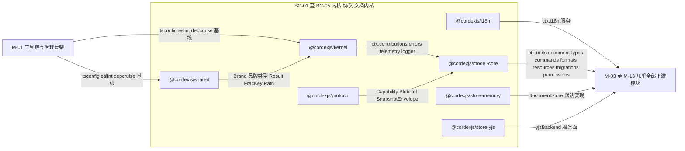

怎么读：七个包共同构成本模块子图，`shared`/`kernel`/`protocol`/`i18n` 是 L0 基座，`model-core`/`store-memory`/`store-yjs` 是 L1 文档内核；唯一上游是 M-01 的构建期基线，下游几乎覆盖全部后续模块。

## 1. 限界上下文与边界

### 1.1 职责与非职责

**BC-01 内核与插件运行时**
- 做：唯一封装 `cordis`；提供 `createHost`、`ContributionPoint`/`Manifest` 机制、`errors`/`telemetry`/`logger` 基础服务、`createIsolatedScope`（文档无关的隔离工具）、失败隔离（Fiber 级）、诊断（`dumpFiberTree`）。
- 不做：不认识任何业务概念——`Unit`/`DocumentType`/`Command`/`Mutation` 属于 BC-05（`createIsolatedScope` 只是通用工具，`Unit`/`UnitScope` 的语义归 model-core，ADR-0005/裁决 C-4）；不提供 UI（M-10）；不做协同传输、不做渲染、不做存储实现。
- 非职责的机械体现：kernel 的 `src/**` 不得出现 `slide`/`store`/`unit` 等业务词根（除类型转发注释）；kernel 自身没有 `cordex.bundle` 字段。

**BC-02 共享基础设施**
- 做：品牌类型（`Emu`/`Pt`/`UnitId`/`NodeId`…）、`Result<T,E>`、断言、`FracKey`/`Path`、哈希、集合工具。
- 不做：不依赖 `cordis`（甚至不知道插件为何物）；不含任何领域知识；不提供任何 `ctx.xxx` 服务（纯值/函数导出，无运行时状态）。

**BC-03 协议与发布语言**
- 做：REST DTO、WS 帧、错误码、权限能力位与角色映射的 Standard Schema（zod 4）定义；`SnapshotEnvelope`/`BlobRef` 等跨进程契约类型。
- 不做：不实现任何业务逻辑或运行时服务；不做实际的 HTTP/WS 传输（属于 `apps/server` 与 `collab-transport-ws`/`server-collab`，M-05/M-08/M-09）；不含 UI 文案（属于 i18n）。

**BC-04 国际化**
- 做：`ctx.i18n` 服务、`i18n.bundle` 贡献点、从 `zh-CN` 源文件反推编译期 key 类型（K8）、ICU 子集格式化。
- 不做：不提供任何产品文案内容本身——各垂直束/UI 包贡献自己的语言包命名空间；不做日期/数字格式之外的本地化（如从右到左排版，不在 v0.1 范围）。

**BC-05 文档内核**
- 做：`Unit`/`UnitScope` 生命周期、`DocumentType` 注册与解析、`DocumentStore` 契约与两个 Provider、`Command`/`Mutation`/`Operation` 三分法执行管线（唯一执行入口）、`History`、`Snapshot`/`SnapshotBundle` 编解码与迁移、`ResourceHook`、权限 fail-closed 检查点、通用 `Selection<A>`、DrawingML 共享绘图词汇。
- 不做：不认识任何具体文档类型语义（`'slide'`/`'doc'`/`'sheet'` 字面量属于 M-03/M-13，lint `no-doc-type-literals`）；不做渲染（M-06/M-07 的 `SceneProvider`/`ElementRenderer` 只是被本层的贡献点/服务承载，逻辑不在此）；不做协同传输具体实现（`store-yjs` 只暴露受控的 `yjsBackend` 服务面，M-05 的 `collab-yjs` 才实现同步协议）；不做服务端 HTTP/WS 传输壳（M-08/M-09）。

### 1.2 通用语言

本节五个上下文使用的核心术语已全部收录于 charter §4.1「核心术语」（内核、插件、纤程、服务、贡献点、清单、文档单元、单元作用域、文档类型、模型、存储、存储原语、降级、命令、变更、操作、事务、来源、变更集、快照、快照包、Blob 引用、派生类型、资源钩子、编解码器、预设、同构类、层带、夹具文档类型）与 §4.3（角色）；不重复定义。

本上下文特有、charter 未收录但本模块架构文档（03/04/05）已定义、后续模块会频繁引用的补充术语表：

| 术语 | 定义 | 所在文件 |
|---|---|---|
| `PointId` | 贡献点 id 的类型：`` `${Lowercase<string>}.${string}` `` | `kernel/src/contribution/point.ts` |
| `ContributionDiagnostic` | 贡献项被拒绝/替换时的诊断记录：`{ pointId, key?, reason: 'schema'\|'duplicate'\|'unknown-point', issues, fiberName }` | `kernel/src/contribution/diagnostics.ts` |
| `Manifest` / `ContributionEntry` | 插件包不运行即可读的静态描述；`ContributionEntry = { point, keys?, count? }` | `kernel/src/manifest/types.ts` |
| `CordexError` / `ErrorTable` / `ErrorCode` | 内核统一错误类型；`ErrorCode = ` `` `${Lowercase<string>}.${Lowercase<string>}` ``（点式 `<域>.<snake_case>`） | `kernel/src/services/errors.service.ts`、`kernel/src/errors.ts` |
| `Capability` | 权限能力位字面量联合（协议词汇，`CommandDef.permission` 的元素类型；04 §2.8 曾用 `PermissionAction`、`01-tooling-and-governance.md` 曾用 `CapabilityBit` 指同一概念，均已按 14 §1 C-15 统一为 `Capability`，见 §12 G-5 已结案） | `protocol/src/permissions/actions.ts` |
| `BodyShapeHints` | `DocumentType.shape`：`{ entityTables, atomicLists, richTexts }` 路径前缀标注，供 Store Provider 选择底层结构 | `model-core/src/document-type/document-type.ts` |
| `TransactionRecord` / `RecordedOp` | 一次事务的完整回放记录（含逆操作、锚点） | `model-core/src/store/transaction.ts` |
| `I18nKeys` | 由 zh-CN 源文件类型级推导出的合法 key 注册表（声明合并增强点） | `i18n/src/keys.ts`、`kernel/src/augment.ts` |

### 1.3 上下文映射

**模块内部**（五个 BC 彼此的关系）：

| 上游 | 下游 | 关系类型 | 防腐层落点 | 传递的契约 |
|---|---|---|---|---|
| BC-02 共享基础设施 | BC-01/03/04/05 | Shared Kernel | — | `Brand<T,Tag>`、`Result<T,E>`、`FracKey`、`Path` |
| BC-01 内核 | BC-04（i18n 消费 `ctx.contributions`） | Open Host Service | `kernel/src/contribution/*.ts` | `ContributionPoint`、`ctx.contribute`/`ctx.contributions` |
| BC-01 内核 | BC-05（model-core 消费 `contributions`/`errors`/`telemetry`） | Open Host Service | `kernel/src/contribution/*.ts` | `ContributionPoint`、`ctx.contribute`/`ctx.contributions` + `errors`/`telemetry` 服务接口 |
| BC-01 内核 | BC-05（`Unit`/`UnitScope` 的隔离机制） | Customer–Supplier | `kernel/src/scope.ts`（`createIsolatedScope`）→ `model-core/src/unit/unit-plugin.ts` | `createIsolatedScope(ctx, { services, meta })` |
| BC-03 协议 | BC-05（`Capability`/`BlobRef`/`SnapshotEnvelope` 词汇复用） | Published Language | `model-core/src/permission/permission.ts` 引用 `protocol` 的 `Capability`；`model-core/src/snapshot/blob-store.ts` 的 `BlobRef` 与 `protocol/src/blob.ts` 同一定义（model-core re-export） | `Capability`、`BlobRef` |
| BC-05 文档内核 | 模块外 BC-06…BC-29（几乎全部） | Customer–Supplier（下游 Conformist） | `model-core/src/{unit,store,command,snapshot}/*.ts` | `DocumentType<S>`、`DocumentStore`、`CommandDef`/`MutationDef`、`ResourceHook` |
| BC-05（store-yjs 的 `yjsBackend`） | 模块外 BC-09 协同（客户端） | Customer–Supplier | `store-yjs/src/yjs-backend.service.ts` | `YjsBackend`（`encodeStateAsUpdate`/`applyUpdate`/`onUpdate`/`stateVector`；§4.21 增 `docHandle()` 与 `registerRemoteOrigin()`，供 `collab-yjs` 把同一 `Y.Doc` 交给 `@hocuspocus/provider`，ADR-0039） |
| BC-03 协议 | 模块外 BC-09 ↔ BC-21、BC-17 ↔ BC-19 | Published Language | `protocol/src/{collab,ws,rest}/*.ts`（`collab/*` 由 M-05/M-09 落地，本模块只定义 REST DTO、CONTROL 载荷、Auth token 与错误码/能力位基座） | CONTROL 判别联合（Stateless 载荷）、Auth token schema、关闭码（§4.21 起线上帧为 Hocuspocus 格式，帧层不由本包编解码，ADR-0039）；Document/Permission/Snapshot DTO |

关于「防腐层」在本模块内部**不**出现独立 ACL 文件：BC-01→BC-05 是纯粹的 Open Host Service（贡献点/服务契约，无需翻译）；BC-02→ 全体是 Shared Kernel（零翻译，直接复用类型）；BC-03 是发布语言本身，不需要再包一层 ACL。真正的 ACL（`ooxml-pptx`）出现在模块外的 BC-08，与本模块无关。

**图 1-1 对外契约与上下游关系**

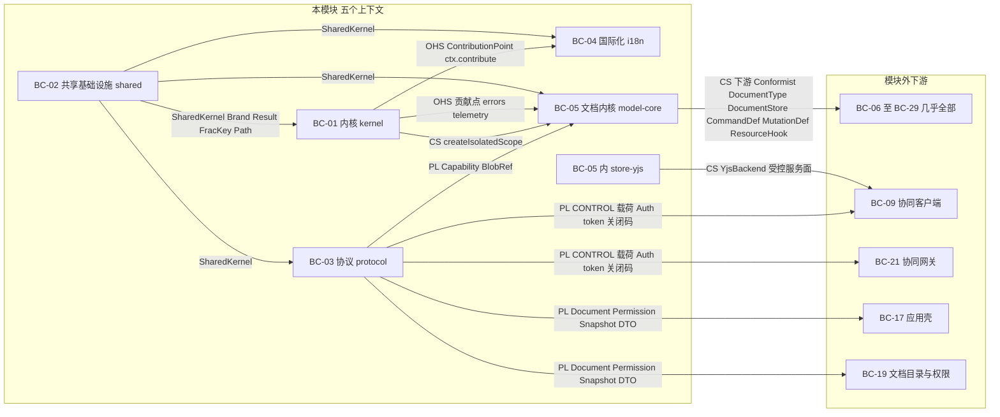

怎么读：箭头从契约提供方指向消费方（与图 0-1 同向），边标签为「关系类型 + 传递的契约」；左侧子图内的边是本模块五个上下文之间的关系，指向右侧的边是对模块外的发布面——文档内核对垂直束、`yjsBackend` 对协同客户端、协议对前后端两组跨进程通道。

依据：本节上表「模块内部」与模块外各行。

## 2. 领域模型

### 2.1 聚合与实体

**`Unit`（聚合根）**

```ts
interface Unit {
  readonly id: UnitId
  readonly documentType: string
  readonly meta: { title?: string; source?: string }
  readonly state: 'opening' | 'ready' | 'closing' | 'failed'
  readonly loadState: 'partial' | 'loaded'   // 渐进打开：首批装载后 partial，全部批次到齐 loaded（rulings §4.18 CO-12）
}
```

- 文件：`model-core/src/unit/unit.ts`。
- `loadState`：非渐进路径（`snapshot`/`state`/`empty`，以及不支持分批的 codec）在 `ready` 时即为 `'loaded'`；渐进打开（下文 `units.open` 渐进路径）在 `unit/opened` 时为 `'partial'`、发 `unit/loaded` 时转为 `'loaded'`。`units.whenLoaded(unitId): Promise<void>` 供全文类命令（全选、查找替换、导出、跨页重排，M-03 守卫）在 loaded 前等待；`units.prioritize(unitId, entityId)` 把用户跳转目标转交导入会话（CO-11）。
- 不变量：`id` 全局唯一（`newNodeId()` UUIDv7 品牌，ADR-0014，跨文档不冲突）；`documentType` 必须能在 `documentTypes` 服务解析，否则整个打开流程在 `opening` 阶段即失败（常量 `UNIT_UNKNOWN_DOCUMENT_TYPE`，错误码值 `format.no_document_type`——唯一权威拼写，见 §2.6 错误码通则与 14 §1 C-16）；`state` 只能由 §2.1 状态机驱动迁移，UI/插件不得直接赋值（无 public setter）。
- 并发/CRDT 下的合并语义：`Unit` 是宿主进程内的运行时句柄，一机一份，不参与 CRDT、不跨端合并；协同收敛发生在它持有的 `store`（`store-yjs` 场景）。两个客户端各自的 `Unit` 实例是完全独立的对象，仅通过 `id` 相等性关联同一份文档。

**`UnitScope`（聚合根的运行时投影与生命周期句柄；ADR-0005）**

```ts
interface UnitScope {
  readonly unit: Unit
  readonly ctx: Context           // 隔离后的子 ctx：ctx.store / ctx.history / ctx.selection / ctx.render / ctx.presence 可用
  readonly fiber: Fiber
  dispose(): Promise<void>
}
```

- 文件：`model-core/src/unit/unit-scope.ts`。
- `UnitScope` 不是独立聚合，是 `Unit` 在 cordis 世界的**实现载体**：一个 Unit = 一个插件 Fiber（`ctx.plugin(unitPlugin, { descriptor })`）；「关闭 Unit」= `fiber.dispose()`（cordis 逆序运行全部 effect）。
- `ctx` 是对隔离服务集合逐个 `isolate()` 后的子 Context；隔离服务集合 = `['store','history','selection','render','presence']` ∪ `documentType.unitServices` ∪ 所选 `store` Provider 的全部 `provide` 名（如 `store-yjs` 的 `yjsBackend`，使 `collab-yjs` 在 `store-memory` 场景下自然 `PENDING`，ADR-0005 第 3 条）∪ 打开时刻 UnitScope 默认 Provider 登记项声明的全部 `provides`（如 `comments` 服务按 Unit 各一份；`ISOLATED_SERVICES` 常量只含前五项，登记项部分由 `unit-plugin.ts` 在 `createIsolatedScope` 时并入，30/03 §5.1a、§5.2；rulings §4.20 FE-01）。
- 归属查询：`unitOf(ctx): Unit | undefined`（读 `ctx[UnitScope.unit]`，`extend()` 挂载的元数据）；事件载荷一律显式携带 `unitId`，不依赖 ctx 推断（检查项 `unit-events-carry-unitId`：不是独立扫描器，按 rulings §4.18 GV-15 落为类型测试断言 `model-core/__tests__/unit-events.type-test.ts`（TD-098），对照见 09-type-discipline/08 §11.1）。

**UnitScope 生命周期状态机**（权威定义于架构 03 §5.3，本节固化为 model-core 的实现契约；状态名与迁移条件不得在实现中漂移）：

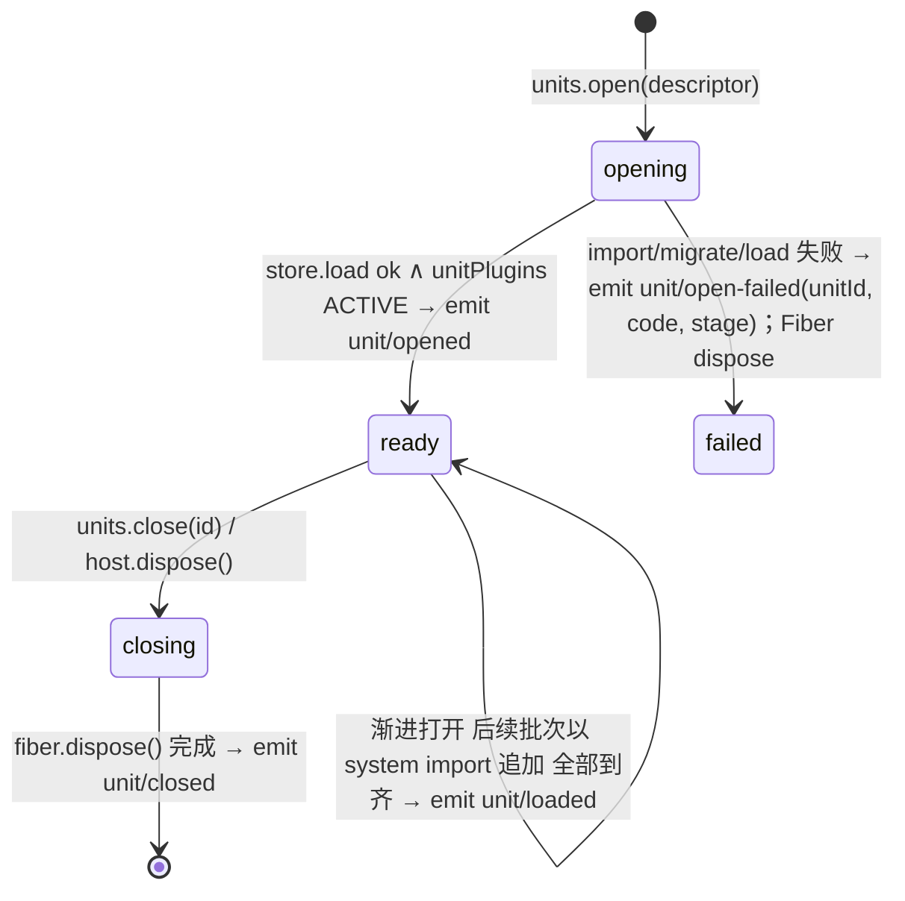

`units.open` 的六个步骤（实现于 `model-core/src/unit/unit-plugin.ts`，任一步失败即 `Result.err` 并迁移到 `failed`）：① 解析 `documentType`（`documentTypes.get`；缺失 → `UNIT_UNKNOWN_DOCUMENT_TYPE`，值 `format.no_document_type`）；② 按 `source.kind`（`'bytes'`→`formats.import`；`'snapshot'`→直接用；`'state'`→交给所选 Provider 的 `loadState`；`'empty'`→`documentType.createEmpty()`）取得 `SnapshotBundle`；③ `migrations.run(snapshot)` 到 `documentType.schemaVersion`、`validateSnapshot`；④ `createIsolatedScope` 建隔离域，按 UnitScope 默认 Provider 登记表（下段）挂 `provides` 含 `store` 的那一条 Provider、`store.load(body)`（渐进打开时只装首批 body）、`resources.apply(...)`；⑤ **按登记表挂载**其余默认 Provider（打开时刻登记表的快照：history、selection 由 model-core 自登记，render、presence、collab-yjs、comments 等由 preset 登记）与 `documentType.unitPlugins`，等待全部子 Fiber 稳定（`PENDING` 不算失败，见 03 §7；某服务无人登记即缺席，依赖方 `PENDING`）；⑥ 注册进 `units` 表、`emit('unit/opened')`（渐进打开时此刻首批已可渲染、可编辑，`loadState='partial'`）。`opening` 期间的中间反馈经 `unit/open-progress` 事件（大文件导入进度）。

**UnitScope 默认 Provider 登记表（rulings §4.20 FE-01，40/11 Q-2 结案）**：`units` 服务（`model-core/src/unit/units.service.ts`）提供 `units.registerUnitProvider(entry: UnitProviderEntry): Disposer` 与 `units.listUnitProviders(): readonly { id: PluginId; provides: readonly string[] }[]`，`UnitProviderEntry = { id: PluginId; plugin: Plugin; config?: unknown; provides: readonly string[] }`（形状即 [50/03](../50-frontend/03-preset-assembly-and-plugins.md) §6.2，`Disposer = () => void`）。登记分工：model-core 在 ready 时只自登记 `history`、`selection` 两个默认 Provider；`store`（store-memory 或 store-yjs）、`render`、`presence`、`collab-yjs`、`comments` 由 preset 的 `scope:'unit'` 条目在 mount 时登记（kernel `mountEntries()` 对这类条目不在根挂载，改调本 API，见 §2.3）。规则：① 同一 `provides` 服务名只允许登记一次，后来者被拒并记诊断（经 `errors`/`telemetry`）、不抛异常；② 登记表的变化只影响之后打开的 Unit，已打开的 Unit 不变（需重开才生效）；③ preset dispose 时经返回的 `Disposer` 撤销全部登记，撤销后 `listUnitProviders()` 无残留。model-core 不 import 任何秩更高的水平层 Provider 包（章程 §5.3 只向下，既有 depcruise 秩规则兜底）；原 `Config.defaultStoreProvider` 字符串删除，store 由唯一的 `provides:['store']` 登记决定（collab 预设的 store-memory → store-yjs 替换在 40/11 `derive.ts` 完成）。登记表用例（`model-core/src/unit/__tests__/units-registry.test.ts`，归 `test/unit`：登记表只有 model-core 一个实现、不调用 kit，按 70/01 §4 文件名前缀规则不进 `test/contract`；用例 id 见 70/02 §9.1，见 §9）：同一 `provides` 第二次登记被拒且有诊断；登记后打开的 Unit 挂上登记项、已打开的 Unit 不变；dispose 后 `assertNoLiveEffects` 为空。M1 前定稿。

**渐进打开：首批装载、后台追加（rulings §4.18 CO-12/CO-11，按 50-frontend/04 §2）**：`source.kind==='bytes'` 且所选 `FormatCodec` 实现了可选的 `importProgressive()`（§2.2）时走此路径，否则仍一次装载。① codec 在 Worker 内跑导入管线，**先完成全部页的规模计数**——超系统天花板整体拒绝（`format.quota_exceeded`），不会装到一半才失败；② 首批（主题/母版/版式 + 首页所在批次）以 `SnapshotBundle` 回传，经第 ③ 步迁移校验后按 ④–⑥ 装载并发 `unit/opened`；③ 后续批次以 `origin: system('import')` 的事务追加进 Store（见 §2.5「import 追加语义」：只新增、不入撤销栈、DirtyTracker 忽略该来源，零编辑导出零脏部件）；④ 全部批次到齐后 `loadState='loaded'` 并 `emit('unit/loaded')`；⑤ 用户跳转到未解析的实体时，`units.prioritize(unitId, entityId)` 调 `ProgressiveImport.prioritize(entityId)`，Worker 完成当前页后先解析该实体所在批次，已解析未装载的批次提到装载队首。Worker 入口与分批协议由 codec 所在模块登记（slide 为 M-04 `ooxml-pptx`）。协同模式不走此路径（Y 状态由 HTTP 快照 bootstrap，`source.kind==='state'`）。

「技术性登记表，非业务聚合」：kernel 的 Fiber 树、`ContributionPoint` 注册表、`ErrorTable`/遥测事件注册表不是本文档意义上的聚合——它们是插件运行时自身的诊断/注册结构（module-map BC-01 行原文表述）；在 §2.5「仓储 / 存储契约」中作为「贡献点表」的实现载体出现，不在本节重复建模。

### 2.2 值对象

| 名称 | 字段（要点） | 校验 schema | 所在文件 |
|---|---|---|---|
| `DocumentType<S>` | `id`、`displayName`、`schemaVersion`、`bodySchema`、`shape: BodyShapeHints`、`createEmpty()`、`unitPlugins`、`unitServices`、`selectionKinds`、`viewModes`、`invariants`、`validateChangeSet()`、`diff?()` | 贡献时经 `core.documentType` 的 `schema` parse | `document-type/document-type.ts` |
| `StoreOp`（5 变体判别联合） | `set\|delete\|insert\|remove\|text`（无 `move`，ADR-0013）；**软删除不新增变体**（rulings §4.15 Q3）：实体删除由文档类型的 `lower()` 降为 `set(<实体路径>._deleted, Tombstone)`，撤销删除 = `delete(<实体路径>._deleted)`，只有服务端 TTL 硬删除才对实体本身发 `delete`/`remove` | `isStoreOp()` 运行时守卫；无 zod（内部热路径） | `store/ops.ts` |
| `Transaction` / `TransactionRecord` / `RecordedOp` | 见 §2.5、§2.6 | 无独立 schema（运行时对象，不跨进程） | `store/transaction.ts` |
| `ChangeSet` | `transactionId`、`origin`、`ops: StoreOp[]\|null`、`derived: boolean`、`touched: Path[]` | 无独立 schema（运行时对象，不跨进程） | `store/change-set.ts` |
| `Tombstone` | `{ at: EpochMs; by: ClientId; byUser?: UserId }`，挂在实体的保留键 `_deleted` 上（rulings §4.15 Q3）。`byUser` 于 2026-09-25 增补：命令层在降为 `set(_deleted, Tombstone)` 时写入当前 principal 的 `userId`，供版本历史「最近删除」显示删除者（设计 03-screens/07；`by` 是 Yjs clientID，离线后无法映射到用户）。该字段由客户端写入、可被伪造，服务端软门禁 L4 须校验 `byUser` 等于来源会话的 `userId`，不符即以 `system('repair')` 还原为会话 userId（与评论作者规则同一机制，[60/16](../60-backend/16-ws-protocol-server-view.md) L4；先例 ADR-0034 补充 v0.2 路径级校验） | 无 zod（内部），`isTombstoned()` 运行时守卫 | `store/tombstone.ts` |
| `UndoSkip` | `{ path: Path; reason: 'remote-conflict' \| 'remote-deleted' }`——撤销时因「同一键被他人后写」（`remote-conflict`）或「目标实体已被他人删除，墓碑 TTL 内亦然」（`remote-deleted`，rulings §4.17 D4）而跳过的键 | 无独立 schema（运行时对象） | `store/transaction.ts` |
| `Origin` | `local(clientId, via?)` \| `remote` \| `system(reason)` \| `replay`——`via?: 'undo' \| 'redo'`（新增，14 §1 C-14）；`reason: 'load' \| 'import' \| 'migration' \| 'repair' \| 'restore' \| 'maintenance'`——前三项为架构 04 §2 既有取值（`'import'` 用于渐进打开的后续批次追加，rulings §4.18 CO-12），后三项为新增（同上，采纳 06 号协议契约 §18.2 的两项增补，见本节末尾） | 判别字面量，无 zod（纯内部） | `store/origin.ts` |
| `Snapshot<S>` | `documentType`、`schemaVersion`、`unitId`、`body: Persisted<S>`、`resources`、`blobs: BlobRef[]` | `validateSnapshot()` 组合 `bodySchema` + 各 `ResourceHook.schema` | `snapshot/snapshot.ts` |
| `SnapshotBundle<S>` | `{ snapshot; blobs: BlobStore }` | `validateSnapshot()` 组合 `bodySchema` + 各 `ResourceHook.schema` | `snapshot/snapshot.ts` |
| `BlobRef` | `{ hash: Sha256Hex; size; contentType }` | zod（与 `protocol/src/blob.ts` 同一定义，model-core re-export） | `snapshot/blob-store.ts` |
| `Migration<S1,S2>` | `documentType`、`from`、`to = from+1`、`migrate(body)`、`migrateResources?` | 贡献时经 `core.migration` 的 `schema` | `migration/migration.ts` |
| `PermissionRequest` / `PermissionDecision` | `{ principal; unitId?; action: Capability; resource? }` / `{ allow: true } \| { allow: false; reason }` | `Capability` 来自 `protocol` | `permission/permission.ts` |
| `Selection<A>` | `{ kind; unitId; anchors: readonly A[]; primary? }` | `kind` 取自 `documentType.selectionKinds`；`A` 由文档类型定义 | `selection/selection.ts` |
| `FormatCodec<S>` / `ImportResult<S>` / `ProgressiveImport<S>` | `{ id; documentType; mimeTypes; extensions; canImport; canExport; import(); export(); importProgressive?() }` / `{ snapshot; diagnostics }` / `{ first: ImportResult<S>; batches: AsyncIterable<BodyBatch<S>>; prioritize(entityId): void; cancel(): void; done: Promise<Result<void, FormatError>> }`——`importProgressive` 可选，返回 `first` 之前必须完成规模包络计数（超天花板整体拒绝）；`BodyBatch` 只含新增实体与有序集合键（rulings §4.18 CO-12/CO-11） | 贡献时经 `core.format` 的 `schema` | `format/format-codec.ts` |
| `ContributionPointSpec<T,K>` / `ContributionPoint<T,K>` | `{ id: PointId; schema; key; conflict?; describe? }` | `defineContributionPoint()` 构造时自检字段完整性 | `kernel/src/contribution/point.ts` |
| `Manifest` | 见 §1.2 补充术语表 | `manifest/schema.ts` 的 Standard Schema | `kernel/src/manifest/types.ts` |
| `PresetEntry` / `LazyPresetEntry` / `PresetTrim` / `PresetReport` | 新增（14 §1 C-07）：`PresetEntry{id;plugin;config?;scope:'host'\|'unit';required?;provides?: readonly string[]}`（稳定 id 的插件条目；`scope`、`provides` 与 40/11 §6 契约草案一致，`scope:'unit'` 条目经 `units.registerUnitProvider` 登记，rulings §4.20 FE-01）、`LazyPresetEntry`（`entry` 字段为动态 `import()`）、`PresetTrim`（`exclude`/`override` 裁剪描述）、`PresetReport`（`Promise.allSettled` 汇总，逐条 ok/failed） | `kernel/src/preset/entry.ts`（`PresetEntry`/`LazyPresetEntry`）、`kernel/src/preset/report.ts`（`PresetReport`） |
| `CordexError` / `ErrorTable` | 见 §1.2 补充术语表 | `defineErrors(domain, table)` 构造时校验 `table` 形状 | `kernel/src/services/errors.service.ts` |
| `Capability` / 角色→能力位映射 | 见 §1.2 补充术语表；角色 `owner\|editor\|commenter\|viewer` | zod 字面量联合 + `ROLE_CAPABILITIES` 表 | `protocol/src/permissions/{actions,roles}.ts` |
| DrawingML 值对象群 | `Color`/`Fill`/`Line`/`EffectList`/`Geometry`/`Transform`/`FontRef`/`TextBody` 家族/`Hyperlink`/`OpaqueXml` | 各自 `drawing/schema/*.schema.ts` | `model-core/src/drawing/*.ts` |

**`Origin` 判别字面量正式接受两项增补（14-cross-module-review.md §1 C-14）**：`30-architecture/06-collaboration.md` §18.2 曾提出 `system.reason` 需覆盖 `'repair'`（协同修复）、`'restore'`（`core.restoreVersion`，已在 §2.6 使用）、`'maintenance'`（`rekey()` 等键长治理，见 §2.3）三个取值，`local.via` 需覆盖 `'undo'`/`'redo'`（§2.6 新增的 `core.undo`/`core.redo`，C-02）。M-05（`05-collaboration-client.md` G-6）已按此增补书写 `domain/session-state.ts` 但假定「06 §18.2 的增补请求已被接受」——本文档在此正式接受并回填，`06-collaboration.md` §2.2/§18.2 的 `TransactionOrigin`/类层级命名（`LocalOrigin`/`RemoteOrigin`/`RepairOrigin`）为历史草稿写法，以本文档 `Origin` 判别字面量为准（`TransactionOrigin` 一词作废）。

### 2.3 领域服务

纯函数清单（全部 `iso`，两端共用；不读时钟、不读随机源，除非明确标注）：

| 签名（草案） | 所在文件 | 两端共用 | 备注 |
|---|---|---|---|
| `between(a?: FracKey, b?: FracKey, random?: Random): FracKey` | `shared/src/order.ts` | 是 | 2026-09-26 按 ADR-0032 修订改写（rulings §4.21 q-frackey）：内置 rocicorp fractional-indexing 4.0.0 算法源码（CC0-1.0，文件头注明仓库、版本、提交与 CC0 声明，不作 npm 依赖）；键 = 整数头 + base-62 小数，按码元序比较，小数末位非 `'0'`；`between` = `generateKeyBetween(a, b)` + 2 位随机后缀（取自注入的 `Random`，缺省 `SystemRandom`，rulings §4.20 TX-10；第 2 位不取 `'0'`），上界以中间键为前缀时回退为 `generateKeyBetween(m, b)`；导入与 `rekey` 用 `generateNKeysBetween` 的确定性键、不加后缀。**只能在命令层调用**，不得出现在 `lower()` 内（ADR-0013） |
| `compareOrder(a: [FracKey,string], b: [FracKey,string]): number` | `shared/src/order.ts` | 是 | 排序键 `(order, id)` |
| `rekey(keys: readonly FracKey[]): readonly FracKey[]` | `shared/src/order.ts` | 是 | 键长治理（origin=`system('maintenance')`） |
| `sha256(bytes: Uint8Array): Promise<Sha256Hex>` | `shared/src/hash.ts` | 是 | WebCrypto `subtle`，同构 |
| `stableStringify(v: JsonValue): string` | `shared/src/json.ts` | 是 | 键排序，供哈希与快照 diff |
| `applyOp(state, op): { next; inverse: StoreOp }` | `store-memory/src/apply-op.ts` | 是 | 五种原语的应用与逆推导（§2.5） |
| `verifyManifestAgainstRuntime(fiber, manifest): MismatchReport` | `kernel/src/manifest/verify.ts` | 是 | ADR-0003 |
| `satisfies(range: string, version: string): boolean` | `kernel/src/manifest/version.ts` | 是 | 内置最小 semver 子集（`^`/`~`/`>=`/精确/`\|\|`），避免拉入 `semver` 包（ADR-0002） |
| `validateSnapshot(snapshot, documentType, resourceHooks): Diagnostics` | `model-core/src/snapshot/validate.ts` | 是 | 组合 `bodySchema` + 各 `ResourceHook.schema` + `blobs` 清单一致性 |
| `dumpFiberTree(ctx): FiberNode[]` | `kernel/src/diagnostics/fiber-tree.ts` | 是 | 诊断，非领域逻辑但无副作用 |
| `mountEntries(ctx, entries: PresetEntry[]): Promise<PresetReport>` | `kernel/src/preset/mount.ts` | 是 | 新增（14 §1 C-07）：装配运行时核心——按序 `ctx.plugin()` 挂载，单条失败不阻塞其余（`allSettled` 语义），供 `preset-slide*`/未来 `preset-doc`/`preset-sheet` 复用；`scope:'unit'` 条目不在根挂载，改为调用 `units.registerUnitProvider`（kernel 只声明结构类型 `UnitProviderRegistrar`，不 import model-core），撤销函数由 preset effect 持有（rulings §4.20 FE-01，§2.1） |
| `lazy(loader: () => Promise<Plugin>): LazyPresetEntry` | `kernel/src/preset/lazy.ts` | 是 | 惰性插件条目包装，供 `slide-render-chart` 等重型可选特性拆包套路复用（00 §6.2） |
| `trim(entries, opts: {exclude?; override?}): PresetEntry[]` | `kernel/src/preset/validate.ts` | 是 | `exclude`/`override` 裁剪校验，支撑「移除任一 Provider 仍可启动」验收（BC-16） |
| `format(pattern, params, locale): string`（ICU 子集） | `i18n/src/format.ts` | 是 | `plural`/`select` + `Intl` 数字/日期 |

`lower(mutation, view): Result<StoreOp[], LowerError>` **不在 model-core 中有具体实现**——它是 `MutationDef` 的字段，由各文档类型（BC-06 等）贡献；model-core 只定义其类型契约（`command/mutation.ts`）与执行位置（`command/pipeline.ts` 的 ④ 阶段）。

### 2.4 领域事件

全部在 `kernel.contribution.ts` / `i18n.contribution.ts` / `model-core.contribution.ts` 的 `Events` 增强中声明（lint 规则 `cordex/events-must-be-declared`，08 §11 对照名 `events-declared`；rulings §4.18 GV-15）；域名固定为章程 §5.5 保留域 `kernel contribution unit command store history selection permission format render layout ui i18n collab presence plugin error perf slide doc sheet` 之一。**`export` 域例外**：下表 `export/started`/`completed`/`failed` 三个事件所用的 `export` 域尚不在该保留域清单内，按 14-cross-module-review.md §1 C-24 裁定标记为「新增建议，已提请章程 §5.5 收编」，不视为本模块违反自述的白名单约束——本文档在合并白名单正式生效前先行使用，收编前扫描器需为 `export` 域临时加白（与 `40-modules/05` §2.4 的 `collab-server` 同类处理）。

| 事件 | 模式 | 载荷（要点） | 发布者文件 | 典型订阅者 |
|---|---|---|---|---|
| `plugin/loaded` | emit | `{ pluginId, version }` | `kernel/src/failure-isolation.ts` | 诊断面板、`server-headless validate` |
| `plugin/failed` | emit | `{ pluginId, version, code, phase }` | `kernel/src/failure-isolation.ts` | `errors` sink、诊断面板 |
| `plugin/incompatible` | emit | `{ pluginId, required, actual }` | `kernel/src/manifest/verify.ts` | 诊断面板 |
| `error/raised` | emit | `(error: CordexError)` | `kernel/src/services/errors.service.ts` | `errors.sink` 贡献方 |
| `contribution/changed` | emit | `(pointId, kind, key)` | `kernel/src/contribution/set.ts` | 任意 `observe()` 消费方 |
| `kernel/manifest-mismatch`（内部诊断） | emit | `MismatchReport` | `kernel/src/manifest/verify.ts` | 诊断面板 |
| `i18n/locale-changed` | emit | `(locale)` | `i18n/src/services/i18n.service.ts` | UI 框架层 |
| `unit/opened` | emit | `(unit: Unit)` | `model-core/src/unit/unit-plugin.ts` | 渲染（`SceneProvider.build`）、UI；渐进打开时首批装载后即发（`loadState='partial'`） |
| `unit/loaded` | emit | `(unitId)` | `model-core/src/unit/unit-plugin.ts` | 新增（rulings §4.18 CO-12）：渐进打开的全部批次到齐（`loadState='loaded'`）；全文类命令守卫（M-03）、打开进度 UI、`perf` 埋点「后台全部解析完成」；非渐进路径紧随 `unit/opened` 发出 |
| `unit/open-progress` | emit | `(unitId, progress)` | `model-core/src/unit/unit-plugin.ts` | 打开进度 UI |
| `unit/open-failed` | emit | `(unitId, code, stage)` | `model-core/src/unit/unit-plugin.ts` | 错误提示 UI |
| `unit/closed` | emit | `(unitId)` | `model-core/src/unit/units.service.ts` | 资源清理 |
| `unit/dirty-changed` | emit | `(unitId, dirty: boolean)` | `model-core/src/unit/units.service.ts` | 「未保存」提示 |
| `unit/saved` | emit | `(unitId)` | `model-core/src/unit/units.service.ts`（由导出/保存命令触发） | 状态栏 |
| `unit/migrated` | emit | `(unitId, from, to)` | `model-core/src/migration/migrations.service.ts` | 审计 |
| `command/execute` | waterfall | `(request, next) → Promise<CommandResult>` | `model-core/src/command/pipeline.ts` | `permission-gate`、`audit`、第三方拦截器（唯一拦截链） |
| `command/executed` | emit | `(unitId, id, params, result)` | `model-core/src/command/pipeline.ts` | UI（`canUndo` 等） |
| `command/rejected` | emit | `(unitId, id, reason)` | `model-core/src/command/pipeline.ts` | 遥测计数（不 `errors.report`） |
| `command/failed` | emit | `(unitId, id, error)` | `model-core/src/command/pipeline.ts` | `errors.report`、审计 |
| `command/audited` | emit | `(record: AuditRecord)` | `model-core/src/command/audit.ts` | 服务端审计（M-12） |
| `store/transaction` | emit | `(unitId, changeSet)` | `store-memory`/`store-yjs` 的 Provider | `SceneProvider.diff`（渲染脏区） |
| `store/loaded` | emit | `(unitId)` | `store-memory`/`store-yjs` 的 Provider | — |
| `store/undo-skipped` | emit | `(unitId, { skipped: UndoSkip[]; wholeStep: boolean })` | `store-memory`/`store-yjs` 的 Provider（新增，rulings §4.15 Q3） | UI 提示条「部分内容已被他人修改，未撤销」+「恢复我的值」（新事务，非撤销；PRD CO-08）；载荷 `{skipped: UndoSkip[], wholeStep}` 为唯一形状（复核 M2，30-architecture/05/06/10 与 M-05 照抄）；埋点**单独统计**跳过次数与整步跳过次数，不计入软冲突率（rulings §4.17 D5，M-05 落地） |
| `history/changed` | emit | `(unitId, { canUndo, canRedo, depth })` | `model-core/src/history/history.service.ts` | UI 上下文键 |
| `selection/changed` | emit | `(unitId, selection)` | `model-core/src/selection/selection.service.ts` | presence 广播（M-05） |
| `permission/changed` | emit | `(unitId, { added, removed })` | `model-core/src/permission/permissions.service.ts`（唯一发出者，扫描器校验） | UI `isReadOnly` 等上下文键 |
| `permission/denied` | emit | `(request, decision)` | `model-core/src/permission/permissions.service.ts`（唯一发出者，扫描器校验） | 遥测计数 |
| `export/started`/`completed`/`failed` | emit | `(unitId, formatId, …)` | `model-core/src/format/formats.service.ts` | 进度 UI、审计（`export` 域为新增建议，见本节上方说明） |

### 2.5 仓储 / 存储契约

**`DocumentStore<S>`（Definition；`model-core/src/store/store.ts`；Provider：`store-memory`、`store-yjs`）**

```ts
interface DocumentStore<S = unknown> {
  readonly unitId: UnitId
  readonly schemaVersion: number
  state(): Persisted<S>
  get<T = unknown>(path: Path): T | undefined
  transact(fn: (tx: Transaction) => void, options: TransactOptions): Result<TransactionRecord, StoreError>
  observe(listener: (change: ChangeSet) => void): () => void
  undo(origin: Origin): Result<TransactionRecord | null, StoreError>
  redo(origin: Origin): Result<TransactionRecord | null, StoreError>
  canUndo(origin: Origin): boolean
  canRedo(origin: Origin): boolean
  toSnapshotBody(): Persisted<S>
  load(body: Persisted<S>, origin: Origin): Result<void, StoreError>
  dirty(): ChangeSet | null
}
```

契约套件：`runDocumentStoreConformance(createStore: (body) => DocumentStore)`（`model-core/src/testing/document-store-conformance.ts`），覆盖：事务原子性、`state()` 引用语义（事务内不变、事务后变化）、`observe` 时序（一次事务一次通知）、`undo/redo` 按 `origin` 过滤、`load` 后 `canUndo` 为 `false`、快照往返（`toSnapshotBody()` 深等于 `load` 入参）、`text` delta 语义、嵌套事务拒绝（`STORE_NESTED_TRANSACTION`）、import 追加（`import-append`，见下段）。`store-memory`/`store-yjs` 的 `__tests__` **必须**实例化本套件（`scan-manifest` 规则 (e)「每个 provider 必有 conformance 调用」，原名 `provider-runs-conformance`，rulings §4.18 GV-15）；rulings §4.15 Q3 起新增「中性撤销语义」分节（见下），用例名见下方**撤销协同契约用例名表**（唯一事实源），两个 Provider 同语义通过。

**中性撤销语义（rulings §4.15 Q3，Definition 层契约，与 CRDT 选型无关）**：
1. **配置字段中性化**：两个 Provider 的 `Config` 共有 `undo.remoteConflict: 'skip'`（M1–M3 唯一取值；枚举保留扩展位，不得出现 Yjs 专名）。
2. **跳过他人后写**：`undo(origin)` 应用一步撤销前，按键（`Path`）判定「该键在本步之后是否被**其他 origin** 写过」；被他人后写的键**不覆盖**，记入 `TransactionRecord.skipped: UndoSkip[]`，其余键照常回滚，并 emit `store/undo-skipped`。UI 提供「恢复我的值」——这是新的 `local` 事务，不是撤销。
3. **整步跳过即停（undo-skip-no-cascade）**：若一步内全部键都被跳过，该步出栈、返回 `skipped` 非空且 `ops` 为空的记录、emit `store/undo-skipped{wholeStep:true}`，**不自动继续撤销下一步**；`redo` 同理对称。
4. **软删除**：实体删除写 `_deleted: Tombstone` 标记（`StoreOp` 仍 5 种，见 §2.2），实体 id 稳定；**删除方**撤销自己的删除即清除标记，期间他人对该实体的编辑随之保留（delete-vs-edit 不再「delete 胜后丢弃」）。**撤销永不复活他人删除的元素**（rulings §4.17 D4）：他人撤销时目标已被删除（墓碑 TTL 内亦然，不看 TTL）→ 该键以 `reason:'remote-deleted'` 跳过并提示；恢复只能由删除方撤销或显式命令「恢复元素」（新 `local` 事务）完成。
5. **读路径过滤**：`state()`/`get()` 返回原始树（含墓碑，供协同与快照）；面向业务的只读视图由 `store/tombstone.ts` 的 `filterLive()`/`isTombstoned()` 过滤，文档类型的选择器、渲染 `SceneProvider`、导出 `FormatCodec` 一律经过滤后读取（M-03/M-04/M-07 各自落地）。
6. **TTL 硬删除由服务端单写者执行**：墓碑默认 TTL 24h（部署可调），到期由服务端协同房间的单写者以 `system('maintenance')` 事务对实体发硬删除（M-09 落地）；客户端 Provider **从不**自行硬删除墓碑。两条不等 TTL 的路径（术语按 rulings §4.18 CO-07 拆开）：文档级「永久删除文档」（文档擦除，S-2 purge）；元素级「彻底删除元素」——只对墓碑态元素开放、只能由 owner 发起，`POST /documents/:id/elements/purge{ids}`（M-08 鉴权）交 M-09 单写者以 `system('maintenance')` 立即硬删（复用 tombstone-sweeper 事务），写审计 `document.element_purged`；只清当前文档状态，历史快照与 update 表按保留期存在。墓碑计入文档总元素上限（20,000，M-03 不变量）。**`undo(origin)`/`redo(origin)` 的 `origin` 实参口径**（14 §1 C-14）：`core.undo`/`core.redo`（§2.6）调用时传 `local(clientId,'undo')`/`local(clientId,'redo')`；契约套件按 `origin.local.clientId` 过滤（同一 `via` 取值不影响过滤逻辑，`via` 仅供审计/遥测区分撤销来源，不参与 Store 内部匹配）。

**图 2-2 中性撤销判定流程**

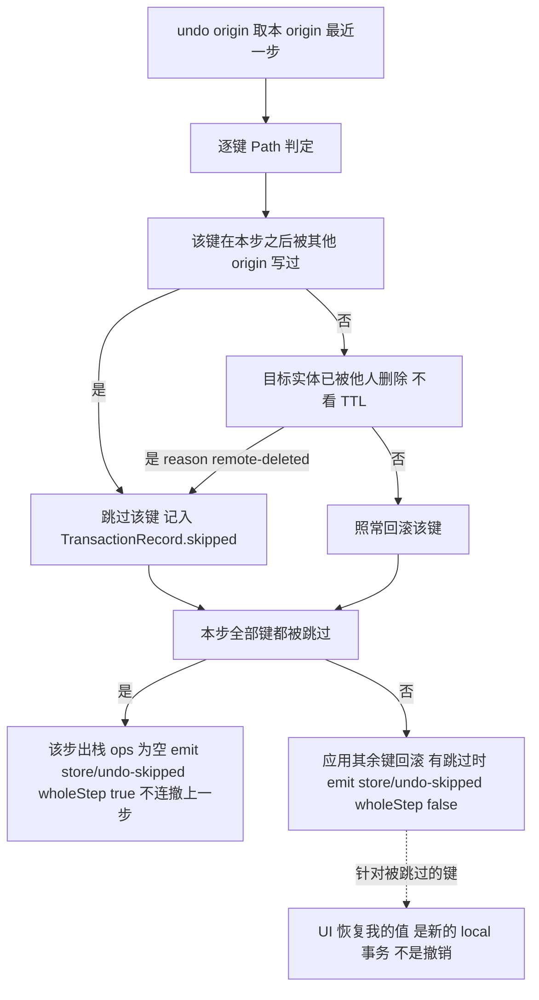

怎么读：两处判定（他人后写、他人已删除）任一命中即跳过该键，图中先后不代表实现顺序；整步跳过时停在该步、不自动继续撤销更早一步（`undo-skip-no-cascade`），`redo` 对称；撤销永不复活他人删除的元素，恢复只能由删除方撤销或显式「恢复元素」命令完成。

依据：本节「中性撤销语义」第 2–4 条；rulings §4.15 Q3、§4.17 D4/D5。

**撤销协同契约用例名表（唯一事实源，2026-09-24 复核修正 M3）**：`runDocumentStoreConformance` 协同分节只使用下表五个用例名；ADR-0020、30-architecture/05 §「如何被机械验证」、06 §8、11 §「契约套件」、M-05 §9 等处一律**照抄本表**，不另起名。

| 用例名 | 断言（store-memory 与 store-yjs 必须同结果） | 对应条款 | 作废别名（不得再用） |
|---|---|---|---|
| `remote-conflict-skip` | 同一键在本步之后被他人写过 → 该键跳过、不覆盖，其余键照常回滚；emit `store/undo-skipped{skipped, wholeStep:false}` | 第 2 条 | — |
| `undo-skip-no-cascade` | 一步内全部键被跳过（含目标已被他人删除；含目标实体已被硬删除——墓碑 TTL 到期或经审计的「彻底删除元素」之后，删除方再撤销该步同样整步跳过，rulings §4.18 CO-07）→ 该步出栈、emit `store/undo-skipped{wholeStep:true}`，**不继续撤销更早一步**；`redo` 对称 | 第 3 条 | — |
| `soft-delete-tombstone` | 删除写 `_deleted` 墓碑、实体 id 稳定；删除方撤销自己的删除 = 以原 id 清除墓碑；用户删除的降级结果只有 `set(<实体路径>/_deleted, {at, by})`，**不含对实体键的 `delete`**（逆操作由 Store 推导为 `delete(<实体路径>/_deleted)`，rulings §4.18 CO-05） | 第 4 条 | `soft-delete-restore-same-id`、`delete-tombstone-undo`（前半） |
| `delete-vs-edit-undo` | (a) 删除方撤销与他人「恢复元素」并发 → 仍只有一份、他人编辑不丢；(b) 他人撤销时目标已被删除（墓碑 TTL 内亦然）→ 跳过并提示、**不复活**（rulings §4.17 D4） | 第 2/4 条 | `delete-vs-edit-no-dup`、`delete-tombstone-undo`（后半） |
| `read-path-filters-tombstone` | `filterLive()` 视图、选择器、`SceneProvider`、`FormatCodec` 读取均不含墓碑实体；`state()` 原始树含墓碑 | 第 5 条 | `tombstone-filtered-on-read` |

**import 追加语义（新增，rulings §4.18 CO-12；契约套件用例 `import-append`，两个 Provider 同语义）**：渐进打开的后续批次以 `transact(fn, { origin: system('import'), label, undoable: false })` 进入 Store（与架构 04 §2.2 同一写法），不新增接口方法，但该来源的事务受三条约束——(a) **只新增**：只允许 `set`/`insert` 当前不存在的实体键与有序集合键，触及已存在的键即整体拒绝（`STORE_IMPORT_APPEND_CONFLICT`，值 `store.import_append_conflict`），因此不会覆盖用户在首批上的编辑；(b) **不入撤销栈**：不进入任何 origin 的撤销/重做栈，`load` 之后的 `canUndo` 不受追加影响，也不计入「跳过他人后写」判定的最后写入表；(c) **照常通知**：`observe` 仍一次事务一次 `ChangeSet`（`origin` 为 `system('import')`），渲染据此增量构建，`DirtyTracker`（M-04 `ooxml-core`）与 `unit/dirty-changed` 忽略 `system('load'|'import')` 来源——打开 200 页后零编辑导出，零脏部件。

**两个 Provider 的差异**（同一契约、不同实现）：

| 维度 | `store-memory` | `store-yjs` |
|---|---|---|
| 状态表示 | 不可变树 + 结构共享（`produce.ts`，≤200 行最小 path-based 更新，无第三方 immer） | `Y.Doc`（唯一 import `yjs` 的模型侧包） |
| `transact` 实现 | 串行应用 `StoreOp[]`，失败整体回滚到事务前引用 | `doc.transact(fn, origin)`；`origin` 透传给 Yjs |
| `observe` 实现 | 事务提交后同步分发一次 `ChangeSet`（`observe.ts`） | `observeDeep` 事件 → 归约为 `ChangeSet` |
| 逆操作 | `apply-op.ts` 显式返回 `{ next, inverse }`，`history-stack.ts` 记录 | `Y.UndoManager`（`trackedOrigins = {localOrigin}`）在 CRDT 层完成；`TransactionRecord.inverse` 仍由同一套 `apply-op` 语义计算，供审计/回放一致性（不参与实际撤销） |
| 撤销冲突判定（§4.15 Q3） | `history-stack.ts` 维护「键 → 最后写入 origin」表；`remote`/他人 `local` 事务更新该表；撤销时据此跳过 | `undo.ts` 包装 `Y.UndoManager`：弹栈前按同一键表判定冲突，部分冲突时以过滤后的 inverse 作为一次 `local(clientId,'undo')` 事务应用并丢弃原栈项，整步冲突时出栈即停；Yjs 锁 **13.6.x 精确版本**（ADR-0020） |
| 顺序实体 | `order: FracKey` 作为普通对象键写入 | `order: FracKey` 作为普通 `Y.Map` 键写入（ADR-0032，无需 CRDT 专用顺序类型） |
| 富文本 | `text-delta.ts`：delta 应用/求逆/组合 | `Y.Text.applyDelta`（原生支持相同 delta 形状） |
| 额外服务 | 无 | `yjsBackend`（`provide: ['store','yjsBackend']`，both 在 UnitScope 隔离域内）——`collab-yjs` 的**唯一**受控访问面，公共 API 不暴露 `Y.*` 类型（api-extractor 正则守护，§6/§10）；§4.21 起经 `docHandle()` 以不透明句柄交出同一 `Y.Doc` 供 provider 使用、经 `registerRemoteOrigin()` 把 provider 登记为远端来源；服务端可接管 Hocuspocus 的外部 `Y.Doc`（§5.7） |
| 适用场景 | 单人查看器/草稿（`preset-slide`/`preset-slide-viewer` 默认） | 协同文档（`preset-slide-collab`、`server-collab`） |
| 依赖上限 | `model-core` | `model-core`（**唯一**允许 `import 'yjs'` 的模型侧包，章程 §5.3 规则 4） |

**`FormatCodec` 的契约套件（新增，14 §1 C-26）**：charter §5.5 以 `runFormatCodecConformance` 为命名约定例证，但此前未落文件——`FormatCodec` 是 `core.format` 贡献点的 Definition，本模块补 `runFormatCodecConformance(createCodec: () => FormatCodec)`（`model-core/src/testing/format-codec-conformance.ts`），覆盖：`canImport`/`canExport` 与 `mimeTypes`/`extensions` 的一致性、`import()`→`export()` 往返的语义等价（非字节级）、`diagnostics` 的错误路径不抛异常；codec 实现了 `importProgressive()` 时另断言「`first` + 全部 `batches` 合并后与 `import()` 结果语义等价」与「超天花板在 `first` 之前拒绝」（rulings §4.18 CO-12）。Provider（`ooxml-pptx` 等，未来 `ooxml-docx`）**必须**在其 `__tests__` 实例化本套件（`scan-manifest` 规则 (e) 的 codec 类扩展，原称 `provider-runs-conformance`，GV-15）；M-04 M1 允许用局部替身过渡（M-04 Q-1）。

**`BlobStore`（Definition；`model-core/src/snapshot/blob-store.ts`）**：`{ get(ref): Promise<Uint8Array|undefined>; put(bytes, contentType): Promise<BlobRef>; has(ref): Promise<boolean> }`；本模块默认 Provider 为 `MemoryBlobStore`（仅测试/查看器兜底），生产 Provider（IndexedDB/S3）分别在 M-05（`collab-offline-idb`，注意：`OfflineStore` ≠ `BlobStore`，二者不可混淆）与 M-08（`server-storage`）。

**贡献点表本身作为「注册表」契约**：`ContributionService`（kernel）不是 DDD 意义的仓储，但承担相同的结构性角色——`core.documentType`/`core.command`/`core.mutation`/`core.format`/`core.resource`/`core.migration`/`core.permissionPolicy` 七个贡献点由 `model-core.contribution.ts` 定义并各自在 `document-type/document-type.point.ts` 等文件中 `defineContributionPoint()`；六个查询服务（`documentTypes`/`commands`/`formats`/`resources`/`migrations`/`permissions`）是这些贡献点表的类型化只读门面。

### 2.6 应用服务与命令

三分法精确契约（D4，权威定义于架构 05 §1；本节只列 model-core 自身拥有的具体实例）：

| 概念 | 能写 | 历史 | 权限 | 网络 |
|---|---|---|---|---|
| `CommandDef<P,R>` | 只能经 `tx.mutate()` | 一个事务 = 一个撤销单元 | 命令级 `permission: readonly Capability[]`（必填非空，AND 语义，Q-T8） | 不上网络 |
| `MutationDef<M>` | 经 `lower()` 变为 `StoreOp[]` 被 Store 应用 | 逆操作由 Store 推导，禁止手写（lint `no-inverse-in-mutation`） | 可选 `permission?(m)` 细化到资源 | 不上网络（协同传 CRDT update） |
| `OperationDef<P>` | 只改 UnitScope 视图服务（`selection`/`render.viewport`） | 不入历史 | 默认 `['doc.read']` | 可作为 presence 广播（`broadcast: true`） |

执行管线（waterfall，唯一拦截链，`model-core/src/command/pipeline.ts`）：

**命令执行管线图（一）：解析、校验与拦截链（①–③）**

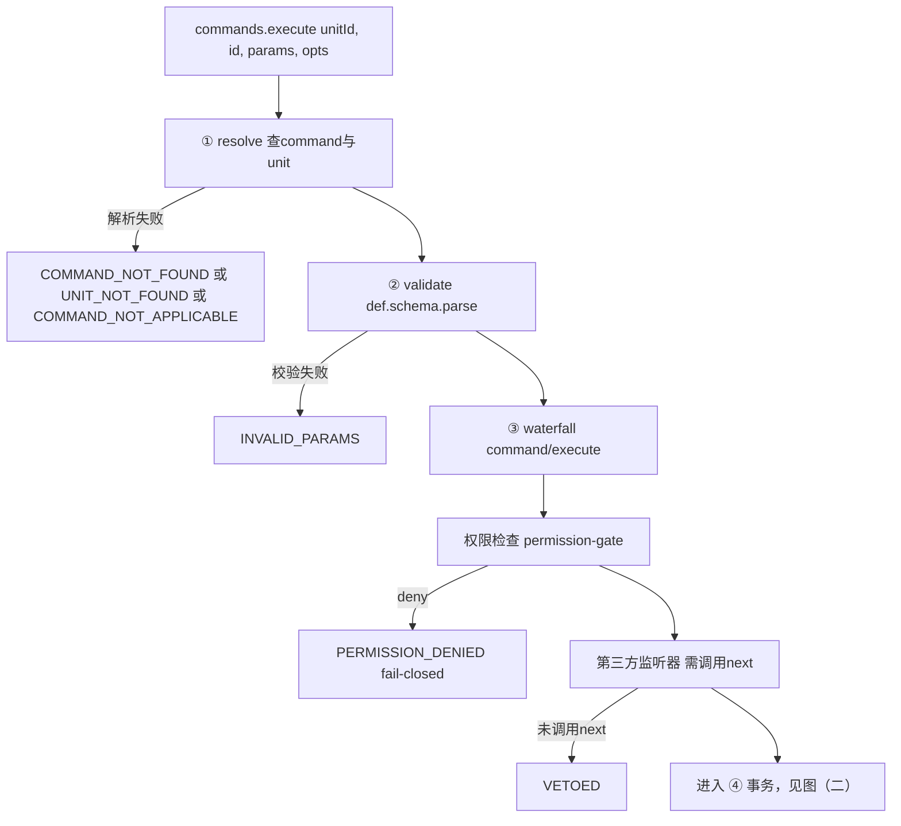

**命令执行管线图（二）：事务、历史、事件与审计（④–⑦）**

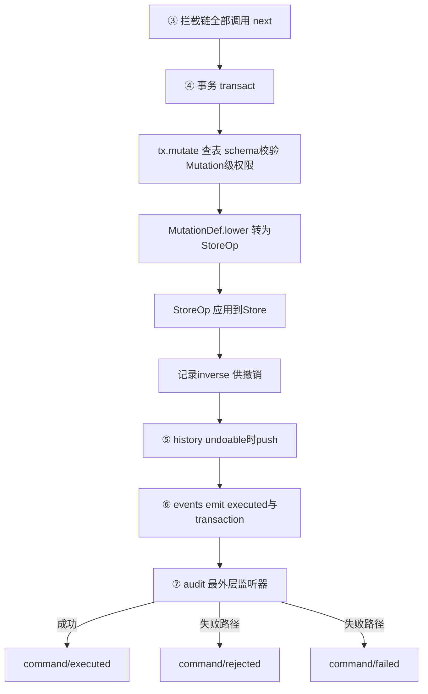

怎么读：两张图首尾相接（2026-09-25 为满足单图 ≤ 40 行拆分，节点与边不变）；①…⑦对应原执行管线的阶段编号；权限检查以 `prepend` 方式插入 waterfall 且 fail-closed（deny 直接短路，不调用 next）；`MutationDef.lower` 与 `StoreOp` 是两个独立步骤——`lower` 把 Mutation 转成 `StoreOp`，再由 Store 应用并记录 `inverse`；⑦ audit 是最外层监听器，成功走 `command/audited`（由 ⑥ 先 emit `command/executed`/`store/transaction`），失败走 `command/rejected` 或 `command/failed`；各终止节点旁的常量名取自 `command/errors.ts`。

**错误码通则（新增，14 §1 C-16，全仓通用，本模块为首次成文处）**：charter §5.4「错误码为点式」与 M-04 G-4 的解释共同构成双口径约定——**TS 常量名 `UPPER_SNAKE`**（如上图 `COMMAND_NOT_FOUND`）用于代码内 `throw`/`Result.err`/`switch` 的可枚举比较；**错误码的值为点式** `<域>.<snake_case>`（如 `command.not_found`），用于跨进程/日志/审计场景需要字符串序列化之处。本模块下述管线与各 `errors.ts` 文件此前只给出 TS 常量名、未给点式值，现补全管线五个最常触发的常量：

| TS 常量（`command/errors.ts`） | 点式值 |
|---|---|
| `COMMAND_NOT_FOUND` | `command.not_found` |
| `COMMAND_NOT_APPLICABLE` | `command.not_applicable` |
| `INVALID_PARAMS` | `command.invalid_params` |
| `PERMISSION_DENIED` | `command.permission_denied` |
| `UNIT_NOT_FOUND` | `command.unit_not_found`（2026-09-25 由 `unit.not_found` 更正，以 30/05 §3.1 为准，30 > 40） |

其余子域错误码（`store/errors.ts`、`migration/errors.ts`、`format/errors.ts`、kernel 顶层 `errors.ts`）按同一规则派生（域取该 `errors.ts` 所在子目录名，kernel 顶层用 `kernel`，如 `kernel.plugin_failed`），不在此逐一穷举；**唯一例外且唯一被 charter §5.4 原文点名的是「未知文档类型」**——不论 TS 常量落在哪个子域（本模块选择 `UNIT_UNKNOWN_DOCUMENT_TYPE`），其值**必须**是 `format.no_document_type`（与 charter §5.4 原文逐字一致，同时收编 ADR-0016 的 `format/no-document-type` 拼写——该拼写用了事件名的 `/` 分隔符，为误用，此处一并改正）。

model-core 自身贡献的**内置命令**（文档类型盲，`command/builtin/`；其余全部 Command/Mutation 由垂直束贡献，不在本模块）：

| id | 参数 schema（要点） | 权限能力位 | 事务边界 | 逆操作来源 | 所在文件 |
|---|---|---|---|---|---|
| `core.export` | `{ mime: string; options?: JsonObject }` | `['doc.export']` | `undoable:false`，不入历史；先 `await units.whenLoaded(unitId)`（渐进打开未到齐时等待，不导出半份文档，rulings §4.18 CO-12），再调用 `ctx.formats.export(unitScope, opts)` | 无（导出不改 Store） | `command/builtin/export-command.ts` |
| `core.restoreVersion`（M3） | `{ targetBody: Persisted<unknown> }` | `['history.restore']` | 单一事务：`documentType.diff(current, target)` 产出的 `Mutation[]` 在一个 `tx` 内全部 `mutate`，`origin: system('restore')` | 由 Store 按原语推导（与普通命令一致） | `command/builtin/restore-version-command.ts` |
| `core.undo`（Operation，新增，14 §1 C-02） | `{}`（无参数） | `['doc.write']` | 不入历史（自身不产生新 `TransactionRecord`；效果是从 history 栈弹出一条并反向应用）；handler 直接调用 `ctx.store.undo(local(clientId,'undo'))`；返回 `null`（栈空）判 `HISTORY_EMPTY`，为空操作非失败 | 不适用（Operation；弹栈即逆操作本身，来源已在 Store 内） | `command/builtin/history-operations.ts` |
| `core.redo`（Operation，新增，14 §1 C-02） | `{}`（无参数） | `['doc.write']` | 同上，调用 `ctx.store.redo(local(clientId,'redo'))`；`HISTORY_EMPTY` 语义同上 | 不适用（Operation） | `command/builtin/history-operations.ts` |
| `core.history.restoreMine`（2026-09-25 登记，决策 RESTORE-CMD） | `{ skipId }` | `['doc.write']` | 普通 Command：把 `skipId` 所属 `stepId` 下 `reason:'remote-conflict'` 记录的 `myValue` 写回原键，一个新本地事务、可撤销、进审计；目标已为墓碑 / 已硬删除 / 记录已淘汰 → `err(command.not_applicable)` | 由 Store 按原语推导 | `command/builtin/history-restore-commands.ts` |
| `core.history.restoreElement`（同上） | `{ skipId }` | `['doc.write']` | 普通 Command：对该 `stepId` 下仍为墓碑态、未硬删除的实体清除 `_deleted`，以原 id 复活（连同落在墓碑上的他人编辑），一个新本地事务、可撤销；复活的元素计入规模守卫 | 由 Store 按原语推导 | `command/builtin/history-restore-commands.ts` |

`view.setMode`（原列于此，id 不变）已按 14 §1 C-01 裁定移出 model-core：定义与文件归 `ui-core/application/operations/view-set-mode.ts`（M-10），本模块不再贡献该 Operation，§2.4「`view/mode-changed`」事件同步移除（发布者改为 ui-core）；理由见本文档 §12 收敛小节。

`core.undo`/`core.redo` 的 `local(clientId, via)` 中 `via` 取值 `'undo'|'redo'`，是 §2.2 `Origin` 判别字面量 `local.via` 增补集合的**唯一生产调用点**（14 §1 C-14）；命令面板/快捷键仅需绑定这两个 id，不得在 ui-core 自行重实现历史语义（依据同 C-02 裁定理由）。

`fixture`/`fixture-grid` 两个测试专用文档类型各自的 3 个 Mutation、2 个 Command 仅存在于 `testing/fixtures/`，用于 §2.5 契约套件与 ADR-0016 的文档类型盲验证，不对生产垂直束可见（§8、§9 详述）。

**图 2-1 命令执行管线**

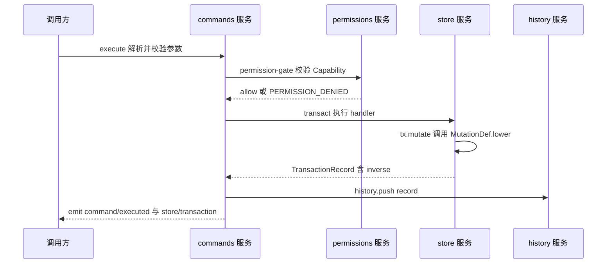

怎么读：这是 §2.6 waterfall 管线①-⑦步骤的时序视角——`permission-gate` fail-closed 拒绝时不会走到 `store`；`lower()` 只在 `store.transact` 内部被调用，逆操作由 Store 推导后随 `TransactionRecord` 一并返回。

## 3. cordis 插件定义

> 七个包按 cordis 形态分四类：`kernel` 是 host 工厂 + 自身也是一个函数插件（提供三个基础服务）；`shared`/`protocol` 是纯库，**没有** `plugin.ts`/`manifest.ts`（`cordex.role='library'`，`scan-manifest` 规则 (a) 只要求 `plugin`/`provider`/`definition` 角色的包有 `manifest.ts`——原名 `manifest-present`，TD-090，rulings §4.18 GV-15），下表标 N/A 并说明原因；`i18n`/`model-core` 是标准函数插件（`model-core` 的 cordis 形态标注为 definition，是因为它的**核心价值**是契约而非某个可替换实现，但其挂载方式仍是函数插件）；`store-memory`/`store-yjs` 是 provider（`implements:['store']`，`store-yjs` 额外 `implements:['yjsBackend']`）。

**`@cordexjs/shared`**

| 项 | 值 |
|---|---|
| 插件名 / `name` | N/A——纯库，无 `plugin.ts`（`cordex.role='library'`） |
| `inject` | N/A |
| `provide` | N/A |
| 贡献点：提供 | 无 |
| 贡献点：消费 | 无 |
| 事件：发布 / 订阅 | 无（不 import cordis，无 `Events` 概念） |
| 配置 schema | 无（无运行时配置；调用方直接 `import` 函数/类型） |
| 生命周期 | 不适用；模块加载即可用，无 ready/dispose |
| Manifest 片段 | 无 `manifest.ts`/`cordex-manifest.json`（`scan-manifest` 规则 (a) 豁免 `library` 角色；原名 `manifest-present`，GV-15） |

**`@cordexjs/kernel`**

| 项 | 值 |
|---|---|
| 插件名 / `name` | `kernel`（`createHost` 内部以 `ctx.plugin(kernelPlugin, options)` 挂载自身） |
| `inject`（必需 / 可选） | 必需：无（L0 最底层，只用 cordis 原生 `Context`/`Service`）；可选：无 |
| `provide` | `['contributions', 'errors', 'telemetry']` |
| 贡献点：提供 | `errors.sink`（`ErrorSink{id;report(err,ctx)}`，key=`id`，`conflict:'error'`）；`telemetry.sink`（`TelemetrySink`，key=`id`，`conflict:'error'`） |
| 贡献点：消费 | 无（自身是贡献点机制的实现者；`defaultSinks!==false` 时**自我贡献**一个 console `errors.sink` 与 no-op `telemetry.sink`，属自产自销的特例） |
| 事件：发布 | `plugin/loaded`、`plugin/failed`、`plugin/incompatible`、`error/raised`、`contribution/changed`；内部诊断 `kernel/manifest-mismatch` |
| 事件：订阅 | 无 cordis `Events`（监听的是 Fiber 状态迁移，走 cordis registry 内部钩子，非声明式 `ctx.on`） |
| 配置 schema | `HostOptions{ kernelVersion?; strictManifest?; defaultSinks?=true; loggerSink?; clock? }` |
| 生命周期 | ready = 三个 `Service` 子类挂载完成 + 失败隔离监听已挂；dispose = `host.dispose()` → 根 Fiber 销毁 → 全部 effect 逆序清理；**不在**任何 UnitScope 内（host 级，秩 0）；PENDING：kernel 本身秩 0、无硬依赖，正常不会 PENDING |
| Manifest 片段 | `{ "id": "@cordexjs/kernel", "provides": ["contributions","errors","telemetry"], "injects": [], "points": ["errors.sink","telemetry.sink"], "unitScoped": false }` |

**`src/preset/` 装配运行时（新增，14 §1 C-07，不改变上表）**：`PresetEntry`/`LazyPresetEntry`/`PresetTrim`/`PresetReport`/`mountEntries()`/`lazy()`/`trim()` 不是 kernel 自身插件的一部分——它们不出现在 `plugin.ts`、不贡献/消费任何贡献点、不发布事件，是**供其它包调用的纯函数与类型集合**（与 `scope.ts` 的 `createIsolatedScope` 同类："文档无关的工具，被上层调用"）。收编进 `@cordexjs/kernel` 而非留在 L8 的理由：三个 `preset-slide*` 包若各自持有会形成同秩定向依赖链（`viewer ← slide ← collab`，需新造 depcruise 规则 `cordex-bundle-chain`）；架构 03 §9「preset 组合与 loader 的关系」本就写在 kernel 章节；来源是 M-11 §4 曾定义的 `preset-slide-viewer/src/assembly/{entry,lazy,mount,report,validate}.ts`，M-11 已按此裁定删除该目录改为 `import '@cordexjs/kernel'`。

**`@cordexjs/protocol`**

| 项 | 值 |
|---|---|
| 插件名 / `name` | N/A——纯库，无 `plugin.ts` |
| `inject` | N/A |
| `provide` | N/A |
| 贡献点：提供 | 无（协议是数据契约，不注册贡献点） |
| 贡献点：消费 | 无 |
| 事件：发布 / 订阅 | 无 |
| 配置 schema | 无 |
| 生命周期 | 不适用 |
| Manifest 片段 | 无 |

**`@cordexjs/i18n`**

| 项 | 值 |
|---|---|
| 插件名 / `name` | `i18n` |
| `inject`（必需 / 可选） | 必需：`['contributions']`；可选：无 |
| `provide` | `['i18n']` |
| 贡献点：提供 | `i18n.bundle`（`{namespace;locale;messages}`，key=`` `${namespace}:${locale}` ``，`conflict:'replace'`） |
| 贡献点：消费 | `i18n.bundle`（自身定义、自身合并消费，各垂直束/UI 包向其贡献语言包） |
| 事件：发布 | `i18n/locale-changed` |
| 事件：订阅 | 无 |
| 配置 schema | `Config{ locale: string; fallback: 'zh-CN' }` |
| 生命周期 | ready = 首次 `t()` 调用前已从贡献表合并完毕；dispose = 清理内部合并缓存；**不在**任何 UnitScope 内（host 级，两端通用）；PENDING：`contributions` 未挂载（几乎不会发生，L0 内部顺序） |
| Manifest 片段 | `{ "id": "@cordexjs/i18n", "provides": ["i18n"], "injects": ["contributions"], "points": ["i18n.bundle"], "i18n": ["i18n"], "unitScoped": false }` |

**`@cordexjs/model-core`**

| 项 | 值 |
|---|---|
| 插件名 / `name` | `model-core` |
| `inject`（必需 / 可选） | 必需：`['contributions', 'errors', 'telemetry']`；可选：无（水平层不假设任何垂直束存在） |
| `provide` | `['units', 'documentTypes', 'commands', 'formats', 'resources', 'migrations', 'permissions']` |
| 贡献点：提供 | `core.documentType`、`core.command`、`core.mutation`、`core.format`、`core.resource`、`core.migration`、`core.permissionPolicy`（七个，键/conflict 见 §2.5 与架构 03 §3.6） |
| 贡献点：消费 | 同上七个（自身定义、自身消费，供六个查询服务查表） |
| 事件：发布 | 见 §2.4 全表（`unit/*`、`command/*`、`store/*`、`history/changed`、`selection/changed`、`permission/*`、`export/*`；`view/mode-changed` 已按 C-01 移出本包，改由 ui-core 发布） |
| 事件：订阅 | 无声明式 `ctx.on`（内部监听 Fiber 生命周期与贡献表变化以驱动 `documentTypes`/`commands` 等服务的反应式视图） |
| 配置 schema | `Config{ historyLimit: number; coalesceMs: number }`（原 `defaultStoreProvider?: string` 删除：store 由 UnitScope 默认 Provider 登记表中唯一的 `provides:['store']` 条目决定，rulings §4.20 FE-01，§2.1） |
| 生命周期 | ready = 七个服务 `Service` 子类挂载完成，并向 `units` 登记表自登记 `history`、`selection` 两个默认 Provider（此时**尚未**打开任何 Unit，服务可用但 `units.list()` 为空）；UnitScope 内：`unit-plugin.ts` 在隔离 `ctx` 下挂载 store Provider/history/selection 等（§2.1 状态机）；PENDING：`contributions`/`errors`/`telemetry` 未就位 |
| Manifest 片段 | `{ "id": "@cordexjs/model-core", "provides": ["units","documentTypes","commands","formats","resources","migrations","permissions"], "injects": ["contributions","errors","telemetry"], "points": ["core.documentType","core.command","core.mutation","core.format","core.resource","core.migration","core.permissionPolicy"], "unitScoped": false }` |

**`@cordexjs/store-memory`**

| 项 | 值 |
|---|---|
| 插件名 / `name` | `store-memory` |
| `inject`（必需 / 可选） | 必需：无（在 UnitScope 隔离 `ctx` 下由 `unit-plugin.ts` 挂载，`initialBody`/`schemaVersion` 经 `Config` 传入）；可选：`ctx.get('errors', false)`（异常兜底上报） |
| `provide` | `['store']` |
| 贡献点：提供 / 消费 | 无（Provider 不注册贡献点） |
| 事件：发布 | `store/transaction`、`store/loaded`（事件由 `model-core.contribution.ts` 声明，此处只是发出者之一） |
| 事件：订阅 | 无 |
| 配置 schema | `Config{ initialBody; schemaVersion; historyLimit: 200; freezeInDev: true; undo: { remoteConflict: 'skip' } }`（`undo.remoteConflict` 与 store-yjs 同名同义，rulings §4.15 Q3） |
| 生命周期 | ready = `MemoryStore` 构造完成并 `load(initialBody)` 成功；dispose = 释放不可变树引用（无原生资源，effect 清理为 no-op）；**UnitScope 内**（provide 的 `store` 名在隔离域内解析）；PENDING：几乎不会（无硬依赖） |
| Manifest 片段 | `{ "id": "@cordexjs/store-memory", "provides": ["store"], "injects": [], "implements": ["store"], "unitScoped": true }` |

**`@cordexjs/store-yjs`**

| 项 | 值 |
|---|---|
| 插件名 / `name` | `store-yjs` |
| `inject`（必需 / 可选） | 必需：无（同上，经 `Config` 传入初始状态）；可选：`ctx.get('errors', false)` |
| `provide` | `['store', 'yjsBackend']`（两者都在 UnitScope 隔离域内） |
| 贡献点：提供 / 消费 | 无 |
| 事件：发布 | `store/transaction`、`store/loaded` |
| 事件：订阅 | 无 |
| 配置 schema | `Config{ clientId?: string; gc: true; undo: { captureTimeout: 500; excludedNamespaces: []; remoteConflict: 'skip' }; maxDocBytes: 64 MiB }`（与 30-architecture/06 §2.4 统一：原扁平字段 `undoCaptureTimeout` 并入 `undo.captureTimeout`，500ms 与 05 §6 `coalesceMs` 一致；`remoteConflict` 为中性字段，rulings §4.15 Q3） |
| 生命周期 | ready = `Y.Doc` 构造完成且从 `body` 重建 Y 树成功（§4.21：服务端以「接管外部 Y.Doc」打开时，改为接管 Hocuspocus 已加载的 `Document`，不新建、不重建）；dispose = `Y.Doc.destroy()`、`UndoManager` 清理（经 `ctx.effect` 拥有；接管模式下不 `destroy()` 外部文档，只解除观察与撤销管理）；**UnitScope 内**；PENDING：几乎不会（无硬依赖，但 `collab-yjs` 若 `inject:['yjsBackend']` 会在 `store-memory` 场景下自然 PENDING——这是本包制造给下游的可诊断信号，ADR-0005 第 3 条） |
| Manifest 片段 | `{ "id": "@cordexjs/store-yjs", "provides": ["store","yjsBackend"], "injects": [], "implements": ["store"], "unitScoped": true }` |

**图 3-1 贡献点与服务流向**

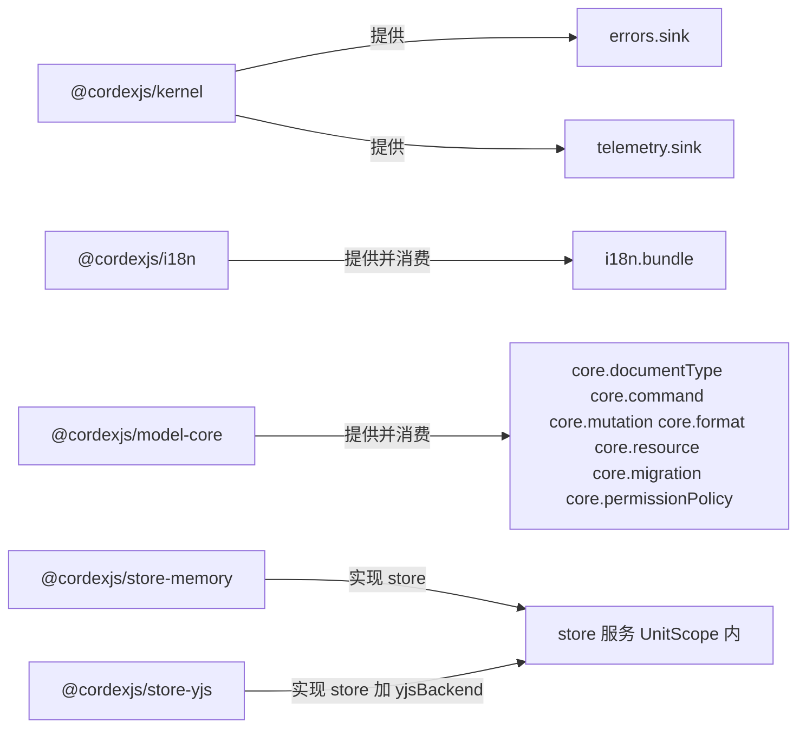

怎么读：`kernel`/`i18n`/`model-core` 是贡献点的定义方也是消费方（自产自销查表）；`store-memory`/`store-yjs` 不注册贡献点，只以 Provider 身份实现同一个 `store` 服务契约。

## 4. 目录树（完整到文件）

> 包级样板文件（`package.json`/`tsconfig.json`/`tsconfig.test.json`/`vitest.config.ts`/`api-extractor.json`/`etc/<name>.api.md`/`README.md`/`CHANGELOG.md`/`cordex-manifest.json`）七个包完全遵循 02 §4.0「包模板」，不在下列七棵树中重复；`shared`/`protocol` 无 `plugin.ts`/`manifest.ts`/`cordex-manifest.json`（`cordex.role='library'`，§3 已说明）。以下只展开 `src/**`（含 `./testing` 子路径），`src/__tests__/` 单测目录在 §9 单独列出。标「（新增）」的文件是 02 §4.1–4.7 骨架未列出、本文档为补全 04/05/ADR 明确要求的契约而新增的文件，理由随文件说明，§12 汇总。
>
> DDD 目录映射（按 00-module-map §1 表，不改变现有目录名）：`shared`/`protocol` 是无领域纯库——按 §1 规则 2 整体视为 `infrastructure/`（工具与编解码算法），不设 `domain/`。`kernel` 的 `Fiber`/`ContributionPoint`/`Manifest` 是插件运行时自身的技术登记表而非业务聚合（module-map BC-01 行原文「kernel 无业务领域」）——比照规则 2 的精神同样不设独立 `domain/`：`contribution/`、`manifest/` 是这一"技术领域"的类型契约，最接近 `domain/`（映射到 §1 表的 `contracts/`），`services/`、`diagnostics/`、`failure-isolation.ts` 是 `application/`+`infrastructure/`。`i18n` 是 plugin 但领域极薄：`keys.ts`/`format.ts` 相当于 `domain/`，`services/i18n.service.ts` 是 `application/`。`model-core` 领域最丰富，按 §1 表逐一对应：`unit/`、`document-type/`、`store/{store,ops,transaction,change-set,origin}.ts`、`command/{command,mutation}.ts`、`snapshot/{snapshot,derived}.ts`、`migration/migration.ts`、`resource/resource-hook.ts`、`permission/permission.ts`、`selection/selection.ts`、`drawing/**` = `domain/`；`*.service.ts`、`command/{pipeline,commands.service,permission-gate,audit}.ts` = `application/`；`store/store-provider.ts`（Provider 挂载约定，非实现）+ `snapshot/{codec,blob-store,validate}.ts` = 介于 `domain/`与`infrastructure/`之间的契约，本文档计入 `domain/`（无 IO，只是编解码算法）；`*.point.ts`/`*.contribution.ts` = OHS 登记，映射 §1 表的 `contracts/`。`store-memory`/`store-yjs` 是纯 Provider 包（§1 规则 1）——整体是 `infrastructure/`，无 `domain/`。

**图 4-1 七包包级依赖**

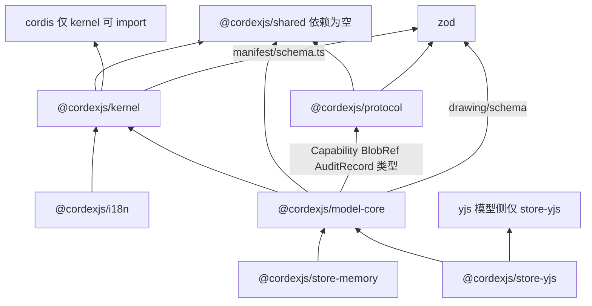

怎么读：自下而上是 import 方向，L0 四包在底、L1 三包在上；`shared` 依赖上限为空（R11），`cordis` 只被 `kernel` 引入（R12），两个 store Provider 只依赖 `model-core` 且互不 import（R7），`yjs` 在模型侧只出现在 `store-yjs`。

依据：§5.1–§5.7 各文件「允许依赖」列；§10 机械约束。

### 4.1 `@cordexjs/shared`

```text
packages/shared/src/
├── index.ts                    仅 re-export
├── brand.ts                    Brand<T,Tag>、brand()/unbrand()
├── ids.ts                      UnitId/NodeId/DocumentId 等品牌 id、newNodeId(deps?)、isNodeId()（UUIDv7 的时间与随机段经 Clock + Random 注入）
├── clock.ts                    （新增，§4.20 TX-10）Clock 接口 + SystemClock（唯一允许读 Date.now 的客户端生产文件，TD-110 豁免）
├── random.ts                   （新增，§4.20 TX-10）Random 接口 + SystemRandom（bytes 用 crypto.getRandomValues，TD-110 豁免）
├── units/
│   ├── emu.ts                  Emu/Pt/Px/Inch/Cm/Mm 品牌数值、换算常量与函数
│   ├── angle.ts                Angle60k/Percent1000/Percent100k
│   └── index.ts                re-export
├── result.ts                   Result<T,E>、ok/err/isOk/map/andThen/unwrapOr/collect
├── assert.ts                   invariant/assertNever/unreachable
├── json.ts                     JsonValue/JsonObject/JsonArray、isJsonValue、stableStringify
├── path.ts                     Path/PathSegment、pathEquals/startsWith/append/toString
├── order.ts                    FracKey、between()/compareOrder()/rekey()（ADR-0032 纯函数实现；2026-09-26 起内置 rocicorp fractional-indexing 4.0.0 算法源码，CC0，登记为 license-allowlist.json#vendored；随机后缀取自注入的 Random）
├── collections.ts              groupBy/sortBy/binarySearchBy/dedupe（无模块级可变状态）
├── hash.ts                     sha256()（WebCrypto subtle）、fnv1a32()
├── text.ts                     grapheme 切分（Intl.Segmenter 封装+降级）
├── disposable.ts               Disposable、composeDisposers()、once()
├── deep-freeze.ts              deepFreeze()（开发期不变性校验）
├── typed-events.ts             极简类型化 emitter（非 cordis 生命周期场景）
└── testing/
    ├── index.ts                fast-check arbitraries：ids/units/JsonValue/Path
    ├── clock.ts                （新增，§4.20 TX-10）FixedClock：手动推进的 now/monotonic/定时器（70/11 §2）
    └── random.ts               （新增，§4.20 TX-10）SeededRandom：种子化伪随机，fork(label) 派生子流
```

### 4.2 `@cordexjs/kernel`

```text
packages/kernel/src/
├── index.ts                    re-export 全部公共面（§6）
├── augment.ts                  export interface Events{}/Context{}/I18nKeys{}；declare module 'cordis' 桥接（ADR-0001）
├── host.ts                     createHost(options): CordexHost
├── host-options.ts             HostOptions 的 Standard Schema；可选 scriptUrlPolicy（组合根传入的 Trusted Types 策略对象，2026-09-25 登记，50/14 §4.2）
├── script-url.ts               toScriptUrl(ctx, url)：有策略返回 policy.createScriptURL(url.href)，无策略返回 url.href；iso，不引用 Worker/trustedTypes 全局（原 createWorker 改名，50/14 §4.2）
├── plugin.ts                   kernel 自身的函数插件：provide=['contributions','errors','telemetry']
├── manifest.ts                 生成物（ADR-0003）
├── kernel.contribution.ts      Context 增强（contributions/errors/telemetry）；Events 声明；ErrorSinkPoint/TelemetrySinkPoint 定义
├── contribution/
│   ├── point.ts                defineContributionPoint<T,K>(spec): ContributionPoint<T,K>
│   ├── service.ts              ContributionService extends Service('contributions')
│   ├── set.ts                  ReadonlyContributionSet<T,K>：get/has/values/keys/size/observe
│   ├── mixin.ts                ctx.mixin('contributions',['contribute'])（全仓唯一 mixin 调用点）
│   └── diagnostics.ts          ContributionDiagnostic 类型与构造
├── manifest/
│   ├── types.ts                Manifest 接口、ContributionEntry
│   ├── schema.ts                Manifest 的 Standard Schema
│   ├── verify.ts                verifyManifestAgainstRuntime(fiber, manifest)
│   └── version.ts               satisfies(range, version) 最小 semver 子集
├── scope.ts                    createIsolatedScope(ctx, spec)（文档无关；model-core 用它构造 UnitScope，裁决 C-4）
├── preset/                     （新增，14 §1 C-07）装配运行时，源自 M-11 §4 assembly/，收编进 kernel 避免 L8 同秩定向依赖链
│   ├── entry.ts                 PresetEntry/LazyPresetEntry 类型；UnitProviderRegistrar 结构类型（scope:'unit' 条目登记用，§4.20 FE-01）
│   ├── lazy.ts                  lazy(loader): LazyPresetEntry
│   ├── mount.ts                 mountEntries(ctx, entries): Promise<PresetReport>；scope:'unit' 条目改调 units.registerUnitProvider
│   ├── report.ts                PresetReport 类型 + 汇总工具
│   └── validate.ts              trim(entries, {exclude,override,configure}): PresetEntry[]；configure 合并＝对象逐键深合并、数组与标量整体替换、undefined 忽略（50/03 §2，2026-09-25）
├── services/
│   ├── errors.service.ts       ErrorsService：defineErrors/create/report/wrap/isOceError
│   ├── telemetry.service.ts    TelemetryService：defineTelemetryEvents/counter/histogram/span/event
│   ├── sinks/
│   │   ├── console-error-sink.ts    默认 errors.sink（no-console lint 白名单）
│   │   └── noop-telemetry-sink.ts   默认 telemetry.sink
│   └── logger.ts                对 cordis 内建 ctx.logger 的结构化包装
├── failure-isolation.ts        监听 Fiber 状态迁移 → errors.report + emit('plugin/failed'|'loaded'|'incompatible')
├── errors.ts                   kernel 错误码（PLUGIN_FAILED/VERSION_MISMATCH/CONTRIBUTION_REJECTED/MANIFEST_MISMATCH/DUPLICATE_KEY/UNKNOWN_POINT）
├── diagnostics/
│   ├── fiber-tree.ts            dumpFiberTree(ctx) → FiberNode[]
│   └── assert.ts                 assertNoLiveEffects/assertSingleProvider/assertState
└── testing/
    ├── index.ts                  re-export
    ├── create-test-host.ts       createTestHost()：记录型 sink、mountAndAwait、expectPending/expectFailed
    ├── lifecycle-suite.ts        defineLifecycleSuite(spec)（primer MUST #7 的机械化）
    ├── fakes.ts                   RecordingErrors、RecordingTelemetry
    └── conformance/
        └── kit.ts                 defineConformanceKit、runKitSelfTest、ResourceTracker 与 kit 统一类型（70/02 §2.1，2026-09-25 登记；assertNoLiveEffects 仍取自 diagnostics/assert.ts）
```

### 4.3 `@cordexjs/protocol`

```text
packages/protocol/src/
├── index.ts                    re-export
├── schema.ts                   z 实例导出约定、Infer<T>、strictObject 默认
├── ids.ts                      DocumentId/UserId/RoomId/SessionId/TaskId 品牌 schema（T-0 去租户删 TenantId；组管理推迟删 GroupId，rulings §4.15）
├── version.ts                  PROTOCOL_VERSION、兼容矩阵
├── errors/
│   ├── codes.ts                 错误码字面量联合 → HTTP 状态映射表 ERROR_HTTP_STATUS（码名与 http-map 以 30/10 §1.1 为唯一源）；含 quota_exceeded（§4.15 Q5）；2026-09-25 按决策 INC-10/SG-04 登记新域与新码（§5.3）
│   └── envelope.ts              ErrorEnvelope{code,message,details?,traceId}
├── permissions/
│   ├── actions.ts               Capability 字面量联合（doc.read/doc.comment/doc.write/doc.export/doc.manage/history.read/history.restore + 第三方 `<vendor>:<域>.<action>`）；PermissionAction 为兼容别名（§12 G-6）
│   ├── roles.ts                （新增）RoleName='owner'|'editor'|'commenter'|'viewer'；ROLE_CAPABILITIES: Record<RoleName, readonly Capability[]>（类型形状定稿，具体组合见 PRD CO 域，本包不重复裁决）
│   ├── principal.ts             Principal{userId,roles,sessionId}（T-0 单组织，无 tenantId）
│   └── decision.ts              PermissionDecision={allow:true}|{allow:false;reason}
├── rest/
│   ├── documents.ts             列表/详情/创建/重命名/删除/权限设置 DTO
│   ├── snapshots.ts             快照列表 / 元数据 / 命名 / 恢复 DTO；latest 直接回字节（>1 MiB 流式代理），不再有预签名 URL DTO（决策 MECH-INC 之 INC-14）
│   ├── import-export.ts         任务创建/查询 DTO；TaskState 字面量联合；两步导入（§4.18 BE-10）：CreateImportUploadRequest/Response（申请上传、返回预签名 PUT 与一次性 uploadId）、CreateImportRequest{uploadId}，不再有 storageKey
│   ├── auth.ts                  login/refresh/me DTO
│   ├── audit.ts                 AuditRecord DTO
│   ├── webhooks.ts              （新增，rulings §4.12 U-14）Webhook 订阅注册/更新/删除、投递日志查询 DTO（M-12 §2.1/§4.11/§7.2 落地）
│   ├── telemetry.ts             （新增，rulings §4.18 BE-30）浏览器错误上报 ClientErrorReport DTO（POST /telemetry/errors，≤ 64 KiB）；OTLP 代理走标准 protobuf，不另建 schema（M-12 §4.12/§7.2 落地）
│   └── index.ts                 re-export
├── ws/
│   ├── handshake.ts             Auth token 的 JSON schema（ticket、protocolVersion、clientId、capabilities、appVersion、epoch?、maxSchemaVersion、traceparent?）与 PermissionDenied 的 reason `{code}`（§4.21 改写，原握手帧 DTO）
│   ├── frames.ts                CONTROL 判别联合（判别键 type），作 Hocuspocus Stateless 载荷：ack 带 tier（§4.15 S-3a）、room 含可选 persist:'ok'|'degraded'（§4.19 INC-09）；§4.21 删帧级类型与 auth/auth.denied/auth.refresh/ping/pong 成员；成员以 30/06 §6.3 为准
│   └── index.ts                 re-export
├── collab/                      （2026-09-25 登记，决策 INC-01；经根入口导出，不加 ./collab 子路径，不建 collab/control.ts；§4.21 删 frame.ts）
│   ├── close-codes.ts           关闭码常量对象（含 1011、4427、4428，决策 INC-06；§4.21 加 4205、4408 扩为超时通用码；非 enum）
│   ├── awareness.ts             AwarenessState zod（≤ 2 KiB，ADR-0024）
│   ├── ticket.ts                CollabTicketClaims（线上 claim perm_ver，TS 字段 permVersion；可选 sid、lnk）
│   └── ticket-claims.type-test.ts  CollabTicketClaims 键集合为封闭集合、无 tenant 类键（70/10 SEC-DA-04）
├── embed/
│   └── messages.ts              （M3 P2，决策 MECH-INC 之 INC-36）形态 E 同站嵌入 postMessage 消息 schema；M3 的 /embed 只接受会话登录，cordex:token 标 M4
├── snapshot/
│   └── envelope.ts              SnapshotEnvelope{documentType,schemaVersion,bodyRef,blobs,createdAt,byVersion}
├── render/
│   ├── sidecar.ts               （新增，rulings §4.15 Q8；§4.18 FE-04 补登）worker ↔ renderer sidecar 的鉴权内部 RPC 契约（state/资源/字体注入、ready 信号、WebP/PDF 结果），与 60-backend/06 §10 的 RPC 契约一致，供 M-09 `remote-renderer.client.ts` 与 renderer 入口共同 import
│   └── page.ts                  （新增，14 §1 C-27；§4.18 BE-04：token→renderId、RenderStateResponse 为注入载荷）RenderPageQuerySchema/RenderPageSignal/RenderStateResponse：Node 进程 ↔ headless Chromium 渲染页的跨进程契约，供 M-09（server-headless）与 M-11（apps/web /render 页）共同 import
├── blob.ts                      BlobRef{hash,size,contentType}（与 model-core 共用同一定义源）
└── testing/
    ├── index.ts                 DTO 工厂（确定性 seed）
    └── redirect-samples.ts      开放重定向样本集（含 //、/\、编码变体、绝对 URL），供 nextAfterLogin 性质测试（70/10 SEC-XS-04，2026-09-25 登记）
```

### 4.4 `@cordexjs/i18n`

```text
packages/i18n/src/
├── index.ts                    re-export
├── plugin.ts                   provide=['i18n']；Config{locale;fallback:'zh-CN'}
├── manifest.ts                 生成物
├── i18n.contribution.ts        Context.i18n；Events 'i18n/locale-changed'；i18n.bundle 贡献点定义；interface I18nKeys{}
├── services/
│   └── i18n.service.ts         I18nService：t()/locale/setLocale()；缺 key 走 fallback+telemetry
├── keys.ts                     从 locales/zh-CN.json 推导的 key 类型（K8）
├── format.ts                   ICU MessageFormat 子集（plural/select）+ Intl 数字/日期
├── create-i18n.ts              createI18n({locale, bundles})：无 host 页面用的纯函数版（登录、错误页等），进入编辑器时交给 host（决策 NOHOST-I18N，2026-09-25 登记）
├── locales/
│   ├── zh-CN.json               源语言（key 权威）；含 errors.* 命名空间：随包自带 protocol 错误码文案（errors.server.*、errors.transport.* 等），按码名键入、不 import protocol（50/15 §11 回写 6）
│   └── en-US.json               翻译（CI 校验 key 集合与源一致）
└── testing/
    └── index.ts                 fixedLocale() 测试 Provider
```

### 4.5 `@cordexjs/model-core`

**图 4-2 model-core 子目录依赖**

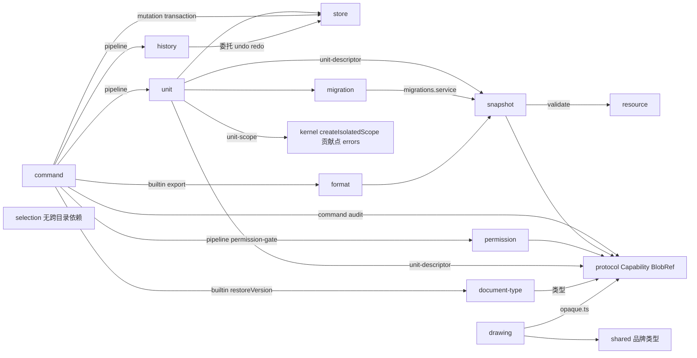

怎么读：箭头为子目录间 import 方向；`command/pipeline.ts` 是依赖最集中的编排点（unit/permission/history），`store` 只被依赖，`selection` 与其余子目录互不依赖；各子目录的 `*.point.ts` 均依赖 kernel 的贡献点定义、各 `errors.ts` 均依赖 kernel `errors.service`，为免重复未逐条画出。

依据：§5.5 各文件「允许依赖」列。

```text
packages/model-core/src/
├── index.ts                              re-export 公共面（§6）
├── plugin.ts                             provide=[7 个服务]；inject=['contributions','errors','telemetry']
├── manifest.ts                           生成物
├── model-core.contribution.ts            Context 服务表 + Events 全表（§2.4）+ 七个贡献点定义导出
├── unit/
│   ├── unit.ts                           Unit{id,documentType,meta,state}
│   ├── unit-descriptor.ts                OpenUnitDescriptor（bytes|snapshot|state|empty 四种 source）
│   ├── unit-scope.ts                     UnitScope{unit,ctx,fiber,dispose()}；ISOLATED_SERVICES 常量；UnitScope.unit symbol
│   ├── unit-plugin.ts                    unitPlugin(ctx,{descriptor,...})：状态机六步（§2.1），按登记表快照挂 Provider
│   ├── units.service.ts                  UnitsService：open/close/get/list/observe/whenLoaded/prioritize；UnitScope 默认 Provider 登记表 registerUnitProvider/listUnitProviders（§4.20 FE-01）
│   └── errors.ts                         （新增）UnitError 码：UNIT_UNKNOWN_DOCUMENT_TYPE（值 format.no_document_type，14 §1 C-16 唯一权威拼写）/MIGRATION_PATH_MISSING 引用/UNIT_NOT_FOUND 引用
├── document-type/
│   ├── document-type.ts                  DocumentType<S> 接口、BodyShapeHints
│   ├── document-type.point.ts            'core.documentType'，key=d.id，conflict='error'
│   └── document-types.service.ts         DocumentTypesService：get/list/observe/resolveByMime
├── store/
│   ├── store.ts                          DocumentStore<S> Definition（§2.5 全签名）
│   ├── ops.ts                            StoreOp 五种原语判别联合、TextDelta、isStoreOp()
│   ├── transaction.ts                    Transaction/TransactionRecord/RecordedOp/UndoSkip（TransactionRecord.skipped）
│   ├── change-set.ts                     ChangeSet、mergeChangeSets()
│   ├── tombstone.ts                      （新增，§4.15 Q3）Tombstone、TOMBSTONE_KEY='_deleted'、isTombstoned()、filterLive()
│   ├── origin.ts                         Origin 判别联合、isLocal()；system.reason∈{load,import,migration,repair,restore,maintenance}、local.via∈{undo,redo}（14 §1 C-14；import 用于渐进打开追加，§4.18 CO-12）
│   ├── store-provider.ts                 StoreProviderPlugin 约定（Config 形状）
│   └── errors.ts                         （新增）StoreError 码：STORE_NESTED_TRANSACTION/STORE_INVALID_PATH/STORE_UNAVAILABLE/STORE_IMPORT_APPEND_CONFLICT（§4.18 CO-12）
├── command/
│   ├── command.ts                        CommandDef<P,R>、OperationDef<P>、defineCommand()/defineOperation()
│   ├── command.point.ts                  'core.command'，key=def.id
│   ├── mutation.ts                       MutationDef<M>、Mutation 基形
│   ├── mutation.point.ts                 'core.mutation'，key=def.type
│   ├── commands.service.ts               CommandsService：execute/has/describe/observeExecutions
│   ├── pipeline.ts                       七阶段实现（§2.6）
│   ├── permission-gate.ts                内置 prepend 监听：命令级+Mutation级 fail-closed
│   ├── audit.ts                          内置最外层监听：构造 AuditRecord → emit command/audited
│   ├── errors.ts                         COMMAND_NOT_FOUND/INVALID_PARAMS/PERMISSION_DENIED/UNIT_NOT_FOUND/HANDLER_FAILED/MUTATION_REJECTED/STORE_UNAVAILABLE
│   └── builtin/
│       ├── export-command.ts             （新增）core.export：调用 formats.export，undoable:false
│       ├── restore-version-command.ts    （新增，M3）core.restoreVersion：documentType.diff() → 单事务写回
│       ├── history-operations.ts         （新增，14 §1 C-02）core.undo/core.redo 两个 Operation：直接调用 ctx.store.undo|redo(local(clientId,'undo'|'redo'))
│       └── history-restore-commands.ts   core.history.restoreMine / core.history.restoreElement 两个普通 Command（新本地事务、可撤销、经权限门与审计；50/04 §6.2，2026-09-25 登记）
├── history/
│   ├── history.ts                        History Definition（UnitScope）
│   ├── history.service.ts                HistoryService 默认 Provider：合并/分组/容量策略
│   ├── recovery-records.ts               恢复记录环形表（最近 20 条、不持久化、Unit 重开清空）：skipId/stepId/entityId/path/myValue/wholeStep/reason/source/by/at；recordConflict() 供 collab-yjs 登记 source:'conflict'（决策 RESTORE-CMD，50/04 §6.1，2026-09-25 登记）
│   └── coalesce.ts                       合并规则（同 label、同 origin、间隔<coalesceMs）
├── snapshot/
│   ├── snapshot.ts                       Snapshot<S>、SnapshotBundle<S>
│   ├── codec.ts                          encodeSnapshot()/decodeSnapshot()
│   ├── derived.ts                        Derived<T>、Persisted<T> 映射类型、expectPersistedEquals()
│   ├── blob-store.ts                     BlobStore Definition、MemoryBlobStore 默认 Provider
│   └── validate.ts                       validateSnapshot()
├── migration/
│   ├── migration.ts                      Migration<S1,S2>
│   ├── migration.point.ts                'core.migration'，key=`${documentType}:${from}->${to}`
│   ├── migrations.service.ts             MigrationsService：plan/run/runOnUnit
│   └── errors.ts                         （新增）MigrationError 码：MIGRATION_PATH_MISSING/SNAPSHOT_TOO_NEW
├── resource/
│   ├── resource-hook.ts                  ResourceHook<T>
│   ├── resource.point.ts                 'core.resource'，key=namespace
│   └── resources.service.ts              ResourcesService：collect/apply（逐 hook 容错，K6）
├── permission/
│   ├── permission.ts                     PermissionRequest、PermissionPolicy
│   ├── permission.point.ts               'core.permissionPolicy'，key=policy.id
│   └── permissions.service.ts            PermissionsService：check/setPrincipal/applyRemoteDecisions
├── format/
│   ├── format-codec.ts                   FormatCodec<S>、ImportResult<S>
│   ├── format.point.ts                   'core.format'，key=codec.id，按 mime 二级索引
│   ├── formats.service.ts                FormatsService：detect/import/export
│   └── errors.ts                         （新增）FormatError 码：FORMAT_UNSUPPORTED_MIME/IMPORT_FAILED/EXPORT_FAILED
├── selection/
│   ├── selection.ts                      Selection<A>、selectionEquals()、serialize
│   └── selection.service.ts              SelectionService 默认 Provider（UnitScope）
├── drawing/
│   ├── color.ts                          Color/SchemeColorName/ColorMapKey
│   ├── fill.ts                           Fill 判别联合（noFill/solid/gradient/blip/pattern/groupFill）
│   ├── line.ts                           Line
│   ├── effect.ts                         EffectList + OpaqueXml 余量
│   ├── geometry.ts                       Geometry（preset|custom）、GeometryPath
│   ├── transform.ts                      Transform、GroupTransform
│   ├── font.ts                           FontRef
│   ├── text.ts                           TextBody/BodyProperties/Paragraph/Run/RunProperties/ListStyle/Bullet/Spacing/TabStop
│   ├── hyperlink.ts                      Hyperlink
│   ├── opaque.ts                         OpaqueXml/OpaqueSlot/OpaquePartRef
│   ├── index.ts                          re-export
│   └── schema/
│       ├── color.schema.ts               ↔ color.ts
│       ├── fill.schema.ts                ↔ fill.ts
│       ├── line.schema.ts                ↔ line.ts
│       ├── effect.schema.ts              ↔ effect.ts
│       ├── geometry.schema.ts            ↔ geometry.ts
│       ├── transform.schema.ts           ↔ transform.ts
│       ├── font.schema.ts                ↔ font.ts
│       ├── text.schema.ts                ↔ text.ts
│       ├── hyperlink.schema.ts           ↔ hyperlink.ts
│       ├── opaque.schema.ts              ↔ opaque.ts
│       └── index.ts                      re-export 全部 schema
├── events.ts                             事件名常量对象（与 model-core.contribution.ts 声明一致）
├── errors.ts                             跨子域公共错误工具（聚合 unit/store/command/migration/format 错误码供 index 统一导出）
└── testing/
    ├── index.ts                          re-export（含 fixtures 两套）
    ├── document-store-conformance.ts     runDocumentStoreConformance()
    ├── format-codec-conformance.ts       （新增，14 §1 C-26）runFormatCodecConformance()
    ├── permission-policy-conformance.ts  （2026-09-25 新增，决策 T-KITS）runPermissionPolicyConformance()：默认拒绝、策略抛异常即拒绝、能力位全集含 history.read/history.restore
    ├── command-harness.ts                createCommandHarness()
    ├── permission-fakes.ts               allowAllPolicy/denyAllPolicy/recordingPolicy
    └── fixtures/
        ├── fixture/                      ADR-0016：键值树+文本块（模拟通用文档）
        │   ├── index.ts                  组装并导出 fixtureDocumentType
        │   ├── document-type.ts          DocumentType 定义、bodySchema、BodyShapeHints
        │   ├── mutations.ts              3 个 Mutation 及各自 lower()
        │   ├── commands.ts               2 个 Command
        │   ├── format-codec.ts           1 个 JSON FormatCodec（透传）
        │   ├── resource-hook.ts          1 个 ResourceHook
        │   ├── migration.ts              1 个 Migration（v1→v2）
        │   └── invariants.ts             2 个 Invariant（无父子环、order 合法）
        └── fixture-grid/                 （新增，依据 ADR-0016：网格键空间，模拟 sheet；02 §4.5 未列，§12 G-7）
            ├── index.ts                  组装并导出 fixtureGridDocumentType
            ├── document-type.ts          稀疏 cells.<r>:<c> 键空间
            ├── mutations.ts              3 个 Mutation（对齐 fixture 的形状以复用契约测试）
            ├── commands.ts               2 个 Command
            ├── format-codec.ts           1 个 JSON FormatCodec
            ├── resource-hook.ts          1 个 ResourceHook
            ├── migration.ts              1 个 Migration（v1→v2）
            └── invariants.ts             2 个 Invariant（行列范围合法、无重复键）
```

### 4.6 `@cordexjs/store-memory`

```text
packages/store-memory/src/
├── index.ts                    re-export
├── plugin.ts                   provide=['store']；Config{initialBody;schemaVersion;historyLimit:200;freezeInDev:true}
├── manifest.ts                 生成物
├── store-memory.contribution.ts  本包无新增 Context/Events 声明（`store` 类型由 model-core 声明）；保留用于结构一致性与未来扩展
├── memory-store.ts             MemoryStore<S> implements DocumentStore<S>
├── apply-op.ts                 applyOp(state,op) → {next,inverse}
├── produce.ts                  最小 path-based 不可变更新（≤200 行，无 immer）
├── text-delta.ts               富文本 delta 应用/求逆/组合
├── history-stack.ts            事务记录栈、undo/redo 指针、容量淘汰；键→最后写入 origin 表（撤销跳过判定）
├── observe.ts                  观察者分发：事务提交后同步一次
└── testing/
    └── index.ts                createMemoryStore(body)
```

### 4.7 `@cordexjs/store-yjs`

```text
packages/store-yjs/src/
├── index.ts                    re-export（公共面禁止出现 Y.* 类型，§6/§10）
├── plugin.ts                   provide=['store','yjsBackend']；Config{clientId?;gc;undo{captureTimeout:500;excludedNamespaces;remoteConflict:'skip'};maxDocBytes}
├── manifest.ts                 生成物
├── store-yjs.contribution.ts   Context.yjsBackend 声明（唯一新增 Context 成员；`store` 类型仍由 model-core 声明）
├── yjs-store.ts                YjsStore<S> implements DocumentStore<S>；持有 Y.Doc（包内私有，不导出）；§4.21 可接管外部 Y.Doc（adopt，服务端 Unit 接管 Hocuspocus Document）
├── mapping/
│   ├── path-resolver.ts        Path → Y.Map/Y.Array/Y.Text 定位
│   ├── apply-op.ts             StoreOp → Y 操作映射
│   ├── to-json.ts              Y 树 → 不可变 JSON 视图（增量缓存）
│   └── from-json.ts            load(body) → 构建 Y 树
├── undo.ts                     Y.UndoManager 封装：trackedOrigins={localOrigin}；跳过他人后写、整步跳过即停（§4.15 Q3）
├── yjs-backend.service.ts      YjsBackend 服务：encodeStateAsUpdate/applyUpdate/onUpdate/stateVector/stats；§4.21 增 docHandle()（不透明 YDocHandle）与 registerRemoteOrigin(origin)（抽象类型，不外泄 Y.*）
└── testing/
    └── index.ts                createYjsStore(body)、twoDocsInSync()
```

## 5. 文件职责表

> 逐文件一行，与 §4 一一对应（`__tests__/` 见 §9）；「允许依赖」列出的是**外部包**，省略「本包其它模块」（包内互引不受 depcruise 包间规则约束，只受文件级无环规则 `cordex-no-circular-file` 约束）。

### 5.1 `@cordexjs/shared`

| 文件 | 职责 | 主要导出 | 允许依赖 | 备注 |
|---|---|---|---|---|
| `index.ts` | 公共 API 面 | 全部下列符号 | 无（`shared` 依赖上限为空，R11 `shared-has-no-deps`） | api-extractor 入口 |
| `brand.ts` | 品牌类型工具 | `Brand<T,Tag>`、`brand()`、`unbrand()` | 无 | `declare const tag: unique symbol` 模式 |
| `ids.ts` | 品牌 id 与生成器 | `UnitId`、`NodeId`、`DocumentId`、`newNodeId()`、`isNodeId()` | 无 | `newNodeId` 用 UUIDv7（ADR-0014）；时间段与随机段经 `{clock?: Clock; random?: Random}` 注入，缺省 `SystemClock`/`SystemRandom`，测试注入 `FixedClock`/`SeededRandom` 可按种子重放（70/11 §1，rulings §4.20 TX-10） |
| `clock.ts` | 时钟端口（新增，rulings §4.20 TX-10） | `Clock`（`now()`/`monotonic()`/`setTimeout(cb, ms): Disposable`）、`SystemClock` | 无 | 签名以 70/11 §2 为准；客户端生产代码中唯一允许 `Date.now()`/`performance.now()` 的文件（TD-110 豁免，09-type-discipline/08 §12c） |
| `random.ts` | 随机源端口（新增，rulings §4.20 TX-10） | `Random`（`next(): number`、`bytes(n): Uint8Array`）、`SystemRandom` | 无 | `bytes` 用 `crypto.getRandomValues`；唯一允许 `Math.random()` 的生产文件（TD-110 豁免） |
| `units/emu.ts` | 几何/字号单位品牌 | `Emu`、`Pt`、`Px`、`Inch`、`Cm`、`Mm`、`EMU_PER_INCH`、`emu()`、`pt()`、`toPx()` | 无 | 唯一模型几何单位（04 §8） |
| `units/angle.ts` | 角度/百分比品牌 | `Angle60k`、`Percent1000`、`Percent100k` | 无 | DrawingML 定点数对齐 |
| `units/index.ts` | 子目录聚合 | re-export | 无 | — |
| `result.ts` | 失败可传播基元 | `Result<T,E>`、`ok`/`err`/`isOk`/`map`/`andThen`/`unwrapOr`/`collect` | 无 | 禁止用 boolean 表示失败（05 §9） |
| `assert.ts` | 断言与不可达分支 | `invariant()`、`assertNever()`、`unreachable()` | 无 | 生产保留；抛 `AssertionFailure`，由 `errors` 服务归类 |
| `json.ts` | JSON 值与稳定序列化 | `JsonValue`/`JsonObject`/`JsonArray`、`isJsonValue()`、`stableStringify()` | 无 | 键排序，供哈希与快照 diff |
| `path.ts` | 路径寻址基元 | `Path`、`PathSegment`、`pathEquals`/`startsWith`/`append`/`toString` | 无 | Store/Mutation 寻址的唯一表示 |
| `order.ts` | 有序集合并发安全键 | `FracKey`、`between()`、`compareOrder()`、`rekey()` | 无 | ADR-0032 纯函数实现；2026-09-26 起内置 rocicorp fractional-indexing 4.0.0 算法源码（ADR-0032 修订）：文件头写 `SPDX-License-Identifier: CC0-1.0`、上游地址 `https://github.com/rocicorp/fractional-indexing`、版本与提交号，本文件路径 `packages/shared/src/order.ts` 即 `license-allowlist.json#vendored` 的登记项（ADR-0049 决策 1、2）；键格式为整数头 + 随机后缀、小数末位非 `'0'`，`between` 与确定性键规则见 §2.3；随机后缀只在此处产生，取自注入的 `Random`（缺省 `SystemRandom`，rulings §4.20 TX-10）；`@cordexjs/shared` 仍零运行时依赖 |
| `collections.ts` | 不可变友好集合工具 | `groupBy`/`sortBy`/`binarySearchBy`/`dedupe` | 无 | 无模块级可变状态（lint 校验） |
| `hash.ts` | 哈希 | `sha256()`、`fnv1a32()` | 无 | `sha256` 用 WebCrypto，同构 |
| `text.ts` | 文本切分基元 | grapheme 切分函数、Unicode 空白/标点判定 | 无 | 供 `engine-layout`/`model-doc`（M-06/M5） |
| `disposable.ts` | 非 cordis 场景清理基元 | `Disposable`、`composeDisposers()`、`once()` | 无 | 插件内一律用 `ctx.effect`，此处仅供纯库自用 |
| `deep-freeze.ts` | 开发期不变性校验 | `deepFreeze()` | 无 | `store-memory` 的 `freezeInDev` 用它 |
| `typed-events.ts` | 极简类型化 emitter | 泛型 `TypedEmitter<T>` | 无 | 仅供不在 cordis 生命周期内的纯库（如 opc 读取进度） |
| `testing/index.ts` | 测试专用构造器 | fast-check arbitraries（ids/units/JsonValue/Path）；re-export `FixedClock`、`SeededRandom` | `fast-check`（devDependency） | `./testing` 子路径导出；生产代码禁止 import |
| `testing/clock.ts` | 假时钟（新增，rulings §4.20 TX-10） | `FixedClock`（`constructor(startMs)`、`advance(ms)`、`set(ms)`） | 无 | 客户端与服务端共用，不另建 `FakeServerClock`（70/11 §2）；旧名 FakeClock 作废 |
| `testing/random.ts` | 种子化随机源（新增，rulings §4.20 TX-10） | `SeededRandom`（`constructor(seed)`、`fork(label)`） | 无 | 协同模拟、退避抖动、DTO 工厂、UUIDv7 随机段 |

### 5.2 `@cordexjs/kernel`

| 文件 | 职责 | 主要导出 | 允许依赖 | 备注 |
|---|---|---|---|---|
| `index.ts` | 公共 API 面 | 见 §6 | shared、cordis | 唯一非 `augment.ts`/`*.contribution.ts` 外允许出现 `import type ... from 'cordis'` 的文件 |
| `augment.ts` | 声明合并桥接 | `Events{}`、`Context{}`、`I18nKeys{}` 空接口 + `declare module 'cordis'` | cordis（类型） | ADR-0001；全仓唯一的 cordis→cordex 桥接点 |
| `host.ts` | 根 Context 工厂 | `createHost()`、`CordexHost` | cordis、shared | 挂载 kernel 自身插件、版本协商、失败隔离监听 |
| `host-options.ts` | Host 配置契约 | `HostOptions` 及其 schema | shared | `defaultSinks` 默认 `true`；可选 `scriptUrlPolicy`（结构化的 Trusted Types 策略对象，由组合根传入，kernel 只保存；2026-09-25 登记，[50/14 §4.2](../50-frontend/14-client-security.md)） |
| `script-url.ts` | 脚本 URL 出口 | `toScriptUrl(ctx, url)` | 无（iso，不引用 `Worker`/`trustedTypes` 全局，章程 §5.3 规则 5） | 2026-09-25 登记（原 `createWorker` 改名）：dom 包的 `new Worker(…)` 首参只能是它的返回值（lint `no-restricted-syntax` 配置行，50/14 §4.2） |
| `plugin.ts` | kernel 函数插件 | `name`/`inject`/`provide`/`Config`/`apply` | cordis、本文件同级模块 | `provide=['contributions','errors','telemetry']` |
| `manifest.ts` | Manifest 生成物 | `manifest: Manifest` | 无 | `manifest-gen --check` 校验无 diff |
| `kernel.contribution.ts` | Context/Events 增强 + 内置贡献点 | `ErrorSinkPoint`、`TelemetrySinkPoint` | cordis（类型）、`./contribution/point` | 唯一运行时 import 限 `import type`（lint `contribution-file-purity`） |
| `contribution/point.ts` | 贡献点定义工厂 | `defineContributionPoint()`、`ContributionPoint<T,K>`、`PointId` | shared | 全仓贡献点的唯一构造入口 |
| `contribution/service.ts` | 贡献点服务实现 | `ContributionService extends Service` | cordis、`./set` | `provide('contributions')` |
| `contribution/set.ts` | 只读反应式集合 | `ReadonlyContributionSet<T,K>` | 无 | `observe()` 变更合并到微任务 |
| `contribution/mixin.ts` | `contribute`/`contributions` 挂到 ctx | 内部注册函数 | cordis | 全仓唯一 `ctx.mixin` 调用点（lint `no-mixin-outside-kernel`） |
| `contribution/diagnostics.ts` | 贡献诊断类型 | `ContributionDiagnostic` | 无 | 校验失败走诊断而非抛错（关键约束） |
| `manifest/types.ts` | Manifest 类型 | `Manifest`、`ContributionEntry` | shared | ADR-0003 |
| `manifest/schema.ts` | Manifest 运行时校验 | `ManifestSchema` | zod（第三方，直接引入） | 校验 `cordex-manifest.json`；`zod` 按章程 §5.3 规则 4 同时白名单于 `protocol`/`kernel`——两包各自独立 import，kernel **不**依赖 protocol（charter §5.2 依赖上限均只列 `shared`） |
| `manifest/verify.ts` | 声明-运行时一致性 | `verifyManifestAgainstRuntime()`、`MismatchReport` | cordis（类型） | 不一致→`strictManifest` 时 FAILED，否则诊断 |
| `manifest/version.ts` | 版本范围比较 | `satisfies()` | 无 | 只支持 `^`/`~`/`>=`/精确/`\|\|`（ADR-0002），不拉入 `semver` |
| `scope.ts` | 隔离作用域工具 | `createIsolatedScope()` | cordis | 文档无关；被 model-core 调用构造 UnitScope（裁决 C-4） |
| `preset/entry.ts` | 装配条目类型 | `PresetEntry`（含 `scope`、`provides?`）、`LazyPresetEntry`、`UnitProviderRegistrar` | shared（类型） | 新增（14 §1 C-07）；源自 M-11 §4 `assembly/entry.ts`；`UnitProviderRegistrar` 只含 `registerUnitProvider(entry): () => void`，使 kernel 不 import model-core 即可登记（rulings §4.20 FE-01） |
| `preset/lazy.ts` | 惰性条目包装 | `lazy()` | `./entry` | 新增；供重型可选特性拆包复用（00 §6.2） |
| `preset/mount.ts` | 装配挂载核心 | `mountEntries()` | cordis、`./entry`、`./report` | 新增；`allSettled` 语义，单条失败不阻塞其余；`scope:'unit'` 条目经 `ctx.get('units')` 调 `registerUnitProvider`，撤销函数挂在 preset 的 effect 上（rulings §4.20 FE-01） |
| `preset/report.ts` | 装配报告类型 | `PresetReport` | 无 | 新增 |
| `preset/validate.ts` | 裁剪校验 | `trim()` | `./entry` | 新增；`exclude`/`override` 支持「移除任一 Provider 仍可启动」验收；`configure` 合并规则（对象深合并、数组与标量替换、`undefined` 忽略，50/03 §2，2026-09-25 定稿，40/17 G-8 结案） |
| `services/errors.service.ts` | 错误服务 | `ErrorsService`、`defineErrors()`、`CordexError` | cordis、shared、`../contribution` | `report()` 扇出到 `errors.sink` |
| `services/telemetry.service.ts` | 遥测服务 | `TelemetryService`、`defineTelemetryEvents()` | cordis、`../contribution` | 采样在服务内完成 |
| `services/sinks/console-error-sink.ts` | 默认错误 sink | `consoleErrorSink` | 无 | `no-console` lint 白名单文件 |
| `services/sinks/noop-telemetry-sink.ts` | 默认遥测 sink | `noopTelemetrySink` | 无 | — |
| `services/logger.ts` | 结构化日志包装 | `createLogger()` | cordis | 不新增服务名，只包装 `ctx.logger` |
| `failure-isolation.ts` | 失败隔离监听 | `installFailureIsolation()` | cordis、`./services/errors.service` | ACTIVE/FAILED/版本失配三类事件的唯一发出点 |
| `errors.ts` | kernel 错误码表 | `KernelErrors`（`defineErrors('kernel', …)`） | `./services/errors.service` | 点式码 `kernel.plugin_failed` 等 |
| `diagnostics/fiber-tree.ts` | Fiber 树 dump | `dumpFiberTree()` | cordis（类型） | 供开发面板与 `server-headless validate` |
| `diagnostics/assert.ts` | 测试断言工具 | `assertNoLiveEffects`/`assertSingleProvider`/`assertState` | cordis（类型） | 生命周期套件依赖 |
| `testing/index.ts` | 测试子路径聚合 | re-export | 无 | `./testing` |
| `testing/create-test-host.ts` | 测试宿主构造 | `createTestHost()` | `../host`、`../services/*` | 记录型 sink |
| `testing/lifecycle-suite.ts` | 生命周期契约套件 | `defineLifecycleSuite()` | vitest（类型，devDependency） | primer MUST #7 的机械化；每插件包 `__tests__/lifecycle.test.ts` 必调用 |
| `testing/fakes.ts` | 测试替身 | `RecordingErrors`、`RecordingTelemetry` | `../services/*`（类型） | — |
| `testing/conformance/kit.ts` | 契约套件统一接口 | `defineConformanceKit`、`runKitSelfTest`、`ResourceTracker`、`KitOptions` 等 kit 类型 | `../../diagnostics/assert`、vitest（类型，devDependency） | 2026-09-25 登记（70/02 §2.1、§14 第 7 条）：全部 `run<Definition>Conformance` 由它构造，`KitOptions` 无 skip / only 类键 |

### 5.3 `@cordexjs/protocol`

| 文件 | 职责 | 主要导出 | 允许依赖 | 备注 |
|---|---|---|---|---|
| `index.ts` | 公共 API 面 | 全部下列符号 | shared、zod | — |
| `schema.ts` | zod 使用约定 | `Infer<T>`、`strictObject` 默认导出 | zod | `zod` 集中于 protocol/kernel（R5） |
| `ids.ts` | 品牌 id schema | `DocumentId`/`UserId`/`RoomId`/`SessionId`/`TaskId` | zod、shared | `z.string().brand`；rulings §4.15 T-0 单组织完全去租户，删除 `TenantId`；Q6 组管理（U-11）推迟，删除 `GroupId` |
| `version.ts` | 协议版本与兼容矩阵 | `PROTOCOL_VERSION`、兼容判定函数 | 无 | 客户端↔服务端握手用（06/08） |
| `errors/codes.ts` | 错误码字面量与 HTTP 映射 | 错误码联合、`ERROR_HTTP_STATUS` | 无 | 禁止 `enum`（lint `no-enum-in-protocol`）；码名、域清单与 HTTP 映射的唯一源是 30/10 §1.1 与 http-map，本文件是其代码落点。含 `quota_exceeded`（rulings §4.15 Q5，超系统天花板导入即拒、性能包络只告警，UX-13；HTTP 413，`details` 带维度与上限值）。**2026-09-25 按决策 INC-10/SG-04（F36）登记**：新域 `server.{auth,users,documents,media,jobs,share_links,snapshots,import,export,thumbnails,comments,webhooks,audit,http}`、`plugin`、`shell`；新码含 `server.snapshots.persist_degraded`、`server.auth.{csrf_rejected,origin_rejected,account_disabled,idp_unavailable,unavailable}`、`server.users.{not_found,last_admin}`、`server.share_links.not_found`、`server.documents.element_not_tombstoned`、`server.import.job_terminal`、`server.media.unsupported_type`、`server.webhooks.egress_blocked`、`permission.{principal_not_found,principal_unsupported,last_owner}`、`storage.{integrity_mismatch,upload_not_found}`、`collab.{payload_too_large,bootstrap_failed,lock_lost,auth_timeout,quarantined,validation_failed}`、`server.jobs.*`、`server.import.*`、`server.export.{not_ready,expired}`、`server.thumbnails.*`、12 个 `headless.*`、`render.{bad_payload,version_mismatch,state_expired}`、`command.unit_not_found`；`format.unsupported_binary` 补 HTTP 映射；废 `share_link.*`、`user.*`、`collab.server.room_full`（统一 `collab.room_full`），WS 握手 `collab.unauthenticated` 映射 4401 |
| `errors/envelope.ts` | 错误信封 | `ErrorEnvelope` | zod | REST/WS 统一错误形状 |
| `permissions/actions.ts` | 权限能力位词汇 | `Capability`、`PermissionAction`（别名） | zod | Q-T8：AND 语义、非空数组；ui-core 标准上下文键族 `can.<capability>` 的 `<capability>` 全集取自此处（rulings §4.20 FE-06，40/10 §2.1） |
| `permissions/roles.ts` | 角色→能力位映射类型 | `RoleName`、`ROLE_CAPABILITIES` | `./actions` | 组合细节见 PRD CO 域（新增文件，§12 G-5） |
| `permissions/principal.ts` | 主体 | `Principal` | zod | `{userId,roles,sessionId}`（rulings §4.15 T-0：无 `tenantId`） |
| `permissions/decision.ts` | 权限决策 | `PermissionDecision` | 无 | `{allow:true}\|{allow:false;reason}` |
| `rest/documents.ts` | 文档 REST DTO | 列表/详情/创建/重命名/删除/权限设置 schema、`ElementPurgeRequest` | zod、`../ids` | 含 `recent`/`pinned` 字段（M2，M-08 落地，rulings §4.12 U-04）；`ElementPurgeRequest{ids: NodeId[]}` 对应 `POST /documents/:id/elements/purge`（相对 `apiBase`＝`/api/v1`，rulings §4.18 BE-11）——「彻底删除元素」：只对墓碑态元素、只限 owner，M-08 鉴权、M-09 单写者以 `system('maintenance')` 执行、审计 `document.element_purged`（M3，rulings §4.18 CO-07）；文档级删除称「永久删除文档」 |
| `rest/snapshots.ts` | 快照 REST DTO | 列表、`SnapshotMeta`、命名、恢复 schema | zod | `latest` 直接回字节（> 1 MiB 流式代理），删预签名 URL DTO（决策 MECH-INC 之 INC-14，2026-09-25）；命名版本 `POST /documents/:id/snapshots{name}`（INC-15）；路由见 60/15 §3.8 |
| `rest/import-export.ts` | 任务 REST DTO | 创建/查询 schema、`TaskState`（`queued`/`running`/`succeeded`/`failed`/`cancelled`，`cancelled` 为导入取消，rulings §4.18 UX-14）、`CreateImportUploadRequest`/`CreateImportUploadResponse`、`CreateImportRequest` | zod、`../ids` | 字面量联合替代 enum；两步导入（2026-09-25，rulings §4.18 BE-10）：`POST /imports/uploads` 请求 `{fileName, byteSize, sha256, docId?}`，响应 `{uploadId, jobId, docId, upload}`（`upload` 为绑定服务端预分配对象键 `docs/{docId}/imports/{jobId}/source.pptx` 的预签名 PUT，≥ 10 MB 为分片 `partUrls`）；`POST /imports` 请求只收 `{uploadId}`（绑定 `userId`、1 h 有效、用后即焚），**删除 `storageKey` 字段**，客户端全程不提交任意对象键；路径相对 `apiBase`（BE-11），M-12 §2.6/§7.2 落地 |
| `rest/auth.ts` | 鉴权 REST DTO | login/refresh/me schema | zod | rulings §4.15 Q6：服务端只做 OIDC RP、不持有密码，`login` 为 OIDC 跳转/回调 DTO；集成方 JWT 与 API Key DTO 降为 M4 |
| `rest/audit.ts` | 审计 REST DTO | `AuditRecord` | zod、`../ids` | M-12 读取 |
| `rest/webhooks.ts`（新增，rulings §4.12 U-14） | Webhook REST DTO | 注册/更新/删除订阅、投递日志查询 schema | zod、`../ids` | M-12 §2.1/§4.11/§7.2 落地，M3 |
| `rest/telemetry.ts`（新增，rulings §4.18 BE-30） | 浏览器遥测 REST DTO | `ClientErrorReport` schema | zod | `POST /telemetry/errors` 载荷，与架构 10 前端错误事件同形状、请求体 ≤ 64 KiB；`POST /telemetry/otlp` 走标准 OTLP/HTTP protobuf（≤ 512 KiB，只转发 traces），不另建 schema；两端点需登录、令牌桶限流，由 M-12 `ClientTelemetryController` 承接（api 角色），路径相对 `apiBase` |
| `rest/index.ts` | 子目录聚合 | re-export | 无 | — |
| `ws/handshake.ts` | Auth token 与拒绝 reason（§4.21 改写） | `AuthTokenSchema`、`AuthDeniedReasonSchema` | zod、`../permissions/decision` | `AuthTokenSchema` 即 Auth 帧 token 的 JSON：`{ticket, protocolVersion, clientId, capabilities, appVersion, epoch?, maxSchemaVersion, traceparent?}`（客户端 `token` 函数生成，服务端 `onAuthenticate` 与 `onTokenSync` 解析，Auth 帧 ≤ 8 KiB 由适配层限）；`AuthDeniedReasonSchema` 即 `PermissionDenied` 的 reason `{code}`，code 字面量联合含 `'collab.rate_limited'`（握手期每用户单实例连接数超限，随后以 4429 关闭，rulings §4.20 BE-01+TX-03），集合以 30/06 §6.3 为准；原 `auth`/`auth.denied` 专用帧随 ADR-0039 取消 |
| `ws/frames.ts` | CONTROL 判别联合（Stateless 载荷） | `ControlSchema`：`auth.ok`、`permission`、`ack`、`error`、`repair`、`room`、`event`，另有诊断用可选 `ping`（§4.21） | zod、`./handshake` | §4.21 起只留 CONTROL 联合：作 Hocuspocus Stateless（类型 5）的 UTF-8 JSON 载荷，由服务端 `connection.sendStateless` 下发、客户端 provider `onStateless` 接收；`sync`/`awareness` 帧级类型删除（帧层由 Hocuspocus 编解码）；`auth`/`auth.denied`/`auth.refresh` 改为 Auth 帧、`PermissionDenied` 与 `sendToken`→`onTokenSync`（见 `ws/handshake.ts`），应用层 `ping`/`pong` 心跳删除；成员与字段以 30/06 §6.3 为准（决策 INC-02~07 补齐后）；判别键统一为 `type`（INC-03/04/05，2026-09-25 更正原 `kind`）；两级 ack `{type:'ack', tier:'spill'} \| {type:'ack', tier:'db', seq}`（rulings §4.15 S-3a，§4.21 H:q-hp-persist-ack 保留），`spill` 不清 pending；`room` 增可选 `persist:'ok'\|'degraded'`（rulings §4.19 INC-09，缺席即 `ok`）；M-05/M-09 各自实现，服务端处理见 60/16；本包仍不 import y-protocols |
| `ws/index.ts` | 子目录聚合 | re-export | 无 | — |
| `collab/close-codes.ts` | 关闭码常量 | `CLOSE_CODES`（常量对象） | 无 | 含 1011、4427、4428（决策 INC-06）；4429 的触发条件增「握手期每用户单实例连接数超限」（rulings §4.20 BE-01+TX-03）；§4.21 加 4205（Hocuspocus 认证前队列或待认证文档数超限）、4408 扩为超时通用码（认证期限与空闲），仍是唯一源——`@hocuspocus/common` 的关闭码常量不直接使用（ADR-0039）；客户端行为见 50/07 §9，触发条件见 60/16 §10 |
| `collab/awareness.ts` | awareness 状态 schema | `AwarenessStateSchema` | zod | ≤ 2 KiB（ADR-0024）；M-05 `domain/awareness-state.ts` 对齐 |
| `collab/ticket.ts` | 协同票据 claims | `CollabTicketClaims` | zod、`../ids` | 线上 claim `perm_ver`、TS 字段 `permVersion`（决策 MECH-INC 之 INC-28）；可选 `sid`、`lnk`（rulings §4.18 BE-02）；签发在 M-08 |
| `collab/ticket-claims.type-test.ts` | 类型测试 | — | `./ticket` | `CollabTicketClaims` 键集合为 60/02 §8 封闭集合，无 tenant 类键（70/10 SEC-DA-04；后缀 `*.type-test.ts`，决策 T-NAMING） |
| `embed/messages.ts` | 嵌入消息 schema（M3 P2） | 形态 E 的 postMessage 消息判别联合 | zod | 决策 MECH-INC 之 INC-36；M3 的 `/embed` 只接受会话登录，`cordex:token` 标 M4；语义见 50/12 §9 |
| `snapshot/envelope.ts` | 快照跨进程信封 | `SnapshotEnvelope` | zod、`./blob` | `schemaVersion` 必填（ADR-0009） |
| `render/sidecar.ts` | worker ↔ renderer sidecar 内部 RPC 契约 | 注入请求（state/资源/字体）、ready 信号与 WebP/PDF 结果的 schema | zod、`./page` | 新增（rulings §4.15 Q8；§4.18 FE-04 补登 `./render/sidecar` 子路径）：与 60-backend/06 §10 的 RPC 契约一致，M-09 `remote-renderer.client.ts` 与 renderer 入口共同 import |
| `render/page.ts` | headless 渲染页跨进程契约 | `RenderPageQuerySchema`、`RenderPageSignal`、`RenderStateResponse` | zod | 新增（14 §1 C-27）：module-map §4.2 第 1 条「`@cordexjs/protocol` 是唯一跨进程契约来源」同样覆盖 Node↔headless Chromium 边界；此前 `server-headless`（M-09）与 `apps/web /render`（M-11）各自类型镜像，本文件为单一事实源，两端均改为 import。rulings §4.18 BE-04：拉取端点已取消，local 与 remote 两种模式都由编排方调用 `window.__cordex.inject` 注入——`RenderPageQuerySchema.token` 改为 `renderId`（只作日志关联），`RenderStateResponse` 保留为注入载荷类型；`RenderPageSignal` 的 ready 注释引用 FE-09 判据：所请求页全部 `render/page-mounted` ∧ 这些页的字体请求全部结算（`fonts-ready` 或 `font-fallback`）∧ 此后出现一次待绘脏区为空的 `render/frame`（`/render` 装配 viewer 时惰性加载全部关闭） |
| `blob.ts` | Blob 引用 | `BlobRef` | zod | 与 `model-core/src/snapshot/blob-store.ts` 同一定义源，model-core re-export |
| `testing/index.ts` | DTO 工厂 | 确定性 seed 的构造函数 | 无 | `./testing` |
| `testing/redirect-samples.ts` | 开放重定向样本集 | `REDIRECT_SAMPLES` | 无 | 2026-09-25 登记（70/10 SEC-XS-04）：供 apps/web `nextAfterLogin` 性质测试的固定样本 |

### 5.4 `@cordexjs/i18n`

| 文件 | 职责 | 主要导出 | 允许依赖 | 备注 |
|---|---|---|---|---|
| `index.ts` | 公共 API 面 | 全部下列符号 | kernel | — |
| `plugin.ts` | i18n 函数插件 | `name`/`inject`/`provide`/`Config`/`apply` | kernel | `provide=['i18n']` |
| `manifest.ts` | Manifest 生成物 | `manifest` | 无 | — |
| `i18n.contribution.ts` | Context/Events 增强 | `i18n.bundle` 贡献点定义、`I18nKeys{}` | kernel（类型） | key=`` `${namespace}:${locale}` ``，`conflict:'replace'` |
| `services/i18n.service.ts` | 国际化服务 | `I18nService` | kernel、`../format` | 缺 key 走 fallback + telemetry 计数 |
| `keys.ts` | 编译期 key 类型 | `I18nKeys` 推导类型 | `./locales/zh-CN.json`（类型导入） | K8：缺 key 编译失败 |
| `format.ts` | 消息格式化 | ICU 子集格式化函数 | 无（`Intl` 内置） | plural/select |
| `create-i18n.ts` | 无 host 的 i18n 工厂 | `createI18n()` | `./format`、`./keys`（类型） | 2026-09-25 登记（决策 NOHOST-I18N，50/16 §3）：登录页、错误页等无宿主页面使用，进入编辑器时交给 host 的 `i18n` 服务 |
| `locales/zh-CN.json` | 源语言文案 | JSON 数据 | 无 | key 权威源；含 `errors.*` 命名空间（随包自带 protocol 错误码文案，按码名键入、不 import protocol；码表一致性由 `scan-contributions` 规则 (f) 的子规则核对，50/15 §11 回写 6，2026-09-25） |
| `locales/en-US.json` | 翻译 | JSON 数据 | 无 | key 集合与 zh-CN 源一致由 `scan-contributions` 规则 (f) 校验（原名 `i18n-keys-sync`，TD-089，rulings §4.18 GV-15），包内 `keys-sync.test.ts` 为自测 |
| `testing/index.ts` | 测试 Provider | `fixedLocale()` | 无 | `./testing` |

### 5.5 `@cordexjs/model-core`

> 因文件数量较大（100 个），按 §4.5 的子目录分组呈现；「允许依赖」省略 kernel/shared（几乎每个文件都需要，除非特别标注更窄的范围）。

**顶层与 `unit/`**

| 文件 | 职责 | 主要导出 | 允许依赖 | 备注 |
|---|---|---|---|---|
| `index.ts` | 公共 API 面 | 见 §6 | protocol | — |
| `plugin.ts` | model-core 函数插件 | `name`/`inject`/`provide`/`Config`/`apply` | 本包全部子模块 | `inject=['contributions','errors','telemetry']` |
| `manifest.ts` | Manifest 生成物 | `manifest` | 无 | — |
| `model-core.contribution.ts` | Context/Events 全表 + 七个贡献点导出 | 见 §2.4/§2.5 | protocol（类型） | 事件先声明后使用（lint `cordex/events-must-be-declared`，08 §11 对照名 `events-declared`，GV-15）；登记新增的 `unit/loaded`（§4.18 CO-12） |
| `unit/unit.ts` | Unit 聚合根类型 | `Unit` | protocol（`Principal` 类型，可选） | 04 §2.1 |
| `unit/unit-descriptor.ts` | 打开描述符 | `OpenUnitDescriptor` | protocol、`../snapshot/snapshot` | 四种 `source.kind`；原 `storeProvider?: string` 字段删除（2026-09-26 定稿，ADR-0005 决策 7 交本文定：同一 `provides` 只登记一次后描述符已无可选项，store 一律取登记表中唯一的 `provides:['store']` 条目，同一 host 内各 Unit 用同一 store Provider；rulings §4.20 FE-01） |
| `unit/unit-scope.ts` | UnitScope 句柄与隔离常量 | `UnitScope`、`ISOLATED_SERVICES`、`UnitScope.unit` symbol | kernel（`createIsolatedScope`） | ADR-0005 |
| `unit/unit-plugin.ts` | Unit 生命周期实现 | `unitPlugin()` | kernel、`./unit-scope`、`../store/*`、`../migration/migrations.service` | §2.1 六步状态机；第 ④⑤ 步按打开时刻的登记表快照挂载 Provider（rulings §4.20 FE-01） |
| `unit/units.service.ts` | Units 服务与 UnitScope 默认 Provider 登记表 | `UnitsService`（`open`/`close`/`get`/`list`/`observe`/`whenLoaded`/`prioritize`/`registerUnitProvider`/`listUnitProviders`）、`UnitProviderEntry` | `./unit`、`./unit-descriptor`、`./unit-plugin`；kernel（`PluginId` 类型） | `provide('units')`；登记规则见 §2.1（同一 `provides` 只登记一次、后来者被拒记诊断不抛；只影响之后打开的 Unit；dispose 全部撤销）；ready 时自登记 `history`、`selection`（rulings §4.20 FE-01） |
| `unit/errors.ts` | Unit 错误码 | `UnitError`（`UNIT_UNKNOWN_DOCUMENT_TYPE`/`UNIT_NOT_FOUND`） | `../../services/errors.service`（kernel） | 新增：填补 `Result<UnitScope,UnitError>` 的类型空白；`UNIT_UNKNOWN_DOCUMENT_TYPE` 值为 `format.no_document_type`（14 §1 C-16 唯一权威拼写，与 ADR-0016 同步） |

**`document-type/`**

| 文件 | 职责 | 主要导出 | 允许依赖 | 备注 |
|---|---|---|---|---|
| `document-type/document-type.ts` | 文档类型契约 | `DocumentType<S>`、`BodyShapeHints`、`Invariant<S>` | protocol（类型） | 04 §2.1；水平层唯一「认识」文档类型存在（但不认识具体是谁）的类型 |
| `document-type/document-type.point.ts` | 贡献点定义 | `DocumentTypePoint` | `../../contribution`（kernel） | id=`core.documentType`，key=`d.id` |
| `document-type/document-types.service.ts` | 查询服务 | `DocumentTypesService` | `./document-type`、`./document-type.point` | `resolveByMime` 委托 `formats` |

**`store/`**

| 文件 | 职责 | 主要导出 | 允许依赖 | 备注 |
|---|---|---|---|---|
| `store/store.ts` | DocumentStore Definition | `DocumentStore<S>`、`TransactOptions` | `./ops`、`./transaction`、`./change-set`、`./origin` | §2.5 全签名；无实现，仅契约 |
| `store/ops.ts` | 存储原语 | `StoreOp`（5 变体）、`TextDelta`、`isStoreOp()` | 无 | ADR-0013；恰 5 个判别成员（类型测试守护）；软删除不新增变体（§4.15 Q3） |
| `store/transaction.ts` | 事务与记录 | `Transaction`、`TransactionRecord`、`RecordedOp`、`UndoSkip` | `./ops`、`./origin` | `mutate()` 签名见 §2.6；`TransactionRecord.skipped?: readonly UndoSkip[]`（撤销跳过的键，rulings §4.15 Q3） |
| `store/change-set.ts` | 变更集 | `ChangeSet`、`mergeChangeSets()` | `./ops` | `touched` 为权威字段 |
| `store/tombstone.ts` | 软删除墓碑约定（新增，rulings §4.15 Q3） | `Tombstone`、`TOMBSTONE_KEY`、`isTombstoned()`、`filterLive()` | `./ops` | 文档类型盲：只约定保留键 `_deleted` 与过滤函数；哪些路径是「实体」由文档类型的 `BodyShapeHints` 声明；TTL 硬删除不在本文件（服务端 M-09） |
| `store/origin.ts` | 事务来源 | `Origin`、`isLocal()` | 无 | `local`/`remote`/`system`/`replay`；`system.reason∈{'load','import','migration'}`（架构 04 §2 既有，`import` 为渐进打开追加批次，rulings §4.18 CO-12）∪`{'repair','restore','maintenance'}`、`local.via∈{'undo','redo'}` 为新增增补（14 §1 C-14，采纳 06 §18.2） |
| `store/store-provider.ts` | Provider 挂载约定 | `StoreProviderPlugin` 类型 | `./store` | 供 `store-memory`/`store-yjs` 的 `plugin.ts` 实现该形状 |
| `store/errors.ts` | 存储错误码 | `StoreError`（`STORE_NESTED_TRANSACTION`/`STORE_INVALID_PATH`/`STORE_UNAVAILABLE`/`STORE_IMPORT_APPEND_CONFLICT`——`system('import')` 追加触及已存在键，rulings §4.18 CO-12） | kernel `errors.service` | 新增：`DocumentStore.transact` 返回类型 `Result<_,StoreError>` 的类型来源；点式值按 §2.6 通则派生（如 `store.nested_transaction`） |

**`command/`**

| 文件 | 职责 | 主要导出 | 允许依赖 | 备注 |
|---|---|---|---|---|
| `command/command.ts` | 命令/操作契约 | `CommandDef<P,R>`、`OperationDef<P>`、`defineCommand()`、`defineOperation()` | protocol（`Capability`）、`../store/transaction` | `permission` 必填非空（Q-T8） |
| `command/command.point.ts` | 贡献点定义 | `CommandPoint` | `../../contribution` | id=`core.command`，key=`def.id` |
| `command/mutation.ts` | 变更契约 | `MutationDef<M>`、`Mutation` 基形 | `../store/ops`、`../store/store`（`ReadonlyStoreView`） | `lower()` 纯函数签名；禁止 `undo`/`inverse` 字段（lint） |
| `command/mutation.point.ts` | 贡献点定义 | `MutationPoint` | `../../contribution` | id=`core.mutation`，key=`def.type` |
| `command/commands.service.ts` | 命令服务 | `CommandsService` | `./command`、`./pipeline` | `provide('commands')`；`unitId` 显式传入 |
| `command/pipeline.ts` | 执行管线实现 | `runPipeline()` | `../unit/units.service`、`../permission/permissions.service`、`../history/history.service` | §2.6 七阶段；`store.transact` 的**唯二**生产调用点之一（ADR-0015） |
| `command/permission-gate.ts` | 权限门 | `installPermissionGate()` | `../permission/permissions.service` | `prepend:true` 注册，fail-closed |
| `command/audit.ts` | 审计监听 | `installAudit()` | protocol（`AuditRecord`） | 最外层 waterfall 监听器 |
| `command/errors.ts` | 命令错误码 | `CommandError` 码表 | kernel `errors.service` | 05 §3.1；点式值见 §2.6 错误码通则表（14 §1 C-16） |
| `command/builtin/export-command.ts` | 内置导出命令 | `exportCommand: CommandDef` | `../../format/formats.service` | `id:'core.export'`；新增，填补 04 §4.4 流程图隐含的命令定义 |
| `command/builtin/restore-version-command.ts` | 内置版本恢复命令（M3） | `restoreVersionCommand: CommandDef` | `../../document-type/document-type`（`diff()`） | `id:'core.restoreVersion'`；新增，对应 04 §10「版本恢复」 |
| `command/builtin/history-operations.ts` | 内置历史操作 | `undoOperation`/`redoOperation: OperationDef` | `../../store/store`（`DocumentStore.undo/redo`）、`../../store/origin`（`local`） | `id:'core.undo'\|'core.redo'`；新增（14 §1 C-02），取代原 `view-operations.ts`——`view.setMode` 已按 C-01 移出本包，见 §12 收敛小节 |
| `command/builtin/history-restore-commands.ts` | 两个恢复命令 | `restoreMineCommand`/`restoreElementCommand: CommandDef` | `../../history/recovery-records`、`../../store/tombstone` | 2026-09-25 登记（决策 RESTORE-CMD，50/04 §6.2）：`core.history.restoreMine`、`core.history.restoreElement`，能力位 `['doc.write']`，新本地事务、可撤销；目标已硬删除或记录已淘汰返回 `err(command.not_applicable)`；`Mod+Z` 永不自动执行 |

**`history/`**

| 文件 | 职责 | 主要导出 | 允许依赖 | 备注 |
|---|---|---|---|---|
| `history/history.ts` | History Definition | `History`（UnitScope 契约） | `../store/origin` | undo/redo/canUndo/canRedo/entries/beginGroup/endGroup |
| `history/history.service.ts` | 默认 Provider | `HistoryService` | `../store/store`（委托 undo/redo） | 策略层：按 origin 过滤、合并、容量 |
| `history/recovery-records.ts` | 恢复记录 | `RecoveryRecord`（`skipId`/`stepId`/`entityId`/`path`/`myValue`/`wholeStep`/`reason`/`source`/`by`/`at`）、`recordConflict()`、`recordUndoSkip()` | `../store/transaction`（`UndoSkip` 类型） | 2026-09-25 登记（50/04 §6.1）：最近 20 条、不持久化、Unit 重开清空；`reason` 在 `UndoSkip.reason` 两值外派生 `hard-deleted`；`recordConflict()` 供 `collab-yjs` 登记 `source:'conflict'` |
| `history/coalesce.ts` | 合并规则 | `shouldCoalesce()` | 无 | 同 label、同 origin、间隔 < `coalesceMs` |

**`snapshot/`**

| 文件 | 职责 | 主要导出 | 允许依赖 | 备注 |
|---|---|---|---|---|
| `snapshot/snapshot.ts` | 快照类型 | `Snapshot<S>`、`SnapshotBundle<S>` | protocol（`BlobRef`） | 04 §2.5 |
| `snapshot/codec.ts` | 编解码 | `encodeSnapshot()`、`decodeSnapshot()` | `./snapshot`、`./validate` | 边界 B（04 §1） |
| `snapshot/derived.ts` | 派生字段剔除 | `Derived<T>`、`Persisted<T>`、`expectPersistedEquals()` | 无 | A6；类型测试辅助 |
| `snapshot/blob-store.ts` | Blob 仓储契约 | `BlobStore`、`MemoryBlobStore` | protocol（`BlobRef`） | 生产 Provider 在 M-05/M-08 |
| `snapshot/validate.ts` | 快照校验 | `validateSnapshot()` | `../resource/resource-hook` | 组合 bodySchema+resources+blobs 清单 |

**`migration/`**

| 文件 | 职责 | 主要导出 | 允许依赖 | 备注 |
|---|---|---|---|---|
| `migration/migration.ts` | 迁移契约 | `Migration<S1,S2>` | 无 | ADR-0009 |
| `migration/migration.point.ts` | 贡献点定义 | `MigrationPoint` | `../../contribution` | key=`` `${documentType}:${from}->${to}` `` |
| `migration/migrations.service.ts` | 迁移服务 | `MigrationsService` | `./migration`、`../snapshot/validate` | `plan`/`run`/`runOnUnit` |
| `migration/errors.ts` | 迁移错误码 | `MigrationError`（`MIGRATION_PATH_MISSING`/`SNAPSHOT_TOO_NEW`） | kernel `errors.service` | 新增：`MigrationsService.run` 返回类型来源；点式值按 §2.6 通则派生（如 `migration.path_missing`） |

**`resource/`**

| 文件 | 职责 | 主要导出 | 允许依赖 | 备注 |
|---|---|---|---|---|
| `resource/resource-hook.ts` | 资源钩子契约 | `ResourceHook<T>` | 无 | 命名空间模板字面量约束 |
| `resource/resource.point.ts` | 贡献点定义 | `ResourcePoint` | `../../contribution` | key=`namespace` |
| `resource/resources.service.ts` | 资源服务 | `ResourcesService` | `./resource-hook` | 逐 hook 容错（K6） |

**`permission/`**

| 文件 | 职责 | 主要导出 | 允许依赖 | 备注 |
|---|---|---|---|---|
| `permission/permission.ts` | 权限请求/策略契约 | `PermissionRequest`、`PermissionPolicy` | protocol（`Capability`/`PermissionDecision`） | ADR-0012 |
| `permission/permission.point.ts` | 贡献点定义 | `PermissionPolicyPoint` | `../../contribution` | key=`policy.id` |
| `permission/permissions.service.ts` | 权限服务 | `PermissionsService` | `./permission` | `permission/changed` 唯一发出者 |

**`format/`**

| 文件 | 职责 | 主要导出 | 允许依赖 | 备注 |
|---|---|---|---|---|
| `format/format-codec.ts` | 编解码契约 | `FormatCodec<S>`、`ImportResult<S>` | `../snapshot/snapshot`、`../snapshot/blob-store` | 04 §2.10 |
| `format/format.point.ts` | 贡献点定义 | `FormatPoint` | `../../contribution` | key=`codec.id`，按 mime 二级索引 |
| `format/formats.service.ts` | 格式服务 | `FormatsService` | `./format-codec` | `detect`/`import`/`export` |
| `format/errors.ts` | 格式错误码 | `FormatError`（`FORMAT_UNSUPPORTED_MIME`/`IMPORT_FAILED`/`EXPORT_FAILED`） | kernel `errors.service` | 新增：`FormatCodec.import/export` 返回类型来源；点式值按 §2.6 通则派生（如 `format.unsupported_mime`）——`format.no_document_type` 是本域内被 charter §5.4 单独点名的固定拼写（14 §1 C-16），不受 `UnitError` 物理归属影响 |

**`selection/`**

| 文件 | 职责 | 主要导出 | 允许依赖 | 备注 |
|---|---|---|---|---|
| `selection/selection.ts` | 选区类型 | `Selection<A>`、`selectionEquals()` | 无 | `serialize` 供 presence |
| `selection/selection.service.ts` | 默认 Provider | `SelectionService` | `./selection` | UnitScope；不入历史 |

**`drawing/`**（DrawingML 共享绘图词汇；无 XML、无文档类型字面量，三种文档类型共用）

| 文件 | 职责 | 主要导出 | 允许依赖 | 备注 |
|---|---|---|---|---|
| `drawing/color.ts` | 颜色值对象 | `Color`、`SchemeColorName`、`ColorMapKey` | shared（`Percent100k` 等） | — |
| `drawing/fill.ts` | 填充值对象 | `Fill` 判别联合 | `./color` | noFill/solid/gradient/blip/pattern/groupFill |
| `drawing/line.ts` | 线条值对象 | `Line` | `./fill`、shared（`Emu`） | — |
| `drawing/effect.ts` | 效果链 | `EffectList` | shared | + `OpaqueXml` 余量 |
| `drawing/geometry.ts` | 几何 | `Geometry`、`GeometryPath` | shared（`Emu`/`Angle60k`） | preset\|custom |
| `drawing/transform.ts` | 变换 | `Transform`、`GroupTransform` | shared | `rotation: Angle60k` |
| `drawing/font.ts` | 字体引用 | `FontRef` | 无 | `+mj-lt` 等主题字体占位符 |
| `drawing/text.ts` | 富文本值对象族 | `TextBody`/`Paragraph`/`Run`/`ListStyle`/… | `./color`、`./fill`、`./font` | 供 `store/ops.ts` 的 `text` 原语 delta 对齐 |
| `drawing/hyperlink.ts` | 超链接 | `Hyperlink` | 无 | `target` 判别联合 |
| `drawing/opaque.ts` | 不透明保留槽 | `OpaqueXml`、`OpaqueSlot`、`OpaquePartRef` | protocol（`BlobRef`） | 04 §5 |
| `drawing/index.ts` | 子目录聚合 | re-export 全部值对象 | 无 | — |
| `drawing/schema/color.schema.ts` | `Color` 校验 | zod schema | zod、`../color` | — |
| `drawing/schema/fill.schema.ts` | `Fill` 校验 | zod schema | zod、`../fill` | — |
| `drawing/schema/line.schema.ts` | `Line` 校验 | zod schema | zod、`../line` | — |
| `drawing/schema/effect.schema.ts` | `EffectList` 校验 | zod schema | zod、`../effect` | — |
| `drawing/schema/geometry.schema.ts` | `Geometry` 校验 | zod schema | zod、`../geometry` | — |
| `drawing/schema/transform.schema.ts` | `Transform` 校验 | zod schema | zod、`../transform` | — |
| `drawing/schema/font.schema.ts` | `FontRef` 校验 | zod schema | zod、`../font` | — |
| `drawing/schema/text.schema.ts` | 富文本族校验 | zod schema | zod、`../text` | — |
| `drawing/schema/hyperlink.schema.ts` | `Hyperlink` 校验 | zod schema | zod、`../hyperlink` | — |
| `drawing/schema/opaque.schema.ts` | 不透明槽校验 | zod schema | zod、`../opaque` | — |
| `drawing/schema/index.ts` | schema 聚合 | re-export 全部 | 无 | 供 `document-type/document-type.ts` 的 `bodySchema` 组合使用 |

**顶层其余文件**

| 文件 | 职责 | 主要导出 | 允许依赖 | 备注 |
|---|---|---|---|---|
| `events.ts` | 事件名常量 | `ModelCoreEvents` 常量对象 | 无 | 与 `model-core.contribution.ts` 声明一致（扫描器校验） |
| `errors.ts` | 错误码聚合导出 | re-export `unit`/`store`/`command`/`migration`/`format` 各 errors | 本包各 `errors.ts` | 供 `index.ts` 统一导出，非独立错误域 |

**`testing/`**

| 文件 | 职责 | 主要导出 | 允许依赖 | 备注 |
|---|---|---|---|---|
| `testing/index.ts` | 子路径聚合 | re-export（含两套 fixtures） | 无 | `./testing` |
| `testing/document-store-conformance.ts` | Store 契约套件 | `runDocumentStoreConformance()` | `../store/*` | §2.5；两个 Provider 必须实例化；含 `import-append`（`system('import')` 只新增、不入撤销栈、照常通知，rulings §4.18 CO-12）；含「中性撤销语义」分节（`remote-conflict-skip`/`undo-skip-no-cascade`/`soft-delete-tombstone`/`delete-vs-edit-undo`/`read-path-filters-tombstone`，rulings §4.15 Q3；用例名以 §2.5「撤销协同契约用例名表」为唯一事实源，`delete-vs-edit-undo` 含 D4「不复活他人删除」断言） |
| `testing/permission-policy-conformance.ts` | 权限策略契约套件（2026-09-25 新增，决策 T-KITS） | `runPermissionPolicyConformance()` | `../permission/*`、`@cordexjs/kernel/testing`（`defineConformanceKit`） | 用例：零策略全部拒绝、策略抛异常即拒绝（fail-closed，D12）、能力位全集含 `history.read`/`history.restore`（`protocol/permissions/actions.ts` 为唯一定义）；preset-slide-viewer `read-only` 策略与任何第三方 `core.permissionPolicy` 贡献必须实例化（`scan-manifest` 规则 (e)）；用例 id 见 70/02 |
| `testing/format-codec-conformance.ts` | FormatCodec 契约套件 | `runFormatCodecConformance()` | `../format/*` | 新增（14 §1 C-26）：填补 charter §5.5 命名例证无归属文件的缺口；`ooxml-pptx` 等 Provider 必须实例化 |
| `testing/command-harness.ts` | 命令测试挽具 | `createCommandHarness()` | `../command/*` | 断言 ops/事件/审计/权限调用 |
| `testing/permission-fakes.ts` | 权限测试替身 | `allowAllPolicy`/`denyAllPolicy`/`recordingPolicy` | `../permission/permission` | — |

**`testing/fixtures/fixture/`**（ADR-0016 键值树夹具）

| 文件 | 职责 | 主要导出 | 允许依赖 | 备注 |
|---|---|---|---|---|
| `index.ts` | 组装导出 | `fixtureDocumentType: DocumentType` | 本目录其余文件 | — |
| `document-type.ts` | 类型定义 | `bodySchema`、`shape: BodyShapeHints` | `../../../drawing`（可选，仅示例字段） | `nodes` 为 entityTables，`texts` 为 richTexts |
| `mutations.ts` | 3 个 Mutation | `MutationDef[]` | `../../../store/ops` | 各自 `lower()` |
| `commands.ts` | 2 个 Command | `CommandDef[]` | `../../../command/command` | — |
| `format-codec.ts` | JSON 编解码 | `FormatCodec` | `../../../format/format-codec` | 透传，无真实格式转换 |
| `resource-hook.ts` | 1 个 ResourceHook | `ResourceHook` | `../../../resource/resource-hook` | — |
| `migration.ts` | 1 个 Migration | `Migration`（v1→v2） | `../../../migration/migration` | — |
| `invariants.ts` | 2 个 Invariant | `Invariant[]` | `../document-type` | 无父子环、order 合法 |

**`testing/fixtures/fixture-grid/`**（新增，ADR-0016 网格夹具，模拟 sheet）

| 文件 | 职责 | 主要导出 | 允许依赖 | 备注 |
|---|---|---|---|---|
| `index.ts` | 组装导出 | `fixtureGridDocumentType: DocumentType` | 本目录其余文件 | §12 G-7 |
| `document-type.ts` | 类型定义 | `bodySchema`、`shape` | 无 | 稀疏 `cells.<r>:<c>` 键空间 |
| `mutations.ts` | 3 个 Mutation | `MutationDef[]` | `../../../store/ops` | 对齐 `fixture` 形状以复用契约测试 |
| `commands.ts` | 2 个 Command | `CommandDef[]` | `../../../command/command` | — |
| `format-codec.ts` | JSON 编解码 | `FormatCodec` | `../../../format/format-codec` | — |
| `resource-hook.ts` | 1 个 ResourceHook | `ResourceHook` | `../../../resource/resource-hook` | — |
| `migration.ts` | 1 个 Migration | `Migration`（v1→v2） | `../../../migration/migration` | — |
| `invariants.ts` | 2 个 Invariant | `Invariant[]` | `../document-type` | 行列范围合法、无重复键 |

### 5.6 `@cordexjs/store-memory`

| 文件 | 职责 | 主要导出 | 允许依赖 | 备注 |
|---|---|---|---|---|
| `index.ts` | 公共 API 面 | `MemoryStore` 及工厂 | model-core | — |
| `plugin.ts` | 函数插件 | `name`/`inject`/`provide`/`Config`/`apply` | model-core | `provide=['store']`，在 UnitScope 隔离 ctx 下挂载 |
| `manifest.ts` | Manifest 生成物 | `manifest` | 无 | `implements:['store']` |
| `store-memory.contribution.ts` | Context/Events 增强占位 | 无新增声明 | model-core（类型） | `store` 类型由 model-core 声明；保留供未来诊断事件 |
| `memory-store.ts` | Store 实现 | `MemoryStore<S> implements DocumentStore<S>` | model-core（`DocumentStore`/`Origin`/`ChangeSet`） | 不可变树+结构共享 |
| `apply-op.ts` | 原语应用与逆推导 | `applyOp()` | model-core（`StoreOp`） | 五种原语各自处理 |
| `produce.ts` | 最小不可变更新 | `produce()` | 无 | ≤200 行，无第三方 immer |
| `text-delta.ts` | 富文本 delta | `applyDelta()`、`invertDelta()`、`composeDelta()` | model-core（`TextDelta`） | 与 Y.Text delta 兼容形状 |
| `history-stack.ts` | 事务记录栈 | `HistoryStack` | model-core（`TransactionRecord`、`Origin`） | 容量淘汰有测试（A29）；维护键→最后写入 origin 表，实现「跳过他人后写、整步跳过即停」（§4.15 Q3） |
| `observe.ts` | 观察者分发 | `createObserverRegistry()` | model-core（`ChangeSet`） | 事务提交后同步一次 |
| `testing/index.ts` | 测试构造器 | `createMemoryStore(body)` | `../memory-store` | `./testing` |

### 5.7 `@cordexjs/store-yjs`

| 文件 | 职责 | 主要导出 | 允许依赖 | 备注 |
|---|---|---|---|---|
| `index.ts` | 公共 API 面 | `YjsStore`、`YjsBackend`、`YDocHandle`（不透明品牌类型，§4.21）类型（禁止 `Y.*` 泄漏，§6/§10） | model-core、yjs（仅本包） | 唯一 import `yjs` 的模型侧包（章程规则 4） |
| `plugin.ts` | 函数插件 | `name`/`inject`/`provide`/`Config`/`apply` | model-core、yjs | `provide=['store','yjsBackend']` |
| `manifest.ts` | Manifest 生成物 | `manifest` | 无 | `implements:['store']` |
| `store-yjs.contribution.ts` | Context 增强 | `Context.yjsBackend` 声明 | model-core（类型） | 唯一新增 Context 成员（`store` 由 model-core 声明） |
| `yjs-store.ts` | Store 实现 | `YjsStore<S> implements DocumentStore<S>` | model-core、yjs（包内私有） | 持有 `Y.Doc`，不导出；§4.21 增「接管外部 Y.Doc」：打开参数 `adopt?: YDocHandle` 时不新建文档、直接在传入的文档上建立映射、观察与撤销管理（服务端 server-collab 在 Hocuspocus 的 `afterLoadDocument` 让 Unit 接管 `Document`，ADR-0039；`gc:true` 与 Hocuspocus 默认一致，ADR-0025 决策 7）；客户端不用此参数 |
| `mapping/path-resolver.ts` | 路径定位 | `resolvePath()` | yjs（包内私有） | `{id}` 选择器按实体 id 查找 |
| `mapping/apply-op.ts` | 原语→Y 操作 | `applyOpToY()` | model-core（`StoreOp`）、yjs（包内私有） | `order` 为普通 `Y.Map` 键写入 |
| `mapping/to-json.ts` | Y 树→JSON 视图 | `toJson()` | yjs（包内私有） | 增量缓存，按 Y 事件失效 |
| `mapping/from-json.ts` | JSON→Y 树 | `fromJson()` | yjs（包内私有） | `load(body)` 使用 |
| `undo.ts` | 撤销封装 | `createUndoManager()` | yjs（包内私有） | `trackedOrigins={localOrigin}`；包装层实现 `undo.remoteConflict:'skip'`：跳过他人后写的键、整步跳过即停并 emit `store/undo-skipped`（§4.15 Q3）；Yjs 13.6.x 精确版本 |
| `yjs-backend.service.ts` | 受控访问面 | `YjsBackendService` | model-core、yjs（包内私有） | `collab-yjs` 的唯一注入点；公共类型不暴露 `Y.*`。§4.21 增两项（证据 CL-01、CL-02、d-26）：`docHandle(): YDocHandle` 返回本 Unit 的 `Y.Doc` 与 `Awareness` 的不透明句柄，只供 `collab-yjs/infrastructure/provider/provider-session.ts` 解包后交给 `@hocuspocus/provider`（同一实例，不复制）；`registerRemoteOrigin(origin: unknown): Disposer` 登记一个远端来源——Yjs 事务 origin 与之相同者一律映射为 `Origin` 的 `remote`，更新「键 → 最后写入 origin」表、不进 `UndoManager`（`trackedOrigins` 仍只有 `localOrigin`），客户端登记 provider 实例（provider 以自身为 origin 应用远端 update），漏登记会把他人修改卷进撤销栈（50/07 §15 V18） |
| `testing/index.ts` | 测试构造器 | `createYjsStore(body)`、`twoDocsInSync()` | `../yjs-store` | `./testing` |

## 6. 对外 API 面

各包 `.` 子路径导出的具体符号见 §5「主要导出」列（不重复枚举）；`./testing` 子路径**只**导出测试替身/构造器/契约套件工厂，生产代码禁止 import（depcruise `no-testing-in-prod`）。api-extractor 稳定级（`@public`/`@beta`/`@internal`，09-api-surface §2.1）按包级 `cordex.stability` 给出默认值，逐符号覆盖留待实现期：

| 包 | `.` 导出概要 | `./testing` 导出概要 | 稳定级（推荐） |
|---|---|---|---|
| `@cordexjs/shared` | 品牌类型、`Result`、断言、`FracKey`、集合/哈希/文本工具（纯类型+纯函数）；`Clock`/`SystemClock`、`Random`/`SystemRandom`（rulings §4.20 TX-10） | fast-check arbitraries；`FixedClock`、`SeededRandom` | `stable`：面最小且几乎不随 cordis 升级变化 |
| `@cordexjs/kernel` | `Context`/`Service`/`Plugin`/`Fiber`/`Events` 类型转发、`createHost`、`defineContributionPoint`、`Manifest` 类型、`errors`/`telemetry` 契约、`createIsolatedScope`、诊断函数；`preset/{entry,lazy,mount,report,validate}` 装配运行时（`PresetEntry`/`LazyPresetEntry`/`PresetTrim`/`PresetReport`/`mountEntries()`，新增，14 §1 C-07）；`HostOptions.scriptUrlPolicy` 与 `toScriptUrl()`（2026-09-25，50/14 §4.2） | `createTestHost`、`defineLifecycleSuite`、fakes、`defineConformanceKit`/`runKitSelfTest`/`ResourceTracker`（2026-09-25，70/02 §2.1） | `beta`（推荐）：cordis 处于 rc，ADR-0001 桥接 spike 未收尾前不承诺 `stable` |
| `@cordexjs/protocol` | 全部 REST/WS/错误码/权限 zod schema 与推导类型；`render/page.ts` 的 `RenderPageQuerySchema`（`renderId`）/`RenderPageSignal`/`RenderStateResponse`（注入载荷）（新增，14 §1 C-27，供 M-09/M-11 import；§4.18 BE-04） | DTO 工厂 | `beta`（推荐）：M-08/M-09 落地传输时大概率新增字段 |
| `@cordexjs/i18n` | `I18nService` 类型、`I18nKeys` 声明合并点、`createI18n()`（无 host 页面用，2026-09-25） | `fixedLocale()` | `stable` |
| `@cordexjs/model-core` | `Unit`/`UnitScope`/`DocumentType`/`DocumentStore`/`CommandDef`/`MutationDef`/`OperationDef`/`Snapshot`/`Migration`/`PermissionPolicy`/`Selection`/`drawing/**`；内置 `core.undo`/`core.redo`（`OperationDef` 实例，新增，14 §1 C-02）；`UnitsService.registerUnitProvider`/`listUnitProviders` 与 `UnitProviderEntry`（UnitScope 默认 Provider 登记表，rulings §4.20 FE-01） | `runDocumentStoreConformance`、`runFormatCodecConformance`（新增，14 §1 C-26）、`createCommandHarness`、`fixture`/`fixture-grid` 两套文档类型 | `beta`（推荐）：`StoreOp`/`Mutation` 形状随 M2 实践可能微调，M3 起收紧为 `stable` |
| `@cordexjs/store-memory` | `MemoryStore` 工厂 | `createMemoryStore` | `beta`（推荐），随 `DocumentStore` 契约一起收紧 |
| `@cordexjs/store-yjs` | `YjsStore`/`YjsBackend` **抽象**类型（禁止出现 `Y.*`，09-api-surface §2.2 正则守护） | `createYjsStore`、`twoDocsInSync` | `beta`（推荐） |

**`publicEntry` 逐包登记（rulings §4.18 FE-04）**：跨包 import 只能走目标包 `exports` 显式登记的子路径（= `cordex.publicEntry`，二者逐一相等），禁止 `./*` 通配与 `src`/`lib` 深引用，`./testing` 仅限测试；每个子路径都有 api-extractor 基线。本模块七个包登记如下——`@cordexjs/shared`：`.`、`./order`（A-9，命令层算键）、`./units`（ooxml-core 单位词法）、`./testing`；`@cordexjs/kernel`：`.`、`./preset`（C-07，preset 装配运行时）、`./testing`；`@cordexjs/protocol`：`.`、`./schema`（`z` 再导出，R5 单点；架构 03 §2.2 插件标准形状与各包 `config` 以此 import）、`./permissions`（M-11 使用）、`./render/page`（C-27）、`./render/sidecar`（worker ↔ renderer sidecar 内部 RPC 契约，rulings §4.15 Q8，M-09 使用）、`./testing`；`rest`/`ws`/`errors` 等其余模块只经根入口 `.` 导出，不设子路径；`@cordexjs/model-core`：`.`、`./drawing`（ooxml-core 的 DrawingML 类型）、`./testing`；`@cordexjs/i18n`、`@cordexjs/store-memory`、`@cordexjs/store-yjs`：`.`、`./testing`。新增子路径须先在此登记并补 api-extractor 基线。

关键类型契约草案（本模块两个最核心的抽象，≤40 行）：

```ts
// kernel：贡献点是唯一的注册抽象
interface ContributionPoint<T, K extends string = string> {
  readonly id: `${Lowercase<string>}.${string}`
  readonly schema: StandardSchemaV1<unknown, T>
  readonly key: (item: T) => K
  readonly conflict?: 'error' | 'replace'  // 缺省 'error'：拒绝后者 + duplicate 诊断，不抛异常；'replace' 须在定义时显式声明，当前取值以架构 03 §3.6 总表 conflict 列为准（§4.18 GV-24）
}
interface Context {
  contribute<T, K extends string>(point: ContributionPoint<T, K>, item: T): () => void
  contributions<T, K extends string>(point: ContributionPoint<T, K>): ReadonlyContributionSet<T, K>
}

// model-core：DocumentStore 是文档类型盲的唯一读写接口
interface DocumentStore<S = unknown> {
  readonly unitId: UnitId
  readonly schemaVersion: number
  state(): Persisted<S>
  transact(fn: (tx: Transaction) => void, opts: TransactOptions): Result<TransactionRecord, StoreError>
  observe(listener: (change: ChangeSet) => void): () => void
  undo(origin: Origin): Result<TransactionRecord | null, StoreError>
  redo(origin: Origin): Result<TransactionRecord | null, StoreError>
  load(body: Persisted<S>, origin: Origin): Result<void, StoreError>
}
```

## 7. 前后端与运行时

七个包全部 `iso`：浏览器与 `server-headless`/`server-collab`（M-09，本模块不写其文件，只描述接入点）加载**同一份源码**，无条件编译分支；差异只在**装配时选择的 Provider**与**宿主外壳**：

| 包 | 浏览器（`apps/web`） | `server-headless`（校验/迁移/导入导出任务） | `server-collab`（协同 Room） |
|---|---|---|---|
| kernel | `createHost()` 由 `apps/web/src/application/host/create-editor-host.ts` 调用（路径以 11 §4.4 为准；apps/web 的 `@cordexjs/kernel` 值导入仅限 `application/host/**`，rulings §4.18 FE-05）——仓库中唯一「知道插件存在」的应用代码（02 §5.2） | 独立 `createHost()` 调用（M-09 `server-headless/src/host.ts`） | 独立 `createHost()` 调用（M-09 `server-collab` 内） |
| model-core | 随 `preset-slide*` 装配；`storeProvider` 默认 `store-memory`，协同场景用 `store-yjs` | `storeProvider='store-memory'`（无需 CRDT） | `storeProvider='store-yjs'`（Room = Unit，ADR-0005） |
| store-memory | 单人草稿/查看器默认 Provider | 校验/迁移/导入导出任务 Provider | 不使用 |
| store-yjs | 协同场景 Provider（`preset-slide-collab`） | 仅离线恢复任务读 `state`（`encoding:'yjs-update'`）时使用 | **唯一** Provider；`yjsBackend` 服务供协同同步逻辑注入 |
| shared / protocol / i18n | 两端等同加载，无差异 | 同左 | 同左 |

`apps/server` 侧的接入点是 `apps/server/src/cordis-host/cordis-host.service.ts`（module-map §4.2 第 5 条）：Nest 模块只调用其 `openUnit`/`closeUnit`/`diagnostics()`，不直接 import 本模块任何包（`server-app-thin` 规则）；真正持有 `createHost()` 与七个包实例的是 `server-collab`/`server-headless` 两个 cordis 宿主（M-09）。

**zod 在浏览器的 jitless 模式**（2026-09-26，rulings §4.21；50-frontend/14 §13 V15）：zod 4.6.5 首次解析时会以 `new Function` 探测能否 JIT（`v4/core/util.js:218-220`），严格 CSP 下即使被捕获也会产生违规报告，所以浏览器侧在任何 schema 解析之前调用 `z.config({ jitless: true })`。调用点在组合根而不在 protocol 包内：apps/web 的 `main.tsx` 与 SDK 的 dom 组合根（落点见 40-modules/11）；服务端（`apps/server`、`server-*`）保留 JIT。protocol 只导出 schema，不在模块顶层解析任何数据，因此不依赖调用时机以外的约定。

**协议 schema 目录组织**（`@cordexjs/protocol/src/`，全部 zod 4，见 §4.3/§5.3）：`errors/`（错误码字面量 + HTTP 状态映射）、`permissions/`（能力位、角色映射、主体、决策）、`rest/`（按资源分文件：`documents`/`snapshots`/`import-export`/`auth`/`audit`/`webhooks`/`telemetry`；`webhooks` 新增，rulings §4.12 U-14；`telemetry` 新增，rulings §4.18 BE-30；原 `groups` 随 rulings §4.15 Q6 组管理推迟而删除）、`ws/`（`handshake` = Auth token 的 JSON schema 与拒绝 reason + `frames` = CONTROL 判别联合，作 Hocuspocus Stateless 载荷；§4.21 起线上帧层由 `@hocuspocus/provider` 与 `@hocuspocus/server` 各自编解码，本包不 import y-protocols，ADR-0039）、`snapshot/`（跨进程信封）、`blob.ts`（顶层，因 model-core 与 protocol 共用）。REST controller 的 `@Body()`、Stateless 载荷与 Auth token 的解析、错误码枚举全部只能引用 `z.infer<typeof X>`（module-map §4.2 第 1 条铁律），任何一方不得私自定义跨进程 DTO。

**图 7-1 两端 Provider 选择**

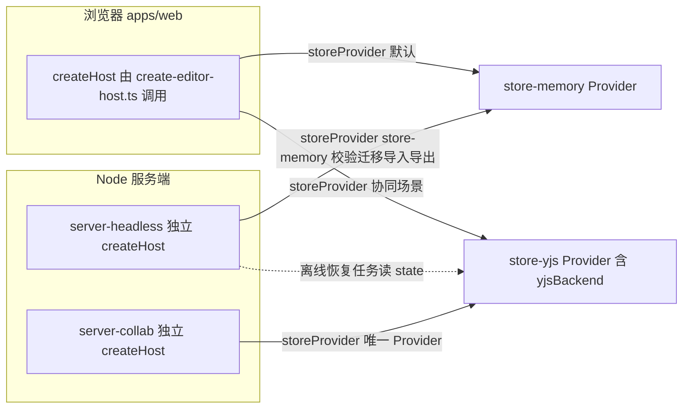

怎么读：同一个 `DocumentStore` Definition 在三处宿主各自装配不同 Provider——浏览器按场景二选一，`server-headless` 以 `store-memory` 为主、只在离线恢复时读 `store-yjs` 的状态，`server-collab` 则唯一依赖 `store-yjs`。

## 8. doc / sheet 扩展缝

BC-05（model-core）是 12 号文档「共享（水平层拥有、零改动）」清单中列出最多抽象的上下文（12 §3.1：Unit/UnitScope、DocumentStore+StoreOp、Transaction/History、Snapshot/Migration/ResourceHook、Command 管线、permissions、`Selection` 泛型），也是 12 §3.2「必须参数化」清单中**注入点**最集中之处：

| 12 §3.2 参数 | 注入方式 | 落在本模块的文件 |
|---|---|---|
| body 类型 `S` 与 schema | `DocumentType<S>.bodySchema` | `document-type/document-type.ts` |
| Mutation 联合 | `core.mutation` 贡献 | `command/mutation.ts`、`command/mutation.point.ts` |
| 命令与操作 | `core.command` 贡献 | `command/command.ts`、`command/command.point.ts` |
| 选区锚点类型与 kinds | `DocumentType.selectionKinds` + 泛型 `A` | `document-type/document-type.ts`、`selection/selection.ts` |
| 单元级服务（`slides`/`docs`/`sheets`） | `DocumentType.unitServices`+`unitPlugins` | `document-type/document-type.ts`（声明）、`unit/unit-scope.ts`（隔离集合计算）、`unit/unit-plugin.ts`（挂载） |
| 格式编解码注册 | `core.format` 贡献 | `format/format-codec.ts`、`format/format.point.ts`（具体 codec 在 M-04） |
| 资源钩子命名空间 | `core.resource` 贡献 | `resource/resource-hook.ts`、`resource/resource.point.ts` |
| 迁移链 | `core.migration` 贡献 | `migration/migration.ts`、`migration/migration.point.ts` |
| 权限策略 | `core.permissionPolicy` 贡献 | `permission/permission.ts`、`permission/permission.point.ts` |

12 §2 结论中「M1 需预先参数化的 4 处 ⚠」，**只有第 4 处落在本模块**（前三处——`layoutTextBody` 分页、`ViewDescriptor` 开放字段、`ui.*` 的 `slot`——分别属于 M-06/M-10，本模块不涉及）：

4. **Snapshot 编解码的 body 分片扩展点**（12 §3.3）：`SnapshotBundle` 允许 `body` 引用外部 blob 分片 `{ $ref: BlobRef }`；`decodeSnapshot` 在 M1 即支持 `$ref` 解析，slide 不使用，为 M5 的 `model-sheet`（巨大 `cells` 表）预留。落点：`snapshot/codec.ts`（`decodeSnapshot` 的 `$ref` 分支）、`snapshot/snapshot.ts`（`Snapshot.body` 类型允许分片标记）。M0/M1 milestone 要求：即使不实现分片读取的性能优化，`$ref` 分支必须存在且有单测，否则 M5 引入分片会改动本应「零改动」的水平层文件。

**必须零改动的文件清单**：按 12 §4.4/module-map §6.4「冻结层」机制，本模块全部七个包的 `src/**`（含 `testing/**`，不含 `__tests__/`）在 M5 `model-doc`/`model-sheet` PR 中要求 `horizontal-freeze.lock` **无 diff**——即 §4/§5 列出的全部 206 个文件都在冻结范围内（2026-09-26 shared 增 4 个，rulings §4.20 TX-10；同日 protocol 删 `collab/frame.ts` 减 1 个，rulings §4.21）；确需改动（例如上述分片扩展点从「存在分支」变为「性能优化」）须附 ADR 并显式更新锁文件。`testing/fixtures/{fixture,fixture-grid}/**`（本文档新增）恰恰是这份「零改动」承诺的**证明机制**：M5 时用它们（而非真正的 `model-slide`）驱动运行时验证（ADR-0016 第 3 条），不需要现在就有 `model-doc`/`model-sheet`。

## 9. 测试布局

七个包遵循 02 §4.0 的包内测试约定——`src/__tests__/` 单测 + `src/testing/` 可测试子路径导出——不使用模板示意的顶层 `tests/` 目录（与 02 现有骨架保持一致；模板与 02 表述的这处差异记入 §12）。

```text
packages/<pkg>/src/__tests__/
├── lifecycle.test.ts            插件/provider 包必须：调用 defineLifecycleSuite
└── <feature>.test.ts            按源文件逐一对应
```

关键测试文件与源文件对应关系（示例，非穷举；穷举清单由 `create-package` 脚手架 + 评审在实现期补齐）：

| 包 | `__tests__` 文件 | 覆盖源文件 | 类型 |
|---|---|---|---|
| shared | `order.test.ts` | `order.ts` | unit + property（fast-check）；2026-09-26 补 rocicorp 上游测试向量、「连续追加 1 万次键长 ≤ 6」与随机插入键长 p99 ≤ 32（ADR-0032 修订） |
| kernel | `augment.type-test.ts` | `augment.ts` | 类型测试（ADR-0001 spike S1/S7/S8；后缀由 `*.test-d.ts` 改为 `*.type-test.ts`，决策 T-NAMING，2026-09-25） |
| kernel | `kit-options.type-test.ts` | `testing/conformance/kit.ts` | 类型测试：`KitOptions` 无 `skip`/`only`/`exclude`/`cases` 键（70/02 §15） |
| protocol | `collab/ticket-claims.type-test.ts` | `collab/ticket.ts` | 类型测试：票据 claims 封闭集合（70/10 SEC-DA-04） |
| model-core | `history-restore-commands.test.ts` | `command/builtin/history-restore-commands.ts`、`history/recovery-records.ts` | integration：新事务、可撤销、硬删除后禁用、原 id 复活；契约侧由 `runDocumentStoreConformance` 的 `history-commands` 分节覆盖（70/02 §4） |
| kernel | `failure-isolation.test.ts` | `failure-isolation.ts` | integration（A/B/C 三插件断言，03 §8） |
| kernel | `version-mismatch.test.ts` | `manifest/verify.ts`、`manifest/version.ts` | integration（ADR-0002） |
| kernel | `lifecycle.test.ts` | `plugin.ts` | contract（`defineLifecycleSuite`） |
| protocol | `schema-snapshot.test.ts` | `rest/*`、`ws/*` | contract（zod→JSON Schema 输出入库 diff） |
| i18n | `keys-sync.test.ts` | `keys.ts`、`locales/*.json` | 包内自测（各 locale 键集合等于 zh-CN）；CI 权威执行点为 `scan-contributions` 规则 (f)（原名 `i18n-keys-sync`，TD-089，GV-15） |
| model-core | `unit-scope.test.ts` | `unit/unit-scope.ts`、`unit/unit-plugin.ts` | integration（ADR-0005：隔离、关闭清理） |
| model-core | `unit/__tests__/units-registry.test.ts` | `unit/units.service.ts`、`unit/unit-plugin.ts` | unit（rulings §4.20 FE-01；不调用 kit，按 70/01 §4 归 `test/unit`，用例 id 见 70/02 §9.1）：同一 `provides` 第二次登记被拒且有诊断；登记后打开的 Unit 挂上登记项、已打开的 Unit 不变；dispose 后 `assertNoLiveEffects` 为空 |
| shared | `clock-random.test.ts` | `clock.ts`、`random.ts`、`testing/{clock,random}.ts`、`ids.ts`、`order.ts` | unit：`SeededRandom` 同种子序列相同、`fork` 互不干扰；注入 `FixedClock`+`SeededRandom` 时 `newNodeId()` 与 `between()` 输出可复现（rulings §4.20 TX-10） |
| model-core | `pipeline.test.ts` | `command/pipeline.ts` | integration（七阶段、VETOED、审计） |
| model-core | `permissions.test.ts` | `permission/permissions.service.ts` | integration（ADR-0012） |
| model-core | `lifecycle.test.ts` | `plugin.ts` | contract |
| store-memory | `conformance.test.ts` | `memory-store.ts` | contract（`runDocumentStoreConformance`） |
| store-yjs | `conformance.test.ts` | `yjs-store.ts` | contract + 双文档收敛 |
| store-yjs | `api-surface.test.ts` | `index.ts` | 静态（`.api.md` 正则扫描 `Y\.[A-Z]\w*`，09-api-surface §2.2） |

仓库根 `fixtures/`（跨包共享，不属于任何单一包）：`fixtures/snapshots/<documentType>/v<N>/*.json`（ADR-0009 历史版本样本；本模块的 `fixture`/`fixture-grid` 各自需要 v1 样本）、`fixtures/snapshots/<documentType>/schema-lock.json`、`fixtures/horizontal-freeze.lock`（§8）。覆盖率与性能预算引用 11-testing-strategy（未列入本模块必读，实现期核对）。

## 10. 机械约束

依据来源：module-map §9（本模块 BC-01…BC-05 五行）、02 §4.0.1/§7、09-boundaries §2/§3。`role` 字段按 02 的七值编码（`library`/`plugin`/`definition`/`provider`/`bundle`/`app`/`tooling`）；depcruise 侧按 09-boundaries §2 折叠为四值（module-map §8 G-2 已记录这一「同一字段两级折叠」关系，本文档不重复裁决）。

| 包 | `package.json#cordex` | 关键 depcruise 规则 | 关键 eslint / 扫描器规则 | 09-type-discipline |
|---|---|---|---|---|
| shared | `L0 / iso / — / library` | R1 无环；R11 `shared-has-no-deps`（`dependencies` 必须为空） | TD-110 确定性 lint（`determinism` 第二个 override：禁 `Date.now`/`Math.random`/无参 `new Date()`；`clock.ts`、`random.ts` 为豁免文件，rulings §4.20 TX-08） | 03-boundaries §3.1；08 §12c TD-110 |
| kernel | `L0 / iso / — / plugin` | R12 `only-kernel-imports-cordis`（唯一允许 `import 'cordis'`） | `no-mixin-outside-kernel`、`no-register-methods`、`no-module-level-mutable-state`、`no-bare-throw`、`no-console` | 03-boundaries §3.3 |
| protocol | `L0 / iso / — / library` | R1；R5 `third-party-single-entry`（`zod` 集中） | `no-enum-in-protocol` | 03-boundaries §3.3 |
| i18n | `L0 / iso / — / plugin` | R1、R2 | `scan-contributions` 规则 (f)（原名 `i18n-keys-sync`，TD-089；rulings §4.18 GV-15） | 06 §3、08 §11.1（09-type-discipline 无 i18n 专项扫描器） |
| model-core | `L1 / iso / — / definition` | R2 `cordex-layer-downward`；被 R3 `cordex-doc-type-blind` 保护（禁止垂直束反向 import） | `no-doc-type-literals`、`no-unit-scoped-inject-at-root`、`no-boolean-command-result`、`no-inverse-in-mutation`、`no-index-in-mutation`、`command-declares-capability`、`operation-has-no-tx`、`effect-owned-timers`、`events-must-be-declared`（08 §11 对照的正式名） | 03-boundaries §3.2/§3.5；04 §11；05 §12 |
| store-memory | `L1 / iso / — / provider`，`implements:['store']` | R2；R7 `cordex-role-provider-no-cross-import`（不得 import store-yjs） | `scan-manifest` 规则 (e)（每个 provider 必有 `runDocumentStoreConformance` 调用；原称 `provider-runs-conformance`，GV-15） | 03-boundaries §3.5 |
| store-yjs | `L1 / iso / — / provider`，`implements:['store','yjsBackend']` | R2；R5（`yjs` 仅此三包之一）；R7 | 同左 + `.api.md` 正则扫描 `Y\.[A-Z]\w*`（09-api-surface §2.2，无豁免通道） | 03-boundaries §3.4/§3.5；04-api-surface §2.2 |

本模块「关键约束」（硬规则，不得违反）与其机械化对照：

| 约束 | 机制 | 落点文件 |
|---|---|---|
| `Mutation` 禁止 `inverse` 字段 | lint `no-inverse-in-mutation`；`MutationDef.schema` 为 `strictObject` | `command/mutation.ts` |
| `StoreOp` 五种原语、无 `move` | 类型测试：判别联合恰 5 个成员 | `store/ops.ts` |
| 软删除只写 `_deleted` 标记、客户端 Provider 不硬删除墓碑（§4.15 Q3） | 契约套件 `soft-delete-tombstone`；`store-memory`/`store-yjs` 源码中对实体路径的 `delete` 只允许出现在 `origin.system.reason==='maintenance'` 分支（评审 + 用例） | `store/tombstone.ts`、两个 Provider |
| `UnitScope` 隔离服务集固定 | `ISOLATED_SERVICES` 常量 + ADR-0005 `unit-scope.test.ts` | `unit/unit-scope.ts` |
| 贡献项 schema 校验失败走诊断而非抛错 | `ContributionService.contribute()` 语义（03 §3.3） | `contribution/service.ts`（kernel） |
| 命令唯一执行入口，`CommandDef.permission` 必填非空 | lint `command-declares-capability`；lint `cordex/store-transact-in-commands-only`（TD-068，08 §11 对照名 `store-transact-callsites`；生产代码仅两处调用 `store.transact`；渐进打开的 `system('import')` 追加是第三处调用点，位于 `unit/unit-plugin.ts`，按该规则的 `cordex-allow` 预算登记，rulings §4.18 CO-12） | `command/pipeline.ts`、`command/command.ts` |
| Snapshot 显式编解码 + `schemaVersion` | `scanners` job 的 schema-lock 步骤（CI job 名维持 13 个封闭集合，rulings §4.18 GV-14）；`validateSnapshot()` | `snapshot/codec.ts`、`snapshot/validate.ts` |
| 权限 fail-closed | `command-harness`：零策略 → 全部 `PERMISSION_DENIED` | `permission/permissions.service.ts`、`command/permission-gate.ts` |

## 11. 里程碑与实施顺序

### M0：骨架（对应 02 §8 骨架创建顺序第 3 步前半段）

建包顺序：`shared → kernel → protocol → i18n → model-core → store-memory → store-yjs`；每个包先用 `tooling/scripts/create-package` 生成占位骨架（`index.ts`/`plugin.ts`〔library 除外〕/`manifest.ts`〔生成〕/`__tests__/lifecycle.test.ts`），使 `pnpm check` 全绿。范围：shared 全部 22 文件落地（含 2026-09-26 新增的 `clock.ts`、`random.ts`、`testing/{clock,random}.ts`）（零外部依赖，最快完成）；kernel 的 `createHost`/`ContributionPoint`/`Manifest`/`errors`/`telemetry` 骨架 + `failure-isolation.test.ts` 通过；protocol 先落 `Capability`/`BlobRef`/`ErrorEnvelope` 三个最小 schema（其余 REST/WS DTO 随 M-08/M-09 排期，不阻塞本模块）；i18n 的 `i18n.bundle` 贡献点 + 空 `zh-CN.json`；model-core 七个服务的 `plugin.ts` 骨架 + 七个贡献点定义（`fixture`/`fixture-grid` 尚不要求完整）；store-memory/store-yjs 的 `provide` 声明到位，`runDocumentStoreConformance` 骨架存在但允许暂时跳过。

### M1：首个可运行切片——打开 fixture 文档类型 → 执行命令 → 撤销

本模块**独立于其它模块**即可验证的最小闭环（不需要 `model-slide`/`ooxml-pptx`/任何 UI）：

**M1 最小闭环链路图**

```mermaid
flowchart LR
createhost["createHost 创建宿主"]
pluginmodel["ctx.plugin 加载 modelCorePlugin"]
pluginstore["ctx.plugin 加载 storeMemoryPlugin"]
contribute["贡献 fixtureDocumentType 到 core.documentType"]
unitsopen["units.open 创建 fixture 空文档"]
execute["commands.execute 执行 fixture.node.insert"]
undo["history.undo 撤销 test-client 操作"]
assert["断言 store.state 深等于插入前状态 且 canUndo 为 false"]
createhost --> pluginmodel
pluginmodel --> pluginstore
pluginstore --> contribute
contribute --> unitsopen
unitsopen --> execute
execute --> undo
undo --> assert
```

怎么读：八个节点按时间顺序一一对应原闭环的每一步；`fixtureDocumentType` 取自 `testing/fixtures/fixture`；`units.open` 以空文档打开；`commands.execute` 的具体入参为 `id`/`parentId: null`/`order`；`history.undo` 的操作者为 `local('test-client')`；末节点断言 `store.state()` 深等于插入前状态且 `canUndo()` 为 `false`。

验收命令（ADR-0004 CI 矩阵的本模块子集）：

```bash
pnpm --filter "@cordexjs/{shared,kernel,protocol,i18n,model-core,store-memory,store-yjs}" build
pnpm --filter "@cordexjs/{kernel,model-core,store-memory,store-yjs}" test
turbo run typecheck lint depcruise manifest api iso-smoke policy \
  --filter="@cordexjs/{shared,kernel,protocol,i18n,model-core,store-memory,store-yjs}"
```

通过标准：`runDocumentStoreConformance`（含 rulings §4.15 Q3「中性撤销语义」分节）在 store-memory 与 store-yjs 均全绿；上述最小闭环集成测试通过；`fixtures/horizontal-freeze.lock` 首次生成（M5 前只需存在，暂不做锁定比对）。

### M2/M3 展望（不在本模块交付范围，仅标注依赖前提）

M2 起 `yjsBackend` 需被 `collab-yjs`（M-05）实际注入验证，`protocol` 的 `ws/*`、`collab/*` 帧文件（含 `room.persist?`，rulings §4.19 INC-09）与 `rest/snapshots.ts` 的 `latest` 需被 M-09 网关与快照 bootstrap 消费——2026-09-25 起协同后端提前到 M2（rulings §4.19 D-M2-CONTENT），服务端文档一律以 `store-yjs` 打开；`command/builtin/history-operations.ts` 的 `core.undo`/`core.redo` 需被 M-10 的撤销/重做按钮与快捷键消费（`view.setMode` 已移出本模块，改由 M-10 自身在 ui-core 落地并消费，不再是本模块的下游验证项）。M3 起 `command/builtin/restore-version-command.ts` 需被 M-09 的版本 REST 端点驱动（命令本身可在 M0/M1 实现并单测，端到端验证等待 M-09）。M3 起 `core.history.restoreMine`/`restoreElement` 与 `recovery-records.ts` 需被 M-10 撤销提示条与 M-05 软冲突 Toast 消费（多人协同体验层）；`embed/messages.ts` 为 M3 P2。

## 12. 与现有文档的差异与追加建议

延续 module-map §8 的编号（G-1…G-4 已在该文档），以下延续为 G-5 起，均为本文档写作过程中发现、按硬规则「不得擅自改写既有骨架」原则记录于此而非直接改写源文档：

| # | 涉及文档 | 差异 / 发现 | 追加建议（不直接生效） |
|---|---|---|---|
| G-5 | `02-layering-and-packages.md` §4.3 vs `05-command-and-history.md` §2、ADR-0012、rulings Q-T8 | 02 §4.3 给 `permissions/actions.ts` 的词汇是「`PermissionAction`：`document.read/edit/comment/export/share/manage`」；05/ADR-0012/12/13 一致使用「`Capability`：`doc.read/doc.comment/doc.write/doc.export/doc.manage/history.read/history.restore`」。02 更新于 09-18，晚于 05/ADR-0012 的 09-15，属真实词汇冲突而非表述差异 | **已结案（14-cross-module-review.md §1 C-15）**：全仓统一为 `Capability`，`PermissionAction`/`CapabilityBit`（`01-tooling-and-governance.md` 曾用）均作废，`PermissionAction` 可保留 `@deprecated` 别名一个版本；本文档 §4.3/§5.3 采用 `Capability` 为准，`00-module-map.md` §2 BC-03 行、`01-tooling-and-governance.md` 已同步回写 |
| G-6 | `02-layering-and-packages.md` §4.3 vs ADR-0012 第 1 条 | ADR-0012「角色→能力位映射也在 protocol」，但 02 §4.3 的 `permissions/` 子树未列出该文件 | 本文档新增 `permissions/roles.ts`；建议 02 §4.3 同步补上 |
| G-7 | `02-layering-and-packages.md` §4.5 vs ADR-0016 第 2 条 | ADR-0016 要求 `fixture` 与 `fixture-grid` 两个夹具类型「同页共存」验证水平层；02 §4.5 只列 `fixture-document-type.ts` 一个 | 本文档补齐 `testing/fixtures/fixture-grid/**`；建议 02 §4.5 同步列出 |
| G-8 | `02-layering-and-packages.md` §4.5 的 `fixture-document-type.ts` | 单文件塞入 3 Mutation+2 Command+FormatCodec+ResourceHook+Migration+2 Invariant，与其它垂直束分文件惯例不一致 | 本文档拆为 8 个文件（§4.5/§5.5 `testing/fixtures/fixture/**`），非否定，只是颗粒度细化；建议 02 §4.5 采纳 |
| G-9 | `02-layering-and-packages.md` §4.5 的 `command/` 子树 | 04 §4.4/§10、03 §3.6 隐含需要 `core.export`/版本恢复/撤销重做内置命令，02 §4.5 未列对应文件 | 本文档新增 `command/builtin/{export-command,restore-version-command,history-operations}.ts`；建议 02 §4.5 同步列出。**注**：本文档写作之初曾在此新增第三个文件 `view-operations.ts`（`view.setMode`），已按 14-cross-module-review.md §1 C-01 裁定移出，改收编 `core.undo`/`core.redo`（C-02），见 §12 收敛小节 |
| G-10 | `02-layering-and-packages.md` §4.5 的错误码文件 | 04 §2.1/§2.2/§2.6/§2.10 分别为 `UnitError`/`StoreError`/`MigrationError`/`FormatError` 标注了返回类型，02 §4.5 只显式列出 `command/errors.ts` | 本文档按同一模式新增 `unit/errors.ts`、`store/errors.ts`、`migration/errors.ts`、`format/errors.ts`；建议 02 §4.5 同步列出 |
| G-11 | `02-layering-and-packages.md` §4.6/§4.7 的 `*.contribution.ts` | 两文件被列出但无行内描述，易误读为「声明新 Context/Events」 | 本文档明确：`store` 类型由 model-core 声明，`store-yjs.contribution.ts` 唯一新增 `Context.yjsBackend`，`store-memory.contribution.ts` 为结构占位；建议 02 同步补充说明 |
| G-12 | `40-modules/_template.md` §9 vs `02-layering-and-packages.md` §4.0 | 模板 §9 示意顶层 `tests/{unit,contract,integration,fixtures}/`；02 §4.0 实际用 `src/__tests__/`+`src/testing/`，无顶层 `tests/` | 本文档 §9 按 02 §4.0 真实约定书写；建议模板 §9 注明「示意，实际见 02 §4.0」 |

### 2026-09-18 收敛（回写员 R1，依据 `14-cross-module-review.md` §1 全部 30 条推荐裁定）

本次收敛落实的裁定编号与本文档改动位置：

| 裁定 | 改动位置 | 摘要 |
|---|---|---|
| C-01 | §2.4（删 `view/mode-changed` 行）、§2.6（删 `view.setMode` 行）、§3（model-core 事件发布列表）、§4.5/§5.5（删 `command/builtin/view-operations.ts`）、§11、G-9 | `view.setMode` Operation 移出 model-core，归 ui-core（M-10） |
| C-02 | §2.6（新增 `core.undo`/`core.redo` 两行）、§4.5/§5.5（新增 `command/builtin/history-operations.ts`）、§6 | 收编撤销/重做为内置 Operation |
| C-07 | §2.2/§2.3（新增 `PresetEntry` 等值对象与 `mountEntries()` 等纯函数）、§3（新增说明段）、§4.2/§5.2（新增 `src/preset/**` 五文件）、§6 | 收编装配运行时（源自 M-11 §4 `assembly/`） |
| C-14 | §2.2（`Origin` 行增补 `via`/`reason` 取值 + 说明段）、§2.5（`undo/redo` 实参口径）、§4.5/§5.5（`store/origin.ts`） | 接受 06 §18.2 的 `Origin` 判别字面量增补 |
| C-15 | §1.2（line 58 能力位词条）、G-5（结案） | 统一为 `Capability`，`CapabilityBit`/`PermissionAction` 作废 |
| C-16 | §2.6（新增「错误码通则」段与对照表）、§2.1（`UNIT_UNKNOWN_DOCUMENT_TYPE` 两处）、§4.5/§5.5（`unit/errors.ts` 等五个 `errors.ts` 行） | 确立 TS 常量 `UPPER_SNAKE`/错误码值点式双轨通则；`format.no_document_type` 定为唯一权威拼写 |
| C-24 | §2.4（域白名单段新增 `export` 域例外说明） | `export` 域标注「新增建议，已提请章程收编」 |
| C-26 | §2.5（新增 `FormatCodec` 契约套件说明）、§4.5/§5.5（新增 `testing/format-codec-conformance.ts`）、§6 | 补齐 charter §5.5 命名例证无归属文件的缺口 |
| C-27 | §4.3/§5.3（新增 `render/page.ts`）、§6 | `RenderPageProtocol` 系列 schema 收编进 `@cordexjs/protocol`，供 M-09/M-11 import |

未落实但已知悉的相关项：C-28（`model-core` 未在本文档依赖上限内出现偏差，不适用）；命名一致性 §2 的「新增建议」58 项中与本模块相关者（`contributions`/`yjsBackend` 服务名、`unit/*` 等事件域全表移入 03 §3.6）留待总编排/架构-类型治理条线统一收编，本文档不重复登记。

### 2026-09-24 回写（rulings §4.15，章程 §10 Q1–Q10 裁决）

| 裁决 | 本文档改动位置 | 要点 |
|---|---|---|
| Q3 撤销语义 | §2.2（`StoreOp` 行、新增 `Tombstone`/`UndoSkip` 行）、§2.4（新增 `store/undo-skipped`）、§2.5（「中性撤销语义」六条 + 契约套件五个新用例 + Provider 差异表新增一行）、§3（两个 Provider 的 `Config` 统一 `undo.remoteConflict:'skip'`）、§4.5/§5.5（新增 `store/tombstone.ts`）、§4.6/§4.7/§5.6/§5.7（`history-stack.ts`/`undo.ts`）、§10 | 同一键被他人后写 → 跳过并提示；整步被跳过 → 停下不连撤；删除改软删除墓碑（`StoreOp` 仍 5 种）；读路径过滤；TTL（默认 24h）硬删除只由服务端单写者执行；Yjs 13.6.x 精确版本 |
| Q3（Config 统一） | §3 store-yjs、§4.7 `plugin.ts` | 原扁平 `undoCaptureTimeout` 并入 `undo.captureTimeout`，与 30-architecture/06 §2.4 对齐（决策包 Q3 docUpdates 指出的 02:498/:811 与 06 §2.4 不一致） |
| S-3a 两级 ack | §4.3/§5.3 `ws/frames.ts` | control ack 带 `tier:'spill'\|'db'`；只有 `db` 清 pending |
| Q5 超系统天花板拒绝导入（rulings 原文「超包络」即超系统天花板，见 ADR-0035 复核修正与 §4.18 UX-13；性能包络只是保证线，不是拒绝线） | §4.3/§5.3 `errors/codes.ts` | 新增 `format.quota_exceeded`（导入）、`document.quota_exceeded`（编辑期）、`storage.quota_exceeded`（存储）三码，域前缀已统一（30-architecture/10 §1.4） |
| T-0 单组织去租户 | §4.3/§5.3 `ids.ts`、`permissions/principal.ts` | 删除 `TenantId`、`Principal.tenantId` |
| Q6 鉴权 / 组管理推迟 | §4.3/§5.3 `rest/auth.ts`；删除 `rest/groups.ts` 与 `GroupId`；§7 协议目录段 | 服务端只做 OIDC RP；集成方 JWT / API Key 降 M4；组管理（U-11）推迟，M3 只按人分享 |

需要其他文件配合：30-architecture/06 §8 #2/#3/#10/#11 与 §2.4（撤销与删除语义改写、`undo.remoteConflict` 字段）；ADR-0020/0032；M-03（实体删除的 `lower()` 改写墓碑、墓碑计入 20,000 上限、选择器过滤）；M-05（撤销跳过的确定性/fuzz 用例、LocalBatcher 两级 ack）；M-08（`groups` 相关删除、`TenantId` 使用点）；M-09（TTL 硬删除单写者、ack tier 发送）。


### 2026-09-24 复核修正（rulings §4.17；复核报告 `00-charter/_evidence/review-2026-09-24.html`）

| 条目 | 本文档改动位置 | 要点 |
|---|---|---|
| M1 两级 ack 帧 | §5.3 `ws/frames.ts` | 本文档为 ack 帧唯一事实源：`{kind:'ack', tier:'spill'} \| {kind:'ack', tier:'db', seq}`；**去掉 `count`/`localCounter`**，理由见该行；30-architecture/06 §2.4 与 M-09 `SpillAck` 照抄 |
| M2 `store/undo-skipped` 载荷 | §2.4 | 唯一形状 `{skipped: UndoSkip[], wholeStep}`（作废 `paths: Path[]`）；30-architecture/05/06/10 与 M-05 照抄 |
| M3 撤销协同契约用例名 | §2.5 新增「撤销协同契约用例名表」、§5.5 `testing/document-store-conformance.ts` | 五个用例名定为唯一事实源并列出作废别名（`delete-tombstone-undo`、`soft-delete-restore-same-id`、`delete-vs-edit-no-dup`、`tombstone-filtered-on-read`）；ADR-0020、30-architecture/05/06/11、M-05 照抄 |
| D4 撤销目标被他人删除 | §2.2 `UndoSkip.reason` 增 `'remote-deleted'`、§2.5 第 4 条、用例 `delete-vs-edit-undo` (b) | 跳过并提示，不看 TTL，撤销永不复活他人删除的元素 |
| D5 埋点口径 | §2.4 `store/undo-skipped` 行 | 单独统计，不计入软冲突率（M-05 落地） |

### 2026-09-25 回写（rulings §4.19 三条设计线拆分与遗留取舍）

| 依据 | 改动位置 | 摘要 |
|---|---|---|
| 设计 03-screens/07「最近删除」显示删除者；ADR-0034 补充 v0.2 先例（F35） | §2.2 `Tombstone` | `{at, by, byUser?: UserId}`：命令层写入当前 principal，服务端软门禁 L4 校验等于会话 userId（60/16 L4） |
| 30/05 §3.1（30 > 40）、决策 INC-10/SG-04（F36、F38） | §2.6 错误码表、§5.3 `errors/codes.ts` | `UNIT_NOT_FOUND` 值 `unit.not_found` → `command.unit_not_found`；`errors/codes.ts` 登记新域与新码（码表唯一源 30/10 §1.1） |
| 决策 INC-01、INC-06、INC-03/04/05、INC-09 | §4.3、§5.3 | 登记 `collab/{frame,close-codes,awareness,ticket}.ts`（根入口导出，不建 `collab/control.ts`）；`ws/frames.ts` 判别键 `type`、`room.persist?` |
| 决策 MECH-INC（INC-14、INC-15、INC-28、INC-36） | §4.3、§5.3 | `rest/snapshots.ts` 删预签名 URL DTO；票据线上 claim `perm_ver`；`embed/messages.ts`（M3 P2） |
| 50/14 §4.2、50/15 §11、50/16 §11.3（F72） | §4.2、§4.4、§5.2、§5.4、§6 | kernel `HostOptions.scriptUrlPolicy` 与 `toScriptUrl()`（原 `createWorker` 改名）；i18n `createI18n()`（决策 NOHOST-I18N）与随包 `errors.*` 协议码文案 |
| 50/04 §6、决策 RESTORE-CMD | §2.6、§4.5、§5.5、§9 | `core.history.restoreMine`/`restoreElement` 与 `recovery-records.ts`（`stepId`、`recordConflict()` 供 collab-yjs） |
| 70/02 §14 第 7 条、70/10 §17 第 5 条、决策 T-NAMING / T-KITS | §4.2、§4.3、§4.5、§5、§9 | kernel `testing/conformance/kit.ts`；model-core `testing/permission-policy-conformance.ts`（`runPermissionPolicyConformance`）；protocol `testing/redirect-samples.ts` 与 `collab/ticket-claims.type-test.ts`；`augment.test-d.ts` → `augment.type-test.ts` |
| §4.19 D-M2-CONTENT | §11 | `ws/*`、`collab/*` 与 `rest/snapshots.ts` 的消费方随协同后端提前到 M2 |

### 2026-09-26 回写（rulings §4.20 遗留小项收口）

| 依据 | 改动位置 | 摘要 |
|---|---|---|
| FE-01（UnitScope 默认 Provider 登记 API，40/11 Q-2 结案） | §2.1（`units.open` 第 ④⑤ 步 + 新增「登记表」段）、§2.2 `PresetEntry` 行、§2.3 `mountEntries` 行、§3 model-core `Config`/生命周期、§4.2/§5.2 `preset/{entry,mount}.ts`、§4.5/§5.5 `unit/{units.service,unit-plugin}.ts`、§6、§9 | `units.registerUnitProvider(entry): Disposer` 与 `units.listUnitProviders()` 落在 `unit/units.service.ts`（不新增文件）；model-core ready 时只自登记 history、selection，其余由 preset `scope:'unit'` 条目在 mount 时登记；同一 `provides` 只登记一次（后来者被拒记诊断、不抛）、只影响之后打开的 Unit、preset dispose 全部撤销；删除 `Config.defaultStoreProvider`；kernel 以结构类型 `UnitProviderRegistrar` 调用，不 import model-core；`OpenUnitDescriptor.storeProvider` 删除（§5.5，ADR-0005 决策 7）；隔离集并入登记项的 `provides`（§2.1 UnitScope 段）；登记表用例 `unit/__tests__/units-registry.test.ts`（`test/unit`，70/02 §9.1） |
| TX-10 ①（Clock/Random 端口登记，70 README §8） | §2.3 `between` 行、§4.1/§5.1（新增 `clock.ts`、`random.ts`、`testing/clock.ts`、`testing/random.ts`；`ids.ts`、`order.ts` 改为接受注入）、§6、§9、§10 shared 行、§11 M0（18 → 22 文件）、§8 冻结文件数（203 → 207） | 签名以 70/11 §2 为准；`FixedClock` 为唯一假时钟名（旧名 FakeClock 作废）；`clock.ts`/`random.ts` 为 TD-110 确定性 lint 的豁免文件（TX-08） |
| TX-01+BE-10（U-07 联合 ADR 立项） | §13 Q-2、Q-3 | 改为随 [ADR-0038 version-restore-undo](../30-architecture/adr/0038-version-restore-undo.md) 结案（M2 出口评审前定稿，未定稿则 M3 版本恢复不开工） |
| BE-01+TX-03（WS 升级限流先扣后退 + 每用户上限） | §5.3 `ws/frames.ts`、`collab/close-codes.ts` | `auth.denied` code 集合含 `collab.rate_limited`（→ 4429）；4429 增握手期触发条件 |
| FE-06（`can.*` 键族） | §5.3 `permissions/actions.ts` | `can.<capability>` 的能力位全集取自本文件 |

### 2026-09-26 回写（rulings §4.21 协同改用 Hocuspocus 4）

| 依据 | 改动位置 | 摘要 |
|---|---|---|
| q-ws-gateway（用户选 Hocuspocus 4）、ADR-0039、证据 TX-08、TX-02、d-03、d-20 | §1.3 表与图、§7 协议段、§4.3、§5.3、§8 冻结文件数（207 → 206） | 删 `collab/frame.ts`（1 字节 FrameType 信封编解码，§4 与 §5 各减一行）；`ws/frames.ts` 只留 CONTROL 判别联合（Stateless 载荷，含两级 ack），删帧级 `sync`/`awareness` 类型与 `auth`/`auth.denied`/`auth.refresh`/`ping`/`pong` 成员；`ws/handshake.ts` 改为 Auth token 的 JSON schema 与 `PermissionDenied` reason；`collab/close-codes.ts` 加 4205、4408 扩为超时通用码；protocol 仍不 import y-protocols |
| H:q-hp-provider、证据 CL-01、CL-02、VR-03、d-26 | §1.3 表、§3 store-yjs 生命周期、§4.7、§5.7、「两个 Provider 的差异」表 | `yjsBackend` 增 `docHandle()`（不透明 `YDocHandle`）与 `registerRemoteOrigin()`；`yjs-store.ts` 增「接管外部 Y.Doc」（`adopt`，服务端用）；均不新增文件 |

需要其他文件配合：30/06 §2.3 的 `yjsBackend` 接口表按本节两个新方法与 `adopt` 参数回写（名称以本文为准）；[50/07](../50-frontend/07-collaboration-client.md) §1、§2（已同轮改写）；40/09 与 60/05 的 Unit 接管挂点（`afterLoadDocument`）引用 §5.7。

## 13. 未决问题

| 编号 | 问题 | 推荐默认值 | 影响范围 |
|---|---|---|---|
| Q-1 | ADR-0001 声明合并桥接 spike（S1–S8）尚未跑，本文档 `augment.ts`/`*.contribution.ts` 结构假设 spike 通过 | 假设通过（当前草案）；若失败改用退路 B，文件数不变、内容形态变（`declare module 'cordis'` 限定进各 `*.contribution.ts`） | `kernel/src/augment.ts`；全七包的 `*.contribution.ts` |
| Q-2 | ~~`core.restoreVersion` 的事务 `origin` 用 `system('restore')`（04 §10 字面）会使其**不进入**标准撤销栈（05 §6：`undo` 只按 `local` 过滤），用户无法一键撤销一次误恢复~~ **（转专项设计，2026-09-19）** | 「维持 `system('restore')`」与「改进本地撤销栈」两个简单方案均已否决（rulings §4.12 U-07）；**转专项设计 `version-restore-undo`**（M-02 × M-05 × M-09，M3 前出 ADR），需回答多人协同下他人已在恢复后内容上继续编辑时如何回退、是否引入受保护的「恢复事务」与二次确认、与 CRDT 合并/快照链的关系；**基线已由 rulings §4.15 Q3 给出**：专项在 §2.5「中性撤销语义」（跳过他人后写并提示、整步跳过即停、软删除墓碑）之上设计，不得另起覆盖他人的撤销语义。**随 ADR-0038 结案（rulings §4.20 TX-01+BE-10）**：专项已登记为 [ADR-0038 version-restore-undo](../30-architecture/adr/0038-version-restore-undo.md)（提议；M-02 主笔，M-05、M-09 会签，70/05 出 `rs/restore-revert-*` 场景），M2 期间起草、M2 出口评审前定稿，未定稿则 M3 版本恢复（CO-07）不开工；起草基线：持有 Room 的实例内单事务、不加锁、走命令管线（不用 `revertTo`），「他人后写」按当前值是否仍出自恢复事务的 struct 范围判断而非值相等，恢复时删掉的元素以原 id 复活；「谁能撤销」「可撤销时效」留到 ADR 定稿时交互拍板 | `command/builtin/restore-version-command.ts`、`store/origin.ts`、05 §6；ADR-0038 |
| Q-3 | ~~`core.restoreVersion` 参数是完整 `targetBody`（本文档选择）还是 `{ versionId }` 由 model-core 自行解析~~ **（转专项设计，2026-09-19）** | 参数形状与撤销语义耦合（`versionId` 形态更利于「恢复事务」记录可回退的目标版本），**转专项设计 `version-restore-undo`**（M-02 × M-05 × M-09，M3 前出 ADR）一并裁定。**随 ADR-0038 结案（rulings §4.20 TX-01+BE-10）**：参数形状在 [ADR-0038](../30-architecture/adr/0038-version-restore-undo.md) 定稿（M2 出口评审前）时一并裁定；此前 `restore-version-command.ts` 维持 `targetBody` 草案，不单独改动 | `command/builtin/restore-version-command.ts`；M-09 版本恢复 REST 端点；ADR-0038 |
| Q-4 | `fixture-grid` 的稀疏 `cells.<r>:<c>` 键形状是否需要与未来 `model-sheet`（M-13/M5）字段级对齐 | 不强制对齐——`fixture-grid` 只是水平层验证工具，非 `model-sheet` 预实现 | `model-core/testing/fixtures/fixture-grid/**`；M-13 |
| Q-5 | `ROLE_CAPABILITIES` 的具体映射值（PRD CO 域，未列入本模块必读） | 类型先行（本文档已定形状），运行时初始值等 M-08 落地时与 PRD CO 域对齐后回填 | `protocol/src/permissions/roles.ts`；M-08 |
| Q-6 | `store-memory.contribution.ts` 当前无实际声明，是否应从骨架省略以保持精简 | 保留（七包结构对称性优先），标注为可选精简项 | `store-memory/src/store-memory.contribution.ts`；`create-package` 脚手架模板 |


