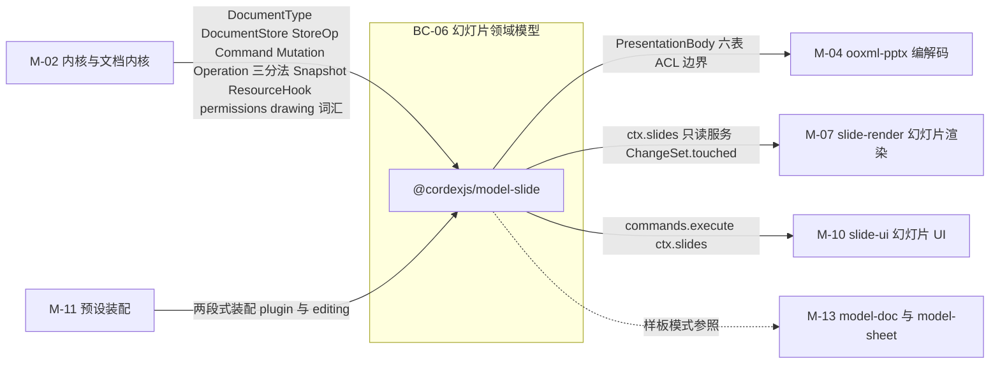
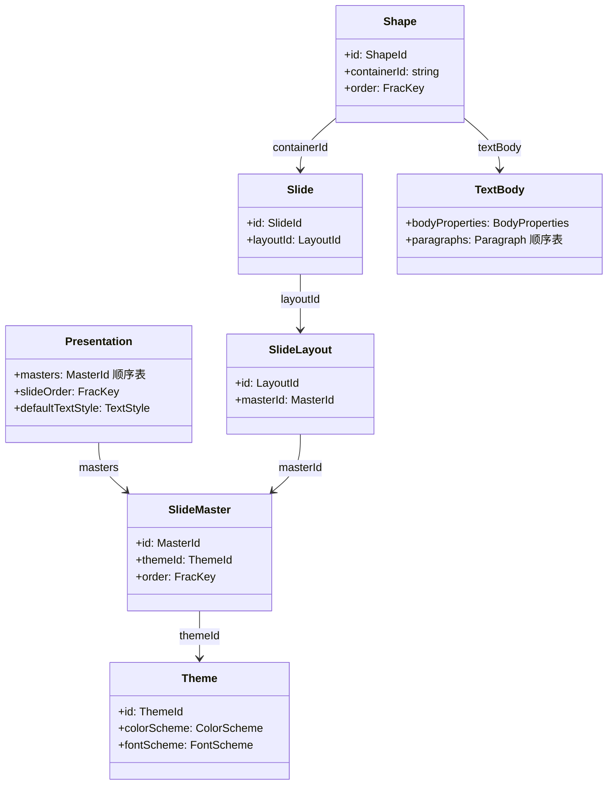
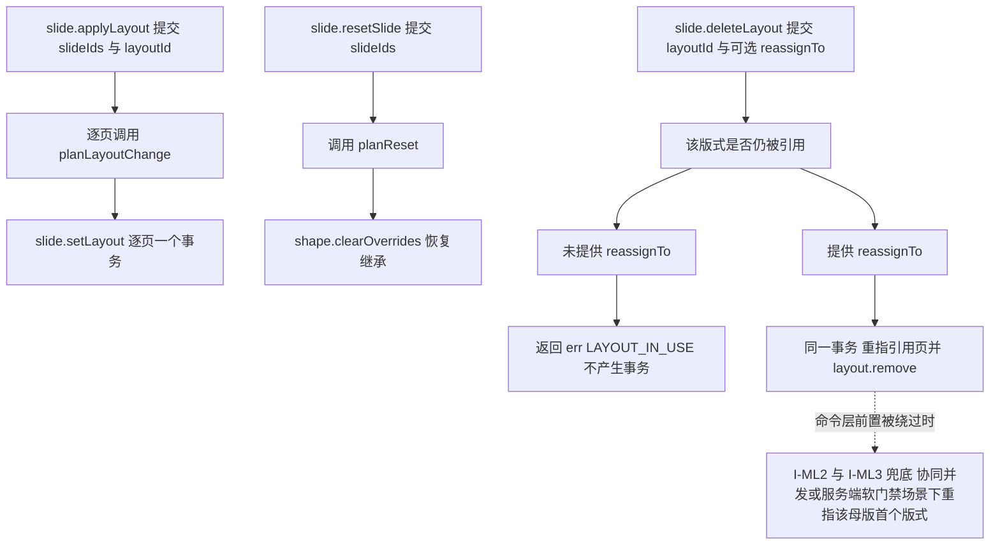
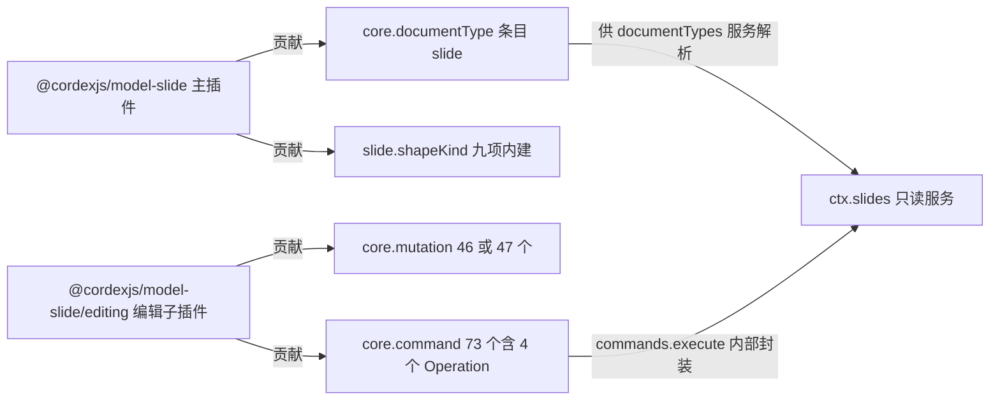
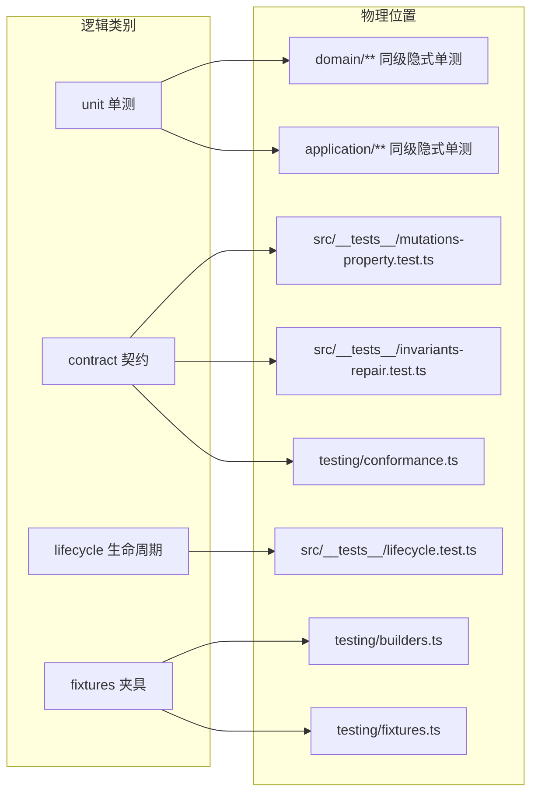

> 状态：草稿 v0.1 | 负责：架构-模块（阶段二，M-03） | 更新：2026-09-18；2026-09-24（rulings §4.15）；2026-09-24（复核修正，rulings §4.17 D2：编辑期超上限常量映射到 `document.quota_exceeded{dimension}`） | 依赖：00-module-map.md M-03、charter v0.2 §4/§5.2 `model-slide` 行/§5.5、30-architecture 04 §3/§4/§6/§8/§9/§12、05 §13、02 §4.8、rulings-2026-09-14 §4.10、PRD `10-prd/03-features/07-masters-layouts-and-themes.md`、ADR-0006/0008/0011/0013/0014/0032

# 03 幻灯片领域模型（限界上下文 BC-06 幻灯片领域模型）

## 0. 一页总览

| 项 | 值 |
|---|---|
| 职责一句话 | 幻灯片对象模型（Presentation/Master/Layout/Slide/Shape 树/TextBody/Theme）的归一化实体表、幻灯片 Mutation 与 Command、样式继承链纯函数、母版/版式/主题引用完整性不变量与 `reassignTo` 语义、`slides` 只读服务 |
| 覆盖的上下文 | BC-06 幻灯片领域模型 |
| 承载包 / 目录 | `@cordexjs/model-slide`（层带 V-model，秩 15，iso），`packages/model-slide/src/` |
| cordis 形态 | plugin（主插件只读部分 + `editing` 编辑子插件，两段式加载） |
| 运行位置 | 两端（浏览器 + `server-headless` 的 Node cordis 宿主加载同一份源码） |
| 上游（依赖） | M-02（`@cordexjs/kernel`/`@cordexjs/shared`/`@cordexjs/model-core`：`DocumentType`、`DocumentStore`/`StoreOp`、Command/Mutation/Operation 三分法、`Snapshot`/`Persisted<T>`、`ResourceHook`、`permissions`、`drawing/` 共享绘图词汇） |
| 下游（被依赖） | M-04（`ooxml-pptx` 对本包做 ACL）、M-07（`slide-render` 读 `slides` 服务）、M-10（`slide-ui` 消费命令与只读服务）、M-11（预设装配挂载本包）、M-13（`model-doc`/`model-sheet` 的样板） |
| 对外服务 | `ctx.slides`（UnitScope 内，只读投影 + 便捷命令封装，见 04 §3.4） |
| 贡献点 | 提供：`slide.shapeKind`；向 BC-05 贡献条目：`core.documentType`（1 个：`slide`）、`core.mutation`（46 个，M3 起 47 个，§2.6）、`core.command`（73 个，含 4 个 Operation，§2.6；14 §1 C-03 新增 18 个后由 55 上修，1 个即 `slide.setNotes` 待 M3）、`core.migration`（M1 为空表但注册） |
| doc / sheet 通用性 | vertical（`bundle=slide`；对应 BC-29 规划位的 `model-doc`/`model-sheet`，铁律 2 强制互不 import） |
| 批次 | 1 |

### 0.1 图示

**图 0-1 模块包关系与上下游**



怎么读：本包只有一个上游 M-02（文档内核契约），下游扇出到编解码、渲染、UI 与预设装配四个方向；`model-doc`/`model-sheet` 与本包是"参照样板"而非依赖关系（铁律 2 互不 import）。

## 1. 限界上下文与边界

### 1.1 职责与非职责

**做什么**：
- 定义 `PresentationBody` 归一化实体表（`presentation`/`masters`/`layouts`/`slides`/`themes`/`shapes`/`media`/`opaqueParts`）及其判别联合形状（`Shape`=`Sp|Pic|GrpSp|CxnSp|GraphicFrame|UnknownShape`），全部字段为 `Persisted<T>`（04 §7）。
- 定义幻灯片专属 `Mutation` 判别联合与其 `lower()` 纯函数（语义变更 → `StoreOp[]`，ADR-0013），以及 `Command`/`Operation` 定义（参数 schema、能力位、`undoable`）。
- 定义样式继承链解析纯函数（Run→Paragraph→TextBody→Shape→Layout 占位符→Master 占位符→Master.textStyles→Presentation.defaultTextStyle→Theme，04 §6）与母版/版式/主题的重匹配/重置/依赖反查纯函数（04 §12.2）。
- 定义引用完整性不变量 `I-ML2`…`I-ML8`（check/repair 纯函数，ADR-0034 的 slide 实例，04 §12.3）与 `validateChangeSet` 的映射配置。
- 向 `core.documentType` 贡献 `slideDocumentType`（`id:'slide'`），向 `slide.shapeKind` 贡献内建形状类型（`sp`/`pic`/`grpSp`/`cxnSp`/`graphicFrame:table|chart|ole|diagram`/`unknown`）。
- 提供 `slides`（UnitScope 内只读服务）：`body()`/`slide(id)`/`shape(id)`/`order()`/`shapesOf()`/`resolved.*`/`exec.*`（便捷命令封装，内部仍 `commands.execute`）。
- 承载 `extensions`（`OpaqueXml[]`）不透明槽——**每个已建模实体都有**，但只是槽位声明与合并/序列化的类型面；槽内 XML 字符串的产生/解析属于 M-04。

**不做什么（指向负责模块）**：
- 不做 Store 事务执行、命令管线（resolve/validate/waterfall/transact/history/audit）、权限判定、Snapshot 编解码与迁移调度、`ResourceHook` 收集——全部是 M-02 `model-core` 的职责；本包只**贡献**类型化条目。
- 不做任何 XML 解析/生成、OPC 包读写、不透明保留的字节级算法——是 M-04（`ooxml-core`/`ooxml-pptx`）的 ACL 职责；本包不出现任何 XML 类型，只暴露 `extensions: OpaqueXml[]` 槽供 M-04 读写。
- 不做场景合成、命中测试、脏区渲染——是 M-07（`slide-render`）的职责；本包只暴露只读 `slides` 服务与 `ChangeSet.touched`。
- 不做 CRDT 映射、awareness、离线队列——是 M-05（`collab-*`）与 M-02（`store-yjs`）的职责；本包的 `Mutation`/`lower()` 对协同模式无感知，并发语义只以「Store 层 LWW + 不变量修复」表达（04 §12.3、05 §13.4）。
- 不做任何 UI 组件、Ribbon 贡献、快捷键——是 M-10（`slide-ui`）的职责。
- 不做图表可编辑数据模型（M1–M2 仅 `Chart.partRef` 占位 + `ooxml-core/chartml` 只读解析，M3 起 `Chart.data` 才在本包建模，charter D16）。

### 1.2 通用语言

复用 charter §4.1 核心术语：`DocumentType`、`Model`、`DocumentStore`、`StoreOp`、`Mutation`、`Command`、`Operation`、`Transaction`、`Origin`、`ChangeSet`、`Snapshot`、`Derived<T>`/`Persisted<T>`、`ResourceHook`、`FormatCodec`、`Scene`/`SceneProvider`、同构类、层带。本上下文特有术语：

| 术语 | 定义 | 对应类型名 |
|---|---|---|
| Presentation | 聚合根，单例，承载页序/母版序/默认文本样式/属性 | `Presentation`（`PresentationBody.presentation`） |
| 归一化实体表 | 有身份对象按 `Record<Id, Entity>` 存储，顺序由 `order: FracKey` 字段承载，引用用 id | `PresentationBody` 的六张表 |
| 占位符继承 | 页/版式上占位符形状的可继承字段缺省即向上查链解析，不烘焙 | `PlaceholderRef`、`InheritableField`、`ResolvedRunProperties` 等 |
| `reassignTo` | 删除被引用版式/母版时，显式指定重指目标以避免 fail-closed 拒绝 | `deleteLayout({ layoutId, reassignTo? })` |
| 默认版式 | 版式/母版删除或悬空修复时的回退目标：该母版首个版式 | `planLayoutChange`/不变量 `I-ML2` 共用的选取函数 |
| FracKey 排序 | 同容器内形状/页/版式/母版的顺序键，`compare = (order, id)`，无数组下标 | `Shape.order`/`Slide.order`/`SlideLayout.order`/`SlideMaster.order: FracKey` |
| 范围条 | 母版视图中「编辑版式\|母版」双态视图状态（不改变模型，Operation 级） | `slide.selectMasterOrLayout` Operation 的 `editTargetKind` 上下文键 |

### 1.3 上下文映射

| 相邻上下文 | 关系类型 | ACL / 落点文件 | 传递的契约 |
|---|---|---|---|
| BC-05 文档内核（上游） | Customer–Supplier（本包为下游 Conformist，对 `DocumentType`/`DocumentStore`/`CommandDef`/`MutationDef` 无议价权） | `model-core/src/{unit,store,command,snapshot}/*.ts` | `DocumentType<PresentationBody>`、`StoreOp`、`Result<T,E>` |
| BC-02 共享基础设施（上游，经 BC-05 转发） | Shared Kernel | `model-core/src/drawing/*.ts` | `Color`/`Fill`/`Line`/`Transform`/`FontRef`/`TextBody` 等值对象原型 |
| BC-08 PPTX 编解码（下游） | **Anticorruption Layer**（`ooxml-pptx` 是 ACL，本包对其是「被翻译的领域语言」一侧） | `ooxml-pptx/src/{import,export}/*.ts` | `PresentationBody` ↔ PresentationML（本包从不出现 XML 类型） |
| BC-12 幻灯片渲染（下游） | Customer–Supplier（`slide-render` 是客户，只读 `slides` 服务） | `slide-render/src/scene/slide-scene-provider.ts` | `SlidesService`（04 §3.4）、`ChangeSet.touched` |
| BC-15 幻灯片 UI（下游） | Customer–Supplier | `slide-ui/src/**` | `commands.execute()`、`ctx.slides` |
| BC-09 协同（客户端）/BC-05 store-yjs（水平，间接） | Conformist（本包的 Mutation/lower 对协同透明，不感知 CRDT） | — | `StoreOp`（Yjs 映射细节属于 06 号协同文档 `06-collaboration.md`） |
| BC-29 doc/sheet 扩展占位（同层带兄弟） | **Separate Ways**（铁律 2 强制） | — | 无共享类型（仅共享水平层 BC-02/05/07/10/11/13/14） |

## 2. 领域模型

### 2.1 聚合与实体

**聚合根**：`PresentationBody`——即一个 `slide` 类型 `Unit` 的 `DocumentStore.state()`；聚合边界由 `slideDocumentType.invariants` 守护，事务边界由 M-02 的 `store.transact` 提供（本包不重新实现事务）。聚合内是六张归一化实体表，引用关系用 id + `order: FracKey`（无嵌套树、无数组下标，04 §3.1）。

| 实体 | ID 品牌类型 | 关键不变量（04 §12.3；id 见下表） | 并发 / CRDT 合并语义 |
|---|---|---|---|
| `Presentation`（单例，非表条目） | — | `masters` 非空（I-ML5） | 各字段独立键 LWW；`defaultTextStyle`/`properties` 整对象替换式 LWW |
| `SlideMaster` | `MasterId` | `themeId ∈ themes`（I-ML4）；被 ≥1 母版引用的主题不可裸删（I-ML6 反向） | 新增/删除为顶层键 LWW；A 删除母版与 B 同时把某版式指向该母版 → I-ML3 兜底（下一行） |
| `SlideLayout` | `LayoutId` | `masterId ∈ masters`（I-ML3） | A 删除版式（已确认，无 `reassignTo` 时 fail-closed 拒绝，见 §2.6）与 B 同时把页 `layoutId` 指向该版式并发收敛后悬空 → **I-ML2 兜底**：重指该母版首个版式并 `materialize` 占位符（04 §12.3、05 §13.4 场景 1） |
| `Slide` | `SlideId` | `layoutId ∈ layouts`（I-ML2） | `order`/`layoutId` 单键 LWW；同位并发插入按 `(order, id)` 全序（ADR-0032），无需 rebase |
| `Shape`（判别联合） | `ShapeId` | `containerId` 存在、`parentId` 同容器（I-ML8）；占位符引用有效（I-ML7 软） | `order`+`parentId` 单键 LWW（移动/换组/调 z 序皆是 `set`，ADR-0032）；A 重置占位符覆盖与 B 移动同占位符并发 → 同键 LWW，双方各自可撤销自己的部分（05 §13.4 场景 2）；删除为**软删除**（`_deleted` 墓碑，rulings §4.15 Q3）：A 删除与 B 编辑并发 → B 的编辑保留在墓碑实体上，A 撤销删除即带着 B 的编辑恢复；A 撤销时若同一键已被 B 后写则跳过并提示（M-02 §2.5） |
| `Theme` | `ThemeId` | 至少被一个母版引用（I-ML6，否则诊断 `THEME_UNREFERENCED_DROPPED`） | `colorScheme`/`fontScheme` **逐槽位**（12 槽 / 4 槽）LWW，非整对象覆盖（05 §13.1 `setColors`/`setFonts`） |
| `MediaRef` | `MediaId` | 无孤儿校验（共享目标保留，04 §5.2） | `BlobRef` 内容寻址，不可变、天然无冲突 |
| `OpaquePartRef`（`opaqueParts` 表） | `PartName`（string） | 不校验，透传 | 整键 LWW；删除页时级联清理其独占 opaque part，共享目标保留 |

**`reassignTo` 与悬空引用兜底的分工**（04 §12.3 末段、05 §13.2/§13.4）：命令层是**第一道 fail-closed 前置**——`slide.deleteLayout`/`slide.deleteMaster` 在目标被引用且未提供 `reassignTo` 时直接返回 `err(LAYOUT_IN_USE | MASTER_IN_USE)`，不产生事务；提供 `reassignTo` 时，重指引用页与删除动作在**同一个事务**内完成（可一次撤销）。不变量 `I-ML2`/`I-ML3` 是**第二道兜底**——只在命令层前置被绕过的场景生效：(a) 协同并发（A 删除已确认、B 同时施加引用，CRDT 合并后才出现悬空）；(b) 服务端软门禁批量修复（ADR-0034，import/migrate 路径不经命令层）。两道机制的重指目标选取函数必须是**同一个纯函数**（当前定义为「该母版首个版式」），否则用户确认对话框里承诺的行为与实际收敛结果会不一致。

**软删除墓碑与规模上限（rulings §4.15 Q3/Q5）**：
- **墓碑**：`slides`/`shapes`/`layouts`/`masters`/`themes` 五张实体表的删除一律写 `_deleted: Tombstone`（M-02 `store/tombstone.ts`），实体 id 稳定、行不移除；级联删除（删页连带其形状、删版式连带其形状、删母版连带版式与形状）对每个被级联实体各写一个墓碑，撤销时一并清除。独占 opaque part（备注页、图表部件等）的级联清理推迟到服务端 TTL 硬删除（默认 24h，M-09 单写者执行）；导出（M-04）与渲染（M-07）经 `filterLive()` 视墓碑实体为不存在。
- **读路径过滤**：`domain/query/selectors.ts`/`traverse.ts` 的全部公开选择器默认只返回存活实体；不变量 I-ML2…I-ML8 把「引用指向墓碑实体」视同悬空（按既有 repair 规则处理）。只有 `element-limits.ts` 的计数与协同/快照路径读原始表。
- **规模上限（部署可调）**：`maxSlides` 200、`maxElementsPerSlide` 1,000、`maxElementsPerDoc` 20,000（软警告 15,000）为默认值，来自部署配置、可完全调整（超出性能保证包络时告警，性能承诺不再成立）。**计数口径**：`shapes` 表全部行（含母版/版式上的形状、组合形状本身与其每个子形状各计 1），**墓碑计入**；`maxSlides` 计 `slides` 表全部行（含墓碑）。命令层守卫：会新增实体的命令（`addSlide`/`duplicateSlide`/`insertShape`/`insertPicture`/`insertTable`/`pasteShapes`/`insertLayout`/`insertMaster`/`applyLayout` 的占位符 `materialize` 等）在 `transact` 前按「提交后计数」判定，超限返回 `err(SLIDE_LIMIT_EXCEEDED \| ELEMENT_LIMIT_EXCEEDED)` 且无事务——两常量映射到 protocol 错误码 `document.quota_exceeded`（常量 `DOCUMENT_QUOTA_EXCEEDED`，M-02 `errors/codes.ts`；详情 `{dimension, limit, actual}`，HTTP 409，命令守卫拒绝、**不关连接**，rulings §4.17 D2）：`SLIDE_LIMIT_EXCEEDED` → `dimension:'slides'`，`ELEMENT_LIMIT_EXCEEDED` → `dimension:'elementsPerSlide'`（单页超限）或 `'elementsTotal'`（文档总元素超限）；达软警告线时命令成功但附诊断。不变量层 `I-LIM1` 只报告（协同并发合并后可能越线），**不 repair**（不能替用户删内容）。超包络导入由 M-04 在解析期直接拒绝（`format.quota_exceeded`，与本段 `document.quota_exceeded`、存储侧 `storage.quota_exceeded` 三码并列），不进入本包。

**图 2-1 幻灯片领域对象关系**



怎么读：六张归一化实体表都用 id 引用而非嵌套包含——`SlideLayout`/`Slide`/`SlideMaster` 三箭头体现的正是 `I-ML2`/`I-ML3`/`I-ML4` 引用完整性不变量；`Shape` 到 `TextBody` 的关系对应 `mutations/text.ts` 的 `shapes/id/textBody` 路径。

### 2.2 值对象

| 名称 | 字段摘要 | 校验 schema | 所在文件 | 来源 |
|---|---|---|---|---|
| `Color`/`Fill`/`Line`/`EffectList`/`Geometry`/`Transform`/`FontRef`/`Hyperlink`/`OpaqueXml`/`OpaquePartRef`/文本基元 | 见 04 §4.3 DrawingML 映射表 | `model-core/src/drawing/schema/*.ts` | `domain/model/drawing/index.ts`（**re-export，不重定义**） | Shared Kernel（BC-02，经 BC-05 转发） |
| `ShapeProperties` | `transform?/geometry?/fill?/line?/effects?/scene3d?: OpaqueXml/shape3d?: OpaqueXml/blackWhiteMode?` | zod，全字段可选（缺省即继承，I-ML1） | `domain/model/drawing/shape-properties.ts` | 本包 |
| `ShapeStyle` | `lineRef/fillRef/effectRef/fontRef`（各 `{ idx; color: Color }`） | zod | `domain/model/drawing/shape-style.ts` | 本包 |
| `Background` | `{kind:'properties';fill;effects?;shadeToTitle}\|{kind:'reference';idx;color}` | zod 判别联合 | `domain/model/drawing/background.ts` | 本包 |
| `PlaceholderRef` | `type: PlaceholderType; index?; orientation?; size?; hasCustomPrompt` | zod | `domain/model/shape/placeholder.ts` | 本包 |
| `NonVisualProps` | `name/hidden/description?/title?/hyperlink?/placeholder?/locks?` | zod | `domain/model/shape/non-visual.ts` | 本包 |
| `CommonSlideData` | `name?/background?/controls?: OpaqueXml/customData?: OpaqueXml/extensions` | zod | `domain/model/common-slide-data.ts` | 本包 |
| `ColorMap` | `Record<ColorMapKey, SchemeColorName>` | zod | `domain/model/theme.ts` | 本包 |
| `BodyProperties`/`ParagraphProperties`/`RunProperties`/`ListStyle`/`Bullet` | 见 04 §3.2 | zod（各字段可选，继承） | `domain/model/text/*.ts` | 本包（TextBody 骨架来自 drawing，段落/字符级细化在本包） |
| `DocumentProperties` | `core`（建模）+ `app`/`custom`: `OpaquePartRef` | zod | `domain/model/properties.ts` | 本包 |
| `OoxmlIds` | `{ cNvPrId?: number; creationId?: string }` | zod | `src/ids.ts` | 本包（ADR-0014，OOXML id 作数据保留） |
| `FracKey` | base62 字符串 + 随机后缀；`between(a?,b?)`/`compareOrder` | 品牌类型，非 zod（构造函数校验） | `@cordexjs/shared/order.ts`（引用，不重定义） | Shared Kernel |

### 2.3 领域服务

> 全部为纯函数：只读 `body`/`chain`/`changeSet`，无 IO、无随机、无时钟；浏览器与 `server-headless` 复用同一份源码（04 §6.3）。

| 函数 | 签名（草案） | 所在文件 | 两端共用 |
|---|---|---|---|
| `buildChain` | `(body, shapeId, paragraph, run) => StyleChain` | `domain/style/inheritance-chain.ts` | 是 |
| `resolveRunProperties` | `(chain: StyleChain) => ResolvedRunProperties`（全字段非 optional） | `domain/style/resolve-run.ts` | 是 |
| `resolveParagraphProperties` | `(chain: StyleChain) => ResolvedParagraphProperties` | `domain/style/resolve-paragraph.ts` | 是 |
| `resolveShapeVisual` | `(body, shapeId) => ResolvedShapeVisual`（style refs → theme.formatScheme） | `domain/style/resolve-shape.ts` | 是 |
| `resolveColor` | `(color: Color, ctx: {theme; colorMap; override?}) => Rgba` | `domain/style/resolve-color.ts` | 是 |
| `createStyleCache`/`invalidate` | `() => StyleCache`；`invalidate(cache, changeSet: ChangeSet) => void`（按 `touched` 命中形状/母版/版式/主题失效，含子孙与反向索引） | `domain/style/cache.ts` | 是 |
| `placeholderFamily` | `(type: PlaceholderType) => PlaceholderFamily` | `domain/style/placeholder-match.ts` | 是 |
| `matchPlaceholder` | `(target, candidates) => ShapeId \| undefined` | `domain/style/placeholder-match.ts` | 是 |
| `planLayoutChange` | `(body, slideId, newLayoutId) => readonly PlaceholderRemap[]`（`inherit\|materialize\|keep`，供 `slide.applyLayout` 命令生成确定性 Mutation） | `domain/style/placeholder-match.ts` | 是 |
| `planReset` | `(body, slideId) => readonly {shapeId; clear: InheritableField[]}[]` | `domain/style/placeholder-match.ts` | 是 |
| `masterTextStyleKind` | `(type?: PlaceholderType) => 'title'\|'body'\|'other'` | `domain/style/effective.ts` | 是 |
| `inheritedParagraphProperties` | `(body, shapeId, level: 0..8) => ResolvedParagraphProperties` | `domain/style/effective.ts` | 是 |
| `resolvePlaceholderBox` | `(body, shapeId) => Transform` | `domain/style/effective.ts` | 是 |
| `effectiveBackground` | `(body, id: SlideId\|LayoutId\|MasterId) => Background \| undefined` | `domain/style/effective.ts` | 是 |
| `effectiveColorMap` | `(body, id: SlideId\|LayoutId) => ColorMap` | `domain/style/effective.ts` | 是 |
| `dependentsOf` | `(body, id: LayoutId\|MasterId\|ThemeId) => readonly (SlideId\|LayoutId)[]`（渲染脏映射与缓存失效的反向索引） | `domain/style/effective.ts` | 是 |
| `getSlide`/`getShape`/`getMasterOf`/`getPlaceholderOnLayout`/`slidesInOrder`/`shapesOf`/`childrenOf` | 对 `body` 的纯读取，结果按 `(order, id)` 排序 + 派生排序缓存 | `domain/query/selectors.ts` | 是 |
| `walkShapes`/`pathOfShape` | `(body, rootIds, visitor) => void`（深度优先、z 序）；`(body, shapeId) => Path` | `domain/query/traverse.ts` | 是 |
| `slideDocumentType.invariants[].check/repair` | 见 §2.1 不变量表；`{ id; check(body): Violation[]; repair?(body, violations): PresentationBody }` | `domain/invariants/index.ts` | 是（服务端软门禁 ADR-0034 复用） |
| `validateChangeSet` | `(view: ReadonlyStoreView, changeSet: ChangeSet) => Result<void, Violation[]>`（按 `touched` 前缀选取相关不变量求值） | `domain/invariants/validate-change-set.ts` | 是 |
| `createEmptyPresentation` | `() => PresentationBody`（默认主题 + 1 母版 + 若干版式 + 1 空白页） | `domain/create-empty.ts` | 是 |
| `diffBodies` | `(a, b: PresentationBody) => readonly SlideMutation[]`（M3 版本恢复：`documentType.diff` 钩子的实现） | `application/diff.ts` | 是 |

### 2.4 领域事件

| 事件 | 载荷（草案） | 发布者文件 | 典型订阅者 |
|---|---|---|---|
| `slide/slide-added` | `{ unitId; slideId: SlideId }` | `interface/services/slides.service.ts`（内部订阅 `store/transaction`，按 `touched` 前缀分类派生，非跨包订阅） | `slide-ui`（缩略图窗格增量渲染） |
| `slide/slide-removed` | `{ unitId; slideIds: readonly SlideId[] }` | `interface/services/slides.service.ts`（内部订阅 `store/transaction`，按 `touched` 前缀分类派生，非跨包订阅） | `slide-ui`、`slide-render`（缩略图缓存清理） |
| `slide/shape-added` | `{ unitId; containerId: SlideId\|LayoutId\|MasterId; shapeId: ShapeId }` | `interface/services/slides.service.ts`（内部订阅 `store/transaction`，按 `touched` 前缀分类派生，非跨包订阅） | `slide-ui`（属性面板/大纲树） |
| `slide/shape-removed` | `{ unitId; containerId; shapeIds: readonly ShapeId[] }` | `interface/services/slides.service.ts`（内部订阅 `store/transaction`，按 `touched` 前缀分类派生，非跨包订阅） | `slide-ui` |
| `slide/shape-changed` | `{ unitId; shapeId: ShapeId; touched: readonly Path[] }` | `interface/services/slides.service.ts`（内部订阅 `store/transaction`，按 `touched` 前缀分类派生，非跨包订阅） | `slide-ui`（属性面板即时刷新，粒度细于 `store/transaction`） |
| `slide/layout-added`（**新增建议**） | `{ unitId; masterId: MasterId; layoutId: LayoutId }` | `interface/services/slides.service.ts`（内部订阅 `store/transaction`，按 `touched` 前缀分类派生，非跨包订阅） | `slide-ui` 母版缩略图窗格 |
| `slide/layout-removed`（**新增建议**） | `{ unitId; layoutIds: readonly LayoutId[] }` | `interface/services/slides.service.ts`（内部订阅 `store/transaction`，按 `touched` 前缀分类派生，非跨包订阅） | `slide-ui` 母版缩略图窗格 |
| `slide/master-added`（**新增建议**） | `{ unitId; masterId: MasterId }` | `interface/services/slides.service.ts`（内部订阅 `store/transaction`，按 `touched` 前缀分类派生，非跨包订阅） | `slide-ui` 母版缩略图窗格 |
| `slide/master-removed`（**新增建议**） | `{ unitId; masterIds: readonly MasterId[] }` | `interface/services/slides.service.ts`（内部订阅 `store/transaction`，按 `touched` 前缀分类派生，非跨包订阅） | `slide-ui` 母版缩略图窗格 |
| `slide/theme-changed`（**新增建议**） | `{ unitId; themeId: ThemeId; slot: 'colors'\|'fonts'\|'variant' }` | `interface/services/slides.service.ts`（内部订阅 `store/transaction`，按 `touched` 前缀分类派生，非跨包订阅） | `slide-ui`（设计/主题面板） |

charter §5.5 与 module-map BC-06 行只登记前 5 个事件（面向页/形状）；后 5 个是本文档为 ML-01…ML-04 新增的建议（§12 记录），使母版/版式/主题结构性变化无需下游订阅粗粒度 `store/transaction` 再自行 diff。若总编排认为应统一走 `store/transaction`，本包届时删除对应 `events.ts` 常量与派生逻辑即可（不影响模型字段）。

### 2.5 仓储 / 存储契约

本包**不定义新的存储 Definition**——复用 BC-05 的 `DocumentStore<PresentationBody>`（签名见架构 04 §2.2，Provider 为 `store-memory`/`store-yjs`）；本包在存储这一层只贡献两件事，且不重复实现 `runDocumentStoreConformance`：

| Definition / 套件 | 方法签名草案 | 默认 Provider / 归属 | 契约套件 |
|---|---|---|---|
| `DocumentStore<PresentationBody>`（上游，M-02 定义） | `state/get/transact/observe/undo/redo/toSnapshotBody/load/dirty`（04 §2.2） | `store-memory`（默认）/`store-yjs`（协同） | `runDocumentStoreConformance`（`model-core/testing`）；本包只提供 `createStore(createEmptyPresentation())` 作为其一个实例化输入，不重新实现 |
| `core.documentType` 条目 `'slide'` | `DocumentType<PresentationBody>`（04 §2.1：`bodySchema`/`shape: BodyShapeHints`/`invariants`/`validateChangeSet`/`diff`） | 本包 `infrastructure/document-type.ts` 唯一贡献 | `runSlideModelConformance`（本包 `testing/conformance.ts`，**新增建议**，见 §12） |
| `slide.shapeKind` 贡献点 | `ShapeKindDef<T>`（04 §3.3：`schema`/`createDefault`/`capabilities`/`describe`） | 本包 `domain/shape-kind/builtin.ts` 贡献内建 7 类；第三方可扩展 | 内建于 `runSlideModelConformance`（逐 kind 校验） |

`runSlideModelConformance` 与 `run<Definition>Conformance` 的命名差异是有意的：`DocumentType` 是贡献点条目而非 Definition/Provider 对，验证的是「这一份文档类型贡献是否自洽」（`bodySchema` 覆盖全部实体、`invariants[].repair` 幂等、`shapeKind` 注册齐全、每个 `lower()` 纯且确定性），供 `model-doc`/`model-sheet` 复制本包模式时对照写 `runDocModelConformance`/`runSheetModelConformance`（§8）。

### 2.6 应用服务与命令

**能力位与逆操作的通用规则（不逐行重复）**：全部幻灯片 `MutationDef` 均未覆盖 `permission()`，能力位继承发起它的 Command（下表「能力位」列）；全部 Mutation 的逆操作**均为 Store 推导**（ADR-0007，05 §5：`set`→`set(旧值)`/`delete`、`insert`→`remove`、`text`→`invert(delta)`），无一手写 `inverse`/`undo` 字段。**所有 `.remove` 类 Mutation 的 `lower()` 产出 `set(<实体路径>._deleted, Tombstone)`**（级联实体逐个写），不再对实体行发 `delete`；其逆操作自然是 `delete(<实体路径>._deleted)`（rulings §4.15 Q3，`StoreOp` 仍 5 种）（`MutationDef.schema` 为 `strictObject`，出现即校验失败）。事务边界由发起的 Command 决定（见 Command 表「事务边界」列）；Mutation 本身不能独立于事务存在。

**Mutation 清单**（按文件分组；type id 为三段式 `slide.<entity>.<verb>`，扫描器 `command-id-format` 校验）：

| 文件 | type id | 参数要点（草案） | `lower()` 要点 |
|---|---|---|---|
| `mutations/slide.ts` | `slide.slide.insert`/`.remove`/`.setOrder`/`.setHidden`/`.setBackground` | `{slide: Slide}`（含 `order`）/`{slideIds}`/`{slideId;order:FracKey}`/`{slideId;hidden}`/`{slideId;background}` | 各自 `set(['slides',id],...)`；`remove` 写页及其形状的墓碑，独占 `notesId`/图表等 opaque part 的清理推迟到服务端 TTL 硬删除（04 §5.2、rulings §4.15 Q3） |
| `mutations/shape.ts` | `shape.insert`/`.remove`/`.setOrder`/`.setTransform`/`.setProperties`/`.setStyle`/`.group`/`.ungroup` | `{shape:Shape}`（含 `containerId/parentId/order`）/`{shapeIds}`/`{shapeId;order:FracKey;parentId?}`/`{shapeId;transform}`/`{shapeId;patch:Partial<ShapeProperties>}`/… | `set(['shapes',id],...)`；`setOrder` 单键（+ 可选 `parentId`，进出组）；无数组下标（ADR-0013） |
| `mutations/text.ts` | `text.applyDelta`/`paragraph.setProperties`/`run.setProperties`/`textBody.setBodyProperties` | `{shapeId;paragraph?;delta:TextDelta}`/`{shapeId;paragraph;patch}`/`{shapeId;paragraph;run;patch}`/`{shapeId;patch}` | `text(['shapes',id,'textBody',...], delta)`；属性类走 `set` |
| `mutations/table.ts` | `table.insertRow`/`.removeRow`/`.insertColumn`/`.removeColumn`/`.setCellProperties`/`.merge`/`.split` | `{shapeId; at: FracKey 或行列引用}`… | `insert`/`remove`（原子列表，`Table.columnWidths`/`rows`）；单元格属性 `set` |
| `mutations/media.ts` | `media.add` | `{mediaId; blob: BlobRef; contentType}` | `set(['media',id], ref)`（BlobRef 注册，不含字节） |
| `mutations/layout.ts` | `layout.insert`/`.remove`/`.setName`/`.setOrder`/`.setProperties`/`.setBackground`；`slide.setLayout`（携带 `remap`）；`shape.clearOverrides`/`shape.setPlaceholder` | `{layout:SlideLayout;shapes:Shape[]}`/`{layoutId}`（前置：无页引用）/`{layoutId;name}`/…/`{slideId;layoutId;remap:PlaceholderRemap[]}`（05 §13.1）/`{shapeId;fields:InheritableField[]}`/`{shapeId;placeholder\|null}` | `remove` 对版式及 `containerId==layoutId` 的形状逐个写墓碑（读视图枚举）；`clearOverrides` 逐字段 `delete`（重置=恢复继承） |
| `mutations/master.ts` | `master.insert`/`.remove`/`.setOrder`/`.setTheme`/`.setProperties`/`.setBackground`/`.setTextStyle` | `{master;layouts;shapes;theme?}`/`{masterId}`（前置：无版式被引用）/…/`{masterId;kind:'title'\|'body'\|'other';level:0..8;patch}` | `remove` 对母版、其版式与形状逐个写墓碑；`setTextStyle` 合并在 `lower` 内按当前视图计算（确定性，05 §13.1） |
| `mutations/theme.ts` | `theme.insert`/`.remove`/`.setColors`/`.setFonts` | `{theme:Theme}`/`{themeId}`（前置：无母版引用）/`{themeId;colors:Partial<ColorScheme>}`/`{themeId;fonts:Partial<FontScheme>}` | `setColors`/`setFonts` **逐槽位** `set(['themes',id,'colorScheme',slot])`，非整体覆盖 |
| `mutations/lower.ts` | （非 Mutation 定义，工具） | — | `bodyPath.slides(id).shapes…` 路径构造辅助，供以上全部 `lower()` 复用（ADR-0013） |

**Command 清单**（`permission` 默认 `['doc.write']`，只读或视图态命令另注；覆盖 ED-02/03/04/05/06/07/08/10/11/13 与 ML-01…ML-04）：

| id | 语义 | 能力位 | 事务边界 | 涉及 Mutation | 文件 / 需求 |
|---|---|---|---|---|---|
| `slide.addSlide` | `{layoutId?;after?}` 新建页（默认版式=当前页版式） | `doc.write` | 一个事务 | `slide.slide.insert` | `slide-commands.ts` / ED-11 |
| `slide.deleteSlides` | `{slideIds}` | `doc.write` | 一个事务 | `slide.slide.remove` | `slide-commands.ts` / ED-11 |
| `slide.duplicateSlide` | `{slideId}` 复制页与其形状（新 id） | `doc.write` | 一个事务 | `slide.slide.insert` | `slide-commands.ts` / ED-11 |
| `slide.reorderSlides` | `{slideId;after?}`（`order` 经 `between` 计算） | `doc.write` | 一个事务 | `slide.slide.setOrder` | `slide-commands.ts` / ED-11 |
| `slide.insertShape` | `{containerId;kind;box}` | `doc.write` | 一个事务 | `shape.insert` | `shape-commands.ts` / ED-05 |
| `slide.deleteShapes` | `{shapeIds}` | `doc.write` | 一个事务 | `shape.remove` | `shape-commands.ts` / ED-08 |
| `slide.moveShapes`/`resizeShapes`/`rotateShapes` | `{shapeIds;...}`（拖拽连续帧首选一个命令收口，05 §8） | `doc.write` | 一个事务 | `shape.setTransform`×N | `shape-commands.ts` / ED-05 |
| `slide.setFill`/`slide.setLine` | `{shapeIds;fill\|line}` | `doc.write` | 一个事务 | `shape.setProperties`/`.setStyle` | `shape-commands.ts` / ED-06 |
| `slide.bringForward`/`sendBackward` | `{shapeIds}` | `doc.write` | 一个事务 | `shape.setOrder`×N | `shape-commands.ts` / ED-08 |
| `slide.group`/`ungroup` | `{shapeIds}`/`{groupId}` | `doc.write` | 一个事务 | `shape.group`/`.ungroup` | `shape-commands.ts` / ED-08 |
| `slide.insertText`/`deleteText` | `{shapeId;paragraph;offset;text\|range}` | `doc.write` | 一个事务 | `text.applyDelta` | `text-commands.ts` / ED-02/ED-13 |
| `slide.toggleBold`/`setFontSize`/`setAlignment`/`setBullet` | `{shapeId;range;...}` | `doc.write` | 一个事务 | `run.setProperties`/`paragraph.setProperties` | `text-commands.ts` / ED-03/ED-04 |
| `slide.insertPicture` | `{containerId;box;blob}` | `doc.write` | 一个事务（含 `media.add`+`shape.insert`） | `media.add`+`shape.insert` | `picture-commands.ts` / ED-07 |
| `slide.replacePicture`/`crop` | `{shapeId;blob?;rect?}` | `doc.write` | 一个事务 | `media.add?`/`shape.setProperties` | `picture-commands.ts` / ED-07 |
| `slide.insertTable` | `{containerId;box;rows;cols}` | `doc.write` | 一个事务 | `shape.insert`（`graphicFrame:table`） | `table-commands.ts` / ED-10 |
| `slide.table.insertRow`/`removeRow`/`insertColumn`/`removeColumn`/`setCellProperties`/`mergeCells`/`splitCell` | 见 `mutations/table.ts` | `doc.write` | 一个事务 | 同名 `table.*` | `table-commands.ts` / ED-10 |
| `slide.applyLayout` | `{slideIds;layoutId}`：逐页 `planLayoutChange` → `slide.slide.setLayout` | `doc.write` | **一页一事务**（撤销粒度按页，05 §13.2） | `slide.setLayout`×N | `layout-commands.ts` / ML-02 |
| `slide.resetSlide` | `{slideIds}`：`planReset` → `shape.clearOverrides`（仅占位符形状） | `doc.write` | 一个事务 | `shape.clearOverrides` | `layout-commands.ts` / ML-02 |
| `slide.setLayoutBackground` | `{layoutId;background}` | `doc.write` | 一个事务 | `layout.setBackground` | `layout-commands.ts` / ML-03 |
| `slide.insertLayout`/`duplicateLayout` | `{masterId;after?;type?;name?}`/`{layoutId}` | `doc.write` | 一个事务 | `layout.insert` | `layout-commands.ts` / ML-03 |
| `slide.deleteLayout` | `{layoutId;reassignTo?}` | `doc.write` | **fail-closed**：被引用且无 `reassignTo` → `err(LAYOUT_IN_USE)`，无事务；带 `reassignTo` → 一个事务（重指 + 删除不可分，Q11 不可撤销） | `layout.remove`（+`slide.setLayout`×N） | `layout-commands.ts` / ML-03、Q11 |
| `slide.renameLayout`/`reorderLayouts` | `{layoutId;name}`/`{layoutId;after?}` | `doc.write` | 一个事务 | `layout.setName`/`.setOrder` | `layout-commands.ts` / ML-03 |
| `slide.addPlaceholder`/`removePlaceholder`/`updatePlaceholder` | `{containerId;type;index?;box}`/`{shapeId}`/`{shapeId;...}`；`addPlaceholder` 前置校验同类占位符上限（Q16） | `doc.write` | 一个事务；超限 → `err(PLACEHOLDER_LIMIT_EXCEEDED)` 无事务 | `shape.insert`/`.remove`/`setPlaceholder` | `layout-commands.ts` / ML-03、Q16 |
| `slide.setMasterBackground` | `{masterId;background}` | `doc.write` | 一个事务 | `master.setBackground` | `master-commands.ts` / ML-03 |
| `slide.setMasterTextStyle` | `{masterId;kind;level;patch}` | `doc.write` | 一个事务 | `master.setTextStyle` | `master-commands.ts` / ML-03 |
| `slide.insertMaster`/`duplicateMaster` | `{}`/`{masterId}` | `doc.write` | 一个事务 | `master.insert` | `master-commands.ts` / ML-03 |
| `slide.deleteMaster` | `{masterId;reassignTo?}` | `doc.write` | fail-closed 同 `deleteLayout`（`err(MASTER_IN_USE)` 或一个事务，级联未引用版式） | `master.remove` | `master-commands.ts` / ML-03、Q11 |
| `slide.setThemeColors`/`setThemeFonts` | `{themeId;...}` | `doc.write` | 一个事务 | `theme.setColors`/`.setFonts` | `theme-commands.ts` / ML-04 |
| `slide.applyTheme` | `{masterId;theme:Theme\|ThemeId}` | `doc.write` | 一个事务（新增主题+切换、旧主题无引用则删除，同一事务） | `theme.insert`+`master.setTheme`(+`theme.remove`) | `theme-commands.ts` / ML-04 |
| `slide.setCurrentSlide`/`setSelection`/`setZoom`（Operation） | 视图状态 | `doc.read`（默认） | 不入历史 | 无 | `operations.ts` / ED-22 |
| `slide.selectMasterOrLayout`（Operation） | `{unitId;targetId:MasterId\|LayoutId}`：母版视图当前编辑目标，`editTargetKind` 上下文键 | `doc.read` | 不入历史；`broadcast:true` | 无 | `operations.ts` / ML-01 范围条（05 §13.3） |

**以下 14 条目 / 18 个命令 id 为新增（14-cross-module-review.md §1 C-03，M-10/G-13 指出 UI 需要但本表原未列出；采纳理由：`ribbon-spec.test.ts` 断言 `commandId ∈ 已注册命令`，缺失即 UI 控件永久 `disabled`）。逆操作来源统一遵循 §2.6 开篇通则（Store 推导，无一手写）；除 `slide.setNotes` 外，其余全部复用既有 Mutation，是「既有 Mutation 的薄命令」，不新增 `application/mutations/*` 定义**：

| id | 语义 | 能力位 | 事务边界 | 涉及 Mutation | 文件 / 需求 |
|---|---|---|---|---|---|
| `slide.pasteShapes` | `{containerId;shapes:Shape[]}`：粘贴一或多个形状（重新分配 id，位置取剪贴板坐标或视口居中） | `doc.write` | 一个事务 | `shape.insert`×N（既有） | `shape-commands.ts` / ED-05 |
| `slide.setFontFamily` | `{shapeId;range;fontFamily:string}` | `doc.write` | 一个事务 | `run.setProperties`（既有） | `text-commands.ts` / ED-03 |
| `slide.toggleItalic`/`toggleUnderline`/`toggleStrikethrough` | `{shapeId;range}`（与既有 `toggleBold` 同形，各自切换 `RunProperties` 对应布尔字段） | `doc.write` | 一个事务 | `run.setProperties`（既有） | `text-commands.ts` / ED-03 |
| `slide.setTextColor`/`setTextHighlight` | `{shapeId;range;color:Color\|null}` | `doc.write` | 一个事务 | `run.setProperties`（既有） | `text-commands.ts` / ED-03 |
| `slide.clearRunFormatting` | `{shapeId;range}`：清空 Run 级覆盖字段，恢复继承链解析值（非写入硬编码默认值） | `doc.write` | 一个事务 | `run.setProperties`（既有，patch 全字段置 `undefined`） | `text-commands.ts` / ED-03 |
| `slide.setIndentLevel` | `{shapeId;paragraph;level:0..8}` | `doc.write` | 一个事务 | `paragraph.setProperties`（既有） | `text-commands.ts` / ED-04 |
| `slide.setLineSpacing` | `{shapeId;paragraph;spacing}` | `doc.write` | 一个事务 | `paragraph.setProperties`（既有） | `text-commands.ts` / ED-04 |
| `slide.setEffect` | `{shapeIds;effects:EffectList}` | `doc.write` | 一个事务 | `shape.setProperties`（既有，`patch.effects`） | `shape-commands.ts` / ED-06 |
| `slide.alignShapes`/`distributeShapes` | `{shapeIds;align:'left'\|'center'\|'right'\|'top'\|'middle'\|'bottom'}`/`{shapeIds;axis:'horizontal'\|'vertical'}`（相对选区包围盒） | `doc.write` | 一个事务 | `shape.setTransform`×N（既有） | `shape-commands.ts` / ED-08 |
| `slide.setSlideBackground` | `{slideId;background}` | `doc.write` | 一个事务 | `slide.setBackground`（既有） | `slide-commands.ts` / ED-11 |
| `slide.setSlideHidden` | `{slideId;hidden}`：放映时跳过该页 | `doc.write` | 一个事务 | `slide.setHidden`（既有） | `slide-commands.ts` / ED-11 |
| `slide.setLayoutProperties` | `{layoutId;showMasterSp:boolean}`：是否显示继承自母版的占位符/装饰形状 | `doc.write` | 一个事务 | `layout.setProperties`（既有） | `layout-commands.ts` / ML-03 |
| `slide.setMasterProperties` | `{masterId;preserve:boolean}`：母版即使暂无版式引用也保留，不参与悬空回收 | `doc.write` | 一个事务 | `master.setProperties`（既有） | `master-commands.ts` / ML-03 |
| `slide.setNotes`（M3） | `{slideId;notes:TextBody}`：讲义备注文本 | `doc.write` | 一个事务 | `slide.setNotes`（**新增 Mutation**，随备注从纯 `notesId` opaque part 提升为建模字段时一并落地；M1/M2 不实现） | `slide-commands.ts` / M3 |

与水平层的边界：`view.setMode`（切普通/母版/演讲者视图）定义在 `ui-core`（文档类型盲，`ui-core/application/operations/view-set-mode.ts`，M-10，见 14-cross-module-review.md §1 C-01），本包只通过 `slideDocumentType.viewModes = ['normal','master','presenter']` 声明合法取值，不在本包重复定义命令。

**图 2-2 版式应用 重置与删除流程**



怎么读：命令层是第一道 fail-closed 前置（无 `reassignTo` 直接拒绝，不产生事务）；`I-ML2`/`I-ML3` 不变量是第二道兜底，只在协同并发或服务端批量修复绕过命令层时才生效，两者的重指目标选取函数必须一致。

## 3. cordis 插件定义

本包导出两个插件，两段式加载（ADR-0015 只读双保险之一）：`@cordexjs/model-slide`（主插件，只读部分）与 `@cordexjs/model-slide/editing`（编辑子插件，独立 chunk）；`preset-slide-viewer` 只加载前者。

**主插件 `@cordexjs/model-slide`**

| 项 | 值 |
|---|---|
| 插件名 / `name` | `@cordexjs/model-slide` |
| `inject`（必需） | `['contributions', 'documentTypes']` |
| `provide` | 无（`slides` 服务经 `unitPlugins` 在 UnitScope 内按 Unit 挂载，非根 `provide`） |
| 贡献点：提供 | `core.documentType`（key `'slide'`，载荷 `DocumentType<PresentationBody>`，`conflict:'error'`）；`core.migration`（M1 空表但注册，A23）；`slide.shapeKind`（内建 `sp`/`pic`/`grpSp`/`cxnSp`/`graphicFrame:table`/`graphicFrame:chart`/`graphicFrame:ole`/`graphicFrame:diagram`/`unknown` 共 9 项） |
| 贡献点：消费 | 无（自身是 `slide.shapeKind` 的定义者） |
| 事件：发布 | `slide/slide-added`/`.removed`、`slide/shape-added`/`.removed`/`.changed`（+ §2.4 新增建议 5 项） |
| 事件：订阅 | `store/transaction`（每 Unit 内部，驱动样式缓存失效与 §2.4 事件派生；非跨包订阅） |
| 配置 schema | 无专属 Config |
| 生命周期 | `ready`：向 `core.documentType`/`slide.shapeKind` 注册（Fiber effect，卸载自动撤销，ADR-0006）；`dispose`：随 Fiber 清理，无手工资源；不依赖任何 `PENDING` 服务 |
| Manifest 片段 | `{"name":"@cordexjs/model-slide","provides":[],"contributes":{"core.documentType":["slide"],"slide.shapeKind":["sp","pic","grpSp","cxnSp","graphicFrame:table","graphicFrame:chart","graphicFrame:ole","graphicFrame:diagram","unknown"]},"isomorphism":"iso"}` |

**编辑子插件 `@cordexjs/model-slide/editing`**

| 项 | 值 |
|---|---|
| 插件名 / `name` | `@cordexjs/model-slide/editing`（子路径导出） |
| `inject`（必需） | `['contributions', 'commands']` |
| `provide` | 无 |
| 贡献点：提供 | `core.mutation`（46 个，M3 起 47 个，key=`type`，见 §2.6）；`core.command`（73 个，含 4 个 Operation，key=`id`，见 §2.6；14 §1 C-03） |
| 贡献点：消费 | 无 |
| 事件：发布 / 订阅 | 无独立（命令执行的 `command/*` 由 M-02 `commands` 服务发出） |
| 配置 schema | `Config{ limits: { maxSlides: 200; maxElementsPerSlide: 1000; maxElementsPerDoc: 20000; softWarnElementsPerDoc: 15000 } }`——默认值为性能保证包络，宿主从部署配置注入、可完全调整（rulings §4.15 Q5）；只被命令层守卫读取 |
| 生命周期 | `ready` 时批量 `ctx.contribute(core.mutation, m)`/`ctx.contribute(core.command, c)`；`preset-slide-viewer` **不加载本插件**——即使命令管线被绕过调用，`core.mutation`/`core.command` 表里也不存在任何幻灯片写操作（ADR-0015 两道只读保证之一，另一道见 09-04） |
| Manifest 片段 | `{"name":"@cordexjs/model-slide/editing","provides":[],"contributes":{"core.mutation":["slide.slide.insert","…"],"core.command":["slide.addSlide","…"]},"isomorphism":"iso"}` |

**图 3-1 贡献点与服务流向**



怎么读：只读服务 `ctx.slides` 同时依赖主插件贡献的文档类型条目与编辑子插件贡献的命令表；`preset-slide-viewer` 不加载编辑子插件时，`core.mutation`/`core.command` 表里不存在任何幻灯片写操作。

## 4. 目录树（完整到文件）

> 顶层按 00-module-map §1 的 DDD 对照表组织为 `domain/`/`application/`/`infrastructure/`/`interface/`/`testing/`（与 02 §4.8 现存扁平结构的映射关系、差异原因见 §12 G-1）。共 110 个源文件（含 3 个 `__tests__`），落在章程估计的 90–110 区间上沿。**14 §1 C-03 新增的 18 个命令 id 不增加文件数**——全部落在既有 `application/commands/*.ts` 五个文件内（仅 `slide.setNotes` 需在 M3 于 `application/mutations/slide.ts` 追加一个 `MutationDef`，同一既有文件，不新增文件），故本节文件数估计维持不变。

```text
packages/model-slide/
├── package.json                      # cordex: { layer:'V-model', bundle:'slide', iso:'iso', role:'plugin', stability:'beta' }
├── tsconfig.json
├── tsconfig.test.json
├── vitest.config.ts
├── api-extractor.json
├── etc/
│   └── model-slide.api.md
├── README.md
├── CHANGELOG.md
├── cordex-manifest.json                 # 构建产物（src/manifest.ts 序列化）
├── src/
│   ├── index.ts                      # 公共 API 面（§6）
│   ├── plugin.ts                     # 主插件：只读部分（§3）
│   ├── editing.ts                    # 编辑子插件（§3；子路径 `./editing`）
│   ├── manifest.ts
│   ├── slide.contribution.ts         # declare module 增强 + 贡献点/事件声明
│   ├── ids.ts                        # 品牌 id（MasterId/LayoutId/…）+ OoxmlIds
│   ├── events.ts                     # 事件名常量（§2.4）
│   ├── errors.ts                     # 错误码：LAYOUT_IN_USE(slide.layout_in_use)/MASTER_IN_USE(slide.master_in_use)/PLACEHOLDER_LIMIT_EXCEEDED(slide.placeholder_limit_exceeded)/SLIDE_LIMIT_EXCEEDED、ELEMENT_LIMIT_EXCEEDED(→document.quota_exceeded{dimension}，§4.17 D2)…（TS 常量 UPPER_SNAKE、值点式，14 §1 C-16 通则，域=slide）
│   ├── domain/                       # 聚合 / 实体 / 值对象 / 领域服务 / 领域事件类型（DDD domain 层）
│   │   ├── model/                    # 归一化实体表与判别联合（聚合根 + 实体 + 值对象）
│   │   │   ├── index.ts              # PresentationBody 与全部实体类型的桶导出
│   │   │   ├── body.ts               # PresentationBody（04 §3.1）
│   │   │   ├── presentation.ts
│   │   │   ├── master.ts
│   │   │   ├── layout.ts
│   │   │   ├── slide.ts
│   │   │   ├── common-slide-data.ts
│   │   │   ├── theme.ts
│   │   │   ├── media.ts
│   │   │   ├── properties.ts
│   │   │   ├── extensions.ts         # OpaqueSlot/OpaqueXml/OpaquePartRef 槽类型
│   │   │   ├── derived.ts            # Derived<T> 字段清单
│   │   │   ├── shape/
│   │   │   │   ├── shape.ts          # Shape 判别联合 + ShapeBase
│   │   │   │   ├── non-visual.ts
│   │   │   │   ├── sp.ts
│   │   │   │   ├── pic.ts
│   │   │   │   ├── grp-sp.ts
│   │   │   │   ├── cxn-sp.ts
│   │   │   │   ├── graphic-frame.ts
│   │   │   │   ├── table.ts
│   │   │   │   ├── chart.ts          # M1–M2 partRef 占位；M3 起 data
│   │   │   │   ├── ole.ts
│   │   │   │   ├── diagram.ts
│   │   │   │   ├── unknown.ts
│   │   │   │   └── placeholder.ts    # PlaceholderRef
│   │   │   ├── text/
│   │   │   │   ├── text-body.ts
│   │   │   │   ├── body-properties.ts
│   │   │   │   ├── paragraph.ts
│   │   │   │   ├── paragraph-properties.ts
│   │   │   │   ├── run.ts
│   │   │   │   ├── run-properties.ts
│   │   │   │   ├── list-style.ts
│   │   │   │   └── bullet.ts
│   │   │   ├── drawing/              # re-export model-core/drawing + slide 特有组合值对象
│   │   │   │   ├── index.ts
│   │   │   │   ├── shape-properties.ts
│   │   │   │   ├── shape-style.ts
│   │   │   │   ├── background.ts
│   │   │   │   └── slide-hyperlink.ts
│   │   │   └── schema/               # zod schema，按领域分组而非逐类型 1:1（§2.2、§12 G-3）
│   │   │       ├── index.ts          # bodySchema 组合 + schema-lock 哈希源
│   │   │       ├── presentation.schema.ts
│   │   │       ├── masters-layouts-slides.schema.ts
│   │   │       ├── shape.schema.ts
│   │   │       ├── text.schema.ts
│   │   │       └── theme-drawing.schema.ts
│   │   ├── style/                    # 领域服务：样式继承链解析纯函数（§2.3）
│   │   │   ├── placeholder-match.ts
│   │   │   ├── effective.ts
│   │   │   ├── inheritance-chain.ts
│   │   │   ├── resolve-run.ts
│   │   │   ├── resolve-paragraph.ts
│   │   │   ├── resolve-shape.ts
│   │   │   ├── resolve-color.ts
│   │   │   └── cache.ts
│   │   ├── query/                    # 领域服务：只读查询与遍历
│   │   │   ├── selectors.ts
│   │   │   └── traverse.ts
│   │   ├── invariants/               # 领域服务：引用完整性不变量（ADR-0034 的 slide 实例）
│   │   │   ├── index.ts              # I-ML2…I-ML8 + 基础不变量（无环/order 合法）+ I-LIM1
│   │   │   ├── element-limits.ts     # SlideLimits、countElements()（墓碑计入）、checkLimits()（§4.15 Q5）
│   │   │   └── validate-change-set.ts
│   │   ├── shape-kind/               # slide.shapeKind 贡献点定义与内建注册
│   │   │   ├── shape-kind.point.ts
│   │   │   └── builtin.ts
│   │   ├── selection.ts              # SlideSelectionAnchor（04 §3.6）
│   │   └── create-empty.ts           # createEmptyPresentation()
│   ├── application/                  # Mutation 定义 + lower()、Command 定义、查询编排（DDD application 层）
│   │   ├── mutations/
│   │   │   ├── index.ts              # allSlideMutations: MutationDef[]
│   │   │   ├── slide.ts
│   │   │   ├── shape.ts
│   │   │   ├── text.ts
│   │   │   ├── table.ts
│   │   │   ├── media.ts
│   │   │   ├── layout.ts             # 含 slide.setLayout + shape.clearOverrides/setPlaceholder
│   │   │   ├── master.ts
│   │   │   ├── theme.ts
│   │   │   └── lower.ts              # bodyPath 构造辅助，供以上 lower() 复用
│   │   ├── commands/
│   │   │   ├── index.ts              # allSlideCommands
│   │   │   ├── slide-commands.ts
│   │   │   ├── shape-commands.ts
│   │   │   ├── text-commands.ts
│   │   │   ├── picture-commands.ts
│   │   │   ├── table-commands.ts
│   │   │   ├── layout-commands.ts    # 含 master/theme 之外的 ML-02/03 命令
│   │   │   ├── master-commands.ts
│   │   │   ├── theme-commands.ts
│   │   │   └── operations.ts         # 视图态 Operation（§2.6 末）
│   │   └── diff.ts                   # diffBodies()（documentType.diff，M3 版本恢复）
│   ├── infrastructure/               # DocumentType 贡献、迁移、Snapshot 分片编解码（DDD infrastructure 层）
│   │   ├── document-type.ts          # slideDocumentType: DocumentType<PresentationBody>
│   │   ├── migrations/
│   │   │   └── index.ts              # slide 的 Migration 列表（M1 空数组但注册，A23）
│   │   └── snapshot/
│   │       └── sharding.ts           # 大 body 的 BlobRef 分片扩展点（新增建议，§8/§12 G-5）
│   ├── interface/                    # 对外接口：slides 服务、UnitScope 内句柄（DDD interface 层）
│   │   ├── index.ts                  # 桶导出 SlidesService 类型与 exec.* 便捷契约
│   │   └── services/
│   │       └── slides.service.ts     # SlidesService（'slides'，UnitScope 内挂载）
│   ├── testing/                      # 契约套件与夹具（子路径导出 `./testing`）
│   │   ├── index.ts
│   │   ├── builders.ts               # presentation().slide().shape(...).build()
│   │   ├── fixtures.ts               # 典型 body：单页文本/母版继承/分组/表格
│   │   └── conformance.ts            # runSlideModelConformance（新增建议，§2.5）
│   └── __tests__/                    # 同位测试（02 §4.0 惯例，非独立顶层 tests/，见 §9）
│       ├── lifecycle.test.ts             # 插件包必含（defineLifecycleSuite）
│       ├── mutations-property.test.ts    # property：任意合法 Mutation 序列后 bodySchema.parse 通过
│       └── invariants-repair.test.ts     # property：随机破坏 body → repair 一次即 check 为空、再次无变化
```

每个顶层目录一句职责：`domain/` 不依赖 `application`/`infrastructure`/`interface`（只依赖 M-02 的类型与 `@cordexjs/shared`）；`application/` 依赖 `domain/`，产出 `MutationDef[]`/`CommandDef[]`；`infrastructure/` 依赖 `domain/`+`application/`，组装成 `DocumentType` 贡献；`interface/` 依赖 `domain/`（只读查询），不依赖 `application/` 的命令实现细节（`exec.*` 走 `ctx.commands.execute`，不直接调用 handler）；`testing/` 依赖以上全部，供包外契约测试与夹具复用。

## 5. 文件职责表

> 逐文件一行，与 §4 一一对应；「允许依赖」省略 `@cordexjs/kernel`/`@cordexjs/shared`（全部文件隐式可用，除 `domain/model/**` 类型文件不引入 `@cordexjs/kernel`）。测试文件另见 §9。

**根配置（9）**

| 文件 | 职责 | 主要导出 | 允许依赖 | 备注 |
|---|---|---|---|---|
| `package.json` | 包元数据与 `cordex` 字段 | — | — | `layer:'V-model' bundle:'slide' iso:'iso' role:'plugin'` |
| `tsconfig.json` | extends `tooling/tsconfig/iso.json` | — | — | `isolatedDeclarations:true` |
| `tsconfig.test.json` | 测试专用 tsconfig | — | — | include `__tests__`/`testing` |
| `vitest.config.ts` | 测试运行配置 | — | — | environment: node（iso 包） |
| `api-extractor.json` | API 报告配置 | — | — | mainEntry `lib/index.d.ts` |
| `etc/model-slide.api.md` | api-extractor 基线报告 | — | — | 入库，PR diff 必审 |
| `README.md` | 包职责与公共 API 概览 | — | — | manifest-gen 写入标记区 |
| `CHANGELOG.md` | 版本记录 | — | — | Changesets 生成 |
| `cordex-manifest.json` | 静态插件清单产物 | — | — | 由 `src/manifest.ts` 序列化 |

**`src/` 顶层（8）**

| 文件 | 职责 | 主要导出 | 允许依赖 | 备注 |
|---|---|---|---|---|
| `src/index.ts` | 公共 API 面唯一入口 | 见 §6 | `domain/*`、`application/mutations/index`、`application/commands/index`、`infrastructure/document-type`、`interface` | 禁止副作用（`sideEffects:false`） |
| `src/plugin.ts` | 主插件（只读部分） | `name/inject/provide/apply` | `infrastructure/document-type`、`domain/shape-kind` | §3 |
| `src/editing.ts` | 编辑子插件 | `name/inject/apply` | `application/mutations (index)`、`application/commands (index)` | 子路径 `./editing`，独立 chunk |
| `src/manifest.ts` | 生成物 | `manifest: Manifest` | — | 头部标记 generated |
| `src/slide.contribution.ts` | `declare module '@cordexjs/kernel'` 增强 + 贡献点导出 | `Context.slides`、`Events`、`ShapeKindPoint` | `domain/shape-kind/shape-kind.point` | 无运行时 import（lint `contribution-file-purity`） |
| `src/ids.ts` | 品牌 id 与 OOXML id 类型 | `MasterId/LayoutId/SlideId/ShapeId/ThemeId/MediaId/NotesId`、`OoxmlIds` | `@cordexjs/shared`（`NodeId`/`Brand`） | 基于 `NodeId` 细分 |
| `src/events.ts` | 事件名常量 | 与 `slide.contribution.ts` 一致的字符串字面量表 | — | 扫描器 `events-declared` 校验 |
| `src/errors.ts` | 本包错误码 | `LAYOUT_IN_USE`/`MASTER_IN_USE`/`PLACEHOLDER_LIMIT_EXCEEDED`/`PLACEHOLDER_TYPE_INCOMPATIBLE`/`SLIDE_LIMIT_EXCEEDED`/`ELEMENT_LIMIT_EXCEEDED` | `@cordexjs/kernel`（`defineErrors`） | §2.6 命令 fail-closed 路径引用；点式值（14 §1 C-16 通则）：`slide.layout_in_use`/`slide.master_in_use`/`slide.placeholder_limit_exceeded`/`slide.placeholder_type_incompatible`；`SLIDE_LIMIT_EXCEEDED`/`ELEMENT_LIMIT_EXCEEDED`（rulings §4.15 Q5 编辑期守卫）**不另立点式值**（原 `slide.slide_limit_exceeded`/`slide.element_limit_exceeded` 作废），映射到 protocol 错误码 `document.quota_exceeded`（常量 `DOCUMENT_QUOTA_EXCEEDED`，M-02 `errors/codes.ts`；详情 `{dimension, limit, actual}`，HTTP 409，命令守卫拒绝、**不关连接**，rulings §4.17 D2）：`SLIDE_LIMIT_EXCEEDED` → `dimension:'slides'`，`ELEMENT_LIMIT_EXCEEDED` → `dimension:'elementsPerSlide'`（单页超限）或 `'elementsTotal'`（文档总元素超限）；二者是本包的映射常量而非独立错误码，故不违反 C-16「值全文件唯一」；导入期超包络是 M-04 的 `format.quota_exceeded`，不在本包 |

**`domain/model/`（12，实体表与聚合根）**

| 文件 | 职责 | 主要导出 | 允许依赖 | 备注 |
|---|---|---|---|---|
| `domain/model/index.ts` | 桶导出 | 全部实体/值对象类型 | 本目录内文件 | 供 `application`/`interface`/`testing` 统一引入 |
| `domain/model/body.ts` | 聚合根实体表 | `PresentationBody` | `master/layout/slide/theme/shape/media/extensions` | 04 §3.1 |
| `domain/model/presentation.ts` | 单例配置实体 | `Presentation` | `theme.ts`（无，仅类型引用）、`text/list-style` | `conformance`/`sections`/`properties` |
| `domain/model/master.ts` | 母版实体 | `SlideMaster` | `common-slide-data`、`text/list-style` | ML-01/03（04 §12.1） |
| `domain/model/layout.ts` | 版式实体 | `SlideLayout` | `common-slide-data` | `showMasterShapes`/`preserve`/`userDrawn` |
| `domain/model/slide.ts` | 页实体 | `Slide` | `common-slide-data` | `hidden`/`notesId?` |
| `domain/model/common-slide-data.ts` | 页/版式/母版共用容器数据 | `CommonSlideData` | `drawing/background` | 形状不在此（按 `containerId` 反查） |
| `domain/model/theme.ts` | 主题实体 | `Theme`、`ColorMap` | `drawing (re-export)` | 12 槽色板 + 字体方案 |
| `domain/model/media.ts` | 媒体引用 | `MediaRef` | `@cordexjs/model-core`（`BlobRef`） | 不含字节 |
| `domain/model/properties.ts` | 文档属性 | `DocumentProperties` | `extensions.ts` | `app`/`custom` 为 `OpaquePartRef` |
| `domain/model/extensions.ts` | 不透明槽类型 | `OpaqueSlot`、`OpaqueXml`、`OpaquePartRef` | `@cordexjs/model-core`（`drawing/opaque` re-export） | 全部已建模实体持有 |
| `domain/model/derived.ts` | 派生字段清单 | 标注集合（文档用途，非运行时） | `@cordexjs/model-core`（`Derived<T>`） | 04 §7 |

**`domain/model/shape/`（13，形状判别联合）**

| 文件 | 职责 | 主要导出 | 允许依赖 | 备注 |
|---|---|---|---|---|
| `shape/shape.ts` | 形状判别联合 + 公共基形 | `Shape`、`ShapeBase` | `non-visual.ts`、各 kind 文件、`@cordexjs/shared`（`FracKey`） | `kind` 为判别字段 |
| `shape/non-visual.ts` | 非可视属性 | `NonVisualProps`、`ShapeLocks` | `@cordexjs/model-core`（`Hyperlink`） | `placeholder?: PlaceholderRef` |
| `shape/sp.ts` | 普通形状 | `Sp` | `drawing/shape-properties`、`drawing/shape-style`、`text/text-body` | `useBackgroundFill` |
| `shape/pic.ts` | 图片形状 | `Pic`、`BlipFill` | `media.ts` | `sourceRect?`/`stretch\|tile` |
| `shape/grp-sp.ts` | 组合形状 | `GrpSp`、`GroupTransform` | `@cordexjs/model-core`（`Transform`） | 子形状按 `parentId` 反查，无 `childIds` |
| `shape/cxn-sp.ts` | 连接线 | `CxnSp` | `shape.ts`（`ShapeId` 引用） | `startConnection?/endConnection?` |
| `shape/graphic-frame.ts` | 图形容器 | `GraphicFrame` | `table.ts`/`chart.ts`/`ole.ts`/`diagram.ts` | `graphic` 判别联合 |
| `shape/table.ts` | 表格 | `Table`、`TableRow`、`TableCell` | `text/text-body` | `columnWidths: Emu[]` 原子列表 |
| `shape/chart.ts` | 图表占位 | `Chart` | `extensions.ts`（`OpaquePartRef`） | M1–M2 不透明，M3 起 `data`（ED-15） |
| `shape/ole.ts` | OLE 嵌入 | `Ole` | `extensions.ts`、`media.ts` | `progId`/`preview?: { media: MediaId; contentType }`——由 M-04 `ole.ts` 从 `mc:Fallback` 的 `p:pic` 提取，M1 渲染预览图（EMF/WMF 预览 M2 由 M-07 惰性栅格化；rulings §4.15 Q7） |
| `shape/diagram.ts` | SmartArt | `Diagram` | `extensions.ts` | 只读保留：`dataPart`/`drawingPart?: PartName`（`dsp:drawing` 由 M-07 经 `ooxml-core` 只读解析渲染，rulings §4.15 Q7）；原 `fallbackShapeIds?` **删除**（不再把 drawing 物化成模型形状，避免与只读解析双源） |
| `shape/unknown.ts` | 未知形状兜底 | `UnknownShape` | `extensions.ts`、`@cordexjs/model-core`（`Transform`） | `mc:AlternateContent` 等；新增 `transform: Transform`（取所选分支 `xfrm`）与 `renderHint: 'fallback-pic'\|'fallback-shapes'\|'placeholder'`（rulings §4.15 Q7，PD-18 结案）：删除整体移除（M1 P0），移动/缩放写 `transform`、由 M-04 回写到每个分支（M2 P1）；其余内容仍不透明 |
| `shape/placeholder.ts` | 占位符引用值对象 | `PlaceholderRef`、`PlaceholderType` | — | ML-01…03 核心字段 |

**`domain/model/text/`（8）与 `drawing/`（5）**

| 文件 | 职责 | 主要导出 | 允许依赖 | 备注 |
|---|---|---|---|---|
| `text/text-body.ts` | 文本容器 | `TextBody` | `body-properties.ts`、`paragraph.ts` | ED-02/03 |
| `text/body-properties.ts` | 文本框属性 | `BodyProperties` | — | `autofit: none\|normal\|shape`（ED-24） |
| `text/paragraph.ts` | 段落 | `Paragraph`、`Inline` | `paragraph-properties.ts`、`run.ts` | `endProperties?` |
| `text/paragraph-properties.ts` | 段落属性 | `ParagraphProperties` | `bullet.ts` | `level:0..8` |
| `text/run.ts` | 行内元素 | `Run`、`LineBreak`、`Field` | `run-properties.ts` | 判别字段 `kind` |
| `text/run-properties.ts` | 字符属性 | `RunProperties` | `@cordexjs/model-core`（`Fill`/`FontRef`/`Hyperlink`） | ED-03 |
| `text/list-style.ts` | 列表样式 | `ListStyle` | `paragraph-properties.ts` | `levels: Partial<Record<0..8,…>>` |
| `text/bullet.ts` | 项目符号 | `Bullet` | `media.ts`（图片项目符号） | ED-04 |
| `drawing/index.ts` | re-export 入口 | `Color/Fill/Line/EffectList/Geometry/Transform/FontRef` 等 | `@cordexjs/model-core/drawing` | **不重定义**，Shared Kernel |
| `drawing/shape-properties.ts` | 形状可继承视觉属性 | `ShapeProperties` | `drawing/index.ts` | 全字段可选（I-ML1） |
| `drawing/shape-style.ts` | 样式引用 | `ShapeStyle` | `drawing/index.ts`（`Color`） | `lineRef/fillRef/effectRef/fontRef` |
| `drawing/background.ts` | 背景 | `Background` | `drawing/index.ts` | 判别联合 |
| `drawing/slide-hyperlink.ts` | 内部超链接解释 | `resolveInternalHyperlink` | `@cordexjs/model-core`（`Hyperlink`） | `slide:<SlideId>`/`first\|last\|next\|previous` |

**`domain/model/schema/`（6，zod schema，按领域分组）**

| 文件 | 职责 | 主要导出 | 允许依赖 | 备注 |
|---|---|---|---|---|
| `schema/index.ts` | `bodySchema` 组合入口 | `presentationBodySchema` | 本目录内 5 个 schema 文件 | schema-lock 哈希源（ADR-0009） |
| `schema/presentation.schema.ts` | `Presentation` 校验 | `presentationSchema` | `model/presentation.ts` | — |
| `schema/masters-layouts-slides.schema.ts` | 母版/版式/页校验 | `masterSchema/layoutSchema/slideSchema` | `model/{master,layout,slide,common-slide-data}.ts` | 三者共用 `commonSlideData` 校验 |
| `schema/shape.schema.ts` | 形状判别联合校验 | `shapeSchema` | `model/shape/*.ts` | 含 `slide.shapeKind` 贡献的第三方 schema 合并点 |
| `schema/text.schema.ts` | 文本校验 | `textBodySchema` | `model/text/*.ts` | — |
| `schema/theme-drawing.schema.ts` | 主题与 drawing 组合校验 | `themeSchema` | `model/theme.ts`、`model/drawing/*.ts` | — |

**`domain/style/`（8）、`domain/query/`（2）、`domain/invariants/`（3）、`domain/shape-kind/`（2）、`domain/` 根（2）**

| 文件 | 职责 | 主要导出 | 允许依赖 | 备注 |
|---|---|---|---|---|
| `style/placeholder-match.ts` | 占位符匹配与版式重匹配计划 | `placeholderFamily/matchPlaceholder/planLayoutChange/planReset` | `domain/model`、`domain/query/selectors` | 04 §12.2；ML-02 |
| `style/effective.ts` | 母版继承与反向索引 | `masterTextStyleKind/inheritedParagraphProperties/resolvePlaceholderBox/effectiveBackground/effectiveColorMap/dependentsOf` | `domain/model`、`domain/query/selectors` | ML-03 即时更新的反向索引来源 |
| `style/inheritance-chain.ts` | 构建解析链 | `buildChain` | `style/placeholder-match`、`style/effective` | 04 §6.1 七级链 |
| `style/resolve-run.ts` | 字符属性解析 | `resolveRunProperties` | `style/inheritance-chain` | 结果全字段必填 |
| `style/resolve-paragraph.ts` | 段落属性解析 | `resolveParagraphProperties` | `style/inheritance-chain` | 结果全字段必填 |
| `style/resolve-shape.ts` | 形状视觉解析 | `resolveShapeVisual` | `domain/model`（`Theme.formatScheme`） | style refs → theme |
| `style/resolve-color.ts` | 颜色解析 | `resolveColor` | `domain/model`（`ColorMap`） | scheme→clrMap→theme→修饰符 |
| `style/cache.ts` | 样式缓存与失效 | `createStyleCache/invalidate` | `@cordexjs/model-core`（`ChangeSet`） | LRU 5000，淘汰需被测试（A29） |
| `query/selectors.ts` | 只读选择器 | `getSlide/getShape/getMasterOf/getPlaceholderOnLayout/slidesInOrder/shapesOf/childrenOf` | `domain/model`、`@cordexjs/model-core`（`filterLive`/`isTombstoned`） | 结果按 `(order,id)` 排序 + 派生缓存；默认过滤 `_deleted` 墓碑实体（rulings §4.15 Q3） |
| `query/traverse.ts` | 遍历 | `walkShapes/pathOfShape` | `domain/model` | 深度优先、z 序；跳过墓碑实体及其子树 |
| `invariants/element-limits.ts` | 规模上限（新增，rulings §4.15 Q5） | `SlideLimits`、`DEFAULT_SLIDE_LIMITS`、`countElements(body)`、`checkLimits(body, delta, limits)` | `domain/model` | 计数读原始表（墓碑计入，母版/版式形状与组合形状均计）；命令层守卫与 `I-LIM1` 共用同一函数；数值由插件 `Config.limits` 注入，不硬编码于调用点 |
| `invariants/index.ts` | 不变量注册表 | `slideInvariants: Invariant<PresentationBody>[]`（I-ML2…I-ML8 + I-LIM1 + 基础项；I-LIM1 仅报告不 repair） | `domain/model`、`domain/query/selectors`、`style/effective`（`dependentsOf`） | ADR-0034 slide 实例，04 §12.3 |
| `invariants/validate-change-set.ts` | 变更集校验映射 | `validateChangeSet` | `invariants/index.ts` | 默认实现来自 model-core，此处只配置前缀映射 |
| `shape-kind/shape-kind.point.ts` | 贡献点类型 | `ShapeKindPoint`、`ShapeKindDef<T>` | `domain/model/shape` | 04 §3.3 |
| `shape-kind/builtin.ts` | 内建形状类型注册 | `builtinShapeKinds` | `shape-kind.point.ts`、`domain/model/shape/*` | `sp/pic/grpSp/cxnSp/graphicFrame:*/unknown` |
| `domain/selection.ts` | 选区锚点 | `SlideSelectionAnchor` | `@cordexjs/model-core`（`Selection<A>`）、`domain/model/shape` | 04 §3.6 |
| `domain/create-empty.ts` | 空白文档构造 | `createEmptyPresentation` | `domain/model`、`domain/model/theme` | 默认主题+1 母版+若干版式+1 空白页 |

**`application/mutations/`（10）**

| 文件 | 职责 | 主要导出 | 允许依赖 | 备注 |
|---|---|---|---|---|
| `mutations/index.ts` | Mutation 汇总 | `allSlideMutations: MutationDef[]` | 本目录内 8 个定义文件 | `editing.ts` 唯一读取点 |
| `mutations/slide.ts` | 页级 Mutation | 6 个 `MutationDef`（§2.6）；M3 起 7 个（+`slide.setNotes`，14 §1 C-03） | `domain/model`、`@cordexjs/model-core`（`StoreOp`） | — |
| `mutations/shape.ts` | 形状级 Mutation | 8 个 `MutationDef` | `domain/model`、`@cordexjs/model-core`（`StoreOp`） | 含 `group`/`ungroup` |
| `mutations/text.ts` | 文本 Mutation | 4 个 `MutationDef` | `domain/model`、`@cordexjs/model-core`（`TextDelta`） | ED-02/03/04/13 |
| `mutations/table.ts` | 表格 Mutation | 7 个 `MutationDef` | `domain/model`、`@cordexjs/model-core`（`TextDelta`） | ED-10 |
| `mutations/media.ts` | 媒体注册 Mutation | 1 个 `MutationDef` | `domain/model`、`@cordexjs/model-core`（`BlobRef`） | 不含字节 |
| `mutations/layout.ts` | 版式/占位符 Mutation | 9 个 `MutationDef`（含 `slide.setLayout`） | `domain/model`、`domain/style/placeholder-match`（remap 类型） | ML-02/03 |
| `mutations/master.ts` | 母版 Mutation | 7 个 `MutationDef` | `domain/model` | ML-03 |
| `mutations/theme.ts` | 主题 Mutation | 4 个 `MutationDef` | `domain/model` | ML-04，逐槽位 `set` |
| `mutations/lower.ts` | `lower()` 路径构造辅助 | `bodyPath` 工具 | `@cordexjs/shared`（`Path`） | 供以上全部复用 |

**`application/commands/`（10）与 `application/diff.ts`（1）**

| 文件 | 职责 | 主要导出 | 允许依赖 | 备注 |
|---|---|---|---|---|
| `commands/index.ts` | Command/Operation 汇总 | `allSlideCommands: (CommandDef\|OperationDef)[]` | 本目录内 9 个定义文件 | `editing.ts` 唯一读取点 |
| `commands/slide-commands.ts` | 页管理命令 | `slide.addSlide/deleteSlides/duplicateSlide/reorderSlides`+`setSlideBackground/setSlideHidden`（14 §1 C-03 新增）+`setNotes`（M3 新增）＝7 个（§12 G-7 说明移除 `changeLayout`） | `application/mutations/slide`、`@cordexjs/shared`（`order.between`） | ED-11 |
| `commands/shape-commands.ts` | 形状编辑命令 | 11 个 `CommandDef`＋4 个新增（`pasteShapes`/`setEffect`/`alignShapes`/`distributeShapes`，14 §1 C-03）＝15 个 | `application/mutations/shape` | ED-05/06/08 |
| `commands/text-commands.ts` | 文本编辑命令 | 6 个 `CommandDef`＋9 个新增（`setFontFamily`/`toggleItalic`/`toggleUnderline`/`toggleStrikethrough`/`setTextColor`/`setTextHighlight`/`clearRunFormatting`/`setIndentLevel`/`setLineSpacing`，14 §1 C-03）＝15 个 | `application/mutations/text` | ED-02/03/04/13 |
| `commands/picture-commands.ts` | 图片命令 | 3 个 `CommandDef` | `application/mutations/{media,shape}` | ED-07 |
| `commands/table-commands.ts` | 表格命令 | 8 个 `CommandDef` | `application/mutations/table` | ED-10 |
| `commands/layout-commands.ts` | 版式与占位符命令 | 11 个 `CommandDef`（含 `applyLayout`/`resetSlide`/`deleteLayout`）＋1 个新增（`setLayoutProperties`，14 §1 C-03）＝12 个 | `application/mutations/layout`、`domain/style/placeholder-match` | ML-02/03、Q11、Q16 |
| `commands/master-commands.ts` | 母版命令 | 5 个 `CommandDef`＋1 个新增（`setMasterProperties`，14 §1 C-03）＝6 个 | `application/mutations/master` | ML-03、Q11 |
| `commands/theme-commands.ts` | 主题命令 | 3 个 `CommandDef` | `application/mutations/theme` | ML-04 |
| `commands/operations.ts` | 视图态 Operation | `slide.setCurrentSlide/setSelection/setZoom/selectMasterOrLayout` | `domain/selection` | 不入历史；`broadcast` 见 §2.6 |
| `application/diff.ts` | 版本恢复差分 | `diffBodies` | `domain/model`、`application/mutations/*`（构造 Mutation） | M3；`documentType.diff` 钩子实现 |

**`infrastructure/`（3）、`interface/`（2）、`testing/`（4）、`src/__tests__/`（3）**

| 文件 | 职责 | 主要导出 | 允许依赖 | 备注 |
|---|---|---|---|---|
| `infrastructure/document-type.ts` | 组装 `DocumentType` 贡献 | `slideDocumentType: DocumentType<PresentationBody>` | `domain/model/schema`、`domain/invariants`、`application/diff`、`domain/create-empty` | `plugin.ts` 唯一读取点 |
| `infrastructure/migrations/index.ts` | 迁移注册表 | `slideMigrations: Migration[]` | `@cordexjs/model-core`（`Migration`） | M1 空数组但注册（A23） |
| `infrastructure/snapshot/sharding.ts` | 大 body 分片扩展点 | `shardBody?/unshardBody?`（M1 直通实现） | `@cordexjs/model-core`（`BlobRef`/`SnapshotBundle`） | 新增建议，落地 00 §6.3 第 4 点，见 §8/§12 G-5 |
| `interface/index.ts` | 接口层桶导出 | `SlidesService` 类型、`exec.*` 契约 | `interface/services/slides.service` | 供 `src/index.ts` re-export |
| `interface/services/slides.service.ts` | UnitScope 内只读服务 | `SlidesService`（`body/slide/shape/order/shapesOf/resolved/exec`） | `domain/query`、`domain/style`、`@cordexjs/model-core`（`commands`/`store` 类型） | 04 §3.4；`exec.*` 内部仍 `ctx.commands.execute` |
| `testing/index.ts` | 测试辅助桶导出 | `builders`/`fixtures`/`conformance` re-export | 本目录内文件 | `./testing` 子路径入口 |
| `testing/builders.ts` | 构造器 | `presentation().slide().shape(...).text(...).build()` | `domain/model`、`domain/create-empty` | 链式 API |
| `testing/fixtures.ts` | 典型 body 夹具 | `singleTextSlideBody`/`inheritedMasterBody`/`groupedShapesBody`/`tableBody` | `testing/builders.ts` | M-04/M-07 契约测试复用 |
| `testing/conformance.ts` | 文档类型级契约套件 | `runSlideModelConformance(createBody)`（新增建议，§2.5） | `infrastructure/document-type`、`domain/invariants`、`domain/shape-kind` | 供 `model-doc`/`model-sheet` 对照实现 |
| `src/__tests__/lifecycle.test.ts` | 插件生命周期契约 | — | `@cordexjs/kernel/testing`（`defineLifecycleSuite`） | 插件包必含（02 §4.0） |
| `src/__tests__/mutations-property.test.ts` | Mutation 合法性 property test | — | `testing/*`、`fast-check` | 任意合法 Mutation 序列后 `bodySchema.parse` 通过 |
| `src/__tests__/invariants-repair.test.ts` | 修复幂等 property test | — | `domain/invariants`、`fast-check` | 随机破坏 body → repair 一次即净、再次无变化 |

## 6. 对外 API 面

`src/index.ts` 导出（类型为主；`Mutation`/`Command` 定义只在 `editing.ts` 内部向贡献点注册，根导出只给类型与纯函数，供 `slide-render`/`slide-ui` 直接调用只读能力而不必经 `commands.execute`）：

- **类型**：`PresentationBody`、`Presentation`、`SlideMaster`、`SlideLayout`、`Slide`、`Shape`（`Sp|Pic|GrpSp|CxnSp|GraphicFrame|UnknownShape`）、`Theme`、`TextBody`、`PlaceholderRef`/`PlaceholderType`、`MasterId/LayoutId/SlideId/ShapeId/ThemeId/MediaId`、`SlideSelectionAnchor`、`ResolvedRunProperties`/`ResolvedParagraphProperties`/`ResolvedShapeVisual`、`SlidesService`、`PlaceholderRemap`、`InheritableField`。
- **值**：`createEmptyPresentation`、`buildChain`/`resolveRunProperties`/`resolveParagraphProperties`/`resolveShapeVisual`/`resolveColor`、`placeholderFamily`/`matchPlaceholder`/`planLayoutChange`/`planReset`、`dependentsOf`、`createStyleCache`。
- **子路径导出**：`./editing`（编辑子插件，见 §3）、`./testing`（契约套件与夹具，见 §2.5/§9）。
- **api-extractor 稳定级**：`beta`（M1）——`ShapeProperties`/`extensions` 槽字段随 M2/M3 细化的概率高；`PresentationBody` 六张表的**键名**一经发布视为 `stable`（`ooxml-pptx`/`slide-render` 大量硬编码路径前缀，改名属破坏性变更）。

**关键类型契约草案**（≤ 40 行）：

```ts
export interface PresentationBody {
  presentation: Presentation
  masters: Record<MasterId, SlideMaster>
  layouts: Record<LayoutId, SlideLayout>
  slides: Record<SlideId, Slide>
  themes: Record<ThemeId, Theme>
  shapes: Record<ShapeId, Shape>
  media: Record<MediaId, MediaRef>
  opaqueParts: Record<PartName, OpaquePartRef>
}

export type Shape = Sp | Pic | GrpSp | CxnSp | GraphicFrame | UnknownShape
export interface ShapeBase {
  id: ShapeId; kind: Shape['kind']
  containerId: SlideId | LayoutId | MasterId
  parentId: ShapeId | null
  order: FracKey
  nonVisual: NonVisualProps; ooxml: OoxmlIds; extensions: OpaqueSlot
}

export interface SlidesService {
  body(): PresentationBody
  slide(id: SlideId): Slide | undefined
  shape(id: ShapeId): Shape | undefined
  order(): readonly SlideId[]
  shapesOf(container: SlideId | LayoutId | MasterId): readonly ShapeId[]
  resolved: {
    run(shapeId: ShapeId, paragraph: number, run: number): ResolvedRunProperties
    shape(shapeId: ShapeId): ResolvedShapeVisual
  }
}

export declare function createEmptyPresentation(): PresentationBody
export declare function planLayoutChange(
  body: PresentationBody, slideId: SlideId, newLayoutId: LayoutId
): readonly PlaceholderRemap[]
```

## 7. 前后端与运行时

本包是纯 iso 包，**不存在 Provider 变体**——不像 `store-memory`/`store-yjs` 那样有可替换实现；浏览器与 `server-headless` 加载同一份源码（module-map §5 行）。

| 场景 | 接入路径 | 说明 |
|---|---|---|
| 浏览器（编辑） | `preset-slide`/`preset-slide-collab` 装配（本包不被 `apps/web` 直接 import） | `plugin.ts`+`editing.ts` 均加载 |
| 浏览器（查看器） | `preset-slide-viewer` | 只加载 `plugin.ts`（ADR-0015 两道只读保证之一） |
| 服务端（导入/导出/校验/迁移） | `server-headless` 的 `createHeadlessHost` 装配同一份 `plugin.ts`+`editing.ts` | 命令管线以 `principal:system` 执行（05 §11） |
| 服务端（协同房间） | `server-collab` 经 `store-yjs` 持有 body，命令管线在 Room 内以真实 principal 执行 | 本包对协同模式无感知（§1.3 Conformist） |

进程间契约：本包**不出现在** `@cordexjs/protocol` 的任何 REST DTO / WS 帧里——`PresentationBody` 只经 `Snapshot.body`（M-02 的 JSON 编解码边界）或 CRDT update 字节跨进程，前后端各自 import 本包源码解释这些字节，不存在「序列化本包类型直接传输」的路径。母版/版式/主题相关错误码（`LAYOUT_IN_USE` 等）经 `CommandError.data` 透传，最终落在 protocol 的通用 `ErrorEnvelope` 里（该壳对 `LAYOUT_IN_USE` 语义无知）。

## 8. doc / sheet 扩展缝

本包是 `model-doc`/`model-sheet` 的**样板**（module-map §6.2）。

| 文件 / 目录 | 标注 | 复制到 doc/sheet 时怎么变 |
|---|---|---|
| `domain/model/**` | slide 专属 | 完全重写：doc 是 `blocks` 有序序列，sheet 是稀疏 `cells` 字符串键（`<sheet>:<r>:<c>`）；`domain/model/drawing/` 对 `@cordexjs/model-core/drawing` 的 re-export 模式不变 |
| `domain/style/**` | slide 专属算法，**模式**可复制 | 占位符/母版继承是 PowerPoint 语义，不直接复用；但「纯函数 + revision 缓存 + `invalidate(changeSet)`」（`style/cache.ts`）这一结构原样复制 |
| `domain/query/**`、`domain/invariants/**` | 垂直束模板 | 目录名、`Invariant<S>{check,repair}` 签名照抄；内容按各自领域重写 |
| `domain/shape-kind/**` | slide 专属概念（sheet 无对应物，doc 可能有 `blockKind`） | sheet 大概率不需要；doc 若需要按同一贡献点模式（`doc.blockKind`）新增 |
| `application/mutations/**`、`application/commands/**` | 垂直束模板 | 目录结构、三段式 id 约定（`<docType>.<entity>.<verb>`）、能力位默认值原样复制；具体 type 集合重写 |
| `infrastructure/document-type.ts` | 垂直束模板 | `DocumentType<S>` 组装骨架复制，`bodySchema`/`shape: BodyShapeHints`/`invariants` 换成各自领域的 |
| `infrastructure/migrations/index.ts` | 垂直束模板 | 空表起步，模式相同 |
| `infrastructure/snapshot/sharding.ts` | **主要为 sheet 预留**（新增建议） | slide 当前是直通实现；`model-sheet` 的巨大 `cells` 表是本文件真正要解决的场景，对应 module-map §6.3 第 4 点 |
| `interface/services/*.service.ts` | 垂直束模板 | 改名 `docs.service.ts`/`sheets.service.ts`；只读投影 + `exec.*` 模式复制 |
| `testing/conformance.ts` | 垂直束模板 | `runSlideModelConformance` → `runDocModelConformance`/`runSheetModelConformance`，断言项模式相同 |
| `src/plugin.ts`/`editing.ts` 两段式加载 | 垂直束模板 | 「只读主插件 + 编辑子插件」拆分模式原样复制，供各自 viewer 预设复用 ADR-0015 |
| `PlaceholderRef`、`SlideMaster.textStyles`、`reassignTo` 语义 | slide 专属，**不复制** | doc/sheet 没有「母版/版式」概念；sheet 若需要「样式集」，另起纯函数而非硬套占位符匹配算法 |

铁律 2（束间隔离）在本包的落地：`domain/**`/`application/**` 不 import 任何 `model-doc`/`model-sheet` 类型；`__tests__`/`testing/` 只使用本包自己的夹具，不反向依赖未来的 doc/sheet 测试夹具；本包会被 M-13 的 `horizontal-freeze` 排除在「冻结对象」之外（本包本身就是垂直束，不是被冻结的水平层）。

## 9. 测试布局

物理位置遵循 02 §4.0 包模板的**同位测试**约定（`src/__tests__/` + `testing/` 子路径），不是独立的顶层 `tests/` 目录；下表按逻辑类别映射到 §4/§5 已列的物理文件：

**测试布局映射图**



怎么读：本包无独立顶层 `tests/` 目录，物理位置均落在 §4/§5 已列文件内；`unit/` 的同级隐式单测未在 §4 逐一列出 `.test.ts`，遵循包内惯例；`testing/conformance.ts` 供本包与下游调用；`lifecycle` 测试用 `defineLifecycleSuite`，是插件包强制项；`fixtures` 经 `./testing` 子路径导出，供 M-04/M-07/M-10/M-13 复用。

| 测试类别 | 覆盖内容 | 源文件 | 补充 |
|---|---|---|---|
| unit | 每个纯函数（`resolveRunProperties`/`planLayoutChange`/`dependentsOf`/`matchPlaceholder`…）的确定性与边界用例 | `domain/style/**`、`domain/query/**`、`domain/invariants/**` | 同级隐式单测，不在 §4 目录树重复标注 |
| property | `lower()` 纯度、`repair` 幂等、`bodySchema` 往返 | `src/__tests__/mutations-property.test.ts`、`invariants-repair.test.ts` | fast-check（`@cordexjs/shared/testing` + 本包 `testing/builders.ts`） |
| contract | 文档类型级契约套件 | `testing/conformance.ts`（`runSlideModelConformance`） | 本包 `__tests__` 与 M-04（往返后再跑一次）共同调用 |
| lifecycle | 插件生命周期、`preset-slide-viewer` 不加载 `editing.ts` | `src/__tests__/lifecycle.test.ts` | `defineLifecycleSuite`（02 §4.0） |
| 命令层集成 | `commands.execute` 端到端（权限/事务/审计） | 依赖 M-02 `command-harness.ts`；本包只提供 `slideDocumentType` 作为输入 | `LAYOUT_IN_USE`/`reassignTo` 用例见 05 §12 |
| fixtures | 单页文本/母版继承/分组/表格四类典型 body | `testing/fixtures.ts` | M-07/M-10/M-13 复用 |

覆盖率与性能预算引用架构 11（`11-testing-strategy.md`，本文档未逐条核对，仅按其编号引用）；样式解析缓存淘汰测试见 §2.3 `style/cache.ts`（A29）。

## 10. 机械约束

| 规则 | 机制 | 依据 |
|---|---|---|
| `package.json#cordex` | `{layer:'V-model', bundle:'slide', iso:'iso', role:'plugin', stability:'beta'}` | 02 §4.0.1 schema |
| 只向下依赖 | R2：本包只能 import 秩 ≤15 的包（`kernel`/`shared`/`protocol`/`model-core`） | depcruise |
| 垂直束隔离 | R4 `cordex-bundle-isolation`：不得 import `model-doc`/`model-sheet` | depcruise（铁律 2） |
| 水平层反向保护 | R3：本包受保护，水平层不得反向 import 本包 | depcruise（铁律 1；本包是被保护对象） |
| 不出现 XML 类型 | 本包不依赖 `ooxml-core`，物理上不可能引入 XML 类型（ACL 边界见 04 §5） | depcruise（无直接依赖边） |
| 单位品牌 | `no-px-in-model`（`Px` 出现在 `domain/model/**` 即错误）；`no-magic-emu`（禁裸 914400 字面量） | tsc + eslint（04 §8/§11） |
| Mutation 无 `inverse` | `no-inverse-in-mutation`；`MutationDef.schema` 为 `strictObject` | lint + 契约测试（ADR-0007） |
| Mutation 无数组下标 | `no-index-in-mutation` | 扫描器（06 I4，05 §12） |
| 命令能力位必填 | `command-declares-capability` | lint（05 §12） |
| 命令 id / Mutation type 命名 | `command-id-format`：`<domain>.<name>` / `<docType>.<entity>.<verb>` | 扫描器（05 §12） |
| 失败不用 boolean | `no-boolean-command-result` | lint |
| 事件先声明后使用 | `events-declared`（`src/events.ts` 与 `slide.contribution.ts` 一致） | 扫描器 |
| 版式/母版删除 fail-closed | 无 `reassignTo` → `LAYOUT_IN_USE`/`MASTER_IN_USE` 且无事务；带 → 一次撤销恢复 | `command-harness` 契约测试（05 §12） |
| 删除即墓碑（rulings §4.15 Q3） | 全部 `.remove` 类 `lower()` 只产出 `set(…._deleted)`，不对实体行发 `delete`/`remove` | `runSlideModelConformance` 的 lower 纯度分节 + property 测试 |
| 规模上限守卫（rulings §4.15 Q5） | 新增实体的命令超限返回 `SLIDE_LIMIT_EXCEEDED`/`ELEMENT_LIMIT_EXCEEDED`（→ `document.quota_exceeded{dimension, limit, actual}`，rulings §4.17 D2）且无事务；墓碑计入；上限值只来自 `Config.limits` | `command-harness` 契约测试 + 边界用例（19,999/20,000/20,001，含墓碑） |
| `testing/` 不进生产 | `no-testing-in-prod`：`domain/**`/`application/**`/`infrastructure/**`/`interface/**` 不得 import `./testing` | depcruise（02 §4.0.2） |
| API 报告 | `etc/model-slide.api.md` 入库，PR diff 必审 | api-extractor + CI |
| 类型治理 | 品牌类型 / `Result` / 禁 `enum`（`PlaceholderType`/`LayoutType` 等用 const 对象） | 09-type-discipline（ADR-0042/0047） |

## 11. 里程碑与实施顺序

**M0 骨架**（与 M-01 工具链并行）：根配置 9 个文件 + `src/{index,plugin,manifest,slide.contribution,ids,events,errors}.ts`；`domain/model/**`（全部实体/值对象类型）+ `schema/**`（`bodySchema` 的地基）；`domain/{create-empty,selection}.ts`；`infrastructure/document-type.ts`（先挂空 `invariants`/`migrations`，跑通 `core.documentType` 贡献链路）；`testing/{builders,fixtures}.ts`。验收：`pnpm --filter @cordexjs/model-slide build` 通过；`slideDocumentType.bodySchema.parse(createEmptyPresentation())` 成功；最小 host 内 `ctx.documentTypes.get('slide')` 可取到条目。

**M1 首个可运行切片**：补齐 `domain/query/**`、`domain/style/**`（先只要 04 §6 七级链跑通，不含 ML 继承细化）、`application/mutations/{slide,shape,text}.ts`、`application/commands/{slide,shape,text}-commands.ts`、`domain/shape-kind/**`、`src/editing.ts`；`domain/invariants/**` 只建基础项（无父子环、`order` 合法、`containerId` 存在）+ `element-limits.ts`（守卫与 I-LIM1）；全部 `.remove` 类 Mutation 按墓碑语义实现、选择器过滤墓碑（rulings §4.15 Q3/Q5 均属 M1 数据形状，后补即破坏快照兼容）；`testing/conformance.ts` 初版 + `src/__tests__/*`。

切片语义（对应任务书要求「打开 pptx 夹具的模型 → 移动形状 → 撤销」）：pptx 导入本身是 M-04 的职责，本包在此切片中的验收边界是——`slideDocumentType` 描述的 body 能被 M-04 导入结果 `load` 进 `store-memory`；`shape.setTransform` 的 `MutationDef.lower()` 产出正确 `StoreOp`；`slide.moveShapes` 命令经 M-02 命令管线执行后 `store.undo(local)` 能精确回到移动前状态（深等于）。三者拼起来即「打开 → 移动 → 撤销」链路里**本包负责的那一段**。

验收命令（草案）：
```bash
pnpm --filter @cordexjs/model-slide build
pnpm --filter @cordexjs/model-slide test src/__tests__/mutations-property.test.ts
pnpm --filter @cordexjs/model-slide test -- --grep "runSlideModelConformance"
pnpm --filter @cordexjs/model-slide test -- --grep "moveShapes.*undo"
# command-harness 用例：insertShape → moveShapes → undo → state() 深等于 moveShapes 之前
```

**M2**：`application/mutations/{table,media,layout,master}.ts`、`commands/{picture,table,layout,master}-commands.ts`；`domain/invariants/**` 补全 I-ML2…I-ML7；`domain/style/{placeholder-match,effective}.ts`；`infrastructure/snapshot/sharding.ts`（直通实现）——覆盖 ML-01/ML-02（P0）与 ED-05…ED-11。验收：`slide.applyLayout`/`slide.resetSlide`/`slide.deleteLayout(reassignTo)` 的 `command-harness` 用例全绿；母版视图只读穿透测试（占位符可选中不可编辑，M2 范围）。

**M3**：`application/mutations/theme.ts`、`commands/theme-commands.ts`、`application/diff.ts`；`domain/model/shape/chart.ts` 的 `data` 字段（ED-15）；`domain/invariants` 补全 I-ML8；`layout-commands.ts`/`master-commands.ts` 剩余项（占位符增删上限、多选批量删除前置）——覆盖 ML-03/ML-04。验收：`slide.deleteMaster(reassignTo)`/`slide.applyTheme` 撤销一致性；`diffBodies` 往返测试（版本恢复）。

## 12. 与现有文档的差异与追加建议

| # | 涉及文档 | 差异 / 发现 | 追加建议（不直接生效） |
|---|---|---|---|
| G-1 | `02-layering-and-packages.md` §4.8 vs 本文档 §4 | 02 §4.8 给出的是扁平结构（`model/`/`mutations/`/`commands/`/`services/`/`style/`/`query/`/`invariants/`/`shape-kind/` 直接在 `src/` 下），本文档按 00-module-map §1 的 DDD 对照表把同一批文件收拢进 `domain/`/`application/`/`infrastructure/`/`interface/` 四个顶层目录；文件名与职责未变，只改父目录路径 | 若总编排采纳 DDD 顶层目录作为物理事实源，02 §4.8 需要同步改写；若否，本文档 §4/§5 的路径前缀需整体回退为扁平结构（属于机械替换，不影响本文档其余内容的正确性）。两种方案二选一，不建议长期并存导致代码生成器歧义 |
| G-2 | `02-layering-and-packages.md` §4.8 vs §4.0 包模板 | §4.8 的树未列出 `events.ts`/`errors.ts`，但 §4.0 通用包模板明确要求每个包都有这两个文件；`model-slide` 确实需要（`LAYOUT_IN_USE`/`MASTER_IN_USE` 等错误码、5+5 个事件常量） | 本文档已按模板补齐（§4/§5）；建议 02 §4.8 的树同步补上这两行，避免其它模块规划 agent 误以为 model-slide 没有专属错误码 |
| G-3 | `02-layering-and-packages.md` §4.8 `schema/` 行 | 02 §4.8 只写「`schema/` 每个实体的 zod schema」，未定颗粒度；本文档按「按领域分组（6 个文件）」而非逐类型 1:1（≈30+ 个文件）落地，以控制维护成本 | 若类型治理条线认为「完整到文件」要求逐类型 1:1，需在 09-type-discipline 补一条颗粒度基线并回写本文档 §4/§5；当前按分组处理，一致性由 `bodySchema` 组合处的类型测试兜底 |
| G-4 | 04 §2.5 契约套件命名约定、02 §4.0.2 | `run<Definition>Conformance` 命名约定面向 Definition/Provider 对；`DocumentType` 是贡献点条目而非 Definition，严格讲不适用该约定。本文档新增 `runSlideModelConformance` 并在 §2.5 说明命名差异原因 | 建议 02 §4.0.2 或 04 号文档补一条「文档类型级契约套件」命名规则（`run<DocType>ModelConformance`），使 M-13 的 `model-doc`/`model-sheet` 有明文可依，而不是靠本文档单点示范 |
| G-5 | 00-module-map §6.3 第 4 点、04 §2.5 | `SnapshotBundle.body` 的 `$ref: BlobRef` 分片扩展点在章程/module-map 只是「已内建的参数化点」，未指定落在哪个文件；本文档新增 `infrastructure/snapshot/sharding.ts` 作为 slide 束的具体落点（M1 直通实现） | 建议 M-02（`model-core`）与 M-13（`model-sheet`）规划 agent 确认分片协议的具体接口形状（谁调用 `shardBody`：`codec.ts` 还是 `store.toSnapshotBody()`），避免各垂直束各自发明不兼容的分片格式 |
| G-6 | charter §5.5、00-module-map BC-06 行 | 权威事件表只登记 `slide/slide-added`/`.removed`/`shape-added`/`.removed`/`.changed` 5 个；本文档 §2.4 为 ML-01…ML-04 新增建议 `slide/layout-added`/`.removed`、`master-added`/`.removed`、`theme-changed` | 需总编排在 charter §5.5 或事件总表中正式裁定是否采纳；若否，删除本包 `events.ts` 对应 5 个常量与其派生逻辑即可，模型字段不受影响 |
| G-7 | 02 §4.8 `commands/slide-commands.ts` vs 05 §13.2 `layout-commands.ts` | 02 §4.8 在 `slide-commands.ts` 列出 `slide.changeLayout`；05 §13.2（更晚、ML 专项）在 `layout-commands.ts` 定义语义相近但签名不同的 `slide.applyLayout`（`{slideIds;layoutId}`，一页一事务）。本文档 §2.6/§5 采用 `slide.applyLayout` 为唯一权威，从 `slide-commands.ts` 移除 `changeLayout` | 建议 02 §4.8 同步删除 `changeLayout`，避免下游（M-10 `slide-ui`）Ribbon 绑定时误对接两个语义重叠的命令 id |
| G-8 | PRD `07-masters-layouts-and-themes.md` ML-03（Q16）、架构 04 | PRD 只给出占位符上限的**描述性规则**（标题/居中标题、日期、页脚、页码各至多 1 个；「内容族上限以架构 04 模型约束为准」），但架构 04 全文未给出具体数字表 | 建议 04 号文档补一张「占位符类型 → 数量上限」表，被本包 `domain/invariants/index.ts`（新增建议条目 `I-ML9`）与 `addPlaceholder` 命令前置校验共同引用；本文档暂只声明校验点存在，数值留白 |
| G-9 | PRD `07-masters-layouts-and-themes.md` ML-03「母版管理」段原文 | PRD 原文自述「目标版式选取细则待设计 26 补稿（登记于 G-73 待补）」——`slide.deleteMaster(reassignTo)` 跨母版重指到哪个版式尚未定案 | 本文档 §2.6 暂沿用与 `deleteLayout` 相同的「该母版首个版式」规则占位；待设计缺口补齐后，若细则不同需同步修订本文档该命令行与 §2.1 CRDT 合并语义描述 |

### 2026-09-18 收敛（回写员 R1，依据 `14-cross-module-review.md` §1 全部 30 条推荐裁定）

本次收敛落实的裁定编号与本文档改动位置：

| 裁定 | 改动位置 | 摘要 |
|---|---|---|
| C-03 | §2.6（新增 14 行 / 18 个命令 id）、§0/§1（命令计数 55→73）、§3（Manifest 片段计数）、§4（文件数不受影响的说明）、§5（`slide-commands.ts`/`shape-commands.ts`/`text-commands.ts`/`layout-commands.ts`/`master-commands.ts` 五行计数） | 补齐 M-10/G-13 指出的 UI 需要但清单缺失的命令；除 `slide.setNotes`（M3 新增 Mutation）外全部复用既有 Mutation |
| C-01 | §2.6 末尾（`view.setMode` 归属说明补充具体文件路径） | 确认定义在 `ui-core/application/operations/view-set-mode.ts`（M-10），本包不重复定义 |
| C-16 | §4（`src/errors.ts` 目录树注释）、§5（`src/errors.ts` 文件行） | 四个本包错误码补齐点式值（域前缀 `slide.`），对齐 TS 常量 `UPPER_SNAKE`/值点式双轨通则 |

**C-04 不适用**：`slide/show-changed` 事件由 M-07（`07-slide-rendering.md`）定义与发布，本文档全篇未提及该事件，无需同步。

### 2026-09-24 回写（rulings §4.15，章程 §10 Q1–Q10 裁决）

| 裁决 | 改动位置 | 摘要 |
|---|---|---|
| Q3 撤销语义 | §2.1（实体表 `Shape` 行、新增「软删除墓碑与规模上限」段）、§2.6（通用规则段、`slide`/`layout`/`master` 三个 Mutation 行）、§5（`query/selectors.ts`/`traverse.ts`）、§10、§11 | 五张实体表删除一律写 `_deleted` 墓碑（`StoreOp` 仍 5 种）；读路径默认过滤；独占 opaque part 清理推迟到服务端 TTL 硬删除；delete-vs-edit 编辑保留 |
| Q5 规模上限 | §2.1 同段、§3 编辑子插件 `Config.limits`、§4/§5 新增 `domain/invariants/element-limits.ts`、`src/errors.ts` 两个错误码、§10 | 200 页 / 单页 1,000 / 文档总元素 20,000（软警告 15,000），部署配置完全可调；墓碑计入；命令层 fail-closed + I-LIM1 只报告 |
| Q7 保真落点 | §5 `shape/ole.ts`、`shape/diagram.ts`、`shape/unknown.ts` | `Ole.preview` 来自 `mc:Fallback` 的 `p:pic`；删除 `Diagram.fallbackShapeIds`，改记 `drawingPart`；`UnknownShape` 增加 `transform` 与 `renderHint`（PD-18 结案） |

需要其他文件配合：M-02 §2.5（中性撤销语义、`store/tombstone.ts`，已同步回写）；M-04（`UnknownShape.transform/renderHint`、`Ole.preview`、`Diagram.drawingPart` 的填充，及其 `import-envelope.ts` 元素计数口径与本文档 §2.1 一致——`shapes` 全表含母版/版式、组合形状与子形状各计 1）；M-07（经 `filterLive()` 渲染；`renderHint` 消费；`p:timing` 只读视图若需由本包建模，另行登记）；M-09（TTL 硬删除单写者与级联 opaque part 清理）；30-architecture/04 §12（不变量表补 I-LIM1）。


### 2026-09-24 复核修正（rulings §4.17）

| 裁决 | 改动位置 | 摘要 |
|---|---|---|
| D2 编辑期超上限错误码 | §2.1「规模上限」段、§4/§5 `src/errors.ts`、§10 规模上限守卫行 | `SLIDE_LIMIT_EXCEEDED`/`ELEMENT_LIMIT_EXCEEDED` 不再有独立点式值（`slide.slide_limit_exceeded`/`slide.element_limit_exceeded` 作废），改为映射到 protocol 的 `document.quota_exceeded{dimension, limit, actual}`（409，命令守卫拒绝、不关连接）；`dimension` 取值 `slides`/`elementsPerSlide`/`elementsTotal`，与 30-architecture/10 §1.4 取值表一致；与 `format.quota_exceeded`（导入，M-04）、`storage.quota_exceeded`（存储，M-08）三码并列 |

## 13. 未决问题

| # | 问题 | 推荐默认值 | 影响范围 |
|---|---|---|---|
| Q1 | §4 的 DDD 顶层目录（`domain`/`application`/`infrastructure`/`interface`）与 02 §4.8 现存扁平目录，哪个是最终物理路径的事实源（G-1） | 采用 DDD 分层作为物理路径事实源——总编排指令与 00-module-map §1 的 DDD 对照表明确要求本包作为 `model-doc`/`model-sheet` 样板，物理落地更利于代码生成器与新人按目录名定位聚合/应用/基础设施边界 | 本文档 §4/§5 全部路径前缀；02 §4.8 是否需要同步改写；M-13 样板复制的起点 |
| Q2 | `domain/model/schema/` 按领域分组（6 个文件）还是逐类型 1:1（≈30+ 个文件）（G-3） | 分组——降低维护成本，一致性由 `bodySchema` 组合处的类型测试兜底 | 是否满足总编排「完整到文件」的粒度要求；若否需拆分并相应上调本包预计文件数（可能超出 90–110 区间） |
| Q3 | `runSlideModelConformance` 的契约边界是否需要覆盖协同并发场景（04 §12.3「并发下由 I-ML2 兜底」提到的悬空引用） | 暂不覆盖——并发合并测试放在 M-05/M-09（协同/服务端）契约套件的协同分节，本包 `runSlideModelConformance` 只覆盖单机（本地事务）场景的不变量与 lower 纯度 | M-05（`collab-*`）、M-09（服务端软门禁）规划 agent 需在其契约套件里显式引用本包 `domain/invariants` 的 `repair` 函数并补协同分节 |
| Q4 | §2.4 新增建议的 5 个 `slide/layout-*`/`master-*`/`theme-changed` 事件是否采纳（G-6） | 采纳——避免下游 UI 订阅粗粒度 `store/transaction` 再自行 diff；若担心事件表膨胀，可先只上 `slide/master-added`/`.removed`（母版数量变化最影响 UI 布局），版式/主题变化暂缓 | charter §5.5 事件总表；`slide-ui`（M-10）母版缩略图窗格的实现方式 |
| Q5 | 占位符类型计数上限的具体数值（G-8：标题类=1 已明确，但内容族/媒体族上限缺表） | 推荐由架构-结构条线在 04 号文档补一张表，本包 `I-ML9` 与 `addPlaceholder` 引用同一常量表，避免命令层与不变量层各自硬编码不同数字 | 04 §12.1 需补表；本包 `domain/invariants/index.ts`、`application/commands/layout-commands.ts` |
| Q6 | `slide.deleteMaster(reassignTo)` 的跨母版目标版式选取函数最终细则（G-9，依赖设计 26 补稿） | 暂用「该母版首个版式」占位（与 `deleteLayout` 同函数），设计缺口补齐后对齐 | 本文档 §2.1 CRDT 合并语义表、§2.6 `slide.deleteMaster` 行；PRD 07 `G-73` 待补项 |
| Q7 | 母版/版式/主题删除采用墓碑后，`deleteLayout`/`deleteMaster` 带 `reassignTo` 的「Q11 不可撤销」口径与「可一次撤销」表述（§2.1 末段 vs §2.6 表）是否统一为「可撤销」 | 推荐统一为可撤销：墓碑使撤销代价与普通删除相同，重指与墓碑同一事务，一次撤销即恢复 | §2.1、§2.6 `slide.deleteLayout`/`deleteMaster` 行；PRD 07 ML-03 |
